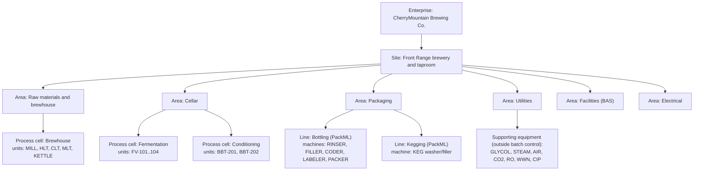
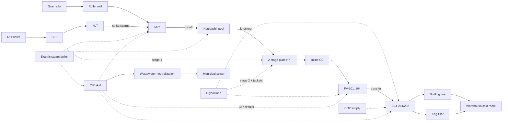
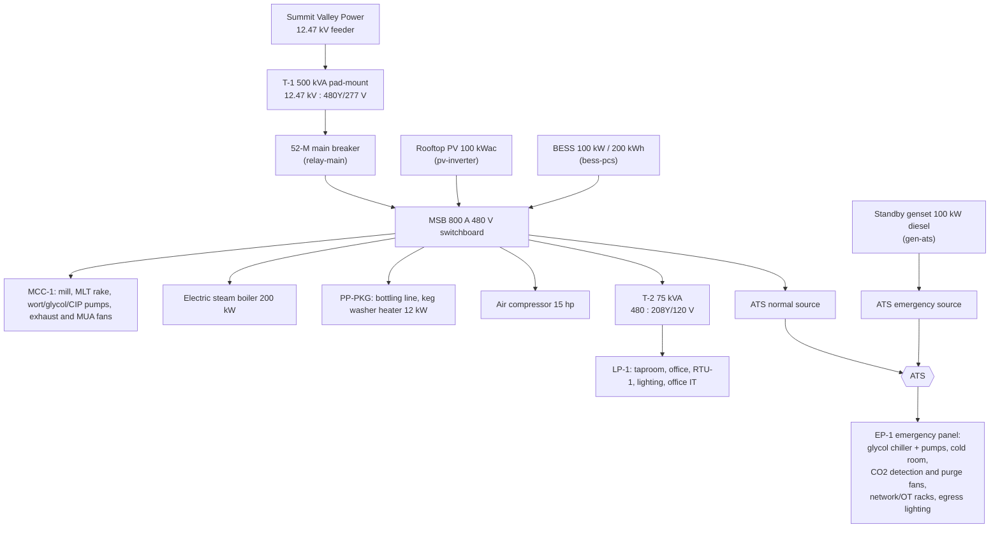
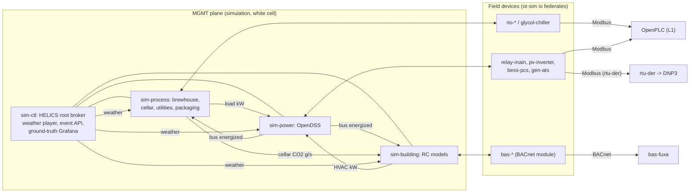
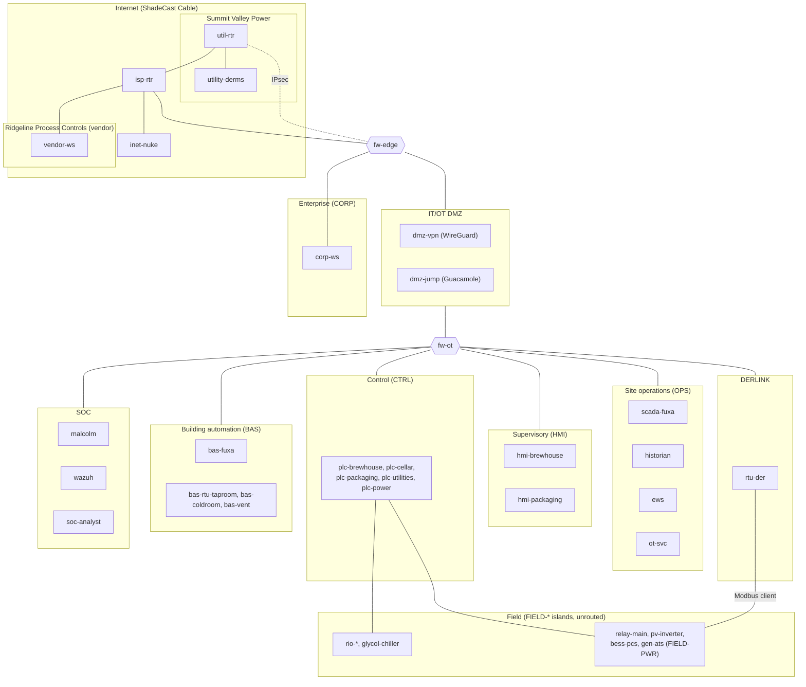
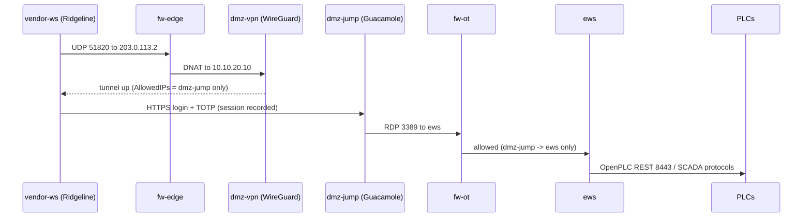

# CherryMountain Brewery: phenix topology design

> **Status:** design. This document specifies the CherryMountain Brewery
> topology for [phēnix](https://github.com/sandialabs/sceptre-phenix). The
> configs, images, programs, and simulation code it describes are built in the
> phases listed in [Implementation roadmap](#18-implementation-roadmap).
>
> **tl;dr:** a 42-VM, all open-source OT cyber range of a Colorado
> microbrewery. It covers brewhouse, cellar, bottling, utilities, plant power,
> and building automation. FUXA is the SCADA/HMI, OpenPLC runs the PLCs, and
> ot-sim provides the field devices. The physics run in a HELICS co-simulation.
> Blue-team monitoring and vendor remote access are included, and the range
> exercises most phenix capabilities.

## Contents

1. [Summary](#1-summary)
2. [Goals and non-goals](#2-goals-and-non-goals)
3. [The plant](#3-the-plant)
4. [Brewery primer and glossary](#4-brewery-primer-and-glossary)
5. [How real breweries are automated](#5-how-real-breweries-are-automated)
6. [Process design](#6-process-design)
7. [Electrical distribution and energy](#7-electrical-distribution-and-energy)
8. [Building automation](#8-building-automation)
9. [Simulation and co-simulation](#9-simulation-and-co-simulation)
10. [Network architecture](#10-network-architecture)
11. [Node inventory and resources](#11-node-inventory-and-resources)
12. [Control system design](#12-control-system-design)
13. [Vendor remote access](#13-vendor-remote-access)
14. [Blue-team monitoring](#14-blue-team-monitoring)
15. [phenix integration](#15-phenix-integration)
16. [New and extended software](#16-new-and-extended-software)
17. [Testing and validation](#17-testing-and-validation)
18. [Implementation roadmap](#18-implementation-roadmap)
19. [Risks and open questions](#19-risks-and-open-questions)
20. [Licensing](#20-licensing)
21. [References](#21-references)

---

## 1. Summary

CherryMountain Brewery is a notional production brewery and taproom on the
Colorado Front Range. Its flagship West Coast IPA is **"Fire of the Phenix"**.
This topology emulates the brewery's OT network end to end:

- **Process:** brewhouse, cellar, and bottling and kegging. Utilities include
  glycol, steam, compressed air, CO₂, water treatment, wastewater
  neutralization, and clean-in-place (CIP).
- **Plant electrical system:** a utility service with an automatic transfer
  switch (ATS) to a standby generator, plus rooftop PV and a battery energy
  storage system (BESS). The utility tariff is derived from open data.
- **Building automation system (BAS):** the taproom/office HVAC, a walk-in
  cold room, and brewhouse and cellar ventilation with CO₂ safety interlocks.
- **Supervisory systems:** FUXA for SCADA, HMI, alarms, and recipes, plus a
  historian and an engineering workstation.
- **Remote access:** a vendor path over WireGuard to a Guacamole jump host.
- **Blue-team monitoring:** Malcolm (Zeek with CISA ICS parsers, Suricata,
  and Arkime) and Wazuh.

All components are open source. A HELICS co-simulation couples the process,
power, and building physics. ot-sim field devices expose that physics over
Modbus, DNP3, and BACnet (BACnet through a new ot-sim module). The
topology uses phenix's workflow layout, core and user apps, state of health
(SoH), packet capture, SCORCH, image builds, and a Builder package.

## 2. Goals and non-goals

**Goals**

- A realistic, internally consistent brewery OT environment. Engineers and
  operators can run it, defenders can baseline it, and researchers can extend
  it.
- Use only open-source software, with permissive or copyleft OSI licenses.
- Run fully unattended: every VM is configured at boot from injected files,
  with no manual GUI setup.
- Use as much of phenix as applies: apps, SoH, packet capture, images,
  SCORCH, Builder, and the workflow directory layout.
- Show how brewery subsystems interact: process ↔ utilities ↔ building ↔
  power ↔ utility grid.
- Fit one host with about 128 GB RAM and 32 or more cores. A lite variant
  and a CI variant scale it down.

**Language requirement**

- **The project language is US English (en-US), and the intended users are
  native English speakers.** This applies to:
  - all documentation and README text
  - HMI and BAS screens and alarm messages
  - tag and point descriptions and FUXA project text
  - PLC program comments, code comments, log messages, and commit messages
- Use US spelling (for example "color", "neutralization", "liter").
- No localization or internationalization is required. FUXA's UI language
  is set to English.
- **Units:** US customary units are primary on HMIs and in documents (°F,
  psig, gal, bbl, lb). SI units appear in model internals and where
  standards require them.
- **Dates and times:** data, logs, and APIs use ISO 8601 timestamps. HMIs
  use en-US display conventions.

**Non-goals (attach points are noted for later)**

- **Adversary emulation.** Kali, Caldera, and caldera-ot are not deployed.
  The `caldera` app and SCORCH `caldera`/`art` components can attach to the
  DMZ, the CORP zone, or the vendor network later.
- **Business IT.** ERP/MES, LIMS, Active Directory, and email are not
  deployed. The CORP zone has a single workstation as the attach point.
- **Real safety instrumented systems.** Safety interlocks are modeled in
  PLC logic and simulated hardwired relays. IEC 61511 SIS design is out of
  scope.
- **High-fidelity building energy analysis.** The building models are
  low-order (see [§8](#8-building-automation)).

The company, the utility (*Summit Valley Power*), the ISP (*ShadeCast
Cable*), and the integrator (*Ridgeline Process Controls*) are fictional.

## 3. The plant

### 3.1 Site and capacity

| Item | Value |
|---|---|
| Location | Colorado Front Range, about 5,200 ft (1,585 m) elevation |
| Ambient pressure | about 12.1 psia (83.4 kPa). Water boils at about 202.3 °F (94.6 °C); 16 °P wort at about 202.8 °F (94.9 °C) |
| Annual production | about 2,500 bbl/yr (US beer barrel = 31 gal = 117.3 L) |
| Brewhouse | 15 bbl, two-vessel, steam-heated: mash/lauter tun (MLT) and kettle/whirlpool |
| Liquor tanks | 30 bbl hot liquor tank (HLT), 30 bbl cold liquor tank (CLT) |
| Cellar | 4 × 30 bbl unitanks (FV-101…104), double-batched (two brews per FV); 2 × 30 bbl bright beer tanks (BBT-201/202) |
| Packaging | 12 oz bottling line at about 1,800 bottles/h (about 5.4 bbl/h); semi-automatic keg washer/filler (½ bbl kegs); manual palletizing |
| Taproom | about 120 seats, with a walk-in cold room for kegs |
| Brew schedule | About 167 brews/yr (3.2/week), run as same-day double batches: two 15 bbl brews back to back fill one 30 bbl FV. That is 1–2 double-brew days a week. A double-brew day runs about 11 h (05:00–16:00). The second mash-in starts when the MLT frees up, about 3.5–4 h after the first, and both boils finish by about 15:30, before the utility on-peak window ([§7.4](#74-utility-tariff-from-open-data)) |

**Capacity check.** An IPA occupies an FV for about 14 days, plus about 1
day of CIP and turnaround. Each FV therefore turns about 24 times a year,
which gives 4 × 30 bbl × 24 ≈ 2,900 bbl/yr of cellar capacity.
2,500 bbl/yr is about 86% utilization, so the schedule has headroom for
seasonal beers and delays.

### 3.2 "Fire of the Phenix" (notional recipe)

The recipe is stored as data in [BeerJSON](https://github.com/beerjson/beerjson)
at `recipes/fire-of-the-phenix.json`. The simulation reads the mash, hop,
and fermentation profiles from it, and so do FUXA's recipe parameters.

| Parameter | Target |
|---|---|
| Style | West Coast IPA |
| OG / FG | 1.066 (16.1 °P) / 1.012 (3.1 °P) |
| ABV / IBU / SRM | about 7.1% / 68 / about 7 |
| Grain bill | 2-row pale 88%, Munich 6%, Crystal 40L 3%, Carapils 3% |
| Mash | single infusion 152 °F (66.7 °C) for 60 min; mash-out 168 °F (75.6 °C) |
| Boil | 60 min at the local wort boiling point (about 202.8 °F) |
| Hops | Columbus at 60 min (bittering); Centennial at 10 min; whirlpool Citra + Simcoe at 180 °F for 20 min; dry hop Citra/Mosaic/Simcoe at 2 lb/bbl on day 5 |
| Yeast | American ale (Chico-type) pitched at 64 °F; ferment at 66 °F; free-rise to 70 °F for the diacetyl rest |
| Finishing | cold crash to 34 °F; carbonate to 2.6 volumes CO₂ in the BBT |

The bittering additions are sized with an altitude-derated utilization
([§9.3](#93-models)). A recipe calculated at sea level would come in under
its IBU target at 5,200 ft.

## 4. Brewery primer and glossary

| Term | Meaning |
|---|---|
| Liquor | Brewing water. Hot liquor is held in the HLT; cold liquor in the CLT. |
| Grist | Milled malt. A roller mill feeds the grist case or hydrator. |
| Mash / MLT | Grist mixed with hot liquor so enzymes convert starch to sugar. The mash/lauter tun (MLT) does both mashing and lautering. |
| Vorlauf | Recirculating the first runnings until they run clear. |
| Lauter / sparge / runoff | Separating sweet wort from the grain bed (lauter), rinsing the bed with hot liquor (sparge), and transferring wort to the kettle (runoff). |
| Wort | Sugary liquid before fermentation. |
| Kettle / boil | Boiling wort to sterilize it, isomerize hop acids, and drive off volatiles. |
| Whirlpool | Swirling hot wort so trub settles in a cone; also used for a hop stand at sub-boiling temperature. |
| Knockout | Transferring hot wort through the heat exchanger (HX) to the fermenter. |
| Heat exchanger (HX) | Plate heat exchanger. Stage 1 uses cold liquor, stage 2 uses glycol. |
| Aeration / oxygenation | Adding O₂ to wort at knockout, about 8–10 ppm, for yeast growth. |
| Pitching | Adding yeast to the wort. |
| FV / unitank | Fermentation vessel. A unitank is a conical, jacketed, pressure-rated tank used for both fermentation and conditioning. |
| Krausen | Foam head during active fermentation. |
| Diacetyl rest | Holding warm at the end of fermentation so yeast reabsorb diacetyl (buttery off-flavor). |
| Dry hop | Adding hops to fermenting or finished beer for aroma. |
| Hop creep | Refermentation caused by hop enzymes after dry hopping. It produces extra attenuation, CO₂, and pressure. |
| Spunding | Capturing fermentation CO₂ by holding tank pressure with a relief (spunding) valve. |
| Cold crash | Chilling to about 32–34 °F to drop yeast and haze. |
| BBT | Bright beer tank: holds finished beer for carbonation and packaging. |
| Volumes (CO₂) | Carbonation level. 1 volume ≈ 1.96 g/L CO₂. |
| DO / TPO | Dissolved oxygen / total package oxygen; quality limits on oxygen pickup. |
| Filler / crowner | Counter-pressure bottle filler and crown capper, usually built as one machine (monoblock). |
| Coder, labeler, checkweigher, case packer | Downstream packaging machines. A fill-level inspector or checkweigher rejects under-filled bottles. |
| Keg washer/filler | Cleans, sanitizes, purges, and fills kegs. |
| CIP | Clean-in-place: automated caustic, acid, and sanitizer (for example peracetic acid, PAA) cycles through tanks and lines. |
| Swing panel / flow plate | A manual U-bend panel that routes CIP or product. Proximity switches prove the bend position. |
| Mix-proof valve | A double-seat valve that keeps product and CIP separate while letting both lines run. |
| Glycol | Propylene glycol solution (about 35%) chilled to about 28 °F and circulated through tank jackets. |
| °P / SG | Degrees Plato / specific gravity, the sugar concentration. |
| IBU / SRM | International Bitterness Units / Standard Reference Method (color). |
| bbl / hL | US beer barrel (31 gal) / hectoliter (100 L); 1 bbl ≈ 1.173 hL. |
| TTB | The US Alcohol and Tobacco Tax and Trade Bureau, which sets federal excise and recordkeeping rules for brewers. |

## 5. How real breweries are automated

This section summarizes research into real brewery automation and maps each
finding to a design choice.

### 5.1 Architecture patterns

- **PLC/SCADA split.** PLCs own real-time control: I/O, PID loops,
  sequences, and interlocks. SCADA/HMI owns recipes, batch execution, alarm
  acknowledgement, and trends.
  → *Design:* OpenPLC owns control; FUXA owns recipes, batch sequencing,
  and alarms.
- **Batch control with ISA-88.** Procedures and recipe parameters live in a
  batch engine. Equipment modules and their interlocks live in the PLC.
  Stone Brewing moved its brewhouse from Siemens BRAUMAT to Rockwell PLCs
  with Ignition HMI, historian, batch, and MES. The project used ISA-88 and
  ISA-101 high-performance HMI guidelines in a hub-and-spoke architecture.
  → *Design:* PLC programs expose ISA-88 *phases* (for example `MASH_IN`,
  `BOIL`, `KNOCKOUT`). FUXA server scripts sequence phases from recipe
  parameters.
- **OEM islands on packaging.** Packaging machines usually arrive with
  their own controllers and protocols. For example, Lakefront Brewery's
  packaging line runs on a GuardLogix safety controller over EtherNet/IP.
  → *Design:* packaging gets its own PLC, a different SCADA protocol
  (S7comm), and a PackML state model.
- **Small-cellar practice.** A typical small cellar uses one PLC with a
  touchscreen, controlling a glycol solenoid per jacket zone on every
  fermenter. One published example runs five 30 bbl FVs on an
  AutomationDirect PLC.
  → *Design:* a dedicated cellar PLC runs per-zone glycol control for every
  FV and BBT.

### 5.2 Standards applied

| Standard | Use in this design |
|---|---|
| ISA-88 (IEC 61512) | Physical model (enterprise → site → area → process cell → unit → equipment module → control module) and procedural model (procedure → unit procedure → operation → phase) |
| ISA-95 (IEC 62264) | Level model and the Unified Namespace topic hierarchy |
| ANSI/ISA-TR88.00.02-2022 (PackML) | Bottling line state machine and PackTags; OEE is computed from PackTags |
| ISA-101 | High-performance HMI: grayscale backgrounds, color reserved for abnormal states, a display hierarchy |
| ISA-18.2 (IEC 62682) | Alarm philosophy, priorities, rationalization, and shelving |
| ISA/IEC 62443-3-2 / 3-3 | Zones and conduits, and per-zone security level targets |
| ISA-5.1 | Instrument tag naming |
| IEEE 1547-2018 | DER interoperability: the DER must support at least one of IEEE 2030.5, IEEE 1815 (DNP3), or SunSpec Modbus. This design uses DNP3 to the utility and Modbus locally |

### 5.3 Best practices encoded

- **CIP route verification.** Before CIP starts, swing-panel proximity
  switches must prove the route. A return-flow switch proves the circuit is
  complete. A hard interlock blocks product transfer into any vessel or line
  that is in CIP. Every cycle records its parameters (time, temperature,
  conductivity, flow) as a verification record.
- **CO₂ life safety.** OSHA's permissible exposure limit (PEL) is 5,000 ppm
  as an 8-hour time-weighted average (TWA). The NIOSH short-term exposure
  limit (STEL) is 30,000 ppm (15 min), and the NIOSH IDLH is 40,000 ppm.
  The cellar alarm tiers are a design choice built on those limits:
  **5,000 / 15,000 / 30,000 ppm**, which start the purge fans, then alarm,
  then evacuate. Breweries report similar tiers; for example, one brewery
  in an MBAA forum discussion uses 5,000/15,000 ppm alerts. MBAA's CO₂
  safety guidance calls for detection, ventilation, and evacuation alarms,
  and here CO₂ detection is interlocked to ventilation.
- **Glycol.** About 35% propylene glycol is supplied at about 28 °F. Each
  tank has separate cone and side jacket zones.
- **Wastewater.** Caustic and acid CIP effluent is neutralized to a
  configured permit band (pH 6.0–9.0) before discharge.
- **Compliance data.** TTB requires daily records of operations,
  including production and removals (27 CFR 25.292), kept for 3 years
  (27 CFR 25.300). It also requires a Brewer's Report of Operations
  (27 CFR 25.297), reported in barrels.
  - CherryMountain's federal excise tax is about 2,500 bbl × $3.50/bbl
    (the reduced rate) ≈ $8,750/yr. That is under the $50,000 threshold,
    so it files quarterly, on TTB F 5130.26 or a quarterly F 5130.9.
  - The historian and packaging counts are therefore compliance-grade
    data, which raises the stakes for data integrity.
- **Altitude-aware control.** Boil detection uses the local wort boiling
  point, not 212 °F. All pressure setpoints are stored as absolute pressure
  and shown as gauge pressure using the site ambient pressure
  ([§9.3](#93-models)).

### 5.4 Energy benchmarks (used to check the loads)

- **End-use shares.** These figures come from different sources, so they
  are indicative and do not sum to 100%.
  - The Idaho Power tip sheet (citing E-Source) gives refrigeration 37%,
    process 25%, lighting 10%, compressed air 9%, HVAC 9%, and other 10%.
  - Older literature (Scheller et al. 2008, as cited) puts refrigeration
    as high as 44% and packaging near 20% of electricity.
- **Electricity intensity.** The Brewers Association (BA) 2014–2018
  benchmarking report puts a 2,500 bbl/yr brewery in its 1,000–10,000
  bbl/yr class.
  - That class has an electricity median of 65 kWh/bbl (IQR 45–91, n=93)
    plus a natural gas median of 3.8 therm/bbl (IQR 2.7–6.2). The 0–1,000
    class median is 182 kWh/bbl.
  - BA breweries mostly heat with gas. An all-electric equivalent is
    therefore roughly 150–176 kWh/bbl. That range is indicative, because
    the medians come from different samples.
- **Water ratio.** The BA 1,000–10,000 class median is 8.7 bbl of water
  per bbl of beer (IQR 6.2–12.1). Best-practice large breweries reach about
  3.5–5.
- *Design target:* about 150 kWh/bbl, all-electric with steam from an
  electric boiler. That is near the low end of the peer-median equivalent.
  - It gives about 370 MWh/yr and an average load of about 42 kW, with
    brew-day peaks near 300 kW before peak shaving
    ([§7.2](#72-loads-notional-checked-against-54)).
  - Excluding the electric boiler, which is gas-fired at most benchmark
    breweries, refrigeration is about 45% of electricity. That is
    consistent with the 37–44% literature.

### 5.5 Threat context

Production stoppages from cyberattacks are well documented in brewing:

- **Molson Coors (March 2021):** production and shipments disrupted.
- **Duvel Moortgat (March 2024):** ransomware halted bottling.
- **Asahi (September–October 2025):** ransomware halted most domestic
  production in Japan.

These motivate the blue-team layer, though no attacks are emulated in this
design.

## 6. Process design

### 6.1 ISA-88 physical model



The ISA-88 batch model covers the brewhouse and cellar. Packaging lines
follow PackML (ISA-TR88.00.02), which calls machines "units/machines".
Utilities, Facilities, and Electrical are site areas outside batch control.
ISA-88 allows hierarchy levels to be omitted where they add nothing.

### 6.2 Process flow



### 6.3 Areas, equipment, and control strategies

**Raw materials and brewhouse**

- PLC: `plc-brewhouse`. Remote I/O: `rio-brewhouse`.
- **Equipment:** grain silo with level; auger; roller mill (VFD); grist
  hydrator; HLT (level, temperature, steam valve); CLT (level, temperature);
  MLT (steam jacket, rake drive and height, false-bottom differential
  pressure, runoff flow); kettle/whirlpool (steam jacket, level,
  temperature, tangential inlet); wort pump (VFD); two-stage plate HX;
  inline O₂ (mass flow controller with DO probe); hop doser for whirlpool
  additions.
- **Control:**
  - HLT temperature PID on steam.
  - Mash step-temperature PID on jacket steam, with ramp/soak segments
    taken from the recipe.
  - Lauter: runoff flow controlled against bed differential pressure;
    sparge flow balanced to runoff; rake lowered when differential pressure
    is high.
  - Kettle: boil vigor held through steam valve position. Boil is detected
    when temperature plateaus within 0.5 °F of the computed local *wort*
    boiling point. That point is the water saturation temperature at the
    measured ambient pressure plus about 0.5 °F of elevation from dissolved
    extract. Hop addition prompts and the whirlpool doser run on boil time.
  - Knockout: the stage-2 glycol valve trims wort to 64 °F, and O₂ flow is
    ratioed to wort flow.
- **ISA-88 phases:** `MILL`, `HLT_HEAT`, `MASH_IN`, `MASH_STEP`, `VORLAUF`,
  `LAUTER`, `BOIL`, `WHIRLPOOL`, `KNOCKOUT`, `CIP_READY`.

**Cellar**

- PLC: `plc-cellar`. Remote I/O: `rio-cellar`.
- **Equipment:** each FV has cone and side glycol zones (solenoid valves
  plus RTDs), a pressure transmitter, an automatic spunding valve, a
  sample-port density meter, and a CIP spray ball. Mechanical pressure
  relief and vacuum relief valves are not PLC-controlled. Each BBT has a
  jacket zone, level, pressure, temperature, a carbonation stone with a CO₂
  flow controller, and a pressure regulator. Shared equipment: a dry-hop
  doser (CO₂-purged hop port) and transfer valves with route verification.
- **Control:**
  - Per-zone temperature control with a ±0.5 °F deadband. Setpoint
    profiles come from the recipe: ferment, free-rise, diacetyl rest, crash.
  - The spunding setpoint ramps to about 12 psig on site near terminal
    gravity. Setpoints are stored as absolute pressure (12 psig on site ≈
    24.1 psia) and displayed as gauge pressure.
  - Vessels are rated 15 psig MAWP, and mechanical relief valves are set
    at 15 psig.
  - The dry-hop sequence purges with CO₂ before dosing.
  - Cold crash ramp rate is limited so the glycol plant isn't overloaded.
  - BBT carbonation targets volumes computed from temperature and absolute
    pressure ([§9.3](#93-models)).
  - Transfers are blocked while the source or destination is in CIP.

**Packaging**

- PLC: `plc-packaging`. Remote I/O: `rio-packaging`.
- **Equipment:** depalletizer (sweep), rinser, monoblock filler/crowner
  (CO₂ pre-evacuation, fill height), date coder, labeler, fill-level
  inspection with reject, case packer, keg washer/filler, and conveyors with
  accumulation and jam photo-eyes.
- **Control:**
  - A PackML state machine for the line and for each machine. States:
    Stopped, Resetting, Idle, Starting, Execute, Completing, Complete,
    Holding, Held, Unholding, Suspending, Suspended, Unsuspending, Stopping,
    Aborting, Aborted, Clearing.
  - PackML modes: Production, Maintenance, and Manual (PackTag
    `UnitModeCurrent`). Time spent in each state, per mode, feeds the OEE
    calculation.
  - Line speed follows accumulation, and the line starves or blocks
    correctly.
  - PackTags: `ProdProcessedCount`, `ProdDefectiveCount`, state, current
    speed, and stop reason.
  - The filler is interlocked to BBT pressure and product supply.

**Utilities**

- PLC: `plc-utilities`. Remote I/O: `rio-utilities`, plus the
  `glycol-chiller` OEM controller.
- **Equipment:**
  - Glycol: a 15-ton (about 53 kW thermal) chiller with two compressor
    stages and its own controller; a glycol reservoir; supply pumps.
  - Steam: a 200 kW electric steam boiler at 15 psig, with a low-water
    cutoff.
  - Compressed air: a 15 hp air compressor (about 12 kW electrical input)
    with a dryer.
  - CO₂: a bulk CO₂ tank with a vaporizer.
  - Water: an RO skid (permeate flow, conductivity) and a carbon filter.
  - Wastewater neutralization: a tank with pH, caustic and acid dosing
    pumps, and a discharge valve.
  - CIP skid: caustic, acid/sanitizer, and hot water tanks; supply and
    return pumps; a steam heater; conductivity and temperature; a return
    flow switch; swing-panel proximity switches. Circuits: brewhouse,
    FV-101…104, BBT-201/202, transfer lines.
- **Control:**
  - Chiller staging on glycol supply temperature (setpoint 28 °F).
  - Glycol pump pressure control.
  - Boiler enable and pressure supervision. The low-water cutoff is a
    simulated hardwired trip.
  - CO₂ low-pressure alarm.
  - Wastewater: pH is dosed toward 7. The discharge valve is permitted
    only while pH is within 6.0–9.0.
  - CIP sequence: pre-rinse → caustic (about 175 °F / 80 °C, 1.5–2%) →
    rinse → acid (periodic, for example weekly) → rinse → sanitize (PAA,
    ambient). The route must be verified first, and the return flow must be
    proven.
  - A peer interlock with `plc-cellar` uses Modbus reads
    ([§6.6](#66-cross-system-interactions)).

**Electrical**

- PLC: `plc-power`. Devices: `relay-main`, `pv-inverter`, `bess-pcs`,
  `gen-ats`, and `rtu-der`.
- See [§7](#7-electrical-distribution-and-energy).

**Facilities**

- Front end: `bas-fuxa`. Devices: `bas-rtu-taproom`, `bas-coldroom`, and
  `bas-vent`.
- See [§8](#8-building-automation).

### 6.4 Tag naming and I/O summary

Tags follow ISA-5.1 inside the ISA-88 hierarchy:
`<AREA>.<UNIT>.<LOOP><FUNC><NN>.<ATTR>`. Examples:

- `CEL.FV101.TT01.PV`: FV-101 side temperature, process value
- `CEL.FV101.TV01.CMD`: side glycol valve command
- `BH.KTL.TT01.PV`, `UTL.GLY.PT01.PV`, `PKG.LINE.PACKML.STATE`

Equipment IDs such as FV-101 (fermenter) are the brewery's own names. In
ISA-5.1, the letters "FV" would mean a flow valve. To avoid ambiguity, an
instrument tag always sits inside the equipment path (`CEL.FV101.TT01`),
and a bare `FV-101` is never used as an instrument tag.

| Area | AI | AO | DI | DO | Owner |
|---|---:|---:|---:|---:|---|
| Brewhouse | 22 | 8 | 18 | 20 | plc-brewhouse / rio-brewhouse |
| Cellar | 34 | 6 | 12 | 22 | plc-cellar / rio-cellar |
| Packaging | 10 | 4 | 32 | 24 | plc-packaging / rio-packaging |
| Utilities | 24 | 6 | 22 | 20 | plc-utilities / rio-utilities, glycol-chiller |
| Electrical | 40 | 6 | 16 | 10 | plc-power / power devices |
| Facilities (BACnet objects) | 30 | 8 | 14 | 12 | bas-fuxa / BAS devices |

These counts are design estimates. The plant tag database (`plant.yaml`,
[§12.6](#126-plant-tag-database)) is authoritative.

### 6.5 Alarm philosophy (ISA-18.2)

- **Priorities.** Critical (reserved for life safety), High, Medium, and
  Low. The target distribution across High/Medium/Low is about 5/15/80%.
- **Rate.** The target alarm rate follows the EEMUA 191 / IEC 62682
  benchmark: no more than about one alarm per 10 minutes per operator
  (about 144 a day) in steady state.
- **Rationalization.** Each alarm has a cause, consequence, operator
  action, and time to respond. These are recorded in `plant.yaml` and
  generated into the FUXA alarm definitions.
- **Examples:**
  - CO₂ ≥ 30,000 ppm: Critical.
  - FV temperature more than 2 °F from setpoint for 15 minutes: High.
  - Glycol supply above 34 °F: High.
  - Wastewater discharge inhibited: Medium.
  - Bottling line held more than 10 minutes: Low.
- **Shelving and suppression.** Shelving is allowed. State-based
  suppression applies; for example, packaging alarms are suppressed while
  the line is Stopped.

### 6.6 Cross-system interactions

These couplings make the range behave like a plant rather than a set of
isolated demos.

| # | From → to | Mechanism | Observable effect |
|---|---|---|---|
| 1 | Brewhouse → cellar | ISA-88 unit-to-unit transfer at knockout. The FUXA batch engine reserves the FV, and plc-cellar confirms the FV is clean, empty, and lined up | Batch waits if no FV is ready; route interlock |
| 2 | Brewhouse → utilities | Steam demand (mash, boil); HLT/CLT draw; glycol load spike at knockout (HX stage 2) | Boiler kW swings; chiller stages up |
| 3 | Cellar → utilities | Glycol demand from jacket valves; CO₂ draw for purge and carbonation; CIP requests | Glycol supply temperature rises during a crash |
| 4 | Utilities ↔ cellar | plc-utilities reads the CIP-permit and transfer status from plc-cellar over peer Modbus (east–west L1 traffic) | CIP blocked during a transfer and vice versa |
| 5 | Cellar → building | Fermentation CO₂ vented by spunding and blow-off into the cellar room (CO₂ mass balance) | bas-vent purge fans start; alarms at 15,000 ppm |
| 6 | BAS → SCADA | scada-fuxa reads cellar CO₂ alarms from bas-vent over BACnet | Process HMI shows the life-safety state; carbonation inhibited at ≥15,000 ppm |
| 7 | BBT → packaging | Product supply and BBT pressure gate the filler | Filler holds on low BBT pressure |
| 8 | Building ↔ process | Ambient and room temperatures change jacket heat gain and chiller COP; brewhouse heat and vapor load the makeup-air unit | Summer afternoons stress the glycol plant |
| 9 | Process + building → power | Every motor, heater, and compressor publishes kW to the power model | Feeder loading, demand peaks |
| 10 | Power → process + building | De-energized buses stop equipment. The ATS feeds the emergency panel EP-1 (glycol, cold room, CO₂/vent, network) from the genset | Outage: brewhouse stops, cellar protected |
| 11 | Utility ↔ power | DERMS reads PV and BESS over DNP3 and sends curtailment and dispatch; the tariff drives peak shaving | Curtailment visible at the inverter |
| 12 | Weather → building, PV, utilities | Weather federate (Denver TMY3) | Diurnal PV, HVAC, and chiller cycles |
| 13 | CIP and brewhouse drains → wastewater | Effluent volume and pH into the neutralization tank | Dosing pumps run; discharge inhibited when pH is out of band |

## 7. Electrical distribution and energy

### 7.1 One-line



### 7.2 Loads (notional, checked against [§5.4](#54-energy-benchmarks-used-to-check-the-loads))

| Load | Rated kW | Assumed duty | Annual MWh |
|---|---:|---|---:|
| Electric steam boiler | 200 | About 83 double-brew days × 11 h at about 55% average, plus CIP steam | 115 |
| Glycol chiller (2 stages) + pumps (EP-1) | 22 | Continuous, staged, about 55% of rated on average | 106 |
| Bottling line + conveyors | 25 | About 450 h/yr of packaging shifts (06:00–14:30) | 9 |
| Keg washer heater | 12 | About 250 h/yr | 3 |
| Air compressor (15 hp) | 12 (input) | Cycling, about 25% | 26 |
| Mill, rake, pumps (MCC-1) | 15 | Brew days, about 40% | 6 |
| Exhaust and makeup-air fans (purge fans on EP-1) | 6 | Brew days and purge events, about 1,200 h | 7 |
| Taproom RTU, DX cooling (gas heat) | 12 | About 1,400 full-load-equivalent hours | 17 |
| Cold room condensing unit, incl. defrost and evaporator fans (EP-1) | 3 | About 50% | 13 |
| Lighting, plugs, office IT (LP-1) | 16 | About 30% | 42 |
| OT and network racks (EP-1) | 2 | Continuous | 18 |
| RO skid, dosing, misc. | 4 | About 2,000 h | 8 |
| **Total** | **329 nameplate** | | **about 370** (≈150 kWh/bbl) |

- **Peaks.** A brew day with no packaging peaks near 300 kW (boiler,
  chiller, MCC, fans, air, HVAC, base loads). Brew days are scheduled away
  from packaging shifts where possible, but a coincident day peaks near
  330 kW. These are the peaks the BESS shaves.
- **Emergency panel.** EP-1 runs about 30 kW (chiller at full stage, cold
  room, purge fans, OT racks, egress lighting). The 100 kW genset leaves
  margin for compressor starting.
- **Service.** T-1 (500 kVA) has a full-load current of about 601 A at
  480 V. The main breaker and MSB are 800 A, which is within the 125%
  allowance for transformer secondary protection. PV and BESS backfeed
  through the MSB.

### 7.3 Power control (`plc-power`)

- **Outage ride-through:**
  1. The utility is lost. The MSB de-energizes. PV and BESS stop
     energizing within 2 s, per IEEE 1547 unintentional-islanding rules.
     Neither is connected to EP-1, and v1 has no grid-forming BESS.
  2. The ATS senses the loss, starts the genset, and transfers EP-1 within
     about 10 s.
  3. `plc-power` opens and holds open the large MSB feeders (boiler,
     packaging, RTU), so restoration can be staged. It sheds EP-1 sub-loads
     if genset load exceeds 80%.
  4. When the utility returns, the ATS retransfers after its stable-source
     timer. PV and BESS reconnect after the IEEE 1547 return-to-service
     delay. `plc-power` recloses the MSB feeders in stages to limit inrush.
- **BESS dispatch (100 kW / 200 kWh, a 2-hour battery):**
  1. *Priority 1: monthly demand cap.* Demand is billed on the monthly
     peak at all hours, so the BESS holds 15-minute demand under a
     configurable target (default 250 kW). It keeps at least 50% state of
     charge (100 kWh) before 05:00 on brew days, recharging overnight from
     the grid at off-peak rates.
  2. *Priority 2: on-peak energy shift.* Any remaining energy discharges
     during the 17:00–21:00 weekday window, typically about 50 kW across the
     window when state of charge allows.
  3. PV charges the battery at midday when there is surplus.
- **PV and utility limits.** The inverter applies
  `min(site_limit, utility_limit)`. The PLC writes the site limit, and the
  utility writes its limit through `rtu-der`.
- **Genset exercise:** weekly, scheduled.

### 7.4 Utility tariff from open data

The fictional utility's commercial tariff, *SV-SGT*, is built from **open
data**: [OpenEI Utility Rate Database
(URDB)](https://apps.openei.org/USURDB/) records, released CC0, for
Colorado's largest investor-owned utility (Public Service Co. of Colorado,
EIA ID 15466), effective 2026-01-01.

| Component | Source record | Value used |
|---|---|---|
| Distribution demand | Schedule SG, time-differentiated demand ([URDB 69bda768f0300279d30f154c](https://apps.openei.org/USURDB/rate/view/69bda768f0300279d30f154c)) | $9.66/kW-month on the monthly maximum demand |
| Generation/transmission demand (seasonal) | same record, TOU demand periods | **Summer (Jun–Sep): $27.14/kW**; **other months: $19.79/kW**. All hours (the record defines no hourly demand window) |
| Energy TOU window | Schedule SG-TOU ([URDB 69bdaa2ade50eca8ee0baa6a](https://apps.openei.org/USURDB/rate/view/69bdaa2ade50eca8ee0baa6a)) | **On-peak: weekdays 17:00–21:00, all year**; weekends off-peak |
| Energy rates | same record | On-peak $0.38375/kWh (Jun–Sep), $0.23371/kWh (Oct–May); off-peak $0.09927/kWh |

| Fixed charge | both records | $91.79/month |

Notes and disclosures:

- **Values.** All values are copied as recorded in URDB, without riders or
  adjustments.
- **Blend.** SV-SGT is a deliberate notional blend of two real schedules:
  - Schedule SG-TOU applies only to customers with demand under 50 kW
    (URDB `peakkwcapacitymax` = 50). A brewery peaking near 300 kW could
    not take it. Only its TOU energy window and energy rates are used.
  - Not used: SG's own energy charge ($0.04771/kWh) and SG-TOU's flat
    demand charge ($1.71/kW).
  - The SG-TOU energy rates are priced for a small-customer schedule,
    while SV-SGT also carries SG's demand charges.
- **Effective cost.** At the brewery's low load factor (14–17%), SV-SGT
  works out to roughly $0.38–0.43/kWh, or about $140–160k/yr for 370 MWh
  at a 250–300 kW monthly peak. Demand charges are about 70% of that. This
  is intentional: it makes peak shaving and load shifting economically
  visible in exercises. Each 50 kW of shaved peak saves about $19k/yr.
- **Window.** The 17:00–21:00 weekday window matches the Colorado PUC's
  Xcel time-of-use decision (Proceeding 24AL-0377E, effective November 1,
  2025).
- **Demand interval.** The URDB records leave the demand interval blank, so
  SV-SGT assumes the common 15-minute interval.

**Operational consequences built into the scenario:**

- Double-brew days start at 05:00, and both boils finish by about 15:30.
- Cold crashes are scheduled off-peak.
- Demand is billed at all hours on the monthly peak, so brew-day boiler
  peaks are the primary shaving target (BESS priority 1). The 17:00–21:00
  energy shift is secondary.
- Grafana tracks monthly demand cost and kWh/bbl.

### 7.5 Utility DER link

IEEE 1547-2018 requires DER to support a standard communications interface.
CherryMountain's interconnection agreement uses **DNP3**:

- **Path:** the utility DERMS (`utility-derms`) polls `rtu-der` over an
  IPsec site-to-site tunnel between `util-rtr` and `fw-edge`. The tunnel
  carries the utility's DER network 192.0.2.0/24 to DERLINK 10.20.15.0/24.
- **Gateway:** `rtu-der` is an ot-sim front-end processor (FEP). Its
  upstream side is a DNP3 outstation. Its downstream side is a Modbus
  client to `pv-inverter`, `bess-pcs`, and `relay-main`.
- **Trade-off:** routing a utility conduit through the IT/OT DMZ
  firewall pair is a deliberate teaching point. The common real-world
  alternative is a utility-owned cellular modem at the DER gateway.

## 8. Building automation

### 8.1 Spaces, equipment, and BACnet devices

| Device (ot-sim + BACnet module) | Space and equipment | Example BACnet objects |
|---|---|---|
| `bas-rtu-taproom` (device 3001) | Taproom/office rooftop unit (RTU-1): 10-ton DX, gas heat, economizer, CO₂ demand-controlled ventilation | AI zone temperature, AI zone CO₂, AI supply air temperature, AV occupied setpoints, AO economizer, BO supply fan, BO cooling stages 1/2, BO heat, MSV occupancy mode |
| `bas-coldroom` (device 3002) | Walk-in cold room (kegs, 36 °F): 1.5 hp condensing unit, defrost, door switch | AI room temperature, AV setpoint, BO compressor, BO defrost, BI door, AV door-open minutes |
| `bas-vent` (device 3003) | Brewhouse and cellar ventilation: kettle hood exhaust fan (VFD), makeup-air unit (gas), 2 cellar purge fans, 4 cellar CO₂ sensors | AI CO₂ ×4, AI MUA discharge temperature, AO exhaust speed, BO purge fans, BO MUA enable, BV CO₂ alarm tiers, BI purge-fan status |

**Local logic.** Each controller runs its own interlocks in ot-sim logic,
the way real BAS controllers do. For example, CO₂ ≥ 5,000 ppm starts the
purge fans locally. The `bas-fuxa` front end supervises, schedules, and
alarms. `scada-fuxa` reads the CO₂ objects for the process HMI.

### 8.2 What building modeling looks like (plain terms)

A building model treats each space as a **heat bucket**:

- **Thermal mass:** the air, walls, floor, and contents store heat.
- **Leak paths:** heat leaks through walls, roof, windows, and infiltration.
- **Gains:** sun, people, lights, and equipment add heat.
- **HVAC:** adds or removes heat and moves air.
- **Controls:** decide what the HVAC does.
- **Weather:** drives the outside conditions.

The outputs are room temperature, humidity and CO₂, and equipment power.
Fidelity is a ladder:

1. **RC networks (low lift).** An electrical analogy: R is insulation, C is
   heat storage. A 1R1C model has one mass. 2R2C and 3R2C separate the fast
   air node from the slow wall/floor mass. That is about 3–10 parameters and
   about 100 lines of Python. ISO 13790's 5R1C model with solar gains is
   implemented in `RC_BuildingSimulator` (MIT-style).
2. **BOPTEST.** Modelica-based emulators in Docker with a REST API
   (`/advance`, `/inputs`, `/measurements`). The `bestest_air` case, a
   single-zone office, uses Denver TMY weather.
3. **EnergyPlus.** Detailed whole-building simulation with a Python
   callback API (`pyenergyplus`). Related tools: OpenStudio for geometry and
   Alfalfa for live point read/write.
4. **Modelica Buildings / Spawn of EnergyPlus.** Equation-based,
   highest-fidelity HVAC and controls, run as FMUs. This needs a Modelica
   toolchain.

### 8.3 Recommendation

| Space | Model | Effort |
|---|---|---|
| Taproom/office | 3R2C zone + RTU model (DX stages, gas heat, economizer, fan) + occupancy-driven CO₂ balance | Days |
| Walk-in cold room | 1R1C + condensing-unit thermostat + defrost timer + door-open infiltration events | About 1 day |
| Brewhouse and cellar | Well-mixed volumes: heat and vapor from the kettle; cellar CO₂ balance driven by fermentation | 2–3 days |

**Model equations.** T_a is the air temperature, T_m the mass temperature,
and T_o the outdoor temperature. The taproom 3R2C zone:

- C_a·dT_a/dt = (T_m − T_a)/R_am + (T_o − T_a)/R_ao + Q_hvac + Q_int + f·Q_sol
- C_m·dT_m/dt = (T_a − T_m)/R_am + (T_o − T_m)/R_mo + (1 − f)·Q_sol

Cold room: C·dT/dt = (T_o − T)/R + Q_door − Q_ref·u

Cellar CO₂ (ppm): V·dC/dt = G_CO₂(t)·10⁶ + Q_vent·(C_out − C)

- G_CO₂ is in m³/s, converted from the fermentation federate's mass flow
  (`cellar/co2.vent_gps`, [§9.3](#93-models)): G_CO₂ = ṁ_CO₂ / ρ_CO₂.
- ρ_CO₂ is the site density, about 1.51 kg/m³ at 83.4 kPa and 68 °F. The
  sea-level value, about 1.83 kg/m³, would be 22% off.
- The room is treated as well mixed. CO₂ is heavier than air, so the
  sensors are mounted low (12–18 in above the floor), and a stratification
  factor scales the concentration the low sensors read.

**Weather.** The weather federate reads the EnergyPlus-distributed
`USA_CO_Golden-NREL.724666_TMY3.epw` and
`USA_CO_Denver-Aurora-Buckley.AFB.724695_TMY3.epw` files with pvlib.

- The EPW station elevations differ from the site: Golden is at 1,829 m
  (mean 82.1 kPa) and Buckley at 1,726 m (82.7 kPa).
- The federate therefore corrects the hourly station pressure to the
  site's 1,585 m with the barometric formula before publishing it.
- BOPTEST `bestest_air` remains an optional upgrade for the office.

## 9. Simulation and co-simulation

### 9.1 Architecture

All physics run as **HELICS** federates on the out-of-band MGMT plane
([§10.2](#102-vlan-and-ip-plan)). The phenix `ot-sim` app writes each field
device's ot-sim config. Each device's ot-sim `io` module is a HELICS
federate: it subscribes to the process values it exposes over its protocol,
and it sends writes (operator and PLC commands) to the owning federate's
`updates` endpoint.



### 9.2 Federates

| Federate | Host | Step | Publishes (examples) | Subscribes (examples) |
|---|---|---|---|---|
| `weather` | sim-ctl | 60 s | `weather/ambient.temp_f`, `weather/ghi.wm2`, `weather/pressure.kpa` | — |
| `brewhouse` | sim-process | 1 s | `brewhouse/<device>.<point>`, `brewhouse/load.boiler.kw` | `brewhouse/updates` (endpoint), `power/bus.msb.energized`, `weather/pressure.kpa` |
| `cellar` | sim-process | 1 s (kinetics compressed; exported fluxes real-time-equivalent, [§9.4](#94-time-and-initial-state)) | `cellar/fv101.temp_f`, `cellar/co2.vent_gps`, `cellar/clock.sim_hours` | `cellar/updates`, `weather/ambient.temp_f`, `weather/pressure.kpa` |
| `utilities` | sim-process | 1 s | `utilities/glycol.supply_f`, `utilities/load.chiller.kw` | `utilities/updates`, `weather/ambient.temp_f` |
| `packaging` | sim-process | 1 s | `packaging/line.state`, `packaging/load.line.kw` | `packaging/updates` |
| `power` | sim-power | 1 s | `power/<device>.<point>`, `power/bus.ep1.energized` | each `<fed>/load.<feeder>.kw` (enumerated by plantgen), `power/updates`, `weather/ghi.wm2` |
| `building` | sim-building | 10 s | `building/<device>.<point>`, `building/load.rtu.kw` | `building/updates`, `cellar/co2.vent_gps`, `weather/ambient.temp_f`, `weather/ghi.wm2` |
| ot-sim `io` | each field device | Real-time HELICS federate (no tunable step; ot-sim `start-time`/`end-time`/`real-time` settings) | protocol writes → `<fed>/updates` | `<fed>/<device>.<point>` |

- **Naming.** Device keys follow the phenix `ot-sim` app's convention:
  `<federate>/<device>.<point>`, with writes to the `<federate>/updates`
  endpoint.
- **Explicit subscriptions.** HELICS has no wildcard subscriptions, so
  plantgen enumerates every key.
- **Loop latency.** The process → power → "bus energized" loop carries a
  one-step (1 s) latency by design, because every federate has a non-zero
  period.
- **Broker.** HELICS uses the zmq core on its default broker port.
- **Real-time pacing.** Federates run in HELICS real-time mode, with lag and
  lead tolerances set per federate.
- **End time.** The phenix ot-sim app's default HELICS `end-time` of 36000 s
  must be raised for multi-day experiments.

### 9.3 Models

No mature open-source brewery process simulator exists. The models below are
written as one Python package (`sim/cherrymountain_sim`), about 1,500 lines.
It builds on SciPy, the CalebBell `ht`/`fluids` libraries, CoolProp, SimPy,
PackMLpy, OpenDSSDirect.py, and pvlib, and on the federate helper class that
ships with ot-sim (`otsim.helics_helper.HelicsFederate`).

**Mash** (`brewhouse`)

- Strike water temperature: T_w = (0.2/r)·(T_target − T_grain) + T_target,
  with r in qt/lb (the exact derived constant is 0.197). The metric form
  uses 0.41 with r in L/kg. The constant is a ratio of temperature
  differences, so the same formula works in °F or °C.
- Step heating is an energy balance on water plus grain (grain c_p ≈ 0.4 of
  water) with jacket steam duty.
- Conversion uses a two-enzyme lumped kinetic model, following Müller
  (2000) and Brandam et al. (2003):
  - β-amylase peaks around 60–65 °C (140–149 °F) and denatures quickly.
  - α-amylase peaks around 68–72 °C (154–162 °F).
  - Each has Arrhenius activity and first-order thermal deactivation.
  - The model outputs fermentability and the extract-yield curve.
- The empirical multi-parameter starch-hydrolysis model of Saarni, Miller
  and Block (2020), *Beverages* 6(4):60, is used to check the trends with
  temperature and liquor-to-grist ratio.

**Boil and whirlpool** (`brewhouse`)

- Evaporation: ṁ_evap = (Q_steam − Q_loss)/h_fg, targeting 4–8% per hour.
- Local boiling point: the water saturation temperature at the measured
  ambient pressure (IAPWS-IF97, or Clausius–Clapeyron) plus the
  boiling-point elevation from dissolved extract (about 0.3 K at 16 °P).
  At 83.4 kPa that is 94.6 °C water and about 94.9 °C wort.
- Bitterness:
  - Tinseth: U = 1.65·0.000125^(G−1) · (1 − e^(−0.04·t))/4.15, and
    IBU = U·(mg/L α-acids added). G is the average kettle gravity during
    the boil (about 1.063 for this recipe), not the OG.
  - Altitude derating multiplies Tinseth's 0.04 min⁻¹ time constant by the
    Arrhenius rate ratio between the local boiling point and 100 °C.
  - That ratio is about 0.69 using Hosom's mIBU temperature function, and
    0.63–0.65 using Malowicki and Shellhammer's activation energy. So
    isomerization is about 31–37% slower.
  - The resulting IBU loss is about 11–13% for 60-minute additions and
    26–31% for 10-minute additions.
  - The whirlpool hop stand uses Hosom's mIBU relative utilization,
    U_rel(T) = 2.39×10¹¹·e^(−9773/T) (T in K), integrated over the
    cooling curve.

**Knockout heat exchanger** (`brewhouse`)

- Counterflow ε-NTU, solved for each stage with `ht`:
  ε = (1 − e^(−NTU(1−Cr))) / (1 − Cr·e^(−NTU(1−Cr))) for Cr < 1. For
  balanced flow (Cr = 1), ε = NTU/(1 + NTU).
- Stage 1 uses CLT water, whose temperature follows the seasonal Denver
  groundwater curve. Stage 2 uses glycol, and that load is published to
  `utilities`.

**Fermentation** (`cellar`)

- The de Andrés-Toro et al. (1998) model, with equations and parameters as
  reproduced in Rodman and Gerogiorgis (2016), *Food Bioprod. Process.*
  (open manuscript). Its parameters cover 8–24 °C, and Rodman reports
  validation over more than 200 fermentation campaigns, citing de
  Andrés-Toro et al. (2004).
- **State variables:** lag, active, and dead biomass (X_lag, X_act, X_dead);
  sugar S; ethanol E; ethyl acetate; diacetyl.
- **Temperature dependence:** every rate constant has the form
  p = exp(A + B/T), with T in kelvin.
- **Derived outputs:**
  - CO₂ evolution ≈ 0.955·dE/dt (mass basis, from stoichiometry:
    44.01/46.07).
  - Heat release Q ≈ 586.6 kJ/kg × extract consumed. The literature range
    is 500–590 kJ/kg.
  - Gravity in °P from S and E.
- **Parameter decisions:**
  - *μ_e0's B constant is −1267.24.* Rodman Table 1 prints −12667.24, which
    is a typo: with p = exp(A + B/T) and A = 3.27 it gives μ_e0 ≈ 2×10⁻¹⁸
    h⁻¹ at 15 °C. −1267.24 gives about 0.32 h⁻¹, consistent with the other
    rates. A unit test asserts μ_e0(15 °C) ≈ 0.3 h⁻¹.
  - The model was fitted to lager fermentations, so its ale behavior at
    18–20 °C is approximate. Tune it so attenuation from 16.1 °P to about
    3 °P completes in about 5–6 days at 66–70 °F.
- **Hop creep:** a first-order sugar source after dry hopping,
  dS/dt += k_hc(T)·dose·D_remaining, tuned to give 0.2–0.5 °P of extra
  attenuation over 3–5 days, with a matching rise in CO₂, pressure, and
  diacetyl. No published rate constants exist, so the value is tuned.
- **Jackets:** each zone follows m·c_p·dT/dt = Q_ferm − U·A·(T − T_gly)·u_valve,
  with a dimple-jacket U of about 150–400 W/m²K.

**Carbonation** (`cellar`)

- Equilibrium volumes come from the ASBC/Zahm-Nagel relationship, as a
  common empirical fit in psig and °F:
  P = −16.6999 − 0.0101059·T + 0.00116512·T² + 0.173354·T·V + 4.24267·V
  − 0.0684226·V².
- This fit is in sea-level gauge pressure. CherryMountain adds the ambient
  pressure difference (14.7 − 12.1 = 2.6 psi):
  - 2.6 vol at 34 °F ≈ 10.2 psig at sea level ≈ **12.8 psig gauge on site**.
  - The provenance of the fit is unconfirmed, so cross-check it with
    Henry's law (k_H(298 K) ≈ 0.034 mol·kg⁻¹·bar⁻¹, with van 't Hoff
    temperature dependence).

**Glycol plant** (`utilities`)

- Reservoir energy balance: m·c_p·dT/dt = ΣQ_jackets + Q_HX2 − Q_chiller.
- Chiller capacity and COP depend on ambient temperature. Glycol properties
  come from CoolProp `INCOMP::MPG[0.35]`.
- Staging is done by the OEM controller (`glycol-chiller`).

**Steam, air, CO₂, RO, wastewater, CIP** (`utilities`)

- Lumped first-order models with tank volumes, mass balances, and
  pH/conductivity mixing.
- CIP is a sequence model with temperature, conductivity, and flow, driven
  by PLC commands.

**Bottling** (`packaging`)

- A SimPy model stepped at 1 s inside the federate.
- Each machine has a PackMLpy state machine, a nominal rate, MTBF/MTTR jam
  distributions, and accumulation buffers. The filler takes BBT pressure as
  an input.
- Produces bottle and case counts, rejects, and state times for OEE.

**Power** (`power`)

- OpenDSS via OpenDSSDirect.py, based on ot-sim's OpenDSS federate example
  (`testing/e2e/helics/opendss-federate.py` in patsec/ot-sim).
- 480 V three-phase circuit with a Vsource at 12.47 kV behind T-1.
- Loads are `Load` elements with kW from the process federates.
- PV is a `PVSystem` with irradiance from `weather`. The BESS is a
  `Storage` element with state of charge.
- Breakers and the ATS are switchable `Line`/`SwtControl` elements.
- **Genset:** a second `Vsource` on the EP-1 island bus, enabled only while
  the genset runs. OpenDSS needs a source element in every island, so this
  is a modeling convention.
- pandapower is a documented fallback if islanding proves awkward.

**Building** (`building`)

- The [§8.3](#83-recommendation) RC and CO₂ models, using pvlib to read EPW
  weather and compute solar gains.

### 9.4 Time and initial state

- **Time scale.** The brewhouse, packaging, building, and power run in
  real time. A double-brew day takes about 11 h of wall time, with an
  optional speed-up for demos. Fermentation kinetics run with a
  configurable compression factor (default 48×, so 1 simulated day takes
  30 minutes). A full primary fermentation shows in about 2.5–3 hours, and
  fermentation through crash in about 3.5–4 hours.
- **Time-base rules (compression must not distort coupled physics):**
  - *Kinetic state is compressed.* Sugar, ethanol, biomass, and diacetyl
    advance 48× faster.
  - *Exported fluxes are real-time-equivalent.* The cellar federate
    publishes CO₂ release (g/s), fermentation heat, and the resulting
    jacket, glycol, and electrical loads at the real-world rate for the
    tank's current fermentation state, not the compressed rate.
  - Without this rule, a compressed CO₂ release would be about 48× too
    high: about 20 g/s per FV and more than 20,000 ppm in the cellar, from
    fermentation alone. Fermentation heat would be about 30 kW per FV
    against a 53 kW chiller.
  - *Tank thermal and fluid dynamics run in real time.* PLC temperature
    control, valve behavior, and alarm delays (for example the 15-minute
    deviation alarm) stay in wall time.
  - *Recipe-time logic runs in sim time.* Profile steps (free-rise,
    diacetyl rest, dry-hop day, crash start) are keyed to fermentation
    progress (gravity) or to `cellar/clock.sim_hours`. The FUXA batch
    engine and `plc-cellar` profile timers read that clock.
- **Staggered initial state.** The plant starts mid-production, so every
  phase is visible within minutes of `experiment start`:

| Vessel | Initial state |
|---|---|
| FV-101 | Clean and empty, reserved for today's knockout (brew day starts 05:00 sim-time) |
| FV-102 | Fermentation day 2 (about 10 °P, active CO₂) |
| FV-103 | Day 5, dry hop in progress (hop creep) |
| FV-104 | Cold crash ramping to 34 °F |
| BBT-201 | Carbonating to 2.6 vol |
| BBT-202 | Feeding the bottling line (packaging shift running) |

- **Clock.** The default simulation clock starts on a summer weekday at
  04:30 local time, ahead of the 05:00 brew start.
  - Summer demand rates apply immediately.
  - The 17:00–21:00 on-peak energy window arrives after about 12.5 h of
    wall time, unless the demo speed-up is used.
  - A scenario parameter, `clock.start`, sets another start time. For
    example, 15:30 gives a BESS peak-shaving demo with on-peak arriving in
    90 minutes.

### 9.5 Scenario events and ground truth

- **Event API.** `sim-ctl` exposes a small HTTP API on the MGMT plane.
  The SCORCH `plantevent` component calls it to inject operational events:
  - start a batch
  - open the utility breaker (outage)
  - fail a chiller compressor
  - release CO₂ in the cellar
  - jam the labeler
  - step the outside temperature
- **Ground truth.** The ot-sim `ground-truth-module` and each federate write
  true state to an in-experiment OpenSearch node on `sim-ctl` (index
  `cherrymountain-truth-*`) over MGMT. Grafana on `sim-ctl` shows the
  white-cell view. The host reaches both, and the event API, through
  `phenix/startup-autotunnel` port forwards ([§15.3](#153-topology-modules-and-variants)).
- **Separation.** Ground truth is deliberately separate from the blue team's
  Malcolm view, so exercises can compare "what happened" with "what was
  observed".
- **Synthetic data.** No public fermentation time-series dataset exists.
  Synthetic curves are exported in the Fermentrack/iSpindel CSV schema
  (`log_time, beer_temp, gravity`), so standard tools can read them.

## 10. Network architecture

### 10.1 Zones and conduits (Purdue model / ISA/IEC 62443)



**Zones** (ISA/IEC 62443-3-2; the security level targets, SL-T, are
notional design targets):

| Zone | Purdue level | SL-T | Notes |
|---|---|---|---|
| INET, VENDOR, UTIL | 5 (external) | — | Untrusted |
| CORP | 4 | 1 | Single office workstation (attach point for business IT) |
| DMZ | 3.5 | 2 | WireGuard gateway and Guacamole jump host |
| OPS | 3 | 2 | Historian, EWS, services, and the FUXA server. FUXA performs L2 supervisory functions but is hosted with the L3 site-operations services; its operator clients sit in HMI |
| HMI | 2 | 2 | Thin-client kiosks |
| BAS | 2 (facilities) | 1 | Separate facilities system |
| CTRL | 1 | 2 | PLCs |
| FIELD-* | 0 | 2 | Unrouted I/O islands |
| DERLINK | 1 (utility-facing gateway) | 2 | rtu-der upstream side |
| SOC | 3 (security) | 2 | Malcolm, Wazuh, analyst |
| MGMT | n/a (simulation plane) | n/a | Out of bounds for exercises |

**Design rules**

- **Field networks are unrouted L2 islands.**
  - Each PLC is dual-homed (CTRL plus its FIELD VLAN) and is the only L1
    path to its I/O.
  - The exception is FIELD-PWR, where `rtu-der` is a second Modbus client
    of the power devices. `rtu-der` has two plant NICs, DERLINK and
    FIELD-PWR.
- **Routing is static everywhere** (topology `network.routes`). The design
  uses no dynamic routing protocol, which is common practice for a small OT
  site and avoids route injection across zone boundaries. phenix supports
  OSPF, but it is deliberately not used.
- **Conduits are initiated upward only.** For example, logs and telemetry
  flow to the SOC and the historian. Replies are allowed statefully; there
  is no data diode.
- **Every conduit crosses at least one firewall.** There are two documented
  deviations:
  - The utility DNP3 conduit ([§7.5](#75-utility-der-link)) reaches an L1
    gateway from L5 through fw-edge and fw-ot with no protocol break. It is
    decrypted from IPsec on fw-edge, so it crosses the DMZ in plaintext.
  - The MGMT plane (below).
- **MGMT is a simulation back-plane, not a containment boundary.** Field
  devices with HELICS-backed I/O and the simulation nodes have a MGMT NIC
  for HELICS, ground truth, and simulation time. That bypasses the zone
  model by necessity.
- **MGMT controls:**
  - A host nftables policy on every MGMT member allows only:
    - ICMP echo to sim-ctl, which the helics app's broker-wait script
      needs.
    - HELICS zmq traffic to the broker: ports 23405–23406, plus a pinned
      per-federate port range.
    - OpenSearch (9200) and NTP to sim-ctl.
  - No node has a default route via MGMT.
  - The ot-sim CPU API binds to `127.0.0.1:9101` (`cpu-module.api-endpoint`).
    The default is `0.0.0.0` and unauthenticated.
  - No host tap with `externalAccess` is attached to MGMT.
- **Visibility is not containment.** Excluding MGMT from the mirror and
  hiding it in the SoH graph are visibility choices only. A compromised
  device controls its own nftables, so exercise rules treat MGMT as out of
  bounds.

### 10.2 VLAN and IP plan

VLAN aliases are pinned in `phenix.yml` (`vlanRange` 100–199).

**Interface naming:**
- Plant NICs are `IF0`, `IF1`, … in the order the Zone column of
  [§11](#11-node-inventory-and-resources) lists them. For example,
  plc-cellar has IF0 on CTRL and IF1 on FIELD-CEL; rio-cellar has IF0 on
  FIELD-CEL.
- The MGMT NIC is always named `mgmt`, and malcolm's mirror NIC is named
  `mirror`.
- SoH, mirror, helics, and ot-sim metadata all reference these names.

| VLAN (alias) | ID | Subnet | Gateway | Members |
|---|---:|---|---|---|
| INET | 101 | 203.0.113.0/24 | isp-rtr .1 | fw-edge .2 (public; WireGuard DNAT and IPsec endpoint), util-rtr .3, inet-nuke .10 |
| VENDOR | 102 | 198.51.100.0/24 | isp-rtr .1 | vendor-ws .10 |
| UTIL | 103 | 192.0.2.0/24 | util-rtr .1 | utility-derms .10 |
| CORP | 104 | 10.10.10.0/24 | fw-edge .1 | corp-ws .10 |
| DMZ | 105 | 10.10.20.0/24 | fw-edge .1 (static routes to OT prefixes via fw-ot .2) | fw-ot .2, dmz-vpn .10, dmz-jump .11 |
| WG tunnel (not a VLAN) | — | 10.99.0.0/24 | dmz-vpn .1 | vendor-ws .2. Not routed beyond dmz-vpn; dmz-jump routes 10.99.0.0/24 via 10.10.20.10 |
| OPS | 106 | 10.20.30.0/24 | fw-ot .1 | scada-fuxa .10, historian .11, ews .12, ot-svc .13 |
| HMI | 107 | 10.20.20.0/24 | fw-ot .1 | hmi-brewhouse .10, hmi-packaging .11 |
| CTRL | 108 | 10.20.10.0/24 | fw-ot .1 | plc-brewhouse .11, plc-cellar .12, plc-packaging .13, plc-utilities .14, plc-power .15 |
| FIELD-BH | 109 | 10.20.11.0/24 | none | plc-brewhouse .1, rio-brewhouse .10 |
| FIELD-CEL | 110 | 10.20.12.0/24 | none | plc-cellar .1, rio-cellar .10 |
| FIELD-PKG | 111 | 10.20.13.0/24 | none | plc-packaging .1, rio-packaging .10 |
| FIELD-UTL | 112 | 10.20.14.0/24 | none | plc-utilities .1, rio-utilities .10, glycol-chiller .11 |
| DERLINK | 113 | 10.20.15.0/24 | fw-ot .1 | rtu-der .10 |
| FIELD-PWR | 114 | 10.20.16.0/24 | none | plc-power .1, rtu-der .2, relay-main .20, pv-inverter .21, bess-pcs .22, gen-ats .23 |
| BAS | 115 | 10.30.10.0/24 | fw-ot .1 | bas-fuxa .10, bas-rtu-taproom .20, bas-coldroom .21, bas-vent .22 |
| SOC | 116 | 10.40.10.0/24 | fw-ot .1 | malcolm .10, wazuh .11, soc-analyst .12 |
| MGMT | 117 | 172.16.0.0/16 | none (no default route) | sim-ctl .10.1, sim-process .10.2, sim-power .10.3, sim-building .10.4; rio-brewhouse .20.11, rio-cellar .20.12, rio-packaging .20.13, rio-utilities .20.14, glycol-chiller .20.15; relay-main .20.21, pv-inverter .20.22, bess-pcs .20.23, gen-ats .20.24; bas-rtu-taproom .20.31, bas-coldroom .20.32, bas-vent .20.33; 172.16.30.0/24 reserved for the SoH capture scenario |
| MIRROR | 118 | 172.30.0.0/16 (mirror app `mirrorNet`) | — | malcolm `mirror` NIC (address assigned by the mirror app) |

`rtu-der` (an ot-sim FEP) and `utility-derms` (an fd-client DNP3 master)
expose no HELICS-backed points, so they have no MGMT NIC.

**Routing (all static).** The `startup` app does not configure routers, so
static routes are set in topology `network.routes`:

| Node | Routes |
|---|---|
| isp-rtr | Connected INET and VENDOR only. It is "the internet"; there are no routes to private nets |
| util-rtr | Default via isp-rtr 203.0.113.1. Policy IPsec to fw-edge (203.0.113.2): 192.0.2.0/24 ↔ 10.20.15.0/24 |
| fw-edge | Default via isp-rtr 203.0.113.1. 10.20.0.0/16, 10.30.10.0/24, and 10.40.10.0/24 via fw-ot 10.10.20.2. Policy IPsec to util-rtr (203.0.113.3): 10.20.15.0/24 ↔ 192.0.2.0/24. SNAT (masquerade) only for source 10.10.10.0/24 out INET, which also keeps IPsec traffic out of NAT. DNAT 203.0.113.2 udp/51820 → 10.10.20.10 |
| fw-ot | Default via fw-edge 10.10.20.1. OT zones connected |
| dmz-vpn, dmz-jump | Default via fw-edge .1. 10.20.0.0/16, 10.30.10.0/24, and 10.40.10.0/24 via fw-ot .2, so DMZ → OT traffic crosses fw-ot directly instead of hairpinning through fw-edge. dmz-jump also routes 10.99.0.0/24 via dmz-vpn |
| PLCs | Default via fw-ot on CTRL (IF0). FIELD NICs have no gateway |
| rtu-der | Default via fw-ot on DERLINK (IF0). FIELD-PWR has no gateway |

### 10.3 Conduit matrix (default deny, stateful, logged)

| Source → destination | Service | Firewall | Purpose |
|---|---|---|---|
| CORP → INET | TCP 80/443/25, UDP 123/53 (SNAT) | fw-edge | Office web and email (protonuke noise); public NTP/DNS stand-in on inet-nuke |
| fw-edge → inet-nuke | UDP 123 | — | Edge firewall time from the public NTP stand-in |
| INET → dmz-vpn | UDP 51820 (DNAT 203.0.113.2 → 10.10.20.10) | fw-edge | Vendor WireGuard |
| vendor-ws (tunnel 10.99.0.2) → dmz-jump | TCP 443 | — (intra-DMZ via dmz-vpn; WireGuard AllowedIPs restrict the peer to dmz-jump) | Guacamole login |
| DMZ hosts → ot-svc | UDP 123, UDP/TCP 53 | fw-ot | Time (Guacamole TOTP needs it) and DNS |
| util-rtr (203.0.113.3) ↔ fw-edge (203.0.113.2) | IKE UDP 500/4500, ESP | fw-edge | Utility IPsec |
| utility-derms (192.0.2.10) → rtu-der (10.20.15.10) | TCP 20000 (DNP3) | fw-edge, fw-ot | DER telemetry and control |
| dmz-jump → ews | TCP 3389 (RDP), 22 | fw-ot | Vendor sessions via Guacamole |
| HMI → scada-fuxa, bas-fuxa | TCP 1881 | fw-ot | Operator HMI |
| HMI → historian | TCP 3000 | fw-ot | Read-only Grafana |
| scada-fuxa → plc-brewhouse | TCP 4840 (OPC UA) | fw-ot | SCADA polling |
| scada-fuxa → plc-packaging | TCP 102 (S7comm) | fw-ot | SCADA polling |
| scada-fuxa → plc-cellar, plc-utilities, plc-power | TCP 502 (Modbus) | fw-ot | SCADA polling |
| scada-fuxa → BAS devices | UDP 47808 (BACnet/IP) | fw-ot | CO₂ life-safety status ([§6.6](#66-cross-system-interactions) #6) |
| ews → CTRL PLCs | TCP 8443 (OpenPLC REST), 502, 4840, 102 | fw-ot | Programming and diagnostics |
| ews → bas-fuxa, BAS devices | TCP 1881, UDP 47808 | fw-ot | BAS engineering |
| bas-fuxa → historian | TCP 8086 | fw-ot | BAS DAQ |
| All routed OT zones (incl. fw-ot itself) → ot-svc | UDP 123, UDP/TCP 53, UDP 514 | fw-ot | NTP, DNS, syslog |
| ot-svc → wazuh | UDP 514 | fw-ot | Syslog relay into the SIEM |
| fw-edge, fw-ot → wazuh | UDP 514 | fw-ot | Firewall logs, including drops. Malcolm cannot see blocked flows ([§14](#14-blue-team-monitoring)) |
| DMZ hosts → wazuh | TCP 1514/1515 | fw-ot | Wazuh agents (initiated upward; replies stateful) |
| OPS/HMI/BAS Linux hosts → wazuh | TCP 1514/1515 | fw-ot | Wazuh agents |
| soc-analyst → malcolm, wazuh | intra-zone | — | Analyst consoles |

Intra-zone traffic is not filtered by the firewalls. That covers scada-fuxa ↔
historian (InfluxDB 8086, MQTT 1883) in OPS and the peer Modbus between
plc-utilities and plc-cellar in CTRL. Malcolm sees this traffic through the
mirror.

### 10.4 Protocol map

| Link | Protocol (port) | Implementation |
|---|---|---|
| FUXA → plc-brewhouse | OPC UA (4840) | FUXA OPC UA client ↔ OpenPLC v4 `opcua` plugin |
| FUXA → plc-packaging | S7comm (102) | FUXA S7 client (snap7) ↔ OpenPLC v4 `s7comm` plugin |
| FUXA → plc-cellar, utilities, power | Modbus TCP (502) | FUXA Modbus client ↔ OpenPLC v4 `modbus_slave` |
| PLCs → RIO and power devices | Modbus TCP (502) | OpenPLC v4 `modbus_master` ↔ ot-sim Modbus server |
| plc-utilities → plc-cellar | Modbus TCP (502) | Peer interlock reads (east–west) |
| bas-fuxa, scada-fuxa → BAS devices | BACnet/IP (UDP 47808) | FUXA BACnet client ↔ new ot-sim BACnet module |
| utility-derms → rtu-der | DNP3 (TCP 20000) over IPsec | ot-sim DNP3 master ↔ ot-sim FEP outstation |
| rtu-der → power devices | Modbus TCP (502) | ot-sim FEP Modbus client |
| relay-main | Telnet (23) | ot-sim `telnet` module (an ot-sim admin shell with its default banner). Reachable only from the FIELD-PWR segment (plc-power, rtu-der), so it is a lateral-movement artifact, not a sanctioned path. The `cherrymountain` app injects the telnet config, because the phenix ot-sim app doesn't generate it |
| FUXA → historian | InfluxDB HTTP (8086); MQTT (1883) PackTags/OEE | FUXA DAQ; FUXA server script publishing to Mosquitto; Telegraf → InfluxDB |
| HMIs → FUXA | HTTP/WebSocket (1881) | Chromium kiosk |
| vendor-ws → dmz-vpn → dmz-jump → ews | WireGuard (UDP 51820) → HTTPS (443) → RDP (3389)/SSH (22) | phenix `wireguard` app; Guacamole; xrdp |
| Field and sim nodes | HELICS (MGMT only) | ot-sim `io` module, Python federates |
| All | NTP, DNS, syslog, Wazuh | chrony, dnsmasq, rsyslog, Wazuh agent |

**WAN emulation.** The vrouter `emulators` (netem) apply to egress only:

- **isp-rtr:** about 30 ms of delay and 0.1% loss on its VENDOR and INET
  egress (the vendor path), plus a bandwidth limit on INET.
- **util-rtr:** about 20 ms of delay on its INET and UTIL egress (the
  utility WAN). The IPsec and DNP3 path between fw-edge and util-rtr stays
  on the INET segment and never crosses isp-rtr.

## 11. Node inventory and resources

| Hostname | Zone | Role | Image | vCPU / GB |
|---|---|---|---|---|
| isp-rtr | INET + VENDOR | ShadeCast Cable edge router (VyOS) | vyos | 1 / 2 |
| inet-nuke | INET | Internet web/SMTP server (protonuke), plus public NTP and DNS stand-in (chronyd, dnsmasq) | cm-svc + protonuke | 1 / 1 |
| vendor-ws | VENDOR | Ridgeline Process Controls technician laptop (WireGuard client, browser) | cm-desktop | 2 / 3 |
| util-rtr | INET + UTIL | Summit Valley Power router, IPsec peer (VyOS) | vyos | 1 / 2 |
| utility-derms | UTIL | Utility DERMS, DNP3 master | cm-otsim | 1 / 1 |
| corp-ws | CORP | Office workstation (protonuke client) | cm-desktop | 2 / 3 |
| fw-edge | edge | IT/Internet firewall, NAT, IPsec (VyOS) | vyos | 1 / 2 |
| dmz-vpn | DMZ | WireGuard gateway | cm-wireguard | 1 / 1 |
| dmz-jump | DMZ | Guacamole jump host (TOTP, session recording) | cm-guacamole | 2 / 3 |
| fw-ot | OT edge | OT firewall, all zone conduits (VyOS) | vyos | 1 / 2 |
| scada-fuxa | OPS | Process SCADA: FUXA, batch engine, alarms | cm-fuxa | 2 / 4 |
| historian | OPS | InfluxDB 2, Telegraf, Grafana, Mosquitto | cm-historian | 2 / 6 |
| ews | OPS | Engineering workstation: OpenPLC Editor, Wireshark, BAC0, mbpoll, xrdp | cm-ews | 2 / 3 |
| ot-svc | OPS | NTP (chrony), DNS (dnsmasq), syslog relay | cm-svc | 1 / 1 |
| hmi-brewhouse | HMI | Brewhouse and cellar operator kiosk | cm-desktop | 2 / 3 |
| hmi-packaging | HMI | Packaging and utilities operator kiosk | cm-desktop | 2 / 3 |
| plc-brewhouse | CTRL + FIELD-BH | OpenPLC v4 (OPC UA plugin) | cm-openplc | 1 / 2 |
| plc-cellar | CTRL + FIELD-CEL | OpenPLC v4 | cm-openplc | 1 / 1 |
| plc-packaging | CTRL + FIELD-PKG | OpenPLC v4 (PackML) | cm-openplc | 1 / 1 |
| plc-utilities | CTRL + FIELD-UTL | OpenPLC v4 | cm-openplc | 1 / 1 |
| plc-power | CTRL + FIELD-PWR | OpenPLC v4 | cm-openplc | 1 / 1 |
| rio-brewhouse | FIELD-BH + MGMT | Brewhouse remote I/O (ot-sim) | cm-otsim | 1 / 1 |
| rio-cellar | FIELD-CEL + MGMT | Cellar remote I/O (ot-sim) | cm-otsim | 1 / 1 |
| rio-packaging | FIELD-PKG + MGMT | Packaging remote I/O (ot-sim) | cm-otsim | 1 / 1 |
| rio-utilities | FIELD-UTL + MGMT | Utilities remote I/O (ot-sim) | cm-otsim | 1 / 1 |
| glycol-chiller | FIELD-UTL + MGMT | Chiller OEM controller (ot-sim) | cm-otsim | 1 / 1 |
| relay-main | FIELD-PWR + MGMT | Main breaker protective relay and meter (ot-sim, Modbus + Telnet) | cm-otsim | 1 / 1 |
| pv-inverter | FIELD-PWR + MGMT | PV inverter (ot-sim) | cm-otsim | 1 / 1 |
| bess-pcs | FIELD-PWR + MGMT | BESS power conversion system (ot-sim) | cm-otsim | 1 / 1 |
| gen-ats | FIELD-PWR + MGMT | Genset controller and ATS (ot-sim) | cm-otsim | 1 / 1 |
| rtu-der | DERLINK + FIELD-PWR | DER gateway (ot-sim FEP) | cm-otsim | 1 / 1 |
| bas-fuxa | BAS | BAS front end (FUXA instance 2) | cm-fuxa | 2 / 3 |
| bas-rtu-taproom | BAS + MGMT | RTU-1 controller (ot-sim + BACnet) | cm-otsim | 1 / 1 |
| bas-coldroom | BAS + MGMT | Cold room controller (ot-sim + BACnet) | cm-otsim | 1 / 1 |
| bas-vent | BAS + MGMT | Ventilation and CO₂ controller (ot-sim + BACnet) | cm-otsim | 1 / 1 |
| sim-ctl | MGMT | HELICS root broker, weather, event API, ground-truth OpenSearch and Grafana, chronyd for MGMT | cm-sim | 2 / 6 |
| sim-process | MGMT | Process federates | cm-sim | 2 / 3 |
| sim-power | MGMT | OpenDSS federate | cm-sim | 2 / 3 |
| sim-building | MGMT | Building federate | cm-sim | 2 / 3 |
| malcolm | SOC + MIRROR | Malcolm: Zeek + ICSNPP, Suricata, Arkime, OpenSearch | cm-malcolm | 8 / 24 |
| wazuh | SOC | Wazuh manager, indexer, and dashboard | cm-wazuh | 4 / 8 |
| soc-analyst | SOC | Analyst workstation | cm-desktop | 2 / 3 |

**Totals:** 42 VMs, **66 vCPUs** (overcommitted on 32 cores; most nodes are
idle) and **112 GB RAM**.

**Variants** ([§15.3](#153-topology-modules-and-variants)):

- **`lite`** (no SOC, no vendor remote access): 36 VMs, 47 vCPUs, 70 GB.
- **`ci`** (the cellar slice: sim-ctl, sim-process, rio-cellar,
  plc-cellar, scada-fuxa): 5 VMs, 7 vCPUs, about 8 GB.
  - It uses CI memory overrides: sim-ctl 1/2 with no ground-truth
    OpenSearch, sim-process 2/2, scada-fuxa 2/2.
  - scada-fuxa and plc-cellar share one flat CTRL VLAN, with no firewall.
  - FUXA DAQ goes to its built-in SQLite, since there is no historian.
  - It needs `/dev/kvm` on the runner, with 1.75× vCPU overcommit on a
    4-vCPU runner.

## 12. Control system design

### 12.1 OpenPLC (v4 runtime, v3 fallback)

**Programs** are IEC 61131-3 Structured Text, built in the OpenPLC Editor:

- **plc-brewhouse:** ISA-88 phase state machines (Idle → Running → Holding
  → Held → Restarting → Complete/Aborted), commanded through phase
  registers by the FUXA batch engine. Includes PID loops and
  altitude-aware boil detection.
- **plc-cellar:** per-zone glycol deadband control, setpoint profiles,
  spunding, dry-hop and transfer sequences, CIP and transfer interlocks,
  and carbonation control.
- **plc-packaging:** the PackML state machine, ported from Beckhoff's MIT
  `PackML_PLC_Example`, plus PackTags and machine interlocks.
- **plc-utilities:** glycol, steam, air, CO₂, RO, wastewater, and CIP
  sequences with route verification.
- **plc-power:** load shed, BESS dispatch, PV site limit, and ATS
  supervision.

**v4 plugins per PLC.** Each PLC runs `modbus_master` to poll its RIO, plus
one northbound plugin:

| PLC | Northbound plugin |
|---|---|
| plc-brewhouse | `opcua` |
| plc-packaging | `s7comm` |
| plc-cellar, plc-utilities, plc-power | `modbus_slave` |

**Provisioning (v4):**

1. Commit the Editor projects. Commit the built program ZIPs through Git LFS.
2. The `cherrymountain` app generates each PLC's plugin `conf/*.json`. The
   `opcua` template's default endpoint, `opc.tcp://localhost:4840/...`, is
   rebound to the PLC's CTRL address.
3. A boot script repacks the ZIP with that node's plugin configs.
4. The script creates the admin user (`POST /api/create-user`), logs in,
   uploads the ZIP (`POST /api/upload-file`), polls
   `/api/compilation-status`, and calls `/api/start-plc`.
5. The runtime auto-starts the program on later boots.

**v3 fallback**, if a Phase 0 spike shows v4 can't be provisioned
unattended:

- Use the GRFICSv3 pattern: bake `compile_program.sh <prog>.st` into the
  image, and inject `openplc.db` (with a `Programs` row and
  `Start_run_mode=true`), `active_program`, `st_files/`, and `mbconfig.cfg`.
- v3 is archived. The fallback also changes the FUXA links for brewhouse
  and packaging to Modbus or EtherNet/IP, because v3 has no OPC UA, and it
  gains DNP3.

### 12.2 FUXA (two instances)

**Version and build**

- Pin one FUXA release.
- From v1.3.2, FUXA's drivers are optional npm plugins. Bake
  `modbus-serial`, `node-opcua`, `node-snap7`, and `node-bacnet` into the
  image so the range runs offline.

**Provisioning**

- The `cherrymountain` app generates the project JSON from `plant.yaml`
  (devices, tags, alarms, DAQ settings) and merges it with a hand-built view
  skeleton exported from the FUXA editor.
- Tag IDs are deterministic (derived from tag names), so the views stay
  bound across regenerations.
- `mysettings.json` is injected with `secureEnabled: true`, a `secretCode`
  (so tokens survive restarts), `daqstore` (InfluxDB 2), and
  `nodeRedEnabled: false`. FUXA has no admin-password setting.
- A boot script waits for port 1881 and then:
  1. Signs in as the seeded `admin`/`123456` (`POST /api/signin`).
  2. Sets the range admin password through the users API.
  3. POSTs the project to `/api/project` with that admin token.

**scada-fuxa (process)**

- **Views** (ISA-101 style, grayscale): Overview with KPIs, Brewhouse,
  Cellar (FV/BBT grid), Packaging (line and OEE), Utilities, Electrical
  one-line, Alarms, Trends, and Batch (recipe "Fire of the Phenix", batch
  ID, phase status).
- **Alarms** are generated from the rationalized definitions in `plant.yaml`.
- **Server scripts:**
  - An ISA-88 batch engine that sequences PLC phases from recipe parameters
    and coordinates unit-to-unit transfers.
  - A daily production report (PDF) with barrels packaged:
    bottles × 12 oz ÷ 3,968 oz/bbl, plus kegs. It supports the TTB records.
  - A PackTags/OEE publisher that sends MQTT to the historian's Mosquitto
    on ISA-95 topics such as
    `cherrymountain/frontrange/packaging/bottling-line/packtags/...`.
- **DAQ** goes to the InfluxDB 2 bucket `scada`.

**bas-fuxa (BAS)**

- BACnet/IP client to the three BAS devices.
- Views: building overview, RTU-1, cold room, ventilation/CO₂.
- Schedules (occupancy) and alarms.
- DAQ goes to the InfluxDB 2 bucket `bas`.

**HMIs** are Chromium kiosks, for example
`http://10.20.30.10:1881/home/Brewhouse`.

### 12.3 ot-sim field devices

- **Repo and image.** Devices run `patsec/ot-sim`, pinned and rebuilt on
  Ubuntu noble. The image adds a systemd unit for `ot-sim-cpu-module` and
  the new BACnet module.
- **DNP3 build risk.** ot-sim's README lists Ubuntu 20.04 as the last
  known-good DNP3 build, and `pydnp3` fails on Debian Bookworm. Phase 0
  therefore tests building the C++ DNP3 module on noble. The fallback is a
  focal-based image for the two DNP3 nodes (rtu-der, utility-derms), using
  the repo's `renewables/wind/turbine/phenix-images/ot-sim.yml` as a
  template, which includes the systemd unit.
- **CPU API.** `cpu-module.api-endpoint` is set to `127.0.0.1:9101` on
  every device. The default is `0.0.0.0`, unauthenticated.
- **Configs.** The phenix `ot-sim` app generates
  `/etc/ot-sim/config.xml`:
  - All devices are `fd-server` hosts, except `rtu-der` (`fep`) and
    `utility-derms` (`fd-client`, the DNP3 master).
  - Device types come from a custom `infrastructures: brewery:` map
    generated from `plant.yaml`.
  - Every device is HELICS-backed, which the app requires for fd-servers.
- **Local logic.** OEM-style logic runs in each device's ot-sim `logic`
  module:
  - glycol-chiller compressor staging
  - BAS local interlocks
  - the pv-inverter `min(site_limit, utility_limit)` rule
  - relay-main overcurrent trip
- **Telnet.** `relay-main` also runs the ot-sim `telnet` module. Its config
  is injected by the `cherrymountain` app, and it is reachable only from
  FIELD-PWR ([§10.4](#104-protocol-map)).

### 12.4 Historian and engineering workstation

**historian**

- InfluxDB 2 OSS, with buckets `scada` and `bas`, and `oee` from Telegraf.
- Telegraf runs `mqtt_consumer` for PackTags, plus host metrics.
- Grafana is provisioned with dashboards for fermentation curves, OEE,
  energy (kWh/bbl against the BA benchmark), monthly demand cost, and
  glycol plant health.
- Mosquitto is the MQTT broker.

**ews**

- Ubuntu desktop with the OpenPLC Editor, a browser (FUXA editor, OpenPLC
  REST), Wireshark, mbpoll, BAC0, pymodbus, and opcua-client tools.
- xrdp, for vendor and Guacamole sessions.

### 12.5 Addressing conventions (high off-by-one risk)

| Component | Convention |
|---|---|
| ot-sim (phenix app) | Literal register numbers: coils from 1, discrete inputs from 10001, input registers from 30001, holding registers from 40001 |
| OpenPLC v4 `modbus_master` | Its own JSON config of start addresses and sizes per device |
| OpenPLC `modbus_slave` (v3 map for reference) | %IX/%QX bits from 0; %IW = input registers 0–1023; %QW = holding registers 0–1023; %MW = holding registers 1024–2047 (setpoints). Confirm the v4 map in the spike |
| FUXA Modbus | `memaddress` area (0, 100000, 300000, 400000) plus a **1-based** `address` (FUXA subtracts 1) |

`plantgen` ([§16](#16-new-and-extended-software)) assigns every address
from `plant.yaml` and renders all three formats from one source.

Registers are kept **contiguous**. OpenPLC and FUXA both read blocks, and
ot-sim rejects reads of unconfigured addresses. A CI check fails on gaps or
mismatches.

### 12.6 Plant tag database

`plant/plant.yaml` is the single source of truth (sketch):

```yaml
site: {name: CherryMountain Brewery, elevation_ft: 5200, ambient_psia: 12.1}
areas:
  - id: CEL
    units:
      - id: FV101
        federate: cellar
        rio: rio-cellar
        plc: plc-cellar
        tags:
          - id: TT01
            desc: FV-101 side temperature
            type: analog-read
            units: degF
            range: [20, 90]
            scada: {protocol: modbus, area: holding}
            alarms:
              - {kind: deviation, limit: 2.0, delay: 15m, priority: high,
                 cause: glycol valve stuck or chiller fault,
                 action: check TV01 and glycol supply}
          - {id: TV01, desc: FV-101 side glycol valve, type: binary-read-write}
```

## 13. Vendor remote access



**Controls**

- **WireGuard keys and config.**
  - `plantgen` (or the `cherrymountain` app at configure) generates the key
    pairs and tunnel addresses (10.99.0.0/24: dmz-vpn .1, vendor-ws .2).
    They go into the scenario metadata as range-only throwaway secrets.
  - The phenix `wireguard` app only renders `/etc/wireguard/wg0.conf` from
    that metadata. With `boot: true` it enables `wg-quick@wg0`.
  - The vendor peer's AllowedIPs on dmz-vpn admit only traffic to
    `dmz-jump`.
- **Tunnel routing.** dmz-vpn forwards decapsulated traffic onto the DMZ
  with the tunnel source address. dmz-jump routes 10.99.0.0/24 back via
  dmz-vpn, so Guacamole and Wazuh see the vendor's real tunnel address. No
  NAT is used.
- **Session controls.** Guacamole uses the TOTP extension, so DMZ hosts need
  time from ot-svc. Session recording goes to disk, and the recordings are
  blue-team evidence.
- **Choke point.** The only conduit from the DMZ into L3 for vendor sessions
  is `dmz-jump → ews`. Logging conduits to the SOC are separate, so the EWS
  is the single choke point into L1.

This is the classic OT attack path (vendor credential → jump host → EWS →
PLC). It is documented as a design teaching point and as the primary attach
point for future adversary-emulation scenarios.

## 14. Blue-team monitoring

**Malcolm** (CISA, Apache-2.0)

- Zeek with the CISA **ICSNPP** parsers for BACnet, S7comm, DNP3 and Modbus
  extensions, EtherNet/IP, OPC UA binary, and more.
- Suricata and Arkime full packet capture, with OpenSearch Dashboards.
- **Capture:** the `mirror` app mirrors OPS, HMI, CTRL, all FIELD VLANs,
  DERLINK, BAS, and DMZ over GRE to malcolm's `mirror` NIC
  (`setupOVS: true`, so the image includes openvswitch). Malcolm captures on
  the in-guest OVS port.

```yaml
- name: mirror
  metadata: {version: v1, mirrorNet: 172.30.0.0/16, mirrorVLAN: MIRROR, mirrorBridge: cherrymtn}
  hosts:
    - hostname: malcolm
      metadata:
        interface: mirror
        setupOVS: true
        vlans: [OPS, HMI, CTRL, FIELD-BH, FIELD-CEL, FIELD-PKG, FIELD-UTL, FIELD-PWR, DERLINK, BAS, DMZ]
```

- **What Malcolm sees:**
  - With more than one VLAN listed, the mirror app leaves out router and
    firewall taps (unless `forceMirrorRouted`), and OVS mirrors frames
    delivered to the selected VM taps.
  - A routed flow is therefore captured once per direction, at the
    receiving host, with no duplicates.
- **What Malcolm cannot see:** flows the firewalls drop, traffic the
  firewalls originate, and the SOC VLAN itself. Blocked conduit attempts are
  visible only through VyOS firewall logs in Wazuh.

**Wazuh** (GPL-2.0)

- Agents run on Linux hosts in OPS, HMI, BAS (bas-fuxa), the DMZ (dmz-vpn
  via `cm-wireguard`, dmz-jump), and the SOC.
- Syslog comes from the VyOS firewalls and from the ot-svc relay.
- PLCs and ot-sim devices have no agents, which is realistic.

**Baseline detection use cases** (normal operations should generate known,
explainable events):

- OpenPLC program upload or start/stop, seen in REST traffic from the EWS.
- Modbus or S7 writes from a host other than scada-fuxa or the EWS.
- BACnet `WriteProperty` from outside bas-fuxa or the EWS.
- DNP3 control operations from utility-derms (expected) versus anything
  else.
- A vendor WireGuard or Guacamole session outside an approved window.
- ATS transfer and load-shed events.
- New hosts on field VLANs.

**Excluded** as non-OSI-licensed: Security Onion 2.4 (Elastic License 2.0)
and EMQX 5.9+ (BSL).

## 15. phenix integration

### 15.1 Directory layout (`phenix workflow apply`)

The topology uses the `phenix workflow apply` directory layout.

**Running it.** In the standard Docker deployment, run
`docker exec phenix phenix workflow apply /phenix/topologies/cherrymountain-brewery`.
- Run it as the user that runs `phenix ui`.
- Run it from outside the directory, because phenix reads
  `config.*`/`users.*` from the current directory.

**Variants.** The workflow branch defaults to the directory name, and each
branch maps to one experiment. Each variant therefore applies with its own
branch:
- `-b cherrymountain-lite -c phenix-lite.yml`
- `-b cherrymountain-ci -c phenix-ci.yml`

Every file in `phenix-configs/` is stored on each apply. So configs have
fixed, variant-specific names (for example `cherrymountain-core`,
`cherrymountain-full`, `cherrymountain-lite`). Inject paths use
`/phenix/injects/${BRANCH_NAME}/...`, which expands to the branch of that
apply.

```text
cherrymountain-brewery/
├── README.md
├── DESIGN.md
├── phenix.yml                      # Workflow: full variant (topology/scenario cherrymountain-full)
├── phenix-lite.yml                 # Workflow: lite (apply with -b cherrymountain-lite -c phenix-lite.yml)
├── phenix-ci.yml                   # Workflow: CI slice (apply with -b cherrymountain-ci -c phenix-ci.yml)
├── phenix-configs/
│   ├── topology-full.yml           # cherrymountain-full: includeTopologies core + soc + remote-access
│   ├── topology-core.yml           # cherrymountain-core
│   ├── topology-soc.yml            # cherrymountain-soc
│   ├── topology-remote-access.yml  # cherrymountain-remote-access
│   ├── topology-lite.yml           # cherrymountain-lite: includeTopologies core
│   ├── topology-ci.yml             # cherrymountain-ci (flat CTRL VLAN)
│   ├── scenario-full.yml
│   ├── scenario-lite.yml
│   ├── scenario-ci.yml
│   └── scenario-soh-capture.yml    # adds SoH packetCapture (Packetbeat)
├── phenix-injects/                 # -> /phenix/injects/cherrymountain-brewery
│   ├── fuxa/  openplc/  otsim/  sim/  historian/  guacamole/  wazuh/  malcolm/  desktop/
├── phenix-images/                  # Image configs (cm-*.yml); built with phenix image build
├── apps/                           # phenix-app-cherrymountain + plantevent SCORCH component
├── sim/                            # cherrymountain_sim federates package
├── plc/                            # OpenPLC Editor projects + program ZIPs (LFS)
├── fuxa/                           # FUXA view skeletons
├── plant/plant.yaml                # tag database (single source of truth)
├── recipes/fire-of-the-phenix.json # BeerJSON
├── tools/plantgen/                 # offline generator
└── builder/cherrymountain.package.yaml
```

`phenix.yml` sketch:

```yaml
apiVersion: phenix.sandia.gov/v0
kind: Workflow
metadata: {}
spec:
  auto: {create: ${BRANCH_NAME}, update: true, restart: true}
  topology: cherrymountain-full
  scenario: cherrymountain-full
  vlans: {INET: 101, VENDOR: 102, UTIL: 103, CORP: 104, DMZ: 105, OPS: 106,
          HMI: 107, CTRL: 108, FIELD-BH: 109, FIELD-CEL: 110, FIELD-PKG: 111,
          FIELD-UTL: 112, DERLINK: 113, FIELD-PWR: 114, BAS: 115, SOC: 116,
          MGMT: 117, MIRROR: 118}
  vlanRange: {min: 100, max: 199}
  defaultBridge: cherrymtn   # non-default bridge enables the Netflow tab
```

Configs reference injects as `/phenix/injects/${BRANCH_NAME}/<path>`.

Scenarios carry `metadata.annotations.topology`, which workflow requires.
`fromScenario` checks that a referenced scenario's annotation *contains*
the current topology name. So the full scenario's annotation lists every
topology that borrows from it:
`topology: cherrymountain-full,cherrymountain-lite,cherrymountain-ci`.

### 15.2 Apps

| App | Type | Use in this topology |
|---|---|---|
| `startup` | core | Hostnames, interfaces, routes, DNS (ot-svc) |
| `ntp` | core | **App mode, no `ntp-server` label.** The label switches the app to a legacy mode that ignores per-host settings. `defaultSource` is ot-svc (IF0), and every host is listed, generated by plantgen. Servers (`server: chronyd`): ot-svc (OT zones and DMZ), sim-ctl (MGMT-only field devices), inet-nuke (internet side, CORP, fw-edge). Linux clients use `client: chrony` with the matching `source`; VyOS uses `client: ntp`, the only client type vrouters accept |
| `serial` | core | Stretch goal: RS-485 Modbus RTU between rio-utilities and glycol-chiller over a `type: serial` interface. Validate ot-sim serial over minimega serial in the Phase 0 spike |
| `vrouter` | core | VyOS on fw-edge, fw-ot, isp-rtr, util-rtr: ACL rulesets implementing [§10.3](#103-conduit-matrix-default-deny-stateful-logged) (stateful); SNAT and DNAT on fw-edge; IPsec fw-edge ↔ util-rtr; netem emulators on WAN legs. Static routes come from topology `network.routes`, which the vrouter templates render. OSPF is supported by phenix but deliberately not used |
| `tap` | core optional | Not used in the default scenarios. phenix taps live in a network namespace (with a veth /30 and masquerade for `externalAccess`), so they don't give the host a route to VMs. Host access to white-cell services uses `phenix/startup-autotunnel` instead ([§15.3](#153-topology-modules-and-variants)). A dev-only scenario may add a tap with `externalAccess` on MGMT for package mirrors |
| `soh` | core optional | [§15.4](#154-state-of-health) |
| `scorch` | core optional | [§15.6](#156-scorch-pipelines) |
| `ot-sim` | user | All field devices, the FEP, and the DNP3 master. Custom `infrastructures` map. HELICS wiring |
| `helics` | user | Root broker on sim-ctl (`broker.root: sim-ctl\|mgmt`). It counts federates only from `helics/federate` annotations, so scenario order is `ot-sim`, then `cherrymountain` (which annotates the sim-* federate nodes), then `helics`. Its broker-wait script pings the broker, so the MGMT nftables policy allows ICMP to sim-ctl |
| `mirror` | user (Go) | GRE mirror of the monitored VLANs to malcolm (`version: v1`, `mirrorVLAN: MIRROR`, host `interface: mirror`, `setupOVS: true`; sketch in [§14](#14-blue-team-monitoring)) |
| `wireguard` | user | Renders `wg0.conf` on vendor-ws and dmz-vpn from keys and addresses generated by plantgen; `boot: true` enables `wg-quick@wg0` |
| `protonuke` | user | inet-nuke `-serve -http -https -smtp`; corp-ws and vendor-ws as clients |
| `cherrymountain` | **new** user | [§16](#16-new-and-extended-software) |
| `mgmt_tap` | user | Not used; host access uses autotunnel |
| `sceptre` (bennu) | user | Not used. Documented fallback for BACnet (bennu `hvac` infrastructure) if the ot-sim BACnet module slips |
| `caldera`, SCORCH `art`/`caldera`/`ettercap`/`disruption` | user | Out of scope (no adversary emulation); attach points in [§2](#2-goals-and-non-goals) |
| `ignition`, `wind-turbine`, `scale` | user | Not applicable (FUXA replaces Ignition) |

`ot-sim` metadata sketch (generated by `plantgen`):

```yaml
- name: ot-sim
  metadata:
    infrastructure: brewery
    infrastructures:
      brewery:
        fv-zone: {temp_f: analog-read, setpoint_f: analog-read-write, valve: binary-read-write}
    helics: {broker: {hostname: "sim-ctl|mgmt"}, federate: cellar, endpoint: updates}
    cpu-module: {api-endpoint: "127.0.0.1:9101"}
    ground-truth-module: {elastic: {endpoint: "http://172.16.10.1:9200", index-base-name: cherrymountain-truth}}
  hosts:
    - hostname: rio-cellar
      metadata:
        type: fd-server
        modbus: {interface: "IF0:502", devices: [{name: cellar/fv101-side, type: fv-zone}]}
```

The ground-truth endpoint is the OpenSearch node on sim-ctl (in-experiment),
which uses the Elasticsearch-compatible API.

`ntp` sketch (app mode; plantgen lists every host):

```yaml
- name: ntp
  metadata:
    defaultSource: {hostname: ot-svc, interface: IF0}
  hosts:
    - {hostname: ot-svc, metadata: {server: chronyd}}
    - {hostname: sim-ctl, metadata: {server: chronyd}}
    - {hostname: inet-nuke, metadata: {server: chronyd}}
    - {hostname: scada-fuxa, metadata: {client: chrony}}
    - {hostname: rio-cellar, metadata: {client: chrony, source: {hostname: sim-ctl, interface: mgmt}}}
    - {hostname: corp-ws, metadata: {client: chrony, source: {hostname: inet-nuke, interface: IF0}}}
    - {hostname: fw-ot, metadata: {client: ntp}}
```

### 15.3 Topology modules and variants

- **Modules.** `topology-core.yml` holds 36 nodes. `topology-soc.yml` adds
  malcolm, wazuh, and soc-analyst. `topology-remote-access.yml` adds
  vendor-ws, dmz-vpn, and dmz-jump. The full `topology.yml` merges all
  three with `includeTopologies`.
- **Variants.** The lite and CI variants have their own topology, scenario,
  and workflow files.
  - `fromScenario` copies an app's metadata **and hosts** wholesale, so it is
    used only for apps whose host lists are identical across variants (for
    example `vrouter`, `ot-sim`, `helics` in lite).
  - `plantgen` emits per-variant app blocks for apps whose hosts differ:
    `soh`, `ntp`, `protonuke`, `cherrymountain`. `mirror` and `wireguard`
    are absent from lite.
- **Boot order.** Builder device order is boot order, and `delay: c2`
  enforces readiness:
  1. firewalls and routers
  2. sim-ctl
  3. sim-* federates
  4. field devices (delay on sim-ctl)
  5. PLCs (delay on their RIO)
  6. FUXA (delay on the PLCs)
  7. HMIs
- **Labels.** Each node gets a `zone` label (for example `zone: ctrl`), used
  for `phenix vm … --label` operations. There is no `ntp-server` label
  ([§15.2](#152-apps)).
- **Annotations.** `phenix/startup-autotunnel` gives the host unique port
  forwards. Each entry is `sport[:dhost]:dport`, and the first number is the
  host listening port:

  | Node | Entries | Purpose |
  |---|---|---|
  | scada-fuxa | `["11881:1881"]` | |
  | bas-fuxa | `["11882:1881"]` | |
  | historian | `["13000:3000"]` | |
  | sim-ctl | `["13001:3000", "18080:8080", "19200:9200"]` | Grafana, event API (used by SCORCH `plantevent`), OpenSearch |
  | malcolm | `["18443:443"]` | |
  | wazuh | `["18444:443"]` | |

  None of these collide with phenix's own UI port, 3000.
- **VyOS access.** White-cell access to the VyOS nodes uses VNC and cc.
  `vrouter/enable-ssh` isn't used, because the routers have no management
  NIC.

### 15.4 State of health

```yaml
- name: soh
  metadata:
    startupDelay: 10m
    c2Timeout: 15m
    testReachability: "off"        # segmentation blocks pings by design
    skipHosts: [isp-rtr, util-rtr, fw-edge, fw-ot]
    testCustomReachability:        # sketch; plantgen generates one entry per testable flow
      - {src: hmi-brewhouse, dst: "scada-fuxa|IF0", proto: tcp, port: 1881, wait: 5m}
      - {src: scada-fuxa, dst: "plc-brewhouse|IF0", proto: tcp, port: 4840, wait: 5m}
      - {src: plc-cellar, dst: "rio-cellar|IF0", proto: tcp, port: 502, wait: 5m}
      - {src: utility-derms, dst: "rtu-der|IF0", proto: tcp, port: 20000, wait: 5m}
      - {src: bas-fuxa, dst: "bas-vent|IF0", proto: udp, port: 47808, wait: 5m,
         udpPacketBase64: "gQoAEQEEAAUBDAwCAAu7GU0="}   # BACnet ReadProperty(Device 3003, object-name)
    hostProcesses:                 # map: hostname -> process patterns (pgrep -f)
      rio-cellar: [ot-sim-cpu-module, ot-sim-modbus-module]
      scada-fuxa: ["/opt/fuxa/server/main.js"]
      sim-ctl: [helics_broker]
    hostListeners:
      plc-cellar: [":502"]
      scada-fuxa: [":1881"]
      historian: [":8086", ":3000", ":1883"]
    dockerContainers:              # map: hostname -> container names (Docker healthcheck)
      dmz-jump: [guacamole, guacd, postgres]
      malcolm: []                  # key container names from the pinned Malcolm compose file
    # hostCustomTests is a map keyed by hostname; omitted here because the
    # cherrymountain app emits per-host sohProfile.customTests instead.
```

- **Generated checks.** The `cherrymountain` app emits a per-host
  `sohProfile` with processes, listeners, and custom tests:
  - a Modbus read from each PLC to its RIO
  - OpenPLC `/api/status` reports running
  - FUXA `/api/project` contains the expected devices
  - a BACnet ReadProperty succeeds
  - the HELICS federate count on sim-ctl
  - fresh points in each InfluxDB bucket
  - Malcolm Zeek logs growing
- **Probe limits.** SoH TCP and UDP probes need a reply. One-way flows
  (syslog), IKE/ESP, and negative tests (blocked paths stay blocked) are
  therefore checked with `cc` scripts in SCORCH or `sohProfile.customTests`.
- **Timing values.** `startupDelay`/`c2Timeout`/`wait` come from
  wind-plant SoH configs on the user's unmerged fork branch
  `feat-topology-soh-checks`, where VyOS adjacency and guest C2
  registration were slow in CI.
- **Packet capture view.** `scenario-soh-capture.yml` adds SoH
  `packetCapture`, which feeds the Network Volume chord graph. It is a
  separate scenario because of its cost:
  - phenix adds an Elastic VM (default 4 vCPU / 4 GB) plus one hidden
    Packetbeat VM per captured *host* (1 vCPU / 512 MB, with one NIC per
    captured interface).
  - Both are attached to the `MGMT` VLAN, which phenix hard-codes; the
    `elasticServer.vlan` field is ignored.
  - `elasticServer.ipAddress` is set inside the reserved 172.16.30.0/24.
  - `captureHosts` is limited to the five PLCs and scada-fuxa (CTRL and
    FIELD interfaces). That adds about 7 VMs and roughly 7 GB.

### 15.5 Packet capture strategy

| Need | Mechanism | Output |
|---|---|---|
| Ad-hoc capture during an exercise | UI tap click or `phenix vm capture start` | `.pcap` in the experiment Files tab |
| Repeatable per-run captures | SCORCH `pcap` (OVS, no guest agent; listed per VM interface; needs tshark tools on the head node, which the phenix container has), `convert_to_json: true` → Filebeat → host Elasticsearch. `pcap` start clears other active minimega captures, so don't mix it with ad hoc captures | SCORCH run folder + Kibana |
| In-guest view (e.g., the IPsec endpoint) | SCORCH `tcpdump` | SCORCH run folder |
| Continuous NSM | `mirror` app → Malcolm | Zeek/Suricata/Arkime in Malcolm |
| Flow overview | Netflow tab (non-default bridge `cherrymtn`) | UI |
| Topology traffic graph | SoH `packetCapture` (capture scenario only; monitor VMs join MGMT) | SoH Network Volume graph |
| Blocked-flow evidence | VyOS firewall logs → Wazuh | Wazuh dashboards |

### 15.6 SCORCH pipelines

| Run | Configure | Start | Stop / cleanup |
|---|---|---|---|
| `baseline-brew-day` | soh (all checks), cc: verify Malcolm and Wazuh healthy | vmstats, hoststats, pcap (scada-fuxa IF0, plc-brewhouse IF0+IF1, rio-brewhouse IF0), plantevent `start-batch recipe=fire-of-the-phenix`, pause 30m, soh (`flows`, `custom`) | stop pcap (JSON → Filebeat), cc: export FUXA alarm history and an InfluxDB backup to Files, collector |
| `utility-outage` | soh | pcap (rtu-der IF0+IF1, plc-power IF1, gen-ats IF0), plantevent `utility-breaker open`, pause 10m, cc: Modbus read of gen-ats running and ATS on emergency, plantevent `utility-breaker close`, pause 10m | stop pcap, collector |
| `cellar-co2-leak` | soh | pcap (bas-fuxa IF0, bas-vent IF0), plantevent `co2-release fv=FV-102 rate=high`, pause 15m, cc: BACnet read of purge fans on and alarm tier | stop pcap, collector |
| `vendor-maintenance` | soh | cc on vendor-ws: bring up WireGuard, scripted Guacamole session; cc on ews: benign PLC program re-upload; `break` (analyst review) | collector |
| `packaging-shift` | soh | plantevent `jam labeler` (randomized with `loop`/`replace`), qos (FIELD-PKG delay/loss), pause 45m | collector (OEE from InfluxDB) |

Each run uses `loop` with `replace` to randomize event times and
magnitudes. Validate the configs offline with `phenix-scorch-validate`.

### 15.7 Images

| Image | Base | Contents | Notes |
|---|---|---|---|
| `cm-openplc` | noble minbase | OpenPLC v4 runtime (native install), boot provisioning script | v3 fallback image config kept alongside |
| `cm-fuxa` | noble minbase | Node 22, pinned FUXA, plugins pre-installed, systemd unit, project-import script | Used by scada-fuxa and bas-fuxa |
| `cm-otsim` | noble minbase | Pinned `patsec/ot-sim` built from source, BACnet module, HELICS, systemd unit, nftables MGMT policy | Replaces the prebuilt focal image, which has no service unit |
| `cm-sim` | noble minbase | HELICS 3.6 + pyhelics, OpenDSSDirect.py, SciPy, SimPy, PackMLpy, CoolProp, ht, pvlib, cherrymountain_sim, chrony, nftables. On sim-ctl: single-node OpenSearch (ground truth) and Grafana | |
| `cm-historian` | noble minbase | InfluxDB 2 OSS, Telegraf, Grafana, Mosquitto, Wazuh agent | |
| `cm-desktop` | noble mingui | Chromium (kiosk), WireGuard tools, protonuke, Wazuh agent | Role injections: HMI, corp, vendor, analyst |
| `cm-ews` | noble mingui | OpenPLC Editor, Wireshark, mbpoll, BAC0, pymodbus, opcua-client, xrdp, Wazuh agent | |
| `cm-guacamole` | noble minbase | Docker + guacd/guacamole/postgres images pre-pulled, TOTP extension, recording volume, Wazuh agent | |
| `cm-svc` | noble minbase | chrony, dnsmasq, rsyslog, Wazuh agent | |
| `cm-malcolm` | noble minbase, about 60G | Docker + pinned Malcolm images pre-pulled, openvswitch | Largest image |
| `cm-wazuh` | noble minbase | Wazuh all-in-one (manager, indexer, dashboard), offline install | |
| `cm-wireguard` | noble minbase | Derived from the repo's `renewables/wind/plant/phenix-images/wireguard.yml` (focal), rebased on noble, plus chrony and a Wazuh agent. IP forwarding enabled | dmz-vpn |
| `vyos` | prebuilt (sceptre-phenix-images) | VyOS 1.5 with miniccc built in (`-m` build flag) | `oras pull`; topology uses `os_type: vyos`, `inject_partition: 3`, ≥2 GB |

- **miniccc.** Every Linux image gets miniccc via
  `phenix image inject-miniexe`, which SoH, cc, and SCORCH require. That
  command does not work on VyOS, so the prebuilt VyOS image builds miniccc
  in instead. inet-nuke also gets protonuke via `inject-miniexe` on
  `cm-svc`.
- **Root access.** Range images follow the repo convention of a passwordless
  root console.
- **Upstreaming.** Generic images (`cm-otsim`, `cm-openplc`, `cm-fuxa`) are
  candidates for upstreaming to sceptre-phenix-images.

### 15.8 Builder package

After the topology is published, open it in Builder. Add zone groups,
notes, and custom icons (brew kettle, fermenter, bottle, BACnet). Then
export `builder/cherrymountain.package.yaml` with its linked scenarios and
the list of required images, apps, and files. The `builder-doc` annotation
is never hand-written.

## 16. New and extended software

| Item | Where | Purpose |
|---|---|---|
| `phenix-app-cherrymountain` | `apps/` (Python `AppBase`, `pyproject.toml`; Dockerfile `FROM ghcr.io/sandialabs/sceptre-phenix/phenix:main`) | **configure:** validate `plant.yaml` against the topology; emit `sohProfile`s. **pre-start:** render and inject OpenPLC plugin configs and boot scripts, the FUXA project and `mysettings.json`, Telegraf/Grafana/Mosquitto/InfluxDB provisioning, HELICS federate configs for sim nodes, HMI kiosk URLs, Guacamole connections, Wazuh enrollment, nftables MGMT policy. **post-start/running:** verify provisioning; write plant KPIs (batches, bottles, kWh/bbl, demand) to `status.apps.cherrymountain`. **cleanup:** export the FUXA alarm history, DAQ data, and an InfluxDB backup to the Files directory |
| `phenix-scorch-component-plantevent` | `apps/` | Drives the sim-ctl event API from SCORCH (batch, outage, chiller fault, CO₂ release, jam, weather step), through the host autotunnel port (`localhost:18080` → sim-ctl:8080) |
| `plantgen` | `tools/plantgen/` | Offline generator. Inputs: `plant.yaml` and the topology. Outputs: scenario `ot-sim` metadata, register maps for all three addressing conventions, FUXA tag lists, explicit HELICS pub/sub lists, the `ntp` host list, SoH reachability entries, per-variant app blocks, WireGuard key pairs and tunnel addresses, and SCORCH capture VM/interface lists. Outputs are committed, and CI checks they are current |
| `cherrymountain_sim` | `sim/` | Process, power, building, and weather federates plus the event API ([§9](#9-simulation-and-co-simulation)) |
| **ot-sim BACnet module** (upstream) | `patsec/ot-sim` (`src/python`) | BACpypes3 BACnet/IP server. Maps AI/AO/AV/BI/BO/BV/MSV objects to message-bus tags; priority arrays for commandable objects; Who-Is/I-Am; ReadProperty, WriteProperty, ReadPropertyMultiple; optional COV |
| **phenix `ot-sim` app: BACnet support** (upstream) | `sandialabs/sceptre-phenix-apps` | Per-host `bacnet: {interface: IF0:47808, instance: N, devices: [...]}` and `bacnet:` point attributes (object type, units) in infrastructure maps |
| phenix `ot-sim` app: telnet support (optional upstream) | `sandialabs/sceptre-phenix-apps`; banner in `patsec/ot-sim` | Generate the `telnet` module config, which the `cherrymountain` app injects until then. Optionally add an SEL-style banner to ot-sim's banner map |
| Image configs | `phenix-images/` | [§15.7](#157-images) |
| SoH protocol probes (proposal) | `sandialabs/sceptre-phenix` | Optional upstream proposal: first-class Modbus/BACnet/OPC UA SoH checks, replacing the scripted custom tests |

Until the upstream changes merge, the derived phenix container installs
forked `sceptre-phenix-apps` (the phenix Dockerfile's `APPS_REPO` and
`APPS_BRANCH` build arguments).

ot-sim BACnet config sketch:

```xml
<bacnet name="bas-vent" mode="server">
  <endpoint>0.0.0.0:47808</endpoint>
  <device instance="3003" name="BAS-VENT-1"/>
  <object type="analog-input" instance="1" name="CEL-CO2-1" units="partsPerMillion" tag="building/bas-vent.co2_1"/>
  <object type="binary-output" instance="1" name="CEL-PURGE-FAN-1" tag="building/bas-vent.purge_fan_1" commandable="true"/>
</bacnet>
```

## 17. Testing and validation

- **Model unit tests (pytest):**
  - Fermentation: attenuation timing and CO₂ mass balance, plus published
    curve shapes.
  - IBU: compared with Brewtarget/brewday at sea level, and against the
    derating at altitude.
  - HX: outlet temperatures checked against hand ε-NTU calculations.
  - Carbonation: the Zahm-Nagel fit against Henry's law.
  - Power flow: voltages within ANSI C84.1 Range A (±5%).
  - PackML: legal state transitions only.
- **plantgen consistency in CI:** no register gaps, all three address
  formats agree, every tag has an owner, and every alarm is rationalized.
- **Repository lint:** `prek` (codespell, yamllint, shellcheck, hygiene).
- **Runtime acceptance:** SoH passes on the full and lite variants.
  - Every TCP conduit in §10.3, and the BACnet UDP flows, are tested by
    `testCustomReachability`.
  - Flows that send no reply (syslog, IKE/ESP) and negative tests (blocked
    paths stay blocked) use `cc` checks.
- **e2e CI** (the `.github/e2e/topologies.json` harness on the user's
  unmerged fork branch `ci-e2e-minimega`): an entry for the `ci` slice. Its
  checks:
  - ot-sim CPU module running
  - OpenPLC status running
  - FUXA project has the cellar device
  - HELICS federation complete
  - FUXA returns a changing value for `CEL.FV101.TT01.PV` through its REST
    tag API

## 18. Implementation roadmap

| Phase | Scope | Exit criteria |
|---|---|---|
| 0: Spikes | See the spike list below | Each spike has a written go/no-go decision |
| 1: Network | Core topology, VyOS conduits and static routes, ot-svc, SoH reachability | All §10.3 conduits pass; blocked paths fail |
| 2: Simulation | HELICS federation, all ot-sim devices, ground truth | Federates in sync for 24 h; ground truth in Elastic |
| 3: Control | PLC programs, FUXA projects, HMIs, historian | Full brew-day batch runs unattended; alarms rationalized |
| 4: Power + BAS | OpenDSS, tariff logic, BESS/ATS, BACnet devices | Outage and CO₂ scenarios behave as in §6.6 |
| 5: SOC + remote access | Malcolm, Wazuh, WireGuard, Guacamole | Baseline detections fire on the vendor-maintenance run |
| 6: Polish | SCORCH runs, Builder package, README, e2e CI, upstream PRs | Fresh `phenix workflow apply` → green SoH, with no manual steps |

**Phase 0 spikes:**

- **OpenPLC v4.** The unattended ZIP and plugin-config flow (this decides v4
  or v3). Also memory use with `opcua` + `modbus_master` + on-device
  compile, and rebinding the OPC UA endpoint.
- **FUXA.** Offline plugins, plus the secure-mode sign-in → password →
  `/api/project` flow. Also FUXA OPC UA and S7 interop with the v4 plugins.
- **ot-sim on noble.** A Python HELICS federate, *and* the C++ DNP3 module
  passing a master/outstation test. The fallback is a focal image for the
  DNP3 nodes.
- **BACnet.** A BACnet module proof of concept against FUXA `node-bacnet`,
  including ReadProperty on device 3003.
- **Malcolm.** Resource fit on the host, and capture through mirror
  `setupOVS`.
- **IPsec + DNP3 through VyOS 1.5.** Check that phenix's `vyatta.tmpl`
  IPsec block commits. It appears to write the IKE proposal under
  `esp-group`, so be ready to patch phenix or push the config via cc.
- **Host access to white-cell services** (OpenSearch, Grafana, event API)
  through `phenix/startup-autotunnel`.
- **Serial (stretch).** ot-sim Modbus RTU over minimega serial.

## 19. Risks and open questions

| Risk | Mitigation |
|---|---|
| OpenPLC v4 has no documented unattended ST → ZIP path; plugin configs live inside the ZIP | Phase 0 spike; commit Editor-built ZIPs and repack configs at boot; v3 fallback |
| FUXA project JSON schema is undocumented and changes between releases | Pin the version; generate from a skeleton exported by that version; test import in CI |
| Three Modbus addressing conventions | `plantgen` single source; CI gap/mismatch checks |
| ot-sim is published as a focal image without a service unit | Rebuild on noble (`cm-otsim`) |
| de Andrés-Toro parameters are lager-fitted (μ_e0 typo resolved in §9.3) | Tune ale behavior to target attenuation; unit test on μ_e0 |
| Fermentation time compression could distort coupled physics | Time-base rules in §9.4: compressed kinetics, real-time-equivalent fluxes |
| Hop creep rate is tuned; altitude derating uses literature activation energies | Labeled as tuned or derived in the model docs; compare with brewer data if available |
| Malcolm RAM (24 GB) on a 128 GB host | `lite` variant; Malcolm profile tuning |
| `fromScenario` copies hosts wholesale; workflow maps one experiment per branch | Per-variant app blocks from plantgen; variants applied with `-b`; fixed config names (§15.1, §15.3) |
| ntp app label mode overrides per-host settings | App mode only, every host listed (§15.2) |
| phenix VyOS IPsec template may not commit on VyOS 1.5 | Phase 0 spike; patch phenix or push config via cc |
| VyOS NIC ordering (seen in the fork's wind-plant CI; fixed in the sceptre-phenix-images VyOS recipe) | Use the current prebuilt VyOS; SoH `startupDelay` |
| ot-sim DNP3 module on noble is unproven | Phase 0 spike; focal fallback image for the DNP3 nodes |
| FUXA secure-mode provisioning needs sign-in and a password change before project import | Boot script flow in §12.2 |
| SoH capture scenario attaches monitor VMs to MGMT | Separate scenario; reserved 172.16.30.0/24; limited `captureHosts` |
| Image configs upserted through `phenix-configs/` (inferred, undocumented) | Keep them in `phenix-images/` and build with `phenix image build` |
| MGMT plane bypasses segmentation | nftables per device (allowing ICMP, HELICS, OpenSearch, and NTP to sim-ctl); no default route; ot-sim CPU API on localhost; exercise rules. Mirror exclusion is visibility only |
| BACnet module is new code | Proof of concept in Phase 0; bennu `hvac` fallback via the `sceptre` app |
| OpenDSS islanding needs a source in each island | Genset modeled as a switched Vsource; pandapower fallback |

## 20. Licensing

| Component | License |
|---|---|
| FUXA | MIT |
| OpenPLC v4 runtime / v3 | GPL-3.0 (v4 also offered under a commercial license) |
| ot-sim (`patsec/ot-sim`) | GPL-3.0 |
| phenix, sceptre-phenix-apps, sceptre-bennu | GPL-3.0 |
| HELICS / pyhelics | BSD-3-Clause |
| OpenDSS / OpenDSSDirect.py | BSD-3-Clause |
| SimPy, PackMLpy, BACpypes3, BeerJSON, CoolProp, `ht` | MIT |
| pvlib | BSD-3-Clause |
| Malcolm, Guacamole, Zeek ICSNPP | Apache-2.0 / Apache-2.0 / BSD-3-Clause |
| Zeek | BSD-3-Clause |
| Suricata, Wazuh | GPL-2.0 |
| InfluxDB 2 OSS, Telegraf | MIT |
| Grafana | AGPL-3.0 |
| Mosquitto | EPL-2.0 / EDL-1.0 |
| VyOS (rolling, built from source) | GPL-2.0 / LGPL-2.1 |
| WireGuard | GPL-2.0 (kernel) / MIT and others (tools) |
| OpenEI URDB tariff data | CC0-1.0 |
| EnergyPlus weather files | Distributed with EnergyPlus (BSD-3-Clause-style). Confirm the redistribution terms for the bundled EPW files |

**Excluded:** Security Onion 2.4 (Elastic License 2.0), EMQX 5.9+ (BSL
1.1), Labshock (non-commercial license).

## 21. References

These are all the sources used in the analysis behind this design. Links
were current as of 2026-11-08. Where a figure rests on a secondary source,
both are listed.

### 21.1 Open data

| Dataset | Use | Link | License / terms |
|---|---|---|---|
| OpenEI U.S. Utility Rate Database (URDB): PSCo Schedule SG, time-differentiated demand (eff. 2026-01-01) | SV-SGT demand charges (§7.4) | <https://apps.openei.org/USURDB/rate/view/69bda768f0300279d30f154c> | CC0-1.0 |
| OpenEI URDB: PSCo Schedule SG-TOU (eff. 2026-01-01) | SV-SGT energy TOU window and rates (§7.4) | <https://apps.openei.org/USURDB/rate/view/69bdaa2ade50eca8ee0baa6a> | CC0-1.0 |
| OpenEI URDB: utility index (174 PSCo rates) | Tariff discovery | <https://apps.openei.org/USURDB/?utilRateFinder=Public+Service+Co+of+Colorado> | CC0-1.0 |
| EnergyPlus TMY3 weather: `USA_CO_Golden-NREL.724666_TMY3.epw`, `USA_CO_Denver-Aurora-Buckley.AFB.724695_TMY3.epw` | Weather federate, building and PV models (§8.3, §9.2) | <https://github.com/NatLabRockies/EnergyPlus> (weather directory) | Distributed with EnergyPlus; confirm the EPW redistribution terms |
| NREL National Solar Radiation Database (NSRDB) | Alternative weather and irradiance source | <https://nsrdb.nrel.gov/>, <https://registry.opendata.aws/nrel-pds-nsrdb> | Free with an API key; CC BY (3.0 US / 4.0, listings differ) |
| Brewers Association 2014–2018 Five-Year Sustainability Benchmarking Report | Electricity, natural gas, and water benchmarks by size class (§5.4) | <https://cdn.brewersassociation.org/wp-content/uploads/2020/04/2014-2018-Five-Year-Sustainability-Benchmarking-Report.pdf> | BA publication |
| Brewers Association benchmarking tool and sustainability manuals | Energy, water, wastewater KPIs | <https://www.brewersassociation.org/> | BA members/public |
| Idaho Power brewery and winery tip sheet (citing E-Source) | Electric end-use shares (§5.4) | <https://docs.idahopower.com/pdfs/energyefficiency/businesstips/Commercial_Tip_Sheets_Breweries_Wineries.pdf> | Public utility publication |
| BeerJSON schema | Recipe data format (§3.2) | <https://github.com/beerjson/beerjson>, <https://beerjson.github.io/beerjson/recipe.json.html> | MIT |
| Kaggle beer recipes (Brewer's Friend scrape, about 60k recipes) | Recipe plausibility reference | <https://arxiv.org/pdf/2505.17039> (study describing the data) | Per dataset terms |
| Kaggle "Brewery CSV" (batch-level operations data) | Evaluated; batch summaries only, no time series | <https://www.kaggle.com/datasets/abcbbong/brewery-csv> | Per dataset terms |
| Open Brewery DB | Evaluated; brewery directory only | <https://www.openbrewerydb.org/>, <https://github.com/openbrewerydb/openbrewerydb> | Open data |
| Fermentrack log format | Schema model for synthetic fermentation CSVs (§9.5) | <https://github.com/thorrak/fermentrack> | MIT |

### 21.2 Papers and technical sources (models)

- Rodman, A. D. and Gerogiorgis, D. I. (2016). *Food and Bioproducts
  Processing*. Reproduces the de Andrés-Toro beer fermentation model with
  corrected equations and parameters. Open accepted manuscript:
  <https://www.pure.ed.ac.uk/ws/files/24789868/FBP_03_2016.pdf>
- de Andrés-Toro, B. et al. (1998). "A kinetic model for beer production
  under industrial operational conditions." *Mathematics and Computers in
  Simulation* 48:65–74. The original source. Rodman's Table 1 typo in μ_e0
  is resolved in §9.3.
- Rodman, A. D. (PhD thesis, University of Edinburgh), beer fermentation
  modeling and optimization: <https://era.ed.ac.uk/handle/1842/36020>
- Beer fermentation parameter estimation (2019), open access:
  <https://core.ac.uk/download/363992347.pdf>
- Gee, D. A. and Ramirez, W. F. (1988), *Biotechnology and Bioengineering*
  31:224; (1994) *Journal of the Institute of Brewing* 100:321. The model
  and parameters appear in the public COMSOL documentation:
  <https://doc.comsol.com/6.4/doc/com.comsol.help.models.chem.beer_fermentation/beer_fermentation.html>
- Saarni, A., Miller, K. and Block, D. (2020). "A Multi-Parameter,
  Predictive Model of Starch Hydrolysis in Barley Beer Mashes."
  *Beverages* 6(4):60, doi:10.3390/beverages6040060, open access:
  <https://mdpi-res.com/d_attachment/beverages/beverages-06-00060/article_deploy/beverages-06-00060.pdf>
- Brandam, C. et al. (2003). "An original kinetic model for the enzymatic
  hydrolysis of starch during mashing." *Biochemical Engineering Journal*.
  The two-enzyme mash kinetics.
- Müller (2000), high-temperature mashing ODE model:
  <https://pages.mtu.edu/~struther/Courses/OLD/Other/Older/3521_10/ClassNotebooks/EnzymeandMicroTech_V27_p337-344_2000_Brewing_ODE.pdf>
- Heat of fermentation (about 586.6 kJ/kg extract), COBEM 2009:
  <https://www.abcm.org.br/anais/cobem/2009/pdf/COB09-0046.pdf>
- Tinseth, G. Hop utilization formula: <https://www.realbeer.com/hops/research.html>
- Rager, J. (1990). "Calculating Hop Bitterness in Beer." *Zymurgy* special
  issue.
- Hosom, J. P. mIBU (whirlpool/hop-stand utilization):
  <https://jphosom.github.io/alchemyoverlord/ibu_mIBU.html>; SMPH model FAQ:
  <https://jphosom.github.io/alchemyoverlord/ibu_SMPH_FAQ.html>
- Malowicki, M. G. and Shellhammer, T. H. (2005). Isomerization and
  degradation kinetics of hop acids in a model wort-boiling system. *Journal
  of Agricultural and Food Chemistry* 53(11). The basis for the altitude
  isomerization derating.
- Hop creep: Brewers Association technical brief (Stokholm and Shellhammer):
  <https://brewersassociation.org/?p=113856>; hop amylase activity, *Journal
  of the Institute of Brewing*: <https://jib.cibd.org.uk/index.php/jib/article/view/75>
- brewday IBU utilities (Tinseth/Rager reference implementation):
  <https://brewday.readthedocs.io/en/latest/api/utilities/hops.html>
- High-elevation brewing (boiling point and utilization at altitude), *BYO*:
  <https://byo.com/articles/high-elevation-brewing/>
- ISO 13790 5R1C implementation (RC_BuildingSimulator):
  <https://github.com/architecture-building-systems/RC_BuildingSimulator>
- Brewery energy end uses, as cited from Scheller et al. (2008), *Tanzania
  Journal of Engineering and Technology*:
  <https://journals.udsm.ac.tz/index.php/tjet/article/download/5025/4283>
- Compressed air share of brewery electricity, Campden BRI:
  <https://www.campdenbri.co.uk/sustainablebrewing/brewing-energy-electricitycosts.php>

### 21.3 Standards, regulations, and safety guidance

- ISA-88 batch control (overview): <https://sgsystemsglobal.com/glossary/isa-88-s88-batch-control-standard/>;
  phases and equipment modules: <https://sgsystemsglobal.com/glossary/isa-88-phases-equipment-modules/>
- ISA standards (ISA-88, ISA-95, ISA-101, ISA-18.2, ISA-5.1, ISA/IEC 62443):
  <https://www.isa.org/standards-and-publications>
- PackML (ANSI/ISA-TR88.00.02-2022): <https://en.wikipedia.org/wiki/PackML>;
  OPC UA PackML companion specification (OPC 30050):
  <https://reference.opcfoundation.org/specs/OPC-30050/4.2>; 2022 update:
  <https://www.controleng.com/updated-packml-standard-released/>
- IEEE 1547-2018 (DER interconnection and interoperability):
  <https://standards.ieee.org/ieee/1547/5915/>
- OSHA and NIOSH CO₂ exposure limits: NIOSH Pocket Guide, carbon dioxide:
  <https://www.cdc.gov/niosh/npg/npgd0103.html>
- MBAA Brewery Safety, Carbon Dioxide (CO₂) Safety:
  <https://www.mbaa.com/brewresources/brewsafety/BrewSafety/Carbon%20Dioxide%20(CO2)%20Safety.pdf>;
  MBAA discussion of alarm levels:
  <https://community.mbaa.com/discussion/co2-monitor-alarm-levels-safety-1>
- Craft Brewers Conference 2015, CO₂ hazards and controls (D. Currier):
  <https://www.craftbrewersconference.com/wp-content/uploads/2015_presentations/W1440_David_Currier.pdf>
- TTB brewer recordkeeping, 27 CFR Part 25: 25.292 (daily records), 25.297
  (Report of Operations, F 5130.9 or 5130.26), 25.300 (retention):
  <https://www.ecfr.gov/current/title-27/chapter-I/subchapter-A/part-25>;
  Brewer's Report of Operations (TTB F 5130.9):
  <https://www.ttb.gov/system/files/images/forms_tutorials/documents/f51309.pdf>;
  Brewer's Report of Operations instructions:
  <https://www.pay.gov/public/static-assets/paygov/ATF/help/ATF_5130_9_v6.html>
- Colorado PUC, Xcel Energy time-of-use rates (Proceeding 24AL-0377E):
  <https://puc.colorado.gov/time-of-use-rates>,
  <https://puc.colorado.gov/press-release/colorado-public-utilities-commission-announces-new-xcel-energy-time-of-use-rates>
- CIP practice: flow plate and proximity-switch route verification:
  <https://csidesigns.com/blog/articles/clean-in-place-how-cip-is-used-in-breweries>;
  CIP verification and maintenance:
  <https://oxmaint.com/industries/food-manufacturing/cip-system-maintenance-verification-beverage-plants>

### 21.4 Brewery automation case studies and practice

- Stone Brewing SCADA, HMI, and MES upgrade (Inductive Automation):
  <https://inductiveautomation.com/resources/customerproject/improved-scada-hmi-and-mes-for-ninthlargest-craft-brewer-in-united-states>
- Big and small brewers' automation upgrades, including Lakefront packaging
  (*Food Engineering*):
  <https://www.foodengineeringmag.com/articles/102294-big-and-small-brewers-launch-automation-upgrades>
- AutomationDirect cellar automation case study:
  <https://library.automationdirect.com/automation-helps-turn-homebrewer-into-brewhouse/>
- Brewery electrical planning reference points:
  <https://brewsnews.com.au/planning-brewhouse-utilities-your-brewery-electrical-requirements>
- Glycol chiller sizing calculator (crash and holding loads):
  <https://www.thermalcare.com/resource-center/calculators/brewery-calculator>

### 21.5 Software and platforms

- phēnix: <https://github.com/sandialabs/sceptre-phenix>, docs
  <https://phenix.sceptre.dev/latest>; apps:
  <https://github.com/sandialabs/sceptre-phenix-apps>; images:
  <https://github.com/sandialabs/sceptre-phenix-images>; bennu:
  <https://github.com/sandialabs/sceptre-bennu>
- ot-sim: <https://github.com/patsec/ot-sim>, docs <https://ot-sim.patsec.dev>
- FUXA: <https://github.com/frangoteam/FUXA>, <https://frangoteam.org/>,
  <https://deepwiki.com/frangoteam/FUXA>
- OpenPLC: v4 runtime <https://github.com/Autonomy-Logic/openplc-runtime>,
  docs <https://autonomylogic.com/docs>; v3 (archived)
  <https://github.com/thiagoralves/OpenPLC_v3>
- HELICS: <https://github.com/GMLC-TDC/HELICS>, <https://github.com/GMLC-TDC/pyhelics>
- OpenDSSDirect.py: <https://github.com/dss-extensions/OpenDSSDirect.py>;
  pandapower: <https://github.com/e2nIEE/pandapower>
- SimPy: <https://gitlab.com/team-simpy/simpy>; PackMLpy:
  <https://pypi.org/project/packmlpy/>
- CoolProp: <https://github.com/CoolProp/CoolProp>; CalebBell `ht`:
  <https://github.com/CalebBell/ht>; pvlib:
  <https://github.com/pvlib/pvlib-python>
- Brewtarget: <https://github.com/Brewtarget/brewtarget>; brewday:
  <https://github.com/chrisgilmerproj/brewday>
- BACpypes3: <https://github.com/JoelBender/BACpypes3>; BAC0:
  <https://github.com/ChristianTremblay/BAC0>
- BOPTEST: <https://github.com/ibpsa/project1-boptest>; EnergyPlus:
  <https://github.com/NatLabRockies/EnergyPlus>; Alfalfa:
  <https://github.com/NatLabRockies/alfalfa>; Modelica Buildings:
  <https://github.com/lbl-srg/modelica-buildings>; FMPy:
  <https://github.com/CATIA-Systems/FMPy>; TESP:
  <https://github.com/pnnl/tesp>
- Malcolm: <https://github.com/cisagov/Malcolm>; ICSNPP:
  <https://github.com/cisagov/ICSNPP>; Zeek: <https://github.com/zeek/zeek>;
  Suricata: <https://github.com/OISF/suricata>; Arkime:
  <https://github.com/arkime/arkime>; Wazuh: <https://github.com/wazuh/wazuh>
- InfluxDB: <https://github.com/influxdata/influxdb>; Telegraf:
  <https://github.com/influxdata/telegraf>; Grafana:
  <https://github.com/grafana/grafana>; Mosquitto:
  <https://github.com/eclipse-mosquitto/mosquitto>
- VyOS: <https://github.com/vyos/vyos-1x>; WireGuard:
  <https://www.wireguard.com/>; Apache Guacamole:
  <https://guacamole.apache.org/>

### 21.6 Prior art (ICS ranges and testbeds)

- GRFICSv3 (OpenPLC remote-I/O pattern and unattended provisioning):
  <https://github.com/Fortiphyd/GRFICSv3>
- rsb-lab (MIT brewery ICS lab; review its ST programs and FUXA screens
  before reuse): <https://github.com/0xC00BE/rsb-lab>
- ICSSIM (bottle-filling example): <https://github.com/AlirezaDehlaghi/ICSSIM>
- libremfg PackML-MQTT-Simulator:
  <https://github.com/libremfg/PackML-MQTT-Simulator>
- Beckhoff PackML PLC example (MIT):
  <https://github.com/Beckhoff-USA-Community/PackML_PLC_Example>
- MITRE caldera-ot (future attach point): <https://github.com/mitre/caldera-ot>
- Excluded for licensing:
  - Labshock (non-commercial): <https://github.com/zakharb/labshock>
  - Security Onion (Elastic License 2.0):
    <https://github.com/Security-Onion-Solutions/securityonion>
  - EMQX (BSL): <https://www.emqx.com/en/content/license-faq>

### 21.7 Threat context (brewery cyber incidents)

- Molson Coors (March 2021) and an industry history:
  <https://www.americancraftbeer.com/?p=127820>
- Duvel Moortgat (March 2024):
  <https://www.vrt.be/vrtnws/en/2024/03/06/cyber-attack-brings-production-at-duvel-moortgat-breweries-to-a/>,
  <https://www.bleepingcomputer.com/news/security/duvel-says-it-has-more-than-enough-beer-after-ransomware-attack/>
- Asahi (September–October 2025):
  <https://www.bloomberg.com/news/articles/2025-10-03/asahi-warns-of-data-loss-in-attack-that-crippled-beer-plants>
