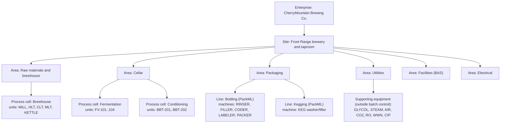
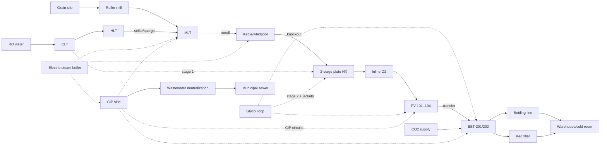
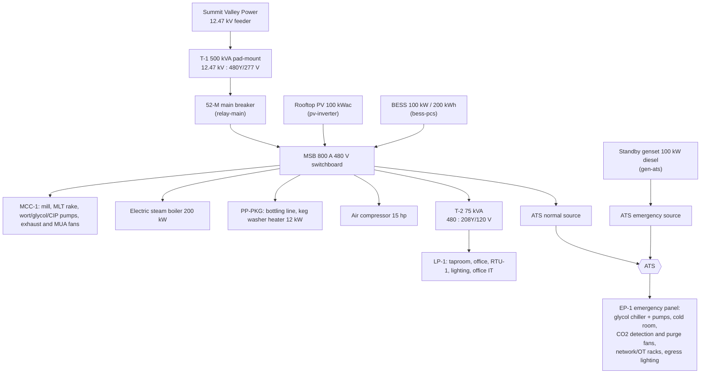
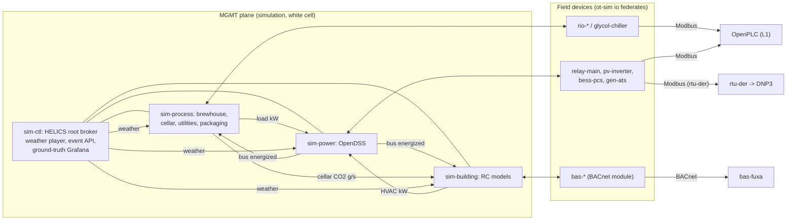
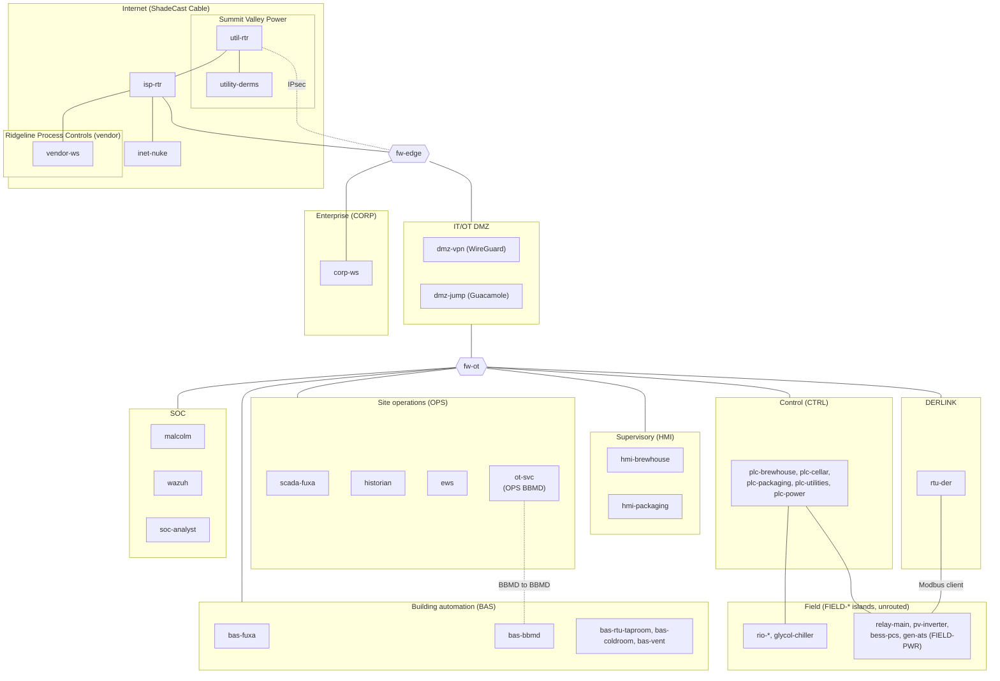
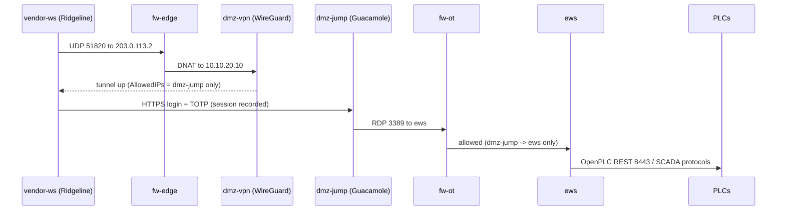

# CherryMountain Brewery: phenix topology design

> **Status:** design, with the Phase 0 spikes and their gap-closing second
> round done. This document specifies the CherryMountain Brewery topology for
> [phēnix](https://github.com/sandialabs/sceptre-phenix). The configs, images,
> programs, and simulation code it describes are built in the phases listed in
> [Implementation roadmap](#18-implementation-roadmap). The `ci` variant (the
> cellar slice) is built and tested in Docker. Phase 1 (the network) is built
> and checked statically, and Phase 2 (the plant database, the generator, and
> the seven federates) and the `cherrymountain` app are largely built; no VM
> has run any of it yet. The spike decisions are folded into the sections
> below.
>
> **tl;dr:** a 43-VM, all open-source OT cyber range of a Colorado
> microbrewery. It covers brewhouse, cellar, bottling, utilities, plant power,
> and building automation. FUXA is the SCADA/HMI, OpenPLC runs the PLCs, and
> ot-sim provides the field devices. The physics run in a HELICS co-simulation.
> Blue-team monitoring and vendor remote access are included, and the range
> exercises most phenix capabilities.

## Contents

1. [Summary](#1-summary)
2. [Goals and non-goals](#2-goals-and-non-goals)
3. [The plant](#3-the-plant)
4. [Brewery primer and glossary](#4-brewery-primer-and-glossary)
5. [How real breweries are automated](#5-how-real-breweries-are-automated)
6. [Process design](#6-process-design)
7. [Electrical distribution and energy](#7-electrical-distribution-and-energy)
8. [Building automation](#8-building-automation)
9. [Simulation and co-simulation](#9-simulation-and-co-simulation)
10. [Network architecture](#10-network-architecture)
11. [Node inventory and resources](#11-node-inventory-and-resources)
12. [Control system design](#12-control-system-design)
13. [Vendor remote access](#13-vendor-remote-access)
14. [Blue-team monitoring](#14-blue-team-monitoring)
15. [phenix integration](#15-phenix-integration)
16. [New and extended software](#16-new-and-extended-software)
17. [Testing and validation](#17-testing-and-validation)
18. [Implementation roadmap](#18-implementation-roadmap)
18A. [Regulatory and standards context](#18a-regulatory-and-standards-context)
19. [Risks and open questions](#19-risks-and-open-questions)
20. [Licensing](#20-licensing)
21. [References](#21-references)

---

## 1. Summary

CherryMountain Brewery is a notional production brewery and taproom on the
Colorado Front Range. Its flagship West Coast IPA is **"Fire of the Phenix"**.
This topology emulates the brewery's OT network end to end:

- **Process:** brewhouse, cellar, and bottling and kegging. Utilities include
  glycol, steam, compressed air, CO₂, water treatment, wastewater
  neutralization, and clean-in-place (CIP).
- **Plant electrical system:** a utility service with an automatic transfer
  switch (ATS) to a standby generator, plus rooftop PV and a battery energy
  storage system (BESS). The utility tariff is derived from open data.
- **Building automation system (BAS):** the taproom/office HVAC, a walk-in
  cold room, and brewhouse and cellar ventilation with CO₂ safety interlocks.
- **Supervisory systems:** FUXA for SCADA, HMI, alarms, and recipes, plus a
  historian and an engineering workstation.
- **Remote access:** a vendor path over WireGuard to a Guacamole jump host.
- **Blue-team monitoring:** Malcolm (Zeek with CISA ICS parsers, Suricata,
  and Arkime) and Wazuh.

All components are open source. A HELICS co-simulation couples the process,
power, and building physics. ot-sim field devices expose that physics over
Modbus, DNP3, and BACnet (BACnet through a new ot-sim module). The
topology uses phenix's workflow layout, core and user apps, state of health
(SoH), packet capture, SCORCH, image builds, and a Builder package.

## 2. Goals and non-goals

**Goals**

- A realistic, internally consistent brewery OT environment. Engineers and
  operators can run it, defenders can baseline it, and researchers can extend
  it.
- Use only open-source software, with permissive or copyleft OSI licenses.
- Run fully unattended: every VM is configured at boot from injected files,
  with no manual GUI setup.
- Use as much of phenix as applies: apps, SoH, packet capture, images,
  SCORCH, Builder, and the workflow directory layout.
- Show how brewery subsystems interact: process ↔ utilities ↔ building ↔
  power ↔ utility grid.
- Fit one host with about 128 GB RAM and 32 or more cores. A lite variant
  and a CI variant scale it down.

**Language requirement**

- **The project language is US English (en-US), and the intended users are
  native English speakers.** This applies to:
  - all documentation and README text
  - HMI and BAS screens and alarm messages
  - tag and point descriptions and FUXA project text
  - PLC program comments, code comments, log messages, and commit messages
- Use US spelling (for example "color", "neutralization", "liter").
- No localization or internationalization is required. FUXA's UI language
  is set to English.
- **Units:** US customary units are primary on HMIs and in documents (°F,
  psig, gal, bbl, lb). SI units appear in model internals and where
  standards require them.
- **Dates and times:** data, logs, and APIs use ISO 8601 timestamps. HMIs
  use en-US display conventions.

**Repository requirements**

These apply to the final design and to the code that builds it, not to the
Phase 0 spike kits or the integration test. [§17](#17-testing-and-validation)
lists the hooks.

- **Every check runs locally and in CI.** `prek run --all-files` runs the same
  hooks as the Lint workflow (prek 0.5.10; the workflow runs on push to `main`
  and on `pull_request`).
- **Schema validation.** Every phenix config is validated with
  `check-jsonschema` 0.38.0 against sceptre-phenix's JSON Schemas. The schemas
  are pinned by commit (`6cc94b2`), and `--base-uri` makes their `$ref`s
  resolve at that commit. A `require-pattern` hook guards `apiVersion`,
  because the umbrella schema lets a file with a mistyped API group through
  unchecked.
- **Block-style YAML.** Phenix YAML configs use block style and avoid flow and
  JSON syntax. A scoped yamllint rule allows only empty `{}` and `[]`. JSON
  that phenix injects verbatim is exempt. The YAML sketches in this document
  use flow style for brevity; the files do not.
- **systemd units** follow current best practice (sandboxing directives,
  explicit `Type=`, correct ordering, no deprecated keys). They are checked
  with `systemd-analyze verify` and a `systemd-analyze security` exposure
  threshold.
- **`.desktop` files** are checked with `desktop-file-validate`.
- **Shell** is checked with shellcheck, including the shell embedded in image
  YAML.
- **Dockerfiles** are checked with hadolint v2.14.0 and **Compose files** with
  dclint v3.1.0. Both follow current best practice.
- **Documentation.** Every image and every app has a README. Images share one
  `phenix-images/README.md` with a section per image; each app ships its own
  `README.md`. The `POSTBUILD_*` scripts in image configs are phenix defaults
  and are not linted.
- **phenix app metadata** is validated with Pydantic, following
  sceptre-phenix-apps ([§16](#16-new-and-extended-software)).
- **Python style.** All project code uses Pydantic models where a dataclass or
  record fits, type annotations on every non-local variable (module,
  class, and instance attributes), and `pathlib` for paths.

**Non-goals (attach points are noted for later)**

- **Adversary emulation.** Kali, Caldera, and caldera-ot are not deployed.
  The `caldera` app and SCORCH `caldera`/`art` components can attach to the
  DMZ, the CORP zone, or the vendor network later.
- **Business IT.** ERP/MES, LIMS, Active Directory, and email are not
  deployed. The CORP zone has a single workstation as the attach point. The
  taproom point of sale is part of this: no card-payment system is deployed,
  so PCI DSS is out of scope, and the CORP zone is where a POS segment would
  attach ([§18A](#18a-regulatory-and-standards-context)).
- **Real safety instrumented systems.** Safety interlocks are modeled in
  PLC logic and simulated hardwired relays. IEC 61511 SIS design is out of
  scope.
- **High-fidelity building energy analysis.** The building models are
  low-order (see [§8](#8-building-automation)).
- **Regulatory paperwork.** Permits, licenses, filings, training, and the
  written programs a real brewery keeps (TTB, OSHA, the fire code, the POTW)
  are documented, not emulated. The range keeps the *records* the controls
  would produce for them, so exercises can ask what an attacker could falsify
  ([§18A](#18a-regulatory-and-standards-context)).

The company, the utility (*Summit Valley Power*), the ISP (*ShadeCast
Cable*), and the integrator (*Ridgeline Process Controls*) are fictional.

## 3. The plant

### 3.1 Site and capacity

| Item | Value |
|---|---|
| Location | Colorado Front Range, about 5,200 ft (1,585 m) elevation |
| Ambient pressure | about 12.1 psia (83.4 kPa). Water boils at about 202.3 °F (94.6 °C); 16 °P wort at about 202.8 °F (94.9 °C) |
| Annual production | about 2,500 bbl/yr (US beer barrel = 31 gal = 117.3 L) |
| Brewhouse | 15 bbl, two-vessel, steam-heated: mash/lauter tun (MLT) and kettle/whirlpool |
| Liquor tanks | 30 bbl hot liquor tank (HLT), 30 bbl cold liquor tank (CLT) |
| Cellar | 4 × 30 bbl unitanks (FV-101…104), double-batched (two brews per FV); 2 × 30 bbl bright beer tanks (BBT-201/202) |
| Packaging | 12 oz bottling line at about 1,800 bottles/h (about 5.4 bbl/h); semi-automatic keg washer/filler (½ bbl kegs); manual palletizing |
| Taproom | about 120 seats, with a walk-in cold room for kegs |
| Building | One single-story building of about 18,000 sq ft gross floor area (brewhouse, cellar, packaging, warehouse and cold room, taproom, office). The size is a design assumption, chosen so the building sits in the small-building class of the local benchmarking ordinance and below the state's 50,000 sq ft threshold ([§18A](#18a-regulatory-and-standards-context)) |
| Jurisdiction | Notional. Where a rule depends on the city or county, the design uses the City and County of Denver as the representative Front Range jurisdiction (the weather is Denver TMY3) and says so; the sewer is a Metro Water Recovery member system, and water is municipal (no well) |
| Brew schedule | About 167 brews/yr (3.2/week), run as same-day double batches: two 15 bbl brews back to back fill one 30 bbl FV. That is 1–2 double-brew days a week. A double-brew day runs about 11 h (05:00–16:00). The second mash-in starts when the MLT frees up, about 3.5–4 h after the first, and both boils finish by about 15:30, before the utility on-peak window ([§7.4](#74-utility-tariff-from-open-data)) |

**Capacity check.** An IPA occupies an FV for about 14 days, plus about 1
day of CIP and turnaround. Each FV therefore turns about 24 times a year,
which gives 4 × 30 bbl × 24 ≈ 2,900 bbl/yr of cellar capacity.
2,500 bbl/yr is about 86% utilization, so the schedule has headroom for
seasonal beers and delays.

### 3.2 "Fire of the Phenix" (notional recipe)

The recipe is stored as data in [BeerJSON](https://github.com/beerjson/beerjson)
at `recipes/fire-of-the-phenix.json`. The simulation reads the mash, hop,
and fermentation profiles from it, and so do FUXA's recipe parameters.

| Parameter | Target |
|---|---|
| Style | West Coast IPA |
| OG / FG | 1.066 (16.1 °P) / 1.012 (3.1 °P) |
| ABV / IBU / SRM | about 7.1% / 68 / about 7 |
| Grain bill | 2-row pale 88%, Munich 6%, Crystal 40L 3%, Carapils 3% |
| Mash | single infusion 152 °F (66.7 °C) for 60 min; mash-out 168 °F (75.6 °C) |
| Boil | 60 min at the local wort boiling point (about 202.8 °F) |
| Hops | Columbus at 60 min (bittering); Centennial at 10 min; whirlpool Citra + Simcoe at 180 °F for 20 min; dry hop Citra/Mosaic/Simcoe at 2 lb/bbl on day 5 |
| Yeast | American ale (Chico-type) pitched at 64 °F; ferment at 66 °F; free-rise to 70 °F for the diacetyl rest |
| Finishing | cold crash to 34 °F; carbonate to 2.6 volumes CO₂ in the BBT |

The bittering additions are sized with an altitude-derated utilization
([§9.3](#93-models)). A recipe calculated at sea level would come in under
its IBU target at 5,200 ft.

## 4. Brewery primer and glossary

| Term | Meaning |
|---|---|
| Liquor | Brewing water. Hot liquor is held in the HLT; cold liquor in the CLT. |
| Grist | Milled malt. A roller mill feeds the grist case or hydrator. |
| Mash / MLT | Grist mixed with hot liquor so enzymes convert starch to sugar. The mash/lauter tun (MLT) does both mashing and lautering. |
| Vorlauf | Recirculating the first runnings until they run clear. |
| Lauter / sparge / runoff | Separating sweet wort from the grain bed (lauter), rinsing the bed with hot liquor (sparge), and transferring wort to the kettle (runoff). |
| Wort | Sugary liquid before fermentation. |
| Kettle / boil | Boiling wort to sterilize it, isomerize hop acids, and drive off volatiles. |
| Whirlpool | Swirling hot wort so trub settles in a cone; also used for a hop stand at sub-boiling temperature. |
| Knockout | Transferring hot wort through the heat exchanger (HX) to the fermenter. |
| Heat exchanger (HX) | Plate heat exchanger. Stage 1 uses cold liquor, stage 2 uses glycol. |
| Aeration / oxygenation | Adding O₂ to wort at knockout, about 8–10 ppm, for yeast growth. |
| Pitching | Adding yeast to the wort. |
| FV / unitank | Fermentation vessel. A unitank is a conical, jacketed, pressure-rated tank used for both fermentation and conditioning. |
| Krausen | Foam head during active fermentation. |
| Diacetyl rest | Holding warm at the end of fermentation so yeast reabsorb diacetyl (buttery off-flavor). |
| Dry hop | Adding hops to fermenting or finished beer for aroma. |
| Hop creep | Refermentation caused by hop enzymes after dry hopping. It produces extra attenuation, CO₂, and pressure. |
| Spunding | Capturing fermentation CO₂ by holding tank pressure with a relief (spunding) valve. |
| Cold crash | Chilling to about 32–34 °F to drop yeast and haze. |
| BBT | Bright beer tank: holds finished beer for carbonation and packaging. |
| Volumes (CO₂) | Carbonation level. 1 volume ≈ 1.96 g/L CO₂. |
| DO / TPO | Dissolved oxygen / total package oxygen; quality limits on oxygen pickup. |
| Filler / crowner | Counter-pressure bottle filler and crown capper, usually built as one machine (monoblock). |
| Coder, labeler, checkweigher, case packer | Downstream packaging machines. A fill-level inspector or checkweigher rejects under-filled bottles. |
| Keg washer/filler | Cleans, sanitizes, purges, and fills kegs. |
| CIP | Clean-in-place: automated caustic, acid, and sanitizer (for example peracetic acid, PAA) cycles through tanks and lines. |
| Swing panel / flow plate | A manual U-bend panel that routes CIP or product. Proximity switches prove the bend position. |
| Mix-proof valve | A double-seat valve that keeps product and CIP separate while letting both lines run. |
| Glycol | Propylene glycol solution (about 35%) chilled to about 28 °F and circulated through tank jackets. |
| °P / SG | Degrees Plato / specific gravity, the sugar concentration. |
| IBU / SRM | International Bitterness Units / Standard Reference Method (color). |
| bbl / hL | US beer barrel (31 gal) / hectoliter (100 L); 1 bbl ≈ 1.173 hL. |
| TTB | The US Alcohol and Tobacco Tax and Trade Bureau, which sets federal excise and recordkeeping rules for brewers. |

## 5. How real breweries are automated

This section summarizes research into real brewery automation and maps each
finding to a design choice.

### 5.1 Architecture patterns

- **PLC/SCADA split.** PLCs own real-time control: I/O, PID loops,
  sequences, and interlocks. SCADA/HMI owns recipes, batch execution, alarm
  acknowledgement, and trends.
  → *Design:* OpenPLC owns control; FUXA owns recipes, batch sequencing,
  and alarms.
- **Batch control with ISA-88.** Procedures and recipe parameters live in a
  batch engine. Equipment modules and their interlocks live in the PLC.
  Stone Brewing moved its brewhouse from Siemens BRAUMAT to Rockwell PLCs
  with Ignition HMI, historian, batch, and MES. The project used ISA-88 and
  ISA-101 high-performance HMI guidelines in a hub-and-spoke architecture.
  → *Design:* PLC programs expose ISA-88 *phases* (for example `MASH_IN`,
  `BOIL`, `KNOCKOUT`). FUXA server scripts sequence phases from recipe
  parameters.
- **OEM islands on packaging.** Packaging machines usually arrive with
  their own controllers and protocols. For example, Lakefront Brewery's
  packaging line runs on a GuardLogix safety controller over EtherNet/IP.
  → *Design:* packaging gets its own PLC, a different SCADA protocol
  (S7comm), and a PackML state model.
- **Small-cellar practice.** A typical small cellar uses one PLC with a
  touchscreen, controlling a glycol solenoid per jacket zone on every
  fermenter. One published example runs five 30 bbl FVs on an
  AutomationDirect PLC.
  → *Design:* a dedicated cellar PLC runs per-zone glycol control for every
  FV and BBT.

### 5.2 Standards applied

| Standard | Use in this design |
|---|---|
| ISA-88 (IEC 61512) | Physical model (enterprise → site → area → process cell → unit → equipment module → control module) and procedural model (procedure → unit procedure → operation → phase) |
| ISA-95 (IEC 62264) | Level model and the Unified Namespace topic hierarchy |
| ANSI/ISA-TR88.00.02-2022 (PackML) | Bottling line state machine and PackTags; OEE is computed from PackTags |
| ISA-101 | High-performance HMI: grayscale backgrounds, color reserved for abnormal states, a display hierarchy |
| ISA-18.2 (IEC 62682) | Alarm philosophy, priorities, rationalization, and shelving |
| ISA/IEC 62443-3-2 / 3-3 | Zones and conduits, and per-zone security level targets |
| ISA-5.1 | Instrument tag naming |
| IEEE 1547-2018 | DER interoperability: the DER must support at least one of IEEE 2030.5, IEEE 1815 (DNP3), or SunSpec Modbus. This design uses DNP3 to the utility and Modbus locally |

### 5.3 Best practices encoded

- **CIP route verification.** Before CIP starts, swing-panel proximity
  switches must prove the route. A return-flow switch proves the circuit is
  complete. A hard interlock blocks product transfer into any vessel or line
  that is in CIP. Every cycle records its parameters (time, temperature,
  conductivity, flow) as a verification record.
- **CO₂ life safety.** OSHA's permissible exposure limit (PEL) is 5,000 ppm
  as an 8-hour time-weighted average (TWA; 29 CFR 1910.1000 Table Z-1, which
  sets no STEL). The NIOSH short-term exposure limit (STEL) is 30,000 ppm
  (15 min), and the NIOSH IDLH is 40,000 ppm.
  The cellar alarm tiers are a design choice built on those limits:
  **5,000 / 15,000 / 30,000 ppm**, which start the purge fans, then alarm,
  then evacuate. Breweries report similar tiers; for example, one brewery
  in an MBAA forum discussion uses 5,000/15,000 ppm alerts. MBAA's CO₂
  safety guidance calls for detection, ventilation, and evacuation alarms,
  and here CO₂ detection is interlocked to ventilation.
  - **Confirmed against the codes (2026-11-09).** The 2021 IFC, which the
    Colorado Division of Fire Prevention and Control adopts unamended,
    requires gas detection where an insulated liquid CO₂ beverage system
    with more than 100 lb of CO₂ is indoors without ventilation: sensors
    within 12 in of the floor, a supervisory alarm at 5,000 ppm and an alarm
    in the room at 30,000 ppm (IFC 2021 §5307.3). The representative
    jurisdiction goes further: the Denver Fire Department's policy *IFC 5307*
    (effective 2020-06-15) sets exactly the three tiers used here, **5,000 ppm
    TWA (self-resetting), 15,000 ppm (latching), and 30,000 ppm (latching,
    strobes and horns, evacuate and call 911)**, detectors 12–24 in above the
    floor at each point of use and each supply tank area, exhaust taken within
    12 in of the floor at 1 cfm/ft² and held below 5,000 ppm, and, at the
    30,000 ppm tier, **closure of an automatic CO₂ system shutoff valve that
    fails closed on loss of power or detection**. It also requires an
    annunciator outside the hazard area, signage, an annual operational permit,
    and a construction permit for systems over 100 lb. The design's tiers and
    sensor heights match; the shutoff valve and the detection coverage outside
    the cellar do not ([§18A](#18a-regulatory-and-standards-context)).
  - Fermenters, bright tanks, the mash tun, and the kettle are permit-required
    confined spaces under 29 CFR 1910.146 whenever a hazardous atmosphere (CO₂
    above the PEL, oxygen below 19.5 %) can exist in them. The entry permit,
    attendant, atmospheric testing (oxygen, then flammables, then toxics), and
    the one-year retention of canceled permits are procedures, not controls;
    the range documents them and keeps the CO₂ readings that would appear on
    a permit ([§18A](#18a-regulatory-and-standards-context)).
- **Glycol.** About 35% propylene glycol is supplied at about 28 °F. Each
  tank has separate cone and side jacket zones.
- **Wastewater.** Caustic and acid CIP effluent is neutralized to a
  configured permit band (pH 6.0–9.0) before discharge.
  - **Checked against the rules (2026-11-09).** The federal pretreatment
    standards prohibit any industrial discharge with a pH below 5.0 unless the
    works is designed for it, heat that takes the treatment plant above 40 °C
    (104 °F), and oxygen-demanding slugs that cause interference (40 CFR
    403.5(b)). Metro Water Recovery's 2026 Rules and Regulations repeat these
    for its member sewers (§6.14: pH below 5.0 prohibited for industrial
    users; 40 °C at the plant; a slug may not exceed five times the 24-hour
    average for more than 15 minutes) and define a significant industrial
    user, which gets a discharge permit, at 25,000 gal/day of process
    wastewater or 5 % of the plant's capacity, or by designation (§2 item 85).
    At about 2,500 bbl/yr and the Brewers Association's 4–10 bbl of water per
    bbl of beer, CherryMountain discharges a few thousand gallons a day, so it
    is a permitted-by-designation or sector-program user rather than an SIU by
    volume. The 6.0–9.0 band is the brewery's own permit condition; it is the
    "typical pre-treated end-of-pipe" range the Brewers Association manual
    gives (pH 6–9, BOD 100–400 ppm, TSS 50–500 ppm), against untreated brewery
    effluent of pH 3–12 and BOD 600–5,000 ppm. The utilities federate keeps
    the discharge record such a permit asks for
    ([§9.6](#96-implementation-status-and-validation)).
- **Compliance data.** TTB requires daily records of operations,
  including production and removals (27 CFR 25.292), kept for 3 years
  (27 CFR 25.300). It also requires a Brewer's Report of Operations
  (27 CFR 25.297), reported in barrels.
  - CherryMountain's federal excise tax is about 2,500 bbl × $3.50/bbl
    (the reduced rate) ≈ $8,750/yr. That is under the $50,000 threshold,
    so it files quarterly, on TTB F 5130.26 or a quarterly F 5130.9.
  - **Checked (2026-11-09).** 26 U.S.C. 5051(a)(2) sets the $3.50 rate on the
    first 60,000 barrels for a brewer producing not more than 2,000,000
    barrels a year, with no end date since Pub. L. 116-260; 27 CFR 25.152
    applies it. The daily record (25.292(a)) covers materials, beer produced,
    beer bottled and racked, removals taxpaid and tax-free, returns, losses,
    and tests of measuring devices, with daily summaries (25.292(b)). Records
    stay at the brewery, available to TTB in business hours, for not less than
    three years from the date or the last entry, extendable by TTB for three
    more; data-processing records may live elsewhere if the source records
    stay at the brewery and the data can be retrieved within five business
    days (25.300(a), (c), (d)). Colorado adds a three-year retention for the
    books behind its 8.0 cents per gallon excise return, due by the 20th of the
    following month (C.R.S. 44-3-503(1)(a), (3), (4), (6)).
  - **Tax determination and fill.** Bottled beer is computed from the 25.158
    case table (a case of 24 × 12 fl oz is 0.07258 barrel) to five decimals,
    with the daily sum rounded to two (25.157). A keg is its rated size, but a
    keg found more than 2 % over it is taxed on the actual quantity "without
    benefit of any tolerance" (25.156). A bottle must state its net contents
    exactly, "except for such variations in measuring as may occur in filling
    conducted in compliance with good commercial practice," and over any
    three-month period the barrel equivalent of the bottles filled may not
    vary more than 0.5 % from the labeled equivalent (25.142(a), (d)). NIST
    Handbook 133 (2026), which the state weights-and-measures program applies
    at retail, allows an individual 12 fl oz package no more than 0.5 fl oz
    under its label (Appendix A, Table 2-6) and requires the lot average to
    meet the label. The packaging federate's fill-level model and TTB barrel
    figures follow these ([§9.6](#96-implementation-status-and-validation)).
  - The historian and packaging counts are therefore compliance-grade
    data, which raises the stakes for data integrity. The historian's 30-day
    retention ([§12.4](#124-historian-and-engineering-workstation)) is
    operational; the TTB record is the daily production report and the batch
    records FUXA writes, which a real brewery would keep for the three years.
- **Altitude-aware control.** Boil detection uses the local wort boiling
  point, not 212 °F. All pressure setpoints are stored as absolute pressure
  and shown as gauge pressure using the site ambient pressure
  ([§9.3](#93-models)).

### 5.4 Energy benchmarks (used to check the loads)

- **End-use shares.** These figures come from different sources, so they
  are indicative and do not sum to 100%.
  - The Idaho Power tip sheet (citing E-Source) gives refrigeration 37%,
    process 25%, lighting 10%, compressed air 9%, HVAC 9%, and other 10%.
  - Older literature (Scheller et al. 2008, as cited) puts refrigeration
    as high as 44% and packaging near 20% of electricity.
- **Electricity intensity.** The Brewers Association (BA) 2014–2018
  benchmarking report puts a 2,500 bbl/yr brewery in its 1,000–10,000
  bbl/yr class.
  - That class has an electricity median of 65 kWh/bbl (IQR 45–91, n=93)
    plus a natural gas median of 3.8 therm/bbl (IQR 2.7–6.2, n=96). The
    0–1,000 class median is 182 kWh/bbl. (Re-read from the report's
    1,000–10,000 bbl/year charts on 2026-11-09; the chart bands are the
    middle 50%.)
  - BA breweries mostly heat with gas. An all-electric equivalent is
    therefore roughly 150–176 kWh/bbl. That range is indicative, because
    the medians come from different samples.
- **Water ratio.** The BA 1,000–10,000 class median is 8.7 bbl of water
  per bbl of beer (IQR 6.2–12.1, n=89). Best-practice large breweries reach
  about 3.5–5.
- *Design target:* about 150 kWh/bbl, all-electric with steam from an
  electric boiler. That is near the low end of the peer-median equivalent.
  - It gives about 370 MWh/yr and an average load of about 42 kW, with
    brew-day peaks near 300 kW before peak shaving
    ([§7.2](#72-loads-notional-checked-against-54)).
  - Excluding the electric boiler, which is gas-fired at most benchmark
    breweries, refrigeration is about 45% of electricity. That is
    consistent with the 37–44% literature.

### 5.5 Threat context

Production stoppages from cyberattacks are well documented in brewing:

- **Molson Coors (March 2021):** production and shipments disrupted.
- **Duvel Moortgat (March 2024):** ransomware halted bottling.
- **Asahi (September–October 2025):** ransomware halted most domestic
  production in Japan.

These motivate the blue-team layer, though no attacks are emulated in this
design.

The range itself adds one protocol-level exposure on purpose. The BACnet
broadcast management devices (BBMDs) that carry discovery across `fw-ot`
([§10.3](#103-conduit-matrix-default-deny-stateful-logged)) can forward
broadcasts between zones, and their broadcast distribution tables (BDTs) can
be rewritten over the network. [§14](#14-blue-team-monitoring) treats that as
an attack surface and a detection opportunity.

## 6. Process design

### 6.1 ISA-88 physical model



The ISA-88 batch model covers the brewhouse and cellar. Packaging lines
follow PackML (ISA-TR88.00.02), which calls machines "units/machines".
Utilities, Facilities, and Electrical are site areas outside batch control.
ISA-88 allows hierarchy levels to be omitted where they add nothing.

### 6.2 Process flow



### 6.3 Areas, equipment, and control strategies

**Raw materials and brewhouse**

- PLC: `plc-brewhouse`. Remote I/O: `rio-brewhouse`.
- **Equipment:** grain silo with level; auger; roller mill (VFD); grist
  hydrator; HLT (level, temperature, steam valve); CLT (level, temperature);
  MLT (steam jacket, rake drive and height, false-bottom differential
  pressure, runoff flow); kettle/whirlpool (steam jacket, level,
  temperature, tangential inlet); wort pump (VFD); two-stage plate HX;
  inline O₂ (mass flow controller with DO probe); hop doser for whirlpool
  additions.
- **Control:**
  - HLT temperature PID on steam.
  - Mash step-temperature PID on jacket steam, with ramp/soak segments
    taken from the recipe.
  - Lauter: runoff flow controlled against bed differential pressure;
    sparge flow balanced to runoff; rake lowered when differential pressure
    is high.
  - Kettle: boil vigor held through steam valve position. Boil is detected
    when temperature plateaus within 0.5 °F of the computed local *wort*
    boiling point. That point is the water saturation temperature at the
    measured ambient pressure plus about 0.5 °F of elevation from dissolved
    extract. Hop addition prompts and the whirlpool doser run on boil time.
  - Knockout: the stage-2 glycol valve trims wort to 64 °F, and O₂ flow is
    ratioed to wort flow.
- **ISA-88 phases:** `MILL`, `HLT_HEAT`, `MASH_IN`, `MASH_STEP`, `VORLAUF`,
  `LAUTER`, `BOIL`, `WHIRLPOOL`, `KNOCKOUT`, `CIP_READY`.

**Cellar**

- PLC: `plc-cellar`. Remote I/O: `rio-cellar`.
- **Equipment:** each FV has cone and side glycol zones (solenoid valves
  plus RTDs), a pressure transmitter, an automatic spunding valve, a
  sample-port density meter, and a CIP spray ball. Mechanical pressure
  relief and vacuum relief valves are not PLC-controlled; each pressure-relief
  valve (PSV) has a lift switch wired to rio-cellar (`CEL.PSV.ZSH01.PV` to
  `ZSH06.PV`, FV-101 to BBT-202, full and lite) that alarms High. FVs have
  no level transmitter: the batch engine knows the volume from knockout, and
  the fill is simulation truth only ([§9.5](#95-scenario-events-and-ground-truth)).
  Each BBT has a
  jacket zone, level, pressure, temperature, a carbonation stone with a CO₂
  flow controller, and a pressure regulator. Shared equipment: a dry-hop
  doser (CO₂-purged hop port) and transfer valves with route verification.
- **Control:**
  - Per-zone temperature control with a ±0.5 °F deadband. Setpoint
    profiles come from the recipe: ferment, free-rise, diacetyl rest, crash.
  - The spunding setpoint ramps to about 12 psig on site near terminal
    gravity. Setpoints are stored as absolute pressure (12 psig on site ≈
    24.1 psia) and displayed as gauge pressure.
  - Vessels are rated 15 psig MAWP, and mechanical relief valves are set
    at 15 psig. A PSV pops at 15 psig, vents CO₂ into the cellar room at up to
    25 g/s, and reseats at 13.5 psig (10 % blowdown). It is the limit a
    written spunding setpoint cannot move: a setpoint above the MAWP ends in
    repeated lifts and rising room CO₂, not unbounded vessel pressure.
  - The dry-hop sequence purges with CO₂ before dosing.
  - Cold crash ramp rate is limited so the glycol plant isn't overloaded.
  - BBT carbonation targets volumes computed from temperature and absolute
    pressure ([§9.3](#93-models)). The stone closes while the head is more
    than 1 psi above the target's equilibrium pressure, so gas that does not
    dissolve never builds up to the PSV in normal running.
  - Transfers are blocked while the source or destination is in CIP.

**Packaging**

- PLC: `plc-packaging`. Remote I/O: `rio-packaging`.
- **Equipment:** depalletizer (sweep), rinser, monoblock filler/crowner
  (CO₂ pre-evacuation, fill height), date coder, labeler, fill-level
  inspection with reject, case packer, keg washer/filler, and conveyors with
  accumulation and jam photo-eyes.
- **Control:**
  - A PackML state machine for the line and for each machine. States:
    Stopped, Resetting, Idle, Starting, Execute, Completing, Complete,
    Holding, Held, Unholding, Suspending, Suspended, Unsuspending, Stopping,
    Aborting, Aborted, Clearing.
  - PackML modes: Production, Maintenance, and Manual (PackTag
    `UnitModeCurrent`). Time spent in each state, per mode, feeds the OEE
    calculation.
  - Line speed follows accumulation, and the line starves or blocks
    correctly.
  - PackTags: `ProdProcessedCount`, `ProdDefectiveCount`, state, current
    speed, and stop reason.
  - The filler is interlocked to BBT pressure and product supply.

**Utilities**

- PLC: `plc-utilities`. Remote I/O: `rio-utilities`, plus the
  `glycol-chiller` OEM controller.
- **Equipment:**
  - Glycol: a 15-ton (about 53 kW thermal) chiller with two compressor
    stages and its own controller; a glycol reservoir; supply pumps.
  - Steam: a 200 kW electric steam boiler at 15 psig, with a low-water
    cutoff.
  - Compressed air: a 15 hp air compressor (about 12 kW electrical input)
    with a dryer.
  - CO₂: a bulk CO₂ tank with a vaporizer.
  - Water: an RO skid (permeate flow, conductivity) and a carbon filter.
  - Wastewater neutralization: a tank with pH, caustic and acid dosing
    pumps, and a discharge valve.
  - CIP skid: caustic, acid/sanitizer, and hot water tanks; supply and
    return pumps; a steam heater; conductivity and temperature; a return
    flow switch; swing-panel proximity switches. Circuits: brewhouse,
    FV-101…104, BBT-201/202, transfer lines.
- **Control:**
  - Chiller staging on glycol supply temperature (setpoint 28 °F).
  - Glycol pump pressure control.
  - Boiler enable and pressure supervision. The low-water cutoff is a
    simulated hardwired trip.
  - CO₂ low-pressure alarm.
  - Wastewater: pH is dosed toward 7. The discharge valve is permitted
    only while pH is within 6.0–9.0.
  - CIP sequence: pre-rinse → caustic (about 175 °F / 80 °C, 1.5–2%) →
    rinse → acid (periodic, for example weekly) → rinse → sanitize (PAA,
    ambient). The route must be verified first, and the return flow must be
    proven.
  - A peer interlock with `plc-cellar` uses Modbus reads
    ([§6.6](#66-cross-system-interactions)).

**Electrical**

- PLC: `plc-power`. Devices: `relay-main`, `pv-inverter`, `bess-pcs`,
  `gen-ats`, and `rtu-der`.
- See [§7](#7-electrical-distribution-and-energy).

**Facilities**

- Front end: `bas-fuxa`. Devices: `bas-rtu-taproom`, `bas-coldroom`, and
  `bas-vent`.
- See [§8](#8-building-automation).

### 6.4 Tag naming and I/O summary

Tags follow ISA-5.1 inside the ISA-88 hierarchy:
`<AREA>.<UNIT>.<LOOP><FUNC><NN>.<ATTR>`. Examples:

- `CEL.FV101.TT01.PV`: FV-101 side temperature, process value
- `CEL.FV101.TV01.CMD`: side glycol valve command
- `BH.KTL.TT01.PV`, `UTL.GLY.PT01.PV`, `PKG.LINE.PACKML.STATE`

Equipment IDs such as FV-101 (fermenter) are the brewery's own names. In
ISA-5.1, the letters "FV" would mean a flow valve. To avoid ambiguity, an
instrument tag always sits inside the equipment path (`CEL.FV101.TT01`),
and a bare `FV-101` is never used as an instrument tag.

| Area | AI | AO | DI | DO | Owner |
|---|---:|---:|---:|---:|---|
| Brewhouse | 22 | 8 | 18 | 20 | plc-brewhouse / rio-brewhouse |
| Cellar | 34 | 6 | 12 | 22 | plc-cellar / rio-cellar |
| Packaging | 10 | 4 | 32 | 24 | plc-packaging / rio-packaging |
| Utilities | 24 | 6 | 22 | 20 | plc-utilities / rio-utilities, glycol-chiller |
| Electrical | 40 | 6 | 16 | 10 | plc-power / power devices |
| Facilities (BACnet objects) | 30 | 8 | 14 | 12 | bas-fuxa / BAS devices |

These counts are design estimates. The plant tag database (`plant.yaml`,
[§12.6](#126-plant-tag-database)) is authoritative.

### 6.5 Alarm philosophy (ISA-18.2)

- **Priorities.** Critical (reserved for life safety), High, Medium, and
  Low. The target distribution across High/Medium/Low is about 5/15/80%.
- **Rate.** The target alarm rate follows the EEMUA 191 / IEC 62682
  benchmark: no more than about one alarm per 10 minutes per operator
  (about 144 a day) in steady state.
- **Rationalization.** Each alarm has a cause, consequence, operator
  action, and time to respond. These are recorded in `plant.yaml` and
  generated into the FUXA alarm definitions.
- **Current state.** `plant.yaml` holds 76 rationalized alarms: 4 Critical, 27
  High, 25 Medium, and 20 Low. That is not yet the 5/15/80 target, because only
  the important alarms are rationalized so far.
- **Examples:**
  - CO₂ ≥ 30,000 ppm: Critical; ≥ 15,000 ppm: High; tier 1 (≥ 5,000 ppm, the
    OSHA PEL, purge fans running) for a minute: Low, so the operator knows the
    cellar is above the PEL before it is an emergency.
  - FV temperature more than 2 °F from setpoint for 15 minutes: High.
  - A vessel's relief valve lifted (its lift switch): High, at once.
  - Glycol supply above 34 °F: High.
  - Wastewater discharge inhibited: Medium.
  - Bottling line held more than 10 minutes: Low.
- **Deadband and off-delay.** Every alarm carries a deadband (hysteresis in
  engineering units; plant.yaml `deadband`, default 1 % of the tag's range span
  and at most a quarter of a deviation limit) and an off-delay (`off_delay`,
  default 0). plantgen writes both to `alarms.json` (`deadband`,
  `off_delay_s`), and `plc/common/plcbuild.py` generates each PLC's alarm logic
  from that file (the `CmAlarm` block: set past the limit, clear back inside by
  the deadband, on-delay, off-delay, suppression), so the PLCs and FUXA's alarm
  list cannot drift. The ci slice's hand-written plc-cellar program predates
  this and has on-delays only.
- **Shelving and suppression.** Shelving is allowed. State-based
  suppression applies; for example, packaging alarms are suppressed while
  the line is Stopped (the alarm's `suppress` bit is 0).

### 6.6 Cross-system interactions

These couplings make the range behave like a plant rather than a set of
isolated demos.

| # | From → to | Mechanism | Observable effect |
|---|---|---|---|
| 1 | Brewhouse → cellar | ISA-88 unit-to-unit transfer at knockout. The FUXA batch engine reserves the FV, and plc-cellar confirms the FV is clean, empty, and lined up | Batch waits if no FV is ready; route interlock |
| 2 | Brewhouse → utilities | Steam demand (mash, boil); HLT/CLT draw; glycol load spike at knockout (HX stage 2) | Boiler kW swings; chiller stages up |
| 3 | Cellar → utilities | Glycol demand from jacket valves; CO₂ draw for purge and carbonation; CIP requests | Glycol supply temperature rises during a crash |
| 4 | Utilities ↔ cellar | plc-utilities reads the CIP-permit and transfer status from plc-cellar over peer Modbus (east–west L1 traffic) | CIP blocked during a transfer and vice versa |
| 5 | Cellar → building | Fermentation CO₂ vented by spunding and blow-off, and by the vessels' relief valves, into the cellar room (CO₂ mass balance) | bas-vent purge fans start; alarms at 15,000 ppm |
| 6 | BAS → cellar (life safety) and BAS → SCADA (display) | The bas-vent gas-detection relay is hardwired into rio-cellar (`CEL.SYS.XS01.CO2_OK`); `plc-cellar` inhibits carbonation while it is open. scada-fuxa only reads the CO₂ objects from bas-vent over BACnet, discovering it through the BBMDs ([§10.4](#104-protocol-map)) | Carbonation inhibited at ≥15,000 ppm or on loss of detection power; the process HMI shows the state. See [§6.7](#67-cellar-co2-life-safety-interlock) |
| 7 | BBT → packaging | Product supply and BBT pressure gate the filler | Filler holds on low BBT pressure |
| 8 | Building ↔ process | Ambient and room temperatures change jacket heat gain and chiller COP; brewhouse heat and vapor load the makeup-air unit | Summer afternoons stress the glycol plant |
| 9 | Process + building → power | Every motor, heater, and compressor publishes kW to the power model | Feeder loading, demand peaks |
| 10 | Power → process + building | De-energized buses stop equipment. The ATS feeds the emergency panel EP-1 (glycol, cold room, CO₂/vent, network) from the genset | Outage: brewhouse stops, cellar protected |
| 11 | Utility ↔ power | DERMS reads PV and BESS over DNP3 and sends curtailment and dispatch; the tariff drives peak shaving | Curtailment visible at the inverter |
| 12 | Weather → building, PV, utilities | Weather federate (Denver TMY3) | Diurnal PV, HVAC, and chiller cycles |
| 13 | CIP and brewhouse drains → wastewater | Effluent volume and pH into the neutralization tank | Dosing pumps run; discharge inhibited when pH is out of band |

### 6.7 Cellar CO2 life-safety interlock

**One mechanism: a hardwired relay into plc-cellar.** The cellar CO₂ protection
uses the BAS controller's own logic and a hardwired contact, and no supervisory
host is in the path:

1. **Detection and ventilation (bas-vent, local).** The four low-mounted
   sensors feed bas-vent's controller logic. At 5,000 ppm it starts both purge
   fans itself ([§8.1](#81-spaces-equipment-and-bacnet-devices)); the alarm
   tiers are 5,000 / 15,000 / 30,000 ppm ([§5.3](#53-best-practices-encoded)).
2. **Carbonation inhibit (hardwired relay, plc-cellar logic).** bas-vent's
   gas-detection relay output is wired to a rio-cellar discrete input,
   `CEL.SYS.XS01.CO2_OK`. The relay is **de-energize to trip**: it is closed
   (TRUE) only while the sensed CO₂ is below tier 2 (15,000 ppm) and EP-1, which
   powers the detection panel, is live. `plc-cellar` sets
   `CEL.SYS.XS01.CO2_INHIBIT` whenever the contact is open and then forces both
   BBT carbonation valves (`FCV01.OUT`) to 0 and the hop-port CO₂ purge valve
   closed, holding a dry-hop sequence (operator request `CEL.DH.XC01.CMD`: a
   30 s CO₂ purge, then a 60 s dose) in its purge step. The inhibit clears
   only after the contact has been closed again for a release delay (60 s), so
   a tier that chatters does not cycle the carbonation stones.
   **Startup:** the contact reads open until the building federate first
   reports it (the cellar federate's input default is 0), so carbonation starts
   inhibited and is released 60 s after the first healthy report, as an
   unpowered panel would behave.
3. **Supervision (FUXA, display only).** scada-fuxa reads the CO₂ objects and
   tiers from bas-vent over BACnet (through the BBMDs) and reads
   `CO2_INHIBIT` from plc-cellar over Modbus. It alarms and displays; it never
   writes either, so the BACnet writer rules (Suricata sids 9000113/9000114,
   Zeek `BACnet_Write_Unexpected`) list only bas-fuxa and the EWS.

**Fail-safe behavior.**

| Failure | Effect on the interlock |
|---|---|
| BBMD (ot-svc or bas-bbmd), the BBMD conduits, or `fw-ot` | None. The relay path is hardwired; scada-fuxa loses its CO₂ display, and its BACnet tags go stale (FUXA keeps the last value, [§8.1](#81-spaces-equipment-and-bacnet-devices)) |
| scada-fuxa or bas-fuxa down | None. Only the display and the BAS alarms are lost |
| BACnet on bas-vent (the ot-sim BACnet module) down | None. Ventilation and the relay are the controller's local logic |
| EP-1 dead (detection panel unpowered) | The relay drops: carbonation is inhibited (de-energize to trip). The purge fans are on EP-1 too and stop |
| CO₂ at or above 15,000 ppm | The relay drops: carbonation and hop-port purges are inhibited until the sensed value falls 10 % below the tier and the release delay passes |
| rio-cellar or the FIELD-CEL link down | `plc-cellar`'s Modbus master keeps the last input values, so the inhibit holds its last state. A RIO heartbeat would let the PLC fail safe here too; it is open work ([§19](#19-risks-and-open-questions)) |
| plc-cellar stopped | Its outputs stop updating; rio-cellar keeps the last commands. Without a PLC the cellar autopilot takes over after 300 s and honors the relay itself ([§9.6](#96-implementation-status-and-validation)) |

**Simulation.** The building federate computes the relay state (tier 2 clear
and EP-1 energized) and publishes `building/vent.co2_relay_ok`; the cellar
federate republishes it as rio-cellar's `gasrelay.co2_ok` point. A crash of
the bas-vent ot-sim process therefore does not drop the relay, which a real
controller failure would: a documented simplification. In the `ci` variant
there is no building federate and no BBT, so the point does not exist.

## 7. Electrical distribution and energy

### 7.1 One-line



### 7.2 Loads (notional, checked against [§5.4](#54-energy-benchmarks-used-to-check-the-loads))

| Load | Rated kW | Assumed duty | Annual MWh |
|---|---:|---|---:|
| Electric steam boiler | 200 | About 83 double-brew days × 11 h at about 55% average, plus CIP steam | 115 |
| Glycol chiller (2 stages) + pumps (EP-1) | 22 | Continuous, staged, about 55% of rated on average | 106 |
| Bottling line + conveyors | 25 | About 450 h/yr of packaging shifts (06:00–14:30) | 9 |
| Keg washer heater | 12 | About 250 h/yr | 3 |
| Air compressor (15 hp) | 12 (input) | Cycling, about 25% | 26 |
| Mill, rake, pumps (MCC-1) | 15 | Brew days, about 40% | 6 |
| Exhaust and makeup-air fans (purge fans on EP-1) | 6 | Brew days and purge events, about 1,200 h | 7 |
| Taproom RTU, DX cooling (gas heat) | 12 | About 1,400 full-load-equivalent hours | 17 |
| Cold room condensing unit, incl. defrost and evaporator fans (EP-1) | 3 | About 50% | 13 |
| Lighting, plugs, office IT (LP-1) | 16 | About 30% | 42 |
| OT and network racks (EP-1) | 2 | Continuous | 18 |
| RO skid, dosing, misc. | 4 | About 2,000 h | 8 |
| **Total** | **329 nameplate** | | **about 370** (≈150 kWh/bbl) |

- **Peaks.** A brew day with no packaging peaks near 300 kW (boiler,
  chiller, MCC, fans, air, HVAC, base loads). Brew days are scheduled away
  from packaging shifts where possible, but a coincident day peaks near
  330 kW. These are the peaks the BESS shaves.
- **Emergency panel.** EP-1 runs about 30 kW (chiller at full stage, cold
  room, purge fans, OT racks, egress lighting). The 100 kW genset leaves
  margin for compressor starting.
- **Service.** T-1 (500 kVA) has a full-load current of about 601 A at
  480 V. The main breaker and MSB are 800 A, which is within the 125%
  allowance for transformer secondary protection. PV and BESS backfeed
  through the MSB.
- **Code notes (the one-line is notional).** Two things a real installation
  would do differently, which the model ignores:
  - EP-1 carries NFPA 70 (NEC) Article 700 *emergency* loads (egress
    lighting) together with Article 701/702 *standby* loads (glycol, cold
    room, CO₂ detection and purge fans, racks). NEC 700.10(B) requires
    emergency wiring to be kept entirely independent of other wiring, so the
    egress lighting would be on its own emergency circuit or battery unit
    equipment, and EP-1 would be a legally required or optional standby
    panel. The name "emergency panel" is the brewery's, not the code's.
  - The 100 kWac PV and 100 kW BESS backfeed about 300 A of inverter
    overcurrent devices (at 125%) onto the 800 A bus, which exceeds the 120%
    busbar allowance of NEC 705.12. A real interconnection would use a
    supply-side (line-side) connection or a bus rated for the sum. OpenDSS
    does not care; the note matters only when the one-line is read as an
    installation drawing.
  - **Code editions and the storage system.** Colorado's State Electrical
    Board adopted the 2023 NEC effective 2023-08-01 (3 CCR 710-1; a
    municipality may be stricter). Denver's 2025 Building and Fire Code,
    adopted 2025-06-13, is based on the 2024 I-codes with the 2021 IECC kept
    as the energy code. The 200 kWh lithium-ion BESS would be installed to
    NFPA 855 (2023 edition in force in most adoptions; the 2026 edition adds
    installation-level large-scale fire testing) and the IFC's ESS section:
    UL 9540 listing, UL 9540A fire-propagation test data, a hazard mitigation
    analysis, an emergency response plan, explosion control to NFPA 68 or 69,
    and commissioning and decommissioning plans submitted to the fire code
    official. None of that is modeled; the `bess-pcs` points carry only power,
    state of charge, connection, and a fault bit
    ([§18A](#18a-regulatory-and-standards-context)).

### 7.3 Power control (`plc-power`)

- **Outage ride-through:**
  1. The utility is lost. The MSB de-energizes. PV and BESS stop
     energizing within 2 s, per IEEE 1547-2018 clause 8.1.1 (detect an
     unintentional island and cease to energize within 2 s). Neither is
     connected to EP-1, and v1 has no grid-forming BESS.
  2. The ATS senses the loss, starts the genset, and transfers EP-1 within
     about 10 s.
  3. `plc-power` opens and holds open the large MSB feeders (boiler,
     packaging, RTU), so restoration can be staged. It sheds EP-1 sub-loads
     if genset load exceeds 80%.
  4. When the utility returns, the ATS retransfers after its stable-source
     timer. PV and BESS reconnect after the IEEE 1547-2018 enter-service
     intentional delay (clause 4.10.3, Table 39: 300 s by default, adjustable
     0–600 s; the power federate uses 300 s). `plc-power` recloses the MSB
     feeders in stages to limit inrush.
- **BESS dispatch (100 kW / 200 kWh, a 2-hour battery):**
  1. *Priority 1: monthly demand cap.* Demand is billed on the monthly
     peak at all hours, so the BESS holds 15-minute demand under a
     configurable target (default 250 kW). It keeps at least 50% state of
     charge (100 kWh) before 05:00 on brew days, recharging overnight from
     the grid at off-peak rates.
  2. *Priority 2: on-peak energy shift.* Any remaining energy discharges
     during the 17:00–21:00 weekday window, typically about 50 kW across the
     window when state of charge allows.
  3. PV charges the battery at midday when there is surplus.
- **PV and utility limits.** The inverter applies
  `min(site_limit, utility_limit)`. The PLC writes the site limit, and the
  utility writes its limit through `rtu-der`.
- **Utility BESS dispatch.** A utility dispatch (rtu-der AO 3) overrides the
  site dispatch for 15 minutes after its last write, and an explicit 0 kW is a
  command (hold the battery idle), not "no command". rtu-der writes only when
  the DERMS operates the point: ot-sim's FEP Modbus client writes on a bus
  update and never at startup, so the site dispatch runs until the utility
  acts.
- **Genset exercise:** weekly, scheduled by `plc-power` through
  `gen-ats.gen_start` (`PWR.GEN.HS01.CMD`). The exercise runs **under load**:
  once the set is up, the ATS transfers EP-1 to it for the duration of the
  command and retransfers at once when the command clears, then the engine
  cools down for 300 s. That is how NFPA 110 has the monthly test carry the
  emergency loads through the transfer switch: at least 30 minutes at not
  less than 30 % of nameplate kW (30 kW here) or at the manufacturer's
  exhaust temperature, with weekly inspections, monthly transfer-switch
  operation, an annual supplemental load test when the monthly load falls
  short, and written records of every inspection, test, and repair (as the
  Minnesota Department of Health summarizes the standard's Chapter 8; the
  NFPA text itself was not read, [§21.3](#213-standards-regulations-and-safety-guidance)).
  EP-1's rated load is 33 kW, so a brew-day exercise meets the 30 % rule and
  an off-day exercise at about 15 kW does not. A `genset-exercise` event
  ([§9.5](#95-scenario-events-and-ground-truth)) runs a timed test with a
  load bank to make up the difference. The power federate logs every run
  (kind, loaded time, average and peak kW, whether it met the criteria) and
  the hour meter, including the calendar-year test hours that 40 CFR
  60.4211(f) caps at 100 for an emergency engine (50 of them may be
  non-emergency use). A utility outage during a test becomes an emergency run.
  The log is ground truth ([§9.6](#96-implementation-status-and-validation),
  [§18A](#18a-regulatory-and-standards-context)).

### 7.4 Utility tariff from open data

The fictional utility's commercial tariff, *SV-SGT*, is built from **open
data**: [OpenEI Utility Rate Database
(URDB)](https://apps.openei.org/USURDB/) records, released CC0, for
Colorado's largest investor-owned utility (Public Service Co. of Colorado,
EIA ID 15466), effective 2026-01-01.

| Component | Source record | Value used |
|---|---|---|
| Distribution demand | Schedule SG, time-differentiated demand ([URDB 69bda768f0300279d30f154c](https://apps.openei.org/USURDB/rate/view/69bda768f0300279d30f154c)) | $9.66/kW-month on the monthly maximum demand |
| Generation/transmission demand (seasonal) | same record, TOU demand periods | **Summer (Jun–Sep): $27.14/kW**; **other months: $19.79/kW**. All hours (the record defines no hourly demand window) |
| Energy TOU window | Schedule SG-TOU ([URDB 69bdaa2ade50eca8ee0baa6a](https://apps.openei.org/USURDB/rate/view/69bdaa2ade50eca8ee0baa6a)) | **On-peak: weekdays 17:00–21:00, all year**; weekends off-peak |
| Energy rates | same record | On-peak $0.38375/kWh (Jun–Sep), $0.23371/kWh (Oct–May); off-peak $0.09927/kWh |

| Fixed charge | both records | $91.79/month |

Notes and disclosures:

- **Values.** All values are copied as recorded in URDB, without riders or
  adjustments.
- **Blend.** SV-SGT is a deliberate notional blend of two real schedules:
  - Schedule SG-TOU applies only to customers with demand under 50 kW
    (URDB `peakkwcapacitymax` = 50). A brewery peaking near 300 kW could
    not take it. Only its TOU energy window and energy rates are used.
  - Not used: SG's own energy charge ($0.04771/kWh) and SG-TOU's flat
    demand charge ($1.71/kW).
  - The SG-TOU energy rates are priced for a small-customer schedule,
    while SV-SGT also carries SG's demand charges.
- **Effective cost.** At the brewery's low load factor (14–17%), SV-SGT
  works out to roughly $0.38–0.43/kWh, or about $140–160k/yr for 370 MWh
  at a 250–300 kW monthly peak. Demand charges are about 70% of that. This
  is intentional: it makes peak shaving and load shifting economically
  visible in exercises. Each 50 kW of shaved peak saves about $19k/yr.
- **Window.** The 17:00–21:00 weekday window matches the Colorado PUC's
  Xcel time-of-use decision (Proceeding 24AL-0377E): on-peak 5–9 PM on
  non-holiday weekdays year-round, moved from 3–7 PM, for residential and
  small-commercial customers, announced for October 2025 and in effect from
  November 1, 2025. SG-TOU is that small-commercial schedule, which is why
  its window is used. Holidays are not modeled.
- **Demand interval.** The URDB records leave the demand interval blank, so
  SV-SGT assumes the common 15-minute interval.
- **Verification.** Both records were re-read through the URDB API on
  2026-11-09 (`api.openei.org/utility_rates`, `getpage=<id>`,
  `detail=full`). SG's `demandratestructure` is period 1 ($19.79/kW) in
  January–May and October–December and period 2 ($27.14/kW) in June–September,
  for all 24 hours on weekdays and weekends. SG-TOU's `energyweekdayschedule`
  puts hours 17–20 (17:00–21:00) in the $0.38375 period in June–September and
  the $0.23371 period in the other months, with every other weekday hour and
  every weekend hour at $0.09927; `peakkwcapacitymax` is 50 and
  `demandwindow` is null in both records.

**Operational consequences built into the scenario:**

- Double-brew days start at 05:00, and both boils finish by about 15:30.
- Cold crashes are scheduled off-peak.
- Demand is billed at all hours on the monthly peak, so brew-day boiler
  peaks are the primary shaving target (BESS priority 1). The 17:00–21:00
  energy shift is secondary.
- Grafana tracks monthly demand cost and kWh/bbl.

### 7.5 Utility DER link

IEEE 1547-2018 requires DER to support a standard communications interface.
CherryMountain's interconnection agreement uses **DNP3**:

- **Path:** the utility DERMS (`utility-derms`) polls `rtu-der` over an
  IPsec site-to-site tunnel between `util-rtr` and `fw-edge`. The tunnel
  carries the utility's DER network 192.0.2.0/24 to DERLINK 10.20.15.0/24.
- **Gateway:** `rtu-der` is an ot-sim front-end processor (FEP). Its
  upstream side is a DNP3 outstation. Its downstream side is a Modbus
  client to `pv-inverter`, `bess-pcs`, and `relay-main`.
- **Trade-off:** routing a utility conduit through the IT/OT DMZ
  firewall pair is a deliberate teaching point. The common real-world
  alternative is a utility-owned cellular modem at the DER gateway.

**rtu-der DNP3 point map** (outstation 1024, master 1, TCP 20000; generated by
plantgen as `plant/generated/full/dnp3/rtu-der.json`). Analog values are the
Modbus raw value, engineering value × 10^scale.

| Type | Index | Point (upstream device) | Plant tag | Scale |
|---|---:|---|---|---:|
| AI | 0 | Service real power, import positive (relay-main) | `PWR.MAIN.JT01.PV` | 1 |
| AI | 1 | Service reactive power (relay-main) | `PWR.MAIN.JT02.PV` | 1 |
| AI | 2 | Service voltage, line to line (relay-main) | `PWR.MAIN.ET01.PV` | 1 |
| AI | 3 | Service current, phase A (relay-main) | `PWR.MAIN.IT01.PV` | 1 |
| AI | 4 | Service frequency (relay-main) | `PWR.MAIN.ST01.PV` | 2 |
| AI | 5 | 15-minute demand (relay-main) | `PWR.MAIN.JQ01.PV` | 1 |
| AI | 6 | PV output kW (pv-inverter) | `PWR.PV.JT01.PV` | 1 |
| AI | 7 | PV active power limit in effect, % (pv-inverter) | `PWR.PV.JY01.PV` | 1 |
| AI | 8 | BESS power, discharge positive (bess-pcs) | `PWR.BESS.JT01.PV` | 1 |
| AI | 9 | BESS state of charge (bess-pcs) | `PWR.BESS.EY01.PV` | 1 |
| BI | 0 | 52-M main breaker closed (relay-main) | `PWR.MAIN.ZS01.PV` | |
| BI | 1 | 52-M tripped on overcurrent (relay-main) | `PWR.MAIN.YA01.PV` | |
| BI | 2 | Boiler feeder closed (relay-main) | `PWR.MAIN.ZS02.PV` | |
| BI | 3 | Packaging feeder closed (relay-main) | `PWR.MAIN.ZS03.PV` | |
| BI | 4 | RTU-1 feeder closed (relay-main) | `PWR.MAIN.ZS04.PV` | |
| BI | 5 | PV inverter connected (pv-inverter) | `PWR.PV.ZS01.PV` | |
| BI | 6 | BESS connected (bess-pcs) | `PWR.BESS.ZS01.PV` | |
| BI | 7 | BESS PCS fault (bess-pcs) | `PWR.BESS.YA01.PV` | |
| BO | 0 | **52-M close (0 opens)** (relay-main) | `PWR.MAIN.HS01.CMD` | |
| BO | 1 | **Boiler feeder close** (relay-main) | `PWR.MAIN.HS02.CMD` | |
| BO | 2 | **Packaging feeder close** (relay-main) | `PWR.MAIN.HS03.CMD` | |
| BO | 3 | **RTU-1 feeder close** (relay-main) | `PWR.MAIN.HS04.CMD` | |
| BO | 4 | PV inverter enable (pv-inverter) | `PWR.PV.HS01.CMD` | |
| BO | 5 | BESS enable (bess-pcs) | `PWR.BESS.HS01.CMD` | |
| AO | 0 | PV site limit, % (pv-inverter; plc-power's point) | `PWR.PV.JC01.SP` | 1 |
| AO | 1 | **PV utility limit, %** (pv-inverter) | `PWR.PV.JC02.SP` | 1 |
| AO | 2 | BESS power setpoint (bess-pcs; plc-power's dispatch) | `PWR.BESS.JC01.SP` | 1 |
| AO | 3 | **BESS utility dispatch, kW** (bess-pcs) | `PWR.BESS.JC02.SP` | 1 |

- **Expected utility operations.** The DERMS polls every input (Class 0) and
  writes AO 1 (curtailment) and AO 3 (dispatch); it may operate BO 4 and 5 (DER
  enable, the IEEE 1547 permit to energize). Those are the baseline: Suricata
  sids 9000134 to 9000136 log an analog setpoint (object group 41) from
  utility-derms at priority 4, and sid 9000137 a binary control (group 12) at
  priority 3.
- **Exposed but not expected.** The FEP maps the relay-main breaker and the
  three MSB feeder commands (BO 0 to 3), and the site's own setpoints (AO 0
  and 2), because rtu-der is a second Modbus client of the FIELD-PWR devices and
  plantgen maps every point of them. A utility CROB on BO 0 to 3 can open the
  service or a feeder: Suricata sids 9000138 and 9000139 and the Zeek notice
  `DNP3_Breaker_Command` alert on it from any host, and any control operation
  from a host other than utility-derms alerts at priority 1 (sids 9000130 to
  9000133). Writes to AO 0 and 2 fight plc-power, which rewrites them every
  scan. Restricting the FEP map to the utility points is open work for the
  ot-sim FEP config ([§19](#19-risks-and-open-questions)).

## 8. Building automation

### 8.1 Spaces, equipment, and BACnet devices

| Device (ot-sim + BACnet module) | Space and equipment | Example BACnet objects |
|---|---|---|
| `bas-rtu-taproom` (device 3001) | Taproom/office rooftop unit (RTU-1): 10-ton DX, gas heat, economizer, CO₂ demand-controlled ventilation | AI zone temperature, AI zone CO₂, AI supply air temperature, AV occupied setpoints, AO economizer, BO supply fan, BO cooling stages 1/2, BO heat, MSV occupancy mode |
| `bas-coldroom` (device 3002) | Walk-in cold room (kegs, 36 °F): 1.5 hp condensing unit, defrost, door switch | AI room temperature, AV setpoint, BO compressor, BO defrost, BI door, AV door-open minutes |
| `bas-vent` (device 3003) | Brewhouse and cellar ventilation: kettle hood exhaust fan (VFD), makeup-air unit (gas), 2 cellar purge fans, 4 cellar CO₂ sensors | AI CO₂ ×4, AI MUA discharge temperature, AO exhaust speed, BO purge fans, BO MUA enable, BV CO₂ alarm tiers, BI purge-fan status |

**Local logic.** Each controller runs its own interlocks in ot-sim logic,
the way real BAS controllers do. For example, CO₂ ≥ 5,000 ppm starts the
purge fans locally, and bas-vent's gas-detection relay, hardwired into
rio-cellar, drops at 15,000 ppm so plc-cellar inhibits carbonation
([§6.7](#67-cellar-co2-life-safety-interlock)). The `bas-fuxa` front end supervises,
schedules, and alarms. `scada-fuxa` only reads the CO₂ objects for the process
HMI.

**Discovery across `fw-ot`.** `bas-fuxa` shares the BAS VLAN with the devices.
plantgen sets its BACnet device's `broadcastAddress` to the subnet's directed
broadcast address, `10.30.10.255`
(`plant/generated/full/fuxa/bas-fuxa-tags.json`), so its Who-Is reaches the BAS
devices directly on their own VLAN, without the BBMDs. FUXA on the BAS side has
not been tested: the `bbmd` spike ran `scada-fuxa` only, so this path is
expected to work but is unverified. `scada-fuxa` is on OPS, and FUXA's
BACnet driver (node-bacnet 0.2.4) sends its Who-Is to the device's
`broadcastAddress` property, or to `255.255.255.255:47808` when the property is
unset. A router never forwards the limited broadcast. A BBMD on each side
carries it ([§10.4](#104-protocol-map)). The `bbmd` spike ran a real FUXA 1.3.5
through the BBMDs and a stateful default-drop ACL on a VyOS VM and on a Linux
router, and it read device 3003.

- The devices need no BBMD code. They answer a forwarded Who-Is with a unicast
  I-Am straight to the client, which is what BACpypes3 (and so the ot-sim
  BACnet module) does.
- The BBMDs are standalone services, not part of any device (see
  [§11](#11-node-inventory-and-resources) for where they run). The design keeps
  both BBMDs, including the `bas-bbmd` VM, for realism and as blue-team attack
  surface ([§14](#14-blue-team-monitoring)).
- A device that broadcasts its I-Am answers through the BAS BBMD. A stand-in
  client found such a device through the BBMDs, but FUXA binds its own address,
  so it never hears a broadcast I-Am and cannot use that path.
- **Known alternative, deliberately not used.** Setting a FUXA BACnet device's
  `broadcastAddress` to the device's own IP turns the Who-Is into a unicast.
  FUXA then reads the device with no BBMD, with only the FUXA-to-device rule and
  the established-reply rule, and it needs one FUXA device per BACnet device.
  The design leaves `broadcastAddress` unset on `scada-fuxa`, as the spike did,
  so FUXA's discovery exercises the BBMDs. plantgen omits the property on
  `scada-fuxa` (its devices sit on the BAS subnet, behind fw-ot), so the
  Who-Is goes to `255.255.255.255`, which the OPS BBMD's `/0` prefix hears.
- **FUXA marks a BACnet device "connected" on the first I-Am from anything**,
  including the OPS BBMD's own. A device that never answers leaves its tags
  `null` while FUXA says connected. SoH and health checks therefore read a tag
  value, never the connection state.

### 8.2 What building modeling looks like (plain terms)

A building model treats each space as a **heat bucket**:

- **Thermal mass:** the air, walls, floor, and contents store heat.
- **Leak paths:** heat leaks through walls, roof, windows, and infiltration.
- **Gains:** sun, people, lights, and equipment add heat.
- **HVAC:** adds or removes heat and moves air.
- **Controls:** decide what the HVAC does.
- **Weather:** drives the outside conditions.

The outputs are room temperature, humidity and CO₂, and equipment power.
Fidelity is a ladder:

1. **RC networks (low lift).** An electrical analogy: R is insulation, C is
   heat storage. A 1R1C model has one mass. 2R2C and 3R2C separate the fast
   air node from the slow wall/floor mass. That is about 3–10 parameters and
   about 100 lines of Python. ISO 13790's 5R1C model with solar gains is
   implemented in `RC_BuildingSimulator` (MIT-style).
2. **BOPTEST.** Modelica-based emulators in Docker with a REST API
   (`/advance`, `/inputs`, `/measurements`). The `bestest_air` case, a
   single-zone office, uses Denver TMY weather.
3. **EnergyPlus.** Detailed whole-building simulation with a Python
   callback API (`pyenergyplus`). Related tools: OpenStudio for geometry and
   Alfalfa for live point read/write.
4. **Modelica Buildings / Spawn of EnergyPlus.** Equation-based,
   highest-fidelity HVAC and controls, run as FMUs. This needs a Modelica
   toolchain.

### 8.3 Recommendation

| Space | Model | Effort |
|---|---|---|
| Taproom/office | 3R2C zone + RTU model (DX stages, gas heat, economizer, fan) + occupancy-driven CO₂ balance | Days |
| Walk-in cold room | 1R1C + condensing-unit thermostat + defrost timer + door-open infiltration events | About 1 day |
| Brewhouse and cellar | Well-mixed volumes: heat and vapor from the kettle; cellar CO₂ balance driven by fermentation | 2–3 days |

**Model equations.** T_a is the air temperature, T_m the mass temperature,
and T_o the outdoor temperature. The taproom 3R2C zone:

- C_a·dT_a/dt = (T_m − T_a)/R_am + (T_o − T_a)/R_ao + Q_hvac + Q_int + f·Q_sol
- C_m·dT_m/dt = (T_a − T_m)/R_am + (T_o − T_m)/R_mo + (1 − f)·Q_sol

Cold room: C·dT/dt = (T_o − T)/R + Q_door − Q_ref·u

Cellar CO₂ (ppm): V·dC/dt = G_CO₂(t)·10⁶ + Q_vent·(C_out − C)

- G_CO₂ is in m³/s, converted from the fermentation federate's mass flow
  (`cellar/co2.vent_gps`, [§9.3](#93-models)): G_CO₂ = ṁ_CO₂ / ρ_CO₂.
- ρ_CO₂ is the site density, about 1.51 kg/m³ at 83.4 kPa and 68 °F. The
  sea-level value, about 1.83 kg/m³, would be 22% off.
- The room is treated as well mixed. CO₂ is heavier than air, so the
  sensors are mounted low (12–18 in above the floor), and a stratification
  factor scales the concentration the low sensors read.

**Weather.** The weather federate reads the EnergyPlus-distributed
`USA_CO_Golden-NREL.724666_TMY3.epw` and
`USA_CO_Denver-Aurora-Buckley.AFB.724695_TMY3.epw` files with its own EPW
reader. The files are not committed, so without one the federate synthesizes
Denver weather. The implementation uses neither pvlib nor CoolProp
([§9.6](#96-implementation-status-and-validation)).

- The EPW station elevations differ from the site: Golden is at 1,829 m
  (mean 82.1 kPa) and Buckley at 1,726 m (82.7 kPa).
- The federate therefore corrects the hourly station pressure to the
  site's 1,585 m with the barometric formula before publishing it.
- BOPTEST `bestest_air` remains an optional upgrade for the office.

**Standards the BAS stands in for.** The current BACnet standard is
ANSI/ASHRAE 135-2024 (published 2024-12-31, folding 17 addenda into
135-2020, including BACnet/SC configuration and certificate management). Its
secure datalink, BACnet Secure Connect, runs over TLS in a hub-and-spoke
topology and, in the committee's words, "eliminates BACnet/IP Broadcast
Management Devices (BBMDs) and their configuration." The range keeps
BACnet/IP over UDP 47808 with two BBMDs on purpose: that is what most
installed brewery BAS look like, and the BBMDs are the attack surface and
detection opportunity of [§5.5](#55-threat-context) and
[§14](#14-blue-team-monitoring). BACnet/SC is the upgrade a real site would
plan, and the range is the place to show why. The RTU's CO₂ demand-controlled
ventilation, economizer, and occupancy schedule are the control features the
commercial energy code requires of such a unit (Denver keeps the 2021 IECC;
ASHRAE 90.1 and 62.1 were not read for this design, so no clause is cited).
ASHRAE Guideline 36 (2018 for air-side systems; the 2021 edition added boiler
and chilled-water plants) is the reference for high-performance sequences; the
range's sequences are the simplified controller logic of
[§9.3](#93-models). ASHRAE 223P, the semantic-tagging standard, was in public
review in 2024 and is not used.
See [§18A](#18a-regulatory-and-standards-context).

## 9. Simulation and co-simulation

### 9.1 Architecture

All physics run as **HELICS** federates on the out-of-band MGMT plane
([§10.2](#102-vlan-and-ip-plan)). The phenix `ot-sim` app writes each field
device's ot-sim config. Each device's ot-sim `io` module is a HELICS
federate: it subscribes to the process values it exposes over its protocol,
and it sends writes (operator and PLC commands) to the owning federate's
`updates` endpoint.



### 9.2 Federates

| Federate | Host | Step | Publishes (examples) | Subscribes (examples) |
|---|---|---|---|---|
| `weather` | sim-ctl | 1 s (the weather itself changes each minute) | `weather/ambient.temp_f`, `weather/ghi.wm2`, `weather/pressure.kpa` | The KPI keys and the 3D view's keys (`plant.yaml` `snapshot`; 179 in full and lite), served as `GET /api/v1/state` and `/kpis` ([§9.5](#95-scenario-events-and-ground-truth)) |
| `brewhouse` | sim-process | 1 s | `brewhouse/<device>.<point>`, `brewhouse/load.boiler.kw` | `brewhouse/updates` (endpoint), `power/bus.msb.energized`, `weather/pressure.kpa` |
| `cellar` | sim-process | 1 s (kinetics compressed; exported fluxes real-time-equivalent, [§9.4](#94-time-and-initial-state)) | `cellar/fv101.temp_f`, `cellar/co2.vent_gps`, `cellar/clock.sim_hours` | `cellar/updates`, `weather/ambient.temp_f`, `weather/pressure.kpa` |
| `utilities` | sim-process | 1 s | `utilities/glycol.supply_f`, `utilities/load.chiller.kw` | `utilities/updates`, `weather/ambient.temp_f` |
| `packaging` | sim-process | 1 s | `packaging/line.state`, `packaging/load.line.kw` | `packaging/updates` |
| `power` | sim-power | 1 s | `power/<device>.<point>`, `power/bus.ep1.energized` | each `<fed>/load.<feeder>.kw` (enumerated by plantgen), `power/updates`, `weather/ghi.wm2` |
| `building` | sim-building | 10 s | `building/<device>.<point>`, `building/load.rtu.kw` | `building/updates`, `cellar/co2.vent_gps`, `weather/ambient.temp_f`, `weather/ghi.wm2` |
| ot-sim `io` | each field device | Real-time HELICS federate (no tunable step; ot-sim `start-time`/`end-time`/`real-time` settings) | protocol writes → `<fed>/updates` | `<fed>/<device>.<point>` |

- **Naming.** Device keys follow the phenix `ot-sim` app's convention:
  `<federate>/<device>.<point>`, with writes to the `<federate>/updates`
  endpoint.
- **Explicit subscriptions.** HELICS has no wildcard subscriptions, so
  plantgen enumerates every key.
- **Loop latency.** The process → power → "bus energized" loop carries a
  one-step (1 s) latency by design, because every federate has a non-zero
  period.
- **Broker.** HELICS uses the zmq core on its default broker port.
- **Real-time pacing.** Federates run in HELICS real-time mode, with lag and
  lead tolerances set per federate.
- **End time.** The phenix ot-sim app's default HELICS `end-time` of 36000 s
  must be raised for multi-day experiments.

### 9.3 Models

No mature open-source brewery process simulator exists. The models below are
written as one Python package (`sim/cherrymountain_sim`). It builds on SimPy
and OpenDSSDirect.py. SciPy, the CalebBell `ht` library, and PackMLpy are used
to check the models in the tests. The package has its own helper for the
HELICS federates. Where this section names CoolProp or pvlib, the code uses its
own functions instead ([§9.6](#96-implementation-status-and-validation)).

**Mash** (`brewhouse`)

- Strike water temperature: T_w = (0.2/r)·(T_target − T_grain) + T_target,
  with r in qt/lb (the exact derived constant is 0.197). The metric form
  uses 0.41 with r in L/kg. The constant is a ratio of temperature
  differences, so the same formula works in °F or °C.
- Step heating is an energy balance on water plus grain (grain c_p ≈ 0.4 of
  water) with jacket steam duty.
- Conversion uses a two-enzyme lumped kinetic model, following Müller
  (2000) and Brandam et al. (2003):
  - β-amylase peaks around 60–65 °C (140–149 °F) and denatures quickly.
  - α-amylase peaks around 68–72 °C (154–162 °F).
  - Each has Arrhenius activity and first-order thermal deactivation.
  - The model outputs fermentability and the extract-yield curve.
- The empirical multi-parameter starch-hydrolysis model of Saarni, Miller
  and Block (2020), *Beverages* 6(4):60, is used to check the trends with
  temperature and liquor-to-grist ratio.

**Boil and whirlpool** (`brewhouse`)

- Evaporation: ṁ_evap = (Q_steam − Q_loss)/h_fg, targeting 4–8% per hour.
- Local boiling point: the water saturation temperature at the measured
  ambient pressure plus the boiling-point elevation from dissolved extract
  (about 0.3 K at 16 °P). The code uses the Antoine equation for water
  (A = 8.07131, B = 1730.63, C = 233.426 in mmHg and °C, valid 1–100 °C),
  which stays within 0.1 K of IAPWS-IF97 over the 90–100 °C range that
  matters here, and the ebullioscopic constant K_b = 0.512 K·kg/mol with
  the extract counted as maltose (0.29 K at 16.1 °P). At 83.4 kPa that is
  94.6 °C water and about 94.9 °C wort.
- Bitterness:
  - Tinseth: U = 1.65·0.000125^(G−1) · (1 − e^(−0.04·t))/4.15, and
    IBU = U·(mg/L α-acids added). G is the average kettle gravity during
    the boil (about 1.063 for this recipe), not the OG.
  - Altitude derating multiplies Tinseth's 0.04 min⁻¹ time constant by the
    Arrhenius rate ratio between the local boiling point and 100 °C.
  - That ratio is about 0.69 using Hosom's mIBU temperature function, and
    0.63–0.65 using Malowicki and Shellhammer's activation energy. So
    isomerization is about 31–37% slower.
  - The resulting IBU loss is about 11–13% for 60-minute additions and
    26–31% for 10-minute additions.
  - The whirlpool hop stand uses Hosom's mIBU relative utilization,
    U_rel(T) = 2.39×10¹¹·e^(−9773/T) (T in K), integrated over the
    cooling curve.

**Knockout heat exchanger** (`brewhouse`)

- Counterflow ε-NTU, solved for each stage with `ht`:
  ε = (1 − e^(−NTU(1−Cr))) / (1 − Cr·e^(−NTU(1−Cr))) for Cr < 1. For
  balanced flow (Cr = 1), ε = NTU/(1 + NTU).
- Stage 1 uses CLT water, whose temperature follows the seasonal Denver
  groundwater curve. Stage 2 uses glycol, and that load is published to
  `utilities`.

**Fermentation** (`cellar`)

- The de Andrés-Toro et al. (1998) model, with equations and parameters as
  reproduced in Rodman and Gerogiorgis (2016), *Food Bioprod. Process.*
  (open manuscript). Its parameters cover 8–24 °C, and Rodman reports
  validation over more than 200 fermentation campaigns, citing de
  Andrés-Toro et al. (2004).
- **State variables:** lag, active, and dead biomass (X_lag, X_act, X_dead);
  sugar S; ethanol E; ethyl acetate; diacetyl.
- **Temperature dependence:** every rate constant has the form
  p = exp(A + B/T), with T in kelvin.
- **Derived outputs:**
  - CO₂ evolution ≈ 0.955·dE/dt (mass basis, from stoichiometry:
    44.01/46.07).
  - Heat release Q ≈ 586.6 kJ/kg × extract consumed. The literature range
    is 500–590 kJ/kg.
  - Gravity in °P from S and E.
- **Parameter decisions:**
  - *μ_e0's B constant is −1267.24.* Rodman Table 1 prints −12667.24, which
    is a typo: with p = exp(A + B/T) and A = 3.27 it gives μ_e0 ≈ 2×10⁻¹⁸
    h⁻¹ at 15 °C. −1267.24 gives about 0.32 h⁻¹, consistent with the other
    rates. A unit test asserts μ_e0(15 °C) ≈ 0.3 h⁻¹.
  - *The diacetyl production rate k_dc is 1.27672×10⁻⁴ L·g⁻¹·h⁻¹.* Rodman
    Table 2 prints 1.27672×10⁻⁷, a second typo: with it the model peaks
    near 0.001 ppm diacetyl, while the paper's own Fig. 5d peaks near
    1.5 ppm and its Table 4 reports 0.20 and 0.21 ppm at the ethanol
    production time of the 11 °C and 13 °C isothermal runs. The 10⁻⁴ value
    (de Andrés-Toro's) reproduces both (0.21 and 0.22 ppm), and the Table 4
    test checks it. The consumption rate k_dm = 1.13864×10⁻³ is as printed.
  - The model was fitted to lager fermentations, so its ale behavior at
    18–20 °C is approximate. Tune it so attenuation from 16.1 °P to about
    3 °P completes in about 5–6 days at 66–70 °F.
- **Hop creep:** a first-order sugar source after dry hopping,
  dS/dt += k_hc(T)·dose·D_remaining, tuned to give 0.2–0.5 °P of extra
  attenuation over 3–5 days, with a matching rise in CO₂, pressure, and
  diacetyl. No published rate constants exist, so the value is tuned.
- **Jackets:** each zone follows m·c_p·dT/dt = Q_ferm − U·A·(T − T_gly)·u_valve,
  with a dimple-jacket U of about 150–400 W/m²K.

**Carbonation** (`cellar`)

- Equilibrium volumes come from the ASBC/Zahm-Nagel relationship, as a
  common empirical fit in psig and °F:
  P = −16.6999 − 0.0101059·T + 0.00116512·T² + 0.173354·T·V + 4.24267·V
  − 0.0684226·V².
- This fit is in sea-level gauge pressure. CherryMountain adds the ambient
  pressure difference (14.7 − 12.1 = 2.6 psi):
  - 2.6 vol at 34 °F ≈ 10.2 psig at sea level ≈ **12.8 psig gauge on site**.
  - The provenance of the fit is unconfirmed, so cross-check it with
    Henry's law (k_H(298 K) ≈ 0.034 mol·kg⁻¹·bar⁻¹, with van 't Hoff
    temperature dependence).

**Relief valves** (`cellar`, `sim/cherrymountain_sim/relief.py`)

- Every FV and BBT has a pop-action PSV: it lifts when the head reaches
  15 psig, vents at most its rated 25 g/s (the BBT's worst credible inflow,
  the stone fully open plus the serving regulator, is about 11.4 g/s), and
  reseats once the head is down to 13.5 psig. A lift shorter than a step
  still shows as lifted for that step.
- The vented CO₂ goes into the cellar room, so the building federate's CO₂
  balance and the [§6.7](#67-cellar-co2-life-safety-interlock) interlock see
  it. A 30 psig spunding setpoint on an active FV makes the PSV lift every few
  minutes; a stone forced open on a BBT lifts it within the hour.

**Glycol plant** (`utilities`)

- Reservoir energy balance: m·c_p·dT/dt = ΣQ_jackets + Q_HX2 − Q_chiller.
- Chiller capacity and COP depend on ambient temperature. Glycol uses a
  constant c_p of 3.8 kJ/(kg·K). CoolProp's `INCOMP::MPG[0.35]` gives about
  3.75 at 28 °F.
- The OEM staging logic runs in the `utilities` federate, because the
  `glycol-chiller` points expose stage status, not stage commands.

**Steam, air, CO₂, RO, wastewater, CIP** (`utilities`)

- Lumped first-order models with tank volumes, mass balances, and
  pH/conductivity mixing.
- CIP is a sequence model with temperature, conductivity, and flow, driven
  by PLC commands.

**Bottling** (`packaging`)

- A SimPy model stepped at 1 s inside the federate.
- Each machine has a PackML state machine, a nominal rate, MTBF/MTTR jam
  distributions, and accumulation buffers. The state machine is a custom
  synchronous implementation that uses PackMLpy's transition table. The filler
  takes BBT pressure as an input.
- Produces bottle and case counts, rejects, and state times for OEE.

**Power** (`power`)

- OpenDSS via OpenDSSDirect.py, based on ot-sim's OpenDSS federate example
  (`testing/e2e/helics/opendss-federate.py` in patsec/ot-sim).
- 480 V three-phase circuit with a Vsource at 12.47 kV behind T-1.
- Loads are `Load` elements with kW from the process federates.
- PV is a `PVSystem` with irradiance from `weather`. The BESS is a
  `Storage` element with state of charge.
- Breakers and the ATS are switchable `Line`/`SwtControl` elements.
- **Genset:** a second `Vsource` on the EP-1 island bus, enabled only while
  the genset runs. OpenDSS needs a source element in every island, so this
  is a modeling convention.
- pandapower is a documented fallback if islanding proves awkward.

**Building** (`building`)

- The [§8.3](#83-recommendation) RC and CO₂ models, with solar gains from the
  weather federate's irradiance.

### 9.4 Time and initial state

- **Time scale.** The brewhouse, packaging, building, and power run in
  real time. A double-brew day takes about 11 h of wall time, with an
  optional speed-up for demos. Fermentation kinetics run with a
  configurable compression factor (default 48×, so 1 simulated day takes
  30 minutes). A full primary fermentation shows in about 2.5–3 hours, and
  fermentation through crash in about 3.5–4 hours.
- **Time-base rules (compression must not distort coupled physics):**
  - *Kinetic state is compressed.* Sugar, ethanol, biomass, and diacetyl
    advance 48× faster.
  - *Exported fluxes are real-time-equivalent.* The cellar federate
    publishes CO₂ release (g/s), fermentation heat, and the resulting
    jacket, glycol, and electrical loads at the real-world rate for the
    tank's current fermentation state, not the compressed rate.
  - Without this rule, a compressed CO₂ release would be about 48× too
    high: about 20 g/s per FV and more than 20,000 ppm in the cellar, from
    fermentation alone. Fermentation heat would be about 30 kW per FV
    against a 53 kW chiller.
  - *Tank thermal and fluid dynamics run in real time.* PLC temperature
    control, valve behavior, and alarm delays (for example the 15-minute
    deviation alarm) stay in wall time.
  - *Recipe-time logic runs in sim time.* Profile steps (free-rise,
    diacetyl rest, dry-hop day, crash start) are keyed to fermentation
    progress (gravity) or to `cellar/clock.sim_hours`. The FUXA batch
    engine and `plc-cellar` profile timers read that clock.
- **Staggered initial state.** The plant starts mid-production, so every
  phase is visible within minutes of `experiment start`:

| Vessel | Initial state |
|---|---|
| FV-101 | Clean and empty, reserved for today's knockout (brew day starts 05:00 sim-time) |
| FV-102 | Fermentation day 2 (about 10 °P, active CO₂) |
| FV-103 | Day 5, dry hop in progress (hop creep) |
| FV-104 | Cold crash ramping to 34 °F |
| BBT-201 | Carbonating to 2.6 vol |
| BBT-202 | Feeding the bottling line (packaging shift running) |

- **Clock.** The default simulation clock starts on a summer weekday at
  04:30 local time, ahead of the 05:00 brew start.
  - Summer demand rates apply immediately.
  - The 17:00–21:00 on-peak energy window arrives after about 12.5 h of
    wall time, unless the demo speed-up is used.
  - A scenario parameter, `clock.start`, sets another start time. For
    example, 15:30 gives a BESS peak-shaving demo with on-peak arriving in
    90 minutes.

### 9.5 Scenario events and ground truth

- **Event API.** The weather federate on `sim-ctl` serves a small HTTP API. It
  binds `127.0.0.1:8080`, so it is reached only through the autotunnel's cc
  tunnel, not over the MGMT plane. The `ci` variant has no event API. The
  SCORCH `plantevent` component calls it to inject operational events:
  - start a batch
  - open the utility breaker (outage)
  - fail a chiller compressor
  - release CO₂ in the cellar
  - jam the labeler
  - step the outside temperature

  The weather federate forwards each event to the owning federate's `updates`
  endpoint. The API also serves `GET /api/v1/kpis` (batches, bottles, energy,
  demand, and the compliance figures of [§18A](#18a-regulatory-and-standards-context):
  TTB barrels, mean fill and under-fill rejects, inhibited wastewater
  discharges, verified and unverified CIP runs, genset hours and test hours),
  which the `cherrymountain` app reads, and `GET /api/v1/state`, the
  ground-truth snapshot for the white cell's 3D view
  ([§15.10](#1510-white-cell-3d-view-cm-viz)). Both are built from the weather
  federate's subscriptions, which plantgen derives from `plant.yaml`
  `snapshot` (the KPI keys were published all along, but nothing subscribed,
  so the KPIs read zero until this was added). The API rejects an event with a
  400 when a parameter is unusable, including a `duration` that is not a number
  (a boolean counts as not a number), not positive (0 is allowed for
  `weather-step`, where it holds the step), or longer than 24 hours. A federate
  that still receives a bad event or message logs it and drops it, and keeps
  stepping.
- **Ground truth.** The ot-sim `ground-truth-module` and each federate write
  true state to an in-experiment OpenSearch node on `sim-ctl` (index
  `cherrymountain-truth-*`) over MGMT. Grafana on `sim-ctl` shows the
  white-cell view. The host reaches both, and the event API, through
  `phenix/startup-autotunnel` port forwards ([§15.3](#153-topology-modules-and-variants)).
- **Truth no device measures.** The cellar federate publishes, per vessel,
  `cellar/<unit>.level_pct` (FVs: the fill, which has no transmitter),
  `spund_gps`, `psv_gps`, and `leak_gps` (plant.yaml `unit_outputs`); the
  BBTs' level is their `LT01` point. No ot-sim device subscribes to them.
- **Separation.** Ground truth is deliberately separate from the blue team's
  Malcolm view, so exercises can compare "what happened" with "what was
  observed".
- **Synthetic data.** No public fermentation time-series dataset exists.
  Synthetic curves are exported in the Fermentrack/iSpindel CSV schema
  (`log_time, beer_temp, gravity`), so standard tools can read them.

### 9.6 Implementation status and validation

`sim/cherrymountain_sim` has seven federates: weather (with the event API),
brewhouse, cellar (with the bright tanks), utilities, packaging (PackML),
power (OpenDSS, the tariff, and the BESS and genset), and building. It also has
a ground-truth writer and an offline harness (`cherrymountain-local`) that runs
every federate without HELICS. The tests in `sim/` and `tools/plantgen/`
(both run in CI) check the models against hand calculations and published
values:

| Check | Result |
|---|---|
| Wort boiling point | 94.94 °C |
| Lager fermentation (Rodman Table 4, 11 / 13 °C) | 50.5 / 56.8 g/L ethanol; diacetyl 0.21 / 0.22 ppm (published 0.20 / 0.21) |
| Strike water (Palmer) | 165.1 °F |
| Tinseth reference | 20.73 IBU |
| Altitude derate | 0.698 / 0.643 (Hosom / Malowicki) |
| Fire of the Phenix | 68.0 IBU on site, 74.9 IBU at sea level |
| HX ε | 0.870 |
| Zahm-Nagel | 12.8 psig on site; Henry's law within 6 % |
| Feeder voltages | ANSI C84.1 Range A up to 329 kW; 0.984 pu at full load |
| BESS | Holds the import at about 240 kW |
| Genset | Carries EP-1 at 10 s |
| Peak shaving | $19,140 per 50 kW-year |
| PackML | Matches PackMLpy's table; 5000-command fuzz |
| Cellar CO₂ | 2627 ppm steady state at 1 g/s (3284 ppm sensed, below the purge stop); tiers clear 10 % below their limit |
| Relief valves | A 30 psig spunding setpoint holds FV-102 between 13.5 and 15.5 psig with repeated lifts, all vented gas reaching the room; a forced stone lifts the BBT PSV; normal carbonation peaks at 14.0 psig with no lift (3 h offline run) |
| KPI API | After 2.5 h offline: 2,376 bottles, 28 kegs, 221 kWh, 128 kW demand, 21.2 TTB barrels, 12.04 fl oz mean fill (all zeros before the weather federate subscribed) |
| Genset exercise (NFPA 110, 40 CFR 60.4211(f)) | A remote start transfers EP-1 and runs 33 kW for 40 min: logged as an exercise that met 30 min at 30 % of nameplate; the everyday 15 kW does not until a 40 kW load bank is added; an outage during a test is logged as an emergency run; test hours accrue against the 100 h/yr cap |
| Wastewater discharge record (40 CFR 403.5, POTW permit) | A pH 12 caustic slug with the discharge valve commanded is inhibited (120 s inhibited, 1 event); the discharge that follows stays inside 6.0–9.0; hourly samples accumulate |
| CIP verification record | A 60 min caustic wash on FV-102 is verified (supply past 160 °F, return past 40 mS/cm, flow proven 10 min); a 2 min rinse is logged and not verified |
| Fill level (NIST HB 133 Table 2-6, 27 CFR 25.142(d)) | 5,000+ bottles in a shift: rejects below 11.5 fl oz under 1 %, lot mean at or above 12 fl oz, quarterly barrel-equivalent variance inside 0.5 %, packaged barrels per the 25.158 case table |
| 12 h offline run | 2 brews, 14,327 bottles, 227 kW peak |

- **IBU reference.** The check uses the published Tinseth formula. Brewtarget
  itself was not run.
- **Not run yet.** A 24 h HELICS soak, and anything on a VM.

**Deviations from the design above** (each is also recorded where it matters):

- The weather federate steps at 1 s, not 60 s. The weather values change once a
  minute.
- Chiller staging, the BAS interlocks, and the PV site limit live in the
  federates, not in ot-sim `logic` blocks ([§12.3](#123-ot-sim-field-devices)).
- Built-in operators (the `autopilot` setting) run the brewhouse, utilities,
  and packaging while no PLC is writing. They hand over on the first write
  and take control back after 300 federate seconds without one (a stopped
  PLC, or a one-off write from another host). This relies on a running PLC's
  writes reaching the federate continuously, which both halves do according to
  their source: OpenPLC v4.3.2's `modbus_master` plugin writes every write point
  (FC 15/16) every cycle it is due, with no change detection
  (`modbus_master_plugin.py`; plantgen sets a 250 ms cycle), and ot-sim
  `9dc33047` pushes an update for every Modbus write request, changed or not,
  which its io module sends to the federate's endpoint at the next step. So no
  PLC heartbeat tag is needed; a VM run must still confirm it. The power and
  building federates follow a point's last write and otherwise their own
  controller. The cellar's autopilot (sim setting `autopilot`, the same
  hand-off) runs the recipe profile by kinetic hours since pitch: 66 °F, then
  70 °F with the spunding valve sealed from day 4, then a 34 °F crash from day
  10; it holds the bright tanks at 34 °F and carbonates them toward 2.6 vol
  only while the CO₂ relay is healthy ([§6.7](#67-cellar-co2-life-safety-interlock)).
- PackML uses PackMLpy's transition table on a custom synchronous machine.
- There is no CoolProp or pvlib. The code has its own EPW reader, synthetic
  Denver weather when no EPW file is present, and a constant glycol c_p.
- The live kettle IBU keeps rising through the whirlpool (72 to 86 IBU), above
  the recipe's 68 IBU stand-only estimate.
- The `plant.yaml` schema grew: signed `int16` points, `written_by` holding
  registers, alarm kinds `highhigh`, `lowlow`, and `state`, ISA-18.2 `suppress`
  bits, PACKML tags, and NTP role defaults.
- The FUXA tags for OPC UA and S7 points have `address: null`. The
  `cherrymountain` app resolves them from the compiled program's
  `debug_map.json` ([§12.1](#121-openplc-v4-runtime-v3-fallback)).
- The event API binds `127.0.0.1:8080` on the weather federate and is reached
  through the cc tunnel. The `ci` variant has none.
- The compliance records of [§18A](#18a-regulatory-and-standards-context)
  (the genset test log, the wastewater discharge record, the CIP verification
  records, the fill statistics and TTB barrels) live in the federates and ride
  in the ground-truth documents. Their headline figures are federate outputs
  (no tags, no FUXA change) that the KPI API carries; the filler's
  `ProdDefectiveCount` now comes from the fill model.
  The `genset-exercise` event is new to the event API; the SCORCH `plantevent`
  component does not know it yet.

**Remaining:** the ot-sim `logic` blocks of
[§12.3](#123-ot-sim-field-devices), and the 24 h soak. The peer reads of
`plc-cellar` by `plc-utilities` are in plantgen: tags with `peer:` land at
`%IX120.0` up through an FC1 device in plc-utilities' `modbus_master.json`
that reads 0 when plc-cellar is unreachable.

## 10. Network architecture

### 10.1 Zones and conduits (Purdue model / ISA/IEC 62443)



**Text alternative to the diagram.** The Internet zone holds `isp-rtr`, which
joins `fw-edge`, `inet-nuke` (the public NTP and DNS stand-in), the vendor
(`vendor-ws`), and the utility (`util-rtr`, then `utility-derms`). `util-rtr`
also reaches `fw-edge` over an IPsec tunnel. `fw-edge` is the only router
between those external networks and the inside: it connects the enterprise
zone (`corp-ws`) and the IT/OT DMZ (`dmz-vpn`, which ends the vendor's
WireGuard tunnel, and `dmz-jump`, the Guacamole jump host). The DMZ connects to
`fw-ot`, and `fw-ot` is the only router into the OT zones: OPS (`scada-fuxa`,
`historian`, `ews`, and `ot-svc`, which also hosts the OPS BBMD), HMI (the two
kiosks), CTRL (the five PLCs), DERLINK (`rtu-der`), BAS (`bas-fuxa`, `bas-bbmd`,
and the three BAS devices), and SOC (`malcolm`, `wazuh`, `soc-analyst`). The
field networks are not routed: each PLC reaches its I/O devices (`rio-*`,
`glycol-chiller`, and the FIELD-PWR power devices) only over its own FIELD
VLAN, and `rtu-der` is a second Modbus client of the power devices. The BBMD on
`ot-svc` and the one on `bas-bbmd` talk to each other across `fw-ot`.

The main flows, all detailed in [§10.3](#103-conduit-matrix-default-deny-stateful-logged):

- **Vendor access.** `vendor-ws` opens a WireGuard tunnel (UDP 51820) through
  `isp-rtr` and `fw-edge` to `dmz-vpn`, reaches `dmz-jump` on HTTPS, and then
  `dmz-jump` reaches `ews` through `fw-ot` (RDP or SSH).
- **Utility link.** `utility-derms` reaches `rtu-der` with DNP3 (TCP 20000)
  through the IPsec tunnel, `fw-edge`, and `fw-ot`.
- **Supervision.** The kiosks in HMI use the FUXA servers. `scada-fuxa` polls
  the PLCs in CTRL and the BAS devices through `fw-ot`, and `ews` programs the
  PLCs.
- **Monitoring.** Logs and agents flow upward into SOC (`wazuh`), the firewalls
  send their logs there too, and `malcolm` watches a mirror of the inside
  networks.
- **Corporate Internet.** `corp-ws` reaches the Internet zone through `fw-edge`
  (web, mail, NTP, and DNS).

**Zones** (ISA/IEC 62443-3-2; the security level targets, SL-T, are
notional design targets):

| Zone | Purdue level | SL-T | Notes |
|---|---|---|---|
| INET, VENDOR, UTIL | 5 (external) | — | Untrusted |
| CORP | 4 | 1 | Single office workstation (attach point for business IT) |
| DMZ | 3.5 | 2 | WireGuard gateway and Guacamole jump host |
| OPS | 3 | 2 | Historian, EWS, services, and the FUXA server. FUXA performs L2 supervisory functions but is hosted with the L3 site-operations services; its operator clients sit in HMI |
| HMI | 2 | 2 | Thin-client kiosks |
| BAS | 2 (facilities) | 1 | Separate facilities system |
| CTRL | 1 | 2 | PLCs |
| FIELD-* | 0 | 2 | Unrouted I/O islands |
| DERLINK | 1 (utility-facing gateway) | 2 | rtu-der upstream side |
| SOC | 3 (security) | 2 | Malcolm, Wazuh, analyst |
| MGMT | n/a (simulation plane) | n/a | Out of bounds for exercises |

**Design rules**

- **Field networks are unrouted L2 islands.**
  - Each PLC is dual-homed (CTRL plus its FIELD VLAN) and is the only L1
    path to its I/O.
  - The exception is FIELD-PWR, where `rtu-der` is a second Modbus client
    of the power devices. `rtu-der` has two plant NICs, DERLINK and
    FIELD-PWR.
- **Routing is static everywhere** (topology `network.routes`). The design
  uses no dynamic routing protocol, which is common practice for a small OT
  site and avoids route injection across zone boundaries. phenix supports
  OSPF, but it is deliberately not used.
- **Data conduits are initiated upward where possible.** For example, logs
  and telemetry flow to the SOC and the historian. Replies are allowed
  statefully; there is no data diode. Control conduits necessarily start
  downward: SCADA and the EWS to the PLCs, dmz-jump to the EWS, and the
  utility DERMS to rtu-der.
- **Cross-zone conduits cross at least one firewall.** The rows marked "—"
  in [§10.3](#103-conduit-matrix-default-deny-stateful-logged) are not
  cross-zone: intra-DMZ (vendor tunnel to dmz-jump through dmz-vpn, which
  enforces its own nftables forward policy, [§13](#13-vendor-remote-access)),
  intra-SOC (soc-analyst), and fw-edge's own NTP from inet-nuke. There are
  two documented deviations:
  - The utility DNP3 conduit ([§7.5](#75-utility-der-link)) reaches an L1
    gateway from L5 through fw-edge and fw-ot with no protocol break. It is
    decrypted from IPsec on fw-edge, so it crosses the DMZ in plaintext.
    The vrouter template's rule matches the source address `192.0.2.10` only
    (it has no IPsec policy match), so a plaintext packet spoofing that address
    from the INET segment would pass the ACL. `cm-vyos-config.sh` therefore adds
    `ipsec match-ipsec-in` (or `match-ipsec` on older builds) after boot to
    every fw-edge rule whose source is utility-derms. That is unverified on a
    VyOS VM, and `netcheck` does not model it; the template limitation is
    recorded for upstream ([§16](#16-new-and-extended-software)).
  - The MGMT plane (below).
- **MGMT is a simulation back-plane, not a containment boundary.** Field
  devices with HELICS-backed I/O and the simulation nodes have a MGMT NIC
  for HELICS, ground truth, and simulation time. That bypasses the zone
  model by necessity.
- **MGMT controls:**
  - A host nftables policy on every MGMT member allows only:
    - ICMP echo to sim-ctl, which the helics app's broker-wait script
      needs.
    - HELICS zmq traffic to the broker: ports 23405–23406, plus a pinned
      per-federate port range.
    - OpenSearch (9200) and NTP to sim-ctl.
  - No node has a default route via MGMT.
  - The ot-sim CPU API binds to `127.0.0.1:9101` (`cpu-module.api-endpoint`).
    The default is `0.0.0.0` and unauthenticated.
  - No host tap with `externalAccess` is attached to MGMT.
- **Visibility is not containment.** Excluding MGMT from the mirror and
  hiding it in the SoH graph are visibility choices only. A compromised
  device controls its own nftables, so exercise rules treat MGMT as out of
  bounds.

### 10.2 VLAN and IP plan

VLAN aliases are pinned in `phenix.yml` (`vlanRange` 100–199).

**Interface naming:**
- Plant NICs are `IF0`, `IF1`, … in the order the Zone column of
  [§11](#11-node-inventory-and-resources) lists them. For example,
  plc-cellar has IF0 on CTRL and IF1 on FIELD-CEL; rio-cellar has IF0 on
  FIELD-CEL.
- The MGMT NIC is always named `mgmt`, and malcolm's mirror NIC is named
  `mirror`.
- **Router interfaces are named `eth0`, `eth1`, …, not `IF0`, `IF1`.** They are
  the VyOS NIC names in topology order, because the `vrouter` app writes its
  netem policies with the interface name.
- SoH, mirror, helics, and ot-sim metadata all reference these names.

| VLAN (alias) | ID | Subnet | Gateway | Members |
|---|---:|---|---|---|
| INET | 101 | 203.0.113.0/24 | isp-rtr .1 | fw-edge .2 (public; WireGuard DNAT and IPsec endpoint), util-rtr .3, inet-nuke .10 |
| VENDOR | 102 | 198.51.100.0/24 | isp-rtr .1 | vendor-ws .10 |
| UTIL | 103 | 192.0.2.0/24 | util-rtr .1 | utility-derms .10 |
| CORP | 104 | 10.10.10.0/24 | fw-edge .1 | corp-ws .10 |
| DMZ | 105 | 10.10.20.0/24 | fw-edge .1 (static routes to OT prefixes via fw-ot .2) | fw-ot .2, dmz-vpn .10, dmz-jump .11 |
| WG tunnel (not a VLAN) | — | 10.99.0.0/24 | dmz-vpn .1 | vendor-ws .2. Not routed beyond dmz-vpn; dmz-jump routes 10.99.0.0/24 via 10.10.20.10 |
| OPS | 106 | 10.20.30.0/24 | fw-ot .1 | scada-fuxa .10, historian .11, ews .12, ot-svc .13 (also the OPS BBMD) |
| HMI | 107 | 10.20.20.0/24 | fw-ot .1 | hmi-brewhouse .10, hmi-packaging .11 |
| CTRL | 108 | 10.20.10.0/24 | fw-ot .1 | plc-brewhouse .11, plc-cellar .12, plc-packaging .13, plc-utilities .14, plc-power .15 |
| FIELD-BH | 109 | 10.20.11.0/24 | none | plc-brewhouse .1, rio-brewhouse .10 |
| FIELD-CEL | 110 | 10.20.12.0/24 | none | plc-cellar .1, rio-cellar .10 |
| FIELD-PKG | 111 | 10.20.13.0/24 | none | plc-packaging .1, rio-packaging .10 |
| FIELD-UTL | 112 | 10.20.14.0/24 | none | plc-utilities .1, rio-utilities .10, glycol-chiller .11 |
| DERLINK | 113 | 10.20.15.0/24 | fw-ot .1 | rtu-der .10 |
| FIELD-PWR | 114 | 10.20.16.0/24 | none | plc-power .1, rtu-der .2, relay-main .20, pv-inverter .21, bess-pcs .22, gen-ats .23 |
| BAS | 115 | 10.30.10.0/24 | fw-ot .1 | bas-bbmd .5, bas-fuxa .10, bas-rtu-taproom .20, bas-coldroom .21, bas-vent .22 |
| SOC | 116 | 10.40.10.0/24 | fw-ot .1 | malcolm .10, wazuh .11, soc-analyst .12 |
| MGMT | 117 | 172.16.0.0/16 | none (no default route) | sim-ctl .10.1, sim-process .10.2, sim-power .10.3, sim-building .10.4; rio-brewhouse .20.11, rio-cellar .20.12, rio-packaging .20.13, rio-utilities .20.14, glycol-chiller .20.15; relay-main .20.21, pv-inverter .20.22, bess-pcs .20.23, gen-ats .20.24; bas-rtu-taproom .20.31, bas-coldroom .20.32, bas-vent .20.33; 172.16.30.0/24 reserved for the SoH capture scenario |
| MIRROR | 118 | 172.30.0.0/16 (mirror app `mirrorNet`) | — | malcolm `mirror` NIC (address assigned by the mirror app) |

`rtu-der` (an ot-sim FEP) and `utility-derms` (an fd-client DNP3 master)
expose no HELICS-backed points, so they have no MGMT NIC.

**Routing (all static).** The `startup` app does not configure routers, so
static routes are set in topology `network.routes`:

| Node | Routes |
|---|---|
| isp-rtr | Connected INET and VENDOR only. It is "the internet"; there are no routes to private nets |
| util-rtr | Default via isp-rtr 203.0.113.1. Policy IPsec to fw-edge (203.0.113.2): 192.0.2.0/24 ↔ 10.20.15.0/24 |
| fw-edge | Default via isp-rtr 203.0.113.1. 10.20.0.0/16, 10.30.10.0/24, and 10.40.10.0/24 via fw-ot 10.10.20.2. Policy IPsec to util-rtr (203.0.113.3): 10.20.15.0/24 ↔ 192.0.2.0/24. SNAT (masquerade) only for source 10.10.10.0/24 out INET, which also keeps IPsec traffic out of NAT. DNAT 203.0.113.2 udp/51820 → 10.10.20.10 |
| fw-ot | Default via fw-edge 10.10.20.1. OT zones connected |
| dmz-vpn, dmz-jump | Default via fw-edge .1. 10.20.0.0/16, 10.30.10.0/24, and 10.40.10.0/24 via fw-ot .2, so DMZ → OT traffic crosses fw-ot directly instead of hairpinning through fw-edge. dmz-jump also routes 10.99.0.0/24 via dmz-vpn |
| PLCs | Default via fw-ot on CTRL (IF0). FIELD NICs have no gateway |
| rtu-der | Default via fw-ot on DERLINK (IF0). FIELD-PWR has no gateway |

### 10.3 Conduit matrix (default deny, stateful, logged)

| Source → destination | Service | Firewall | Purpose |
|---|---|---|---|
| CORP → INET | TCP 80/443/25, UDP 123/53 (SNAT) | fw-edge | Office web and email (protonuke noise); public NTP/DNS stand-in on inet-nuke |
| fw-edge → inet-nuke | UDP 123 | — | Edge firewall time from the public NTP stand-in |
| INET → dmz-vpn | UDP 51820 (DNAT 203.0.113.2 → 10.10.20.10) | fw-edge | Vendor WireGuard |
| vendor-ws (tunnel 10.99.0.2) → dmz-jump (10.10.20.11) | TCP 443 | dmz-vpn's own nftables `forward` policy (default drop, [§13](#13-vendor-remote-access)); WireGuard AllowedIPs also restrict the peer to dmz-jump | Guacamole login. Anything else from the tunnel address is dropped and logged (`cm-wg-drop`), and Wazuh rule 100105 alerts on it |
| DMZ hosts → ot-svc | UDP 123, UDP/TCP 53 | fw-ot | Time (Guacamole TOTP needs it) and DNS |
| util-rtr (203.0.113.3) ↔ fw-edge (203.0.113.2) | IKE UDP 500/4500, ESP | fw-edge | Utility IPsec |
| utility-derms (192.0.2.10) → rtu-der (10.20.15.10) | TCP 20000 (DNP3) | fw-edge, fw-ot | DER telemetry and control |
| dmz-jump → ews | TCP 3389 (RDP), 22 | fw-ot | Vendor sessions via Guacamole |
| HMI → scada-fuxa, bas-fuxa | TCP 1881 | fw-ot | Operator HMI |
| HMI → historian | TCP 3000 | fw-ot | Read-only Grafana |
| scada-fuxa → plc-brewhouse | TCP 4840 (OPC UA) | fw-ot | SCADA polling |
| scada-fuxa → plc-packaging | TCP 102 (S7comm) | fw-ot | SCADA polling |
| scada-fuxa → plc-cellar, plc-utilities, plc-power | TCP 502 (Modbus) | fw-ot | SCADA polling |
| scada-fuxa → BAS devices | UDP 47808 (BACnet/IP) | fw-ot | ReadProperty and ReadPropertyMultiple of the CO₂ objects for the process HMI. scada-fuxa never writes to BACnet: the life-safety interlock is hardwired ([§6.7](#67-cellar-co2-life-safety-interlock)), and a WriteProperty from it alerts (Suricata sid 9000113, Zeek `BACnet_Write_Unexpected`). Replies are stateful. The rule still matters after the connection-tracking entry from the I-Am expires |
| ot-svc (OPS BBMD) → bas-bbmd | UDP 47808 | fw-ot | BBMD rule 1: Forwarded-NPDU carrying FUXA's Who-Is, plus BDT and foreign-device messages |
| BAS devices → scada-fuxa, ews | UDP 47808 | fw-ot | BBMD rule 2, **required**: a device answers the forwarded Who-Is with a unicast I-Am straight to the client. This is a new BAS → OPS flow that no BBMD-to-BBMD rule covers; without it discovery fails. It has no SoH probe, because the flow sends no reply of its own, so only `netcheck` checks it |
| bas-bbmd → ot-svc (OPS BBMD) | UDP 47808 | fw-ot | BBMD rule 3, tested and **optional**: it passes only unsolicited broadcast I-Ams (power-up, periodic) from devices, which the BAS BBMD forwards to OPS. It matched when tested. A Who-Is answered with a broadcast I-Am passes on the established rule, and FUXA cannot hear broadcast I-Ams anyway ([§10.4](#104-protocol-map)). Keep it only for devices that announce themselves |
| ews → CTRL PLCs | TCP 8443 (OpenPLC REST, HTTPS with a self-signed certificate), 502, 4840, 102 | fw-ot | Programming and diagnostics. The REST session is TLS, so Zeek and Suricata see the session (source, destination, bytes) but not the requests ([§14](#14-blue-team-monitoring)) |
| ews → bas-fuxa, BAS devices | TCP 1881, UDP 47808 | fw-ot | BAS engineering (unicast reads) |
| bas-fuxa → historian | TCP 8086 | fw-ot | BAS DAQ |
| All routed OT zones (incl. fw-ot itself) → ot-svc | UDP 123, UDP/TCP 53, UDP 514 | fw-ot | NTP, DNS, syslog |
| ot-svc → wazuh | UDP 514 | fw-ot | Syslog relay into the SIEM |
| fw-edge, fw-ot → wazuh | UDP 514 | fw-ot | Firewall logs, including drops. Malcolm cannot see blocked flows ([§14](#14-blue-team-monitoring)) |
| DMZ hosts → wazuh | TCP 1514/1515 | fw-ot | Wazuh agents (initiated upward; replies stateful) |
| OPS/HMI/BAS Linux hosts → wazuh | TCP 1514/1515 | fw-ot | Wazuh agents |
| soc-analyst → malcolm, wazuh | intra-zone | — | Analyst consoles |

Intra-zone traffic is not filtered by the firewalls. That covers scada-fuxa ↔
historian (InfluxDB 8086, MQTT 1883) in OPS and the peer Modbus between
plc-utilities and plc-cellar in CTRL. Malcolm sees this traffic through the
mirror.

**VyOS build and the IPsec conduit.** The routers run a VyOS rolling build.
Rolling images report `999.<timestamp>`, not "1.5", because vyos-build T9547
changed versioning on 2026-10-31. The `vyos-ipsec` spike ran the utility conduit
on `999.202611082315`:

- phenix's rendered IPsec config commits at first boot. The SA comes up as
  AES-256 with SHA-1 (`AES_CBC_256/HMAC_SHA1_96`) in under 15 seconds. ICMP,
  TCP 20000, and a DNP3 link-status frame cross the tunnel, and a capture on
  the host tap of the router's WAN NIC shows only ESP. (A capture inside the
  router also shows decrypted copies, so it is not evidence.)
- The upstream `vyatta.tmpl` writes the IKE proposal under `esp-group IKE-1W`.
  This build commits those lines anyway, but leaves the IKE group with no
  proposal, so the peers would negotiate defaults. The pinned fork already
  writes `ike-group`.
- The stock config prints a deprecation warning: the IKE group has no
  `key-exchange` and still accepts IKEv1. The design sets
  `set vpn ipsec ike-group IKE-1W key-exchange ikev2` (upstream follow-up in
  [§16](#16-new-and-extended-software)).
- Current rolling images name NICs in PCI slot order (vyos-1x
  `canonical_sort_key`), which matches phenix's `eth<index>`. The spike saw
  `eth0` at `0000:01:01.0` and `eth1` at `0000:01:02.0`, with the first
  topology interface on `eth0`.
- ACL syntax with a valueless `state established` and `state related` commits
  on this build.

**Implementation (Phase 1, checked statically).** The `vrouter` app in
`scenario-full.yml` holds one ruleset per source interface on fw-edge and fw-ot
(`FROM-<zone>`): the stateful accept, the flows of the matrix above, and a
default drop. `acl.egress` is phenix's name, from its per-VLAN viewpoint, for the
ruleset applied to packets coming in on an interface. The lite scenario takes
the app from the full one. `tools/netcheck` traces every conduit above and every
default drop through the static routes, NAT, IPsec, and these rulesets
([§17](#17-testing-and-validation)).

- **Router settings the templates cannot render.** phenix's vrouter templates
  cannot log a rule, set a syslog target, write the IKEv2 `key-exchange`, give
  fw-ot its own NTP source, or match an IPsec policy.
  `phenix-injects/vrouter/cm-vyos-config.sh` does all five after boot. A
  topology `commands` entry (a `cc exec`) runs it once per boot. It turns on
  `default-log` for every ruleset, sends the router logs to Wazuh, sets
  `ike-group IKE-1W key-exchange ikev2`, points fw-ot at ot-svc, and requires
  IPsec on fw-edge's utility DNP3 rule. `--dry-run` makes the changes, prints
  `compare`, and discards them. `tools/netcheck/tests/test_vyos_config.py` runs
  the script against a stand-in VyOS shell (the commands per router, the
  run-once marker, the dry run, and the failure paths).
- **Boot order.** isp-rtr boots first, because the vrouter app reuses the NTP
  address of the first router that has one for every router. The script then
  fixes fw-ot's source.
- **Router-local traffic is unfiltered.** The rendered rulesets filter only the
  `forward` chain, so traffic to a router's own address (IKE, SSH, the routers'
  own NTP and syslog) is not filtered. `netcheck` reports it as `local`.
- **Netem loss is an integer percent.** The WAN emulation below uses 1 %, not
  0.1 %.
- **Unverified until a VM run:** that VyOS accepts the rulesets, the post-boot
  script (the syslog syntax is tried as `remote`, then `host`, and the injected
  path is assumed to appear as `/config/scripts/custom/`), and the SoH probes.

### 10.4 Protocol map

| Link | Protocol (port) | Implementation |
|---|---|---|
| FUXA → plc-brewhouse | OPC UA (4840) | FUXA OPC UA client ↔ OpenPLC v4 `opcua` plugin |
| FUXA → plc-packaging | S7comm (102) | FUXA S7 client (snap7) ↔ OpenPLC v4 `s7comm` plugin |
| FUXA → plc-cellar, utilities, power | Modbus TCP (502) | FUXA Modbus client ↔ OpenPLC v4 `modbus_slave` |
| PLCs → RIO and power devices | Modbus TCP (502) | OpenPLC v4 `modbus_master` ↔ ot-sim Modbus server |
| plc-utilities → plc-cellar | Modbus TCP (502) | Peer interlock reads (east–west) |
| bas-fuxa → BAS devices | BACnet/IP (UDP 47808) | FUXA BACnet client ↔ new ot-sim BACnet module. Same VLAN, and the Who-Is goes to the directed broadcast address `10.30.10.255`, so no BBMD is involved. Untested: the `bbmd` spike covered `scada-fuxa` only |
| scada-fuxa → BAS devices | BACnet/IP (UDP 47808) through fw-ot | Same client and module. Who-Is discovery goes through the BBMDs below; the I-Am returns by unicast; reads and writes are unicast |
| ot-svc ↔ bas-bbmd | BACnet/IP BBMD (UDP 47808) | BACpypes3 BBMDs; each BDT lists both |
| utility-derms → rtu-der | DNP3 (TCP 20000) over IPsec | ot-sim DNP3 master ↔ ot-sim FEP outstation |
| rtu-der → power devices | Modbus TCP (502) | ot-sim FEP Modbus client |
| relay-main | Telnet (23) | ot-sim `telnet` module (an ot-sim admin shell with its default banner). Reachable only from the FIELD-PWR segment (plc-power, rtu-der), so it is a lateral-movement artifact, not a sanctioned path. The `cherrymountain` app injects the telnet config, because the phenix ot-sim app doesn't generate it |
| ews → CTRL PLCs | OpenPLC v4 runtime REST API (TCP 8443) | HTTPS with a self-signed certificate (`phenix-injects/openplc/cm-openplc-provision.sh` uses `curl -k`, and the EWS tool does not verify the certificate). Mirrored capture holds only TLS sessions: Zeek and Suricata cannot read the program upload or start/stop calls, only the session ([§14](#14-blue-team-monitoring)) |
| FUXA → historian | InfluxDB HTTP (8086); MQTT (1883) PackTags/OEE | FUXA DAQ; FUXA server script publishing to Mosquitto; Telegraf → InfluxDB |
| HMIs → FUXA | HTTP/WebSocket (1881) | Chromium kiosk |
| vendor-ws → dmz-vpn → dmz-jump → ews | WireGuard (UDP 51820) → HTTPS (443) → RDP (3389)/SSH (22) | phenix `wireguard` app; Guacamole; xrdp |
| Field and sim nodes | HELICS (MGMT only) | ot-sim `io` module, Python federates |
| All | NTP, DNS, syslog, Wazuh | chrony, dnsmasq, rsyslog, Wazuh agent |

**BACnet across `fw-ot`.** The BBMDs make FUXA's discovery work across the
router. The `bbmd` spike passed on a VyOS VM and on a Linux router, first with a
socket stand-in client and then with a real FUXA 1.3.5 (node-bacnet 0.2.4),
BACpypes3 BBMDs, device 3003, and a stateful default-drop ACL.

- **Nodes.** One BBMD runs on `ot-svc` (OPS) and one on `bas-bbmd` (BAS). Each
  BDT lists both. The BDT entries have no mask, so the sending BBMD unicasts to
  its peer, which rebroadcasts locally. That is the mode that crosses a router
  that does not forward directed broadcasts.
- **Why not on FUXA's host.** node-bacnet binds UDP 47808 there, so a BBMD
  cannot share the host.
- **Listening.** BACpypes3 hears broadcasts only on its subnet's directed
  broadcast address. FUXA sends to `255.255.255.255`, so the OPS BBMD starts
  with a `/0` prefix (for example `10.20.30.13/0:47808`), which makes its
  broadcast address `255.255.255.255`. The spike started both BBMDs that way.
  With a normal `/24` the Who-Is found nothing.
- **Flow.** FUXA broadcasts a Who-Is. The OPS BBMD forwards it to the BAS BBMD
  (rule 1), which rebroadcasts it on BAS. The device sends its I-Am to FUXA
  directly (rule 2), and FUXA then reads by unicast.
- **ACL.** The stateful ACL that only allows UDP 47808 between the BBMDs and
  their replies is not enough. Rules 1 and 2 above are the minimum. With real
  FUXA reading device 3003, the router counters were identical on VyOS and on
  the Linux router: rule 1 (OPS BBMD to BAS BBMD) matched 1 packet, the
  Forwarded-NPDU. Rule 2 (device to FUXA) matched 1, the device's I-Am. The
  established rule matched 18. Rule 3 (BAS BBMD to OPS BBMD) and the
  FUXA-to-device rule matched 0 (the spike numbers these rules 30, 50, 10, 40,
  and 20). The FUXA-to-device reads ride the I-Am's connection-tracking entry, so
  keep that rule for reads after the entry expires.
- **Unsolicited broadcast I-Ams.** A stand-in client bound to `0.0.0.0` heard a
  device's unsolicited broadcast I-Am through the BBMDs only with rule 3 in
  place, and rule 3 then matched (2 packets on netns, 5 on VyOS). FUXA binds its
  own address, so it never hears the rebroadcast, and rule 3 matters only for
  other clients. Rule 3 is therefore optional.
- **FUXA's own behavior** (read from its driver and shown by captures):
  - The Who-Is goes to the device's `broadcastAddress` property. Unset, it is
    `255.255.255.255` and the BBMDs are needed. Set to the device's IP, it is a
    unicast, and FUXA reads the device with no BBMD, with only the
    FUXA-to-device rule and the established-reply rule. The design keeps the
    BBMDs for realism and as blue-team attack surface
    ([§14](#14-blue-team-monitoring)), and leaves the property unset on
    `scada-fuxa`.
  - FUXA reports a device "connected" on the first I-Am from anything,
    including the OPS BBMD's. SoH and health checks read a tag value
    ([§15.4](#154-state-of-health)).
  - FUXA sends its Who-Is once, at connect. A device whose ACL rule appears
    later is not found until the runtime reconnects.
  - A device FUXA has not discovered is polled by broadcast, one
    ReadPropertyMultiple per second per tag group. The BBMDs forward each one
    (a run counted 157 forwarded packets in about two and a half minutes).

**WAN emulation.** The vrouter `emulators` (netem) apply to egress only:

- **isp-rtr:** about 30 ms of delay and 1% loss (netem loss is an integer percent) on its VENDOR and INET
  egress (the vendor path), plus a bandwidth limit on INET.
- **util-rtr:** about 20 ms of delay on its INET and UTIL egress (the
  utility WAN). The IPsec and DNP3 path between fw-edge and util-rtr stays
  on the INET segment and never crosses isp-rtr.

## 11. Node inventory and resources

| Hostname | Zone | Role | Image | vCPU / GB |
|---|---|---|---|---|
| isp-rtr | INET + VENDOR | ShadeCast Cable edge router (VyOS) | vyos | 1 / 2 |
| inet-nuke | INET | Internet web/SMTP server (protonuke), plus public NTP and DNS stand-in (chronyd, dnsmasq) | cm-svc + protonuke | 1 / 1 |
| vendor-ws | VENDOR | Ridgeline Process Controls technician laptop (WireGuard client, browser) | cm-desktop | 2 / 3 |
| util-rtr | INET + UTIL | Summit Valley Power router, IPsec peer (VyOS) | vyos | 1 / 2 |
| utility-derms | UTIL | Utility DERMS, DNP3 master | cm-otsim | 1 / 1 |
| corp-ws | CORP | Office workstation (protonuke client) | cm-desktop | 2 / 3 |
| fw-edge | edge | IT/Internet firewall, NAT, IPsec (VyOS) | vyos | 1 / 2 |
| dmz-vpn | DMZ | WireGuard gateway | cm-wireguard | 1 / 1 |
| dmz-jump | DMZ | Guacamole jump host (TOTP, session recording) | cm-guacamole | 2 / 3 |
| fw-ot | OT edge | OT firewall, all zone conduits (VyOS) | vyos | 1 / 2 |
| scada-fuxa | OPS | Process SCADA: FUXA, batch engine, alarms | cm-fuxa | 2 / 4 |
| historian | OPS | InfluxDB 2, Telegraf, Grafana, Mosquitto | cm-historian | 2 / 6 |
| ews | OPS | Engineering workstation: OpenPLC Editor, Wireshark, BAC0, mbpoll, xrdp | cm-ews | 2 / 3 |
| ot-svc | OPS | NTP (chrony), DNS (dnsmasq), syslog relay, OPS BBMD (BACpypes3) | cm-svc | 1 / 1 |
| hmi-brewhouse | HMI | Brewhouse and cellar operator kiosk | cm-desktop | 2 / 3 |
| hmi-packaging | HMI | Packaging and utilities operator kiosk | cm-desktop | 2 / 3 |
| plc-brewhouse | CTRL + FIELD-BH | OpenPLC v4 (OPC UA plugin) | cm-openplc | 1 / 2 |
| plc-cellar | CTRL + FIELD-CEL | OpenPLC v4 | cm-openplc | 1 / 1 |
| plc-packaging | CTRL + FIELD-PKG | OpenPLC v4 (PackML) | cm-openplc | 1 / 1 |
| plc-utilities | CTRL + FIELD-UTL | OpenPLC v4 | cm-openplc | 1 / 1 |
| plc-power | CTRL + FIELD-PWR | OpenPLC v4 | cm-openplc | 1 / 1 |
| rio-brewhouse | FIELD-BH + MGMT | Brewhouse remote I/O (ot-sim) | cm-otsim | 1 / 1 |
| rio-cellar | FIELD-CEL + MGMT | Cellar remote I/O (ot-sim) | cm-otsim | 1 / 1 |
| rio-packaging | FIELD-PKG + MGMT | Packaging remote I/O (ot-sim) | cm-otsim | 1 / 1 |
| rio-utilities | FIELD-UTL + MGMT | Utilities remote I/O (ot-sim) | cm-otsim | 1 / 1 |
| glycol-chiller | FIELD-UTL + MGMT | Chiller OEM controller (ot-sim) | cm-otsim | 1 / 1 |
| relay-main | FIELD-PWR + MGMT | Main breaker protective relay and meter (ot-sim, Modbus + Telnet) | cm-otsim | 1 / 1 |
| pv-inverter | FIELD-PWR + MGMT | PV inverter (ot-sim) | cm-otsim | 1 / 1 |
| bess-pcs | FIELD-PWR + MGMT | BESS power conversion system (ot-sim) | cm-otsim | 1 / 1 |
| gen-ats | FIELD-PWR + MGMT | Genset controller and ATS (ot-sim) | cm-otsim | 1 / 1 |
| rtu-der | DERLINK + FIELD-PWR | DER gateway (ot-sim FEP) | cm-otsim | 1 / 1 |
| bas-bbmd | BAS | BAS BBMD (BACpypes3); its BDT lists itself and ot-svc | cm-svc | 1 / 1 |
| bas-fuxa | BAS | BAS front end (FUXA instance 2) | cm-fuxa | 2 / 3 |
| bas-rtu-taproom | BAS + MGMT | RTU-1 controller (ot-sim + BACnet) | cm-otsim | 1 / 1 |
| bas-coldroom | BAS + MGMT | Cold room controller (ot-sim + BACnet) | cm-otsim | 1 / 1 |
| bas-vent | BAS + MGMT | Ventilation and CO₂ controller (ot-sim + BACnet) | cm-otsim | 1 / 1 |
| sim-ctl | MGMT | HELICS root broker, weather, event API, ground-truth OpenSearch and Grafana, chronyd for MGMT | cm-sim | 2 / 6 |
| sim-process | MGMT | Process federates | cm-sim | 2 / 3 |
| sim-power | MGMT | OpenDSS federate | cm-sim | 2 / 3 |
| sim-building | MGMT | Building federate | cm-sim | 2 / 3 |
| malcolm | SOC + MIRROR | Malcolm: Zeek + ICSNPP, Suricata, Arkime, OpenSearch | cm-malcolm | 8 / 24 |
| wazuh | SOC | Wazuh manager, indexer, and dashboard | cm-wazuh | 4 / 8 |
| soc-analyst | SOC | Analyst workstation | cm-desktop | 2 / 3 |

**Totals:** 43 VMs, **67 vCPUs** (overcommitted on 32 cores; most nodes are
idle) and **113 GB RAM**.

**Where the BBMDs run.** The OPS BBMD shares `ot-svc`, so it adds no VM. The
BAS side needs its own small node, `bas-bbmd`, because every other BAS host
already owns UDP 47808: `bas-fuxa` runs node-bacnet, and each device runs an
ot-sim BACnet module. The `bbmd` spike only tested BBMDs as separate processes
on their own addresses, never inside a device, so the design uses a standalone
service (`cm-bbmd.service` in `cm-svc`, enabled on these two nodes only). The
`bas-bbmd` VM stays in the design (43 VMs). That was decided with the
`broadcastAddress` alternative, which needs no BBMD, in view
([§8.1](#81-spaces-equipment-and-bacnet-devices)). Hosting the BAS BBMD in
`bas-vent`'s BACnet module would drop the VM but is untested
([§19](#19-risks-and-open-questions)).

**Malcolm sizing.** Both profiles stay in the design. The default `malcolm`
node is 8 vCPU / 24 GB, which is Malcolm's documented minimum for the full stack
(the full stack means local OpenSearch, Suricata, NetBox, and file scanning). An
optional slim profile is for smaller hosts. The evidence is from the `malcolm`
spike:

- Zeek with the ICSNPP parsers is small. On a 52 MB pcap it peaked at 281 MiB
  and 118% of one core.
- The cost is the pipeline. The trimmed pipeline (OpenSearch with a 3 GB heap
  and Logstash with 2 GB, plus Dashboards, Arkime, Zeek, Suricata, Filebeat,
  pcap-monitor, and dashboards-helper) ran the whole upload path in 142 s on a
  4 vCPU / 16 GB runner. The containers peaked at 8.4 GiB summed, and the host
  used 9.2 GiB of 16 GB (run 42547389340).
- Suricata added 917 MiB at its peak and about one core to that stack. Without
  it, an earlier run of the same pipeline peaked at 7.6 GiB.
- The full stack adds Postgres and Redis for NetBox, Strelka, the upload and
  nginx containers. The 24 GB profile sets OpenSearch to a 6 GB heap and
  Logstash to 3 GB (`phenix-injects/malcolm/profiles.sh`), below Malcolm's
  10 GB OpenSearch default. None of that was measured, and no live capture ran in a real `cm-malcolm` VM.

The 24 GB default stays until a VM run measures the full stack. The slim profile
is the trimmed pipeline above, with Suricata and without NetBox and Strelka, at
about 4 vCPU / 12 GB. That figure is the measured 8.4 GiB peak plus headroom,
not a measurement of a live-capture VM, and it is not the default.

**Variants** ([§15.3](#153-topology-modules-and-variants)):

- **`lite`** (no SOC, no vendor remote access): 37 VMs, 48 vCPUs, 71 GB.
- **`ci`** (the cellar slice: sim-ctl, sim-process, rio-cellar,
  plc-cellar, scada-fuxa): 5 VMs, 7 vCPUs, about 8 GB.
  - It uses CI memory overrides: sim-ctl 1/2 with no ground-truth
    OpenSearch, sim-process 2/2, scada-fuxa 2/2.
  - scada-fuxa and plc-cellar share one flat CTRL VLAN, with no firewall.
  - FUXA DAQ goes to its built-in SQLite, since there is no historian.
  - It needs `/dev/kvm` on the runner, with 1.75× vCPU overcommit on a
    4-vCPU runner.

## 12. Control system design

### 12.1 OpenPLC (v4 runtime, v3 fallback)

**Programs** are IEC 61131-3 Structured Text, built headless (see
provisioning below) or in the OpenPLC Editor:

- **plc-brewhouse:** ISA-88 phase state machines (Idle → Running → Holding
  → Held → Restarting → Complete/Aborted), commanded through phase
  registers by the FUXA batch engine. Includes PID loops and
  altitude-aware boil detection.
- **plc-cellar:** per-zone glycol deadband control, setpoint profiles,
  spunding, dry-hop and transfer sequences, CIP and transfer interlocks,
  carbonation control, and the CO₂ carbonation interlock on the hardwired
  bas-vent relay ([§6.7](#67-cellar-co2-life-safety-interlock)). The full and
  lite program is `plc/plc-cellar/plc-cellar-plant.st`; the ci slice keeps
  `plc-cellar.st` (fermenters only).
- **plc-packaging:** the PackML state machine, ported from Beckhoff's MIT
  `PackML_PLC_Example`, plus PackTags and machine interlocks.
- **plc-utilities:** glycol, steam, air, CO₂, RO, wastewater, and CIP
  sequences with route verification.
- **plc-power:** load shed, BESS dispatch, PV site limit, and ATS
  supervision.

**As built** (`plc/<plc>/`, [plc/common/README.md](plc/common/README.md)).
The programs are simpler than the targets above, and the gaps are open work:
plc-brewhouse uses proportional valves rather than PID and runs one phase per
Start (no FUXA batch engine exists yet to sequence them, so with the PLC
running the brewhouse waits for phase commands instead of following its
autopilot); plc-cellar has fixed spunding steps, no setpoint profiles, and no
transfer sequence beyond the peer status bits; plc-packaging coordinates the
machines' own PackML state machines (it is not the Beckhoff port); and
plc-power has no time source on FIELD-PWR, so the on-peak window, the 05:00
state-of-charge target, the monthly demand reset, and the weekly genset
exercise wait for a clock point ([§19](#19-risks-and-open-questions)).

**v4 plugins per PLC.** Each PLC runs `modbus_master` to poll its RIO, plus
one northbound plugin:

| PLC | Northbound plugin |
|---|---|
| plc-brewhouse | `opcua` |
| plc-packaging | `s7comm` |
| plc-cellar, plc-utilities, plc-power | `modbus_slave` |

**Provisioning (v4).** The `openplc-v4` spike chose v4 (runtime v4.3.2, run in
Docker only; a VM reboot and VM RAM were not tested). v4.3.x is strucpp-based,
so the runtime compiles generated C++, not MatIEC output, when a ZIP is
uploaded.

1. **Build the program ZIP.** `plc/plc-cellar/build_zip.sh` builds the ci
   slice's ZIP and `plc/common/build_zip.sh` the ZIPs of all five PLCs for the
   full and lite variants (`phenix-injects/openplc/<variant>/<plc>.zip`, with
   the alarm logic generated from `alarms.json` and the strucpp
   `debug_map.json` inside; [plc/common/README.md](plc/common/README.md)). Both
   build headless, with strucpp pinned at `fcccfbdf`, and the ZIPs are
   committed through Git LFS. The
   OpenPLC Editor (4.3.3 or later, as the runtime reports in
   `/api/capabilities`) stays optional. The ZIP must carry:
   - `generated.cpp`, `generated.hpp`, and `generated_debug.cpp`
   - `defines.h`, with the real `PROGRAM_MD5`
   - `strucpp_runtime/include/`
   - `conf/<plugin>.json` for each plugin

   Without `generated_debug.cpp`, `start-plc` answers `START:OK` but the
   program never loads (`undefined symbol ...debug_array_count`, and the
   status stays `STATUS:EMPTY`).
2. **Plugin configs.** A plugin with no matching `conf/<name>.json` is
   disabled, and a ZIP with no `conf/` disables all of them.
   - `plantgen` generates `modbus_master.json` and `modbus_slave.json`, with an
     explicit `buffer_mapping`
     ([§12.5](#125-addressing-conventions-high-off-by-one-risk)).
   - The `cherrymountain` app generates the `opcua` and `s7comm` configs.
     `conf/opcua.json` needs `format_version: 2` and a per-variable `size`, and
     it addresses each variable by `arr`/`elem` from the compile's
     `debug_map.json`, not by name. The app therefore derives OPC UA configs
     from the compiled program, not from `plant.yaml` alone.
   - OPC UA must bind `0.0.0.0`. The template's `localhost` endpoint starts but
     refuses remote clients, so the endpoint is rebound to the PLC's CTRL
     address.
3. A boot script repacks the ZIP with that node's plugin configs.
4. The script creates the admin user (`POST /api/create-user`), logs in,
   uploads the ZIP (`POST /api/upload-file`, field `file`), polls
   `/api/compilation-status`, and calls `/api/start-plc`. `START:OK` does not
   prove the program loaded, so the script then polls `/api/status` for
   `STATUS:RUNNING`. Right after an upload, `compilation-status` might still
   report the previous build's `SUCCESS` or `FAILED` (unverified on a VM), which
   would start the old program; the script and `cm_plc_tool.py` therefore accept
   a final state only after this upload has shown a busy state, or after a
   60-second grace. `cm_plc_tool.py --json` prints the outcome as one JSON
   object for scripted use.
5. The runtime auto-starts the program on later boots (checked with a
   container restart only).

**Memory.** With all four plugins (`modbus_master`, `modbus_slave`, `opcua`,
`s7comm`) running, the container used 161 MiB at steady state. Its cgroup peak
since boot, which includes the first compile, was 361 MiB. The test program had
three variables, so a brewhouse-size compile is unmeasured. The runtime's
`compile.sh` caps parallel jobs at the smaller of `nproc - 1` and the RAM in
GB.

**v3 fallback.** The spike found v4 can be provisioned unattended, so v3 is
retired. For reference, the pattern would have been GRFICSv3's: bake
`compile_program.sh <prog>.st` into the image, and inject `openplc.db` (with a
`Programs` row and `Start_run_mode=true`), `active_program`, `st_files/`, and
`mbconfig.cfg`. v3 is archived, has no OPC UA, and gains DNP3.

### 12.2 FUXA (two instances)

**Version and build**

- Pin FUXA exactly. The latest published Docker image is 1.3.5 and there is
  no 1.3.6 tag, so `cm-fuxa` builds a pinned commit from source. The
  integration test runs the 1.3.5 image.
- The drivers (Modbus, OPC UA, S7, BACnet) are not baked into FUXA. They
  install on demand into `server/_pkg/runtime/node_modules` through
  `POST /api/plugins` (an `npm install --save-exact`), 92 MB for
  `modbus-serial`, `node-opcua`, `node-snap7`, and `node-bacnet`.
  - The image build runs the four installs once, at the pinned versions in
    [§15.7](#157-images), and ships `server/_pkg/`.
  - The range then runs offline: the spike copied that `_pkg/` into a fresh
    container with no network, and all four drivers loaded.

**Provisioning**

- The `cherrymountain` app generates the project JSON from `plant.yaml`
  (devices, tags, alarms, DAQ settings) with `fuxa/build_project.py`: for ci
  the hand-laid Cellar view, and for full and lite a view per device (the
  Cellar view too on scada-fuxa) for both scada-fuxa and bas-fuxa. The
  committed copies (`fuxa/<variant>/<host>-project.json`) are checked current
  by the `cm-fuxa-check` hook. OPC UA tags address `ns=2;s=<tag>` and S7 tags
  the data blocks the app gives the `s7comm` plugin (DB1 %QW, DB2 %IW, DB3 %MW,
  DB4 %IX, DB5 %QX).
- Tag IDs are deterministic (derived from tag names), so the views stay
  bound across regenerations.
- `mysettings.json` goes in `server/_appdata/` and is injected with
  `secureEnabled: true`, a `secretCode` (so tokens survive restarts),
  `daqstore` (InfluxDB 2), and `nodeRedEnabled: false`. FUXA has no
  admin-password setting.
- A boot script waits for port 1881 and then:
  1. Signs in as the seeded `admin`/`123456` (`POST /api/signin`).
  2. Sets the range admin password through the users API (`groups: -1`, and
     `info` must be the JSON string `"{}"`).
  3. POSTs the project to `/api/project` with that admin token, then reads it
     back until every device in `FUXA_EXPECT_DEVICES` (written by the app;
     default every device of the file) is there. A re-run first GETs
     `/api/project` and, when FUXA already holds the same devices with the same
     tag counts, skips the POST and the runtime restart it causes. The script
     ran three times against a FUXA 1.3.5 container (import, skipped re-run, a
     missing device failing).

  The spike ran this flow unattended, twice. The seeded password stops
  working, and tokens survive both the runtime restart and a full restart of
  FUXA.
- **`POST /api/project` replaces the whole project.** It clears everything
  first, so it wipes the built-in FuxaServer device (id `0`) unless the posted
  project includes it. The generated projects include it.
- **Tag address formats:**
  - OPC UA: the node id string.
  - S7: `DB<n>.DBW<byte>`.
  - Modbus: a 1-based address plus `memaddress` 400000, 300000, 100000, or 0.
  - BACnet: `<type>-<instance>`, with `memaddress` set to the remote device
    instance.
- **Verified in the spike:** FUXA's own OPC UA, S7, Modbus TCP, and BACnet
  drivers read live values from the OpenPLC v4 plugins and a BACpypes3
  responder. FUXA's process RSS was 174 MB with four devices polling at 1 s.
  Not done: confirming in a browser that a posted view renders, and a
  10-minute memory soak.

**scada-fuxa (process)**

- **Views** (ISA-101 style, grayscale): Overview with KPIs, Brewhouse,
  Cellar (FV/BBT grid), Packaging (line and OEE), Utilities, Electrical
  one-line, Alarms, Trends, and Batch (recipe "Fire of the Phenix", batch
  ID, phase status).
- **Alarms** are generated from the rationalized definitions in `plant.yaml`.
- **Server scripts:**
  - An ISA-88 batch engine that sequences PLC phases from recipe parameters
    and coordinates unit-to-unit transfers.
  - A daily production report (PDF) with barrels packaged:
    bottles × 12 oz ÷ 3,968 oz/bbl, plus kegs. It supports the TTB records.
  - A PackTags/OEE publisher that sends MQTT to the historian's Mosquitto
    on ISA-95 topics such as
    `cherrymountain/frontrange/packaging/bottling-line/packtags/...`.
- **DAQ** goes to the InfluxDB 2 bucket `scada`.

**bas-fuxa (BAS)**

- BACnet/IP client to the three BAS devices, on the same VLAN. Its Who-Is
  goes to the directed broadcast address `10.30.10.255`, so it needs no BBMD
  ([§8.1](#81-spaces-equipment-and-bacnet-devices); untested, because the `bbmd`
  spike covered `scada-fuxa` only).
- Views: building overview, RTU-1, cold room, ventilation/CO₂.
- Schedules (occupancy) and alarms.
- DAQ goes to the InfluxDB 2 bucket `bas`.

**BACnet on scada-fuxa.** A FUXA BACnet device's `property.address` must be an
IP that exists on the FUXA host (its own interface), not the remote device. The
driver connects only after an I-Am answers its Who-Is, and it sends the Who-Is
to the device's `broadcastAddress` property (`255.255.255.255:47808` when the
property is unset), as captures confirmed. So scada-fuxa, on OPS, reaches the BAS
devices through the BBMDs ([§10.4](#104-protocol-map)), and it needs the I-Am
unicast rule in [§10.3](#103-conduit-matrix-default-deny-stateful-logged). A real
FUXA 1.3.5 did this in the `bbmd` spike, on a VyOS router and on a Linux router.
FUXA reports "connected" on any first I-Am, including the BBMD's own, so
health checks read a tag value, not the connection state
([§15.4](#154-state-of-health)).

**HMIs** are Chromium kiosks, for example
`http://10.20.30.10:1881/home/Brewhouse`.

### 12.3 ot-sim field devices

- **Repo and image.** Devices run `patsec/ot-sim`, pinned and rebuilt on
  Ubuntu noble. The image adds a systemd unit for `ot-sim-cpu-module` and
  the new BACnet module.
- **Noble for every node, DNP3 included.** ot-sim's README lists Ubuntu 20.04
  as the last known-good DNP3 build, but the `otsim-noble` spike built the C++
  DNP3 module (opendnp3 3.1.2) on noble with gcc 13.3 without patches, and the
  upstream end-to-end test passed (Class 0 scan, trip and close, through a
  Modbus gateway into HELICS and OpenDSS). The spike ran in Docker, not a VM
  image, and no systemd unit was tried. No focal image is needed.
- **Build recipe pins:**
  - Build `pyzmq` from source (`pip install --no-binary pyzmq`, which needs
    `libzmq3-dev`). The default wheel bundles a libzmq that collides with the
    one HELICS bundles, and the ot-sim I/O module segfaults. The CPU module
    then restarts the dying module, and the retry fails with `duplicate
    federate name detected`, which hides the crash.
  - `pydnp3` does not build on noble, so it is not installed. The C++ DNP3
    master (`ot-sim-e2e-dnp3-master`, built with `-DBUILD_E2E=ON`) replaces
    it.
  - Pin `opendssdirect.py ~=0.8.4` for the OpenDSS federate. Version 0.9.x
    fails with `Invalid terminal index (0)`.
  - The Go build downloads a newer Go toolchain (a dependency needs Go 1.25 or
    later), so an offline image build must pre-seed that toolchain or vendor
    the modules.
  - The systemd unit puts both `/usr/local/bin` and the venv `bin`
    (`/opt/otsim-venv/bin`) on `PATH`, because the CPU module finds the other
    modules through `PATH`.
  - A root XML comment before `<ot-sim>` makes the C++ DNP3 module reject the
    config ("missing root 'ot-sim' element").
- **CPU API.** `cpu-module.api-endpoint` is set to `127.0.0.1:9101` on
  every device. The default is `0.0.0.0`, unauthenticated.
- **Configs.** The phenix `ot-sim` app generates
  `/etc/ot-sim/config.xml`:
  - All devices are `fd-server` hosts, except `rtu-der` (`fep`) and
    `utility-derms` (`fd-client`, the DNP3 master).
  - Device types come from a custom `infrastructures: brewery:` map
    generated from `plant.yaml`.
  - Every device is HELICS-backed, which the app requires for fd-servers.
- **Local logic.** OEM-style logic is meant to run in each device's ot-sim
  `logic` module:
  - glycol-chiller compressor staging
  - BAS local interlocks
  - the pv-inverter `min(site_limit, utility_limit)` rule
  - relay-main overcurrent trip

  In the current build the first three live in the simulation federates (the
  chiller staging in `utilities`, the BAS interlocks in `building`, and the PV
  limit in `power`). The ot-sim `logic` blocks are still to do
  ([§9.6](#96-implementation-status-and-validation)).
- **Serial.** ot-sim supports Modbus RTU natively, as master and as server: a
  `<serial>` block (`device`, `baud-rate`, `data-bits`, `stop-bits`, `parity`,
  `timeout`) replaces `<endpoint>` in the Modbus module. No ot-sim change is
  needed. It ran over the phenix `serial` app ([§15.2](#152-apps)). The image
  for an RTU node also needs libzmq5, libczmq4, and libxml2.
- **Telnet.** `relay-main` also runs the ot-sim `telnet` module, reachable
  only from FIELD-PWR ([§10.4](#104-protocol-map)). The phenix ot-sim app does
  not render it, so at pre-start the `cherrymountain` app (which runs after it)
  takes the `config.xml` the ot-sim app rendered for relay-main and adds the
  CPU `module` entry and a `telnet` element on relay-main's FIELD-PWR address,
  port 23 (plant.yaml `hosts.relay-main.app.telnet`).
- **EWS credentials.** The app writes `/etc/default/cm-ews` (0600) with the
  OpenPLC account it creates on every PLC, which `cm_plc_tool.py` reads.

### 12.4 Historian and engineering workstation

**historian**

- InfluxDB 2 OSS, with buckets `scada` and `bas`, and `oee` from Telegraf. Each
  bucket has an explicit retention of 30 days (`historian.retentionHours`, 720
  by default; 0 keeps data forever). `cm-historian-provision` passes it to
  `influx setup` and `influx bucket create`, so an existing bucket keeps the
  retention it was created with. Thirty days is an operational window, not a
  records retention: TTB wants the brewery's daily records kept at least three
  years (27 CFR 25.300), and Colorado wants the excise books kept three years
  (C.R.S. 44-3-503(6)). In this design those records are FUXA's daily
  production report and batch records, not the historian; a real brewery would
  either set the `scada` bucket's retention to cover the packaging counts for
  three years or export them ([§18A](#18a-regulatory-and-standards-context)).
- Telegraf runs `mqtt_consumer` for PackTags, plus host metrics.
- Grafana is provisioned with dashboards for fermentation curves, OEE,
  energy (kWh/bbl against the BA benchmark), monthly demand cost, and
  glycol plant health.
- Mosquitto is the MQTT broker.

**ews**

- Ubuntu desktop with the OpenPLC Editor, a browser (FUXA editor, OpenPLC
  REST), Wireshark, mbpoll, BAC0, pymodbus, and the asyncua command-line
  tools (`uals`, `uaread`, `uawrite`, `uacall`). opcua-client needs
  Python 3.14 and noble ships 3.12.
- xrdp, for vendor and Guacamole sessions.

### 12.5 Addressing conventions (high off-by-one risk)

| Component | Convention |
|---|---|
| ot-sim (phenix app) | Literal register numbers: coils from 1, discrete inputs from 10001, input registers from 30001, holding registers from 40001. ot-sim stores and matches the literal number the app assigns, so the first input register is read with FC4 at 30001. Analog points must set `data-type: uint16`, because the app defaults to int32 (two registers); plantgen emits it |
| OpenPLC v4 `modbus_master` | Its own JSON config of start addresses and sizes per device |
| OpenPLC v4 modbus_slave (4.3.2) | Coils are %QX bits from 0 (then %MX). Discrete inputs are %IX. Input registers are %IW only, from 0. Holding registers are segmented back to back: %QW (qw_count), then %MW, then %MD (2 registers each), then %ML (4 each). %MWn is at holding qw_count + n (for plc-cellar, %MW0 = holding 104). Each count is clamped to the program's own image table (highest located index + 1), and a segment's start moves when an earlier count changes. plantgen writes tight counts as an explicit buffer_mapping, so nothing is clamped. v3 map for reference only: %QW 0–1023, %MW 1024–2047 |
| FUXA Modbus | `memaddress` area (0, 100000, 300000, 400000) plus a **1-based** `address` (FUXA subtracts 1) |

`plantgen` ([§16](#16-new-and-extended-software)) assigns every address
from `plant.yaml` and renders all three formats from one source.

Registers are kept **contiguous**. OpenPLC and FUXA both read blocks, and
ot-sim rejects reads of unconfigured addresses. A CI check fails on gaps or
mismatches. The unused %QW0–99 and %QX bytes below the RIO block are inside the
exposed ranges and read 0.

### 12.6 Plant tag database

`plant/plant.yaml` is the single source of truth. It now covers every area:
43 hosts, 428 tags (`plant/generated/full/tags.json`), and 76 rationalized alarms
([§6.5](#65-alarm-philosophy-isa-182)). The sketch:

```yaml
site: {name: CherryMountain Brewery, elevation_ft: 5200, ambient_psia: 12.1}
areas:
  - id: CEL
    units:
      - id: FV101
        federate: cellar
        rio: rio-cellar
        plc: plc-cellar
        tags:
          - id: TT01
            desc: FV-101 side temperature
            type: analog-read
            units: degF
            range: [20, 90]
            scada: {protocol: modbus, area: holding}
            alarms:
              - {kind: deviation, limit: 2.0, delay: 15m, priority: high,
                 cause: glycol valve stuck or chiller fault,
                 action: check TV01 and glycol supply}
          - {id: TV01, desc: FV-101 side glycol valve, type: binary-read-write}
```

The slave addresses depend on the PLC's whole located set: adding a %QW moves
every %MW, so regenerate and rebuild the ZIP together
(`python -m plantgen`, `python sync.py`, then `plc/<plc>/build_zip.sh`).
`sync.py --check` fails when the committed ZIP's `conf/` files or
`PROGRAM_MD5` are stale. `sync.py` replaces `sync_ci.py` for all three variants
(`sync_ci.py` only calls it for `ci`). It is aware of Git LFS pointers: where the
ZIP is still a pointer, it skips the ZIP check. The integration test pins the clamp and segment rules
by uploading two deliberately different `modbus_slave.json` files.

## 13. Vendor remote access



The OpenPLC REST API on 8443 is HTTPS with a self-signed certificate, so a
capture of the EWS-to-PLC leg shows TLS sessions only. A program upload or a
start/stop from the EWS is detected from the session source and size and from
the EWS's own logs, not from request contents ([§14](#14-blue-team-monitoring)).

**Controls**

- **WireGuard keys and config.**
  - `plantgen` writes the tunnel addresses (10.99.0.0/24: dmz-vpn .1,
    vendor-ws .2) and placeholder key pairs (X25519 from a fixed seed) into the
    scenario. At configure the `cherrymountain` app replaces those keys with
    per-experiment ones (`wireguardKeys: generate`, the default) and keeps
    them in the experiment directory, so the committed keys never protect a
    running range.
  - The phenix `wireguard` app only renders `/etc/wireguard/wg0.conf` from
    that metadata. With `boot: true` it enables `wg-quick@wg0`.
  - The vendor peer's AllowedIPs on dmz-vpn admit only traffic to
    `dmz-jump`.
- **Forward policy on dmz-vpn.** AllowedIPs on the vendor's laptop do not
  limit where a decapsulated packet goes next, and dmz-vpn forwards without NAT,
  so a rewritten laptop config would otherwise reach the whole DMZ. The
  nftables ruleset `phenix-injects/wireguard/nftables-wireguard.nft` (table
  `inet cm_wireguard`, loaded by `70-wireguard.sh` before the tunnel comes up)
  sets the `forward` chain policy to drop and allows only:
  - established and related replies, and
  - the vendor tunnel address (`10.99.0.2`, arriving on `wg0`) to dmz-jump
    (`10.10.20.11`) on TCP 443.

  Every other forwarded packet is logged with the prefix `cm-wg-drop` (rate
  limited to 5 per second with a burst of 10) and dropped. The Wazuh agent on
  dmz-vpn reads the line from `/var/log/kern.log`, and rule 100105 (level 12, in
  `phenix-injects/wazuh/cherrymountain_rules.xml`) alerts that the vendor peer
  tried to reach something other than dmz-jump on TCP 443. The `input` and
  `output` hooks stay open, because the host answers the handshake on UDP 51820
  and talks to ot-svc and Wazuh.
- **Peer events.** `cm_wg_watch.py` on dmz-vpn polls `wg show wg0 dump` and
  appends `peer_up`, `peer_down`, and `peer_roam` lines to
  `/var/log/cm-wireguard/events.log`, which the Wazuh agent reads (rules
  100201 to 100205). `/etc/logrotate.d/cm-wireguard` rotates it weekly or at
  10 MB, and `cm_wg_watch.py --once` prints each peer's state for debugging.
- **Tunnel routing.** dmz-vpn forwards decapsulated traffic onto the DMZ
  with the tunnel source address. dmz-jump routes 10.99.0.0/24 back via
  dmz-vpn, so Guacamole and Wazuh see the vendor's real tunnel address. No
  NAT is used.
- **Session controls.** Guacamole uses the TOTP extension, so DMZ hosts need
  time from ot-svc. Session recording goes to disk, and the recordings are
  blue-team evidence.
- **Host access on the vendor path.** `ews`, `dmz-jump`, and `dmz-vpn` refuse
  root and empty-password SSH logins (and `ews`'s xrdp refuses root), so the
  only way in from the tunnel is the vendor account through Guacamole
  ([§15.7](#157-images)). **Accepted risk:** every image keeps the phenix
  passwordless root console (VNC and cc), which the white cell needs; it is
  reachable only from the phenix host, never over the range network.
- **Choke point.** The only conduit from the DMZ into L3 for vendor sessions
  is `dmz-jump → ews`. Logging conduits to the SOC are separate, so the EWS
  is the single choke point into L1.

**Range secrets and their exposure.** Every credential is range-only, but
the design keeps committed values out of running experiments where it can:

| Secret | Where it comes from | Exposure |
|---|---|---|
| OpenPLC, FUXA (admin and JWT `secretCode`), InfluxDB, Grafana, Guacamole admin, Wazuh enrollment | Generated per experiment by the `cherrymountain` app (`secrets.json`, 0600); rendered files replace the static injects | None committed for full and lite. The ci slice's static `fuxa.env`, `openplc.env`, and `mysettings.json` hold fixed values, used only when the ci topology runs without the app (the Docker integration test) |
| Vendor persona (Guacamole password, TOTP key, EWS password) | Generated per experiment and rendered as `ridgeline.env` for dmz-jump, ews, and vendor-ws | The committed `phenix-injects/guacamole/ridgeline.env` is a fallback for runs without the app |
| WireGuard private keys | Generated per experiment at configure | The scenario's fixed-seed keys are public in the repository and are replaced unless `wireguardKeys: scenario` |
| FUXA seed password `123456` | FUXA's own default | Changed by the provisioning script on first boot |
| OpenSearch (ground truth), the event API, HELICS | No authentication | MGMT only, reached from the host through cc tunnels ([§15.3](#153-topology-modules-and-variants)); out of bounds for exercises |

This is the classic OT attack path (vendor credential → jump host → EWS →
PLC). It is documented as a design teaching point and as the primary attach
point for future adversary-emulation scenarios.

## 14. Blue-team monitoring

**Malcolm** (CISA, Apache-2.0)

- Zeek with the CISA **ICSNPP** parsers for BACnet, S7comm, DNP3 and Modbus
  extensions, EtherNet/IP, OPC UA binary, and more. In the spike, Malcolm
  26.10.0's Zeek 9.0.1 with ICSNPP logged Modbus, DNP3, and BACnet (including
  `bacnet_discovery` and `bacnet_property`).
- Suricata and Arkime full packet capture, with OpenSearch Dashboards.
- **Capture:** the `mirror` app mirrors OPS, HMI, CTRL, all FIELD VLANs,
  DERLINK, BAS, and DMZ over GRE to malcolm's `mirror` NIC
  (`setupOVS: true`, so the image includes openvswitch). Malcolm captures on
  the in-guest OVS port. The mirror capture spike passed only with the two
  fixes below, which are requirements.

```yaml
- name: mirror
  metadata: {version: v1, mirrorNet: 172.30.0.0/16, mirrorVLAN: MIRROR, mirrorBridge: cherrymtn}
  hosts:
    - hostname: malcolm
      metadata:
        interface: mirror
        setupOVS: true
        vlans: [OPS, HMI, CTRL, FIELD-BH, FIELD-CEL, FIELD-PKG, FIELD-UTL, FIELD-PWR, DERLINK, BAS, DMZ]
```

- **What Malcolm sees:**
  - With more than one VLAN listed, the mirror app leaves out router and
    firewall taps (unless `forceMirrorRouted`), and OVS mirrors frames
    delivered to the selected VM taps.
  - A routed flow is therefore captured once per direction, at the
    receiving host, with no duplicates. The spike confirmed this for
    same-VLAN ICMP, a routed flow, and TCP/502.
- **What Malcolm cannot see:** flows the firewalls drop, traffic the
  firewalls originate, and the SOC VLAN itself. Blocked conduit attempts are
  visible only through VyOS firewall logs in Wazuh.
- **Capture requirements** (found with the `malcolm` spike, using the mirror
  app's `setupOVS`):
  1. **An OpenFlow flow in the capture VM.** The stock in-guest bridge
     (`phenix`) delivers only the first flooded frames to the capture port,
     because it learns the mirrored MACs on the `sniffer` port and then drops
     frames for them. The `cm-malcolm` boot script must run
     `ovs-ofctl add-flow phenix priority=1000,in_port=sniffer,actions=output:phenix`
     and bring the `phenix` link up.
  2. **`options:df_default=false` on the host's GRE port.** The mirror's GRE
     packets carry the don't-fragment bit, so any frame that no longer fits the
     1500-byte underlay after the 42 bytes of GRE is dropped silently. With
     the option set, a 100 Mbit/s iperf3 run had 0.00% loss. Raising the MTU
     to 9000 did not help.
  3. **Mirrored frames carry an 802.1Q tag.** Zeek and Malcolm handle it, but
     a pcap filter such as `icmp` or `tcp port 5201` does not match tagged
     frames without `vlan and`.

  Item 2 belongs in the mirror app, and item 1 in `setupOVS` or the boot
  script ([§16](#16-new-and-extended-software)).
- **The pcap upload pipeline works.** The full pipeline ran in the spike (run
  42547389340): a pcap dropped in `pcap/upload` reached OpenSearch as Zeek logs
  (modbus, dnp3, bacnet, and the rest) and Suricata alerts 142 s later, with
  nothing fed by hand. Suricata peaked at 917 MiB and one core, the containers
  at 8.4 GiB, and the host at 9.2 GiB of 16 GB ([§11](#11-node-inventory-and-resources)).
  The hand-off was never broken in Malcolm. The earlier runs failed because of
  the setup, and the `cm-malcolm` boot and provisioning must do these four
  things:
  1. **Create `zeek/custom/__load__.zeek`.** `local.zeek` loads `site/custom`,
     and the compose file bind-mounts the checkout's `./zeek/custom` over the
     image's copy. In a checkout that directory holds only a `.gitignore`, which
     hides the image's `__load__.zeek`. Zeek then exits with a fatal error and
     writes no logs.
  2. **Set `PCAP_PIPELINE_VERBOSITY` in `config/upload-common.env`.** The
     services read that file after the process environment, and it sets the
     variable empty, so a value anywhere else is overridden. `-vv` there makes
     every file visible in `docker logs`.
  3. **Avoid the ZeroMQ publish race.** pcap-monitor publishes each pcap once,
     on a ZeroMQ PUB socket (port 30441) with no replay, so a processor that
     subscribes later never sees it. Suricata's processor starts the slowest.
     Wait until every processor logs `subscribed to topic at 30441` before the
     first pcap, or restart pcap-monitor afterwards.
  4. **Use sids of 9000101 and up for custom Suricata rules.** Malcolm's default
     OT rules (ELITEWOLF) use 1000001 and up, and Suricata rejects a clashing
     custom rule as a `Duplicate signature`. `cm-malcolm-provision` checks only
     `cherrymountain.rules` and fails when it has no sid at all
     (`tests/soc/test_malcolm.py`).
- **Not yet verified:** a real `cm-malcolm` VM image with live capture, and
  NetBox and Strelka.

**Wazuh** (GPL-2.0)

- Agents run on an explicit allowlist, the hosts with a conduit to wazuh on
  TCP 1514/1515 through fw-ot or on its SOC VLAN: scada-fuxa, historian, ews,
  ot-svc, hmi-brewhouse, hmi-packaging, bas-fuxa, dmz-vpn, dmz-jump, malcolm,
  and soc-analyst (plant.yaml `app.wazuh.agents`, rendered into the app
  metadata). Only these get the enrollment password; an empty list enrolls
  nobody. bas-bbmd has no conduit and runs no agent (its BBMD traffic is
  visible to Malcolm and its drops to the fw-ot logs), and a netcheck test keeps
  the list equal to the conduit matrix.
- Syslog comes from the VyOS firewalls and from the ot-svc relay.
- PLCs and ot-sim devices have no agents, which is realistic.
- **Rules checked on a real manager.** Every line of
  `phenix-injects/wazuh/samples.txt` was run through `wazuh-logtest` on a Wazuh
  4.14.1 manager container and fires its rule. That run found four problems the
  offline evaluator in `tests/soc/test_wazuh.py` had modeled wrongly, all fixed:
  Wazuh's own `kernel` decoder takes every kernel line first, so the firewall
  drop decoders are its children and rule 100100 matches `decoded_as kernel`;
  `<action>` is a plain string comparison, so anchored patterns never matched;
  `!` in `<srcip>` does not negate (Wazuh 4 uses `negate="yes"`); and the
  children of a rule run highest level first and stop at the first match, so
  100302 (cmadmin from the tunnel, level 12) hid the approved-window rules
  100305/100306 for that login, which 100307/100308 now carry under 100302.
  The evaluator now models all four.

**Baseline detection use cases** (normal operations should generate known,
explainable events):

- OpenPLC program upload or start/stop. The runtime's v4 REST API on 8443 is
  HTTPS with a self-signed certificate (`phenix-injects/openplc/cm-openplc-provision.sh`;
  the tools use `curl -k`), so Zeek and Suricata see only TLS sessions, never
  the requests. Detection rests on:
  - the session source: Suricata sid 9000150 alerts on a REST session from any
    host other than the EWS, and sid 9000151 on a session from the EWS, which is
    the baseline for an upload or start/stop. The Zeek notices
    `PLC_REST_Unexpected_Client` and `PLC_REST_From_EWS` say the same;
  - the Zeek upload-size heuristic in
    `phenix-injects/malcolm/zeek/cherrymountain.zeek`:
    `PLC_Program_Upload_Suspected` fires when one session sends at least 50,000
    bytes to port 8443 (the cellar program ZIP is about 100 KB). It marks an
    upload-sized session, and it cannot tell a start/stop from other small
    calls; and
  - EWS-side logs: `cm_plc_tool.py` writes `cm-plc-tool` events to syslog, and
    Wazuh rules 100411 to 100413 alert on them. An upload made some other way
    on the EWS (for example with `curl`) leaves only the network evidence.
- Modbus or S7 writes from a host other than scada-fuxa or the EWS.
- BACnet `WriteProperty` from outside bas-fuxa or the EWS (Suricata sids
  9000113/9000114 for Original-Unicast, Original-Broadcast, and
  Distribute-Broadcast-To-Network, and 9000115/9000116 for a write relayed in a
  Forwarded-NPDU from any host). **Known gap:** the Suricata rules match the
  service at fixed offsets, so a routed NPDU (DNET present) or a segmented
  request evades them; Zeek's `BACnet_Write_Unexpected` parses the APDU and has
  no such gap, so it is the authoritative detection.
- **BBMD and BDT activity.** The two BBMDs are a new lateral path between OPS
  and BAS. Zeek's `bacnet.log` records the BVLC function, so these are
  detectable:
  - Write-Broadcast-Distribution-Table, Read-BDT, or Register-Foreign-Device
    from anything other than the two BBMDs (a rewritten BDT can redirect
    forwarded broadcasts, and a foreign-device registration receives copies of
    them).
  - Forwarded-NPDU or UDP 47808 between zones outside the four BACnet rows in
    [§10.3](#103-conduit-matrix-default-deny-stateful-logged). Malcolm sees
    the permitted ones; the firewall drops of the others reach Wazuh through
    the `fw-ot` logs.
- DNP3 control operations: from anything other than utility-derms (priority
  1); from utility-derms, analog setpoints and DER enables are the baseline,
  and a CROB on the main breaker or an MSB feeder alerts
  ([§7.5](#75-utility-der-link)). The rules fire on Suricata 7.0.3, 8.0.2, and
  Malcolm 26.10.0's 8.0.7 (`tests/soc`); stock `suricata.yaml` disables the
  Modbus and DNP3 parsers, which Malcolm enables by default.
- A vendor WireGuard or Guacamole session outside an approved window.
- A PLC change through the vendor path: Zeek's
  `PLC_Change_During_Vendor_Session` correlates an OpenPLC REST session from
  the EWS with a dmz-jump RDP or SSH session to the EWS in the two hours before
  it, so the change is tied to the vendor session even when it was made with
  `curl` instead of `cm_plc_tool.py`.
- OPC UA to plc-brewhouse: a session from a host other than scada-fuxa or the
  EWS (sid 9000141) and an OPC UA WriteRequest from one (sid 9000142).
- Telnet to relay-main's ot-sim admin shell from anywhere (sid 9000143): only
  FIELD-PWR can reach it, so a session is lateral movement.
- ATS transfer and load-shed events.
- New hosts on field VLANs.

**Excluded** as non-OSI-licensed: Security Onion 2.4 (Elastic License 2.0)
and EMQX 5.9+ (BSL).

## 15. phenix integration

### 15.1 Directory layout (`phenix workflow apply`)

The topology uses the `phenix workflow apply` directory layout.

**Running it.** In the standard Docker deployment, run
`docker exec phenix phenix workflow apply /phenix/topologies/cherrymountain-brewery`.
- Run it as the user that runs `phenix ui`.
- Run it from outside the directory, because phenix reads
  `config.*`/`users.*` from the current directory.
- The apply starts the experiment from the CLI. Host tunnels for a
  CLI-started experiment exist only with the phenix fork's autotunnel loop
  (`ci-e2e-minimega`, [§15.3](#153-topology-modules-and-variants)). The
  `autotunnel` spike verified this: after `phenix experiment start` exited, the
  fork's `phenix ui` created all four tunnels, and they survived a `phenix ui`
  restart. Upstream `main` creates none for CLI-started experiments, so with it,
  start the experiment from `phenix ui` or create the forwards by hand.

**Variants.** The workflow branch defaults to the directory name, and each
branch maps to one experiment. Each variant therefore applies with its own
branch:
- `-b cherrymountain-lite -c phenix-lite.yml`
- `-b cherrymountain-ci -c phenix-ci.yml`

Every file in `phenix-configs/` is stored on each apply. So configs have
fixed, variant-specific names (for example `cherrymountain-core`,
`cherrymountain-full`, `cherrymountain-lite`). Inject paths use
`/phenix/injects/${BRANCH_NAME}/...`, which expands to the branch of that
apply.

```text
cherrymountain-brewery/
├── README.md
├── DESIGN.md
├── phenix.yml                      # Workflow: full variant (topology/scenario cherrymountain-full)
├── phenix-lite.yml                 # Workflow: lite (apply with -b cherrymountain-lite -c phenix-lite.yml)
├── phenix-ci.yml                   # Workflow: CI slice (apply with -b cherrymountain-ci -c phenix-ci.yml)
├── phenix-configs/
│   ├── topology-full.yml           # cherrymountain-full: includeTopologies core + soc + remote-access
│   ├── topology-core.yml           # cherrymountain-core
│   ├── topology-soc.yml            # cherrymountain-soc
│   ├── topology-remote-access.yml  # cherrymountain-remote-access
│   ├── topology-lite.yml           # cherrymountain-lite: includeTopologies core
│   ├── topology-ci.yml             # cherrymountain-ci (flat CTRL VLAN)
│   ├── scenario-full.yml
│   ├── scenario-lite.yml
│   └── scenario-ci.yml
├── phenix-injects/                 # -> /phenix/injects/cherrymountain-brewery
│   ├── bbmd/  desktop/  docker/  ews/  fuxa/  guacamole/  inet-nuke/
│   └── malcolm/  openplc/  ot-svc/  sim/  vrouter/  wazuh/  wireguard/
├── phenix-images/                  # Image configs (cm-*.yml) and README; built with phenix image build
├── apps/                           # cherrymountain_apps: the cherrymountain phenix app (with its script, systemd, and template files, which include the historian and federate units), the plantevent SCORCH component, simctl.py
├── sim/                            # cherrymountain_sim federates package and tests
├── plc/plc-cellar/                 # plc-cellar Structured Text and the ZIP build scripts (the built ZIP is phenix-injects/openplc/plc-cellar.zip, LFS)
├── fuxa/                           # FUXA project builder (build_project.py) and the scada-fuxa project it writes
├── plant/plant.yaml                # tag database (single source of truth)
├── plant/generated/{ci,full,lite}/ # plantgen output (committed, checked current)
├── recipes/fire-of-the-phenix.json # BeerJSON
├── sync.py                         # embeds plantgen blocks in the scenarios, copies generated files into phenix-injects/
├── sync_ci.py                      # runs sync.py --variant ci
├── tools/plantgen/                 # offline generator
├── tools/netcheck/                 # static check of the IP plan and conduit matrix
├── tools/lint/                     # image-script and systemd-unit lint helpers (run by prek)
├── tests/{integration,soc}/        # CI-slice and render checks; SOC detection, Wazuh, vendor-access, and WireGuard tests
├── spikes/                         # Phase 0 spike kits (bacnet, bbmd, fuxa, malcolm, openplc-v4, otsim-noble, serial, vyos-ipsec, autotunnel, ci)
└── .yamllint-block-style.yml       # block-style rule for phenix YAML
```

Not yet in the repository: a SoH packet-capture scenario
(`scenario-soh-capture.yml`, see [§15.4](#154-state-of-health)) and the Builder
package (`builder/`, see [§15.8](#158-builder-package)).

`phenix.yml` sketch:

```yaml
apiVersion: phenix.sandia.gov/v0
kind: Workflow
metadata: {}
spec:
  auto: {create: ${BRANCH_NAME}, update: true, restart: true}
  topology: cherrymountain-full
  scenario: cherrymountain-full
  vlans: {INET: 101, VENDOR: 102, UTIL: 103, CORP: 104, DMZ: 105, OPS: 106,
          HMI: 107, CTRL: 108, FIELD-BH: 109, FIELD-CEL: 110, FIELD-PKG: 111,
          FIELD-UTL: 112, DERLINK: 113, FIELD-PWR: 114, BAS: 115, SOC: 116,
          MGMT: 117, MIRROR: 118}
  vlanRange: {min: 100, max: 199}
  defaultBridge: cherrymtn   # non-default bridge enables the Netflow tab
```

Configs reference injects as `/phenix/injects/${BRANCH_NAME}/<path>`.

Scenarios carry `metadata.annotations.topology`, which workflow requires.
`fromScenario` checks that a referenced scenario's annotation *contains*
the current topology name. So the full scenario's annotation lists every
topology that borrows from it:
`topology: cherrymountain-full,cherrymountain-lite,cherrymountain-ci`.

### 15.2 Apps

| App | Type | Use in this topology |
|---|---|---|
| `startup` | core | Hostnames, interfaces, routes, DNS (ot-svc) |
| `ntp` | core | **App mode, no `ntp-server` label.** The label switches the app to a legacy mode that ignores per-host settings. `defaultSource` is ot-svc (IF0), and every host is listed, generated by plantgen. Servers (`server: chronyd`): ot-svc (OT zones and DMZ), sim-ctl (MGMT-only field devices), inet-nuke (internet side, CORP, fw-edge). Linux clients use `client: chrony` with the matching `source`; VyOS uses `client: ntp`, the only client type vrouters accept |
| `serial` | core | Stretch goal, **go** after the `serial` spike: RS-485 Modbus RTU between rio-utilities and glycol-chiller over a `type: serial` interface. The app bridges a pty to UDP multicast with `socat`, and the pty and `socat` came up at boot with no manual step. Raw echo worked both ways. **ot-sim's own Modbus RTU master and server run over it** (`<serial>` blocks, no ot-sim change, [§12.3](#123-ot-sim-field-devices)): the master logged 0 errors in about 680 polls at a 1 s period and 9600 baud, 300 loopback reads gave 0 errors, and a write on the master's side reached the server's holding register. The link has no baud-rate pacing and no collisions, so loss and timing say nothing about a real RS-485 bus. Two readers on one pty steal each other's bytes, so guest scripts must own the device. **phenix PR #130** (a `serial` app with QEMU `pci-serial` devices on chardev sockets, bridged by one `socat` on the host) carries the same traffic, but its link does not survive a VM redeploy: after `vm kill` the host `socat` exits and nothing restarts it, and the restarted VM did not register its C2 client within 420 s (not isolated). Its `socat -d -d -d -d` logs 4.4 MB per 5 minutes. The design stays on the current serial app until PR #130 gets a reconnect fix ([§19](#19-risks-and-open-questions)); the spike's patch is `spikes/serial/pr130-serial.patch` |
| `vrouter` | core | VyOS on fw-edge, fw-ot, isp-rtr, util-rtr: ACL rulesets implementing [§10.3](#103-conduit-matrix-default-deny-stateful-logged) (stateful); SNAT and DNAT on fw-edge; IPsec fw-edge ↔ util-rtr (phenix's rendered config commits at boot; see [§10.3](#103-conduit-matrix-default-deny-stateful-logged) and [§19](#19-risks-and-open-questions)); netem emulators on WAN legs (integer loss percent only). Static routes come from topology `network.routes`, which the vrouter templates render. OSPF is supported by phenix but deliberately not used. The templates cannot log, set a syslog target, write `key-exchange`, or give fw-ot its own NTP source, so `cm-vyos-config.sh` does those after boot, and isp-rtr boots first because the app reuses the first router's NTP address for every router ([§10.3](#103-conduit-matrix-default-deny-stateful-logged), [§16](#16-new-and-extended-software)). Router interfaces are `eth0`, `eth1`, … |
| `tap` | core optional | Not used in the default scenarios. phenix taps live in a network namespace (with a veth /30 and masquerade for `externalAccess`), so they don't give the host a route to VMs. Host access to white-cell services uses `phenix/startup-autotunnel` instead ([§15.3](#153-topology-modules-and-variants)). A dev-only scenario may add a tap with `externalAccess` on MGMT for package mirrors |
| `soh` | core optional | [§15.4](#154-state-of-health) |
| `scorch` | core optional | [§15.6](#156-scorch-pipelines) |
| `ot-sim` | user | All field devices, the FEP, and the DNP3 master. Custom `infrastructures` map. HELICS wiring |
| `helics` | user | Root broker on sim-ctl (`broker.root: sim-ctl\|mgmt`). It counts federates only from `helics/federate` annotations, so scenario order is `ot-sim`, then `cherrymountain` (which annotates the sim-* federate nodes), then `helics`. Its broker-wait script pings the broker, so the MGMT nftables policy allows ICMP to sim-ctl |
| `mirror` | user (Go) | GRE mirror of the monitored VLANs to malcolm (`version: v1`, `mirrorVLAN: MIRROR`, host `interface: mirror`, `setupOVS: true`; sketch in [§14](#14-blue-team-monitoring)) |
| `wireguard` | user | Renders `wg0.conf` on vendor-ws and dmz-vpn from keys and addresses generated by plantgen; `boot: true` enables `wg-quick@wg0` |
| `protonuke` | user | inet-nuke `-serve -http -https -smtp`; corp-ws and vendor-ws as clients |
| `cherrymountain` | **new** user | [§16](#16-new-and-extended-software) |
| `mgmt_tap` | user | Not used; host access uses autotunnel |
| `sceptre` (bennu) | user | Not used. The BACnet spike passed, so the bennu `hvac` fallback is not needed unless the ot-sim BACnet module slips |
| `caldera`, SCORCH `art`/`caldera`/`ettercap`/`disruption` | user | Out of scope (no adversary emulation); attach points in [§2](#2-goals-and-non-goals) |
| `ignition`, `wind-turbine`, `scale` | user | Not applicable (FUXA replaces Ignition) |

`ot-sim` metadata sketch (generated by `plantgen`):

```yaml
- name: ot-sim
  metadata:
    infrastructure: brewery
    infrastructures:
      brewery:
        fv-zone: {temp_f: analog-read, setpoint_f: analog-read-write, valve: binary-read-write}
    helics: {broker: {hostname: "sim-ctl|mgmt"}, federate: cellar, endpoint: updates}
    cpu-module: {api-endpoint: "127.0.0.1:9101"}
    ground-truth-module: {elastic: {endpoint: "http://172.16.10.1:9200", index-base-name: cherrymountain-truth}}
  hosts:
    - hostname: rio-cellar
      metadata:
        type: fd-server
        modbus: {interface: "IF0:502", devices: [{name: cellar/fv101-side, type: fv-zone}]}
```

The ground-truth endpoint is the OpenSearch node on sim-ctl (in-experiment),
which uses the Elasticsearch-compatible API.

`ntp` sketch (app mode; plantgen lists every host):

```yaml
- name: ntp
  metadata:
    defaultSource: {hostname: ot-svc, interface: IF0}
  hosts:
    - {hostname: ot-svc, metadata: {server: chronyd}}
    - {hostname: sim-ctl, metadata: {server: chronyd}}
    - {hostname: inet-nuke, metadata: {server: chronyd}}
    - {hostname: scada-fuxa, metadata: {client: chrony}}
    - {hostname: rio-cellar, metadata: {client: chrony, source: {hostname: sim-ctl, interface: mgmt}}}
    - {hostname: corp-ws, metadata: {client: chrony, source: {hostname: inet-nuke, interface: IF0}}}
    - {hostname: fw-ot, metadata: {client: ntp}}
```

### 15.3 Topology modules and variants

- **Modules.** `topology-core.yml` holds 37 nodes (the 43 of the inventory
  minus the SOC and remote-access modules). `topology-soc.yml` adds malcolm, wazuh, and soc-analyst.
  `topology-remote-access.yml` adds vendor-ws, dmz-vpn, and dmz-jump.
  `topology-full.yml` merges all three with `includeTopologies` (43 VMs), and
  `topology-lite.yml` includes only the core (37 VMs). phenix appends the
  included nodes in order, so the boot order is the core's, then the SOC, then
  the remote-access nodes.
- **Variants.** The lite and CI variants have their own topology, scenario,
  and workflow files.
  - `fromScenario` copies an app's metadata **and hosts** wholesale, so it is
    used only for apps whose host lists are identical across variants. In lite
    that is only `vrouter`.
  - `plantgen` emits per-variant app blocks for the apps whose hosts differ:
    `ot-sim`, `cherrymountain`, `helics`, `ntp`, and the generated part of
    `soh`; `wireguard` exists only in full. `sync.py` embeds them in the
    scenarios between `sync:begin` and `sync:end` markers. `mirror` and
    `wireguard` are absent from lite.
- **Boot order.** Builder device order is boot order, and `delay: c2`
  enforces readiness:
  1. firewalls and routers (isp-rtr first, because the `vrouter` app reuses the
     first router's NTP address for every router)
  2. sim-ctl
  3. sim-* federates
  4. field devices (delay on sim-ctl)
  5. PLCs (delay on their RIO)
  6. FUXA (delay on the PLCs)
  7. HMIs
- **Labels.** Each node gets a `zone` label (for example `zone: ctrl`), used
  for `phenix vm … --label` operations. There is no `ntp-server` label
  ([§15.2](#152-apps)).
- **Annotations.** `phenix/startup-autotunnel` forwards guest services to the
  host through minimega's cc tunnel. Each entry is `sport[:dhost]:dport`, and
  `dport` is the guest port. The first number is only the label (the key) of
  the forward, and phenix's forwards API reports it as `srcPort`. **It is not a
  host listening port.** minimega listens on a random host port in 50000–64999
  (`forwardPortBase` in phenix's `web/forward/forward.go`), nothing answers on
  the labeled port, and the real port is hidden from the forwards API's JSON.

  | Node | Entries (label:guest port) | Purpose |
  |---|---|---|
  | scada-fuxa | `["11881:1881"]` | FUXA |
  | bas-fuxa | `["11882:1881"]` | FUXA |
  | historian | `["13000:3000"]` | Grafana |
  | sim-ctl | `["13001:3000", "18080:8080", "19200:9200"]` | Grafana, event API (used by SCORCH `plantevent`), OpenSearch |
  | malcolm | `["18443:443"]` | Malcolm UI |
  | wazuh | `["18444:443"]` | Wazuh UI |

  - **Finding the port.** Only `cc tunnel list <vm>` gives it: the row with
    `dst 127.0.0.1` and `dst port <guest port>`, column `src port`. phenix's
    `GET /experiments/{exp}/vms/{vm}/forwards` lists the forwards, but its
    `srcPort` is the annotation label, so it cannot replace that lookup. Users
    reach the forwards through phenix's forward/tunnel feature. Tools must look
    the port up each run, because it changes whenever a tunnel is re-created.
    The `plantevent` component and the `cherrymountain` app do this with
    `cc tunnel list`, and open a tunnel when none exists. Nothing can collide
    with phenix's own UI port, 3000.
  - **Lifecycle with the fork.** With the user's phenix fork (branch
    `ci-e2e-minimega`), a loop in `phenix ui` creates the tunnels, including
    for CLI-started experiments. The loop waits for the VM's C2 client for as
    long as the experiment runs, and re-creates a tunnel (on a new random port)
    after `vm kill` and `vm start`, a guest reboot, and a long pause. A
    CLI-started experiment works too: after `phenix experiment start` exited,
    the loop created all four tunnels, and they survived a `phenix ui` restart
    (the loop reads the running experiments from the store, so nothing depends
    on which process started the experiment).
  - **Upstream `main`** checks the C2 client once, drops the tunnel silently
    if it is not active yet, creates nothing for CLI-started experiments, and
    never re-creates a tunnel ([§19](#19-risks-and-open-questions)).
- **VyOS access.** White-cell access to the VyOS nodes uses VNC and cc.
  `vrouter/enable-ssh` isn't used, because the routers have no management
  NIC.

### 15.4 State of health

```yaml
- name: soh
  metadata:
    startupDelay: 10m
    c2Timeout: 15m
    testReachability: "off"        # segmentation blocks pings by design
    skipHosts: [isp-rtr, util-rtr, fw-edge, fw-ot]
    testCustomReachability:        # sketch; plantgen generates one entry per testable flow
      - {src: hmi-brewhouse, dst: "scada-fuxa|IF0", proto: tcp, port: 1881, wait: 5m}
      - {src: scada-fuxa, dst: "plc-brewhouse|IF0", proto: tcp, port: 4840, wait: 5m}
      - {src: plc-cellar, dst: "rio-cellar|IF0", proto: tcp, port: 502, wait: 5m}
      - {src: utility-derms, dst: "rtu-der|IF0", proto: tcp, port: 20000, wait: 5m}
      - {src: bas-fuxa, dst: "bas-vent|IF0", proto: udp, port: 47808, wait: 5m,
         udpPacketBase64: "gQoAEQEEAAUBDAwCAAu7GU0="}   # BACnet ReadProperty(Device 3003, object-name)
      - {src: scada-fuxa, dst: "bas-vent|IF0", proto: udp, port: 47808, wait: 5m,
         udpPacketBase64: "gQoAEQEEAAUBDAwCAAu7GU0="}   # the same read through fw-ot
    hostProcesses:                 # map: hostname -> process patterns (pgrep -f)
      rio-cellar: [ot-sim-cpu-module, ot-sim-modbus-module]
      scada-fuxa: ["/opt/fuxa/server/main.js"]
      sim-ctl: [helics_broker]
    hostListeners:
      plc-cellar: [":502"]
      scada-fuxa: [":1881"]
      historian: [":8086", ":3000", ":1883"]
    dockerContainers:              # map: hostname -> container names (Docker healthcheck)
      dmz-jump: [guacamole, guacd, postgres]
      malcolm: []                  # key container names from the pinned Malcolm compose file
    # hostCustomTests is a map keyed by hostname; omitted here because the
    # cherrymountain app emits per-host sohProfile.customTests instead.
```

- **Generated checks.** The `cherrymountain` app emits a per-host
  `sohProfile` with processes, listeners, and custom tests:
  - a Modbus read from each PLC to its RIO
  - OpenPLC `/api/status` reports `STATUS:RUNNING`: the check signs in with
    the range credentials from the root-only `/etc/default/cm-openplc` (sent
    on stdin) and queries `https://127.0.0.1:8443/api/status` with `-k`, so a
    program that stopped after provisioning fails it
  - FUXA `/api/project` contains every device in `FUXA_EXPECT_DEVICES` (signed
    in with the range password from `/etc/default/cm-fuxa`); checked against a
    FUXA 1.3.5 container
  - a BACnet ReadProperty succeeds, from bas-fuxa and from scada-fuxa through
    `fw-ot`
  - FUXA on scada-fuxa returns a live value for a BACnet tag. This is the
    check that exercises BBMD discovery, which a SoH UDP probe cannot. It reads
    the tag value, not FUXA's connection state, because FUXA reports
    "connected" on the first I-Am from anything, including a BBMD's
  - the HELICS federate count on sim-ctl
  - fresh points in each InfluxDB bucket
  - Malcolm healthy (`cm-malcolm-health`): every container of the profile
    running and none unhealthy, the capture port `phenix` promiscuous with its
    rx count growing, and Zeek records in the last 15 minutes
- **Probe limits.** SoH TCP and UDP probes need a reply. One-way flows
  (syslog), IKE/ESP, and negative tests (blocked paths stay blocked) are
  therefore checked with `cc` scripts in SCORCH or `sohProfile.customTests`.
  In the built network, `testCustomReachability` has a probe for every conduit
  that answers (every TCP conduit, the BACnet reads, the BBMD BDT reads, NTP, and
  DNS), and `hostCustomTests` has a `cc` script per blocked path that expects
  `DROPPED`. BBMD rule 2 (the device's I-Am to FUXA), the syslog flows, and
  IKE/ESP have no reply to probe, so only `netcheck` checks them, statically.
- **Timing values.** `startupDelay`/`c2Timeout`/`wait` come from
  wind-plant SoH configs on the user's unmerged fork branch
  `feat-topology-soh-checks`, where VyOS adjacency and guest C2
  registration were slow in CI.
- **Packet capture view (planned, not yet in the repository).** A
  `scenario-soh-capture.yml` would add SoH `packetCapture`, which feeds the Network Volume chord graph. It is a
  separate scenario because of its cost:
  - phenix adds an Elastic VM (default 4 vCPU / 4 GB) plus one hidden
    Packetbeat VM per captured *host* (1 vCPU / 512 MB, with one NIC per
    captured interface).
  - Both are attached to the `MGMT` VLAN, which phenix hard-codes; the
    `elasticServer.vlan` field is ignored.
  - `elasticServer.ipAddress` is set inside the reserved 172.16.30.0/24.
  - `captureHosts` is limited to the five PLCs and scada-fuxa (CTRL and
    FIELD interfaces). That adds about 7 VMs and roughly 7 GB.

### 15.5 Packet capture strategy

| Need | Mechanism | Output |
|---|---|---|
| Ad-hoc capture during an exercise | UI tap click or `phenix vm capture start` | `.pcap` in the experiment Files tab |
| Repeatable per-run captures | SCORCH `pcap` (OVS, no guest agent; listed per VM interface; needs tshark tools on the head node, which the phenix container has), `convert_to_json: true` → Filebeat → host Elasticsearch. `pcap` start clears other active minimega captures, so don't mix it with ad hoc captures | SCORCH run folder + Kibana |
| In-guest view (e.g., the IPsec endpoint) | SCORCH `tcpdump` | SCORCH run folder |
| Continuous NSM | `mirror` app → Malcolm. Needs the capture-VM flow and `df_default=false` on the host GRE port, or frames are lost ([§14](#14-blue-team-monitoring)). Mirrored frames are 802.1Q-tagged, so ad hoc filters need `vlan and` | Zeek/Suricata/Arkime in Malcolm |
| Offline analysis of a saved pcap (for example a SCORCH capture) | Copy it into Malcolm's `pcap/upload`. It works once the four pipeline setup steps of [§14](#14-blue-team-monitoring) are done (the `__load__.zeek` file, `PCAP_PIPELINE_VERBOSITY`, waiting for the processors, and sids of 9000101 and up for custom Suricata rules). In the spike a pcap reached OpenSearch as Zeek logs and Suricata alerts in 142 s | Zeek/Suricata/Arkime in Malcolm |
| Flow overview | Netflow tab (non-default bridge `cherrymtn`) | UI |
| Topology traffic graph | SoH `packetCapture` (capture scenario only; monitor VMs join MGMT) | SoH Network Volume graph |
| Blocked-flow evidence | VyOS firewall logs → Wazuh | Wazuh dashboards |

### 15.6 SCORCH pipelines

| Run | Configure | Start | Stop / cleanup |
|---|---|---|---|
| `baseline-brew-day` | soh (all checks), cc: verify Malcolm and Wazuh healthy | vmstats, hoststats, pcap (scada-fuxa IF0, plc-brewhouse IF0+IF1, rio-brewhouse IF0), plantevent `start-batch recipe=fire-of-the-phenix`, pause 30m, soh (`flows`, `custom`) | stop pcap (JSON → Filebeat), cc: export FUXA alarm history and an InfluxDB backup to Files, collector |
| `utility-outage` | soh | pcap (rtu-der IF0+IF1, plc-power IF1, gen-ats IF0), plantevent `utility-breaker open`, pause 10m, cc: Modbus read of gen-ats running and ATS on emergency, plantevent `utility-breaker close`, pause 10m | stop pcap, collector |
| `cellar-co2-leak` | soh | pcap (bas-fuxa IF0, bas-vent IF0), plantevent `co2-release fv=FV-102 rate=high`, pause 15m, cc: BACnet read of purge fans on and alarm tier | stop pcap, collector |
| `vendor-maintenance` | soh | cc on vendor-ws: bring up WireGuard, scripted Guacamole session; cc on ews: benign PLC program re-upload; `break` (analyst review) | collector |
| `packaging-shift` | soh | plantevent `jam labeler` (randomized with `loop`/`replace`), qos (FIELD-PKG delay/loss), pause 45m | collector (OEE from InfluxDB) |

The `plantevent` component reaches the sim-ctl event API through the
autotunnel forward of `sim-ctl:8080`. The host port is random, and phenix's
forwards API does not report it, so the component resolves it at the start of
each stage with `cc tunnel list sim-ctl`. It opens a tunnel itself when none
exists, and it never assumes a fixed `localhost` port.

Each run uses `loop` with `replace` to randomize event times and
magnitudes. Validate the configs offline with `phenix-scorch-validate`.

**As built** (`scenario-full.yml`). All five runs exist. The vendor run is
unchanged; the other four use `plantevent`, `pause`, `pcap` (the plantgen
capture lists), `soh`, `qos`, and `cc` checks whose validators run on the
phenix host: `utility-outage` reads gen-ats's genset-running and
ATS-on-emergency bits over Modbus from plc-power; `cellar-co2-leak` reads
bas-vent's purge-fan status and CO₂ tier 1 over BACnet from bas-fuxa, which
waits on the ot-sim BACnet module; `baseline-brew-day` exports the FUXA alarm
history and an InfluxDB backup at stop; and `packaging-shift` jams the labeler
and the filler while `qos` adds 50 ms and 1 % loss on plc-packaging's field
link. They do not loop with `replace` yet, and none has run.

### 15.7 Images

| Image | Base | Contents | Notes |
|---|---|---|---|
| `cm-openplc` | noble minbase | OpenPLC v4.3.2 runtime (native install), boot provisioning script, build toolchain (the runtime compiles uploads on the VM) | Program ZIPs are built outside the image by `plc/<plc>/build_zip.sh`. No v3 image: the spike chose v4 |
| `cm-fuxa` | noble minbase | Node 22, FUXA pinned by commit (there is no 1.3.6 tag), drivers installed into `server/_pkg/runtime` at build (`modbus-serial@8.0.19`, `node-opcua@2.149.0`, `node-snap7@1.0.9`, `node-bacnet@0.2.4`), systemd unit, project-import script | Used by scada-fuxa and bas-fuxa |
| `cm-otsim` | noble minbase | Pinned `patsec/ot-sim` built from source (pyzmq built from source, C++ DNP3 module, the E2E DNP3 master, the Go toolchain download), HELICS, systemd unit; the app renders the nftables MGMT policy. The BACnet module is a placeholder until the ot-sim module exists ([§16](#16-new-and-extended-software)) | Replaces the prebuilt focal image, which has no service unit. One image for every ot-sim node, DNP3 included ([§12.3](#123-ot-sim-field-devices)) |
| `cm-sim` | noble minbase, 16G | HELICS 3.6 + pyhelics, OpenDSSDirect.py (`~=0.8.4`), SimPy, cherrymountain_sim, chrony, nftables. The models do not use CoolProp or pvlib, and SciPy, PackMLpy, and `ht` are needed only by the tests ([§9.6](#96-implementation-status-and-validation)). Single-node OpenSearch 3.9 (ground truth, security plugin off) and Grafana 12 with the OpenSearch data source plugin, started only where the app injects `ground-truth.env` (sim-ctl in full and lite) | Built |
| `cm-historian` | noble minbase | InfluxDB 2 OSS, Telegraf, Grafana, Mosquitto, Wazuh agent | |
| `cm-desktop` | noble mingui | Chromium (kiosk), WireGuard tools, protonuke, Wazuh agent | Role injections: HMI, corp, vendor, analyst |
| `cm-ews` | noble mingui | OpenPLC Editor, Wireshark, mbpoll, BAC0, pymodbus, asyncua CLI tools, xrdp, Wazuh agent | |
| `cm-guacamole` | noble minbase | Docker + guacd/guacamole/postgres images pre-pulled, TOTP extension, recording volume, Wazuh agent | |
| `cm-svc` | noble minbase | chrony, dnsmasq, rsyslog, Wazuh agent, BACpypes3 BBMD service (`cm-bbmd.service`, enabled on ot-svc and bas-bbmd only) | |
| `cm-malcolm` | noble minbase, 64G | Docker + pinned Malcolm images pre-pulled, openvswitch, boot and provisioning script that adds the capture flow and does the four upload-pipeline setup steps ([§14](#14-blue-team-monitoring)) | Largest image |
| `cm-wazuh` | noble minbase | Wazuh all-in-one (manager, indexer, dashboard), offline install | |
| `cm-wireguard` | noble minbase | Derived from the repo's `renewables/wind/plant/phenix-images/wireguard.yml` (focal), rebased on noble, plus chrony and a Wazuh agent. IP forwarding enabled | dmz-vpn |
| `vyos` | prebuilt (sceptre-phenix-images) | VyOS rolling with miniccc built in (`-m` build flag). It reports `999.<timestamp>`, not 1.5, since vyos-build T9547 changed rolling versioning on 2026-10-31 | `oras pull`, or build with the images repo's `scripts/vyos/build-vyos.sh`; topology uses `os_type: vyos`, `inject_partition: 3`, ≥2 GB. `rolling` moves daily, so record the build used |

- **miniccc.** Every Linux image gets miniccc via
  `phenix image inject-miniexe`, which SoH, cc, and SCORCH require. That
  command does not work on VyOS, so the prebuilt VyOS image builds miniccc
  in instead. inet-nuke also gets protonuke via `inject-miniexe` on
  `cm-svc`.
- **Root access.** Range images follow the repo convention of a passwordless
  root console (`POSTBUILD_NO_ROOT_PASSWD`, a phenix default kept verbatim),
  which also turns on root SSH with an empty password. The hosts on the vendor
  path, `ews`, `dmz-jump` (`cm-guacamole`), and `dmz-vpn` (`cm-wireguard`), add
  `INSTALL_SSHD_HARDENING`: an `sshd_config.d` drop-in (it wins, because sshd
  keeps the first value and the include comes first) with `PermitRootLogin no`,
  `PermitEmptyPasswords no`, no forwarding, and three tries. On the DMZ hosts
  password logins are off entirely; on `ews` they stay on for the vendor
  account's Guacamole SSH session, and xrdp refuses root (`AllowRootLogin=false`).
  The passwordless root console stays on every image, for the white cell's VNC
  and cc access: an accepted lab-only risk ([§13](#13-vendor-remote-access)).
  The other images keep the default root SSH; they sit behind `fw-ot`, which
  passes TCP 22 only from `dmz-jump` to `ews`.
- **Upstreaming.** Generic images (`cm-otsim`, `cm-openplc`, `cm-fuxa`) are
  candidates for upstreaming to sceptre-phenix-images.
- **Documentation and lint.** `phenix-images/README.md` has one section per
  image (purpose, base, contents, build, used by, pinned versions), added in
  the same change as the image config. The hooks check each config against the
  phenix `Image` schema, run shellcheck on every `INSTALL_*` script, and run
  `systemd-analyze` on the units those scripts write. The `POSTBUILD_*` scripts
  are phenix defaults and are skipped.
- **Pins.** `OTSIM_REF` in `cm-otsim` is ot-sim commit `9dc33047`, the one the
  spike and the integration test built. `CM_REF` in `cm-sim` names a commit of
  this repository; it moves forward with any `sim/` change the image must
  carry, so it always trails the commit that changes `sim/` by one.

### 15.8 Builder package

After the topology is published, open it in Builder. Add zone groups,
notes, and custom icons (brew kettle, fermenter, bottle, BACnet). Then
export `builder/cherrymountain.package.yaml` (not yet created) with its linked scenarios and
the list of required images, apps, and files. The `builder-doc` annotation
is never hand-written.

### 15.9 Operations

This subsection is the operator's runbook for the range. Items marked
**TODO** are designed here and not built yet.

**Host prerequisites.** A host with `/dev/kvm`, about 128 GB RAM and 32 cores
for the full variant (71 GB for lite; [§11](#11-node-inventory-and-resources)),
the phenix fork with the autotunnel loop ([§15.3](#153-topology-modules-and-variants)),
minimega with OVS, Git LFS (the PLC ZIPs), and Docker for the phenix container.
Image storage: twelve qcow2 images of 8 to 64 GB virtual size; compressed
they take roughly 40 GB, and each running VM adds a copy-on-write overlay that
grows with its writes (Malcolm and Wazuh the most). Keep about 150 GB free
for images and overlays. **Host fit:** the full variant asks 67 vCPUs (2.1×
overcommit on 32 cores; most nodes idle) and 113 GB of 128 GB, leaving about
15 GB for the host, phenix, and the page cache. When memory runs short,
in order: use the slim Malcolm profile (−12 GB), run lite (no SOC, no vendor
path), drop the ground-truth Grafana (sim-ctl to 4 GB), and stop the
packaging and BAS sides for exercises that do not need them.

**Image build order.** `cm-svc` and `cm-otsim` first (the network and field
layer), then `cm-sim`, `cm-openplc`, `cm-fuxa`, `cm-historian`, `cm-desktop`,
`cm-ews`, `cm-guacamole`, `cm-wireguard`, `cm-wazuh`, and `cm-malcolm` last
(64 GB, the slowest); the prebuilt `vyos` comes from sceptre-phenix-images.
Run `phenix image inject-miniexe` on each, then commit to the image store.
Rebuild `cm-sim` after a `sim/` change (move `CM_REF` first) and the PLC ZIPs
after a `plant.yaml` change (`plc/common/build_zip.sh --all`).

**Mirror step on the host.** After `phenix experiment start`, set
`options:df_default=false` on the host's GRE port of the mirror (`ovs-vsctl
set interface <gre port> options:df_default=false`) until the mirror app does
it ([§14](#14-blue-team-monitoring)); without it, full-size frames are lost.
**TODO:** a host-side helper that finds the GRE port of the experiment's
mirror and sets the option, run by the white cell or a SCORCH `mm` step.

**Boot-time budget.** The SoH app waits `startupDelay: 10m` and `c2Timeout:
15m`. The boot order ([§15.3](#153-topology-modules-and-variants)) puts the
routers first, then sim-ctl, the federates, the field devices, the PLCs, and
FUXA, each waiting on C2 of the previous layer. Budget, per layer on a loaded
host: routers 2 to 3 min (VyOS commit), sim nodes 2 min, field devices 1 to
2 min, PLCs 3 to 8 min (the first compile of a program), FUXA 2 min, Wazuh 5
to 8 min, Malcolm 10 to 15 min (its containers). The PLC compile and Malcolm
can exceed `startupDelay`, so their SoH checks retry within `c2Timeout`; a
failed first SoH pass on those two alone is expected, not a fault.

**Reset between exercises.** `phenix experiment stop` then `start` gives a
fresh plant (federates restart from the initial state, OpenPLC re-provisions,
FUXA re-imports only when its project changed). Keep the experiment directory:
it holds `secrets.json` and `wireguard.json`, so passwords and keys stay the
same across restarts; delete them to rotate. Clear evidence that should not
carry over: the Malcolm and Wazuh indexes (rebuild those VMs from their
images, or delete the indices), the historian buckets (30-day retention), and
the ground-truth indexes on sim-ctl. **TODO:** a `cm-reset` SCORCH run that
clears those three stores without a restart.

**White-cell guide** (the people who run an exercise):

- Reach the white-cell services through the host's cc tunnels (`cc tunnel
  list <vm>`): ground-truth Grafana and OpenSearch and the event API on
  sim-ctl, Malcolm and Wazuh, FUXA, the historian.
- Drive the plant with the SCORCH runs or `plantevent` (the event API);
  compare what happened (ground truth) with what the SOC saw (Malcolm, Wazuh).
- The MGMT plane, the hosts' consoles, and the phenix host are out of bounds
  for players ([§10.1](#101-zones-and-conduits-purdue-model--isaiec-62443)).
- Abnormal injects available now: utility outage, chiller fault, CO₂ release,
  packaging jams, weather steps, a field-link impairment (`qos`), and a benign
  vendor re-upload. **Attack injects (TODO, out of scope by
  [§2](#2-goals-and-non-goals)):** a rogue Modbus write from the DMZ, a BDT
  rewrite of a BBMD, a DNP3 breaker CROB, and a PLC program change through the
  vendor path; each has a detection in [§14](#14-blue-team-monitoring) and
  would be a SCORCH `cc` step on vendor-ws or dmz-jump.
- **Ground truth against Malcolm (TODO):** a comparison script on the host
  that pulls the event and state history from the ground-truth OpenSearch and
  the alerts and Zeek notices from Malcolm for a time window, aligns them on
  sim time and wall time (the federates stamp documents with sim time,
  [§9.5](#95-scenario-events-and-ground-truth)), and reports each event as
  detected, late, or missed.

**Failure modes.**

- *sim-ctl is a single point of failure.* It runs the HELICS root broker, the
  weather federate, the event API, and ground truth. If it dies, every
  federate blocks at its next time request and the field devices stop
  updating (they hold their last values), the PLCs keep running on stale
  inputs, and the SoH federate-count check fails. Recovery: restart sim-ctl,
  then every federate and ot-sim device (a HELICS federation cannot rejoin a
  new broker); `phenix experiment restart` is the simple path.
- *ot-sim restart after "duplicate federate name".* When an ot-sim I/O module
  dies, the CPU module restarts it and the broker still holds the old federate
  name, so the restart fails with `duplicate federate name detected` until the
  broker times the old one out. The pyzmq rebuild ([§12.3](#123-ot-sim-field-devices))
  removes the known cause; if it happens, restart `ot-sim.service` after the
  broker's timeout, or restart the federation.
- *Stale values and quality.* Modbus has no quality flag. OpenPLC's master
  keeps the last input value on a lost RIO link (`keep-last-value`), and peer
  reads go to 0 (`set-to-zero`); FUXA keeps the last value of a BACnet tag
  whose device stopped answering. Neither the PLCs nor FUXA mark a value as
  stale today. **TODO:** a RIO heartbeat point per RIO that each PLC watches
  (the same fix as the CO₂ relay's, [§19](#19-risks-and-open-questions)), and
  FUXA tags that show the age of their last update.

**Time synchronization.** One NTP hierarchy: `inet-nuke` is the public stand-in
for the internet zones; `ot-svc` serves the OT zones and the DMZ; `sim-ctl`
serves the MGMT-only field devices; the routers take time from those through
the `ntp` app and `cm-vyos-config.sh` ([§15.2](#152-apps)). All three
servers run from their VM clocks (no upstream), so the range agrees with
itself, not with the real world. Guacamole's TOTP needs dmz-jump and the
vendor's laptop within 30 s of each other: both follow the hierarchy
(vendor-ws through inet-nuke, dmz-jump through ot-svc), and the VM clocks start
from the host's, so they agree unless a VM is paused for a long time. Wazuh's
approved-window rules (100204, 100205, 100305 to 100308) use the manager's wall
clock, not the simulation clock, so a demo that moves `clock.start` does not
move the window; the ground-truth timestamps are sim time, so comparisons must
convert.

**Range security** (the range's own exposure, not the plant's):

- The autotunnel forwards listen on the phenix host on random ports
  (50000–64999). minimega's tunnel listens on `:<port>`, every interface of the
  host (`net.Listen("tcp", ":<port>")` in `internal/minitunnel/minitunnel.go`,
  minimega `44638db`), so anyone
  who can reach the host can reach FUXA, Grafana, Malcolm, Wazuh, the
  ground-truth OpenSearch (no authentication), and the event API (no
  authentication). Run the host on a trusted network or firewall those ports
  to the white cell. **TODO:** bind the forwards to `127.0.0.1` in the fork's
  loop and reach them over SSH.
- The ground-truth OpenSearch (sim-ctl 9200, label 19200) runs with its
  security plugin off, the event API (8080, label 18080) has no
  authentication, and HELICS (zmq on 23405–23406 and the federate ports) has
  none either. All three are on MGMT, which no player zone routes to, and the
  per-host nftables MGMT policy limits who reaches them. They are accepted
  range risks; enabling OpenSearch security and an API token are open work.

**FUXA kiosk login.** The HMI kiosks open a FUXA view in secure mode, so they
need a session; `tokenExpiresIn` is 12 h, after which the kiosk shows the
login again. **TODO:** a view-only FUXA account for the kiosks (FUXA groups
allow a viewer role) whose credentials `cm-kiosk` posts to `/api/signin` at
start and again before the 12 h expiry, or a token lifetime that matches the
exercise length.

**Alarm shelving (TODO).** ISA-18.2 shelving is a FUXA feature, not a PLC one:
an operator shelves an alarm for a fixed time (default 8 h, at most one shift)
with a reason, the shelved alarm keeps evaluating and unshelves on expiry, and
the shelf list is part of the shift handover. FUXA 1.3.5 can acknowledge and
silence but has no timed shelve; the design is a FUXA server script that
disables an alarm and re-enables it at expiry, logging both to the historian.

**Log volume.** VyOS `default-log` has no rate limit, so a scan produces one
syslog line per dropped packet. Mitigations in place: rule 100104 aggregates
ten drops a minute from one source into one alert, and `cm-wazuh-provision`
creates an index lifecycle (ISM) policy that deletes `wazuh-alerts-*` and
`wazuh-archives-*` after 14 days (`CM_WAZUH_RETENTION_DAYS`) so the indexer's
16 GB disk does not fill during a long exercise; Malcolm already ages its
indexes out. **TODO:** Wazuh's analysisd EPS limit on the manager.

**EWS program-change detection without cm_plc_tool (TODO).** Today a change
made with `curl` on the EWS leaves only network evidence (the REST session and
size, and now the vendor-session correlation in Zeek). The design: install
`auditd` in cm-ews with an `execve` rule for interactive users
(`auid>=1000`), have the Wazuh agent read `/var/log/audit/audit.log`, and add
a rule on commands whose arguments name an OpenPLC REST path
(`upload-file`, `start-plc`, `stop-plc`) or port 8443.

**Shared shell library (decided against for now).** The wait-and-retry loops
in the provisioning scripts look alike, but each script is injected alone into
a different image by the topology or the app, and each has its own failure
semantics (exit codes the units' `RestartPreventExitStatus` relies on). A
shared `cm-lib.sh` would add an inject to every node that runs any of them and
a coupling between scripts that ship separately, for a few dozen lines saved.
It is not built; revisit if a fourth copy of a helper appears.

## 16. New and extended software

| Item | Where | Purpose |
|---|---|---|
| `phenix-app-cherrymountain` | `apps/` (Python `AppBase`, `pyproject.toml`; Dockerfile `FROM ghcr.io/sandialabs/sceptre-phenix/phenix:main`, pinned by digest). Built, all five stages | **configure:** validate `plant.yaml` against the topology; emit `sohProfile`s. **pre-start:** render and inject the OpenPLC `opcua` and `s7comm` plugin configs (derived from the compiled program's debug map; plantgen supplies the Modbus ones) and boot scripts, the FUXA project and `mysettings.json`, Telegraf/Grafana/Mosquitto/InfluxDB provisioning, HELICS federate configs for sim nodes, HMI kiosk URLs, Guacamole connections, Wazuh enrollment, nftables MGMT policy. **post-start/running:** verify provisioning; write plant KPIs (batches, bottles, kWh/bbl, demand) to `status.apps.cherrymountain`. **cleanup:** export the FUXA alarm history, DAQ data, and an InfluxDB backup to the Files directory |
| `phenix-scorch-component-plantevent` | `apps/` | Drives the sim-ctl event API from SCORCH (batch, outage, chiller fault, CO₂ release, jam, weather step), through the autotunnel forward of sim-ctl:8080. The host port is random and phenix's forwards API does not report it, so the component looks it up with `cc tunnel list` at each stage, and opens a tunnel itself when none exists ([§15.3](#153-topology-modules-and-variants)). Built |
| `plantgen` | `tools/plantgen/` | Offline generator, built. Inputs: `plant.yaml` and the topology. It writes the `ci`, `full`, and `lite` outputs: scenario `ot-sim` metadata (analog points with `data-type: uint16`, or `int16` where signed), register maps for all three addressing conventions, the OpenPLC `modbus_master.json` and `modbus_slave.json` (with an explicit `buffer_mapping`), FUXA tag lists for both FUXA hosts, explicit HELICS pub/sub lists and the `helics` app block, the `ntp` host list, the `soh` block, the `cherrymountain` app block, the proposed `bacnet/<host>.json` object tables, the `dnp3/<fep>.json` point map, WireGuard key pairs and tunnel addresses (deterministic X25519 keys from a seed, checked against the RFC 7748 vectors), and SCORCH `pcap` VM/interface lists. Outputs are committed, and CI checks they are current (`cm-plantgen-tests`, `cm-sync-check`) |
| `cherrymountain_sim` | `sim/` | Process, power, building, and weather federates plus the event API, built ([§9](#9-simulation-and-co-simulation), [§9.6](#96-implementation-status-and-validation)), tested in CI (`cm-sim-tests`) |
| **ot-sim BACnet module** (upstream) | `patsec/ot-sim` (`src/python`) | BACpypes3 BACnet/IP server. Maps AI/AO/AV/BI/BO/BV/MSV objects to message-bus tags; priority arrays for commandable objects; Who-Is/I-Am (a forwarded Who-Is gets a unicast I-Am to the client); ReadProperty, WriteProperty, ReadPropertyMultiple; optional COV. FUXA calls no SubscribeCOV, and a BACpypes3 stand-in answered everything FUXA calls. No BBMD in the module: the BBMDs are separate services ([§11](#11-node-inventory-and-resources)). If the BAS BBMD were hosted in a device module instead, the module would also need BDT and Forwarded-NPDU handling on its one UDP 47808 socket |
| BBMD service (`cm-bbmd`) | `phenix-injects/bbmd/` (BACpypes3) | A small BACpypes3 BBMD with a configurable BDT and listen prefix, run as `cm-bbmd.service` on ot-svc (`/0` prefix) and bas-bbmd. Based on the `bbmd` spike's `bbmd.py`. Its settings are static topology injects, not rendered by the app. Built; not yet run under systemd |
| phenix `mirror` app follow-up (upstream) | `sandialabs/sceptre-phenix-apps` | In `setupOVS` mode, set `options:df_default=false` on the host's GRE port and add the capture-VM flow `in_port=sniffer,actions=output:phenix` (then `ip link set phenix up`), instead of leaving both to the image ([§14](#14-blue-team-monitoring)) |
| phenix autotunnel loop (upstream) | `sandialabs/sceptre-phenix` | The fork's fixes (branch `ci-e2e-minimega`): a loop in `phenix ui` that creates tunnels for every experiment, including CLI-started ones, waits for C2 as long as it runs, and re-creates tunnels after VM restarts, reboots, and long pauses. It also needs a way to read the host port (the forwards API reports only the annotation label) |
| `vyatta.tmpl` and VyOS image fixes (upstream) | `sandialabs/sceptre-phenix`, `sandialabs/sceptre-phenix-images` | `set vpn ipsec ike-group IKE-1W key-exchange ikev2`; the `ike-group` fix if `main` still has the `esp-group` typo; `build-vyos.sh` fixes for the current vyos-build image naming |
| phenix `vrouter` app limitations (upstream) | `sandialabs/sceptre-phenix` | Found while building the network. (1) The app keeps the NTP address of the first router that has one and uses it for every later router, so isp-rtr comes first in the topology and `cm-vyos-config.sh` sets fw-ot's source. (2) The rendered rulesets filter only the `forward` chain, so traffic to a router's own address (IKE, SSH, NTP, syslog) is never filtered. (3) Rules have no `log` field, so `cm-vyos-config.sh` turns on `default-log`. (4) netem `loss` is an integer percent (the design wants 0.1 %, the files use 1). (5) The template has no `key-exchange`, which the row above also asks for. (6) Rules have no IPsec policy match (`ipsec match-ipsec-in`), so a rule for traffic that should arrive only through a tunnel also passes a spoofed plaintext packet; `cm-vyos-config.sh` adds it to the utility DNP3 rule. Until these merge, the script and the topology order work around them |
| phenix PR #130 follow-up (upstream) | `sandialabs/sceptre-phenix` (PR 130, `activeshadow:serial-app`) | Reconnect the host `socat` when a VM is redeployed (after `vm kill` it exits and is never restarted), lower the `-d -d -d -d` log volume (4.4 MB per 5 minutes), and isolate why a restarted VM did not register its C2 client. The design stays on the current serial app until then ([§15.2](#152-apps)) |
| `sync.py` and `netcheck` | repository root, `tools/netcheck/` | `sync.py` embeds plantgen's app blocks in the scenarios, copies generated files into `phenix-injects/`, and checks them (LFS-pointer aware; it replaces `sync_ci.py`). `netcheck` traces every §10.3 conduit and default drop statically ([§17](#17-testing-and-validation)). Built |
| Repository lint hooks | `tools/lint/` | prek hooks that run `systemd-analyze` on units and shellcheck on shell embedded in image YAML ([§17](#17-testing-and-validation)) |
| **phenix `ot-sim` app: BACnet support** (upstream) | `sandialabs/sceptre-phenix-apps` | Per-host `bacnet: {interface: IF0:47808, instance: N, devices: [...]}` and `bacnet:` point attributes (object type, units) in infrastructure maps |
| phenix `ot-sim` app: telnet support (optional upstream) | `sandialabs/sceptre-phenix-apps`; banner in `patsec/ot-sim` | Generate the `telnet` module config, which the `cherrymountain` app injects until then. Optionally add an SEL-style banner to ot-sim's banner map |
| Image configs | `phenix-images/` | [§15.7](#157-images) |
| SoH protocol probes (proposal) | `sandialabs/sceptre-phenix` | Optional upstream proposal: first-class Modbus/BACnet/OPC UA SoH checks, replacing the scripted custom tests |

Until the upstream changes merge, the derived phenix container installs
forked `sceptre-phenix-apps` (the phenix Dockerfile's `APPS_REPO` and
`APPS_BRANCH` build arguments), and the range runs on the phenix fork for the
autotunnel loop.

**`cherrymountain` app metadata validation.** The app is built (`apps/`, all
five stages) and follows the pattern of sceptre-phenix-apps:

- **Models.** One strict Pydantic `BaseModel` per metadata shape, each with an
  explicit `extra` setting (forbid for closed shapes, allow where the app passes
  keys through). A discriminated union on `metadata.type` selects the shape, for
  example for host metadata.
- **Field types.** `Annotated` types such as `Name`, `Token`, and `Hostname`
  carry their validators, so one definition checks every use.
- **Strictness.** Validation uses `model_validate` in strict mode.
- **Errors name where, not what.** A failure names the app, the host, and the
  field. It never echoes the value, because metadata can hold keys and
  passwords.
- **Unknown keys warn.** A key the model does not know produces a warning with
  a did-you-mean suggestion, not a failure, for shapes that allow extras.
- **Entry point.** `pyproject.toml` has a `[project.scripts]` entry,
  `phenix-app-cherrymountain`, as sceptre-phenix-apps does for each app.
- **README.** The app ships its own `README.md` next to its code, covering its
  metadata, stages, and tests, and so does `plantevent`.

**Implementation status of the app and `plantevent`.**

- **Built.** All five stages. The OPC UA plugin config is built from the
  program's `debug_map.json` and checked against `PROGRAM_MD5`. Per-experiment
  secrets go in a mode-0600 `secrets.json`. The app imports plantgen and the
  FUXA project builder from the topology directory at runtime, so the code
  always matches the plant data next to it. The Dockerfile is pinned by digest
  to `phenix:main`. The BBMD config is static topology injects, not rendered by
  the app. `plantevent` finds sim-ctl's random port with `cc tunnel list`, and
  opens a tunnel if needed.
- **Tests.** 94, run on the recorded `ci` experiment and the `full` fixture. The
  Docker image was not built in the sandbox (proxy and disk); hadolint passes.
- **Not yet run.** Historian, Guacamole, Wazuh, the HMI kiosk, and ground
  truth render and pass their tests, and their images exist
  ([§15.7](#157-images)), but no VM has run them; `TODO(verify)` notes mark the
  guesses.
- **Per-experiment secrets.** Besides the service passwords, the app generates
  the vendor persona (`ridgeline.env`) and replaces the scenario's WireGuard
  keys at configure ([§13](#13-vendor-remote-access)).
- **Follow-ups.**
  - Per-variant PLC ZIPs with `debug_map.json` exist for all five PLCs
    (`plc/common`); the app renders each from its variant's ZIP.
  - `fuxa/build_project.py` builds the full and lite projects for scada-fuxa
    and bas-fuxa (every device type, a generated view per device, the PLC
    alarm bits and FUXA's own BACnet alarms); importing them into a running
    FUXA, and the OPC UA namespace index and S7 tag types they assume, are
    unverified.
  - Drop the static sim, OpenPLC, and FUXA topology injects once the app runs.
  - The HELICS federate-count SoH check counts distinct peers on the broker
    port, which is approximate.

ot-sim BACnet config sketch:

```xml
<bacnet name="bas-vent" mode="server">
  <endpoint>0.0.0.0:47808</endpoint>
  <device instance="3003" name="BAS-VENT-1"/>
  <object type="analog-input" instance="1" name="CEL-CO2-1" units="partsPerMillion" tag="building/bas-vent.co2_1"/>
  <object type="binary-output" instance="1" name="CEL-PURGE-FAN-1" tag="building/bas-vent.purge_fan_1" commandable="true"/>
</bacnet>
```

The sketch's `0.0.0.0` endpoint is unverified. The spike's BACpypes3 responder
bound only the interface address it was given, and a BACpypes3 node listens for
broadcasts only on its subnet's directed broadcast address. The module should
take the NIC address and prefix (`IF0:47808` in the app metadata) so the BBMD's
rebroadcast reaches it.

## 17. Testing and validation

- **Model unit tests (pytest in `sim/`, the `cm-sim-tests` hook):**
  - Fermentation: attenuation timing and CO₂ mass balance, plus published
    curve shapes.
  - IBU: compared with the published Tinseth formula at sea level (a 20.73 IBU
    reference), and against the derating at altitude. Brewtarget itself was not
    run.
  - HX: outlet temperatures checked against hand ε-NTU calculations.
  - Carbonation: the Zahm-Nagel fit against Henry's law.
  - Power flow: voltages within ANSI C84.1 Range A (±5%).
  - PackML: legal state transitions only, against PackMLpy's table.

  The results are in [§9.6](#96-implementation-status-and-validation). An offline
  harness runs all seven federates together without HELICS (a 12 h run gave 2
  brews, 14,327 bottles, and a 227 kW peak). A 24 h HELICS soak has not run.
- **plantgen consistency (the `cm-plantgen-tests` hook):** no register gaps,
  all three address formats agree, every tag has an owner, every alarm is
  rationalized and has its deadband, and `cm-sync-check` fails when the
  committed output, the scenario blocks, or a program ZIP is stale.
- **Static network check (Phase 1).** `tools/netcheck` (with its own tests) traces every
  conduit of [§10.3](#103-conduit-matrix-default-deny-stateful-logged) and every
  default drop through the static routes, NAT, IPsec, and the rendered
  rulesets: each conduit must be delivered, its reply must come back, and it
  must cross exactly the firewalls its row names, and every other host pair and
  service must be dropped or unrouted. It also checks the IP plan, the inventory
  totals, boot order, the SoH probes against the rules, and the generated app
  blocks. The prek hooks `cm-netcheck`, `cm-netcheck-tests`, and `cm-sync-check`
  (`sync.py --check`) run it in CI. It models the rules phenix renders, not VyOS
  behavior.
- **App tests (the `cm-app-tests` hook).** The `cherrymountain` app and
  `plantevent` in `apps/`, run on the recorded `ci` experiment and the `full`
  fixture. The hook installs phenix-apps from the fork the range runs on
  ([§16](#16-new-and-extended-software)), pinned by commit, because it is not
  on PyPI.
- **SOC tests (the `cm-soc-tests` hook).** The Wazuh decoders and rules against
  sample lines, the Suricata rules and the Zeek script against the topology's
  addresses (and against the pcaps when Suricata and Zeek are installed; CI
  has neither, so those cases skip there), and the vendor-path scripts.
- **What CI runs.** The Lint workflow runs `prek run --all-files`: every hook
  above, so the plantgen, sim, app, netcheck, SOC, and sync checks all run on
  each pull request. Three checks do not run in CI and are run by hand: the
  Docker integration test (`tests/integration/ci_slice_docker.sh`, minutes and
  a Docker daemon), `build_zip.sh --check` (Node and strucpp; `cm-sync-check`
  covers the program MD5 and plugin configs without them), and the pcap
  replays through Suricata and Zeek.
- **Repository checks:** `prek run --all-files` locally and in the Lint
  workflow ([§2](#2-goals-and-non-goals) has the requirements). The hooks:
  - codespell, yamllint, shellcheck (warning level repository-wide, style level
    for this directory), and hygiene checks.
  - `check-jsonschema` against the sceptre-phenix schemas, one hook per kind
    (Topology, Scenario, Workflow, Image, and a catch-all), plus the
    `require-pattern` guard on `apiVersion`.
  - A second yamllint run with the block-style rule on phenix YAML and the
    plantgen output.
  - `systemd-analyze verify` and `systemd-analyze security --threshold` on every
    unit and on the units that image scripts write. The default limit is an
    exposure score of 3.0, with looser per-unit limits for FUXA (3.5) and
    ot-sim (4.5), and units that mirror an upstream file are verified only.
  - shellcheck on the shell embedded in `phenix-images/*.yml`.
  - hadolint, dclint, and `desktop-file-validate`, which run when such files
    exist.

  `spikes/` and `tests/` are exempt from the stricter hooks.
- **Hardened units are verified offline only.** The first VM run must check
  `DynamicUser=` with `StateDirectory=`, the read-only path settings, and
  `MemoryDenyWriteExecute=` at runtime, because `systemd-analyze` cannot.
- **Integration test (ci slice, Docker, no KVM).**
  `tests/integration/ci_slice_docker.sh` runs ot-sim with the real cellar
  federate, OpenPLC v4.3.2 on the committed ZIP, and FUXA with the generated
  project. It checks that values flow ot-sim → PLC → FUXA, that setpoints
  written through FUXA and Modbus land in the right `%MW` words and move the
  valves, that the alarm bits read correctly, and that the spunding outputs
  reach ot-sim. It also uploads two deliberately different `modbus_slave.json`
  files to pin down the clamp and segment rules in
  [§12.5](#125-addressing-conventions-high-off-by-one-risk).
- **Runtime acceptance:** SoH passes on the full and lite variants. Nothing of
  this has run on a VM yet. The first run must check that VyOS accepts the
  rulesets, the `cm-vyos-config.sh` post-boot script, `cm-bbmd` under systemd,
  and every SoH probe.
  - Every TCP conduit in §10.3, and the BACnet UDP flows, are tested by
    `testCustomReachability`. BBMD discovery is checked by a live FUXA BACnet
    tag on scada-fuxa.
  - Flows that send no reply (syslog, IKE/ESP) and negative tests (blocked
    paths stay blocked) use `cc` checks.
- **e2e CI** (the `.github/e2e/topologies.json` harness on the user's
  unmerged fork branch `ci-e2e-minimega`): an entry for the `ci` slice. Its
  checks:
  - ot-sim CPU module running
  - OpenPLC status running
  - FUXA project has the cellar device
  - HELICS federation complete
  - FUXA returns a changing value for `CEL.FV101.TT01.PV` through its REST
    tag API

## 18. Implementation roadmap

| Phase | Scope | Exit criteria | Status |
|---|---|---|---|
| 0: Spikes | **Done.** See the spike results below | Each spike has a written go/no-go decision (all nine are go) | Done, with a second round that closed the gaps |
| 1: Network | Core topology, VyOS conduits and static routes, ot-svc, SoH reachability | All §10.3 conduits pass; blocked paths fail | **Implemented**: topology modules, rulesets, services, BBMDs, the post-boot VyOS script, and SoH probes. Validated statically by `netcheck`; the VM run is pending |
| 2: Simulation | HELICS federation, all ot-sim devices, ground truth | Federates in sync for 24 h; ground truth in Elastic | **Largely implemented**: `plant.yaml`, plantgen, seven federates, ground truth, and the offline harness ([§9.6](#96-implementation-status-and-validation)). The cellar autopilot and the peer reads of `plc-cellar` are built. Remaining: the ot-sim `logic` blocks and the 24 h soak |
| 3: Control | PLC programs, FUXA projects, HMIs, historian | Full brew-day batch runs unattended; alarms rationalized | **In progress.** All five PLC programs and their full and lite ZIPs are built by `plc/common` (alarms generated from `alarms.json` with deadbands, C++ checked; none run in an OpenPLC runtime yet), including the hardwired CO₂ interlock ([§6.7](#67-cellar-co2-life-safety-interlock)) and the peer reads. The images exist, and the `cherrymountain` app provisions the PLCs, FUXA, the historian, and the kiosks. Open: the FUXA batch engine (so no unattended brew day through the PLC yet), views beyond the generated tag lists, and any VM run |
| 4: Power + BAS | OpenDSS, tariff logic, BESS/ATS, BACnet devices | Outage and CO₂ scenarios behave as in §6.6 | **Partly built.** The power and building federates are built with Phase 2, and the `plc-power` program (load shed, staged restoration, BESS demand-cap dispatch) is built; its on-peak window and genset exercise wait on a clock point ([§19](#19-risks-and-open-questions)). The ot-sim BACnet module remains (it waits on the ot-sim fork) |
| 5: SOC + remote access | Malcolm, Wazuh, WireGuard, Guacamole | Baseline detections fire on the vendor-maintenance run | **Built, not run on a VM.** Images and boot provisioning for Malcolm, Wazuh, WireGuard, Guacamole, and the desktops; Suricata rules (checked on Suricata 7.0.3, 8.0.2, and Malcolm's 8.0.7), Zeek script (checked in Malcolm's Zeek image), and Wazuh rules with their tests; per-experiment vendor and WireGuard secrets |
| 6: Polish | SCORCH runs, Builder package, README, e2e CI, upstream PRs | Fresh `phenix workflow apply` → green SoH, with no manual steps | **Started.** `plantevent` and the four plant-driving SCORCH runs of the full scenario are built ([§15.6](#156-scorch-pipelines)), with the operations runbook ([§15.9](#159-operations)) and the plantgen, sim, app, netcheck, and SOC suites in prek and CI. Open: the Builder package, an e2e run on a VM, and the upstream PRs |

**Phase 0 spikes (done).** The `ci` variant (the cellar slice) was built early
as the integration vehicle. It covers part of phases 1 to 3 for one slice and
has run in Docker only. A second spike round closed the gaps the first left
(real FUXA through the BBMDs, the Malcolm upload pipeline, a CLI-started
autotunnel, and ot-sim's own Modbus RTU).

| Spike | Decision | What changed in this design | Still untested |
|---|---|---|---|
| OpenPLC v4 | Go (v4). Docker only | ZIP contents, headless build, plugin configs, memory ([§12.1](#121-openplc-v4-runtime-v3-fallback)); the v4 Modbus map ([§12.5](#125-addressing-conventions-high-off-by-one-risk)) | VM reboot, VM RAM with a real program, `modbus_master` against ot-sim (the integration test later covered this) |
| FUXA | Go, with changes | Drivers install into `_pkg/`, project replace semantics, secure flow ([§12.2](#122-fuxa-two-instances)) | A posted view rendering in a browser, a 10-minute soak |
| ot-sim on noble | Go: noble for every node, DNP3 included | Build recipe pins ([§12.3](#123-ot-sim-field-devices)); focal fallback retired | ot-sim under systemd, a VM image |
| BACnet | Go: the module scope holds | FUXA connect needs a Who-Is ([§8.1](#81-spaces-equipment-and-bacnet-devices)) | The ot-sim module itself, COV |
| BBMD | Go, with more ACL rules than assumed. Round 2: a real FUXA 1.3.5 reads device 3003 through the BBMDs behind the stateful ACL, on VyOS and on a Linux router | BBMD nodes and rules ([§10.3](#103-conduit-matrix-default-deny-stateful-logged), [§10.4](#104-protocol-map), [§11](#11-node-inventory-and-resources)); rule 3 is optional; the `broadcastAddress` alternative ([§8.1](#81-spaces-equipment-and-bacnet-devices)) | BBMD on `ot-svc` itself under systemd, foreign-device registration, FUXA on the BAS side |
| Malcolm | Go. Capture works with two fixes. Round 2: a pcap in `pcap/upload` reaches OpenSearch as Zeek logs and Suricata alerts in 142 s with four setup steps | Capture requirements and the upload setup ([§14](#14-blue-team-monitoring)), sizing with both profiles ([§11](#11-node-inventory-and-resources)) | A real `cm-malcolm` VM with live capture, NetBox, Strelka |
| IPsec + DNP3 through VyOS | Go, using phenix as is. The build is VyOS rolling | Image and conduit notes ([§10.3](#103-conduit-matrix-default-deny-stateful-logged), [§15.7](#157-images)) | ot-sim DNP3 across the tunnel (a link-status stub was used) |
| Autotunnel | Go, with the fork's loop. Host ports are random. Round 2: a CLI-started experiment gets its tunnels, which survive a `phenix ui` restart | Annotations, port lookup with `cc tunnel list` ([§15.3](#153-topology-modules-and-variants), [§15.6](#156-scorch-pipelines)) | `vm restart` through the UI |
| Serial (stretch) | Go. Round 2: ot-sim's own Modbus RTU runs over the current serial app (0 errors in about 680 polls). PR #130's app works until a VM is redeployed | `serial` app row ([§15.2](#152-apps)), ot-sim serial note ([§12.3](#123-ot-sim-field-devices)) | PR #130 after a reconnect fix; the missing C2 client after a redeploy |

**Running the spike kits.** The netns BBMD runner needs the `conntrack` tool: it
flushes connection tracking between stages, and a missing binary must not pass
silently.

## 18A. Regulatory and standards context

This section maps the regulations, codes, and standards that would apply to
CherryMountain if it were real onto the parts of the range they touch, and
says for each what the range does with it. The number keeps the existing
section anchors stable while other sections are being edited. Sources were
read on 2026-11-09; the ones listed in [§21.3](#213-standards-regulations-and-safety-guidance)
and [§21.4](#214-brewery-automation-case-studies-and-practice) are the ones
actually read, and a row says so where only a secondary source could be
reached (NFPA texts, ASHRAE 15 and 90.1, CGA G-6.5, ASME Section VIII, TTB
rulings). Where a rule depends on the city or county, the representative
jurisdiction of [§3.1](#31-site-and-capacity) is the City and County of
Denver, with the sewer in a Metro Water Recovery member system.

**Legend.** *Modeled*: the control, interlock, or physics is in the range.
*Recorded*: the range produces the record the rule asks for (ground truth or
the historian). *Documented*: described here only; a real brewery would need
it and the notional range leaves it out on purpose. *N/A*: the rule does not
reach a plant like this, and the row says why.

### 18A.1 Alcohol: TTB and Colorado

| Rule | What it requires of a brewery like this | Range |
|---|---|---|
| 26 U.S.C. 5051(a)(2); 27 CFR 25.152 | Federal excise at $3.50/bbl on the first 60,000 bbl for a brewer producing not more than 2,000,000 bbl a year (no end date since Pub. L. 116-260); the general rate is $18/bbl. The brewer's notice, bond, and bonded premises of Part 25 come with it | Documented. The tax estimate is in [§5.3](#53-best-practices-encoded) |
| 27 CFR 25.292, 25.293 | Daily records of materials, beer produced, bottled, racked, removed taxpaid and tax-free, returned, lost, destroyed, and tests of measuring devices, with daily summaries | Recorded in part: the packaging federate's bottle, case, and keg counts and the batch counts; FUXA's daily production report is the record ([§12.2](#122-fuxa-two-instances)). Materials, losses, and returns are not modeled |
| 27 CFR 25.297 | Brewer's Report of Operations, quarterly for a brewer owing not more than $50,000 a year | Documented |
| 27 CFR 25.300 | Records kept at the brewery, available in business hours, for not less than three years (TTB may add three); data-processing copies elsewhere must be retrievable within five business days | Documented. The historian keeps 30 days ([§12.4](#124-historian-and-engineering-workstation)) |
| 27 CFR 25.142, 25.156, 25.157, 25.158 | Bottle marks (brewer, net contents, nature, place); net contents exact except for good-commercial-practice filling variation, and the quarterly barrel equivalent within 0.5 %; a keg more than 2 % over its rating taxed on the actual quantity; bottled beer computed from the case table (24 × 12 fl oz = 0.07258 bbl) to five decimals | Modeled and Recorded: the fill-level model, the quarterly variance, and the TTB barrel figures ([§9.6](#96-implementation-status-and-validation)) |
| 27 CFR 7.21, 7.22 | A COLA before bottling or removal, unless the beer will not be shipped in interstate or foreign commerce (7.21(c)); label changes within TTB's allowances need no new COLA | Documented. A 2,500 bbl brewery selling through Colorado wholesalers may be intrastate-only |
| 27 CFR 7.65, 7.70; 27 CFR 16.21 | Alcohol content, if stated, within 0.3 percentage points of the label; net contents in U.S. units (metric optional, same field of vision); the Government Warning | Recorded in part: the cellar's ground truth carries each tank's ABV against the recipe's 7.1 % ([§9.6](#96-implementation-status-and-validation)) |
| TTB Ruling 2020-2 (read through a secondary report) | A barley beer treated to remove gluten may say so with a qualifying statement, but not "gluten-free" | N/A: the flagship is a barley IPA with no such claim |
| C.R.S. 44-3-402 | The state manufacturer's (brewery) license: brewing, and sales to wholesalers; a brewer that wants to sell to retailers or consumers directly must hold a wholesaler's license (44-3-402(1)(b)). The sales-room privileges in 44-3-402(2) and (7) are for wineries and spirits manufacturers | Documented |
| C.R.S. 44-3-407(1)(b), 44-3-103(49) | A wholesaler's beer license may operate one sales room that sells and serves for on-premises consumption and sells sealed containers to go; the application is copied to the local licensing authority, which has 45 days to object on traffic, noise, or neighborhood grounds. This is how the taproom of a production brewery is licensed | Documented: CherryMountain is a manufacturer plus wholesaler's beer licensee with the taproom as its sales room. (The alternative, a brew pub license under 44-3-417, needs 15 % of on-premises income from food and caps wholesale sales to retailers at 300,000 gal/yr) |
| C.R.S. 44-3-503 | State excise of 8.0 cents per gallon on malt liquor, paid by the manufacturer by the 20th of the following month on a monthly return, with three-year records | Documented |

### 18A.2 Food safety: FDA and Colorado

| Rule | What it requires | Range |
|---|---|---|
| 21 CFR 1.225–1.230 | A brewery manufactures food and must register as a food facility before operating and renew between October 1 and December 31 of each even-numbered year. It is not a "retail food establishment" (1.227) when most sales are to wholesalers; the taproom, which sells directly to consumers, would be | Documented |
| 21 CFR 117.5(i) | Subparts C (hazard analysis and preventive controls) and G (supply chain) do not apply to the alcoholic beverages at a TTB-regulated facility, nor to prepackaged non-alcohol food under 5 % of sales; subpart B current good manufacturing practice still applies | Documented. CIP is the sanitation control a CGMP program would audit, and its runs are now Recorded ([§9.6](#96-implementation-status-and-validation)) |
| 21 CFR Part 1 Subpart J (1.327, 1.337, 1.360) | One-up, one-down traceability records; no exclusion for alcoholic beverages; retention two years for food with a shelf life over six months, one year for 60 days to six months, six months under 60 days | Documented. Lot codes on cases and kegs would come from the date coder and the batch ID ([§6.3](#63-areas-equipment-and-control-strategies)) |
| 6 CCR 1010-2 (Colorado Retail Food Establishment Rules) | Incorporates the 2022 FDA Food Code (as of 2023-01-18), effective 2024-03-16, for establishments that store, prepare, or package food for consumers; enforced by the local public health agency | Documented for the taproom. The cold room's 36 °F setpoint and door-open minutes are Modeled on the BAS ([§8.1](#81-spaces-equipment-and-bacnet-devices)) |

### 18A.3 Life safety, fire, and equipment

| Rule | What it requires | Range |
|---|---|---|
| 29 CFR 1910.1000 Table Z-1; NIOSH | CO₂ PEL 5,000 ppm TWA (no OSHA STEL); NIOSH REL 5,000 ppm TWA and 30,000 ppm STEL; IDLH 40,000 ppm | Modeled: the alarm tiers ([§5.3](#53-best-practices-encoded), [§6.7](#67-cellar-co2-life-safety-interlock)) |
| 2021 IFC §5307.3 (Colorado DFPC adopts the 2021 IFC unamended) | For an insulated liquid CO₂ beverage system over 100 lb indoors: ventilation or gas detection with sensors within 12 in of the floor, a supervisory alarm at 5,000 ppm and a local alarm at 30,000 ppm | Modeled in the cellar: four low-mounted sensors, purge fans at 5,000 ppm, alarms at 15,000 and 30,000 ppm |
| Denver Fire Department policy *IFC 5307* (effective 2020-06-15; Denver's amended §5307, with NFPA 55 Chapter 13) | Alarm set points of **5,000 ppm TWA (self-resetting), 15,000 ppm (latching), 30,000 ppm (latching)**; detectors 12–24 in above the floor at every point of use and supply tank area; exhaust within 12 in of the floor at 1 cfm/ft², negative pressure, held under 5,000 ppm; at 30,000 ppm, strobes and horns, **an automatic system shutoff valve that fails closed on loss of power or detection**, evacuation, and an annunciator and graphic map outside the hazard area; signage; construction permits over 100 lb, a separate compressed-gas permit at 686 lb of CO₂ (1,100 lb liquid), an engineered foundation and permit for bulk tanks over 2,000 lb; annual operational permit and inspection; relief valves piped outdoors; hydrostatic test dates on tanks | Modeled: the three tiers, the sensor height, the carbonation inhibit at 15,000 ppm. **Not modeled:** the 30,000 ppm automatic shutoff of the CO₂ supply (the plant has the valve, `UTL.CO2.XV01.CMD`, but no tier-3 interlock closes it), detection at the bulk tank and vaporizer, the packaging filler, and the taproom cold room and draft system, the annunciator and fire-alarm tie-in, signage, and permits. The shutoff and the extra detection are Phase 3 work ([§19](#19-risks-and-open-questions)) |
| 29 CFR 1910.146 | Fermenters, bright tanks, the mash tun, and the kettle are permit-required confined spaces when CO₂ or oxygen deficiency can be present: a written program, an entry permit signed by the entry supervisor, an attendant, atmospheric testing in the order oxygen, flammables, toxics, rescue arrangements, and canceled permits kept one year | Documented. The range has no entry-permit interlock (for example a vessel "entry" mode that locks out its CO₂, glycol, and CIP valves); that is a Phase 3 candidate ([§19](#19-risks-and-open-questions)). The CO₂ readings an attendant would log are Recorded |
| 29 CFR 1910.147 | Lockout/tagout procedures for servicing, training, and an annual inspection of each procedure, certified | Documented. PackML's Maintenance mode is the nearest control-system feature ([§6.3](#63-areas-equipment-and-control-strategies)) |
| 29 CFR 1910.212; 1910.28 | Point-of-operation and nip-point guarding on the mill, conveyors, filler, and labeler; fall protection at 4 ft on the fermenter platforms and stair landings | Documented; packaging jam photo-eyes are Modeled |
| 29 CFR 1910.1200 | Hazard communication: a written program, GHS labels, SDSs available each shift, training; the 2024 update (GHS Revision 7) with employer compliance dates of 2026-11-20 for substances and 2028-05-19 for mixtures | Documented (caustic, acid, PAA, glycol, CO₂) |
| 29 CFR 1910.119 Appendix A; 40 CFR 68.130 | PSM and RMP list ammonia (10,000 lb), chlorine, peracetic acid above 60 % (PSM 1,000 lb; RMP 10,000 lb), nitric acid; CO₂, sodium hydroxide, phosphoric acid, and propylene glycol are not listed | N/A: no ammonia (glycol chiller), CIP chemicals below listing concentrations or quantities. Colorado has no state OSHA plan, so federal OSHA applies |
| 40 CFR 370.10; 40 CFR 355 Appendix A | EPCRA Tier II at 10,000 lb for a hazardous chemical, or 500 lb (or the TPQ if lower) for an extremely hazardous substance: peracetic acid TPQ 500 lb, nitric acid 1,000 lb, sulfuric acid 1,000 lb; CO₂ and NaOH are not EHS | Documented. The 6,000 lb bulk CO₂ tank is under 10,000 lb; a PAA inventory over 500 lb or a caustic inventory over 10,000 lb would trigger reporting, and the CIP tank sizes are not specified |
| 7 CCR 1101-5 (Colorado Boiler and Pressure Vessel Regulations) | Boilers and pressure vessels within the scope of ASME Sections I, IV, and VIII; an electric boiler is a boiler; steam over 15 psig is a Section I power boiler (annual internal and external inspection), steam at or under 15 psi a Section IV heating boiler (certificate inspection every two years); pressure vessels as ASME VIII scopes them | Documented. The 200 kW electric boiler runs at 15 psig and should be specified as a Section IV unit; its low-water cutoff is Modeled. Whether the 15 psig MAWP unitanks fall inside Section VIII's scope turns on U-1(c)(2), which was not read; the Brewers Association's position (not fetched) is that brewery pressure vessels do |
| ASHRAE 15 (read through ACHR News) and EPA 40 CFR 84 Subpart C | A machinery room, with a refrigerant detector that alarms at the occupational exposure limit for an A1 refrigerant, when the charge per circuit exceeds the refrigerant concentration limit for the room; from 2026-01-01, leak-rate calculation at every top-off of an appliance holding 15 lb or more of HFC, repair within 30 days above 30 % a year for industrial process refrigeration, and annual leak inspections for 15–499 lb | Documented. The 15-ton glycol chiller's charge is not specified and there is no refrigerant leak point on `glycol-chiller`; adding one is a plant.yaml change ([§19](#19-risks-and-open-questions)) |
| NFPA 855 (2023 edition per the ACP explainer; 2026 edition per UL) and UL 9540/9540A | ESS listed to UL 9540, UL 9540A fire-propagation test data, hazard mitigation analysis, emergency response plan, explosion control (NFPA 68 or 69), commissioning and decommissioning plans; the 2026 edition adds installation-level large-scale fire testing | Documented ([§7.2](#72-loads-notional-checked-against-54)). No cell temperature or off-gas detection on `bess-pcs` |
| CGA G-6.5 (edition not verified) and NFPA 55 Chapter 13 | Small stationary insulated CO₂ supply systems; the Denver policy incorporates NFPA 55 Chapter 13 by reference | Documented |

### 18A.4 Environment

| Rule | What it requires | Range |
|---|---|---|
| 40 CFR 403.5 | No discharge with pH under 5.0 (unless the works is designed for it), no heat that takes the plant above 40 °C, no oxygen-demanding slug that causes interference; local limits where the POTW has a pretreatment program | Modeled: the discharge permissive at pH 6.0–9.0 |
| Metro Water Recovery Rules and Regulations (2026): §2 item 85, §6.13, §6.14, §6.16, §6.18 | Significant industrial user at 25,000 gal/day of process wastewater, 5 % of plant capacity, or by designation; prohibited discharges as above plus a slug limit of five times the 24-hour average for 15 minutes; sector control programs; local limits; a Wastewater Discharge Information Form from every non-domestic user | Recorded: the daily discharge record and hourly pH samples a permit's self-monitoring asks for ([§9.6](#96-implementation-status-and-validation)). The WDIF, permit, surcharges (BOD and TSS), and slug control plan are Documented |
| Colorado industrial stormwater general permit COR900000 (renewed effective 2024-07-01; read through a consultant's summary) | Coverage, or a no-exposure certification, for industrial activity exposed to stormwater (grain silo, CO₂ tank, loading dock) | Documented |
| 5 CCR 1001-5 Regulation 3, Part A §II (APEN) | An APEN for any point with uncontrolled actual emissions of 2 tons/yr of a criteria pollutant (1 ton/yr for the nonattainment pollutant in a nonattainment area; 250 lb/yr of a non-criteria pollutant), renewed every five years; CO₂ is not a reportable pollutant (II.D.1.oo); the small gas-fired equipment exemption excludes internal combustion engines (II.D.1.k) | Documented. The electric boiler has no combustion emissions; fermentation CO₂ is exempt; the fermentation and filling ethanol are not quantified here; the 100 kW diesel is the one source that needs an APEN determination |
| 40 CFR 60 Subpart IIII (60.4211(f)) | An emergency stationary engine: unlimited emergency hours, at most 100 hours a year of maintenance checks and readiness testing, of which at most 50 may be non-emergency use, and none of those for peak shaving | Recorded: the genset's calendar-year test hours against the 100 h cap ([§7.3](#73-power-control-plc-power)). The BESS, not the genset, does the peak shaving |
| Water supply | Municipal supply assumed ([§3.1](#31-site-and-capacity)); a well would bring Division of Water Resources permitting and, with 25 or more regular users, public water system rules (not researched to primary sources) | N/A by assumption |

### 18A.5 Electrical, DER, and energy

| Rule | What it requires | Range |
|---|---|---|
| NFPA 70 (2023 NEC, Colorado effective 2023-08-01) Articles 700, 701, 702, 705.12 | Emergency wiring independent of other wiring; standby classifications; interconnected-source busbar limits | Documented ([§7.2](#72-loads-notional-checked-against-54)) |
| NFPA 110 (read through the Minnesota Department of Health summary of the 2010 edition) | Weekly inspection; monthly exercise of a diesel set for at least 30 minutes at not less than 30 % of nameplate kW or the manufacturer's exhaust temperature; an annual supplemental load test (50 % for 30 minutes, then 75 % for 60 minutes) when the monthly load falls short; monthly transfer-switch operation; written records of inspections, tests, exercising, and repairs (8.3.4) | Modeled and Recorded: the exercise under load and the run log ([§7.3](#73-power-control-plc-power)) |
| IEEE 1547-2018, IEEE 1547.1-2020, UL 1741 SB (September 2021) | Cease to energize within 2 s of an island; enter-service delay; ride-through; a communications interface; certification to SB where the jurisdiction requires it | Modeled ([§7.3](#73-power-control-plc-power), [§7.5](#75-utility-der-link)) |
| 4 CCR 723-3 Rules 3853, 3855, 3857 | Level 1 for inverter systems up to 25 kW AC; Level 2 fast track above that, up to 2 MW on a 5–15 kV line (3 MW near a substation); certification to IEEE 1547-2018 and UL 1741 (UL 1741 SA was the transitional listing); commissioning tests per IEEE 1547.1 | Documented: 100 kW of PV and 100 kW of BESS go through Level 2 |
| 4 CCR 723-3 Rule 3664 | Net metering for an investor-owned utility's customer up to 120 % of average annual consumption and the service entrance capacity; monthly 1:1 credit carryover; annual true-up at the utility's average hourly incremental cost | Modeled in part: the meter counts export as zero revenue ([§9.3](#93-models)); the 100 kWac array is well under 120 % of a 370 MWh/yr load |
| NFPA 855, UL 9540 | See [§18A.3](#18a3-life-safety-fire-and-equipment) | Documented |
| NERC CIP | Applies to Bulk Electric System facilities: transmission at 100 kV or higher and generation over 20 MVA (75 MVA aggregate), with behind-the-meter generation excluded when its net capacity to the BES is 75 MVA or less (BES definition, Inclusion I2, Exclusion E2) | N/A: a 480 V retail customer with 0.2 MW of DER. The utility DERMS link ([§7.5](#75-utility-der-link)) is a distribution matter |
| Energize Denver (Ordinance 21-1310, passed 2021-11-22; rules V6 adopted August 2026) | Buildings of 5,000 sq ft and over: 25,000 sq ft and larger benchmark annually by June 1 in ENERGY STAR Portfolio Manager and meet EUI targets; 5,000–24,999 sq ft meet prescriptive options | Documented: at about 18,000 sq ft the brewery is in the prescriptive class. The revenue meter, PV, and HVAC points carry the data benchmarking would use |
| Building Performance Colorado (HB21-1286) | Benchmarking and performance standards for buildings of 50,000 sq ft and larger (the threshold is confirmed only indirectly, by Denver's reference to aligning its large-building options with the state program) | N/A at 18,000 sq ft |

### 18A.6 Building automation

| Standard | What it says | Range |
|---|---|---|
| ANSI/ASHRAE 135-2024 | The current BACnet standard, including BACnet/SC configuration and certificate management | Modeled as BACnet/IP with BBMDs on purpose ([§8.3](#83-recommendation), [§10.4](#104-protocol-map)) |
| BACnet Secure Connect (SSPC 135 whitepaper) | TLS, hub-and-spoke, no broadcasts, no BBMDs, firewall-friendly | Documented as the real-world upgrade the range deliberately does not adopt |
| 2021 IECC / ASHRAE 90.1, 62.1 (not read) | DCV, economizer, scheduling and setback for a unit like RTU-1 | Modeled in simplified form ([§8.1](#81-spaces-equipment-and-bacnet-devices)) |
| ASHRAE Guideline 36 (2018; 2021 added plants); 223P (public review 2024) | Standard sequences; semantic tags | Documented |

### 18A.7 ICS cybersecurity

| Source | What it asks for | Range |
|---|---|---|
| ISA/IEC 62443-3-2, 3-3 | Zones and conduits, security level targets | Modeled ([§10](#10-network-architecture)) |
| IEC 62443-2-4:2023 (Edition 2.0, 2023-12-15) | Security program requirements for the integrator and service provider during integration and maintenance, remote access among them | Modeled in part: the vendor path has a jump host, TOTP, session recording, a tunnel allow-list, and approved-window detections ([§13](#13-vendor-remote-access), [§14](#14-blue-team-monitoring)). **Not in the range:** a per-session authorization (ticket) the brewery grants before the vendor connects, named accounts per technician, and time-boxed enablement of the vendor's tunnel peer; TOTP is not phishing-resistant MFA. These are flagged for the §13 owner ([§19](#19-risks-and-open-questions)) |
| NIST SP 800-82r3 | OT security baseline | Modeled ([§10](#10-network-architecture), [§13](#13-vendor-remote-access), [§14](#14-blue-team-monitoring)) |
| NIST CSF 2.0 | Govern, Identify, Protect, Detect, Respond, Recover | The Govern function (policy, roles, supplier risk) is Documented only |
| CISA Cross-Sector CPGs 2.0 (2025-12-10) | Goals most relevant here: 2.A asset inventory, 2.E network topology, 3.A default passwords, 3.F MFA, 3.I segmentation, 3.O backups, 3.Q log collection and storage, 3.R unauthorized devices, 3.S internet-facing devices, 1.C incident response plans, 5.B incident reporting | Modeled: 2.A (plant.yaml, NetBox in Malcolm), 2.E (this document), 3.A (per-experiment secrets), 3.F (Guacamole TOTP), 3.I (§10), 3.Q (Wazuh, Malcolm), 3.R (new-host detection), 3.S (only WireGuard UDP 51820 is exposed). Documented: 3.O (exports at cleanup, no restore drill), 1.C, 5.B |
| CISA, FBI, EPA, DOE, *Primary Mitigations to Reduce Cyber Threats to OT* (2025-05-06) | Remove OT from the public internet; change default passwords; secure remote access with a private connection, VPN, and phishing-resistant MFA; segment IT and OT with a DMZ; keep the ability to run OT manually | Modeled, with the MFA caveat above; the autopilots and the hardwired CO₂ relay are the manual-operation case ([§6.7](#67-cellar-co2-life-safety-interlock), [§9.6](#96-implementation-status-and-validation)) |
| NSA/CISA, *Selecting and Hardening Standards-based Remote Access VPN Solutions* (2021-09-28) | Prefer standards-based (IKE/IPsec) validated VPNs, strong authentication, minimal features, prompt patching | Documented: the range uses WireGuard for the vendor and IPsec for the utility, which is a teaching contrast, not a compliance claim |
| NERC CIP; TSA pipeline and rail directives; FDA | See [§18A.5](#18a5-electrical-der-and-energy); no pipeline or rail; FDA has no cybersecurity rule for food facilities | N/A |
| Food and Ag-ISAC | Sector threat intelligence and practices (its report on managing end-of-life technology, written after attacks on refrigeration controllers, is on point for `glycol-chiller`) | Documented |
| Colorado Privacy Act, C.R.S. 6-1-1304 | Applies to controllers processing data of 100,000 or more Colorado consumers a year, or 25,000 with data sales | N/A for a brewery of this size; the taproom's customer data is business IT, out of scope |
| PCI DSS v4.0.1 | Cardholder data environment segmentation and controls | N/A: no POS is deployed ([§2](#2-goals-and-non-goals)); the CORP zone is the attach point |
| NIST SP 800-92 Rev. 1 (draft, 2023-10-11); OMB M-21-31 (2021-08-27) | Log management planning; the federal benchmark of 12 months active plus 18 months cold storage (30 months) | Documented. Wazuh and Malcolm run their default retention in the range; a 30-month target would need storage sizing ([§19](#19-risks-and-open-questions)) |
| CIRCIA | 72-hour covered-incident and 24-hour ransom-payment reporting once the final rule is in force; the April 2024 proposal reached the Food and Agriculture sector only through the size-based criterion, and as of this review CISA had not issued the final rule | Documented: a brewery below the small-business size standard would likely be outside it; the SOC's evidence (Malcolm, Wazuh, Guacamole recordings) is what a report would draw on |

### 18A.8 Industry practice

| Source | Practice | Range |
|---|---|---|
| Brewers Association, *Water and Wastewater: Treatment/Volume Reduction Manual* | Untreated brewery effluent pH 3–12, BOD 600–5,000 ppm, TSS 200–1,500 ppm; pre-treated end of pipe pH 6–9, BOD 100–400 ppm; fermentation and filtration waste are about 3 % of volume but 97 % of BOD, so side-stream them; equalize pH in a tank before the sewer (a Colorado small-brewer example uses a 500 gal tank) | Modeled: the neutralization tank, dosing, and permissive; the BA ratios check [§5.4](#54-energy-benchmarks-used-to-check-the-loads) |
| MBAA CO₂ safety; Brewers Association confined-space guidance (the BA page could not be fetched) | Detection, ventilation, evacuation alarms; permit-required entry | Modeled and Documented as above |
| ANSI/ISA-18.2-2016, ANSI/ISA-101.01-2015, ANSI/ISA-88.00.01-2010, ISA-TR88.00.02-2022 | Alarm management, HMI, batch, PackML (all current editions) | Modeled ([§5.2](#52-standards-applied), [§6.5](#65-alarm-philosophy-isa-182)) |

### 18A.9 Gaps found in this review and what was done

| # | Gap | Source | Disposition |
|---|---|---|---|
| 1 | The genset exercise ran unloaded, and nothing recorded runs or hours | NFPA 110 (monthly test under load, records); 40 CFR 60.4211(f) | Implemented in the power federate with tests; `genset-exercise` event ([§7.3](#73-power-control-plc-power)) |
| 2 | No wastewater discharge record for the POTW permit | 40 CFR 403.5; Metro §6.14; permit self-monitoring | Implemented in the utilities federate (ground truth) |
| 3 | CIP "verification record" of [§5.3](#53-best-practices-encoded) existed only as a sentence | FDA CGMP sanitation records; BA practice | Implemented in the utilities federate |
| 4 | Fill-level inspection was a fixed 0.5 % reject with no net-contents basis | NIST HB 133 Table 2-6; 27 CFR 25.142(d), 25.156, 25.158 | Implemented in the packaging federate |
| 5 | No automatic CO₂ supply shutoff at the 30,000 ppm tier | Denver DFD policy IFC 5307 | **Phase 3** (plc-utilities logic on `UTL.CO2.XV01.CMD`, [§6.6](#66-cross-system-interactions)); documented here |
| 6 | CO₂ detection only in the cellar; none at the bulk tank and vaporizer, the filler, or the taproom cold room and draft system | Denver DFD policy IFC 5307 (every point of use and supply tank area) | **Phase 3** (plant.yaml BAS points); documented |
| 7 | No confined-space entry interlock on the vessels | 29 CFR 1910.146 | **Phase 3** candidate (plc-cellar vessel "entry" mode); documented |
| 8 | No refrigerant leak detection or charge record for the chiller | ASHRAE 15; 40 CFR 84 Subpart C | Documented; a plant.yaml point is the fix |
| 9 | No BESS cell-temperature or off-gas monitoring | NFPA 855 | Documented |
| 10 | Boiler class not stated | 7 CCR 1101-5 | Documented: specify a Section IV 15 psig unit |
| 11 | Historian keeps 30 days; TTB and Colorado want three years of records | 27 CFR 25.300; C.R.S. 44-3-503(6) | Documented ([§12.4](#124-historian-and-engineering-workstation)); the app's `historian.retentionHours` is the knob (apps are out of this review's scope) |
| 12 | Vendor access has no per-session approval, per-technician accounts, or time-boxed enablement; TOTP is not phishing-resistant | IEC 62443-2-4; CISA primary mitigations | Flagged for the §13 owner ([§19](#19-risks-and-open-questions)) |
| 13 | SIEM and NSM retention not set against any target | NIST SP 800-92r1; M-21-31 | Flagged for the §14 owner |
| 14 | Licensing, permits, registrations, training, written programs, APEN, stormwater, Tier II | TTB, Colorado LED, FDA, OSHA, DFD, CDPHE, EPCRA | Documented only (notional range) |
| 15 | The `plantevent` SCORCH component does not know `genset-exercise` | this review | Flagged for the apps owner |

## 19. Risks and open questions

| Risk | Mitigation |
|---|---|
| OpenPLC v4 has no documented unattended ST → ZIP path; plugin configs live inside the ZIP (resolved: the spike found the path) | Headless `build_zip.sh` with strucpp pinned; `generated_debug.cpp` required; configs in `conf/`; OPC UA configs derived from the debug map (§12.1). v3 fallback retired. Still open: VM reboot, and the memory of a full-size compile (161 MiB steady, 361 MiB peak for a three-variable program) |
| FUXA project JSON schema is undocumented and changes between releases | Pin the version; generate from a skeleton exported by that version; test import in CI |
| Three Modbus addressing conventions | `plantgen` single source; CI gap/mismatch checks |
| ot-sim is published as a focal image without a service unit | Rebuild on noble (`cm-otsim`) |
| de Andrés-Toro parameters are lager-fitted (μ_e0 typo resolved in §9.3) | Tune ale behavior to target attenuation; unit test on μ_e0 |
| Fermentation time compression could distort coupled physics | Time-base rules in §9.4: compressed kinetics, real-time-equivalent fluxes |
| Hop creep rate is tuned; altitude derating uses literature activation energies | Labeled as tuned or derived in the model docs; compare with brewer data if available |
| Malcolm RAM (24 GB) on a 128 GB host | `lite` variant; Malcolm profile tuning. Both profiles stay (§11): the default 8 vCPU / 24 GB full stack, and an optional slim profile of about 4 vCPU / 12 GB. Evidence: Zeek alone 281 MiB; the trimmed pipeline with Suricata 8.4 GiB of containers and 9.2 GiB of 16 GB on the host (Suricata 917 MiB, one core); NetBox, Strelka, and the default heaps unmeasured |
| Malcolm pcap upload pipeline fails silently when its setup is wrong (resolved: the spike found four causes), and no real `cm-malcolm` VM has run with live capture | The `cm-malcolm` boot and provisioning script creates `zeek/custom/__load__.zeek`, sets `PCAP_PIPELINE_VERBOSITY` in `upload-common.env`, waits for every processor's subscription before the first pcap, and custom Suricata rules use sids of 9000101 and up (§14). Capture live with `zeek-live` in the real VM before relying on it |
| Mirror capture loses frames without two fixes (the capture-VM flow, `df_default=false` on the GRE port) | Requirements in §14; boot script and mirror app follow-up (§16) |
| `fromScenario` copies hosts wholesale; workflow maps one experiment per branch | Per-variant app blocks from plantgen; variants applied with `-b`; fixed config names (§15.1, §15.3) |
| ntp app label mode overrides per-host settings | App mode only, every host listed (§15.2) |
| VyOS is a moving rolling build, not 1.5, and phenix's IPsec template once had an `esp-group` typo (resolved: the rendered config commits at boot, with an AES-256/SHA-1 SA) | Record the build used; keep the fork's `ike-group` fix; set `key-exchange ikev2` to avoid the IKEv1 deprecation warning |
| VyOS NIC ordering (seen in the fork's wind-plant CI; resolved: current rolling orders NICs by PCI slot, matching phenix's `eth<index>`) | Use a current build without the old NIC patch; SoH `startupDelay` |
| ot-sim build on noble needs `pyzmq` built from source (the wheel's libzmq collides with HELICS's and segfaults the I/O module) and downloads a Go toolchain | Both are in the image recipe (§12.3); an offline build must pre-seed the Go toolchain |
| FUXA secure-mode provisioning needs sign-in and a password change before project import | Boot script flow in §12.2, verified unattended. The project upload must include the FuxaServer device |
| SoH capture scenario attaches monitor VMs to MGMT | Separate scenario; reserved 172.16.30.0/24; limited `captureHosts` |
| Image configs upserted through `phenix-configs/` (inferred, undocumented) | Keep them in `phenix-images/` and build with `phenix image build` |
| MGMT plane bypasses segmentation | nftables per device (allowing ICMP, HELICS, OpenSearch, and NTP to sim-ctl); no default route; ot-sim CPU API on localhost; exercise rules. Mirror exclusion is visibility only |
| BACnet module is new code | The Phase 0 stand-in (BACpypes3) answered everything FUXA calls; bennu `hvac` fallback via the `sceptre` app stays documented |
| FUXA's BACnet driver (node-bacnet 0.2.4) sends its Who-Is to the device's `broadcastAddress` property, or to `255.255.255.255` when it is unset, so scada-fuxa could not reach BAS devices through `fw-ot` (resolved by the `bbmd` spike, which ran a real FUXA 1.3.5 through the BBMDs on VyOS and on a Linux router) | A BBMD on ot-svc and one on bas-bbmd, each BDT listing the other, with `/0` listening on the OPS side, and three more ACL rules: rule 2 is required, and rule 3 is optional unless devices send unsolicited I-Ams (§10.3). A host cannot run both FUXA and a BBMD. The user decided to keep the BBMDs and the `bas-bbmd` VM (43 VMs). Alternatives, not used: set `broadcastAddress` to each device's IP (a unicast Who-Is, no BBMD, one FUXA device per BACnet device), or host the BAS BBMD in a device's BACnet module (no extra VM, untested). FUXA reports "connected" on any first I-Am, so health checks read a tag value. plantgen omits `broadcastAddress` on scada-fuxa (§8.1) |
| Requires the phenix fork's autotunnel fixes (branch `ci-e2e-minimega`). Upstream `main` checks the C2 client once, drops the tunnel silently, creates none for CLI-started experiments, and never re-creates one | Run on the fork, or start experiments from `phenix ui` and re-create tunnels manually (the forwards API call works). A CLI-started experiment on the fork gets all its tunnels, and they survive a `phenix ui` restart. Host ports are random and phenix's forwards API does not report them, so tools look them up with `cc tunnel list` (§15.3) |
| Serial: the socat link has no baud pacing, so loss and timing say nothing about a real RS-485 bus. phenix PR #130's QEMU-socket serial app fails when a VM is redeployed: the host `socat` exits and is never restarted, a restarted VM did not register its C2 client (not isolated), and `socat -d -d -d -d` logs 4.4 MB per 5 minutes | Stay on the current serial app, which carried ot-sim's own Modbus RTU master and server with 0 errors in about 680 polls (no ot-sim change). PR #130 needs a reconnect fix first; the spike's patch is `spikes/serial/pr130-serial.patch`. Modbus TCP remains the fallback |
| The phenix `vrouter` app cannot log, set a syslog target, write IKEv2 `key-exchange`, or give each router its own NTP source; it filters only the `forward` chain; it takes only integer netem loss | `cm-vyos-config.sh` does the first four after boot, isp-rtr boots first, the 1 % loss replaces 0.1 %, and `netcheck` reports router-local traffic as unfiltered. Upstream follow-ups in §16. The script is unverified on VyOS until a VM run |
| Hardened systemd units are verified offline only | First VM run checks `DynamicUser` with `StateDirectory`, read-only paths, and `MemoryDenyWriteExecute` at runtime (§17) |
| `CM_REF` in `cm-sim` trails `sim/` changes (`OTSIM_REF` is pinned to the tested ot-sim `9dc33047`) | Move `CM_REF` forward with every `sim/` change the image must carry |
| OpenDSS islanding needs a source in each island | Genset modeled as a switched Vsource; pandapower fallback |
| Checks that need a VM and have not run (Phase 3 review) | Open, to run on the first VM: `cm-wazuh-provision`'s re-run path (the marker and StartLimit of `f4e4ceb`); whether `compilation-status` reports a stale `SUCCESS` right after an upload (the guard in §12.1 is in place either way); `cm-load-images` under `PrivateTmp`, `ProtectSystem=strict`, and `MemoryDenyWriteExecute`; whether `ovs-vsctl`/`ovs-ofctl` can write their logs under `cm-malcolm-capture.service`'s hardening; BACpypes3 with several `--bbmd` arguments; the OpenPLC upload accepting `debug_map.json` in the ZIP; the full and bas FUXA projects importing into FUXA (the ci one does), with the OPC UA namespace index 2 and the S7 tag types they assume; the new SCORCH runs; and the five PLC programs in a runtime |
| Script tests still missing | Open: `cm_selftest_pcap.py`, `cm-load-images`, and the ot-svc chrony and dnsmasq hooks have no tests yet (`cm-vyos-config.sh` and `cm-malcolm-provision`'s sid guard now do) |
| plc-power has no clock: nothing on FIELD-PWR carries the time, so the on-peak window, brew-day SOC target, monthly demand reset, and genset exercise are not in the PLC | Open: expose the sim clock as a gen-ats or relay-main point (as `CEL.CLK.KI01` does for the cellar) and add the schedule to `plc-power.st` |
| rtu-der's DNP3 map exposes the relay-main breaker and MSB feeder commands (BO 0-3) and the site's own setpoints to the utility master, because plantgen maps every FIELD-PWR point | Detection now (Suricata 9000138/9000139, Zeek `DNP3_Breaker_Command`); open: a utility-only FEP map in plantgen's `dnp3/rtu-der.json` and the ot-sim FEP config |
| OpenPLC's `modbus_master` keeps the last input value on a lost RIO link (`error_handling: keep-last-value`), so an interlock input such as the cellar CO₂ relay holds its last state when rio-cellar is unreachable | Open: a RIO heartbeat point (a counter the RIO increments) that each PLC watches, failing its interlocks safe on a stale count ([§6.7](#67-cellar-co2-life-safety-interlock)) |
| The CO₂ life-safety path stops at ventilation and the carbonation inhibit. The representative fire code (Denver DFD policy IFC 5307) also closes an automatic, fail-closed CO₂ supply shutoff at 30,000 ppm and wants detection at every point of use and supply tank area, not only the cellar ([§18A.3](#18a3-life-safety-fire-and-equipment)) | Open, Phase 3: a tier-3 interlock in plc-utilities on `UTL.CO2.XV01.CMD` (fail closed on loss of the detection relay), and BAS CO₂ points at the bulk tank and vaporizer, the filler, and the taproom cold room in `plant.yaml`. Until then the gap is documented |
| Vessel entry is a permit-required confined space (29 CFR 1910.146), and nothing in the control system knows a vessel is being entered | Open, Phase 3 candidate: a per-vessel "entry" mode in plc-cellar that locks out its CO₂, glycol, and CIP valves and alarms on any write to them; documented in [§18A.3](#18a3-life-safety-fire-and-equipment) |
| Compliance records that a real brewery keeps for three years (TTB, Colorado excise) are only in a 30-day historian and in ground truth | Documented in [§12.4](#124-historian-and-engineering-workstation) and [§18A.1](#18a1-alcohol-ttb-and-colorado); the FUXA daily report is the record of record; `historian.retentionHours` can be raised for the `scada` bucket |
| The vendor path meets the shape of IEC 62443-2-4 remote access (jump host, MFA, recording, allow-list) but not its workflow: no per-session authorization by the brewery, no per-technician accounts, no time-boxed peer, and TOTP is not phishing-resistant ([§18A.7](#18a7-ics-cybersecurity)) | Open for the §13 owner: a vendor-session approval record (who approved, window, purpose) that Wazuh's approved-window rules read, per-technician Guacamole and EWS accounts, and a scheduled `wg set` that adds the vendor peer only inside the window |
| SIEM and NSM retention is whatever Wazuh and Malcolm default to; no target is stated against NIST SP 800-92r1 or the M-21-31 30-month benchmark ([§18A.7](#18a7-ics-cybersecurity)) | Open for the §14 owner: state a retention target per store (Wazuh alerts and archives, Malcolm OpenSearch indices, Arkime pcap) and size the `malcolm` and `wazuh` disks to it |
| The chiller and BESS carry no safety-monitoring points (refrigerant leak, cell temperature, off-gas) that ASHRAE 15 and NFPA 855 installations have, so those scenarios cannot be exercised | Open: `plant.yaml` points on `glycol-chiller` and `bess-pcs` with alarms, when the plant database is next edited ([§18A.3](#18a3-life-safety-fire-and-equipment)) |

## 20. Licensing

| Component | License |
|---|---|
| FUXA | MIT |
| OpenPLC v4 runtime / v3 | GPL-3.0 (v4 also offered under a commercial license) |
| ot-sim (`patsec/ot-sim`) | GPL-3.0 |
| phenix, sceptre-phenix-apps, sceptre-bennu | GPL-3.0 |
| HELICS / pyhelics | BSD-3-Clause |
| OpenDSS / OpenDSSDirect.py | BSD-3-Clause |
| SimPy, PackMLpy, BACpypes3, BeerJSON, CoolProp, `ht`, Pydantic | MIT |
| strucpp (compiles the OpenPLC v4 programs) | GPL-3.0; its runtime library carries a runtime exception, so compiled programs have no strucpp license obligation |
| pyzmq | BSD-3-Clause (the libzmq it links is MPL-2.0) |
| pvlib | BSD-3-Clause |
| Malcolm, Guacamole, Zeek ICSNPP | Apache-2.0 / Apache-2.0 / BSD-3-Clause |
| Zeek | BSD-3-Clause |
| Suricata, Wazuh | GPL-2.0 |
| OpenSearch (bundled in Malcolm; also the ground-truth node on sim-ctl) | Apache-2.0 |
| NetBox, Arkime, Strelka (bundled in Malcolm) | Apache-2.0 each |
| PostgreSQL (Malcolm's NetBox database; Guacamole's database on dmz-jump) | PostgreSQL License |
| nginx (Malcolm's `nginx-proxy`; the TLS front end of Guacamole on dmz-jump) | BSD-2-Clause |
| xrdp (on ews, for the vendor's Guacamole session) | Apache-2.0 |
| Chromium (HMI kiosks and the desktops in `cm-desktop`; the browser on ews) | BSD-3-Clause and others (it bundles third-party code under other licenses) |
| InfluxDB 2 OSS, Telegraf | MIT |
| Grafana | AGPL-3.0 |
| Mosquitto | EPL-2.0 / EDL-1.0 |
| VyOS (rolling, built from source) | GPL-2.0 / LGPL-2.1 |
| WireGuard | GPL-2.0 (kernel) / MIT and others (tools) |
| OpenEI URDB tariff data | CC0-1.0 |
| EnergyPlus weather files | Distributed with EnergyPlus (BSD-3-Clause-style). Confirm the redistribution terms for the bundled EPW files |

**Excluded:** Security Onion 2.4 (Elastic License 2.0), EMQX 5.9+ (BSL
1.1), Labshock (non-commercial license).

## 21. References

These are all the sources used in the analysis behind this design. Links
were current as of 2026-11-09. Where a figure rests on a secondary source,
both are listed.

### 21.1 Open data

| Dataset | Use | Link | License / terms |
|---|---|---|---|
| OpenEI U.S. Utility Rate Database (URDB): PSCo Schedule SG, time-differentiated demand (eff. 2026-01-01) | SV-SGT demand charges (§7.4) | <https://apps.openei.org/USURDB/rate/view/69bda768f0300279d30f154c> | CC0-1.0 |
| OpenEI URDB: PSCo Schedule SG-TOU (eff. 2026-01-01) | SV-SGT energy TOU window and rates (§7.4) | <https://apps.openei.org/USURDB/rate/view/69bdaa2ade50eca8ee0baa6a> | CC0-1.0 |
| OpenEI URDB REST API (`utility_rates`, `version=latest`, `detail=full`, `getpage=<id>`), used to re-read both records' hourly schedules on 2026-11-09 (§7.4) | Tariff verification | <https://api.openei.org/utility_rates> (needs an API key; `DEMO_KEY` serves single reads) | CC0-1.0 data |
| OpenEI URDB: utility index (174 PSCo rates) | Tariff discovery | <https://apps.openei.org/USURDB/?utilRateFinder=Public+Service+Co+of+Colorado> | CC0-1.0 |
| EnergyPlus TMY3 weather: `USA_CO_Golden-NREL.724666_TMY3.epw`, `USA_CO_Denver-Aurora-Buckley.AFB.724695_TMY3.epw` | Weather federate, building and PV models (§8.3, §9.2) | <https://github.com/NatLabRockies/EnergyPlus> (weather directory) | Distributed with EnergyPlus; confirm the EPW redistribution terms |
| NREL National Solar Radiation Database (NSRDB) | Alternative weather and irradiance source | <https://nsrdb.nrel.gov/>, <https://registry.opendata.aws/nrel-pds-nsrdb> | Free with an API key; CC BY (3.0 US / 4.0, listings differ) |
| Brewers Association 2014–2018 Five-Year Sustainability Benchmarking Report | Electricity, natural gas, and water benchmarks by size class (§5.4) | <https://cdn.brewersassociation.org/wp-content/uploads/2020/04/2014-2018-Five-Year-Sustainability-Benchmarking-Report.pdf> | BA publication |
| Brewers Association benchmarking tool and sustainability manuals | Energy, water, wastewater KPIs | <https://www.brewersassociation.org/> | BA members/public |
| Idaho Power brewery and winery tip sheet (citing E-Source) | Electric end-use shares (§5.4) | <https://docs.idahopower.com/pdfs/energyefficiency/businesstips/Commercial_Tip_Sheets_Breweries_Wineries.pdf> | Public utility publication |
| BeerJSON schema | Recipe data format (§3.2) | <https://github.com/beerjson/beerjson>, <https://beerjson.github.io/beerjson/recipe.json.html> | MIT |
| Kaggle beer recipes (Brewer's Friend scrape, about 60k recipes) | Recipe plausibility reference | <https://arxiv.org/pdf/2505.17039> (study describing the data) | Per dataset terms |
| Kaggle "Brewery CSV" (batch-level operations data) | Evaluated; batch summaries only, no time series | <https://www.kaggle.com/datasets/abcbbong/brewery-csv> | Per dataset terms |
| Open Brewery DB | Evaluated; brewery directory only | <https://www.openbrewerydb.org/>, <https://github.com/openbrewerydb/openbrewerydb> | Open data |
| Fermentrack log format | Schema model for synthetic fermentation CSVs (§9.5) | <https://github.com/thorrak/fermentrack> | MIT |

### 21.2 Papers and technical sources (models)

- Rodman, A. D. and Gerogiorgis, D. I. (2016). "Multi-objective process
  optimisation of beer fermentation via dynamic simulation." *Food and
  Bioproducts Processing*, doi:10.1016/j.fbp.2016.04.002. Reproduces the de
  Andrés-Toro beer fermentation model with corrected equations and
  parameters (8–24 °C, validated against over 200 fermentations). Two
  misprints matter here: Table 1's μ_e0 B constant and Table 2's diacetyl
  production rate (§9.3); its Table 4 is the validation target of the
  fermentation tests. Open accepted manuscript:
  <https://www.pure.ed.ac.uk/ws/files/24789868/FBP_03_2016.pdf>
- de Andrés-Toro, B. et al. (1998). "A kinetic model for beer production
  under industrial operational conditions." *Mathematics and Computers in
  Simulation* 48:65–74. The original source. Rodman's Table 1 (μ_e0) and
  Table 2 (k_dc) typos are resolved in §9.3.
- Rodman, A. D. (PhD thesis, University of Edinburgh), beer fermentation
  modeling and optimization: <https://era.ed.ac.uk/handle/1842/36020>
- Beer fermentation parameter estimation (2019), open access:
  <https://core.ac.uk/download/363992347.pdf>
- Gee, D. A. and Ramirez, W. F. (1988), *Biotechnology and Bioengineering*
  31:224; (1994) *Journal of the Institute of Brewing* 100:321. The model
  and parameters appear in the public COMSOL documentation:
  <https://doc.comsol.com/6.4/doc/com.comsol.help.models.chem.beer_fermentation/beer_fermentation.html>
- Saarni, A., Miller, K. and Block, D. (2020). "A Multi-Parameter,
  Predictive Model of Starch Hydrolysis in Barley Beer Mashes."
  *Beverages* 6(4):60, doi:10.3390/beverages6040060, open access:
  <https://mdpi-res.com/d_attachment/beverages/beverages-06-00060/article_deploy/beverages-06-00060.pdf>
- Brandam, C. et al. (2003). "An original kinetic model for the enzymatic
  hydrolysis of starch during mashing." *Biochemical Engineering Journal*.
  The two-enzyme mash kinetics.
- Müller (2000), high-temperature mashing ODE model:
  <https://pages.mtu.edu/~struther/Courses/OLD/Other/Older/3521_10/ClassNotebooks/EnzymeandMicroTech_V27_p337-344_2000_Brewing_ODE.pdf>
- Silveira, R. G. and Razuk, P. C. (2009). "Thermal analysis of direct
  cooling systems in cylindroconical fermenters." *Proceedings of COBEM 2009*
  (ABCM). States that fermentation releases 586.6 kJ (140 kcal) per kg of
  extract, the heat of fermentation used in §9.3:
  <https://www.abcm.org.br/anais/cobem/2009/pdf/COB09-0046.pdf>
- Tinseth, G. Hop utilization formula: <https://www.realbeer.com/hops/research.html>
- Rager, J. (1990). "Calculating Hop Bitterness in Beer." *Zymurgy* special
  issue.
- Palmer, J. *How to Brew* (Brewers Publications), the strike water
  temperature equation checked in §9.6: <https://howtobrew.com/>
- Sander, R. (2015). "Compilation of Henry's law constants (version 4.0) for
  water as solvent." *Atmospheric Chemistry and Physics* 15:4399–4981,
  doi:10.5194/acp-15-4399-2015. The CO₂ constant used to cross-check the
  Zahm-Nagel fit (§9.3, §9.6): <https://henrys-law.org/>
- ANSI C84.1, *Electric Power Systems and Equipment: Voltage Ratings (60
  Hertz)*, the Range A voltage limits used in the power-flow checks (§9.6).
- Hosom, J. P. mIBU (whirlpool/hop-stand utilization):
  <https://jphosom.github.io/alchemyoverlord/ibu_mIBU.html>; the method post
  that gives the temperature function used in §9.3, U_rel(T) =
  2.39×10¹¹·e^(−9773/T) (its Eq. [8], relative to boiling):
  <https://jphosom.github.io/alchemyoverlord/blog/06-a-modified-ibu-measurement-especially-for-late-hopping-and-whirlpool-hops/alchemyoverlord-blog-content06.html>;
  SMPH model FAQ:
  <https://jphosom.github.io/alchemyoverlord/ibu_SMPH_FAQ.html>
- Malowicki, M. G. and Shellhammer, T. H. (2005). Isomerization and
  degradation kinetics of hop acids in a model wort-boiling system. *Journal
  of Agricultural and Food Chemistry* 53(11). The basis for the altitude
  isomerization derating.
- Hop creep: Brewers Association technical brief (Stokholm and Shellhammer):
  <https://brewersassociation.org/?p=113856>; hop amylase activity, *Journal
  of the Institute of Brewing*: <https://jib.cibd.org.uk/index.php/jib/article/view/75>
- brewday IBU utilities (Tinseth/Rager reference implementation):
  <https://brewday.readthedocs.io/en/latest/api/utilities/hops.html>
- High-elevation brewing (boiling point and utilization at altitude), *BYO*:
  <https://byo.com/articles/high-elevation-brewing/>
- ISO 13790 5R1C implementation (RC_BuildingSimulator):
  <https://github.com/architecture-building-systems/RC_BuildingSimulator>
- Brewery energy end uses, as cited from Scheller et al. (2008), *Tanzania
  Journal of Engineering and Technology*:
  <https://journals.udsm.ac.tz/index.php/tjet/article/download/5025/4283>
- Compressed air share of brewery electricity, Campden BRI:
  <https://www.campdenbri.co.uk/sustainablebrewing/brewing-energy-electricitycosts.php>

### 21.3 Standards, regulations, and safety guidance

- ISA-88 batch control (overview): <https://sgsystemsglobal.com/glossary/isa-88-s88-batch-control-standard/>;
  phases and equipment modules: <https://sgsystemsglobal.com/glossary/isa-88-phases-equipment-modules/>
- ISA standards (ISA-88, ISA-95, ISA-101, ISA-18.2, ISA-5.1, ISA/IEC 62443):
  <https://www.isa.org/standards-and-publications>
- PackML (ANSI/ISA-TR88.00.02-2022): <https://en.wikipedia.org/wiki/PackML>;
  OPC UA PackML companion specification (OPC 30050):
  <https://reference.opcfoundation.org/specs/OPC-30050/4.2>; 2022 update:
  <https://www.controleng.com/updated-packml-standard-released/>
- RFC 7748, "Elliptic Curves for Security" (X25519), whose test vectors check
  plantgen's deterministic WireGuard keys (§16):
  <https://www.rfc-editor.org/rfc/rfc7748>
- IEEE 1547-2018 (DER interconnection and interoperability; clause 8.1.1
  unintentional islanding, 4.10.3 enter service, clause 10 communications):
  <https://standards.ieee.org/ieee/1547/5915/>
- Gonzalez, S. et al. "Unintentional Islanding Evaluation Utilizing Discrete
  RLC Circuit Versus Power Hardware-in-the-Loop Method," Sandia National
  Laboratories, SAND2019-6655C. The 2 s cease-to-energize requirement of
  IEEE 1547-2018 as it is type-tested (§7.3):
  <https://www.osti.gov/servlets/purl/1640766>
- NIST SP 800-82 Rev. 3, *Guide to Operational Technology (OT) Security*
  (September 2023), doi:10.6028/NIST.SP.800-82r3. The OT security baseline
  behind the zone model, the remote-access path, and the monitoring in §10,
  §13, and §14: <https://csrc.nist.gov/pubs/sp/800/82/r3/final>
- ISA/IEC 62443 series (ISA page listing the parts, including
  ANSI/ISA-62443-3-2-2020, security risk assessment for system design, which
  defines zones and conduits, and ISA-62443-3-3-2013, system security
  requirements and security levels):
  <https://www.isa.org/standards-and-publications/isa-standards/isa-iec-62443-series-of-standards>
- NFPA 70, *National Electrical Code*: Article 700 (emergency systems;
  700.10(B) keeps emergency wiring independent of other wiring), Articles 701
  and 702 (legally required and optional standby systems), and 705.12
  (busbar rules for interconnected power sources). The code notes in §7.2.
- OSHA and NIOSH CO₂ exposure limits: NIOSH Pocket Guide, carbon dioxide
  (REL TWA 5,000 ppm, ST 30,000 ppm; OSHA PEL TWA 5,000 ppm; IDLH
  40,000 ppm): <https://www.cdc.gov/niosh/npg/npgd0103.html>
- MBAA Brewery Safety, Carbon Dioxide (CO₂) Safety:
  <https://www.mbaa.com/brewresources/brewsafety/BrewSafety/Carbon%20Dioxide%20(CO2)%20Safety.pdf>;
  MBAA discussion of alarm levels:
  <https://community.mbaa.com/discussion/co2-monitor-alarm-levels-safety-1>
- Craft Brewers Conference 2015, CO₂ hazards and controls (D. Currier):
  <https://www.craftbrewersconference.com/wp-content/uploads/2015_presentations/W1440_David_Currier.pdf>
- TTB brewer recordkeeping, 27 CFR Part 25: 25.292 (daily records), 25.297
  (Report of Operations, F 5130.9 or 5130.26), 25.300 (retention):
  <https://www.ecfr.gov/current/title-27/chapter-I/subchapter-A/part-25>;
  Brewer's Report of Operations (TTB F 5130.9):
  <https://www.ttb.gov/system/files/images/forms_tutorials/documents/f51309.pdf>;
  Brewer's Report of Operations instructions:
  <https://www.pay.gov/public/static-assets/paygov/ATF/help/ATF_5130_9_v6.html>;
  27 CFR 25.297 as mirrored by Cornell LII (quarterly filing, on F 5130.9 or
  F 5130.26, for a brewer liable for not more than $50,000 of beer tax in
  the previous year and expecting the same in the current year):
  <https://www.law.cornell.edu/cfr/text/27/25.297>
- Colorado PUC, Xcel Energy time-of-use rates (Proceeding 24AL-0377E):
  <https://puc.colorado.gov/time-of-use-rates>,
  <https://puc.colorado.gov/press-release/colorado-public-utilities-commission-announces-new-xcel-energy-time-of-use-rates>;
  the PUC bulletin "PUC Adopts Rules New Xcel Energy TOU, Proceeding No.
  24AL-0377E" (on-peak 5–9 PM on non-holiday weekdays year-round, from 3–7
  PM, for residential and small commercial customers):
  <https://content.govdelivery.com/accounts/CODORA/bulletins/3e2cebe>
- CIP practice: flow plate and proximity-switch route verification:
  <https://csidesigns.com/blog/articles/clean-in-place-how-cip-is-used-in-breweries>;
  CIP verification and maintenance:
  <https://oxmaint.com/industries/food-manufacturing/cip-system-maintenance-verification-beverage-plants>

The sources below were read on 2026-11-09 for [§18A](#18a-regulatory-and-standards-context).
The eCFR and TTB sites refused the review's proxy, so the Code of Federal
Regulations was read on Cornell LII; Colorado regulations on LII's Colorado
mirror; and Colorado statutes from the General Assembly's 2024 Title 44 PDF.

*Alcohol*

- 26 U.S.C. 5051 (tax on beer; $3.50 on the first 60,000 barrels for a
  brewer producing not more than 2,000,000 barrels):
  <https://www.law.cornell.edu/uscode/text/26/5051>
- 27 CFR 25.142 (bottle marks and the 0.5 % quarterly net-contents
  tolerance), 25.152 (reduced rate), 25.156 (keg beer; the 2 % rule), 25.157
  and 25.158 (bottled beer computation and the case table), 25.292 (daily
  records), 25.300 (retention and place of records):
  <https://www.law.cornell.edu/cfr/text/27/25.142>,
  <https://www.law.cornell.edu/cfr/text/27/25.152>,
  <https://www.law.cornell.edu/cfr/text/27/25.156>,
  <https://www.law.cornell.edu/cfr/text/27/25.157>,
  <https://www.law.cornell.edu/cfr/text/27/25.158>,
  <https://www.law.cornell.edu/cfr/text/27/25.292>,
  <https://www.law.cornell.edu/cfr/text/27/25.300>
- 27 CFR 7.21 and 7.22 (COLAs; 7.21(c) intrastate exception), 7.65 (alcohol
  content, 0.3 point tolerance), 7.70 (net contents), 16.21 (Government
  Warning): <https://www.law.cornell.edu/cfr/text/27/7.21>,
  <https://www.law.cornell.edu/cfr/text/27/7.22>,
  <https://www.law.cornell.edu/cfr/text/27/7.65>,
  <https://www.law.cornell.edu/cfr/text/27/7.70>,
  <https://www.law.cornell.edu/cfr/text/27/16.21>
- TTB Ruling 2020-2 on gluten content statements, as reported by Gluten Free
  Watchdog (the TTB site could not be fetched):
  <https://www.glutenfreewatchdog.org/news/ttb-updated-ruling-gluten-content-statements-in-the-labeling-and-advertising-of-wine-distilled-spirits-and-malt-beverages/>
- Colorado Revised Statutes 2024, Title 44 (the Colorado Liquor Code):
  44-3-103(49) (sales room), 44-3-402 (manufacturer's license), 44-3-407(1)(b)
  (wholesaler's beer license and its sales room), 44-3-417 (brew pub), 44-3-503
  (excise tax, 8.0 cents per gallon, monthly return, three-year records):
  <https://leg.colorado.gov/sites/default/files/images/olls/crs2024-title-44.pdf>;
  the sections as mirrored by Colorado Public Law (current through fall 2025):
  <https://colorado.public.law/statutes/crs_44-3-402>,
  <https://colorado.public.law/statutes/crs_44-3-417>,
  <https://colorado.public.law/statutes/crs_44-3-503>

*Food safety*

- 21 CFR 1.226, 1.227, 1.230 (food facility registration: exemptions,
  definitions, timing and biennial renewal), 1.327 and 1.360 (traceability
  records: exclusions and retention), 117.5(i) (the alcoholic-beverage
  exemption from subparts C and G):
  <https://www.law.cornell.edu/cfr/text/21/1.226>,
  <https://www.law.cornell.edu/cfr/text/21/1.227>,
  <https://www.law.cornell.edu/cfr/text/21/1.230>,
  <https://www.law.cornell.edu/cfr/text/21/1.327>,
  <https://www.law.cornell.edu/cfr/text/21/1.360>,
  <https://www.law.cornell.edu/cfr/text/21/117.5>
- 6 CCR 1010-2, Colorado Retail Food Establishment Rules and Regulations:
  §2.3 applicability and §2.6 incorporation of the 2022 FDA Food Code
  (effective 2024-03-16):
  <https://www.law.cornell.edu/regulations/colorado/6-CCR-1010-2.3>,
  <https://www.law.cornell.edu/regulations/colorado/6-CCR-1010-2.6>

*Life safety, fire, and equipment*

- 29 CFR 1910.1000 Table Z-1 (CO₂ 5,000 ppm TWA): <https://www.osha.gov/laws-regs/regulations/standardnumber/1910/1910.1000TABLEZ1>;
  NIOSH IDLH documentation for carbon dioxide (40,000 ppm):
  <https://www.cdc.gov/niosh/idlh/124389.html>
- 29 CFR 1910.146 (permit-required confined spaces), 1910.147 (lockout/tagout),
  1910.212 (machine guarding), 1910.28 (fall protection), 1910.1200 (hazard
  communication, with the 2024 GHS Revision 7 compliance dates), 1910.119
  Appendix A (PSM threshold quantities):
  <https://www.osha.gov/laws-regs/regulations/standardnumber/1910/1910.146>,
  <https://www.osha.gov/laws-regs/regulations/standardnumber/1910/1910.147>,
  <https://www.osha.gov/laws-regs/regulations/standardnumber/1910/1910.212>,
  <https://www.osha.gov/laws-regs/regulations/standardnumber/1910/1910.28>,
  <https://www.osha.gov/laws-regs/regulations/standardnumber/1910/1910.1200>,
  <https://www.osha.gov/laws-regs/regulations/standardnumber/1910/1910.119AppA>;
  OSHA State Plans (Colorado has none): <https://www.osha.gov/stateplans>
- 2021 International Fire Code §5307 as adopted by the Colorado Division of
  Fire Prevention and Control (UpCodes mirror):
  <https://up.codes/viewer/colorado/ifc-2021/chapter/53/compressed-gases>
- Denver Fire Department policy, *Carbon Dioxide (CO₂) Systems Used in
  Beverage Dispensing Applications* (IFC 5307, effective 2020-06-15: the
  5,000/15,000/30,000 ppm set points, detector height, shutoff valve,
  permits):
  <https://www.denvergov.org/content/dam/denvergov/Portals/678/documents/FPB/policydocuments/Carbon_Dioxide_(CO2)_Systems_Used_in_Beverage_Dispensing_Applications_Policy.pdf>;
  the CIRSA hazard alert that points to it:
  <https://www.cirsa.org/wp-content/uploads/2021/03/Hazard-Alert_Carbon-Dioxide-Beverage-Systems.pdf>
- Denver's 2025 Building and Fire Code adoption (2025-06-13; 2024 I-codes with
  the 2021 IECC):
  <https://www.denvergov.org/Government/Agencies-Departments-Offices/Agencies-Departments-Offices-Directory/Community-Planning-and-Development/Building-Codes-Policies-and-Guides/Building-and-Fire-Code-Adoption-Process>
- 7 CCR 1101-5, Colorado Boiler and Pressure Vessel Regulations: §1-6
  definitions (electric boiler; power boiler over 15 psig; Section IV at or
  under 15 psi), §1-7 scope (ASME I, IV, VIII), §2-1 inspection schedule:
  <https://www.law.cornell.edu/regulations/colorado/7-CCR-1101-5-1-6>,
  <https://www.law.cornell.edu/regulations/colorado/7-CCR-1101-5-1-7>,
  <https://www.law.cornell.edu/regulations/colorado/7-CCR-1101-5-2-1>
- ASHRAE Standard 15 machinery-room and detector requirements, as described
  by *ACHR News* (2023-09-06; the standard itself was not read):
  <https://achrnews.com/articles/163224-ashrae-standard-15-2022-plays-crucial-role-in-refrigerant-transition>
- EPA, *Leak Repair Requirements* fact sheet for the HFC Emissions Reduction
  and Reclamation rule (40 CFR 84 Subpart C; 15 lb; 2026-01-01):
  <https://www.epa.gov/system/files/documents/2026-01/er-r-fact-sheet-leak-repair-2026-01-13_1.pdf>
- NFPA 855 as summarized by American Clean Power (2023 edition, January 2024):
  <https://in.gov/counties/white/files/ACP-NFPA-855-Safety-Explainer.pdf>; UL,
  *Understanding UL 9540A and NFPA 855* (2026 edition, Annex G.11, UL 9540A
  edition 6): <https://www.ul.com/thecodeauthority/knowledge/understanding-UL-9540A-NFPA-855>
- 40 CFR 370.10 (Tier II thresholds) and Appendix A to 40 CFR Part 355
  (extremely hazardous substances), 40 CFR 68.130 (RMP regulated substances):
  <https://www.law.cornell.edu/cfr/text/40/370.10>,
  <https://www.law.cornell.edu/cfr/text/40/appendix-A_to_part_355>,
  <https://www.law.cornell.edu/cfr/text/40/68.130>; EPA RMP overview:
  <https://www.epa.gov/rmp/risk-management-program-rmp-rule-overview>

*Environment*

- 40 CFR 403.5 (national pretreatment prohibitions):
  <https://www.law.cornell.edu/cfr/text/40/403.5>
- Metro Water Recovery, *Rules and Regulations Governing the Operation, Use,
  and Services of the System* (2026; §2 item 85 significant industrial user,
  §6.13 deleterious wastes, §6.14 prohibited discharges, §6.16 sector control
  programs, §6.18 local limits):
  <https://www.metrowaterrecovery.com/wp-content/uploads/2026/04/2026-Rules-and-Regulations-remediated.pdf>;
  its industrial pretreatment page (WDIF, permit types):
  <https://metrowaterrecovery.com/industrial-pretreatment/>
- Colorado industrial stormwater general permit COR900000, renewed effective
  2024-07-01, as summarized by Trinity Consultants (the CDPHE pages could not
  be fetched):
  <https://trinityconsultants.com/resources/colorados-renewed-stormwater-permit-effective-july-2024/>
- 5 CCR 1001-5, Colorado Regulation Number 3, Part A §II (APEN thresholds,
  five-year term, exemptions):
  <https://www.law.cornell.edu/regulations/colorado/Article-5-CCR-1001-5-A-II>
- 40 CFR 60.4211(f) (emergency engine hours):
  <https://www.law.cornell.edu/cfr/text/40/60.4211>

*Electrical, DER, and energy*

- Colorado State Electrical Board, 2023 NEC effective 2023-08-01 (DORA
  bulletin, 2023-07-28):
  <https://content.govdelivery.com/accounts/CODORA/bulletins/367d589>
- NFPA 110 Chapter 8 as summarized by the Minnesota Department of Health,
  *Inspection and Testing of Emergency Generators* (2010 edition; rev. June
  2024): <https://www.health.mn.gov/facilities/regulation/engineering/lscgensets24.pdf>
- Colorado PUC Rules Regulating Electric Utilities, 4 CCR 723-3: Rule 3664
  (net metering, 120 %), 3853 (interconnection levels; Level 1 at 25 kW),
  3855 (Level 2 fast track limits), 3857 (certification codes and standards):
  <https://www.law.cornell.edu/regulations/colorado/4-CCR-723-3-3664>,
  <https://www.law.cornell.edu/regulations/colorado/4-CCR-723-3-3853>,
  <https://www.law.cornell.edu/regulations/colorado/4-CCR-723-3-3855>,
  <https://www.law.cornell.edu/regulations/colorado/4-CCR-723-3-3857>
- UL 1741 Supplement SB and IEEE 1547.1-2020, *pv magazine USA* (2022-03-31):
  <https://pv-magazine-usa.com/2022/03/31/evolving-requirements-in-the-solar-storage-industry/>
- NERC, *Bulk Electric System Definition Reference Document* (the BES
  definition, Inclusions I1–I5, Exclusions E1–E4):
  <https://www.nerc.com/pa/RAPA/BES%20DL/bes_phase2_reference_document_20140325_final_clean.pdf>
- Energize Denver: the hub page (5,000 sq ft threshold, the two size classes,
  rules adopted August 2026), the policy timeline (Ordinance 21-1310 passed
  2021-11-22; rules V5 April 2025, V6 August 2026), and a 2022 client alert
  (25,000 sq ft benchmarking by June 1 in Portfolio Manager):
  <https://www.denvergov.org/Government/Agencies-Departments-Offices/Agencies-Departments-Offices-Directory/Climate-Action-Sustainability-Resiliency/High-Performance-Buildings-and-Homes/Energize-Denver-Hub>,
  <https://www.denvergov.org/Government/Agencies-Departments-Offices/Agencies-Departments-Offices-Directory/Climate-Action-Sustainability-and-Resiliency/Denver-Climate-Regulations/Energize-Denver-Building-Performance-Policy/Energize-Denver-Policy-Timeline>,
  <https://chambers.com/articles/client-alert-energize-denver-building-performance-requirements>

*Building automation*

- ANSI/ASHRAE 135-2024 published (bacnet.org, 2024-12-31):
  <https://bacnet.org/news/ansi-ashrae-135-2024-now-published/>; the SSPC 135
  IT Working Group whitepaper *BACnet Secure Connect* (2018):
  <https://cdn.chipkin.com/assets/uploads/2022/Feb/BACnet-SC-Whitepaper-v10_Final_20180710_21-17-31-26.pdf>;
  Standard 223P first public review (bacnet.org, 2024-03-22):
  <https://bacnet.org/news/first-advisory-public-review/>
- Pritoni et al., *Digital and Interoperable: The future of building
  automation is on the horizon* (LBNL, 2024; Guideline 36-2018 and the 2021
  plant sequences, Standard 135 updated in 2024):
  <https://escholarship.org/content/qt191333wd/qt191333wd.pdf>

*ICS cybersecurity*

- IEC 62443-2-4:2023 (Edition 2.0, 2023-12-15): <https://webstore.iec.ch/en/publication/67631>
- NIST Cybersecurity Framework 2.0: <https://www.nist.gov/cyberframework>
- CISA Cross-Sector Cybersecurity Performance Goals 2.0 (released 2025-12-10):
  <https://www.cisa.gov/cybersecurity-performance-goals-2-0-cpg-2-0>,
  <https://content.govdelivery.com/accounts/USDHSCISA/bulletins/3ff7850>
- CISA, FBI, EPA, DOE, *Primary Mitigations to Reduce Cyber Threats to
  Operational Technology* (2025-05-06):
  <https://www.cisa.gov/resources-tools/resources/primary-mitigations-reduce-cyber-threats-operational-technology>
- CISA alert on the NSA/CISA *Selecting and Hardening Standards-based Remote
  Access VPN Solutions* (2021-09-28):
  <https://www.cisa.gov/news-events/alerts/2021/09/28/cisa-and-nsa-release-guidance-selecting-and-hardening-vpns>
- CISA, CIRCIA status (NPRM 2024-04-04; final rule pending as of this review):
  <https://www.cisa.gov/topics/cyber-threats-and-advisories/information-sharing/cyber-incident-reporting-critical-infrastructure-act-2022-circia>
- Food and Agriculture ISAC: <https://www.foodandag-isac.org/>
- Colorado Privacy Act applicability, C.R.S. 6-1-1304:
  <https://colorado.public.law/statutes/crs_6-1-1304>
- PCI Security Standards Council document library (PCI DSS v4.0.1):
  <https://www.pcisecuritystandards.org/document_library/>
- NIST SP 800-92 Rev. 1 (initial public draft, 2023-10-11):
  <https://csrc.nist.gov/pubs/sp/800/92/r1/ipd>; OMB M-21-31 (2021-08-27):
  <https://www.whitehouse.gov/wp-content/uploads/2021/08/M-21-31-Improving-the-Federal-Governments-Investigative-and-Remediation-Capabilities-Related-to-Cybersecurity-Incidents.pdf>

*Weights and measures*

- NIST Handbook 133, *Checking the Net Contents of Packaged Goods* (2026
  edition; Appendix A Table 2-6, MAVs for packages labeled by liquid volume):
  <https://www.nist.gov/pml/owm/nist-handbook-133-current-edition>,
  <https://tsapps.nist.gov/publication/get_pdf.cfm?pub_id=960914>

### 21.4 Brewery automation case studies and practice

- Stone Brewing SCADA, HMI, and MES upgrade (Inductive Automation):
  <https://inductiveautomation.com/resources/customerproject/improved-scada-hmi-and-mes-for-ninthlargest-craft-brewer-in-united-states>
- Big and small brewers' automation upgrades, including Lakefront packaging
  (*Food Engineering*):
  <https://www.foodengineeringmag.com/articles/102294-big-and-small-brewers-launch-automation-upgrades>
- AutomationDirect cellar automation case study:
  <https://library.automationdirect.com/automation-helps-turn-homebrewer-into-brewhouse/>
- Brewery electrical planning reference points:
  <https://brewsnews.com.au/planning-brewhouse-utilities-your-brewery-electrical-requirements>
- Glycol chiller sizing calculator (crash and holding loads):
  <https://www.thermalcare.com/resource-center/calculators/brewery-calculator>
- Brewers Association, *Water and Wastewater: Treatment/Volume Reduction
  Manual* (effluent characteristics, pH equalization, side-streaming; read
  2026-11-09 for [§18A](#18a-regulatory-and-standards-context)):
  <https://cdn.brewersassociation.org/wp-content/uploads/2017/05/Sustainability_Water_Wastewater.pdf>
- ANSI/ISA-18.2-2016, ANSI/ISA-101.01-2015, and ANSI/ISA-88.00.01-2010, as
  listed current by the standards distributors (NSAI, Intertek Inform):
  <https://shop.standards.ie/en-ie/standards/ansi-isa-18-2-2016-575481_saig_isa_isa_1316941>,
  <https://www.intertekinform.com/en-au/standards/ansi-isa-101-01-2015-575556_saig_isa_isa_1317095/>,
  <https://shop.standards.ie/en-ie/standards/isa-88-00-01-2010-575491_saig_isa_isa_1316961>

### 21.5 Software and platforms

- phēnix: <https://github.com/sandialabs/sceptre-phenix>, docs
  <https://phenix.sceptre.dev/latest>; apps:
  <https://github.com/sandialabs/sceptre-phenix-apps>; images:
  <https://github.com/sandialabs/sceptre-phenix-images>; bennu:
  <https://github.com/sandialabs/sceptre-bennu>
- ot-sim: <https://github.com/patsec/ot-sim>, docs <https://ot-sim.patsec.dev>
- FUXA: <https://github.com/frangoteam/FUXA>, <https://frangoteam.org/>,
  <https://deepwiki.com/frangoteam/FUXA>
- OpenPLC: v4 runtime <https://github.com/Autonomy-Logic/openplc-runtime>
  (its README documents the REST API on HTTPS 8443, the plugin system, and
  the GPL-3.0/commercial dual license; `autonomylogic.com/docs` now redirects
  to the Autonomy Edge cloud documentation, which does not cover the
  runtime); v3 (archived) <https://github.com/thiagoralves/OpenPLC_v3>;
  strucpp (compiler for v4 programs) <https://github.com/Autonomy-Logic/strucpp>
- HELICS: <https://github.com/GMLC-TDC/HELICS>, <https://github.com/GMLC-TDC/pyhelics>;
  configuration options reference (`real_time`, `rt_lag` and `rt_lead`,
  default 0.2 s, `period`), the settings `federate.run` uses (§9.2):
  <https://docs.helics.org/en/main/references/configuration_options_reference.html>
- OpenDSSDirect.py: <https://github.com/dss-extensions/OpenDSSDirect.py>;
  pandapower: <https://github.com/e2nIEE/pandapower>
- SimPy: <https://gitlab.com/team-simpy/simpy>; PackMLpy:
  <https://pypi.org/project/packmlpy/>
- CoolProp: <https://github.com/CoolProp/CoolProp>; CalebBell `ht`:
  <https://github.com/CalebBell/ht>; pvlib:
  <https://github.com/pvlib/pvlib-python>
- Brewtarget: <https://github.com/Brewtarget/brewtarget>; brewday:
  <https://github.com/chrisgilmerproj/brewday>
- phenix PR #130, a `serial` app with QEMU socket serial devices bridged by a
  host `socat` (draft, `activeshadow:serial-app`), tested in the `serial` spike
  (§15.2, §19): <https://github.com/sandialabs/sceptre-phenix/pull/130>;
  socat: <http://www.dest-unreach.org/socat/>
- node-bacnet, the BACnet driver FUXA 1.3.5 installs (0.2.4), read in the
  `bbmd` spike (§8.1, §10.4): <https://www.npmjs.com/package/node-bacnet>
- BACpypes3: <https://github.com/JoelBender/BACpypes3>, docs
  <https://bacpypes3.readthedocs.io/>; its `SimpleArgumentParser`
  (`--address` with a prefix, `--bbmd` taking the BDT list, `--foreign`),
  which `cm_bbmd.py` drives (§16):
  <https://github.com/JoelBender/BACpypes3/blob/main/bacpypes3/argparse.py>;
  BAC0: <https://github.com/ChristianTremblay/BAC0>
- BACnet/IP broadcast management (BBMD, BDT, foreign devices): ASHRAE 135
  Annex J; "Building Wide-Area Networks With BACnet, Part 2":
  <https://bacnet.org/wp-content/uploads/sites/4/2022/06/Building-Wide-Area-Networks-With-BACnet-Part-2.pdf>
- BOPTEST: <https://github.com/ibpsa/project1-boptest>; EnergyPlus:
  <https://github.com/NatLabRockies/EnergyPlus>; Alfalfa:
  <https://github.com/NatLabRockies/alfalfa>; Modelica Buildings:
  <https://github.com/lbl-srg/modelica-buildings>; FMPy:
  <https://github.com/CATIA-Systems/FMPy>; TESP:
  <https://github.com/pnnl/tesp>
- Malcolm: <https://github.com/cisagov/Malcolm>, docs
  <https://malcolm.fyi/docs/>, system requirements (8 cores and 24 GB
  minimum, 16+ cores and 32+ GB recommended; §11)
  <https://malcolm.fyi/docs/system-requirements.html>, supported protocols
  <https://malcolm.fyi/docs/protocols.html>; ICSNPP:
  <https://github.com/cisagov/ICSNPP>; Zeek: <https://github.com/zeek/zeek>;
  Suricata: <https://github.com/OISF/suricata>; Arkime:
  <https://github.com/arkime/arkime>; Wazuh: <https://github.com/wazuh/wazuh>
- InfluxDB: <https://github.com/influxdata/influxdb>; Telegraf:
  <https://github.com/influxdata/telegraf>; Grafana:
  <https://github.com/grafana/grafana>; Mosquitto:
  <https://github.com/eclipse-mosquitto/mosquitto>
- VyOS: <https://github.com/vyos/vyos-1x>; vyos-build T9547, rolling images
  reported as 1.5 (fixed by vyos-build PR 1341, 2026-10-31):
  <https://vyos.dev/T9547>; WireGuard:
  <https://www.wireguard.com/>; Apache Guacamole:
  <https://guacamole.apache.org/>; its Docker image manual (the reverse
  proxy variables `REMOTE_IP_VALVE_ENABLED` and `PROXY_ALLOWED_IPS_REGEX`
  that `phenix-injects/guacamole/docker-compose.yml` sets):
  <https://guacamole.apache.org/doc/gug/guacamole-docker.html>; the TOTP
  extension (`TOTP_ENABLED`, `TOTP_ISSUER`; 6 digits, 30 s, SHA-1 by
  default, which `cm_vendor_session.py` matches):
  <https://guacamole.apache.org/doc/gug/totp-auth.html>; the PostgreSQL
  backend's `POSTGRESQL_*` variables:
  <https://guacamole.apache.org/doc/gug/postgresql-auth.html>
- Repository tooling: prek <https://prek.j178.dev>; check-jsonschema
  <https://github.com/python-jsonschema/check-jsonschema>; the sceptre-phenix
  JSON Schemas at the pinned commit
  <https://github.com/sandialabs/sceptre-phenix/tree/6cc94b233e03c7a3979188ffcd0f33316957e0a8/schemas>;
  hadolint <https://github.com/hadolint/hadolint>; dclint
  <https://github.com/docker-compose-linter/docker-compose-linter>;
  `systemd-analyze`
  <https://www.freedesktop.org/software/systemd/man/latest/systemd-analyze.html>;
  Pydantic <https://docs.pydantic.dev/latest/>

### 21.6 Prior art (ICS ranges and testbeds)

- GRFICSv3 (OpenPLC remote-I/O pattern and unattended provisioning):
  <https://github.com/Fortiphyd/GRFICSv3>
- rsb-lab (MIT brewery ICS lab; review its ST programs and FUXA screens
  before reuse): <https://github.com/0xC00BE/rsb-lab>
- ICSSIM (bottle-filling example): <https://github.com/AlirezaDehlaghi/ICSSIM>
- libremfg PackML-MQTT-Simulator:
  <https://github.com/libremfg/PackML-MQTT-Simulator>
- Beckhoff PackML PLC example (MIT):
  <https://github.com/Beckhoff-USA-Community/PackML_PLC_Example>
- MITRE caldera-ot (future attach point): <https://github.com/mitre/caldera-ot>
- Excluded for licensing:
  - Labshock (non-commercial): <https://github.com/zakharb/labshock>
  - Security Onion (Elastic License 2.0):
    <https://github.com/Security-Onion-Solutions/securityonion>
  - EMQX (BSL): <https://www.emqx.com/en/content/license-faq>

### 21.7 Threat context (brewery cyber incidents)

- Molson Coors (March 2021) and an industry history:
  <https://www.americancraftbeer.com/?p=127820>
- Duvel Moortgat (March 2024):
  <https://www.vrt.be/vrtnws/en/2024/03/06/cyber-attack-brings-production-at-duvel-moortgat-breweries-to-a/>,
  <https://www.bleepingcomputer.com/news/security/duvel-says-it-has-more-than-enough-beer-after-ransomware-attack/>
- Asahi (September–October 2025):
  <https://www.bloomberg.com/news/articles/2025-10-03/asahi-warns-of-data-loss-in-attack-that-crippled-beer-plants>
