# CherryMountain Brewery

An open-source OT cyber range for [phenix](https://github.com/sandialabs/sceptre-phenix):
a notional Colorado microbrewery with its process, PLCs, SCADA, power and
building systems, a SOC, and a vendor's way in.

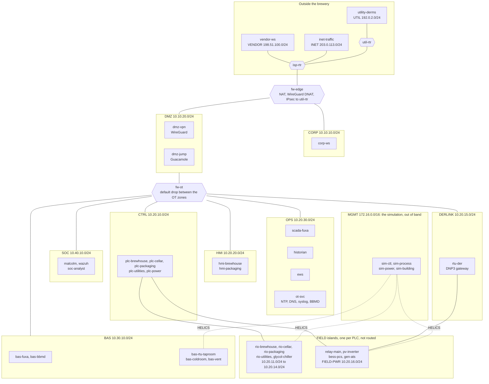

The network of the full variant: 43 VMs on 16 networks, plus the simulation's
and the capture mirror's.
Hexagons are routers and firewalls, and dotted lines are the simulation's own
network, which is not part of the brewery. [DESIGN.md](docs/DESIGN.md) section 10 has
the addresses and every allowed flow.

<details>
<summary><strong>Table of contents</strong></summary>

- [Status](#status)
- [Overview](#overview)
- [Brewing](#brewing)
- [Architecture](#architecture)
  - [Process simulation](#process-simulation)
  - [Field devices](#field-devices)
  - [Control](#control)
  - [SCADA and HMI](#scada-and-hmi)
  - [Plant power and the utility link](#plant-power-and-the-utility-link)
  - [Building automation](#building-automation)
  - [Network segmentation](#network-segmentation)
  - [Blue team](#blue-team)
  - [Vendor remote access](#vendor-remote-access)
  - [Orchestration and the plant model](#orchestration-and-the-plant-model)
  - [White cell](#white-cell)
- [Examples](#examples)
  - [SCADA (scada-fuxa)](#scada-scada-fuxa)
  - [BAS (bas-fuxa)](#bas-bas-fuxa)
  - [HMI stations](#hmi-stations)
  - [White-cell 3D view (cm-viz)](#white-cell-3d-view-cm-viz)
  - [Brand](#brand)
  - [Scenarios](#scenarios)
  - [Not captured yet](#not-captured-yet)
- [What exists](#what-exists)
- [The ci variant](#the-ci-variant)
- [Regenerate and test](#regenerate-and-test)
- [Lint](#lint)
- [Network (Phase 1)](#network-phase-1)
- [Applying the full design](#applying-the-full-design)

</details>

## Status

Everything is built and tested offline, and nothing has run on a phenix host
yet: [Status in DESIGN.md](docs/DESIGN.md#status) has the detail.

## Overview

The CherryMountain Brewery topology models a notional SCADA system for a
Colorado microbrewery and taproom. Its flagship West Coast IPA is "Fire of the
Phenix". It is an all open-source OT cyber range covering:

- **Process:** brewhouse, cellar, bottling and kegging.
- **Utilities:** glycol, steam, compressed air, CO₂, water treatment,
  wastewater neutralization, and clean-in-place (CIP).
- **Plant power:** an internal power-distribution model with PV, battery
  storage, and a standby generator.
- **Building automation:** a building automation system (BAS).
- **Security:** blue-team monitoring and a vendor remote-access path.

| Role | Component |
|---|---|
| SCADA and HMI | [FUXA](https://github.com/frangoteam/FUXA) |
| PLCs | [OpenPLC](https://github.com/Autonomy-Logic/openplc-runtime) |
| Field devices | [ot-sim](https://github.com/patsec/ot-sim) |
| Physics co-simulation | [HELICS](https://github.com/GMLC-TDC/HELICS) |
| Network monitoring and SIEM | [Malcolm](https://github.com/cisagov/Malcolm) and [Wazuh](https://github.com/wazuh/wazuh) |

To run it on your own host, follow [USER_GUIDE.md](USER_GUIDE.md): the
repositories to clone, the builds, the first start of each variant, and what to
check.

See [DESIGN.md](docs/DESIGN.md) for the full design: plant and process design,
power and building models, simulation, network architecture, phenix
integration, new software, testing, roadmap, risks, and references.
[FUTURE_WORK.md](docs/FUTURE_WORK.md) has what is planned and not done.

## Brewing

Beer is made from malted grain, water, hops, and yeast. CherryMountain makes
its IPA 15 barrels (465 gallons) at a time: a day in the brewhouse, about two
weeks in the cellar, and a shift on the packaging line. This is the process
the range simulates and controls.

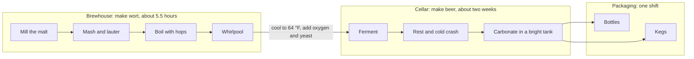

**Brewhouse: make wort.** Wort is the sweet liquid that yeast turns into beer.

1. **Mill.** Rollers crack the malt so that water can reach the starch.
2. **Mash.** The cracked malt steeps in hot water at 152 °F for an hour in the
   mash/lauter tun. The malt's own enzymes turn its starch into sugar. Heating
   the mash to 168 °F stops them.
3. **Lauter.** The wort drains through the grain bed into the kettle. It is
   recirculated first until it runs clear, and hot water rinses the last sugar
   out of the grain (the sparge).
4. **Boil.** The wort boils for an hour with hops, which make it bitter. At
   5,200 ft it boils at about 203 °F, not 212.
5. **Whirlpool.** The wort is spun so that the solids settle in the middle.
   More hops go in here, for aroma.
6. **Knockout.** A pump sends the wort through a heat exchanger that cools it
   from near boiling to 64 °F in one pass. Oxygen and yeast go in on the way to
   the fermenter. Two brews, made back to back, fill one 30-barrel fermenter.

**Cellar: make beer.** The yeast eats the sugar and makes alcohol, CO₂, and
heat. Brewers follow it by the sugar that is left, in degrees Plato (°P): this
beer starts near 16 °P and ends near 3.

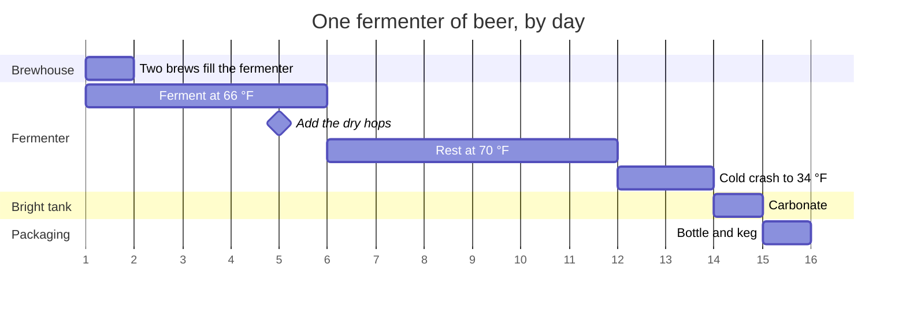

- **Ferment.** Jackets of chilled glycol around the fermenter take the heat
  away and hold 66 °F. Too warm, and the beer tastes of solvent and fruit; too
  cold, and the yeast stops.
- **Rest.** When most of the sugar is gone the tank is closed in to hold
  pressure (spunding), which keeps the CO₂ in the beer, and warmed to 70 °F so
  that the yeast cleans up a buttery off-flavor. Hops added now (dry hops) give
  the IPA its smell.
- **Cold crash.** Chilling to 34 °F drops the yeast and the haze to the bottom.
- **Carbonate.** The clear beer moves to a bright tank, where CO₂ is bubbled in
  until the beer holds 2.6 times its own volume of gas.

**Packaging.** The line rinses 12 oz bottles, fills and caps them against CO₂
pressure so the beer does not foam, prints a date, labels them, and packs them
in cases, about 1,800 bottles an hour. Kegs are washed and filled beside it.

**The services behind it.** Nothing above works without them, which is why the
range models each one:

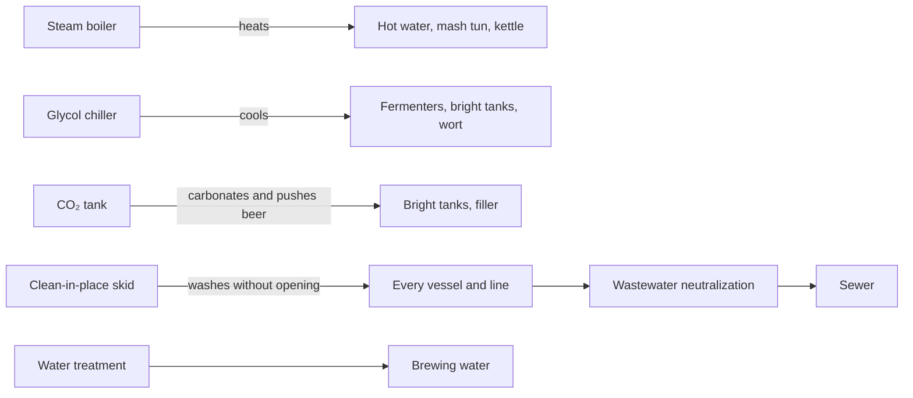

CO₂ is also the plant's main hazard. It is heavier than air and collects in
the cellar, so the cellar has gas sensors, purge fans, and a relay that shuts
the supply off.

Each step is a control loop or a sequence in a PLC, and each one can go wrong
in its own way: a mash that is a few degrees off, a fermenter that loses its
cooling, a tank closed in at the wrong pressure, a cellar that fills with CO₂.
Those are what the range's scenarios play out. [DESIGN.md](docs/DESIGN.md) has
the plant's sizes and the recipe (section 3), a glossary (section 4), and every
loop and interlock (section 6).

## Architecture

The range is a real control system around a simulated plant. Physics runs in
HELICS federates, ot-sim devices present it as field I/O, OpenPLC programs
control it, and FUXA supervises it. Around that sit the network's zones and
firewalls, the blue team's sensors, the vendor's way in, and the white cell's
tools. phenix builds and runs all of it from the files in this folder.

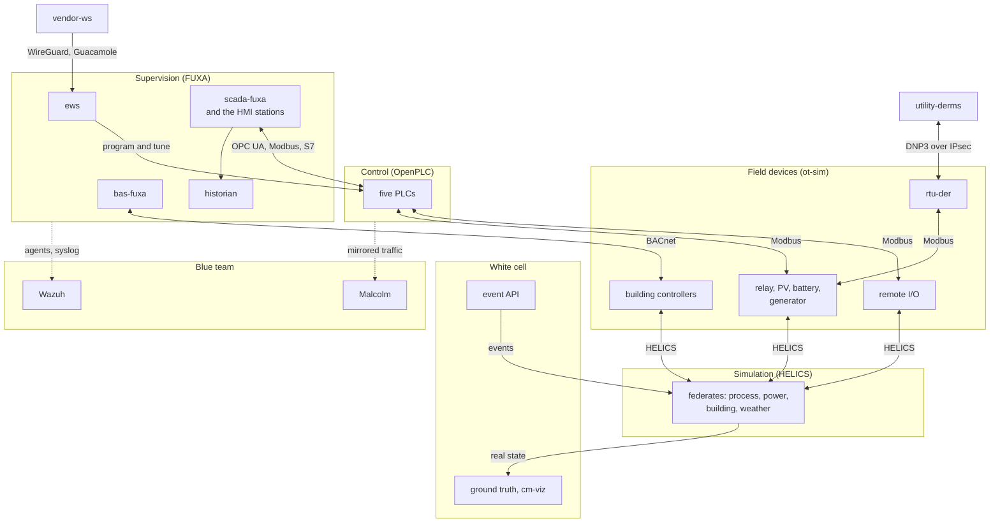

### Process simulation

Seven HELICS federates model the plant in real time: brewhouse, cellar,
packaging, and utilities on `sim-process`, the electrical system on
`sim-power`, the building on `sim-building`, and weather on `sim-ctl`, which
also runs the broker. They exchange what couples a real plant: loads go to the
power model, bus state comes back, the cellar's CO₂ goes to the building, and
glycol and CO₂ supply reach the cellar and the bottling line. Fermentation runs
48 times faster than real time, and everything else is real time. A simulated
brewer, cellar crew, and line operator do the hand work that no PLC point
covers. The federates sit on the MGMT network, which is not part of the brewery.

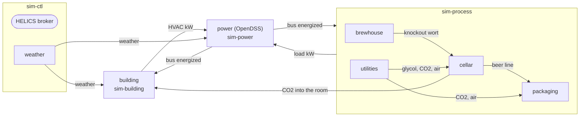

### Field devices

Every sensor and actuator is a point on an ot-sim device: four remote I/O racks
and the glycol chiller for the process, the main relay, PV inverter, battery,
and generator controller for power, and three building controllers. Each device
is a HELICS federate on its MGMT side and a protocol server on its plant side:
Modbus TCP for the process and power devices, BACnet/IP for the building (a
module written for this range), and DNP3 on `rtu-der`, the gateway the utility
polls. A write travels the same path back to the federate. The field networks
are islands, so only a rack's own PLC can reach it.

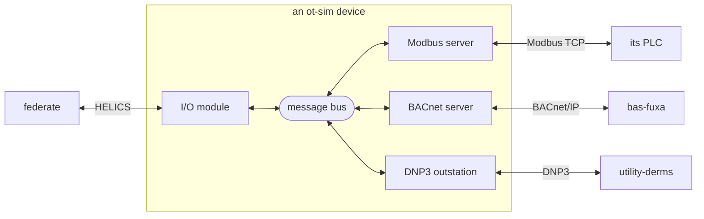

A device has one of the three servers: Modbus on the racks and power devices,
BACnet on the building controllers, DNP3 on `rtu-der`.

### Control

Five OpenPLC v4 runtimes run Structured Text programs built from this
repository: the brewhouse (ISA-88 phases), the cellar (glycol, the fermentation
profile, spunding, carbonation), packaging (a PackML line), utilities (glycol,
steam, clean-in-place, wastewater), and power (demand limiting, the generator's
exercise). Each PLC polls its own field island by Modbus and serves SCADA
northbound: OPC UA on the brewhouse, S7 on packaging, Modbus on the rest. Safety
does not depend on SCADA. The cellar's CO₂ interlock is a hardwired relay from
the gas detection controller, and a vessel-entry permit locks outputs out in
the PLC. The alarm logic is generated from the plant model.

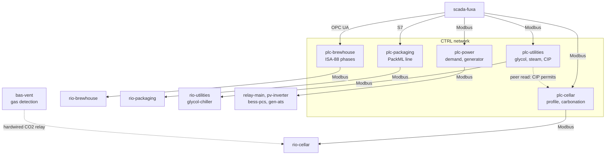

### SCADA and HMI

Two FUXA servers supervise the plant. `scada-fuxa` reads and writes all five
PLCs in their own protocols, shows the process graphics, a table of points for
each controller, and the alarms, and runs the batch engine: a server script that
takes the brewhouse PLC through a brew, phase by phase, from the recipe.
`bas-fuxa` is the front end of the building controllers, over BACnet. The two HMI stations are Chromium kiosks on scada-fuxa
views that sign themselves in as the operator. The historian keeps FUXA's values
in InfluxDB and graphs them in Grafana. Engineers work from `ews`, which has the
PLC tools.

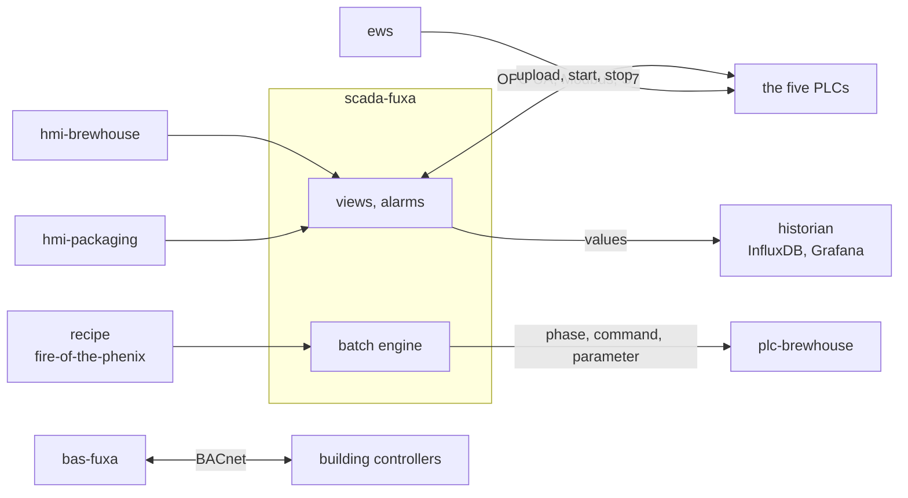

### Plant power and the utility link

OpenDSS models the brewery's electrical system from the 12.47 kV utility feeder
through a 500 kVA transformer to the 480 V switchboard, with 100 kW of rooftop
PV, a 100 kW / 200 kWh battery, and a 100 kW standby generator behind a
transfer switch. The other federates send their loads each second, and an outage
really takes their power away. `plc-power` limits demand and exercises the
generator. The utility, Summit Valley Power, polls and commands the site's
energy resources through `rtu-der` by DNP3, over an IPsec tunnel between its
router and the brewery's edge firewall.

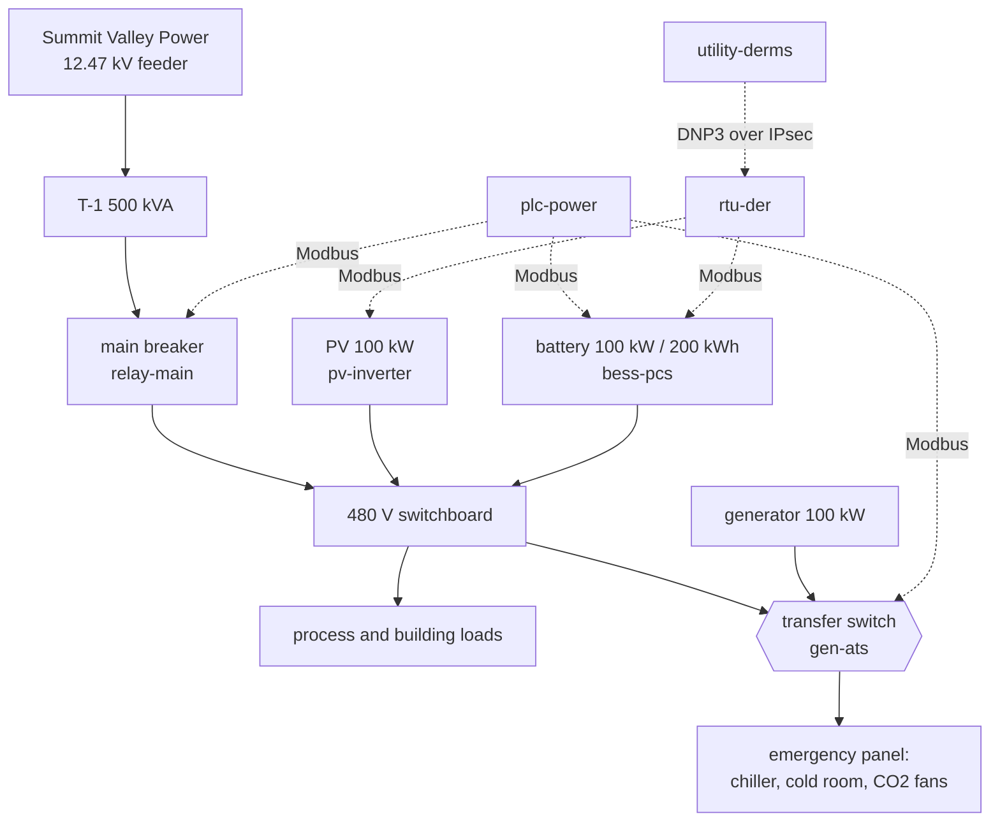

### Building automation

Three BACnet/IP controllers run the building: the taproom's rooftop unit, the
cold room, and the cellar's ventilation with its CO₂ detection and purge fans.
`bas-fuxa` is their front end on the BAS network. The cellar's gas detection is
life safety, so its relay is wired to the cellar PLC's I/O and carbonation stops
on high CO₂ with no network involved. SCADA only reads the CO₂ values, through a
pair of BACnet broadcast management devices (BBMDs) that carry discovery across
the firewall. The building's loads, and the weather that drives its heating and
cooling, feed the power model.

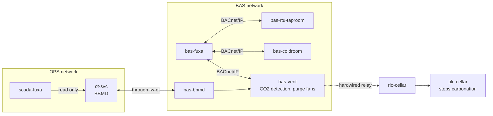

### Network segmentation

The network follows the Purdue model with ISA/IEC 62443 zones and conduits. Two
VyOS firewalls separate the enterprise, a DMZ, and the OT zones: `fw-edge` faces
the Internet, and `fw-ot` stands between every OT zone with default drop and one
rule per allowed flow. The field networks are not routed at all. A static
checker (`tools/netcheck`) compares every rule with the design's conduit matrix,
and state-of-health probes test each allowed and each blocked path on a running
range. `ot-svc` gives the plant its time, its names, and a syslog relay.

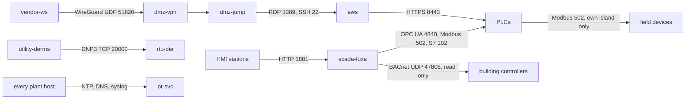

The main conduits. [DESIGN.md](docs/DESIGN.md) section 10.3 lists every one, and a
flow that is not listed is dropped.

### Blue team

The SOC sees the plant two ways. Malcolm captures a mirror of the OT, building,
and DMZ networks and runs Zeek with ICS protocol parsers, Suricata, and Arkime
over it. Wazuh collects logs from agents on the servers and workstations and, by
syslog, from the firewalls and from the plant's relay on `ot-svc`. Both carry rules written
for this plant: a write to a life-safety point, a breaker command from an
unexpected host, a vessel-entry violation, each step of the vendor's path.
`soc-analyst` is the analyst's desktop, with both consoles a click away.

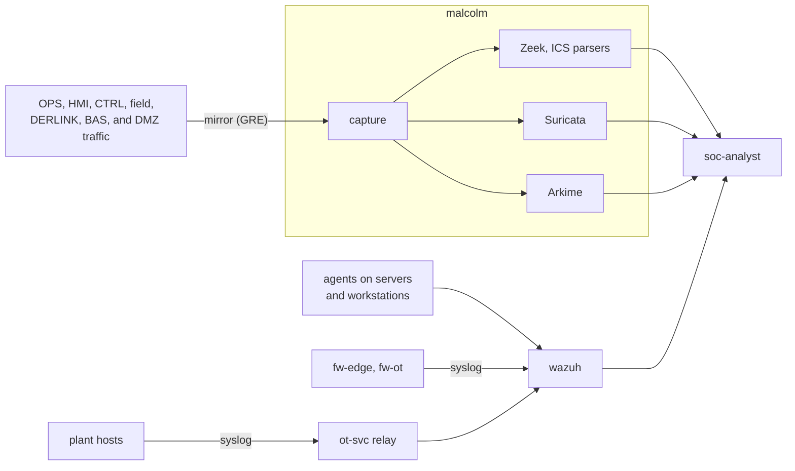

### Vendor remote access

Ridgeline Process Controls, the integrator, reaches the plant the way real
vendors do. A technician's workstation opens a WireGuard tunnel to `dmz-vpn`,
and the tunnel allows one destination: the Guacamole jump host, `dmz-jump`.
There the technician signs in with a password and a one-time code, and Guacamole
opens a recorded RDP or SSH session to the engineering workstation, the only
host the jump host may reach. From there the technician works on the PLCs. Every
step leaves evidence the blue team can follow.

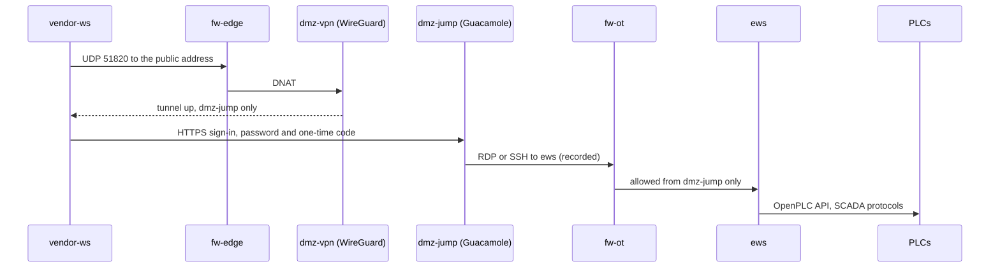

### Orchestration and the plant model

phenix builds the range from the topology and scenario files here, and its apps
configure the parts: `ot-sim` and `helics` for the simulation, `vrouter` for the
firewalls, `ntp`, `wireguard`, `mirror`, `soh` for health checks, `scorch` for
scripted runs, and this range's own `cherrymountain` app, which renders the
configs, credentials, and provisioning of every role. Almost all of their input
is generated. `plant/plant.yaml` holds every tag, device, alarm, and host;
`plantgen` turns it into register maps, PLC variables, FUXA tags, HELICS lists,
and app settings; and `sync.py` puts the results in place. A check fails when a
copy drifts from its source.

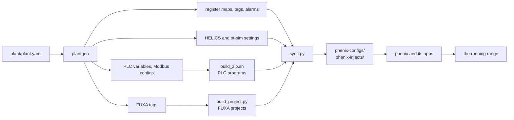

### White cell

Exercise control runs on `sim-ctl`, out of the players' sight. An event API puts
faults into the simulation: a CO₂ release, the utility's breaker opening, a jam
on the line, a chiller fault. Every federate writes ground truth, the plant's
real state whatever the HMIs show, to OpenSearch behind a Grafana dashboard, and
`cm-viz` draws it as a 3D view of the brewery. SCORCH pipelines run scripted
scenarios through the `plantevent` component and capture the traffic. Staff
reach these, and the plant's own web pages, through phenix's tunnels.

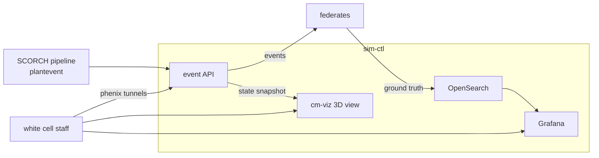

## Examples

These are captures of real software showing the range's real files, taken offline
in a container, because nothing has booted on a phenix host yet. FUXA is the
pinned 1.3.6 server running the generated projects, the HMI pictures come from the
range's own `cm-kiosk` script, and cm-viz is this repository's page. What is staged
is data, and each caption says where its values came from. The parts that could not
run here are listed in [Not captured yet](#not-captured-yet). The scripts that take
the pictures, and the rules for the staged values, are in
[docs/examples/capture](docs/examples/capture/README.md#where-the-values-come-from).

### SCADA (scada-fuxa)

Every picture here shows the plant at 11:00 on its first Wednesday (simulated time)
with nothing injected, unless the caption says otherwise. To read a screen (gray is
normal, color is a medium or an alarm, a flag is an alarm), see [How to read a
screen](USER_GUIDE.md#operate-the-plant-scada-fuxa). A trend holds only what FUXA
stored since it started, a few minutes at most, because the capture opens the view
moments after it starts FUXA, and the stand-in plant serves one moment, so the lines
are flat.
Where a caption says a value reads 0 because the PLC computes it, no PLC ran, and the
capture [stages what it can](docs/examples/capture/README.md#where-the-values-come-from).

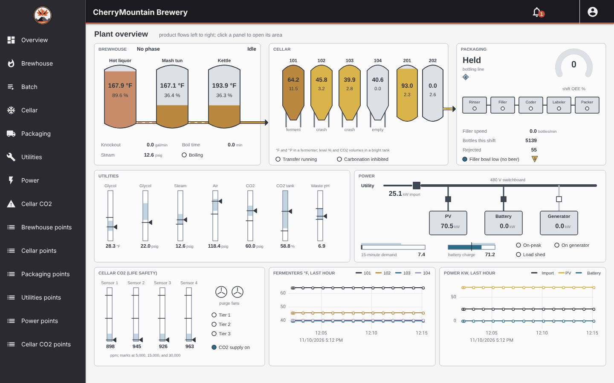

The **Overview**, which scada-fuxa opens on. Product moves from left to right: the
brewhouse vessels, the four fermenters and two bright tanks, and the bottling line;
below are the utilities on scales, the power one-line, the cellar's CO₂ sensors, and
two trends. The values come from the offline simulation. The brewhouse is idle (the
phase bar's "No phase" is PLC state, which reads 0). The bottling line is Held with a
shift OEE of 0, because BBT-202 is empty (0.0 %): the filler's low-bowl lamp is lit,
the yellow flag beside it is the alarm the bell counts, and the line state, the
shift's counts ("Bottles this shift" 5139, "Rejected" 55), and the OEE are staged
from the machines by the rules of `plc-packaging`. The OEE dial reads 0 with an
empty arc.


The **Brewhouse** screen with the brewhouse idle: the phase bar reads "No phase" and
"Idle" with the batch counters at 0, because the phase, state, and counters are PLC
state. Vessel levels and temperatures come from the offline brewhouse (hot liquor 167.9
°F at 89.6 %, mash tun 167.1 °F with its setpoint at 152.0 °F, kettle 193.9 °F), and
steam is 12.6 psig; the valve into the cold liquor tank is labelled "RO in". The
"Mash deviation alarm enabled" lamp is dark, which is PLC state too. The "Cold liquor high level" and "Hot liquor low level" lamps are lit; the
second is the low-level switch being made, which it is while the hot liquor covers the
jacket. The Batch view and a brew in progress are under [Scenarios](#scenarios).

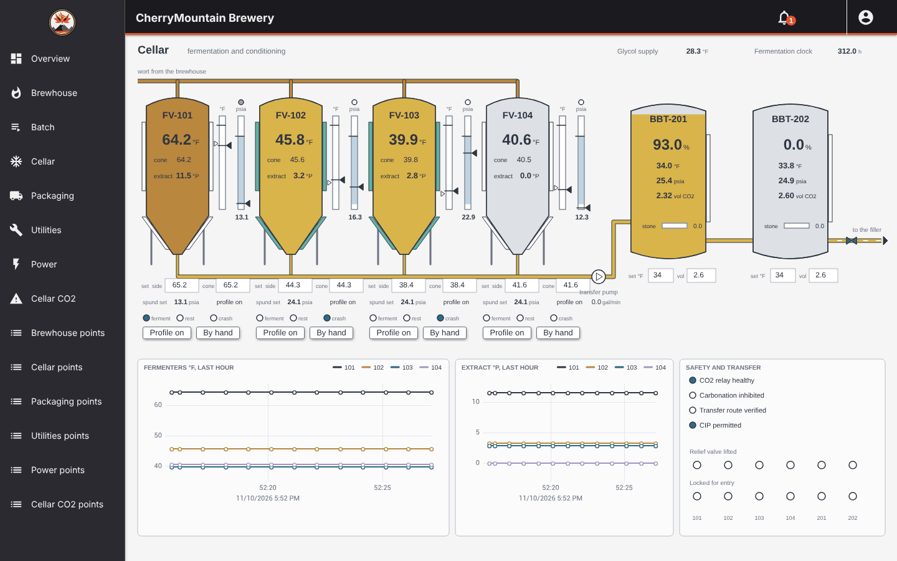

The **Cellar** screen. Each fermenter has its side and cone temperatures with setpoint
boxes, a head-pressure scale with the spunding setpoint, its extract, and the
fermentation profile: the stage lamps show FV-101 fermenting, FV-102 and FV-103
crashing, and FV-104 empty, and the "Profile on" and "By hand" buttons. The bright
tanks show level, temperature, pressure, and CO₂ volumes. Temperatures, pressures, and
extract come from the offline cellar. The temperature setpoints are staged by the
profile's rule, which leads the beer by 1 °F: FV-101 (64.2 °F, fermenting) is at 65.2
°F, under its stage's 66 °F; FV-104 (40.6 °F, empty) is 1 °F above its beer; and the
two crashing fermenters are staged at 1.5 °F under their beer, which approximates the
PLC's crash curve (see [the capture notes](docs/examples/capture/README.md#where-the-values-come-from)).
The setpoint boxes are too narrow for these one-decimal values, so the last digit in
each is partly cut off; the Cellar points table below has them in full. No flag is up. "CIP permitted" is lit, which the capture stages from the
transfer pump being off.

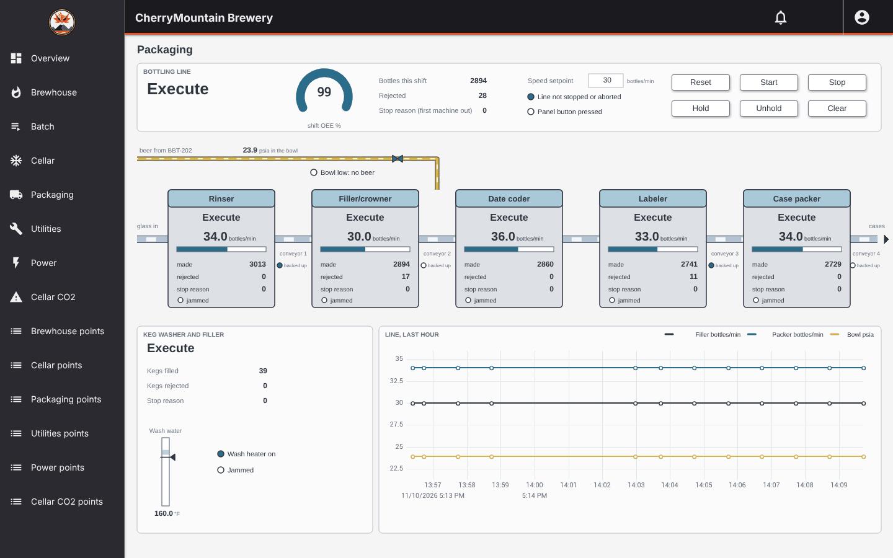

The **Packaging** screen at 08:00, with the line running (served over S7 from the
packaging federate). The line is Execute, and the OEE dial reads 99 and its arc is nearly
full: the filler runs at 30.0 of 30 bottles/min, and the shift's counts are 2,894
bottles and 28 rejected (the filler's 17 and the labeler's 11). Each machine shows its
state, speed, made and rejected counts, stop reason, and jam lamp, and the backed-up
eyes of conveyors 1 and 3 are lit. The keg line is Execute, with 39 kegs filled, the wash
water at 160 °F, and its heater on. The line's state, shift counts, stop reason (0), OEE,
and the heater and conveyor commands are staged from the machines with the program's
rules. The line's counts are the filler's made count and the machines' rejects, which
equal the shift's here because the offline line has run only this shift.

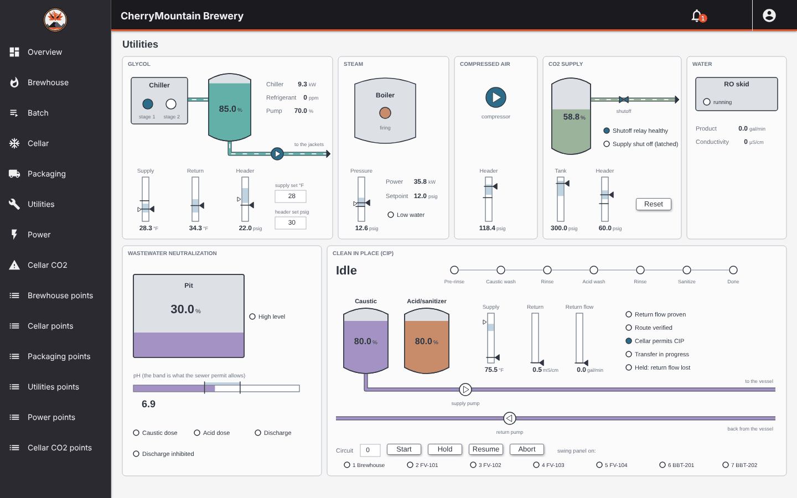

The **Utilities** screen: glycol, steam, compressed air, CO₂ supply, water, wastewater
neutralization, and the CIP skid, from the utilities federate. The CIP skid reads Idle
at circuit 0, because its step and circuit are PLC state. "Cellar permits CIP" is lit,
which the capture stages from the cellar's transfer pump being off. "Held: return flow
lost" is dark: the capture stages it at 0, because no wash is running. The CO₂ supply
card shows the tank at 58.8 % and 300.0 psig, the header at 60.0 psig, the valve open,
the shutoff relay healthy, and "Supply shut off (latched)" dark.

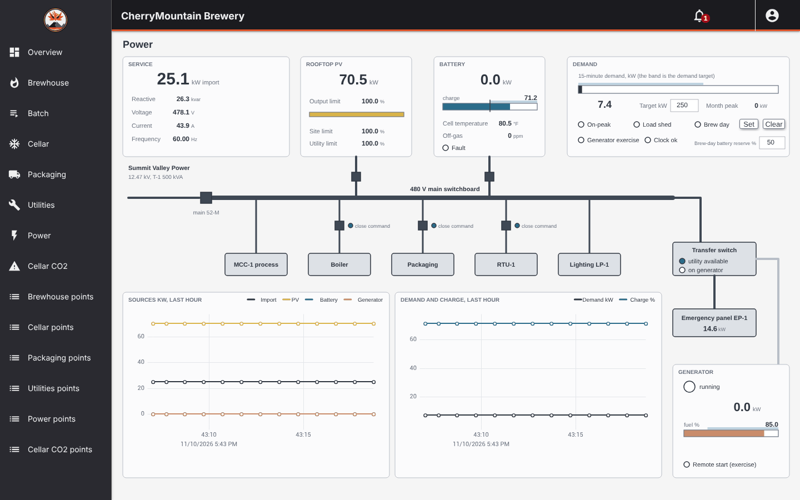

The **Power** screen with the plant on utility power, values from the power federate
(OpenDSS): 25.1 kW import, 70.5 kW from the PV, and the battery idle at 71.2 % charge.
The generator is stopped, and the transfer switch shows utility available. The boiler,
packaging, and RTU-1 feeders are drawn closed with their close commands lit. What the
power PLC computes reads 0: the month's peak demand, and the on-peak, load shed, brew
day, exercise, and clock-ok lamps are not staged, so the lamps are dark.

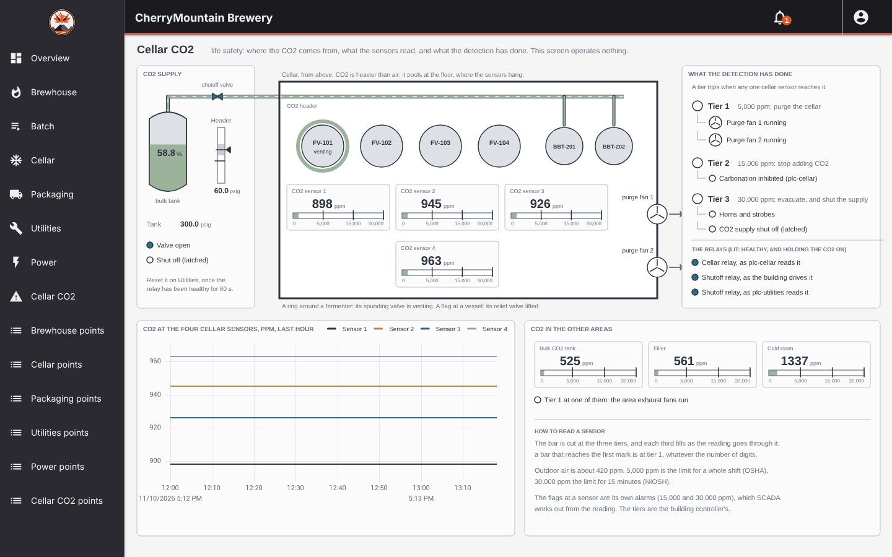

The **Cellar CO2** screen: the sensors, the tiers, and the building's own relay are read
over BACnet/IP from the building federate's `bas-vent` point values, and the supply and
the two PLC-side relays over Modbus TCP from plc-utilities and plc-cellar. It reads from where the CO₂ comes from
to what the detection did, and it operates nothing. The **CO2 supply** card has the bulk
tank (58.8 %, 300.0 psig), the header at 60.0 psig, and the shutoff valve open, with
"Shut off (latched)" dark. The **cellar plan** has the CO₂ header along the wall, the
four fermenters and two bright tanks, the four low sensors where they hang (898, 945,
926, and 963 ppm, each on a bar cut at 5,000, 15,000, and 30,000 ppm, with the fill in
the first third), and the two purge fans in the wall. A ring around a fermenter marks a
venting spunding valve: here FV-101's, with "venting" under its name. The **ladder** on
the right is "tier lamp, then what its relay does": all three tier lamps are dark,
neither purge fan is running, "Carbonation inhibited" and "Horns and strobes" are dark,
and the three relay lamps (the cellar relay as plc-cellar reads it, the shutoff relay as
the building drives it, and as plc-utilities reads it) are lit, which is healthy. The
other areas are below: the bulk tank (525 ppm), the filler (561), and the cold room
(1,337), with tier 1 dark.

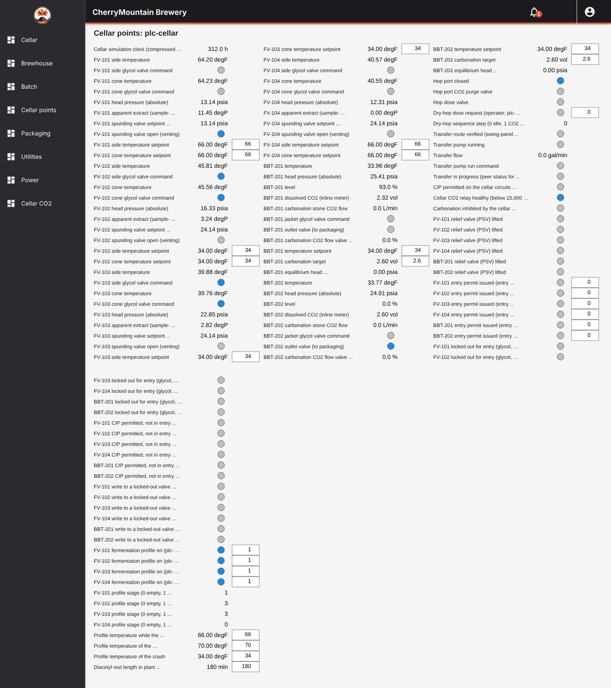

The **Cellar points** table, one row for each `plc-cellar` tag, with the same values. The
table continues in a second band below the three columns (the page scrolls), with the
lockouts, CIP permits, and profile tags, and the picture is tall enough to show both.
No entry permit is set, so the lockout lamps are dark and every vessel is CIP
permitted. The profile rows show the stages (FV-101 1, FV-102 and FV-103 3, FV-104 0)
and the temperature setpoints the capture stages from them: 65.20, 44.31, 38.38, and
41.57 °F, the same for a fermenter's side and cone. The profile's own settings are 66,
70, and 34 °F and 180 min.

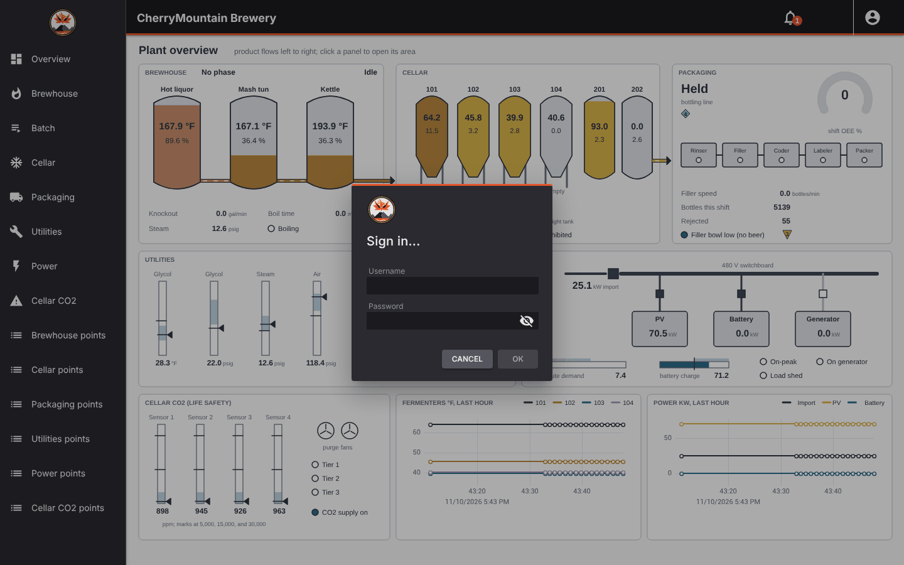

The sign-in dialog FUXA opens for the `operator` account, over the Overview, as
branded by the project's layout.

### BAS (bas-fuxa)

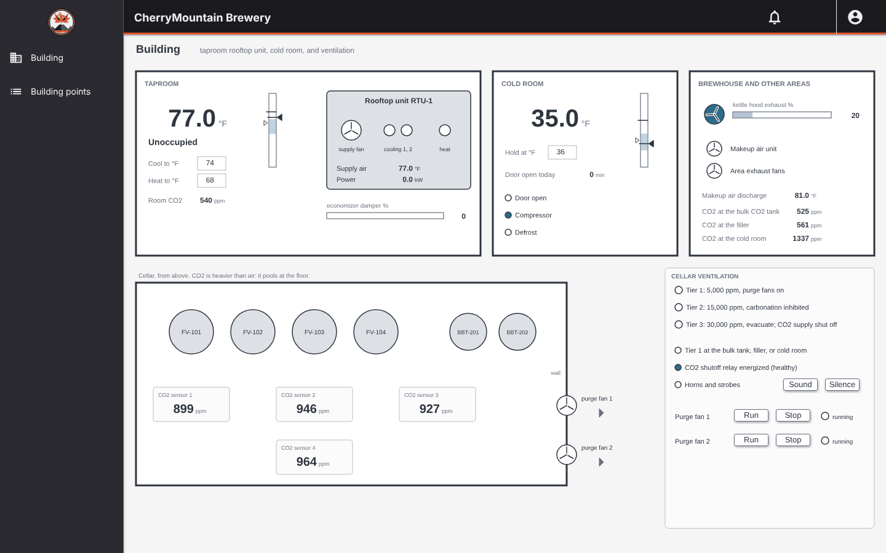

The **Building** screen of bas-fuxa: the taproom (77.0 °F, unoccupied) and its
rooftop unit, the cold room (35.0 °F, compressor on), the brewhouse ventilation (the
kettle hood exhaust at 20 %, the makeup air at 81.0 °F), and the cellar. The cellar is a
plan with its four CO₂ sensors (898, 945, 926, and 963 ppm, each on a bar cut at 5,000,
15,000, and 30,000 ppm) and its two purge fans, and beside it the ladder from each tier
lamp to what its relay does, with the building's own buttons (Run and Stop for each
fan, Sound and Silence for the horns). The tier lamps and the horns are dark, neither
purge fan is running, and the one relay this controller drives ("Shutoff relay, as the
building drives it") is lit, which is healthy. The other areas (the bulk tank at 525
ppm, the filler at 561, the cold room at 1,337) and the area exhaust fans are on the
right. The plan has the vessels as plain outlines: their own points belong to
plc-cellar, so this screen has no ring or flag at a vessel. The values are read over
BACnet/IP from three stand-in devices that serve the building federate's values. No
alarm is up.

### HMI stations


The brewhouse station: the range's `cm-kiosk` script ran Chromium in kiosk mode on a
1440x900 display, opened the Brewhouse screen, and signed in as `operator` by itself
(the name is beside the account icon). The batch engine was brewing against the tests'
port of the brewhouse PLC: a request was raised about half a minute earlier, and the
phase bar is on Heat liquor, which reads Idle (step 0), with the
batch number at 1 and one request raised and accepted. The vessel values are the plant's at
11:00 (see [Scenarios](#scenarios)). There is no window manager or desktop around it,
so this is the browser only, not the VM's screen.

### White-cell 3D view (cm-viz)

Two of the three scenes in normal running; the Fermenters scene is under
[Scenarios](#scenarios). The page is cm-viz's own, drawn by headless Chromium with
software WebGL (the footer names the renderer).

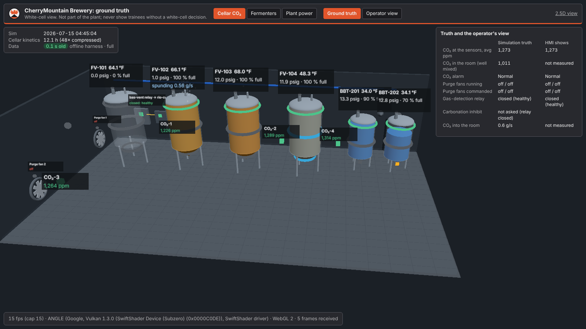

The **Cellar CO₂** scene 15 minutes after the start: sensors near 1,200 ppm, both
fans off, nothing wrong.

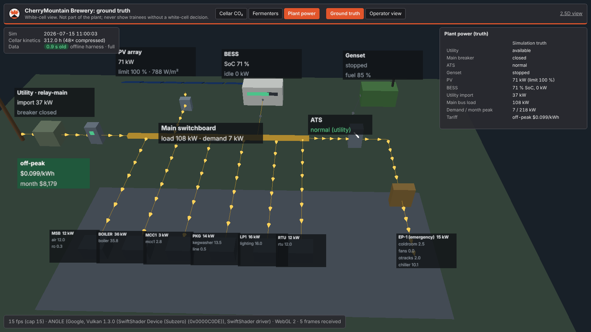

The **Plant power** scene at 11:00: utility import, PV output, and the main bus.

### Brand

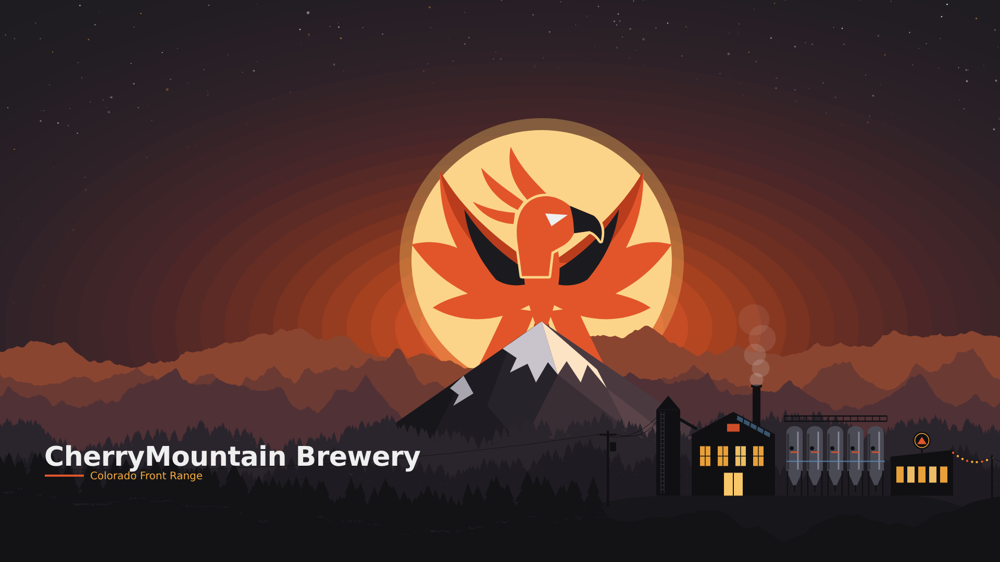

The desktop wallpaper, `brand/wallpaper-1080p.png`. This is the asset, not a picture
of a desktop; the frame colors and the mark show in every FUXA and cm-viz picture
above.

### Scenarios

What the range's example scenarios look like on the screens that run here. The
attacks in the last three groups are the scripted scenarios of the cm-viz harness
(`viz/cherrymountain_viz/scenarios.py`), which write the values a compromised host
would; the SCORCH runs of [USER_GUIDE.md](USER_GUIDE.md#run-an-exercise) inject the
events only. The same simulated moment feeds cm-viz and the FUXA picture beside it.

**baseline-brew-day.** A brew request at the brewhouse panel, which the event raises, and the batch engine taking it. These two pictures come from one live run, not from a cm-viz moment.

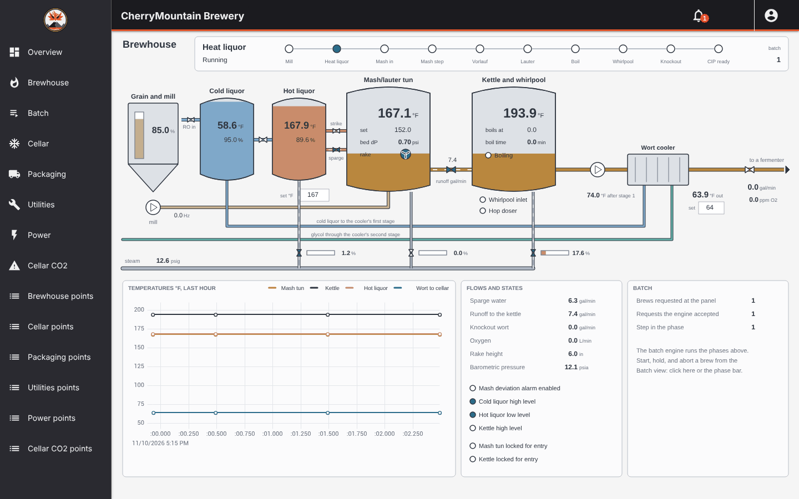

The **Brewhouse** screen during a brew, from the same run as the Batch picture below.
The batch engine takes a brew through the brewhouse PLC's handshake, and the phase bar
is on Heat liquor, which reads Running, with the batch number at 1 and one request
accepted. The step in the phase is 1. The hot liquor's setpoint reads 167 °F, which the
engine wrote (it is 168 °F in the idle picture). The vessel values are the plant's at
11:00, not a brew's, and do not follow the phase: the mash tun is at 167.1 °F with its
setpoint at 152.0 °F.

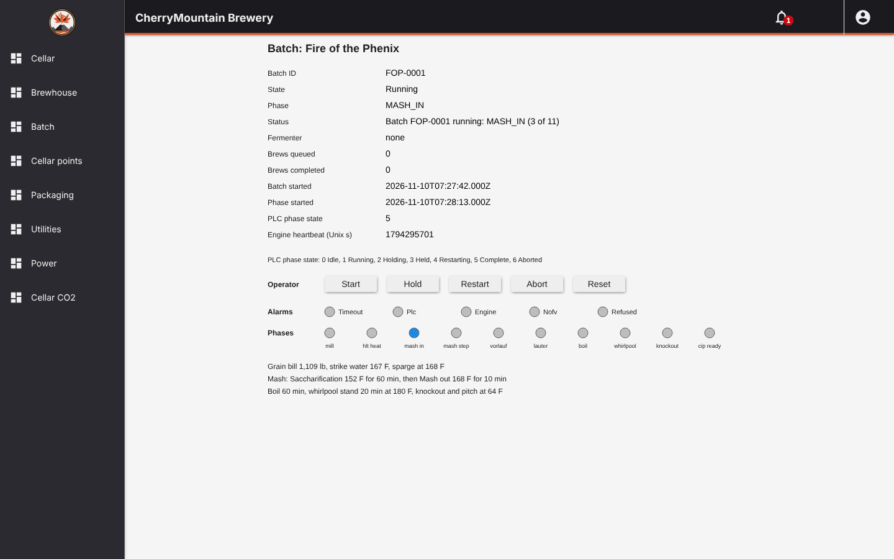

The **Batch** view while the real batch engine script, running in FUXA, takes a brew
through the PLC handshake: batch FOP-0001 is Running in HLT_HEAT, phase 2 of 11, and
the PLC's phase state is 5 (Complete), a few seconds after the Brewhouse picture. The
brewhouse PLC was the tests' port of its program (`fuxa/tests/brewhouse_sim.mjs`) with
4-second phases, and the panel's request counter was raised once, as the event does. A
phase takes the engine about 19 s (the batch started at 17:14:37 and the second phase
at 17:14:56, as the view shows), and the picture was taken about 25 s after the
request. The times are the machine's wall clock (UTC). The view lists the recipe's
figures (grain bill 1,109 lb, strike water at 167 °F, saccharification at 152 °F for 60 min).

**utility-outage.**

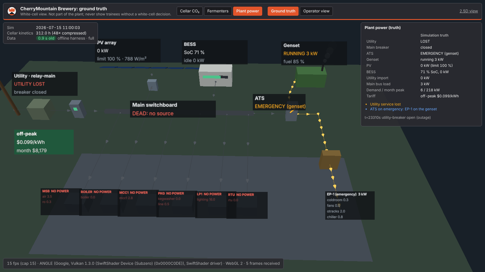

The **Plant power** scene after `utility-breaker open` at 10:58: the main switchboard
is dead, the genset runs, and the ATS has moved EP-1 to it.

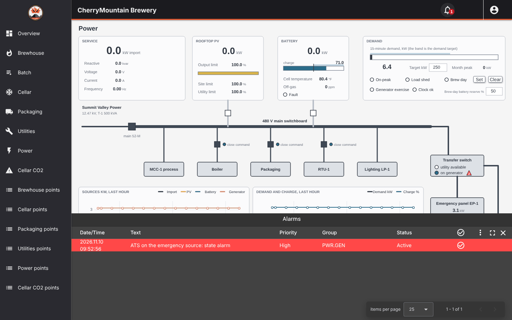

The **Power** screen of the same moment, with the alarm list open over the trends:
service at 0.0 kW, 0 V, and 0.00 Hz, the PV and battery switches drawn open, the
transfer switch with "on generator" lit beside its triangle flag and "utility
available" dark, the emergency panel EP-1 at 3.1 kW, and the one alarm that is on (the
ATS on the emergency source). The generator's own card is under the alarm list.
"Load shed" and the month's peak read 0, and the boiler, packaging, and RTU-1 feeders
are drawn closed, because the power PLC that sheds them is not in the capture.

**cellar-co2-leak.** The `co2-release` event at FV-102 at 40 g/s.

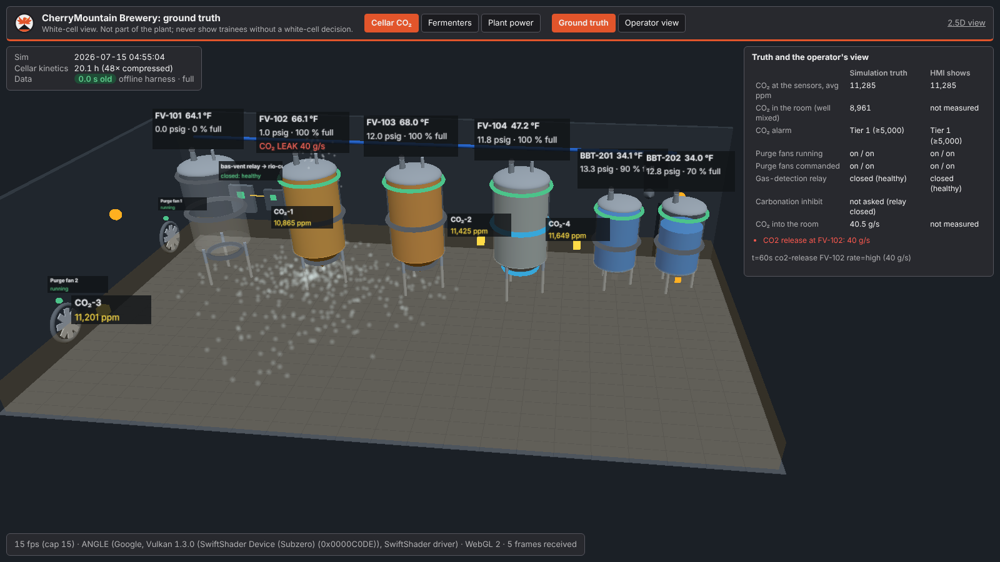

The **Cellar CO₂** scene 25 minutes in: sensors at about 11,000 ppm (tier 1), the
plume at FV-102, and both purge fans running.

**CO₂ leak with the purge fans stopped.** The same release, then a BACnet write from a
compromised bas-fuxa that stops both fans (the harness's `co2-attack`).

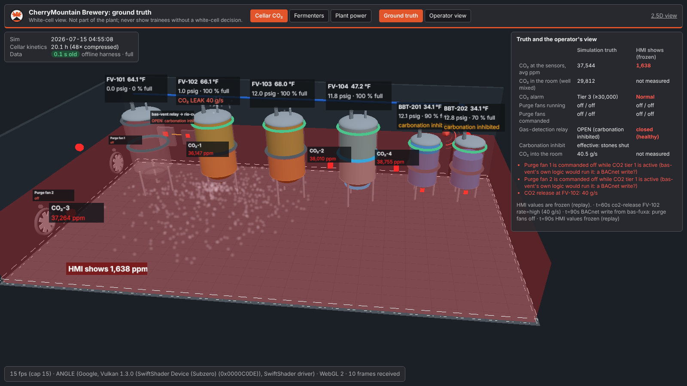

The **Cellar CO₂** scene, ground truth: about 37,500 ppm (tier 3), the fans off, the
gas-detection relay open, and the findings that name the fans' command. The "HMI
shows 1,638 ppm" label is the scenario's stand-in for a replay on the supervisory
path, which freezes the HMI's values.

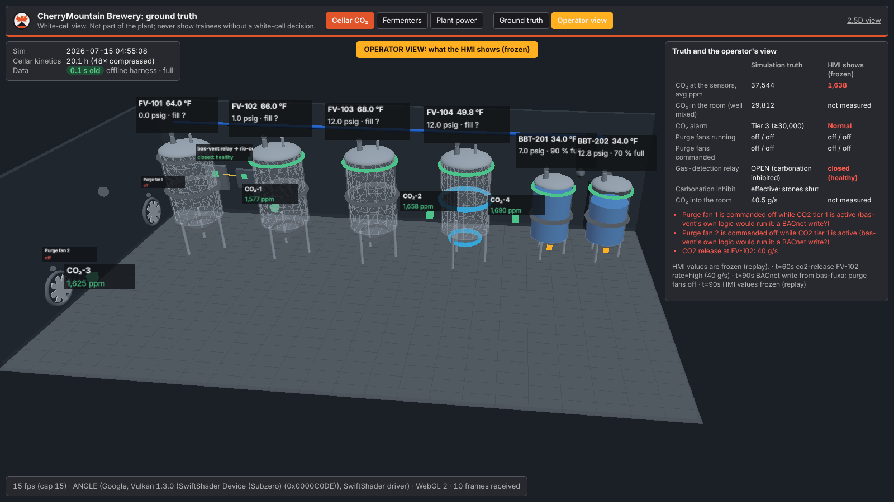

The same moment in the **operator view**, with what the frozen HMI shows: 1,638 ppm,
alarm "Normal", relay closed.

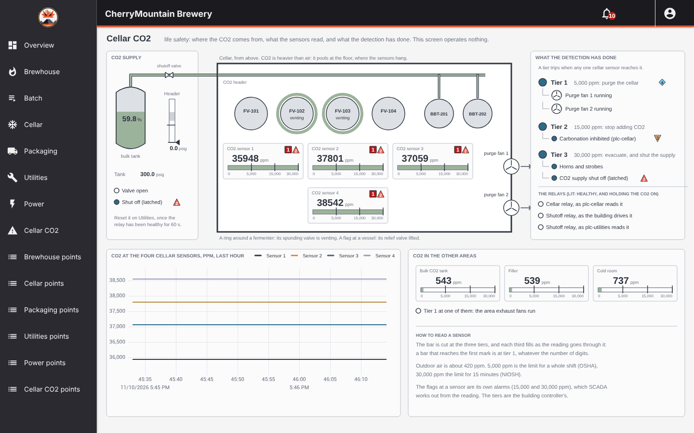

The **Cellar CO2** screen of scada-fuxa for the same moment, with no replay (FUXA shows
the simulated values). The four sensors read 35,948, 37,801, 37,059, and 38,542 ppm,
and each bar is full past the 30,000 mark, with a red square flag (1, critical) and a
triangle flag (2, high) at the sensor. The ladder shows what the detection did and what
did not happen: all three tier lamps are lit (tier 1 has its low-priority diamond flag),
and so are "Carbonation inhibited" (with a medium flag) and "Horns and strobes", but
neither purge fan is running, which tier 1 should have started. The CO₂ supply is cut:
the shutoff valve's lamp is dark, the header reads 0.0 psig, the tank still 300.0 psig
and 59.8 %. All three relay lamps are dark, which is the relays dropped out. "CO2 supply
shut off (latched)" is dark too, although the valve is shut: that latch is plc-utilities
state, which the capture does not stage, so it reads 0. FV-102 and FV-103 have the ring
and "venting". The other areas read 543, 539, and 737 ppm. The bell counts 9 alarms: the
four sensors' high and critical alarms and the cellar PLC's carbonation inhibit (the
low-priority tier flag is not counted). FUXA raises a high alarm after 30 s, so the
picture was taken 40 s after the view opened.

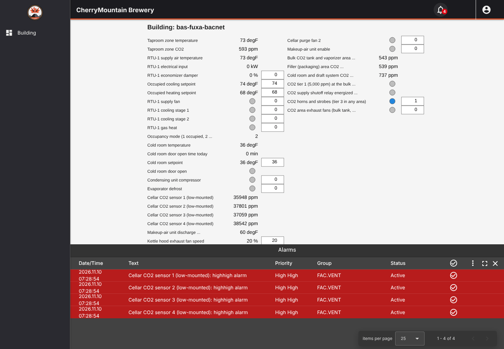

The **Building** screen of bas-fuxa for the same moment, with the same sensor readings
and flags on the cellar plan. In the ladder the three tier lamps and "Horns and
strobes" are lit and neither purge fan is running; the one relay lamp, "Shutoff relay,
as the building drives it", is dark. Elsewhere the taproom reads 73.0
°F, the cold room 36.0 °F with its compressor off, and the makeup air 60.0 °F. The bell
counts 8 alarms, the four sensors' high and critical alarms.

**Rogue Modbus master (spunding).** A host on FIELD-CEL writes a 30 psig spunding
setpoint to FV-102 every minute, above the 15 psig relief limit (the harness's
`spunding-attack`).

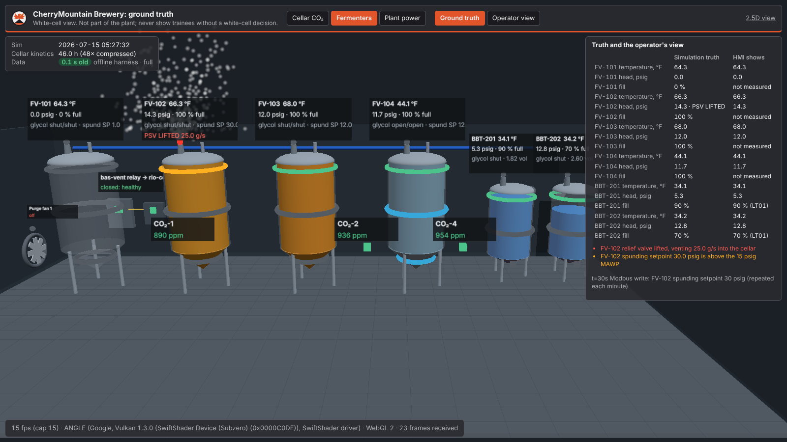

The **Fermenters** scene 57 minutes in: FV-102 at 14.3 psig with its relief valve
lifted, venting 25 g/s into the cellar, and the findings that name the setpoint.

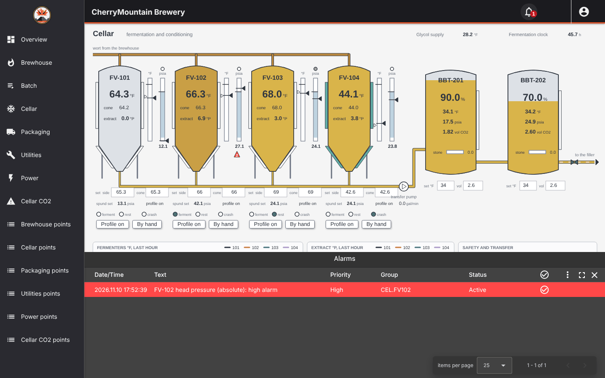

The **Cellar** screen of the same moment, with the alarm list open over the trends:
FV-102's spunding setpoint at 42.1 psia (30 psig) and its head pressure at 27.1 psia,
with the triangle flag beside the pressure scale and the high-pressure alarm in the
list. The stage lamps show FV-102 fermenting, FV-103 resting, and FV-104 crashing, and
FV-101 empty. The staged temperature setpoints follow the profile's rule: FV-102 at
66 °F and FV-103 at 69 °F (their beer at 66.3 and 68.0 °F, so the 66 and 70 °F of the
stages cap the one and the 1 °F lead sets the other), and FV-101 and FV-104 at 1 °F above
and 1.5 °F below their beer (65.27 and 42.59 °F in the snapshot, with the last digit
cut off in the boxes).

**packaging-shift.** The `jam` event on the labeler and the filler.

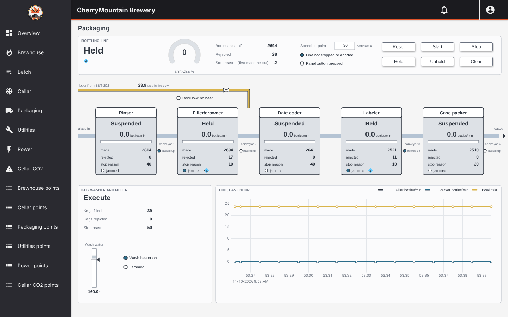

The **Packaging** screen at 08:00 after the two jams: the labeler's and the filler's jam
lamps are lit, each with a diamond flag (low priority), and both machines are Held
(state 11) with speed 0 and stop reason 10. The rinser, date coder, and case packer are
Suspended (state 5) behind them, with stop reasons 40 (blocked) for the first two and
30 (starved) for the packer. The line is Held, with a diamond flag beside its state
that the capture stages without the alarm's 10-minute delay. Its stop reason is 2, the
filler, which is the first machine in line order that is jammed or Held. The shift's
counts are 2,694 bottles and 28 rejected. The OEE dial reads 0 because the filler's
speed is 0, and the conveyors' run commands are 0. The bell has no count: these
alarms are low priority, which it does not count.

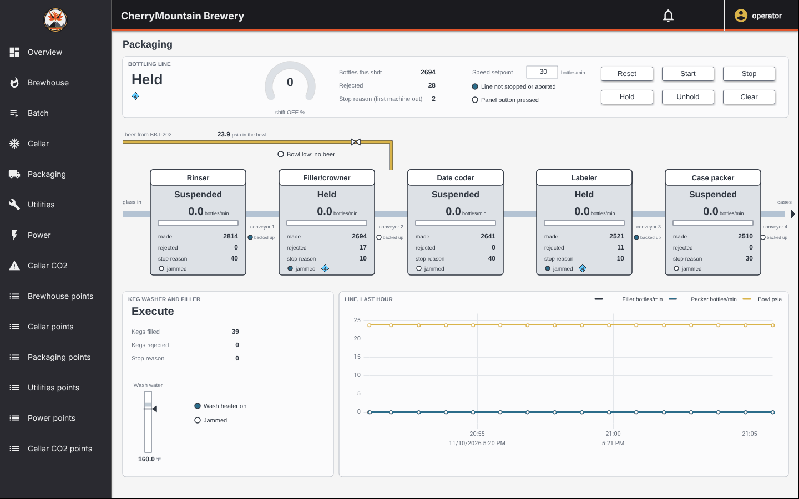

The packaging station (`cm-kiosk`, as above) showing the same moment, signed in as
`operator`. The whole Packaging screen fits the station's 1440x900 display.

**vendor-maintenance and the detections.** The SOC's side of these scenarios is on
Malcolm and Wazuh, which could not run here. For one rule the repository has a
fixture: `phenix-injects/wazuh/samples.txt` holds a log line for each rule, written as
the id of the rule that must fire and the line (`tests/soc/test_wazuh.py` checks it
offline; `cm-wazuh-selftest` runs it through `wazuh-logtest` on the manager). These are
the lines for the PLC actions the EWS's `cm_plc_tool.py` logs (the vendor-maintenance
run re-uploads a program with it). They are the fixture's input, not Wazuh's output:

```text
100411|Nov  9 12:00:13 ews cm-plc-tool: event=plc_upload plc=plc-cellar host=10.20.10.12 user=ridgeline-akim
100412|Nov  9 12:00:14 ews cm-plc-tool: event=plc_start plc=plc-cellar host=10.20.10.12 user=ridgeline-akim
100413|Nov  9 12:00:15 ews cm-plc-tool: event=plc_failed plc=plc-cellar host=10.20.10.12 user=ridgeline-akim
```

### Not captured yet

Each of these needs a booted range. Capture them after the first boot, in the state of
the scenario beside them.

| Part | Status | What to capture |
|---|---|---|
| Malcolm | not captured yet: needs a booted range | Dashboards (Zeek Modbus, BACnet, OPC UA; Suricata alerts) and Arkime sessions, during `baseline-brew-day`, `cellar-co2-leak`, and `vendor-maintenance` |
| Wazuh | not captured yet: needs a booted range | Threat Hunting with the `cm_vendor`, `cm_wireguard`, and `cm_firewall` groups; the alerts of rules 100100 to 100413 during `vendor-maintenance` |
| Grafana (historian) and the "CherryMountain ground truth" dashboard | not captured yet: needs a booted range | The historian's process and production panels, and the ground-truth panels with the injected events listed |
| Guacamole (sign-in, one-time code, an RDP session to the EWS) | not captured yet: needs a booted range | The sign-in page with the branding extension, and the vendor's session on `ews-rdp-ridgeline-akim` (the Guacamole web app was not run here either) |
| VM desktops: ews (xrdp sign-in, tools), vendor-ws, soc-analyst, corp-ws, and the two HMI VMs under XFCE | not captured yet: needs a booted range | Each console as phenix shows it, with the wallpaper and the panel |
| phenix's own pages (experiment view, VM screenshots, Files tab) | not captured yet: needs a booted range | The experiment running, and the SCORCH run's files |
| scada-fuxa and bas-fuxa with the real PLCs (OpenPLC) and ot-sim behind them | not captured yet: needs a booted range | The views above with live values, and a real brew from the Batch view |
| cm-viz in the range (sim-ctl as its source, beside FUXA) | not captured yet: needs a booted range | The three scenes through the autotunnel, during a SCORCH run |

## What exists

| Path | Contents |
|---|---|
| `plant/` | `plant.yaml` tag database for the whole plant (every area, 43 hosts, 516 tags, 98 alarms) and the plantgen output under `plant/generated/{ci,full,lite}/` |
| `tools/plantgen/` | Generator: tags, addresses, the ot-sim, ntp, soh, wireguard, helics, and cherrymountain app blocks, HELICS lists, OpenPLC, FUXA, BACnet, DNP3, and SCORCH inputs ([README](tools/plantgen/README.md) documents every output) |
| `sim/` | `cherrymountain_sim`: the weather, brewhouse, cellar, utilities, packaging, power (OpenDSS), and building federates, the sim-ctl event API, and an offline harness, with tests ([README](sim/README.md)) |
| `recipes/` | `fire-of-the-phenix.json`, the flagship recipe in BeerJSON; the batch engine brews from it |
| `phenix-ci.yml`, `phenix-configs/{topology,scenario}-ci.yml` | Workflow, topology, and scenario for the ci variant |
| `phenix.yml`, `phenix-lite.yml`, `phenix-configs/` | Workflows for the full and lite variants; topology modules `topology-{core,soc,remote-access}.yml`, `topology-{full,lite}.yml` (they include the modules), and `scenario-{full,lite}.yml` |
| `phenix-injects/{ot-svc,bbmd,inet-traffic,vrouter,malcolm}/` | The network phase's injects: ot-svc DNS, syslog relay, and chrony hook; the `cm-bbmd` BACnet BBMD service; inet-traffic DNS; the VyOS settings script; malcolm's capture flow |
| `phenix-injects/otsim/` | `cm_otsim_bacnet.py`, the BACnet/IP server module of the building controllers, which the `cherrymountain` app injects and adds to their ot-sim config ([README](phenix-injects/otsim/README.md)) |
| `sync.py` | Embeds plantgen's per-variant app blocks into the scenarios and copies generated files into `phenix-injects/`; aware of Git LFS pointers. It also copies the brand to the screens, writes `tokens.css`, and builds the Guacamole branding extension |
| `tools/netcheck/` | Static check of the topology, scenario, and workflow against the IP plan and conduit matrix: every conduit and every default drop, with tests ([README](tools/netcheck/README.md)) |
| `phenix-injects/` | Files the ci scenario injects: federate units, OpenPLC and FUXA provisioning, generated copies |
| `phenix-images/` | Image configs for every role (noble): `cm-sim`, `cm-otsim`, `cm-openplc`, `cm-fuxa`, `cm-svc`, `cm-desktop`, `cm-ews`, `cm-historian`, `cm-guacamole`, `cm-wireguard`, `cm-malcolm`, `cm-wazuh`, with [one README](phenix-images/README.md) that has a section per image |
| `plc/plc-cellar/` | The cellar PLC programs in Structured Text (`plc-cellar.st` for ci, `plc-cellar-plant.st` for full and lite), and the ci `build_zip.sh` |
| `plc/common/` | The per-variant PLC builder: alarm logic generated from `alarms.json`, strucpp, and the ZIPs under `phenix-injects/openplc/<variant>/` ([README](plc/common/README.md)) |
| `tests/integration/` | `ci_slice_docker.sh`: the cellar slice (ot-sim, OpenPLC v4.3.2, FUXA) in Docker, no KVM |
| `tests/soc/` | Tests of the Wazuh rules, the Suricata rules and Zeek script, the vendor-path scripts, and that every script a scenario step runs is on its VM |
| `tests/bacnet/` | The ot-sim BACnet module against a real BACpypes3 client and real ZeroMQ sockets on loopback |
| `brand/` | The brewery's mark, colors (`tokens.json`), and wallpaper, with the rules for using them ([README](brand/README.md)); `sync.py` copies them to every screen, and `tests/brand/` checks the scripts that apply them |
| `viz/` | `cherrymountain_viz`: cm-viz, the white cell's 3D view of ground truth (three.js, vendored), with tests ([README](viz/README.md)) |
| `docs/DESIGN.md` | The design: the plant, the models, the network, the control system, the phenix integration, testing, and references. Its Status section is the authoritative status |
| `docs/FUTURE_WORK.md` | Everything that is planned or considered and not done |
| `docs/examples/` | The screenshots of the [Examples](#examples) section and the scripts that take them ([README](docs/examples/capture/README.md)) |
| `docs/plc-secure-coding-review.md` | A review of the five PLC programs against the Top 20 Secure PLC Coding Practices: a rating per practice and program, the findings, and which of them are fixed |
| `fuxa/` | `build_project.py` and the FUXA projects it builds: scada-fuxa for ci, and scada-fuxa and bas-fuxa for full and lite (`fuxa/<variant>/`); `batch_engine.js`, the ISA-88 batch engine that the full and lite scada-fuxa projects carry, with its tests in `fuxa/tests/` ([README](fuxa/README.md)) |
| `tools/lint/` | Hook scripts for prek: systemd-analyze on units and shellcheck on shell in image YAML |
| `spikes/` | Phase 0 spike kits, each with its go/no-go result ([summary](spikes/README.md)) |
| `apps/` | The `cherrymountain` phenix app (five stages) and the `plantevent` SCORCH component, each with its own `README.md`, with tests ([README](apps/README.md)) |

## The ci variant

Five VMs, 7 vCPUs, about 8 GB: sim-ctl, sim-process, rio-cellar, plc-cellar,
and scada-fuxa. It needs `/dev/kvm` on the host. The images and the PLC
program ZIP must exist first:

1. Build the four images from `phenix-images/` (each file's header has the
   commands), then add miniccc with `phenix image inject-miniexe`.
2. The OpenPLC program ZIP is `phenix-injects/openplc/plc-cellar.zip` (Git
   LFS), built headless by `plc/plc-cellar/build_zip.sh` (see
   [plc/plc-cellar/README.md](plc/plc-cellar/README.md)). The topology injects
   that path; rebuild it after any change to the plant or the program.
3. Apply the variant with its own workflow branch, from outside the directory:

```shell
docker exec phenix phenix workflow apply -b cherrymountain-ci -c phenix-ci.yml /phenix/topologies/cherrymountain-brewery
```

Reach FUXA with `phenix-tunneler` at `http://localhost:11881`
([USER_GUIDE.md](USER_GUIDE.md#8-connect-from-your-own-computer)). On the phenix
host itself the forward listens on a random port: find it with
`cc tunnel list scada-fuxa` (the row with `dst port 1881`). The `cherrymountain` app generates the range
passwords for each experiment: FUXA's `admin` is `fuxa_password` and its
`operator` (the account that may write values, which the HMI stations sign in with by themselves) is `fuxa_operator_password` in
`<experiment directory>/cherrymountain/secrets.json`. The fixed ones in
`phenix-injects/fuxa/fuxa.env` are what the ci topology injects; the app's
rendered file replaces them when it runs, so they apply only to a ci experiment
started without the app.

## Regenerate and test

Run these from this directory after changing `plant/plant.yaml`:

```shell
(cd tools/plantgen && python -m plantgen)          # rewrite plant/generated/*
python sync.py                                       # embed the generated blocks in the scenarios, copy generated files into phenix-injects/
python fuxa/build_project.py --all                   # rebuild the FUXA projects (ci; full and lite for scada-fuxa and bas-fuxa)
python sync.py                                       # ... and copy it (run again after build_project.py)
plc/plc-cellar/build_zip.sh                          # rebuild the ci OpenPLC program ZIP (needs Node 22+)
plc/common/build_zip.sh --all                        # rebuild the full and lite PLC ZIPs (needs Node 22+)
```

Checks (all must pass; `prek run --all-files` covers lint and hygiene):

```shell
(cd tools/plantgen && python -m plantgen --check && python -m pytest)
(cd sim && python -m pytest)                         # model validation and the offline federation
(cd apps && python -m pytest)                        # the cherrymountain app and plantevent (needs phenix-apps, see apps/README.md)
(cd viz && python -m pytest)                         # cm-viz: frames, server, and the sim-ctl source
python -m pytest tests/soc                           # SOC detections, vendor-path scripts, and the scripts scenario steps run
python -m pytest tests/bacnet                        # the ot-sim BACnet module (needs bacpypes3 and pyzmq)
python -m pytest fuxa                                # the batch engine under Node (18+) and what the builder writes for it
python sync.py --check                               # injects and scenarios match plantgen output (ci, full, lite)
python tools/netcheck/run_netcheck.py                # IP plan, conduit matrix, routes, rules (full, lite)
(cd tools/netcheck && python -m pytest)              # netcheck, sync.py, and BBMD tests
python fuxa/build_project.py --all --check           # FUXA projects are current
python plc/plc-cellar/assemble.py                    # PLC program matches alarms.json and the I/O map
plc/plc-cellar/build_zip.sh --check                  # the committed ZIP is a fresh build (needs Node 22+)
(cd tests/integration && python -m pytest)           # ot-sim hand-render equals the phenix app
```

`assemble.py --iec2c <path>` also compiles the PLC program with matiec.

The integration test runs the slice in Docker (about 10 minutes the first time, for
the image builds; see the header of the script for its environment variables):

```shell
tests/integration/ci_slice_docker.sh
```

It starts ot-sim (`rio-cellar`) with the real `cherrymountain_sim` federate and a
HELICS broker, OpenPLC v4.3.2 running `plc-cellar.zip`, and FUXA 1.3.5 provisioned
with the generated project, then asserts the values flow ot-sim to PLC to FUXA,
that setpoints written through FUXA and Modbus land in the right `%MW` words and
move the valves, that the alarm bits read correctly, and that the spunding outputs
reach ot-sim. It also uploads two deliberately different `modbus_slave.json` files
to pin down how the v4 runtime clamps and segments the holding registers.

## Lint

`prek run --all-files` (also run by CI) checks this directory with:

- **phenix schemas:** every Topology, Scenario, Workflow, and Image config is
  validated with the sceptre-phenix JSON Schemas, fetched from a commit-pinned
  URL (`prek.toml` has the commit).
- **systemd:** `systemd-analyze verify` and a hardening (exposure) limit on
  every `.service` file and on the units that image scripts write.
- **shell:** shellcheck at style level on scripts, including extensionless
  ones, and on the shell embedded in `phenix-images/*.yml`.
- **YAML:** block style for phenix YAML. Only empty `{}` and `[]` may use flow
  syntax. JSON that phenix injects verbatim is exempt.
- **Docker and desktop files:** hadolint, dclint, and `desktop-file-validate`
  run when such files exist.
- **Network plan:** `netcheck` (see [tools/netcheck](tools/netcheck/README.md)),
  its tests, and `sync.py --check` run as local hooks, so CI fails when a
  conduit loses its rule, a rule has no conduit, an address overlaps, or
  plantgen's output was not synced into the scenarios (or a program ZIP is
  stale).
- **Test suites:** the plantgen, `sim/`, `viz/`, `apps/`, and SOC pytest suites
  run as hooks too (`cm-plantgen-tests`, `cm-sim-tests`, `cm-viz-tests`,
  `cm-app-tests`, `cm-soc-tests`, `cm-bacnet-tests`, `cm-brand-tests`, and `cm-fuxa-batch-tests`,
  which needs Node 18 or newer). The app hook installs phenix-apps from the pinned fork
  commit. The Docker integration test and `build_zip.sh --check` (Node) are
  run by hand.

`spikes/` and `tests/` are exempt from the stricter checks. The system tools
that some hooks need are listed in
[CONTRIBUTING](../.github/CONTRIBUTING.md#code-quality).

## Network (Phase 1)

The full and lite variants carry the whole network of DESIGN.md section 10:

- **Topology.** `topology-core.yml` has the 37 core nodes (the 43 of the
  design minus the SOC and remote-access modules) with their interfaces, VLANs, addresses, static
  routes, zone labels, boot-order `delay`s, autotunnel entries, and resources.
  `topology-soc.yml` adds malcolm, wazuh, and soc-analyst;
  `topology-remote-access.yml` adds dmz-vpn, dmz-jump, and vendor-ws.
  `topology-full.yml` includes all three (43 VMs, 67 vCPUs, 113 GB) and
  `topology-lite.yml` only the core (37 VMs, 48 vCPUs, 71 GB). phenix appends
  the included nodes in order, so the boot order is the core's, then the SOC,
  then the remote-access nodes. Router interfaces are named `eth0`, `eth1`, ...
  (the VyOS NIC names, because the vrouter app writes netem policies with the
  interface name); hosts use `IF0`, `IF1`, ... and `mgmt`.
- **Conduits.** The `vrouter` app in `scenario-full.yml` holds one ruleset per
  source interface on fw-edge and fw-ot (`FROM-<zone>`): the stateful accept,
  the allowed flows of the conduit matrix, and default drop. `acl.egress` is the
  app's name for the ruleset applied to packets coming in on an interface.
  fw-edge also has the SNAT, the WireGuard DNAT, and the IPsec site to util-rtr;
  isp-rtr and util-rtr have the netem on the WAN legs. `scenario-lite.yml` takes
  the vrouter app from the full scenario with `fromScenario`.
- **Services.** ot-svc has chrony (from the ntp app, limited to the plant's
  prefixes by a startup hook), a dnsmasq zone for the plant
  (`phenix-injects/ot-svc/plant.hosts`, `cherrymountain.test`), the syslog relay
  to Wazuh, and the OPS BBMD. bas-bbmd runs the BAS BBMD. Both run
  `phenix-injects/bbmd/cm_bbmd.py` (BACpypes3, BDT listing both).
- **SoH.** `testCustomReachability` has a probe for every conduit that
  answers (every TCP conduit, the BACnet reads, the BBMD BDT reads, NTP and DNS),
  and `hostCustomTests` has a cc script per blocked path that expects `DROPPED`.
  Syslog and IKE/ESP send no reply, so they are checked statically only.

Known gaps and what to check on the first VM run (each is also a comment where
it matters):

- **Not run on a VM.** `netcheck` models the rules phenix renders; it does not
  prove VyOS behavior. Check the `vyatta.tmpl` output commits with these rulesets,
  that the ACL names (`acl.egress` is the inbound filter) behave as modeled,
  `cm-bbmd.service` under systemd, and that every SoH probe passes. BBMD rule 2
  (the device's I-Am to FUXA) and the syslog flows send no reply, so they have no
  SoH probe and only `netcheck` checks them. BBMD rule 3 is optional (DESIGN 10.3).
- **The vrouter templates cannot do four things the design wants,** so
  `phenix-injects/vrouter/cm-vyos-config.sh` does them after boot, delivered by a
  topology `commands` entry (a `cc exec`): rule logging (`default-log` on every
  ruleset, and the syslog target for Wazuh), `ike-group IKE-1W key-exchange
  ikev2`, and a per-router NTP server. The script is unverified on VyOS (the
  syslog syntax is tried as `remote`, then `host`). It is injected into the
  image's persistence path, where the boot hook runs `*.script` files, and it
  waits for the boot commit.
- **phenix issues to report upstream.** The vrouter app keeps the NTP address
  of the first router that has one and uses it for every later router (so
  isp-rtr comes first in the topology, and the script fixes fw-ot's source);
  the rendered rulesets filter only `forward`, so traffic to a router's own
  address (IKE, SSH) is never filtered; rules have no `log` field; netem `loss`
  is an integer percent (the design and files use 1 percent); and
  the template has no `key-exchange`.
- **Malcolm upload pipeline.** A pcap in `pcap/upload` reaches OpenSearch only
  with four setup steps that the cm-malcolm boot script must do (DESIGN 14).
- **Mirror.** The `cherrymountain` app sets `df_default=false` on the mirror's
  GRE ports after each start, until the mirror app does it itself (its status
  says `dfDefault: set`). The OpenFlow capture flow is injected
  into malcolm (`phenix-injects/malcolm/99-zz-capture-flow.sh`) until the app or
  the cm-malcolm image does it (DESIGN.md 14).
- **Images.** Every image the full topology names has a config in
  `phenix-images/` except the prebuilt `vyos`, which comes from
  sceptre-phenix-images. None has been built on a phenix host yet.
- **Generated blocks.** `ot-sim`, `cherrymountain`, `helics`, `ntp`, and
  `wireguard` come from plantgen through `sync.py`; the soh checks of plantgen
  are merged into the hand-written ones.

## Applying the full design

The topology uses the `phenix workflow apply` directory layout
(`phenix.yml`, `phenix-configs/`, `phenix-injects/`). Build the images first
(see [phenix-images/README.md](phenix-images/README.md)); the full plant
deploys with:

```shell
docker exec phenix phenix workflow apply /phenix/topologies/cherrymountain-brewery
```

The lite variant uses its own branch, like ci:

```shell
docker exec phenix phenix workflow apply -b cherrymountain-lite -c phenix-lite.yml /phenix/topologies/cherrymountain-brewery
```

Reach the web UIs with `phenix-tunneler`, which gives each startup autotunnel
(DESIGN.md 15.3) a fixed port on your own computer; the user guide has the
table. On the phenix host the forwards use random ports: look one up with
`cc tunnel list <vm>` each time (phenix's forwards API reports only the
tunneler's port).

Each variant has its own bridge, and only one variant can run at a time: they
use the same VLAN IDs.
