# CherryMountain Brewery

CherryMountain Brewery is an open-source OT cyber range for
[phenix](https://github.com/sandialabs/sceptre-phenix). OT (operational
technology) is the equipment that controls a plant. A cyber range is a practice
network for security work. The range models a notional Colorado microbrewery.
It has the process, the PLCs (programmable logic controllers), and the SCADA
system (supervisory control and data acquisition). It also has the power and
building systems, a SOC (security operations center), and a path in for a
vendor.

To run it, follow [USER_GUIDE.md](USER_GUIDE.md). The guide goes from an empty
host to a range that runs. The plan has a multi-site variant, which does not
exist yet. That variant has four breweries and a head office, and a VPN over a
mock internet joins them.
[The multi-site variant](USER_GUIDE.md#the-multi-site-variant-fleet) in the
guide shows how to run the parts of it that exist.
[docs/multisite/PLANS.md](docs/multisite/PLANS.md) has the plan.

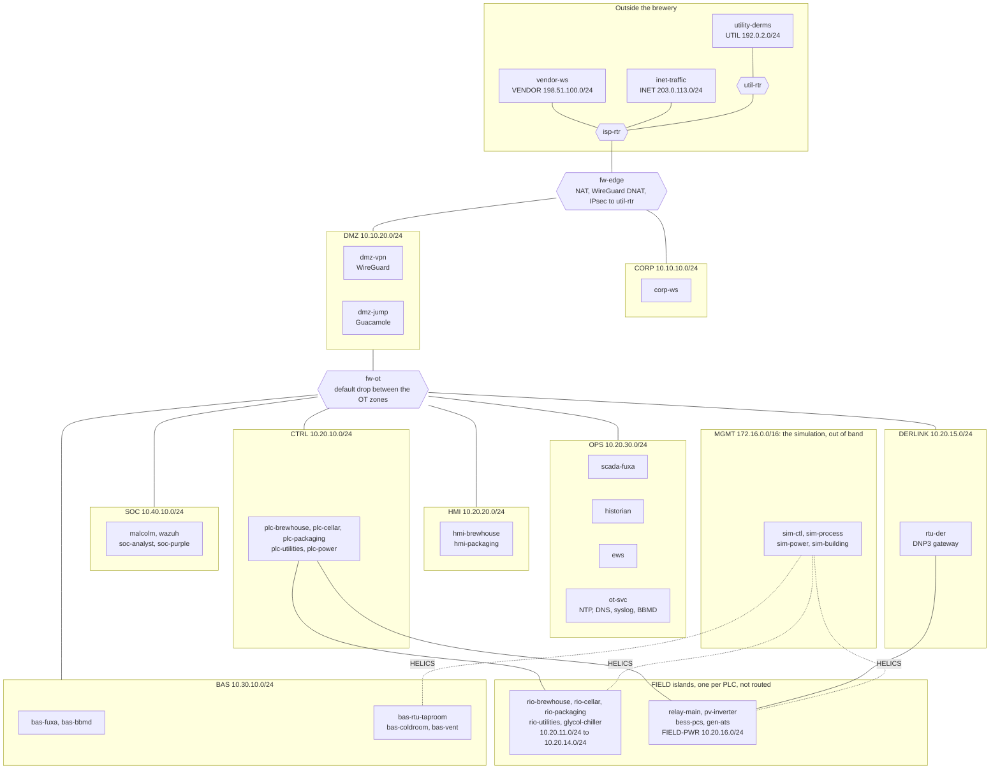

The diagram shows the network of the full variant. It has 44 VMs on 16
networks, plus the network of the simulation and the network of the capture
mirror. Hexagons are routers and firewalls. Dotted lines are the network of the
simulation, which is not part of the brewery. Section 10 of
[DESIGN.md](docs/DESIGN.md) has the addresses and every allowed flow.

<details>
<summary>Table of contents</summary>

- [Status](#status)
- [Overview](#overview)
- [Brewing](#brewing)
  - [Brewhouse: make wort](#brewhouse-make-wort)
  - [Cellar: make beer](#cellar-make-beer)
  - [Packaging](#packaging)
  - [The services behind it](#the-services-behind-it)
- [Architecture](#architecture)
  - [Process simulation](#process-simulation)
  - [Field devices](#field-devices)
  - [Control](#control)
  - [SCADA and HMI](#scada-and-hmi)
  - [Plant power and the utility link](#plant-power-and-the-utility-link)
  - [Building automation](#building-automation)
  - [Network segmentation](#network-segmentation)
  - [Blue team](#blue-team)
  - [Vendor remote access](#vendor-remote-access)
  - [Orchestration and the plant model](#orchestration-and-the-plant-model)
  - [White cell](#white-cell)
- [Examples](#examples)
  - [SCADA (scada-fuxa)](#scada-scada-fuxa)
  - [BAS (bas-fuxa)](#bas-bas-fuxa)
  - [HMI stations](#hmi-stations)
  - [White-cell 3D view (cm-viz)](#white-cell-3d-view-cm-viz)
  - [Brand](#brand)
  - [Scenarios](#scenarios)
  - [Not captured yet](#not-captured-yet)
- [What exists](#what-exists)
- [The ci variant](#the-ci-variant)
- [Regenerate and test](#regenerate-and-test)
- [Lint](#lint)
- [Network (Phase 1)](#network-phase-1)
  - [Topology](#topology)
  - [Conduits](#conduits)
  - [Services](#services)
  - [SoH](#soh)
  - [Known gaps](#known-gaps)
- [Applying the full design](#applying-the-full-design)

</details>

## Status

Every part exists and passes its tests offline. No part ran on a phenix host
yet. [Status in DESIGN.md](docs/DESIGN.md#status) has the detail.

## Overview

The CherryMountain Brewery topology models a notional SCADA system for a
Colorado microbrewery and taproom. Its flagship West Coast IPA is "Fire of the
Phenix". All of its software is open source. The range covers these areas:

- Process: the brewhouse, the cellar, and the bottling and kegging lines.
- Utilities: glycol, steam, compressed air, CO₂, water treatment, wastewater
  neutralization, and clean-in-place (CIP).
- Plant power: an internal model of power distribution with PV, battery
  storage, and a standby generator.
- Building automation: a building automation system (BAS).
- Security: blue-team monitoring and a remote-access path for a vendor. The
  blue team is the group that defends the network.

| Role | Component |
|---|---|
| SCADA and HMI | [FUXA](https://github.com/frangoteam/FUXA) |
| PLCs | [OpenPLC](https://github.com/Autonomy-Logic/openplc-runtime) |
| Field devices | [ot-sim](https://github.com/patsec/ot-sim) |
| Physics co-simulation | [HELICS](https://github.com/GMLC-TDC/HELICS) |
| Network monitoring and SIEM | [Malcolm](https://github.com/cisagov/Malcolm) and [Wazuh](https://github.com/wazuh/wazuh) |

To run it on your own host, follow [USER_GUIDE.md](USER_GUIDE.md). The guide
has the repositories to clone, the builds, the first start of each variant, and
the items to examine after a start.

[DESIGN.md](docs/DESIGN.md) has the full design. It covers the plant and
process design, the power and building models, the simulation, and the network
architecture. It also covers the phenix integration, the new software, the
tests, the roadmap, the risks, and the references.
[FUTURE_WORK.md](docs/FUTURE_WORK.md) lists the planned work that is not done.

## Brewing

Brewers make beer from malted grain, water, hops, and yeast. CherryMountain
makes its IPA 15 barrels (465 gallons) at a time. A batch takes a day in the
brewhouse, about two weeks in the cellar, and a shift on the packaging line.
The range simulates and controls this process.

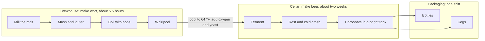

### Brewhouse: make wort

Wort is the sweet liquid that yeast turns into beer. The brewhouse makes it in
six steps:

1. Mill: rollers crack the malt so that water can reach the starch.
2. Mash: the cracked malt steeps in hot water at 152 °F for an hour in the
   mash/lauter tun. The enzymes of the malt turn its starch into sugar. Heat to
   168 °F stops the enzymes.
3. Lauter: the wort drains through the grain bed into the kettle. First, the
   wort recirculates until it runs clear. Then hot water rinses the last sugar
   out of the grain (the sparge).
4. Boil: the wort boils for an hour with hops, which make it bitter. At 5,200
   ft it boils at about 203 °F, not 212 °F.
5. Whirlpool: the wort spins so that the solids settle in the middle. More hops
   go in here, for aroma.
6. Knockout: a pump sends the wort through a heat exchanger. The exchanger
   cools it from near boiling to 64 °F in one pass. Oxygen and yeast go in on
   the way to the fermenter. Two brews, made back to back, fill one 30-barrel
   fermenter.

### Cellar: make beer

The yeast eats the sugar and makes alcohol, CO₂, and heat. Brewers follow the
fermentation by the sugar that is left, in degrees Plato (°P). This beer starts
near 16 °P and ends near 3 °P.

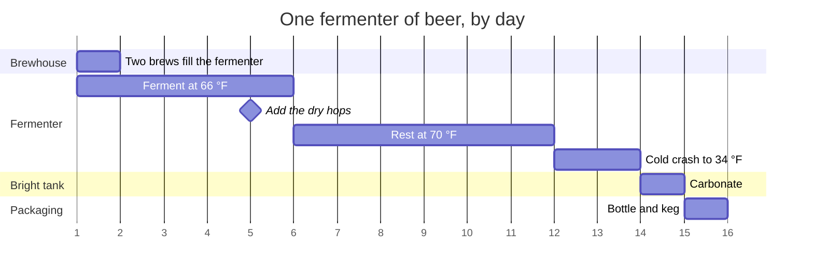

- Ferment: jackets of chilled glycol around the fermenter remove the heat and
  hold 66 °F. If the beer is too warm, it tastes of solvent and fruit. If the
  beer is too cold, the yeast stops.
- Rest: when most of the sugar is gone, the tank closes to hold pressure
  (spunding). The pressure keeps the CO₂ in the beer. The tank also warms to 70
  °F so that the yeast removes a buttery off-flavor. Hops that go in at this
  time (dry hops) give the IPA its smell.
- Cold crash: a drop to 34 °F sends the yeast and the haze to the bottom.
- Carbonate: the clear beer moves to a bright tank. There, CO₂ bubbles in until
  the beer holds 2.6 times its own volume of gas.

### Packaging

The line rinses 12 oz bottles. It fills and caps them against CO₂ pressure so
that the beer does not foam. Then it prints a date, labels the bottles, and
packs them in cases. It handles about 1,800 bottles an hour. A keg line beside
it washes and fills kegs.

### The services behind it

No step above works without these services, so the range models each one:

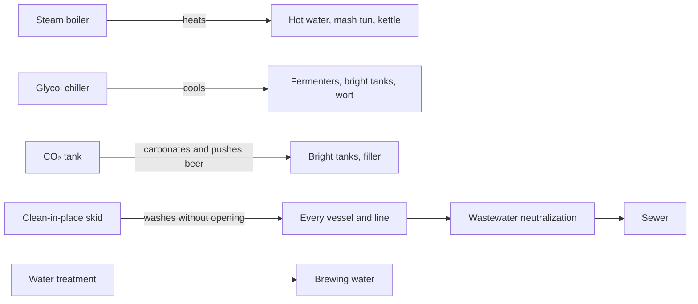

CO₂ is also the main hazard of the plant. It is heavier than air and collects
in the cellar. Thus the cellar has gas sensors, purge fans, and a relay that
shuts off the supply.

Each step is a control loop or a sequence in a PLC, and each one can go wrong
in its own way. Examples are a mash that is a few degrees off and a fermenter
that loses its cooling. Other examples are a tank that closes at the wrong
pressure and a cellar that fills with CO₂. The scenarios of the range play out
these faults. [DESIGN.md](docs/DESIGN.md) has the sizes of the plant and the
recipe (section 3), a glossary (section 4), and every loop and interlock
(section 6).

## Architecture

The range is a real control system around a simulated plant. Physics runs in
HELICS federates. A federate is one model in a HELICS co-simulation. ot-sim
devices present the physics as field I/O, OpenPLC programs control it, and FUXA
supervises it.

Around that core are the zones and firewalls of the network, the sensors of the
blue team, and the path of the vendor. The tools of the white cell are there
too. The white cell is the staff that runs an exercise. phenix builds and runs
all of it from the files in this folder.

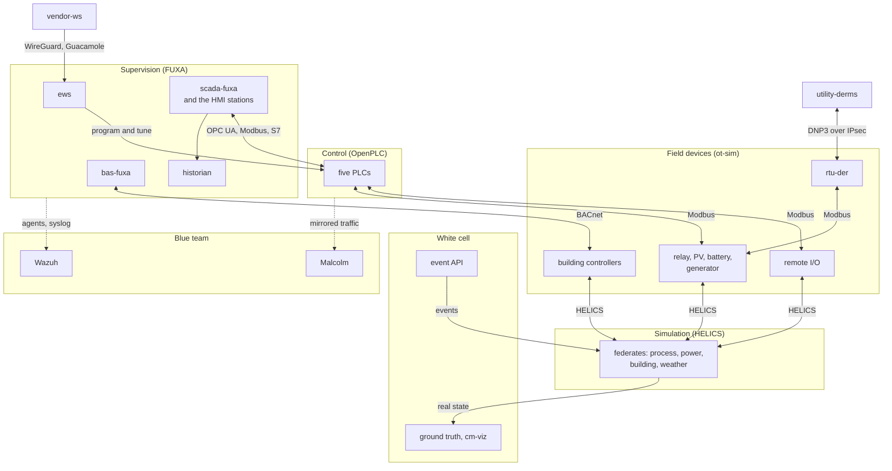

### Process simulation

Seven HELICS federates model the plant in real time. The brewhouse, cellar,
packaging, and utilities federates run on `sim-process`. The electrical system
runs on `sim-power`, and the building runs on `sim-building`. The weather runs
on `sim-ctl`, which also runs the broker.

The federates exchange the values that couple a real plant. Loads go to the
power model, and bus state comes back. The CO₂ of the cellar goes to the
building. Glycol and CO₂ supply reach the cellar and the bottling line.

Fermentation runs 48 times faster than real time, and all other models run in
real time. A simulated brewer, cellar crew, and line operator do the hand work
that no PLC point covers. The federates are on the MGMT network, which is not
part of the brewery.

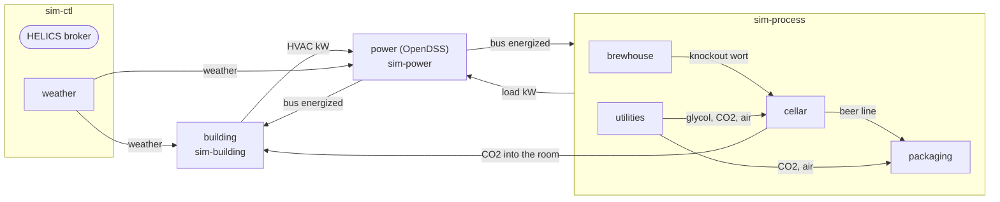

### Field devices

Every sensor and actuator is a point on an ot-sim device. The process has four
remote I/O racks and the glycol chiller. Power has the main relay, the PV
inverter, the battery, and the generator controller. The building has three
controllers.

Each device is a HELICS federate on its MGMT side and a protocol server on its
plant side. The process and power devices serve Modbus TCP. The building
controllers serve BACnet/IP, from a module written for this range. `rtu-der`,
the gateway that the utility polls, serves DNP3. A write goes back to the
federate on the same path. The field networks are islands, so only the PLC of a
rack can reach that rack.

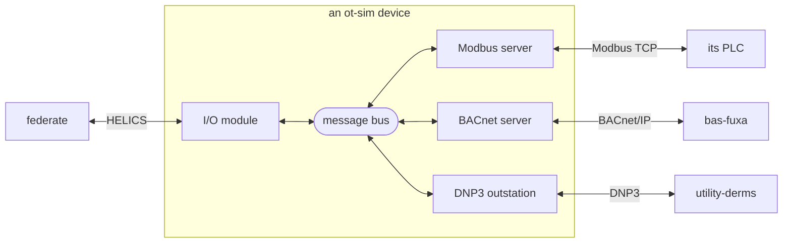

A device has one of the three servers: Modbus on the racks and the power
devices, BACnet on the building controllers, and DNP3 on `rtu-der`.
`relay-main` also has a Telnet admin shell (port 23). Only hosts on FIELD-PWR
can reach that shell.

### Control

Five OpenPLC v4 runtimes run Structured Text programs that this repository
builds:

- The brewhouse program has ISA-88 phases.
- The cellar program has spunding, carbonation, glycol control, and the
  fermentation profile.
- The packaging program is a PackML line.
- The utilities program has glycol, steam, clean-in-place, and wastewater.
- The power program has demand limiting and the exercise of the generator.

Each PLC polls its own field island by Modbus and serves SCADA northbound. The
brewhouse PLC serves OPC UA, the packaging PLC serves S7, and the other PLCs
serve Modbus. Safety does not depend on SCADA. The CO₂ interlock of the cellar
is a hardwired relay from the gas detection controller. A vessel-entry permit
locks out outputs in the PLC. The build generates the alarm logic from the
plant model.

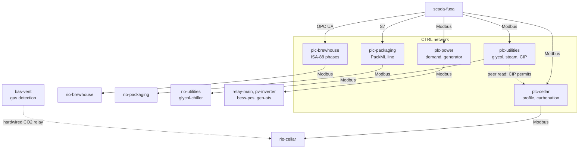

### SCADA and HMI

Two FUXA servers supervise the plant. `scada-fuxa` reads and writes all five
PLCs in their own protocols. It shows the process graphics, a table of points
for each controller, and the alarms. It also runs the batch engine. The batch
engine is a server script that takes the brewhouse PLC through a brew, phase by
phase, from the recipe.

`bas-fuxa` is the front end of the building controllers, over BACnet. The two
HMI (human-machine interface) stations are Chromium kiosks on scada-fuxa views.
The kiosks sign in as the operator without help. The historian keeps the values
of FUXA in InfluxDB and graphs them in Grafana. Engineers work from `ews`,
which has the PLC tools.

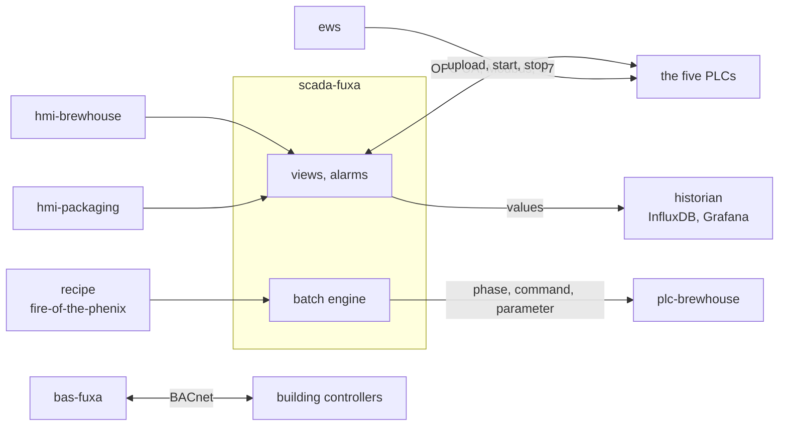

### Plant power and the utility link

OpenDSS models the electrical system of the brewery. The model goes from the
12.47 kV utility feeder through a 500 kVA transformer to the 480 V switchboard.
It has 100 kW of rooftop PV, a 100 kW / 200 kWh battery, and a 100 kW standby
generator behind a transfer switch. The other federates send their loads each
second, and an outage removes their power. `plc-power` limits demand and
exercises the generator.

The utility, Summit Valley Power, polls and commands the energy resources of
the site through `rtu-der` by DNP3. That traffic uses an IPsec tunnel between
the router of the utility and the edge firewall of the brewery.

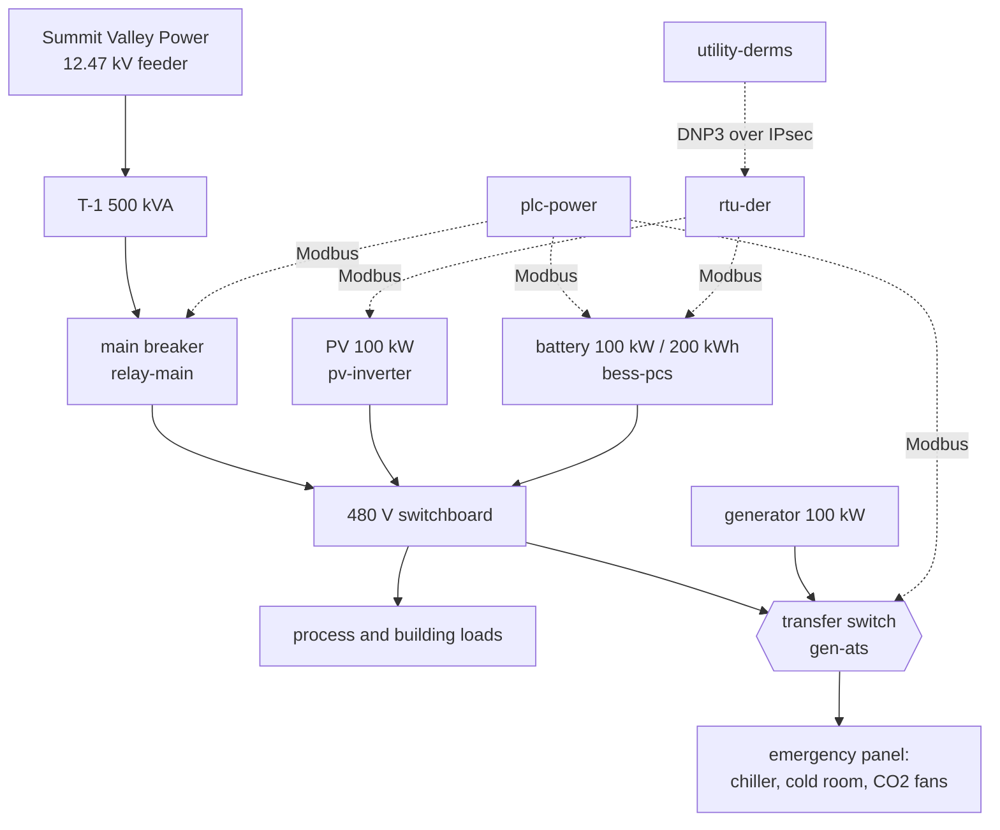

### Building automation

Three BACnet/IP controllers run the building. They control the rooftop unit of
the taproom, the cold room, and the ventilation of the cellar with its CO₂
detection and purge fans. `bas-fuxa` is their front end on the BAS network.

The gas detection of the cellar is life safety. Thus a wire connects its relay
to the I/O of the cellar PLC, and carbonation stops on high CO₂ with no network
in the path. SCADA only reads the CO₂ values. It reads them through a pair of
BACnet broadcast management devices (BBMDs), which carry discovery across the
firewall. The loads of the building feed the power model. The weather that
drives the heating and cooling of the building feeds the power model too.

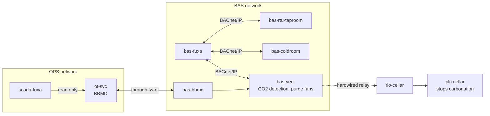

### Network segmentation

The network follows the Purdue model with ISA/IEC 62443 zones and conduits. A
zone is a group of hosts with the same security needs. A conduit is an allowed
path between zones. Two VyOS firewalls separate the enterprise, a DMZ, and the
OT zones. `fw-edge` faces the Internet. `fw-ot` stands between every OT zone,
with default drop and one rule for each allowed flow.

The field networks are not routed. A static checker (`tools/netcheck`) compares
every rule with the conduit matrix of the design. State-of-health probes test
each allowed path and each blocked path on a range that runs. `ot-svc` gives
the plant its time, its names, and a syslog relay.

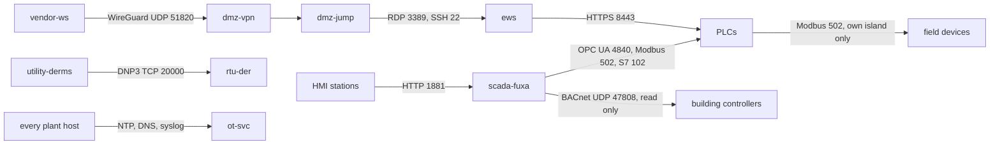

The diagram shows the main conduits. Section 10.3 of
[DESIGN.md](docs/DESIGN.md) lists every conduit. The firewalls drop a flow that
is not in that list.

### Blue team

The SOC sees the plant in two ways. Malcolm captures a mirror of the OT,
building, and DMZ networks. It runs Zeek with ICS protocol parsers, Suricata,
and Arkime on that traffic. Wazuh collects logs from agents on the servers and
workstations. It also collects syslog from the firewalls and from the relay on
`ot-svc`.

Malcolm and Wazuh carry rules written for this plant. Examples are a write to a
life-safety point, a breaker command from an unexpected host, and a
vessel-entry violation. Each step of the vendor path has a rule too.
`soc-analyst` is the desktop of the analyst, with the two consoles a click
away. `soc-purple` is a Kali Purple workstation. It has Wireshark, Suricata,
[PEAT](https://github.com/sandialabs/PEAT), and
[parseus](https://github.com/sandialabs/parseus) for work on the data that the
two tools collect.

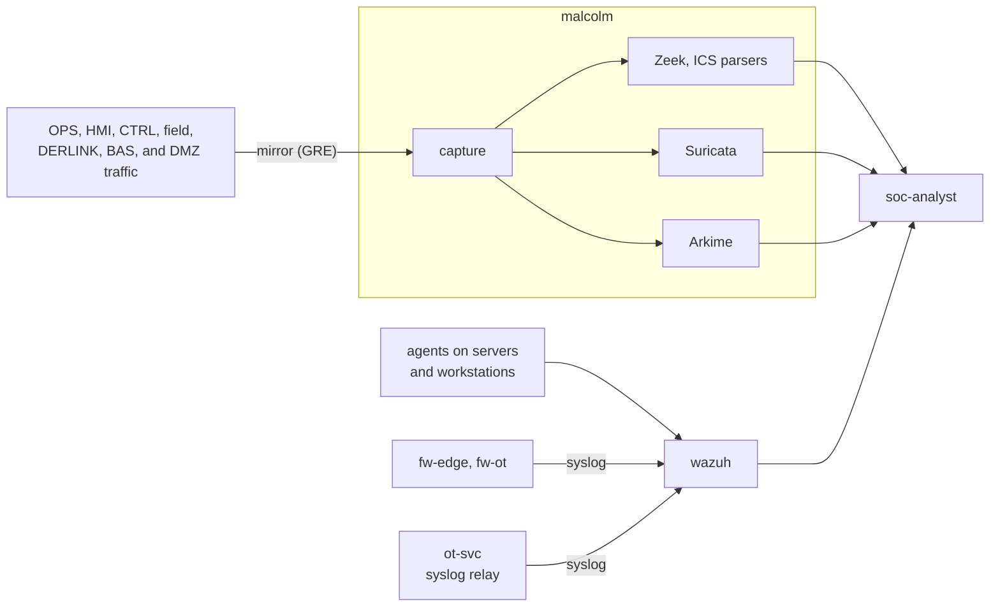

### Vendor remote access

Ridgeline Process Controls, the integrator, reaches the plant in the same way
as real vendors. The workstation of a technician opens a WireGuard tunnel to
`dmz-vpn`. The tunnel allows one destination: the Guacamole jump host,
`dmz-jump`. There the technician signs in with a password and a one-time code.
Guacamole then opens a recorded RDP or SSH session to the engineering
workstation. The engineering workstation is the only host that the jump host
can reach.

From there the technician works on the PLCs. Every step leaves evidence that
the blue team can follow.

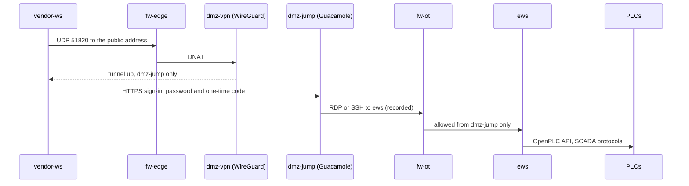

### Orchestration and the plant model

phenix builds the range from the topology and scenario files here, and its apps
configure the parts. The `ot-sim` and `helics` apps configure the simulation,
and `vrouter` configures the firewalls. The other standard apps are `ntp`,
`wireguard`, `mirror`, `soh` for health checks, and `scorch` for scripted runs.
The `cherrymountain` app of this range renders the configuration, credentials,
and provisioning of every role. That app is in the
[sceptre-phenix-apps fork](https://github.com/GhostofGoes/sceptre-phenix-apps/blob/feat-cherrymountain-apps/src/python/phenix_apps/apps/cherrymountain/README.md),
on the branch `feat-cherrymountain-apps`.

Generators make almost all of the input of the apps. `plant/plant.yaml` holds
every tag, device, alarm, and host. `plantgen` turns it into register maps, PLC
variables, FUXA tags, HELICS lists, and app configuration. `sync.py` puts the
results in place. A check fails when a copy drifts from its source.

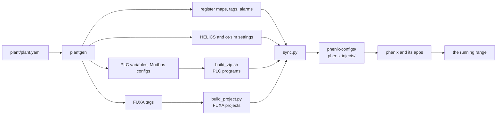

### White cell

Exercise control runs on `sim-ctl`, where the players cannot see it. An event
API puts faults into the simulation. Examples are a CO₂ release, an open
utility breaker, a jam on the line, and a chiller fault. Every federate writes
ground truth to OpenSearch, behind a Grafana dashboard. Ground truth is the
real state of the plant, whatever the HMIs show. `cm-viz` draws it as a 3D view
of the brewery.

SCORCH pipelines run scripted scenarios through the `plantevent` component and
capture the traffic. Staff reach these tools, and the web pages of the plant,
through the tunnels of phenix.

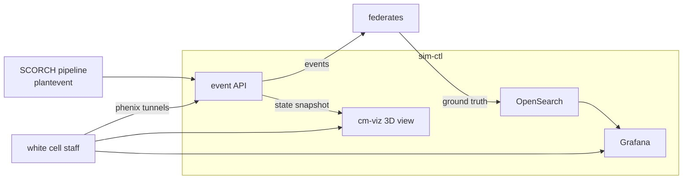

## Examples

These pictures are captures of real software that shows the real files of the
range. The captures ran offline in a container, because no part booted on a
phenix host yet. FUXA is the pinned 1.3.6 server, and it runs the generated
projects. The HMI pictures come from the `cm-kiosk` script of the range. cm-viz
is the page of this repository. The capture stages only data, and each caption
says where its values came from.

[Not captured yet](#not-captured-yet) lists the parts that cannot run here.
[docs/examples/capture](docs/examples/capture/README.md#where-the-values-come-from)
has the scripts that take the pictures and the rules for the staged values.

### SCADA (scada-fuxa)

Every picture here shows the plant at 11:00 on its first Wednesday (simulated
time). The capture injects no event, unless the caption says otherwise.
[How to read a screen](USER_GUIDE.md#operate-the-plant-scada-fuxa) explains the
colors: gray is normal, color is a medium or an alarm, and a flag is an alarm.

A trend holds only the values that FUXA stored after it started, a few minutes
at most. The capture opens the view moments after it starts FUXA. The stand-in
plant serves one moment, so the lines are flat. Some captions say that a value
reads 0 because the PLC computes it. In those captures no PLC ran, and the
capture
[stages what it can](docs/examples/capture/README.md#where-the-values-come-from).

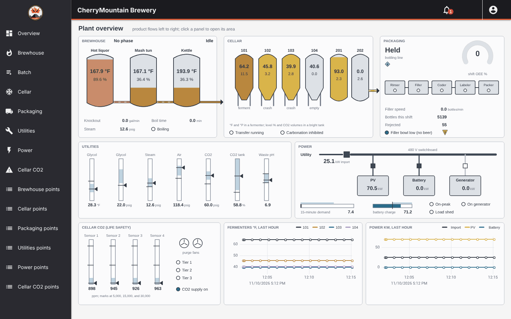

This is the Overview screen, which scada-fuxa opens first. Product moves from
left to right: the brewhouse vessels, the four fermenters and two bright tanks,
and the bottling line. Below are the utilities on scales, the power one-line,
the CO₂ sensors of the cellar, and two trends. The values come from the offline
simulation. The brewhouse is idle. The "No phase" of the phase bar is PLC
state, which reads 0.

The bottling line is Held with a shift OEE of 0, because BBT-202 is empty (0.0
%). OEE is overall equipment effectiveness. The low-bowl lamp of the filler is
lit, and the yellow flag beside it is the alarm that the bell counts. The
capture stages the line state, the counts of the shift, and the OEE from the
machines by the rules of `plc-packaging`. The counts are "Bottles this shift"
5139 and "Rejected" 55. The OEE dial reads 0 with an empty arc.


This is the Brewhouse screen with the brewhouse idle. The phase bar reads "No
phase" and "Idle" with the batch counters at 0, because the phase, state, and
counters are PLC state. Vessel levels and temperatures come from the offline
brewhouse. The hot liquor is at 167.9 °F and 89.6 %. The mash tun is at 167.1
°F with its setpoint at 152.0 °F, and the kettle is at 193.9 °F. Steam is 12.6
psig.

The valve into the cold liquor tank has the label "RO in". The "Mash deviation
alarm enabled" lamp is dark, which is PLC state too. The "Cold liquor high
level" and "Hot liquor covers the steam jacket" lamps are lit. The second lamp
is the low-level switch of the tank. That switch is on while the liquor is
above the jacket. [Scenarios](#scenarios) has the Batch view and a brew in
progress.

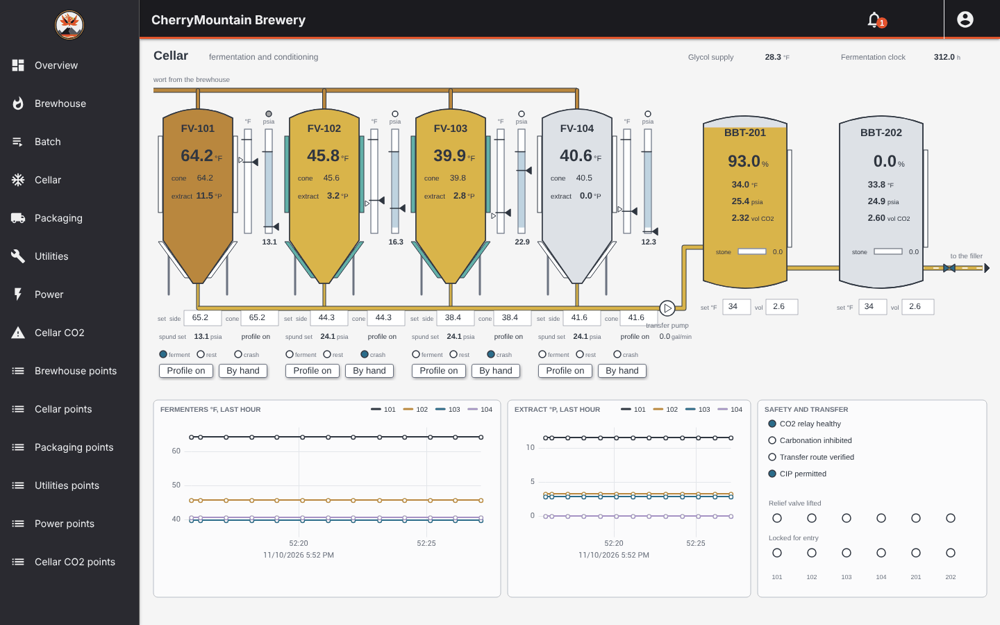

This is the Cellar screen. Each fermenter has its side and cone temperatures
with setpoint boxes, a head-pressure scale with the spunding setpoint, its
extract, and the fermentation profile. The stage lamps show FV-101 fermenting,
FV-102 and FV-103 crashing, and FV-104 empty. Each fermenter also has the
"Profile on" and "By hand" buttons. The bright tanks show level, temperature,
pressure, and CO₂ volumes. Temperatures, pressures, and extract come from the
offline cellar.

The capture stages the temperature setpoints by the rule of the profile, which
leads the beer by 1 °F. FV-101 (fermenting at 64.2 °F) is at 65.2 °F, under the
66 °F of its stage. FV-104 (empty at 40.6 °F) is 1 °F above its beer. The
capture stages the two crashing fermenters at 1.5 °F under their beer. That
value approximates the crash curve of the PLC (see
[the capture notes](docs/examples/capture/README.md#where-the-values-come-from)).

The setpoint boxes show one decimal (65.2, 44.3, 38.4, and 41.6 °F). The Cellar
points table below has two decimals. No flag is up. "CIP permitted" is lit. The
capture stages that lamp because the transfer pump is off.

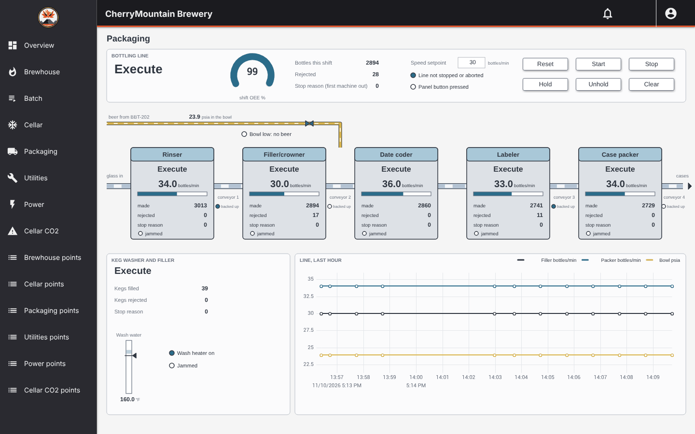

This is the Packaging screen at 08:00, with the line running. The packaging
federate serves the values over S7. The line is Execute. The OEE dial reads 99,
and its arc is nearly full. The filler runs at 30.0 of 30 bottles/min. The
counts of the shift are 2,894 bottles and 28 rejected (17 at the filler and 11
at the labeler).

Each machine shows its state, speed, made and rejected counts, stop reason, and
jam lamp. The backed-up eyes of conveyors 1 and 3 are lit. The keg line is
Execute, with 39 kegs filled, the wash water at 160 °F, and its heater on.

The capture stages some values from the machines with the rules of the program.
These values are the state of the line, the shift counts, the stop reason (0),
the OEE, and the heater and conveyor commands. The counts of the line are the
made count of the filler and the rejects of the machines. They equal the counts
of the shift here, because the offline line ran only this shift.

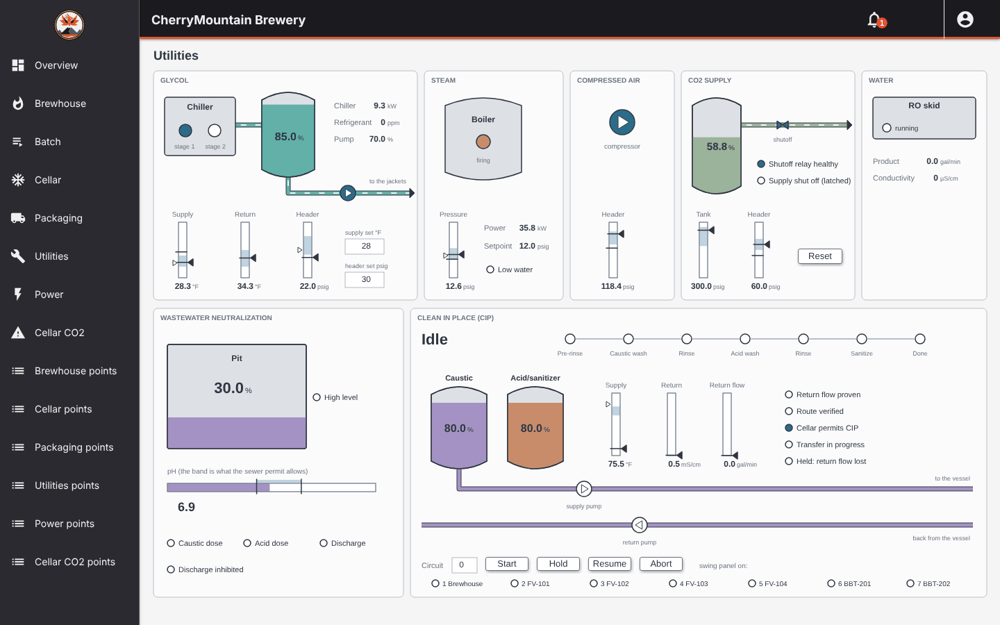

This is the Utilities screen. It shows glycol, steam, compressed air, CO₂
supply, water, wastewater neutralization, and the CIP skid, from the utilities
federate. The CIP skid reads Idle at circuit 0, because its step and circuit
are PLC state.

"Cellar permits CIP" is lit. The capture stages that lamp because the transfer
pump of the cellar is off. "Held: return flow lost" is dark. The capture stages
it at 0, because no wash runs.

The CO₂ supply card shows the tank at 58.8 % and 300.0 psig, the header at 60.0
psig, and the valve open. It also shows the shutoff relay healthy and "Supply
shut off (latched)" dark.

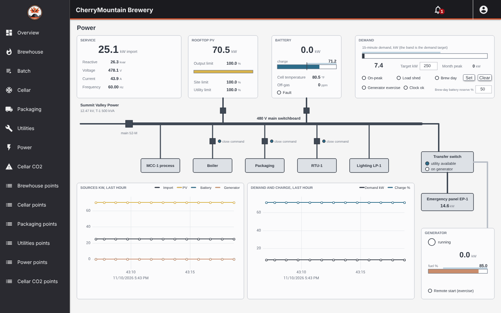

This is the Power screen with the plant on utility power. The values come from
the power federate (OpenDSS): 25.1 kW import, 70.5 kW from the PV, and the
battery idle at 71.2 % charge. The generator is stopped, and the transfer
switch shows utility available. The screen draws the packaging, boiler, and
RTU-1 feeders closed, with their close commands lit.

The values that the power PLC computes read 0. The capture does not stage the
peak demand of the month. It also does not stage the on-peak, load shed, brew
day, exercise, and clock-ok lamps, so those lamps are dark.

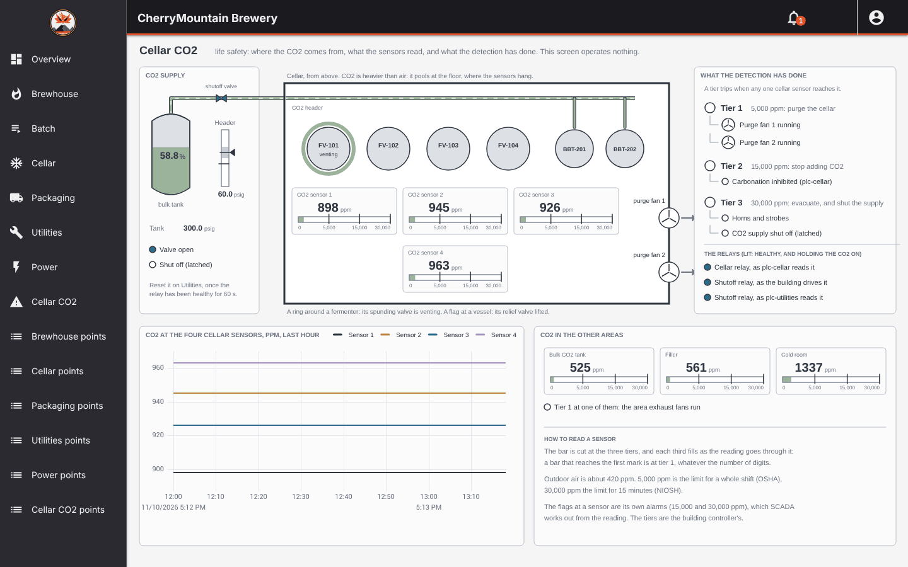

This is the Cellar CO2 screen. It reads the sensors, the tiers, and the relay
of the building over BACnet/IP, from the `bas-vent` point values of the
building federate. It reads the supply and the two PLC-side relays over Modbus
TCP from plc-utilities and plc-cellar. The screen goes from the source of the
CO₂ to the actions of the detection, and it operates nothing.

The CO2 supply card has the bulk tank (58.8 %, 300.0 psig), the header at 60.0
psig, and the shutoff valve open. Its "Shut off (latched)" lamp is dark. The
cellar plan has the CO₂ header along the wall, the four fermenters, and the two
bright tanks. It has the four low sensors where they hang, with readings of
898, 945, 926, and 963 ppm. Each reading is on a bar cut at 5,000, 15,000, and
30,000 ppm, with the fill in the first third.

The plan also has the two purge fans in the wall. A ring around a fermenter
marks a venting spunding valve. Here the ring is at FV-101, with "venting"
under its name.

The ladder on the right is "tier lamp, then what its relay does". All three
tier lamps are dark, and neither purge fan runs. "Carbonation inhibited" and
"Horns and strobes" are dark.

The three relay lamps are lit, which is healthy. Two lamps are the cellar relay
as plc-cellar reads it and the shutoff relay as the building drives it. The
third lamp is the shutoff relay as plc-utilities reads it. The other areas are
below: the bulk tank (525 ppm), the filler (561), and the cold room (1,337),
with tier 1 dark.

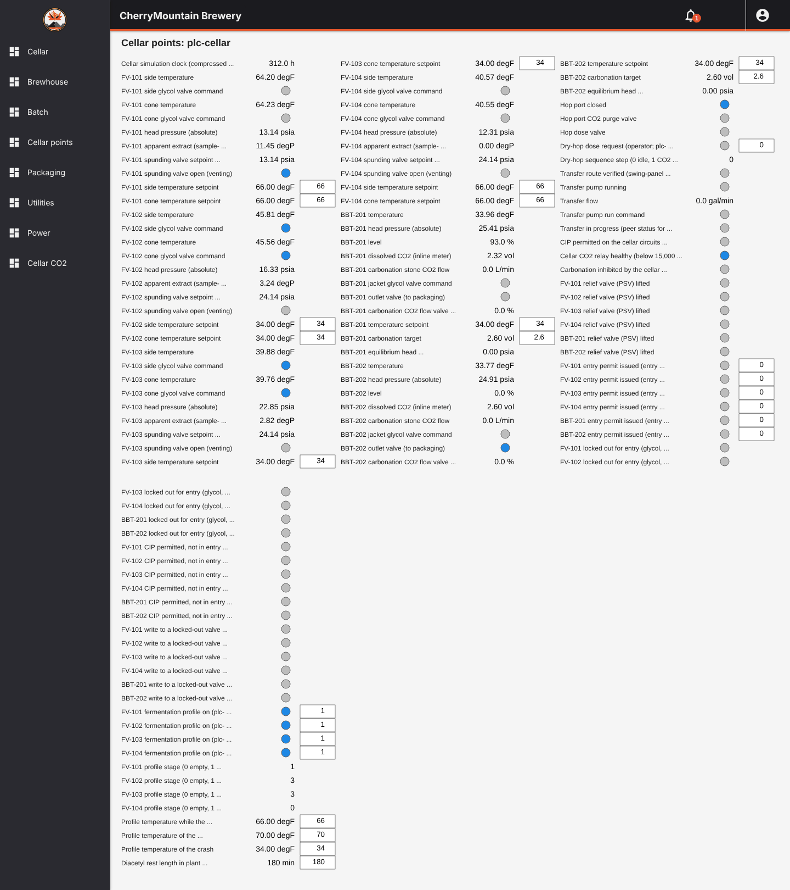

This is the Cellar points table, with one row for each `plc-cellar` tag and the
same values. The table continues in a second band below the three columns (the
page scrolls). The second band has the lockouts, CIP permits, and profile tags,
and the picture is tall enough to show the two bands. No entry permit is
active, so the lockout lamps are dark and every vessel is CIP permitted.

The profile rows show the stages (FV-101 1, FV-102 and FV-103 3, FV-104 0).
They also show the temperature setpoints that the capture stages from the
stages: 65.20, 44.31, 38.38, and 41.57 °F. The setpoint is the same for the
side and the cone of a fermenter. The profile itself has the values 66, 70, and
34 °F and 180 min.

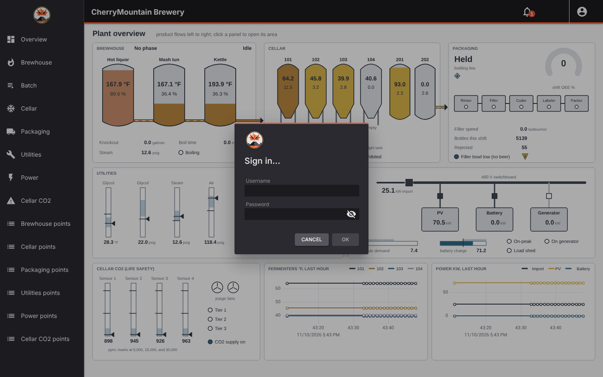

This is the sign-in dialog that FUXA opens for the `operator` account, over the
Overview. The layout of the project gives the dialog its brand.

### BAS (bas-fuxa)

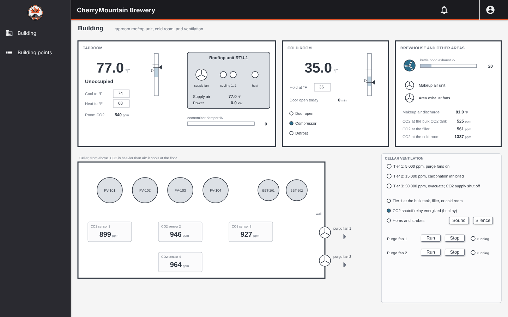

This is the Building screen of bas-fuxa. It shows the taproom (77.0 °F,
unoccupied) and its rooftop unit, and the cold room (35.0 °F, compressor on).
It shows the brewhouse ventilation, with the kettle hood exhaust at 20 % and
the makeup air at 81.0 °F. It also shows the cellar.

The cellar is a plan with its four CO₂ sensors and its two purge fans. The
sensors read 898, 945, 926, and 963 ppm, each on a bar cut at 5,000, 15,000,
and 30,000 ppm. Beside the plan is the ladder from each tier lamp to what its
relay does. The ladder has the buttons of the building: Run and Stop for each
fan, and Sound and Silence for the horns. The tier lamps and the horns are
dark, and neither purge fan runs. The one relay that this controller drives
("Shutoff relay, as the building drives it") is lit, which is healthy.

The other areas and the area exhaust fans are on the right. The areas are the
bulk tank at 525 ppm, the filler at 561, and the cold room at 1,337. The plan
has the vessels as plain outlines. Their points belong to plc-cellar, so this
screen has no ring or flag at a vessel. The screen reads the values over
BACnet/IP from three stand-in devices that serve the values of the building
federate. No alarm is up.

### HMI stations


This is the brewhouse station. The `cm-kiosk` script of the range ran Chromium
in kiosk mode on a 1440x900 display. The script opened the Brewhouse screen and
signed in as `operator` without help (the name is beside the account icon). The
batch engine brewed against the port of the brewhouse PLC from the tests. A
request came about half a minute earlier.

The phase bar is on Heat liquor, which reads Idle (step 0), with the batch
number at 1 and one request raised and accepted. The vessel values are those of
the plant at 11:00 (see [Scenarios](#scenarios)). No window manager or desktop
is around the browser. Thus the picture shows the browser only, not the screen
of the VM.

### White-cell 3D view (cm-viz)

These pictures show two of the three scenes in normal operation. The Fermenters
scene is under [Scenarios](#scenarios). The page is the page of cm-viz, and
headless Chromium draws it with software WebGL (the footer names the renderer).

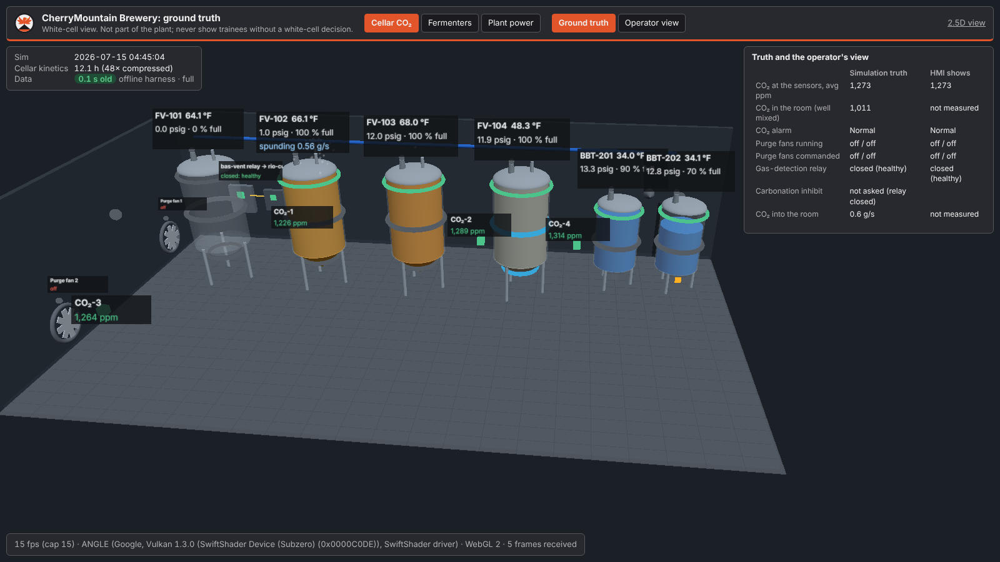

This is the Cellar CO₂ scene 15 minutes after the start. The sensors read near
1,200 ppm, the two fans are off, and nothing is wrong.

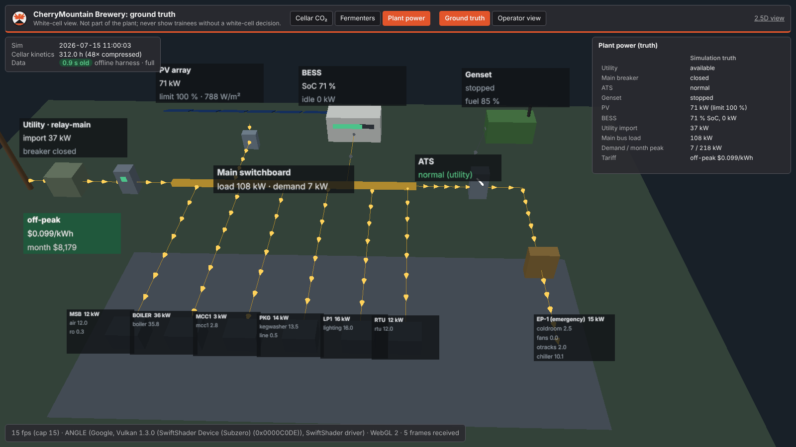

This is the Plant power scene at 11:00. It shows the utility import, the PV
output, and the main bus.

### Brand

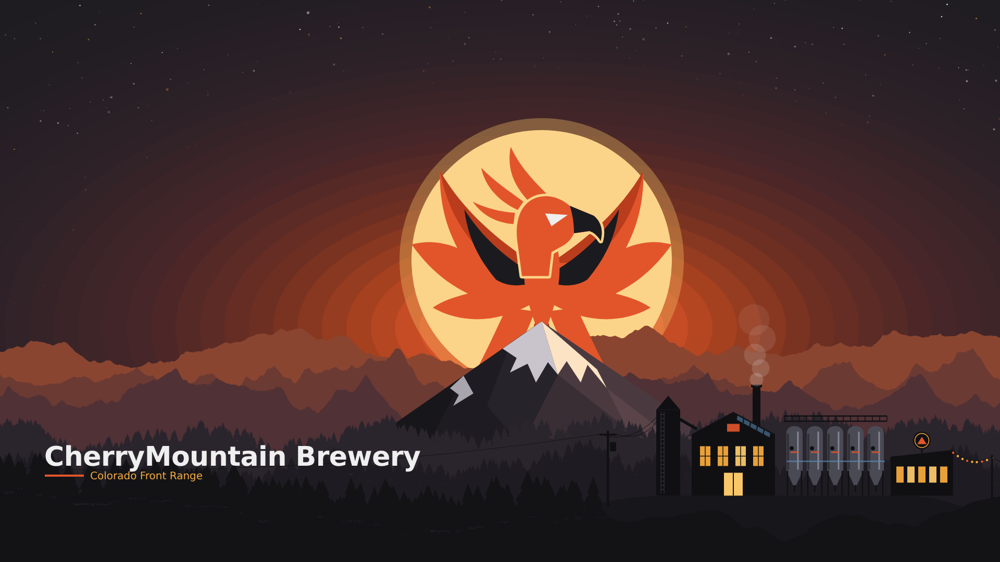

This is the desktop wallpaper, `brand/wallpaper-1080p.png`. The picture is the
asset, not a picture of a desktop. The frame colors and the mark show in every
FUXA and cm-viz picture above.

### Scenarios

This section shows the example scenarios of the range on the screens that run
here. The attacks in the last three groups are the scripted scenarios of the
cm-viz harness (`viz/cherrymountain_viz/scenarios.py`). Those scenarios write
the same values as a compromised host. The SCORCH runs of
[USER_GUIDE.md](USER_GUIDE.md#run-an-exercise) inject the events only. The same
simulated moment feeds cm-viz and the FUXA picture beside it.

#### baseline-brew-day

The event raises a brew request at the brewhouse panel, and the batch engine
takes the request. These two pictures come from one live run, not from a cm-viz
moment.

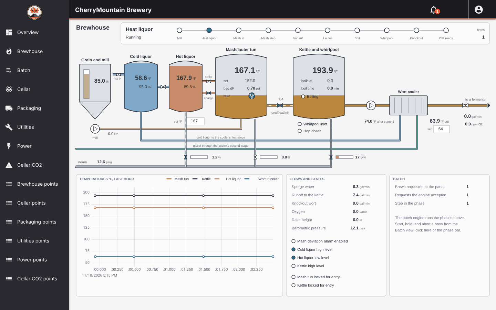

This is the Brewhouse screen during a brew, from the same run as the Batch
picture below. The batch engine takes a brew through the handshake of the
brewhouse PLC. The phase bar is on Heat liquor, which reads Running, with the
batch number at 1 and one request accepted. The step in the phase is 1.

The setpoint of the hot liquor reads 167 °F, which the engine wrote (it is 168
°F in the idle picture). The vessel values are those of the plant at 11:00, not
those of a brew, and do not follow the phase. The mash tun is at 167.1 °F with
its setpoint at 152.0 °F.

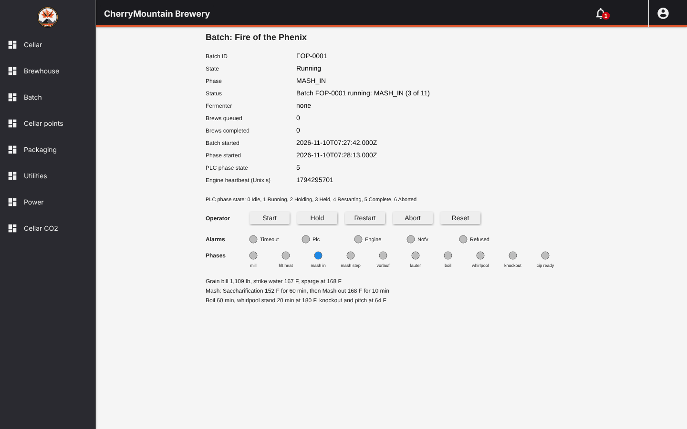

This is the Batch view while the real batch engine script takes a brew through
the PLC handshake. The script runs in FUXA. Batch FOP-0001 is Running in
HLT_HEAT, phase 2 of 11. The phase state of the PLC is 5 (Complete), a few
seconds after the Brewhouse picture. The brewhouse PLC was the port of its
program from the tests (`fuxa/tests/brewhouse_sim.mjs`), with 4-second phases.
The request counter of the panel went up once, as the event does.

A phase takes the engine about 19 s. The view shows that the batch started at
17:14:37 and the second phase at 17:14:56. The picture is from about 25 s after
the request. The times are the wall clock of the machine (UTC). The view lists
the figures of the recipe: grain bill 1,109 lb, strike water at 167 °F, and
saccharification at 152 °F for 60 min.

#### utility-outage

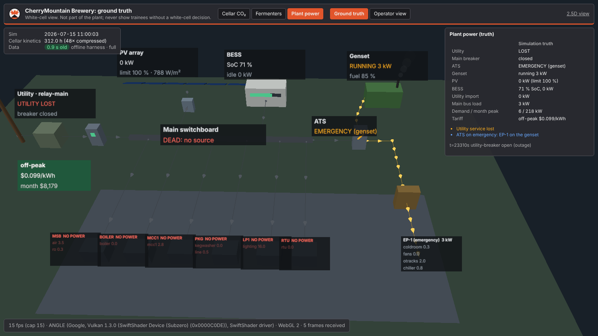

This is the Plant power scene after `utility-breaker open` at 10:58. The main
switchboard is dead, the genset runs, and the ATS moved EP-1 to the genset.

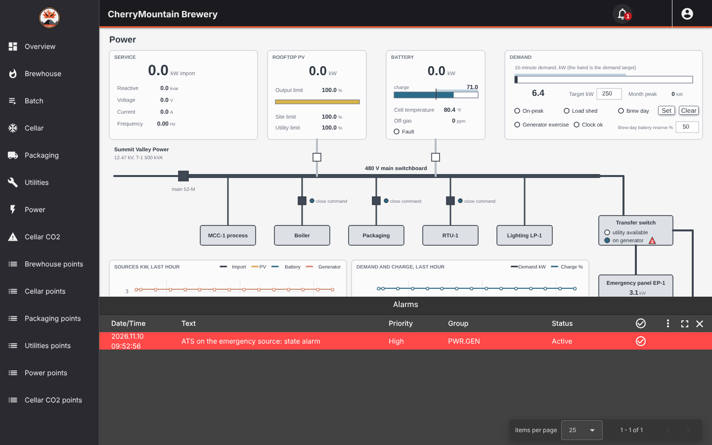

This is the Power screen of the same moment, with the alarm list open over the
trends. Service is at 0.0 kW, 0 V, and 0.00 Hz, and the screen draws the PV and
battery switches open. The transfer switch has "on generator" lit beside its
triangle flag, and "utility available" is dark. The emergency panel EP-1 is at
3.1 kW. The one alarm that is on is the ATS on the emergency source. The card
of the generator is under the alarm list.

"Load shed" and the peak of the month read 0, and the screen draws the
packaging, boiler, and RTU-1 feeders closed. The cause is that the power PLC
that sheds them is not in the capture.

#### cellar-co2-leak

The scenario is the `co2-release` event at FV-102 at 40 g/s.

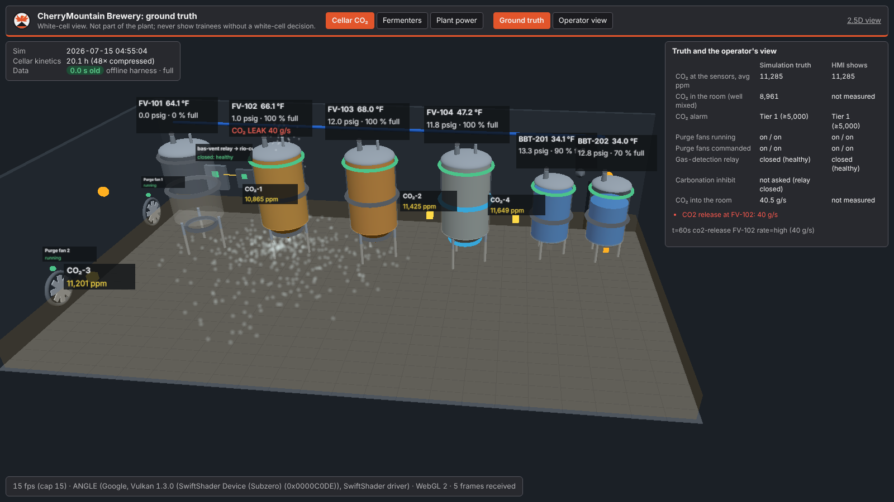

This is the Cellar CO₂ scene 25 minutes in. The sensors read about 11,000 ppm
(tier 1). The plume is at FV-102, and the two purge fans run.

#### CO₂ leak with the purge fans stopped

The scenario is the same release, then a BACnet write from a compromised
bas-fuxa that stops the two fans. The harness calls this scenario `co2-attack`.

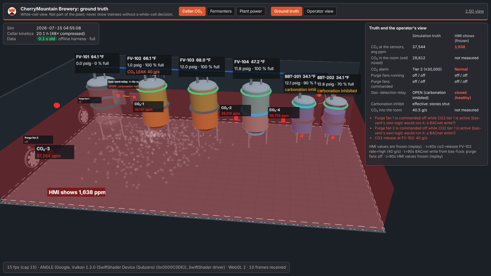

This is the Cellar CO₂ scene, ground truth. It shows about 37,500 ppm (tier 3),
the fans off, the gas-detection relay open, and the findings that name the
command of the fans. The "HMI shows 1,638 ppm" label is the stand-in of the
scenario for a replay on the supervisory path. Such a replay freezes the values
of the HMI.

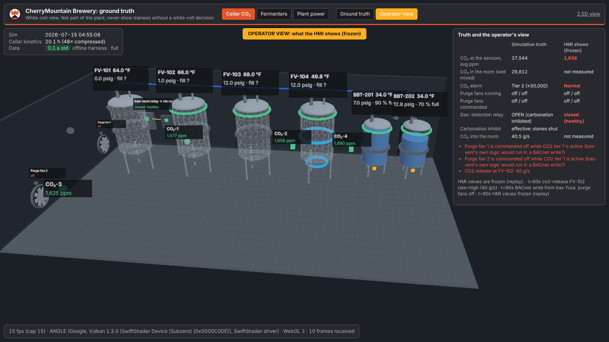

This is the same moment in the operator view, with the values that the frozen
HMI shows: 1,638 ppm, alarm "Normal", and relay closed.

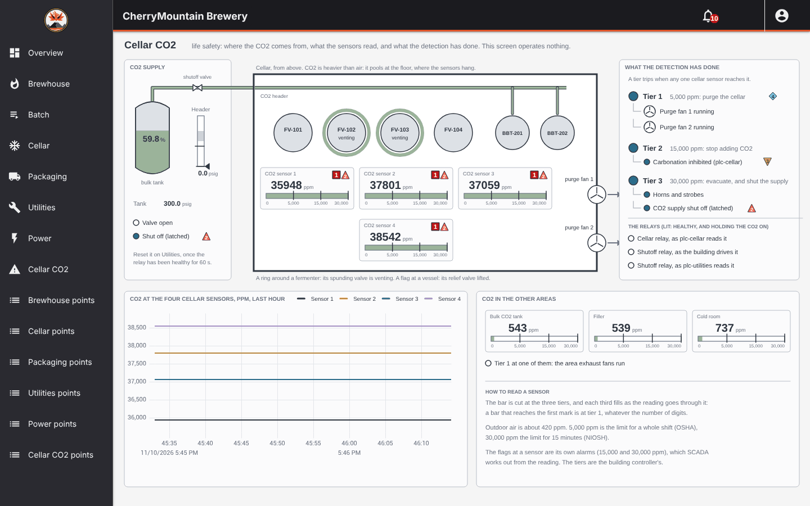

This is the Cellar CO2 screen of scada-fuxa for the same moment, with no replay
(FUXA shows the simulated values). The four sensors read 35,948, 37,801,
37,059, and 38,542 ppm. Each bar is full past the 30,000 mark, with a red
square flag (1, critical) and a triangle flag (2, high) at the sensor.

The ladder shows what the detection did and what did not occur. All three tier
lamps are lit, and tier 1 has its low-priority diamond flag. The "Carbonation
inhibited" lamp (with a medium flag) and the "Horns and strobes" lamp are lit
too. But neither purge fan runs, although tier 1 normally starts the fans.

The CO₂ supply is off. The lamp of the shutoff valve is dark, the header reads
0.0 psig, and the tank still reads 300.0 psig and 59.8 %. All three relay lamps
are dark, which shows that the relays dropped out. The "CO2 supply shut off
(latched)" lamp is lit with its triangle flag, on the ladder and in the supply
card. The capture stages that latch by the rule of plc-utilities. FV-102 and
FV-103 have the ring and "venting".

The other areas read 543, 539, and 737 ppm. The bell counts 10 alarms: the high
and critical alarms of the four sensors, the carbonation inhibit of the cellar
PLC, and the supply shutoff. The bell does not count the low-priority tier
flag. FUXA raises a high alarm after 30 s, so the picture is from 40 s after
the view opened.

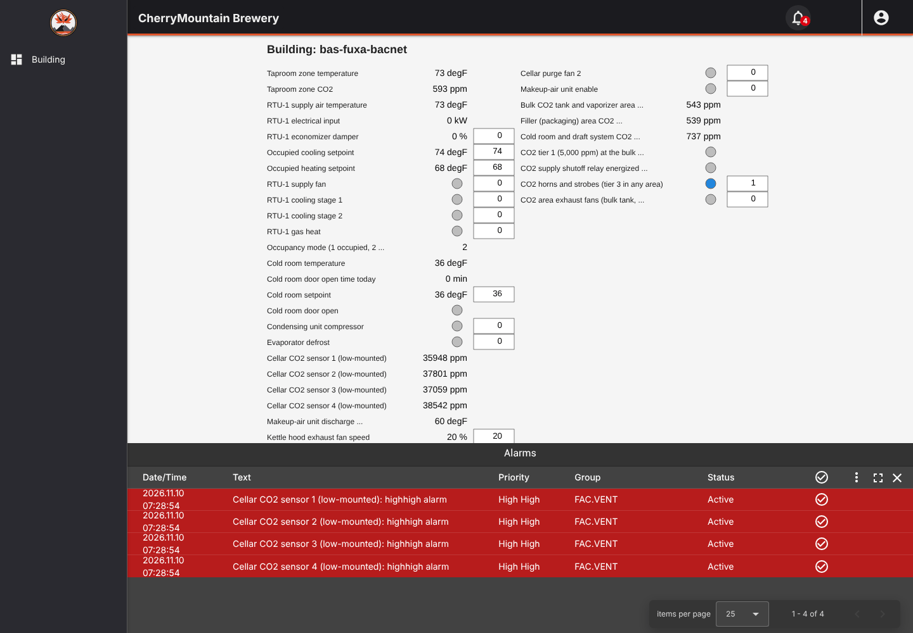

This is the Building screen of bas-fuxa for the same moment, with the same
sensor readings and flags on the cellar plan. In the ladder the three tier
lamps and "Horns and strobes" are lit, and neither purge fan runs. The one
relay lamp, "Shutoff relay, as the building drives it", is dark. Elsewhere the
taproom reads 73.0 °F, the cold room reads 36.0 °F with its compressor off, and
the makeup air reads 60.0 °F. The bell counts 8 alarms, the high and critical
alarms of the four sensors.

#### Rogue Modbus master (spunding)

A host on FIELD-CEL writes a 30 psig spunding setpoint to FV-102 every minute.
That value is above the 15 psig relief limit. The harness calls this scenario
`spunding-attack`.

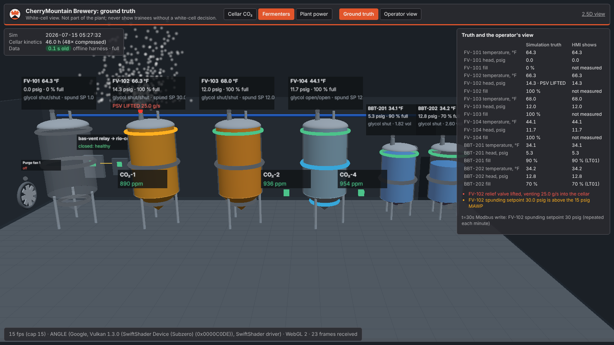

This is the Fermenters scene 57 minutes in. FV-102 is at 14.3 psig with its
relief valve lifted, and it vents 25 g/s into the cellar. The findings name the
setpoint.

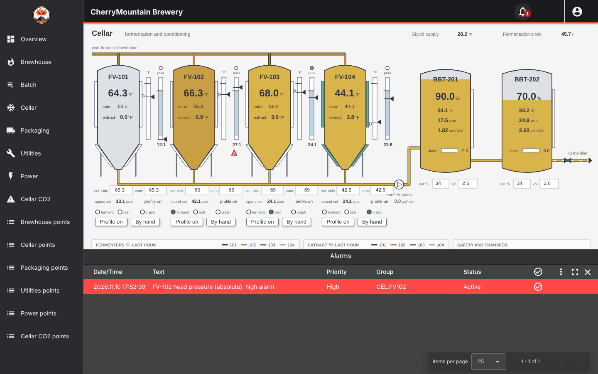

This is the Cellar screen of the same moment, with the alarm list open over the
trends. The spunding setpoint of FV-102 is at 42.1 psia (30 psig), and its head
pressure is at 27.1 psia. The triangle flag is beside the pressure scale, and
the high-pressure alarm is in the list. The stage lamps show FV-102 fermenting,
FV-103 resting, FV-104 crashing, and FV-101 empty.

The staged temperature setpoints follow the rule of the profile. FV-102 is at
66 °F and FV-103 is at 69 °F, with their beer at 66.3 and 68.0 °F. Thus the 66
and 70 °F of the stages cap the first setpoint, and the 1 °F lead sets the
second. FV-101 is at 1 °F above its beer, and FV-104 is at 1.5 °F below its
beer. The boxes show 65.3 and 42.6 °F, and the snapshot has 65.27 and 42.59 °F.

#### packaging-shift

The scenario is the `jam` event on the labeler and the filler.

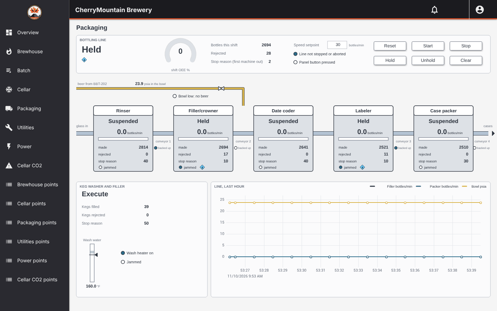

This is the Packaging screen at 08:00 after the two jams. The jam lamps of the
labeler and the filler are lit, each with a diamond flag (low priority). The
two machines are Held (state 11) with speed 0 and stop reason 10. The rinser,
date coder, and case packer are Suspended (state 5) behind them. Their stop
reasons are 40 (blocked) for the first two and 30 (starved) for the packer.

The line is Held, with a diamond flag beside its state. The capture stages that
flag without the 10-minute delay of the alarm. The stop reason of the line is
2, the filler, which is the first machine in line order that is jammed or Held.
The counts of the shift are 2,694 bottles and 28 rejected. The OEE dial reads 0
because the speed of the filler is 0, and the run commands of the conveyors are
0. The bell has no count, because it does not count low-priority alarms.

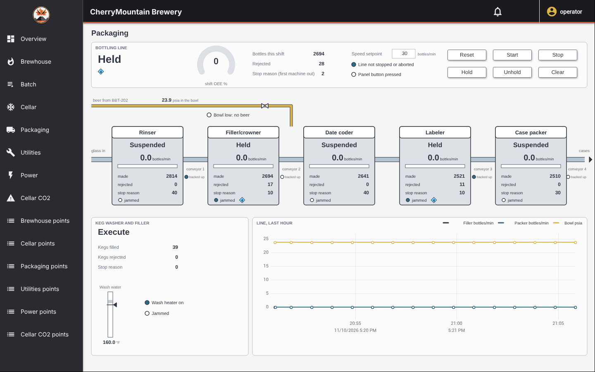

This is the packaging station (`cm-kiosk`, as above). It shows the same moment,
signed in as `operator`. The whole Packaging screen fits the 1440x900 display
of the station.

#### vendor-maintenance and the detections

The SOC side of these scenarios is on Malcolm and Wazuh, which cannot run here.
The repository has one fixture for the Wazuh rules.
`phenix-injects/wazuh/samples.txt` holds a log line for each rule. Each entry
is the id of the rule that must fire, then the line. `tests/soc/test_wazuh.py`
tests the file offline, and `cm-wazuh-selftest` runs it through `wazuh-logtest`
on the manager.

The lines below are for the PLC actions that the `cm_plc_tool.py` of the EWS
logs. The vendor-maintenance run uploads a program again with that tool. The
lines are the input of the fixture, not the output of Wazuh:

```text
100411|Nov  9 12:00:13 ews cm-plc-tool: event=plc_upload plc=plc-cellar host=10.20.10.12 user=ridgeline-akim
100412|Nov  9 12:00:14 ews cm-plc-tool: event=plc_start plc=plc-cellar host=10.20.10.12 user=ridgeline-akim
100413|Nov  9 12:00:15 ews cm-plc-tool: event=plc_failed plc=plc-cellar host=10.20.10.12 user=ridgeline-akim
```

### Not captured yet

Each of these parts needs a booted range. Capture them after the first boot, in
the state of the scenario beside them. The table lists each part and what to
capture.

| Part | Status | What to capture |
|---|---|---|
| Malcolm | not captured yet: needs a booted range | Dashboards (Zeek Modbus, BACnet, and OPC UA, and Suricata alerts) and Arkime sessions during `baseline-brew-day`, `cellar-co2-leak`, and `vendor-maintenance` |
| Wazuh | not captured yet: needs a booted range | Threat Hunting with the `cm_vendor`, `cm_wireguard`, and `cm_firewall` groups. The alerts of rules 100100 to 100413 during `vendor-maintenance` |
| Grafana (historian) and the "CherryMountain ground truth" dashboard | not captured yet: needs a booted range | The process and production panels of the historian, and the ground-truth panels with the injected events listed |
| Guacamole (sign-in, one-time code, an RDP session to the EWS) | not captured yet: needs a booted range | The sign-in page with the branding extension, and the session of the vendor on `ews-rdp-ridgeline-akim`. The web app ran once in containers for a sign-in test, without a picture |
| VM desktops: ews (xrdp sign-in, tools), vendor-ws, soc-analyst, corp-ws, and the two HMI VMs under XFCE | not captured yet: needs a booted range | Each console as phenix shows it, with the wallpaper and the panel |
| The pages of phenix (experiment view, VM screenshots, Files tab) | not captured yet: needs a booted range | The experiment while it runs, and the files of the SCORCH run |
| scada-fuxa and bas-fuxa with the real PLCs (OpenPLC) and ot-sim behind them | not captured yet: needs a booted range | The views above with live values, and a real brew from the Batch view |
| cm-viz in the range (sim-ctl as its source, beside FUXA) | not captured yet: needs a booted range | The three scenes through the autotunnel during a SCORCH run |

## What exists

| Path | Contents |
|---|---|
| `plant/` | `plant.yaml`, the tag database for the whole plant (every area, 44 hosts, 516 tags, 98 alarms), and the plantgen output under `plant/generated/{ci,full,lite}/` |
| `tools/plantgen/` | The generator. It writes tags, addresses, and the ot-sim, ntp, soh, wireguard, helics, and cherrymountain app blocks. It also writes HELICS lists and the OpenPLC, FUXA, BACnet, DNP3, and SCORCH inputs. The [README](tools/plantgen/README.md) documents every output |
| `sim/` | `cherrymountain_sim`: the packaging, weather, brewhouse, cellar, utilities, power (OpenDSS), and building federates, the sim-ctl event API, and an offline harness, with tests ([README](sim/README.md)) |
| `recipes/` | `fire-of-the-phenix.json`, the flagship recipe in BeerJSON. The batch engine brews from it |
| `phenix-ci.yml`, `phenix-configs/{topology,scenario}-ci.yml` | The workflow, topology, and scenario for the ci variant |
| `phenix.yml`, `phenix-lite.yml`, `phenix-configs/` | The workflows for the full and lite variants. The topology modules are `topology-{core,soc,remote-access}.yml`. `topology-{full,lite}.yml` include the modules. The scenarios are `scenario-{full,lite}.yml` |
| `phenix-injects/{ot-svc,bbmd,inet-traffic,vrouter,malcolm}/` | The injects of the network phase. They are the ot-svc DNS, syslog relay, and chrony hook, the `cm-bbmd` BACnet BBMD service, and the inet-traffic DNS. They are also the VyOS configuration script and the capture flow of malcolm |
| `phenix-injects/otsim/` | `cm_otsim_bacnet.py`, the BACnet/IP server module of the building controllers. The `cherrymountain` app injects it and adds it to the ot-sim configuration of the controllers ([README](phenix-injects/otsim/README.md)) |
| `sync.py` | It embeds the per-variant app blocks of plantgen into the scenarios and copies generated files into `phenix-injects/`. It knows about Git LFS pointers. It also copies the brand to the screens, writes `tokens.css`, and builds the Guacamole branding extension |
| `tools/netcheck/` | A static check of the topology, scenario, and workflow against the IP plan and the conduit matrix. It covers every conduit and every default drop, and it has tests ([README](tools/netcheck/README.md)) |
| `phenix-injects/` | The files that the ci scenario injects: federate units, OpenPLC and FUXA provisioning, and generated copies |
| `phenix-images/` | The image configurations (noble) for every role but the routers and soc-purple. They are `cm-sim`, `cm-otsim`, `cm-openplc`, `cm-fuxa`, `cm-svc`, `cm-desktop`, `cm-ews`, `cm-historian`, `cm-guacamole`, `cm-wireguard`, `cm-malcolm`, and `cm-wazuh`. [One README](phenix-images/README.md) has a section for each image, and one for the upstream `kali-purple`. These files are the source. The branch `feat-cherrymountain-images` of the images fork has a copy in `configs/cherrymountain/`, and its CI builds the copy |
| `plc/plc-cellar/` | The cellar PLC programs in Structured Text (`plc-cellar.st` for ci, `plc-cellar-plant.st` for full and lite), and the ci `build_zip.sh` |
| `plc/plc-{brewhouse,packaging,utilities,power}/` | The other four PLC programs in Structured Text. `plc/common/build_zip.sh` builds them for full and lite |
| `plc/common/` | The per-variant PLC builder: alarm logic generated from `alarms.json`, strucpp, and the ZIPs under `phenix-injects/openplc/<variant>/` ([README](plc/common/README.md)) |
| `tests/integration/` | `ci_slice_docker.sh`: the cellar slice (ot-sim, OpenPLC v4.3.2, FUXA) in Docker, with no KVM |
| `tests/soc/` | Tests of the Wazuh rules, the Suricata rules and Zeek script, and the vendor-path scripts. A test also makes sure that every script of a scenario step is on its VM |
| `tests/bacnet/` | The ot-sim BACnet module against a real BACpypes3 client and real ZeroMQ sockets on loopback |
| `brand/` | The mark, colors (`tokens.json`), and wallpaper of the brewery, with the rules for their use ([README](brand/README.md)). `sync.py` copies them to every screen, and `tests/brand/` tests the scripts that apply them |
| `viz/` | `cherrymountain_viz`: cm-viz, the 3D view of ground truth for the white cell (three.js, vendored), with tests ([README](viz/README.md)) |
| `docs/DESIGN.md` | The design: the plant, the models, the network, the control system, the phenix integration, the tests, and the references. Its Status section is the authoritative status |
| `docs/FUTURE_WORK.md` | All planned or considered work that is not done |
| `docs/examples/` | The screenshots of the [Examples](#examples) section and the scripts that take them ([README](docs/examples/capture/README.md)) |
| `docs/plc-secure-coding-review.md` | A review of the five PLC programs against the Top 20 Secure PLC Coding Practices. It has a rating for each practice and program, the findings, and a list of the fixed findings |
| `fuxa/` | `build_project.py` and the FUXA projects that it builds: scada-fuxa for ci, and scada-fuxa and bas-fuxa for full and lite (`fuxa/<variant>/`). It also has `batch_engine.js`, the ISA-88 batch engine in the full and lite scada-fuxa projects, with its tests in `fuxa/tests/` ([README](fuxa/README.md)) |
| `tools/lint/` | Hook scripts for prek: systemd-analyze on units, and shellcheck on the shell in image YAML. `run_app_tests.py` runs the tests of the `cherrymountain` app and `plantevent` on this directory |
| `spikes/` | Phase 0 spike kits, each with its go/no-go result ([summary](spikes/README.md)) |
| [sceptre-phenix-apps](https://github.com/GhostofGoes/sceptre-phenix-apps/tree/feat-cherrymountain-apps), branch `feat-cherrymountain-apps` | The `cherrymountain` phenix app (five stages) and the `plantevent` SCORCH component are not in this repository. They are in `src/python/phenix_apps/apps/cherrymountain/` ([README](https://github.com/GhostofGoes/sceptre-phenix-apps/blob/feat-cherrymountain-apps/src/python/phenix_apps/apps/cherrymountain/README.md)) and `src/python/phenix_apps/apps/scorch/plantevent/` ([README](https://github.com/GhostofGoes/sceptre-phenix-apps/blob/feat-cherrymountain-apps/src/python/phenix_apps/apps/scorch/plantevent/README.md)) of that fork, each with tests |

## The ci variant

The ci variant has five VMs, 7 vCPUs, and about 8 GB: sim-ctl, sim-process,
rio-cellar, plc-cellar, and scada-fuxa. It needs `/dev/kvm` on the host. The
phenix image, the VM images, and the PLC program ZIP must exist first.

1. Build the phenix image one time with the build arguments
   `APPS_REPO=github.com/GhostofGoes/sceptre-phenix-apps` and
   `APPS_BRANCH=feat-cherrymountain-apps`. That branch has the `cherrymountain`
   app ([USER_GUIDE.md](USER_GUIDE.md#4-build-and-start-phenix) has the
   command).
2. Build the four VM images from `phenix-images/`. The header of each file has
   the commands.
3. Add miniccc to each VM image with `phenix image inject-miniexe`.
4. Make sure that the OpenPLC program ZIP,
   `phenix-injects/openplc/plc-cellar.zip` (Git LFS), is present.
   `plc/plc-cellar/build_zip.sh` builds it headless (see
   [plc/plc-cellar/README.md](plc/plc-cellar/README.md)). The topology injects
   that path. Build the ZIP again after each change to the plant or the
   program.
5. Apply the variant with its own workflow branch, from outside the directory:

```shell
docker exec phenix phenix workflow apply -b cherrymountain-ci -c phenix-ci.yml /phenix/topologies/cherrymountain-brewery
```

Reach FUXA with `phenix-tunneler` at `http://localhost:11881`
([USER_GUIDE.md](USER_GUIDE.md#8-connect-from-your-own-computer)). On the
phenix host itself, the forward listens on a random port. Find the port with
`cc tunnel list scada-fuxa` (the row with `dst port 1881`).

The `cherrymountain` app generates the passwords of the range for each
experiment. They are in `<experiment directory>/cherrymountain/secrets.json`.
The `admin` account of FUXA has `fuxa_password`, and the `operator` account has
`fuxa_operator_password`. The `operator` account is the account that can write
values. The HMI stations sign in with it without help.

The fixed passwords in `phenix-injects/fuxa/fuxa.env` are the ones that the ci
topology injects. The rendered file of the app replaces them when the app runs.
Thus they apply only to a ci experiment that starts without the app.

## Regenerate and test

Run these commands from this directory after a change to `plant/plant.yaml`:

```shell
(cd tools/plantgen && python -m plantgen)          # rewrite plant/generated/*
python sync.py                                       # embed the generated blocks in the scenarios, copy generated files into phenix-injects/
python fuxa/build_project.py --all                   # rebuild the FUXA projects (ci; full and lite for scada-fuxa and bas-fuxa)
python sync.py                                       # ... and copy it (run again after build_project.py)
plc/plc-cellar/build_zip.sh                          # rebuild the ci OpenPLC program ZIP (needs Node 22+)
plc/common/build_zip.sh --all                        # rebuild the full and lite PLC ZIPs (needs Node 22+)
```

All of the tests below must pass. `prek run --all-files` covers lint and
hygiene. Run the other commands by hand:

```shell
(cd tools/plantgen && python -m plantgen --check && python -m pytest)
(cd sim && python -m pytest)                         # model validation and the offline federation
python tools/lint/run_app_tests.py                   # the cherrymountain app and plantevent, from the installed phenix-apps (branch feat-cherrymountain-apps)
(cd viz && python -m pytest)                         # cm-viz: frames, server, and the sim-ctl source
python -m pytest tests/soc                           # SOC detections, vendor-path scripts, and the scripts scenario steps run
python -m pytest tests/bacnet                        # the ot-sim BACnet module (needs bacpypes3 and pyzmq)
python -m pytest fuxa                                # the batch engine under Node (18+) and what the builder writes for it
python sync.py --check                               # injects and scenarios match plantgen output (ci, full, lite)
python tools/netcheck/run_netcheck.py                # IP plan, conduit matrix, routes, rules (full, lite)
(cd tools/netcheck && python -m pytest)              # netcheck, sync.py, and BBMD tests
python fuxa/build_project.py --all --check           # FUXA projects are current
python plc/plc-cellar/assemble.py                    # PLC program matches alarms.json and the I/O map
plc/plc-cellar/build_zip.sh --check                  # the committed ZIP is a fresh build (needs Node 22+)
(cd tests/integration && python -m pytest)           # ot-sim hand-render equals the phenix app
```

`assemble.py --iec2c <path>` also compiles the PLC program with matiec.

The integration test runs the slice in Docker. The first run takes about 10
minutes, for the image builds. The header of the script has its environment
variables.

```shell
tests/integration/ci_slice_docker.sh
```

The test starts ot-sim (`rio-cellar`) with the real `cherrymountain_sim`
federate and a HELICS broker. It starts OpenPLC v4.3.2 with `plc-cellar.zip`,
and FUXA 1.3.5 provisioned with the generated project. Then it asserts these
facts:

- The values flow from ot-sim to the PLC to FUXA.
- Setpoints written through FUXA and Modbus land in the right `%MW` words and
  move the valves.
- The alarm bits read correctly.
- The spunding outputs reach ot-sim.

The test also uploads two deliberately different `modbus_slave.json` files.
They show how the v4 runtime clamps and segments the holding registers.

## Lint

`prek run --all-files` examines this directory, and CI runs it too. It has
these hooks:

- Schemas of phenix: a hook tests every Topology, Scenario, Workflow, and Image
  file against the sceptre-phenix JSON Schemas. The hook fetches the schemas
  from a commit-pinned URL (`prek.toml` has the commit).
- Units: `systemd-analyze verify` and a hardening (exposure) limit run on every
  `.service` file and on the units that image scripts write.
- Shell: shellcheck runs at style level on scripts. This includes scripts with
  no extension. It also runs on the shell embedded in `phenix-images/*.yml`.
- YAML: phenix YAML uses block style. Only empty `{}` and `[]` can use flow
  syntax. JSON that phenix injects verbatim is exempt.
- Docker and desktop files: hadolint, dclint, and `desktop-file-validate` run
  when such files exist.
- Network plan: `netcheck` (see [tools/netcheck](tools/netcheck/README.md)),
  its tests, and `sync.py --check` run as local hooks. Thus CI fails when a
  conduit loses its rule, a rule has no conduit, or an address overlaps. CI
  also fails when the output of plantgen is not synced into the scenarios, or a
  program ZIP is stale.
- Test suites: the plantgen, `sim/`, `viz/`, app, and SOC pytest suites run as
  hooks too. The hooks are `cm-plantgen-tests`, `cm-sim-tests`, `cm-viz-tests`,
  `cm-app-tests`, `cm-soc-tests`, `cm-bacnet-tests`, `cm-brand-tests`, and
  `cm-fuxa-batch-tests`, which needs Node 18 or newer. The `cm-app-tests` hook
  installs phenix-apps from a pinned commit of the fork. Then it runs the tests
  of the `cherrymountain` app and `plantevent` from that package on this
  directory (`tools/lint/run_app_tests.py`). Run the Docker integration test
  and `build_zip.sh --check` (Node) by hand.

`spikes/` and `tests/` are exempt from the stricter checks.
[CONTRIBUTING](../.github/CONTRIBUTING.md#code-quality) lists the system tools
that some hooks need.

## Network (Phase 1)

The full and lite variants carry the whole network of DESIGN.md section 10. The
sections below describe the topology, the conduits, the services, and the
health probes. The last section lists the known gaps.

### Topology

`topology-core.yml` has the 37 core nodes (the 44 of the design minus the SOC
and remote-access modules). Each node has its interfaces, VLANs, addresses,
static routes, zone labels, boot-order `delay` values, autotunnel entries, and
resources. `topology-soc.yml` adds malcolm, wazuh, soc-analyst, and soc-purple.
`topology-remote-access.yml` adds dmz-vpn, dmz-jump, and vendor-ws.
`topology-full.yml` includes all three files (44 VMs, 68 vCPUs, 160 GB).
`topology-lite.yml` includes only the core (37 VMs, 45 vCPUs, 69 GB).

phenix appends the included nodes in order. Thus the boot order is the core,
then the SOC, then the remote-access nodes. Router interfaces have the names
`eth0`, `eth1`, and so on. These are the VyOS NIC names, because the vrouter
app writes netem policies with the interface name. Hosts use `IF0`, `IF1`, and
so on, and `mgmt`.

### Conduits

The `vrouter` app in `scenario-full.yml` holds one ruleset for each source
interface on fw-edge and fw-ot (`FROM-<zone>`). A ruleset has the stateful
accept, the allowed flows of the conduit matrix, and default drop. `acl.egress`
is the name that the app uses for the ruleset on packets that come in on an
interface. The fw-edge firewall also has the SNAT, the WireGuard DNAT, and the
IPsec site to util-rtr. The routers isp-rtr and util-rtr have the netem on the
WAN legs. `scenario-lite.yml` takes the vrouter app from the full scenario with
`fromScenario`.

### Services

The ot-svc host has chrony, from the ntp app. A startup hook limits chrony to
the prefixes of the plant. The ot-svc host also has a dnsmasq zone for the
plant (`phenix-injects/ot-svc/plant.hosts`, `cherrymountain.test`), the syslog
relay to Wazuh, and the OPS BBMD. The bas-bbmd host runs the BAS BBMD. The two
BBMDs run `phenix-injects/bbmd/cm_bbmd.py` (BACpypes3, with a BDT that lists
the two).

### SoH

SoH is the state-of-health app of phenix. `testCustomReachability` has a probe
for every conduit that answers: every TCP conduit, the BACnet reads, the BBMD
BDT reads, NTP, and DNS. `hostCustomTests` has a cc script for each blocked
path, and the script expects `DROPPED`. Syslog and IKE/ESP send no reply, so
only the static check covers them.

### Known gaps

These are the known gaps and the items to examine on the first VM run. Each one
is also a comment at the place where it matters.

#### Not run on a VM

`netcheck` models the rules that phenix renders. It does not prove the behavior
of VyOS. On the first VM run, make sure that these items are correct:

- The `vyatta.tmpl` output commits with these rulesets.
- The ACL names behave as modeled (`acl.egress` is the inbound filter).
- `cm-bbmd.service` runs under systemd.
- Every SoH probe passes.

BBMD rule 2 (the I-Am of the device to FUXA) and the syslog flows send no
reply. Thus they have no SoH probe, and only `netcheck` covers them. BBMD rule
3 is optional (DESIGN 10.3).

#### Four items that the vrouter templates cannot do

The vrouter templates cannot do four items that the design needs. Thus
`phenix-injects/vrouter/cm-vyos-config.sh` does them after boot. A topology
`commands` entry (a `cc exec`) delivers the script. The four items are:

- Rule logging: `default-log` on every ruleset, and the syslog target for
  Wazuh.
- `ike-group IKE-1W key-exchange ikev2`.
- The NTP server of fw-ot (ot-svc).
- An IPsec match on the utility rule of fw-edge.

The script is not proven on VyOS. It ran only against a stand-in that defines
the commands of VyOS as shell aliases, as VyOS does. The topology injects the
script into the persistence path of the image, where the boot hook runs
`*.script` files. The script waits for the boot commit.

#### phenix issues to report upstream

- The vrouter app keeps the NTP address of the first router that has one and
  uses it for every later router. Thus isp-rtr comes first in the topology, and
  the script corrects the source of fw-ot.
- The rendered rulesets filter only `forward`. Thus no rule filters traffic to
  the own address of a router (IKE, SSH).
- Rules have no `log` field.
- The netem `loss` value is an integer percent (the design and the files use 1
  percent).
- The template has no `key-exchange`.

#### Other gaps

- Malcolm upload pipeline: a pcap in `pcap/upload` reaches OpenSearch only with
  the four fixes of the malcolm spike. `cm-malcolm-provision` applies them at
  the first boot (DESIGN 14), and that boot did not run in a VM.
- Mirror: the `cherrymountain` app sets `df_default=false` on the GRE ports of
  the mirror after each start, until the mirror app does it. The status of the
  app then says `dfDefault: set`. `cm-malcolm-capture.service` adds the
  OpenFlow capture flow, until the mirror app does it (DESIGN.md 14). The
  injected startup hook `phenix-injects/malcolm/99-zz-capture-flow.sh` starts
  that service.
- Images: every image that the full topology names has a configuration in
  `phenix-images/`, except two prebuilt images from sceptre-phenix-images. The
  two are `vyos` and the `kali-purple` of soc-purple. The `cm-svc-protonuke` of
  inet-traffic is a copy of `cm-svc`. No phenix host built one of these images
  yet. The branch `feat-cherrymountain-images` of the images fork has the
  recipes of the two prebuilt images and a copy of the configurations
  (`configs/cherrymountain/`).
- Generated blocks: `ot-sim`, `cherrymountain`, `helics`, `ntp`, and
  `wireguard` come from plantgen through `sync.py`. The soh checks of plantgen
  merge into the hand-written ones.

## Applying the full design

The topology uses the directory layout of `phenix workflow apply`
(`phenix.yml`, `phenix-configs/`, `phenix-injects/`). Build the images first
(see [phenix-images/README.md](phenix-images/README.md)). Then deploy the full
plant:

```shell
docker exec phenix phenix workflow apply /phenix/topologies/cherrymountain-brewery
```

The lite variant uses its own branch, like ci:

```shell
docker exec phenix phenix workflow apply -b cherrymountain-lite -c phenix-lite.yml /phenix/topologies/cherrymountain-brewery
```

Reach the web UIs with `phenix-tunneler`. It gives each startup autotunnel
(DESIGN.md 15.3) a fixed port on your own computer, and the user guide has the
table. On the phenix host the forwards use random ports. Look one up with
`cc tunnel list <vm>` each time, because the forwards API of phenix reports
only the port of the tunneler.

Each variant has its own bridge. Only one variant can run at a time, because
the variants use the same VLAN IDs.
