# CherryMountain Brewery

An open-source OT cyber range for [phenix](https://github.com/sandialabs/sceptre-phenix):
a notional Colorado microbrewery with its process, PLCs, SCADA, power and
building systems, a SOC, and a vendor's way in.

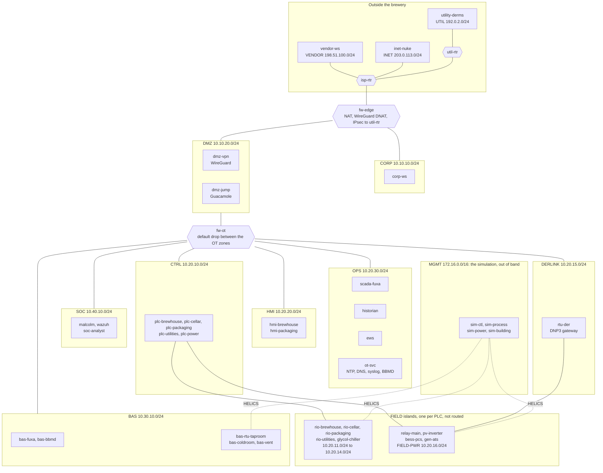

The network of the full variant: 43 VMs on 16 networks, plus the simulation's
and the capture mirror's.
Hexagons are routers and firewalls, and dotted lines are the simulation's own
network, which is not part of the brewery. [DESIGN.md](DESIGN.md) section 10 has
the addresses and every allowed flow.

<details>
<summary><strong>Table of contents</strong></summary>

- [Status](#status)
- [Overview](#overview)
- [Architecture](#architecture)
  - [Process simulation](#process-simulation)
  - [Field devices](#field-devices)
  - [Control](#control)
  - [SCADA and HMI](#scada-and-hmi)
  - [Plant power and the utility link](#plant-power-and-the-utility-link)
  - [Building automation](#building-automation)
  - [Network segmentation](#network-segmentation)
  - [Blue team](#blue-team)
  - [Vendor remote access](#vendor-remote-access)
  - [Orchestration and the plant model](#orchestration-and-the-plant-model)
  - [White cell](#white-cell)
- [What exists](#what-exists)
- [The ci variant](#the-ci-variant)
- [Regenerate and test](#regenerate-and-test)
- [Lint](#lint)
- [Network (Phase 1)](#network-phase-1)
- [Applying the full design](#applying-the-full-design)

</details>

## Status

Everything is built and tested offline, and nothing has run on a phenix host
yet: [Status in DESIGN.md](DESIGN.md#status) has the detail.

## Overview

The CherryMountain Brewery topology models a notional SCADA system for a
Colorado microbrewery and taproom. Its flagship West Coast IPA is "Fire of the
Phenix". It is an all open-source OT cyber range covering:

- **Process:** brewhouse, cellar, bottling and kegging.
- **Utilities:** glycol, steam, compressed air, CO₂, water treatment,
  wastewater neutralization, and clean-in-place (CIP).
- **Plant power:** an internal power-distribution model with PV, battery
  storage, and a standby generator.
- **Building automation:** a building automation system (BAS).
- **Security:** blue-team monitoring and a vendor remote-access path.

| Role | Component |
|---|---|
| SCADA and HMI | [FUXA](https://github.com/frangoteam/FUXA) |
| PLCs | [OpenPLC](https://github.com/Autonomy-Logic/openplc-runtime) |
| Field devices | [ot-sim](https://github.com/patsec/ot-sim) |
| Physics co-simulation | [HELICS](https://github.com/GMLC-TDC/HELICS) |
| Network monitoring and SIEM | [Malcolm](https://github.com/cisagov/Malcolm) and [Wazuh](https://github.com/wazuh/wazuh) |

To run it on your own host, follow [USER_GUIDE.md](USER_GUIDE.md): the
repositories to clone, the builds, the first start of each variant, and what to
check.

See [DESIGN.md](DESIGN.md) for the full design: plant and process design,
power and building models, simulation, network architecture, phenix
integration, new software, testing, roadmap, risks, and references.

## Architecture

The range is a real control system around a simulated plant. Physics runs in
HELICS federates, ot-sim devices present it as field I/O, OpenPLC programs
control it, and FUXA supervises it. Around that sit the network's zones and
firewalls, the blue team's sensors, the vendor's way in, and the white cell's
tools. phenix builds and runs all of it from the files in this folder.

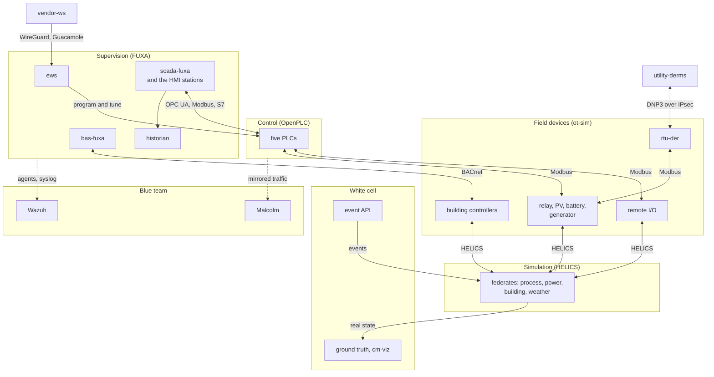

### Process simulation

Seven HELICS federates model the plant in real time: brewhouse, cellar,
packaging, and utilities on `sim-process`, the electrical system on
`sim-power`, the building on `sim-building`, and weather on `sim-ctl`, which
also runs the broker. They exchange what couples a real plant: loads go to the
power model, bus state comes back, the cellar's CO₂ goes to the building, and
glycol and CO₂ supply reach the cellar and the bottling line. Fermentation runs
48 times faster than real time, and everything else is real time. A simulated
brewer, cellar crew, and line operator do the hand work that no PLC point
covers. The federates sit on the MGMT network, which is not part of the brewery.


### Field devices

Every sensor and actuator is a point on an ot-sim device: four remote I/O racks
and the glycol chiller for the process, the main relay, PV inverter, battery,
and generator controller for power, and three building controllers. Each device
is a HELICS federate on its MGMT side and a protocol server on its plant side:
Modbus TCP for the process and power devices, BACnet/IP for the building (a
module written for this range), and DNP3 on `rtu-der`, the gateway the utility
polls. A write travels the same path back to the federate. The field networks
are islands, so only a rack's own PLC can reach it.


A device has one of the three servers: Modbus on the racks and power devices,
BACnet on the building controllers, DNP3 on `rtu-der`.

### Control

Five OpenPLC v4 runtimes run Structured Text programs built from this
repository: the brewhouse (ISA-88 phases), the cellar (glycol, the fermentation
profile, spunding, carbonation), packaging (a PackML line), utilities (glycol,
steam, clean-in-place, wastewater), and power (demand limiting, the generator's
exercise). Each PLC polls its own field island by Modbus and serves SCADA
northbound: OPC UA on the brewhouse, S7 on packaging, Modbus on the rest. Safety
does not depend on SCADA. The cellar's CO₂ interlock is a hardwired relay from
the gas detection controller, and a vessel-entry permit locks outputs out in
the PLC. The alarm logic is generated from the plant model.

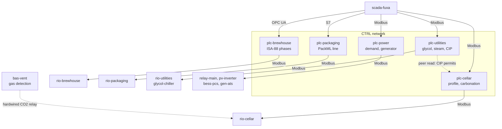

### SCADA and HMI

Two FUXA servers supervise the plant. `scada-fuxa` reads and writes all five
PLCs in their own protocols, shows the process views and alarms, and runs the
batch engine: a server script that takes the brewhouse PLC through a brew, phase
by phase, from the recipe. `bas-fuxa` is the front end of the building
controllers, over BACnet. The two HMI stations are Chromium kiosks on scada-fuxa
views that sign themselves in as the operator. The historian keeps FUXA's values
in InfluxDB and graphs them in Grafana. Engineers work from `ews`, which has the
PLC tools.

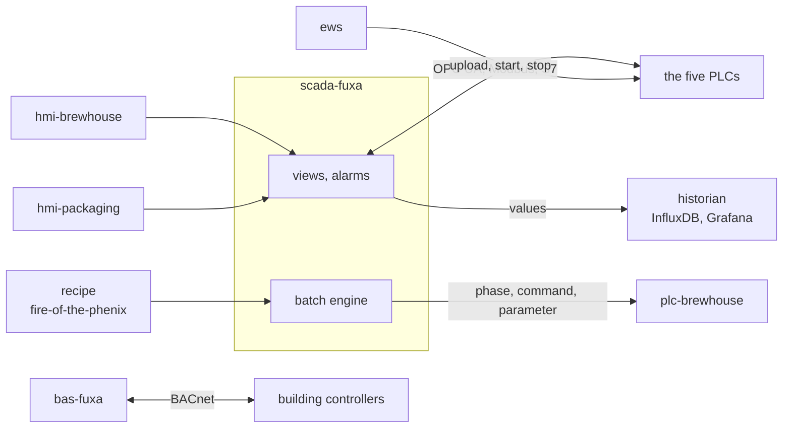

### Plant power and the utility link

OpenDSS models the brewery's electrical system from the 12.47 kV utility feeder
through a 500 kVA transformer to the 480 V switchboard, with 100 kW of rooftop
PV, a 100 kW / 200 kWh battery, and a 100 kW standby generator behind a
transfer switch. The other federates send their loads each second, and an outage
really takes their power away. `plc-power` limits demand and exercises the
generator. The utility, Summit Valley Power, polls and commands the site's
energy resources through `rtu-der` by DNP3, over an IPsec tunnel between its
router and the brewery's edge firewall.

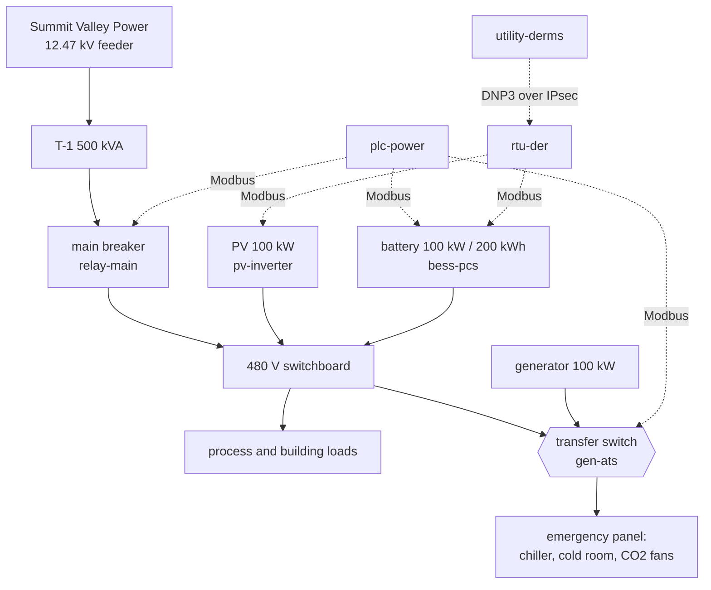

### Building automation

Three BACnet/IP controllers run the building: the taproom's rooftop unit, the
cold room, and the cellar's ventilation with its CO₂ detection and purge fans.
`bas-fuxa` is their front end on the BAS network. The cellar's gas detection is
life safety, so its relay is wired to the cellar PLC's I/O and carbonation stops
on high CO₂ with no network involved. SCADA only reads the CO₂ values, through a
pair of BACnet broadcast management devices (BBMDs) that carry discovery across
the firewall. The building's loads, and the weather that drives its heating and
cooling, feed the power model.

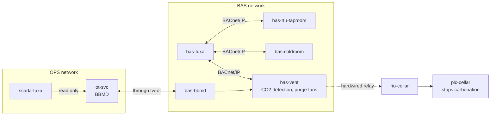

### Network segmentation

The network follows the Purdue model with ISA/IEC 62443 zones and conduits. Two
VyOS firewalls separate the enterprise, a DMZ, and the OT zones: `fw-edge` faces
the Internet, and `fw-ot` stands between every OT zone with default drop and one
rule per allowed flow. The field networks are not routed at all. A static
checker (`tools/netcheck`) compares every rule with the design's conduit matrix,
and state-of-health probes test each allowed and each blocked path on a running
range. `ot-svc` gives the plant its time, its names, and a syslog relay.

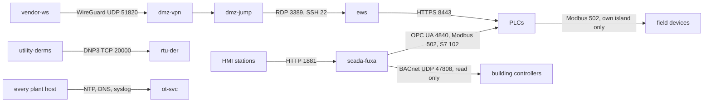

The main conduits. [DESIGN.md](DESIGN.md) section 10.3 lists every one, and a
flow that is not listed is dropped.

### Blue team

The SOC sees the plant two ways. Malcolm captures a mirror of the OT, building,
and DMZ networks and runs Zeek with ICS protocol parsers, Suricata, and Arkime
over it. Wazuh collects logs from agents on the servers and workstations and, by
syslog, from the firewalls and from the plant's relay on `ot-svc`. Both carry rules written
for this plant: a write to a life-safety point, a breaker command from an
unexpected host, a vessel-entry violation, each step of the vendor's path.
`soc-analyst` is the analyst's desktop, with both consoles a click away.

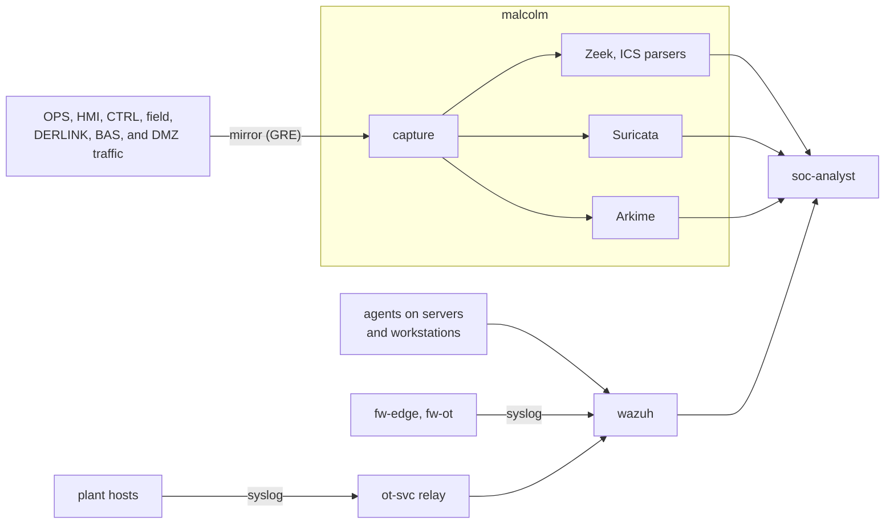

### Vendor remote access

Ridgeline Process Controls, the integrator, reaches the plant the way real
vendors do. A technician's workstation opens a WireGuard tunnel to `dmz-vpn`,
and the tunnel allows one destination: the Guacamole jump host, `dmz-jump`.
There the technician signs in with a password and a one-time code, and Guacamole
opens a recorded RDP or SSH session to the engineering workstation, the only
host the jump host may reach. From there the technician works on the PLCs. Every
step leaves evidence the blue team can follow.

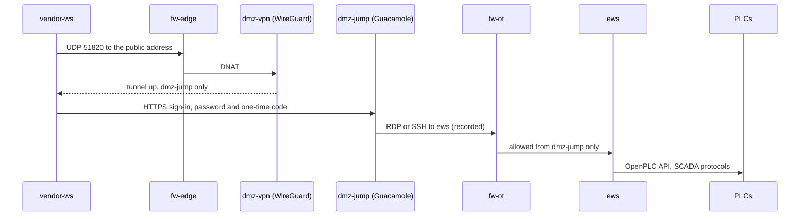

### Orchestration and the plant model

phenix builds the range from the topology and scenario files here, and its apps
configure the parts: `ot-sim` and `helics` for the simulation, `vrouter` for the
firewalls, `ntp`, `wireguard`, `mirror`, `soh` for health checks, `scorch` for
scripted runs, and this range's own `cherrymountain` app, which renders the
configs, credentials, and provisioning of every role. Almost all of their input
is generated. `plant/plant.yaml` holds every tag, device, alarm, and host;
`plantgen` turns it into register maps, PLC variables, FUXA tags, HELICS lists,
and app settings; and `sync.py` puts the results in place. A check fails when a
copy drifts from its source.

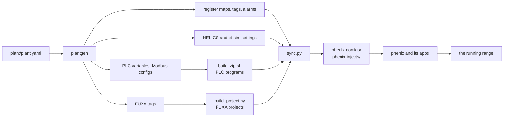

### White cell

Exercise control runs on `sim-ctl`, out of the players' sight. An event API puts
faults into the simulation: a CO₂ release, the utility's breaker opening, a jam
on the line, a chiller fault. Every federate writes ground truth, the plant's
real state whatever the HMIs show, to OpenSearch behind a Grafana dashboard, and
`cm-viz` draws it as a 3D view of the brewery. SCORCH pipelines run scripted
scenarios through the `plantevent` component and capture the traffic. Staff
reach these, and the plant's own web pages, through phenix's tunnels.

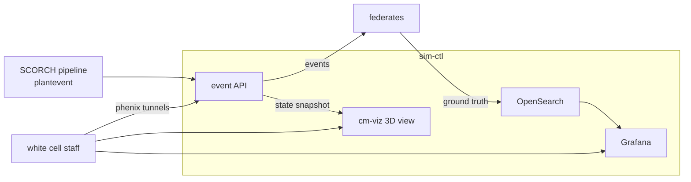

## What exists

| Path | Contents |
|---|---|
| `plant/` | `plant.yaml` tag database for the whole plant (every area, 43 hosts, 514 tags, 97 alarms) and the plantgen output under `plant/generated/{ci,full,lite}/` |
| `tools/plantgen/` | Generator: tags, addresses, the ot-sim, ntp, soh, wireguard, helics, and cherrymountain app blocks, HELICS lists, OpenPLC, FUXA, BACnet, DNP3, and SCORCH inputs ([README](tools/plantgen/README.md) documents every output) |
| `sim/` | `cherrymountain_sim`: the weather, brewhouse, cellar, utilities, packaging, power (OpenDSS), and building federates, the sim-ctl event API, and an offline harness, with tests ([README](sim/README.md)) |
| `recipes/` | `fire-of-the-phenix.json`, the flagship recipe in BeerJSON; the batch engine brews from it |
| `phenix-ci.yml`, `phenix-configs/{topology,scenario}-ci.yml` | Workflow, topology, and scenario for the ci variant |
| `phenix.yml`, `phenix-lite.yml`, `phenix-configs/` | Workflows for the full and lite variants; topology modules `topology-{core,soc,remote-access}.yml`, `topology-{full,lite}.yml` (they include the modules), and `scenario-{full,lite}.yml` |
| `phenix-injects/{ot-svc,bbmd,inet-nuke,vrouter,malcolm}/` | The network phase's injects: ot-svc DNS, syslog relay, and chrony hook; the `cm-bbmd` BACnet BBMD service; inet-nuke DNS; the VyOS settings script; malcolm's capture flow |
| `phenix-injects/otsim/` | `cm_otsim_bacnet.py`, the BACnet/IP server module of the building controllers, which the `cherrymountain` app injects and adds to their ot-sim config ([README](phenix-injects/otsim/README.md)) |
| `sync.py` | Embeds plantgen's per-variant app blocks into the scenarios and copies generated files into `phenix-injects/`; aware of Git LFS pointers. It also copies the brand to the screens, writes `tokens.css`, and builds the Guacamole branding extension |
| `tools/netcheck/` | Static check of the topology, scenario, and workflow against the IP plan and conduit matrix: every conduit and every default drop, with tests ([README](tools/netcheck/README.md)) |
| `phenix-injects/` | Files the ci scenario injects: federate units, OpenPLC and FUXA provisioning, generated copies |
| `phenix-images/` | Image configs for every role (noble): `cm-sim`, `cm-otsim`, `cm-openplc`, `cm-fuxa`, `cm-svc`, `cm-desktop`, `cm-ews`, `cm-historian`, `cm-guacamole`, `cm-wireguard`, `cm-malcolm`, `cm-wazuh`, with [one README](phenix-images/README.md) that has a section per image |
| `plc/plc-cellar/` | The cellar PLC programs in Structured Text (`plc-cellar.st` for ci, `plc-cellar-plant.st` for full and lite), and the ci `build_zip.sh` |
| `plc/common/` | The per-variant PLC builder: alarm logic generated from `alarms.json`, strucpp, and the ZIPs under `phenix-injects/openplc/<variant>/` ([README](plc/common/README.md)) |
| `tests/integration/` | `ci_slice_docker.sh`: the cellar slice (ot-sim, OpenPLC v4.3.2, FUXA) in Docker, no KVM |
| `tests/soc/` | Tests of the Wazuh rules, the Suricata rules and Zeek script, the vendor-path scripts, and that every script a scenario step runs is on its VM |
| `tests/bacnet/` | The ot-sim BACnet module against a real BACpypes3 client and real ZeroMQ sockets on loopback |
| `brand/` | The brewery's mark, colors (`tokens.json`), and wallpaper, with the rules for using them ([README](brand/README.md)); `sync.py` copies them to every screen, and `tests/brand/` checks the scripts that apply them |
| `viz/` | `cherrymountain_viz`: cm-viz, the white cell's 3D view of ground truth (three.js, vendored), with tests ([README](viz/README.md)) |
| `fuxa/` | `build_project.py` and the FUXA projects it builds: scada-fuxa for ci, and scada-fuxa and bas-fuxa for full and lite (`fuxa/<variant>/`); `batch_engine.js`, the ISA-88 batch engine that the full and lite scada-fuxa projects carry, with its tests in `fuxa/tests/` ([README](fuxa/README.md)) |
| `tools/lint/` | Hook scripts for prek: systemd-analyze on units and shellcheck on shell in image YAML |
| `spikes/` | Phase 0 spike kits, each with its go/no-go result ([summary](spikes/README.md)) |
| `apps/` | The `cherrymountain` phenix app (five stages) and the `plantevent` SCORCH component, each with its own `README.md`, with tests ([README](apps/README.md)) |

## The ci variant

Five VMs, 7 vCPUs, about 8 GB: sim-ctl, sim-process, rio-cellar, plc-cellar,
and scada-fuxa. It needs `/dev/kvm` on the host. The images and the PLC
program ZIP must exist first:

1. Build the four images from `phenix-images/` (each file's header has the
   commands), then add miniccc with `phenix image inject-miniexe`.
2. The OpenPLC program ZIP is `phenix-injects/openplc/plc-cellar.zip` (Git
   LFS), built headless by `plc/plc-cellar/build_zip.sh` (see
   [plc/plc-cellar/README.md](plc/plc-cellar/README.md)). The topology injects
   that path; rebuild it after any change to the plant or the program.
3. Apply the variant with its own workflow branch, from outside the directory:

```shell
docker exec phenix phenix workflow apply -b cherrymountain-ci -c phenix-ci.yml /phenix/topologies/cherrymountain-brewery
```

Reach FUXA with `phenix-tunneler` at `http://localhost:11881`
([USER_GUIDE.md](USER_GUIDE.md#8-connect-from-your-own-computer)). On the phenix
host itself the forward listens on a random port: find it with
`cc tunnel list scada-fuxa` (the row with `dst port 1881`). The `cherrymountain` app generates the range
passwords for each experiment: FUXA's `admin` is `fuxa_password` and its
`operator` (the account that may write values, which the HMI stations sign in with by themselves) is `fuxa_operator_password` in
`<experiment directory>/cherrymountain/secrets.json`. The fixed ones in
`phenix-injects/fuxa/fuxa.env` are what the ci topology injects; the app's
rendered file replaces them when it runs, so they apply only to a ci experiment
started without the app.

## Regenerate and test

Run these from this directory after changing `plant/plant.yaml`:

```shell
(cd tools/plantgen && python -m plantgen)          # rewrite plant/generated/*
python sync.py                                       # embed the generated blocks in the scenarios, copy generated files into phenix-injects/
python fuxa/build_project.py --all                   # rebuild the FUXA projects (ci; full and lite for scada-fuxa and bas-fuxa)
python sync.py                                       # ... and copy it (run again after build_project.py)
plc/plc-cellar/build_zip.sh                          # rebuild the ci OpenPLC program ZIP (needs Node 22+)
plc/common/build_zip.sh --all                        # rebuild the full and lite PLC ZIPs (needs Node 22+)
```

Checks (all must pass; `prek run --all-files` covers lint and hygiene):

```shell
(cd tools/plantgen && python -m plantgen --check && python -m pytest)
(cd sim && python -m pytest)                         # model validation and the offline federation
(cd apps && python -m pytest)                        # the cherrymountain app and plantevent (needs phenix-apps, see apps/README.md)
(cd viz && python -m pytest)                         # cm-viz: frames, server, and the sim-ctl source
python -m pytest tests/soc                           # SOC detections, vendor-path scripts, and the scripts scenario steps run
python -m pytest tests/bacnet                        # the ot-sim BACnet module (needs bacpypes3 and pyzmq)
python -m pytest fuxa                                # the batch engine under Node (18+) and what the builder writes for it
python sync.py --check                               # injects and scenarios match plantgen output (ci, full, lite)
python tools/netcheck/run_netcheck.py                # IP plan, conduit matrix, routes, rules (full, lite)
(cd tools/netcheck && python -m pytest)              # netcheck, sync.py, and BBMD tests
python fuxa/build_project.py --all --check           # FUXA projects are current
python plc/plc-cellar/assemble.py                    # PLC program matches alarms.json and the I/O map
plc/plc-cellar/build_zip.sh --check                  # the committed ZIP is a fresh build (needs Node 22+)
(cd tests/integration && python -m pytest)           # ot-sim hand-render equals the phenix app
```

`assemble.py --iec2c <path>` also compiles the PLC program with matiec.

The integration test runs the slice in Docker (about 10 minutes the first time, for
the image builds; see the header of the script for its environment variables):

```shell
tests/integration/ci_slice_docker.sh
```

It starts ot-sim (`rio-cellar`) with the real `cherrymountain_sim` federate and a
HELICS broker, OpenPLC v4.3.2 running `plc-cellar.zip`, and FUXA 1.3.5 provisioned
with the generated project, then asserts the values flow ot-sim to PLC to FUXA,
that setpoints written through FUXA and Modbus land in the right `%MW` words and
move the valves, that the alarm bits read correctly, and that the spunding outputs
reach ot-sim. It also uploads two deliberately different `modbus_slave.json` files
to pin down how the v4 runtime clamps and segments the holding registers.

## Lint

`prek run --all-files` (also run by CI) checks this directory with:

- **phenix schemas:** every Topology, Scenario, Workflow, and Image config is
  validated with the sceptre-phenix JSON Schemas, fetched from a commit-pinned
  URL (`prek.toml` has the commit).
- **systemd:** `systemd-analyze verify` and a hardening (exposure) limit on
  every `.service` file and on the units that image scripts write.
- **shell:** shellcheck at style level on scripts, including extensionless
  ones, and on the shell embedded in `phenix-images/*.yml`.
- **YAML:** block style for phenix YAML. Only empty `{}` and `[]` may use flow
  syntax. JSON that phenix injects verbatim is exempt.
- **Docker and desktop files:** hadolint, dclint, and `desktop-file-validate`
  run when such files exist.
- **Network plan:** `netcheck` (see [tools/netcheck](tools/netcheck/README.md)),
  its tests, and `sync.py --check` run as local hooks, so CI fails when a
  conduit loses its rule, a rule has no conduit, an address overlaps, or
  plantgen's output was not synced into the scenarios (or a program ZIP is
  stale).
- **Test suites:** the plantgen, `sim/`, `viz/`, `apps/`, and SOC pytest suites
  run as hooks too (`cm-plantgen-tests`, `cm-sim-tests`, `cm-viz-tests`,
  `cm-app-tests`, `cm-soc-tests`, `cm-bacnet-tests`, `cm-brand-tests`, and `cm-fuxa-batch-tests`,
  which needs Node 18 or newer). The app hook installs phenix-apps from the pinned fork
  commit. The Docker integration test and `build_zip.sh --check` (Node) are
  run by hand.

`spikes/` and `tests/` are exempt from the stricter checks. The system tools
that some hooks need are listed in
[CONTRIBUTING](../.github/CONTRIBUTING.md#code-quality).

## Network (Phase 1)

The full and lite variants carry the whole network of DESIGN.md section 10:

- **Topology.** `topology-core.yml` has the 37 core nodes (the 43 of the
  design minus the SOC and remote-access modules) with their interfaces, VLANs, addresses, static
  routes, zone labels, boot-order `delay`s, autotunnel entries, and resources.
  `topology-soc.yml` adds malcolm, wazuh, and soc-analyst;
  `topology-remote-access.yml` adds dmz-vpn, dmz-jump, and vendor-ws.
  `topology-full.yml` includes all three (43 VMs, 67 vCPUs, 113 GB) and
  `topology-lite.yml` only the core (37 VMs, 48 vCPUs, 71 GB). phenix appends
  the included nodes in order, so the boot order is the core's, then the SOC,
  then the remote-access nodes. Router interfaces are named `eth0`, `eth1`, ...
  (the VyOS NIC names, because the vrouter app writes netem policies with the
  interface name); hosts use `IF0`, `IF1`, ... and `mgmt`.
- **Conduits.** The `vrouter` app in `scenario-full.yml` holds one ruleset per
  source interface on fw-edge and fw-ot (`FROM-<zone>`): the stateful accept,
  the allowed flows of the conduit matrix, and default drop. `acl.egress` is the
  app's name for the ruleset applied to packets coming in on an interface.
  fw-edge also has the SNAT, the WireGuard DNAT, and the IPsec site to util-rtr;
  isp-rtr and util-rtr have the netem on the WAN legs. `scenario-lite.yml` takes
  the vrouter app from the full scenario with `fromScenario`.
- **Services.** ot-svc has chrony (from the ntp app, limited to the plant's
  prefixes by a startup hook), a dnsmasq zone for the plant
  (`phenix-injects/ot-svc/plant.hosts`, `cherrymountain.test`), the syslog relay
  to Wazuh, and the OPS BBMD. bas-bbmd runs the BAS BBMD. Both run
  `phenix-injects/bbmd/cm_bbmd.py` (BACpypes3, BDT listing both).
- **SoH.** `testCustomReachability` has a probe for every conduit that
  answers (every TCP conduit, the BACnet reads, the BBMD BDT reads, NTP and DNS),
  and `hostCustomTests` has a cc script per blocked path that expects `DROPPED`.
  Syslog and IKE/ESP send no reply, so they are checked statically only.

Known gaps and what to check on the first VM run (each is also a comment where
it matters):

- **Not run on a VM.** `netcheck` models the rules phenix renders; it does not
  prove VyOS behavior. Check the `vyatta.tmpl` output commits with these rulesets,
  that the ACL names (`acl.egress` is the inbound filter) behave as modeled,
  `cm-bbmd.service` under systemd, and that every SoH probe passes. BBMD rule 2
  (the device's I-Am to FUXA) and the syslog flows send no reply, so they have no
  SoH probe and only `netcheck` checks them. BBMD rule 3 is optional (DESIGN 10.3).
- **The vrouter templates cannot do four things the design wants,** so
  `phenix-injects/vrouter/cm-vyos-config.sh` does them after boot, delivered by a
  topology `commands` entry (a `cc exec`): rule logging (`default-log` on every
  ruleset, and the syslog target for Wazuh), `ike-group IKE-1W key-exchange
  ikev2`, and a per-router NTP server. The script is unverified on VyOS (the
  syslog syntax is tried as `remote`, then `host`). It is injected into the
  image's persistence path, where the boot hook runs `*.script` files, and it
  waits for the boot commit.
- **phenix issues to report upstream.** The vrouter app keeps the NTP address
  of the first router that has one and uses it for every later router (so
  isp-rtr comes first in the topology, and the script fixes fw-ot's source);
  the rendered rulesets filter only `forward`, so traffic to a router's own
  address (IKE, SSH) is never filtered; rules have no `log` field; netem `loss`
  is an integer percent (the design and files use 1 percent); and
  the template has no `key-exchange`.
- **Malcolm upload pipeline.** A pcap in `pcap/upload` reaches OpenSearch only
  with four setup steps that the cm-malcolm boot script must do (DESIGN 14).
- **Mirror.** The `cherrymountain` app sets `df_default=false` on the mirror's
  GRE ports after each start, until the mirror app does it itself (its status
  says `dfDefault: set`). The OpenFlow capture flow is injected
  into malcolm (`phenix-injects/malcolm/99-zz-capture-flow.sh`) until the app or
  the cm-malcolm image does it (DESIGN.md 14).
- **Images.** Every image the full topology names has a config in
  `phenix-images/` except the prebuilt `vyos`, which comes from
  sceptre-phenix-images. None has been built on a phenix host yet.
- **Generated blocks.** `ot-sim`, `cherrymountain`, `helics`, `ntp`, and
  `wireguard` come from plantgen through `sync.py`; the soh checks of plantgen
  are merged into the hand-written ones.

## Applying the full design

The topology uses the `phenix workflow apply` directory layout
(`phenix.yml`, `phenix-configs/`, `phenix-injects/`). Build the images first
(see [phenix-images/README.md](phenix-images/README.md)); the full plant
deploys with:

```shell
docker exec phenix phenix workflow apply /phenix/topologies/cherrymountain-brewery
```

The lite variant uses its own branch, like ci:

```shell
docker exec phenix phenix workflow apply -b cherrymountain-lite -c phenix-lite.yml /phenix/topologies/cherrymountain-brewery
```

Reach the web UIs with `phenix-tunneler`, which gives each startup autotunnel
(DESIGN.md 15.3) a fixed port on your own computer; the user guide has the
table. On the phenix host the forwards use random ports: look one up with
`cc tunnel list <vm>` each time (phenix's forwards API reports only the
tunneler's port).

Each variant has its own bridge, and only one variant can run at a time: they
use the same VLAN IDs.
