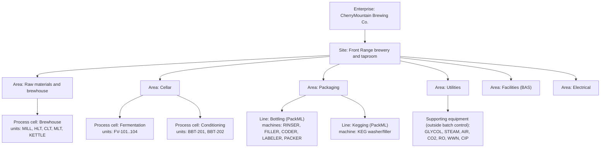
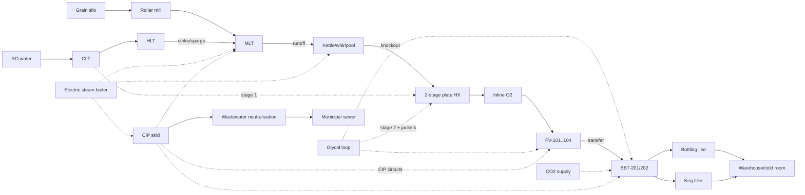
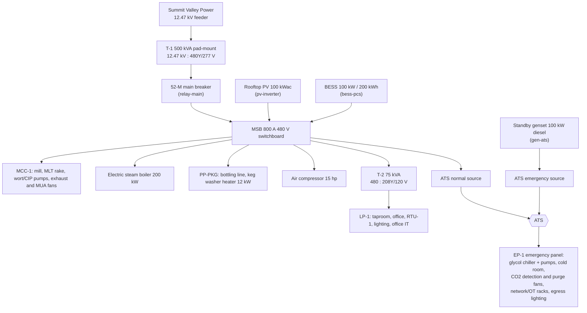
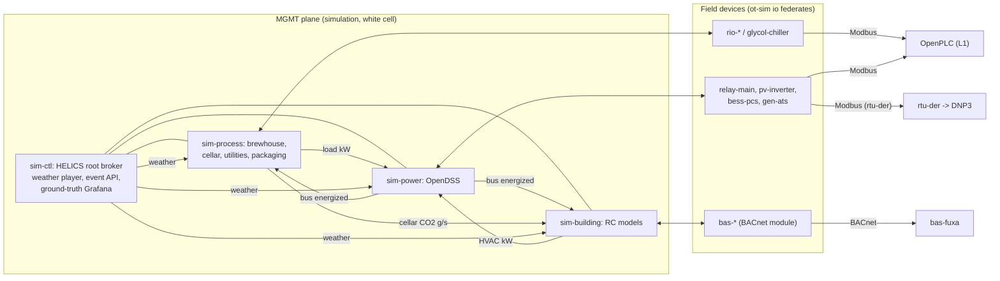
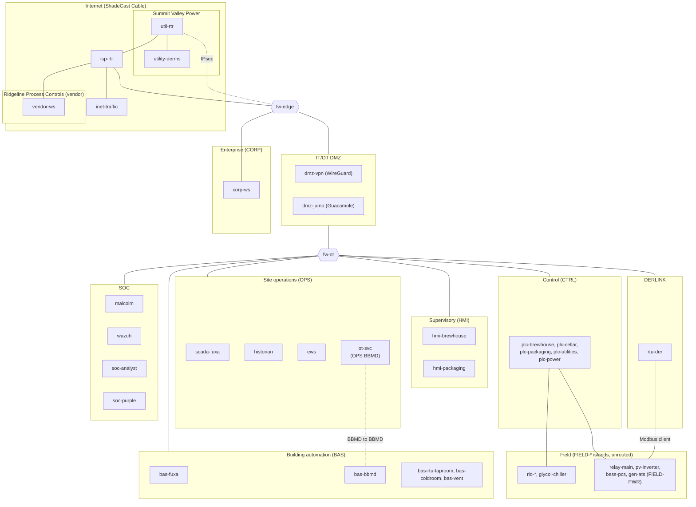
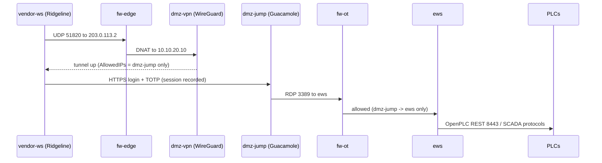

# CherryMountain Brewery: phenix topology design

> Status: the range is built and tested offline. No part of it ran on a phenix
> host yet ([Status](#status)). This document specifies the CherryMountain
> Brewery topology for [phēnix](https://github.com/sandialabs/sceptre-phenix).
> It covers the configurations, images, programs, and simulation code of the
> range. [USER_GUIDE.md](../USER_GUIDE.md) is the step-by-step guide. It tells
> you how to build, start, reach, and use the range.
>
> In short: this is an OT cyber range of a Colorado microbrewery, with 44 VMs
> and only open-source software. OT (operational technology) is the equipment
> that controls a physical plant. A cyber range is a practice network for
> security exercises. The range covers the brewhouse, the cellar, and bottling.
> It also covers utilities, plant power, and building automation. FUXA is the
> SCADA/HMI, OpenPLC runs the PLCs, and ot-sim provides the field devices. The
> physics run in a HELICS co-simulation, where simulators run together and
> exchange values. The range includes blue-team (defender) monitoring and
> remote access for a vendor. It exercises most phenix capabilities.

## Status

This section is the authoritative status of the range. The README and the
user guide point here. When they disagree with this section, this section is
right.

No part of the range ran on a phenix host or in a VM yet. The project built
every part and tested each part as far as is possible without such a host. The
`ci` variant (the cellar slice, five VMs) is the furthest along. Its
integration test runs ot-sim, the OpenPLC v4 runtime, and FUXA together in
Docker. Every image has a configuration
([phenix-images/README.md](../phenix-images/README.md)), but the project built
no image on a phenix host.

| Phase | Status | Left to do |
|---|---|---|
| 0: Spikes | Done. A spike is a short experiment that answers one technical question. Ten spikes are a go. The spike for TheHive case management is a no, and the project deferred DFIR-IRIS to [future work](FUTURE_WORK.md#soc-case-management-with-dfir-iris) | Nothing. The row of each spike in [§18](#18-implementation-roadmap) says what that spike left untested |
| 1: Network | Built, with static checks only. This phase has the topology modules, the firewall rulesets, the services on ot-svc, and both BBMDs (BACnet broadcast management devices). It also has the post-boot VyOS script and the state of health (SoH) probes. `netcheck` compares all of these parts with the conduit matrix. A conduit is an allowed path between two network zones | The VM run. It must test every conduit and every blocked path under SoH, and the VyOS script on VyOS |
| 2: Simulation | Built and run offline. This phase has `plant.yaml`, plantgen, the seven federates, ground truth, and the offline harness ([§9.6](#96-implementation-status-and-validation)). A federate is one simulator in the HELICS co-simulation. A simulated brewer, cellar crew, and line operator do the hand work. As a result, beer moves from the brewhouse to the filler over days. The whole plant ran offline for 54 simulated hours | The ot-sim `logic` blocks, and a 24 h soak (a long continuous run) under HELICS |
| 3: Control | Built and run offline. This phase has all five PLC programs and their full and lite ZIPs. The programs contain the alarm logic generated from `alarms.json`, the hardwired CO₂ interlock ([§6.7](#67-cellar-co2-life-safety-interlock)), and the peer reads. An interlock is logic that blocks an unsafe action. The programs also contain the fermentation profile and the operator panel of the packaging line. All five programs run in the tests as compiled programs. Four run against the federates. The fifth, plc-utilities (its CIP sequence), runs with its inputs set by hand. CIP is clean-in-place, the automated cleaning of tanks and lines. Code generates the scada-fuxa and bas-fuxa projects, with a process graphic for each area. Each graphic ran in a real FUXA server against a stand-in plant ([fuxa/README.md](../fuxa/README.md#the-process-graphics)). The batch engine brews a double-brew day unattended in the offline federation. It also ran in a real FUXA server against a stand-in PLC, with the operator sign-in and the automatic sign-in of the kiosk. The `cherrymountain` app provisions the PLCs, FUXA, the historian, and the kiosks | The full and lite programs in an OpenPLC runtime, plc-utilities against the federates, and the writes from FUXA to plc-brewhouse over OPC UA |
| 4: Power and BAS | Built and run offline. This phase has the power and building federates. `plc-power` does load shed, staged restoration, and dispatch of the battery energy storage system (BESS). It also schedules the on-peak shift, the recharge, the monthly demand reset, and the weekly genset exercise. It takes the time for that schedule from the clock of the automatic transfer switch (ATS) controller ([§12.1](#121-openplc-v4-runtime-v3-fallback)). The controllers of the building automation system (BAS) serve BACnet through the ot-sim BACnet module in this repository ([§16](#16-new-and-extended-software)). The tests used BACpypes3 and BAC0 clients | The outage and CO₂ scenarios on a VM, and the reads from FUXA to the controllers through the BBMDs |
| 5: SOC and remote access | Built, and run in part outside a VM. This phase has images and boot provisioning for Malcolm, Wazuh, WireGuard, Guacamole, and the desktops. It has the Suricata rules (checked on Suricata 7.0.3, 8.0.2, and Malcolm's 8.0.7) and the Zeek script (checked in Malcolm's Zeek image). It has the Wazuh rules (checked in Wazuh 4.14.1 logtest). Each of these three parts has tests. It also has per-experiment vendor and WireGuard secrets. Later reviews compared both configurations with the source and documentation of Malcolm 26.10.0 and Wazuh 4.14.10. The reviews changed both configurations ([§14](#14-blue-team-monitoring)). Malcolm's provisioning and its capture containers then ran for real outside a VM, on a stand-in for the mirror port. That run covered all 40 Suricata rules on 8.0.7, all 16 Zeek notices, and Arkime's sessions from the rotated pcap. The Guacamole stack also ran for real outside a VM. The Wazuh changes ran through the offline evaluator and an emulation of the unit's sandbox, not in logtest | Everything on a VM and under systemd. The first part is the mirror's feed into Malcolm, with Logstash, NetBox, and Strelka. No run started those three. The second part is the Wazuh first-boot setup, the agents, and syslog. The third part is the vendor's path end to end |
| 6: Polish | Started. `cm-viz` is the 3D view for the white cell (the staff who run an exercise). It is built and tested offline ([§15.10](#1510-white-cell-3d-view-cm-viz)). This phase also has `plantevent` and the four SCORCH runs that drive the plant ([§15.6](#156-scorch-pipelines)). It has the operations runbook ([§15.9](#159-operations)), the brand on every screen ([§15.11](#1511-brand)), and nine test suites in prek and CI | The Builder package, an end-to-end (e2e) run on a VM, and cm-viz in the range with its operator-view relay. The upstream pull requests are also left. The ot-sim BACnet module and the support for it in the `ot-sim` app are on fork branches |

[§18](#18-implementation-roadmap) has the scope and exit criteria of each phase
and the spike results. [§19](#19-risks-and-open-questions) lists the risks and
the decisions that the project made. [FUTURE_WORK.md](FUTURE_WORK.md) lists
everything that is left to do, in every phase. It starts with what
[the first run on a phenix host](FUTURE_WORK.md#the-first-run-on-a-phenix-host)
must show. The [Known limits](../USER_GUIDE.md#known-limits) section of the
user guide says what to examine on the first start.

## Contents

- [Status](#status)

1. [Summary](#1-summary)
2. [Goals and non-goals](#2-goals-and-non-goals)
3. [The plant](#3-the-plant)
4. [Brewery primer and glossary](#4-brewery-primer-and-glossary)
5. [How real breweries are automated](#5-how-real-breweries-are-automated)
6. [Process design](#6-process-design)
7. [Electrical distribution and energy](#7-electrical-distribution-and-energy)
8. [Building automation](#8-building-automation)
9. [Simulation and co-simulation](#9-simulation-and-co-simulation)
10. [Network architecture](#10-network-architecture)
11. [Node inventory and resources](#11-node-inventory-and-resources)
12. [Control system design](#12-control-system-design)
13. [Vendor remote access](#13-vendor-remote-access)
14. [Blue-team monitoring](#14-blue-team-monitoring)
15. [phenix integration](#15-phenix-integration)
16. [New and extended software](#16-new-and-extended-software)
17. [Testing and validation](#17-testing-and-validation)
18. [Implementation roadmap](#18-implementation-roadmap)
    - [Future work](#future-work)
18A. [Regulatory and standards context](#18a-regulatory-and-standards-context)
19. [Risks and open questions](#19-risks-and-open-questions)
20. [Licensing](#20-licensing)
21. [References](#21-references)

---

## 1. Summary

CherryMountain Brewery is a notional production brewery and taproom on the
Colorado Front Range. Its flagship West Coast IPA is "Fire of the Phenix".
This topology emulates the OT network of the brewery end to end:

- Process: brewhouse, cellar, and bottling and kegging. Utilities include
  glycol, steam, compressed air, CO₂, water treatment, wastewater
  neutralization, and clean-in-place (CIP).
- Plant electrical system: a utility service with an automatic transfer
  switch (ATS) to a standby generator. The system also has rooftop solar
  power (PV) and a battery energy storage system (BESS). The project derives
  the utility tariff from open data.
- Building automation system (BAS): the taproom/office HVAC, a walk-in
  cold room, and brewhouse and cellar ventilation with CO₂ safety interlocks.
- Supervisory systems: FUXA for SCADA, HMI, alarms, and recipes, plus a
  historian and an engineering workstation.
- Remote access: a vendor path over WireGuard to a Guacamole jump host.
- Blue-team monitoring: Malcolm (Zeek with CISA ICS parsers, Suricata,
  and Arkime) and Wazuh.

All components are open source. A HELICS co-simulation couples the process,
power, and building physics. The ot-sim field devices expose that physics over
Modbus, DNP3, and BACnet. BACnet goes through a new ot-sim module. The
topology uses phenix's workflow layout, core and user apps, state of health
(SoH), packet capture, SCORCH, and image builds. A Builder package is
[future work](FUTURE_WORK.md#exercise-support) ([§15.8](#158-builder-package)).

## 2. Goals and non-goals

Goals:

- Provide a realistic, internally consistent brewery OT environment. Engineers
  and operators can run it, defenders can baseline it, and researchers can
  extend it.
- Use only open-source software, with permissive or copyleft OSI licenses. One
  node is an exception because of its upstream image: soc-purple's parseus runs
  Elastic's own Elasticsearch, Kibana, and Logstash containers
  ([§20](#20-licensing)).
- Run fully unattended. Injected files configure every VM at boot, with no
  manual GUI setup.
- Use as much of phenix as applies: apps, SoH, packet capture, images,
  SCORCH, Builder, and the workflow directory layout.
- Show how brewery subsystems interact: process ↔ utilities ↔ building ↔
  power ↔ utility grid.
- Fit one host. The size of the full variant fits a host with 32 or more cores
  and 512 GB RAM. Its VMs take 160 GB of that RAM ([§15.9](#159-operations)).
  A lite variant and a CI variant scale it down.

Language requirement:

- The project language is US English (en-US), and the intended users are
  native English speakers. This applies to:
  - all documentation and README text
  - HMI and BAS screens and alarm messages
  - tag and point descriptions and FUXA project text
  - PLC program comments, code comments, log messages, and commit messages
- Use US spelling (for example "color", "neutralization", "liter").
- The project does not require localization or internationalization. The UI
  language of FUXA is English.
- Units: US customary units are primary on HMIs and in documents (°F,
  psig, gal, bbl, lb). SI units appear in model internals and where
  standards require them.
- Dates and times: data, logs, and APIs use ISO 8601 timestamps. HMIs
  use en-US display conventions.

Repository requirements:

These requirements apply to the final design and to the code that builds it.
They do not apply to the Phase 0 spike kits or to the integration test.
[§17](#17-testing-and-validation) lists the hooks.

- Every check runs locally and in CI. `prek run --all-files` runs the same
  hooks as the Lint workflow (prek 0.5.10). The workflow runs on push to
  `main` and on `pull_request`.
- Schema check: `check-jsonschema` 0.38.0 makes sure that every phenix config
  obeys the JSON Schemas of sceptre-phenix. The project pins the schemas at
  one commit (`6cc94b2`), and `--base-uri` makes their `$ref`s resolve at that
  commit. A `require-pattern` hook guards `apiVersion`, because the umbrella
  schema lets a file with a mistyped API group through unchecked.
- Block-style YAML: the phenix YAML configurations use block style and avoid
  flow and JSON syntax. A scoped yamllint rule allows only empty `{}` and
  `[]`. JSON that phenix injects verbatim is exempt. The YAML sketches in this
  document use flow style for brevity, but the files do not.
- systemd units: the units follow current best practice (sandboxing
  directives, explicit `Type=`, correct ordering, no deprecated keys). The
  hooks test them with `systemd-analyze verify` and a
  `systemd-analyze security` exposure threshold.
- `.desktop` files: `desktop-file-validate` tests them.
- Shell: shellcheck tests the shell code. This includes the shell code
  embedded in image YAML.
- Dockerfiles and Compose files: hadolint v2.14.0 tests the Dockerfiles, and
  dclint v3.1.0 tests the Compose files. Both types of file follow current
  best practice.
- Documentation: every image and every app has a README. Images share one
  `phenix-images/README.md` with a section per image. Each app ships its own
  `README.md`. The `POSTBUILD_*` scripts in image configurations are phenix
  defaults, and the hooks do not lint them.
- phenix app metadata: Pydantic makes sure that the metadata is valid, as
  sceptre-phenix-apps does ([§16](#16-new-and-extended-software)).
- Python style: all project code uses Pydantic models where a dataclass or
  record fits. It uses type annotations on every non-local variable (module,
  class, and instance attributes), and `pathlib` for paths.

Non-goals (the entries note attach points for later):

- Adversary emulation: the range does not deploy offensive Kali, Caldera, or
  caldera-ot. The node soc-purple is Kali Purple, the defensive edition, in
  the SOC. The `caldera` app and SCORCH `caldera`/`art` components can attach
  to the DMZ, the CORP zone, or the vendor network later.
- Business IT: the range does not deploy ERP/MES, LIMS, Active Directory, or
  email. The CORP zone has a single workstation as the attach point. The
  taproom point of sale (POS) is part of this non-goal. The range deploys no
  card-payment system, so PCI DSS is out of scope. The CORP zone is the attach
  point for a POS segment ([§18A](#18a-regulatory-and-standards-context)).
- Real safety instrumented systems: PLC logic and simulated hardwired relays
  model the safety interlocks. The design of a safety instrumented system
  (SIS) to IEC 61511 is out of scope.
- High-fidelity building energy analysis: the building models are
  low-order, which means that they have few state variables (see
  [§8](#8-building-automation)).
- Regulatory paperwork: this covers the training, permits, licenses, filings,
  and written programs that a real brewery keeps (TTB, OSHA, the fire code,
  the POTW). POTW means publicly owned treatment works, the public sewage
  plant. The design documents this paperwork, but the range does not emulate
  it. The range keeps the records that the controls produce for this
  paperwork. Thus exercises can ask which records an attacker can falsify
  ([§18A](#18a-regulatory-and-standards-context)).

The company, the utility (*Summit Valley Power*), the ISP (*ShadeCast
Cable*), and the integrator (*Ridgeline Process Controls*) are fictional.

## 3. The plant

### 3.1 Site and capacity

| Item | Value |
|---|---|
| Location | Colorado Front Range, about 5,200 ft (1,585 m) elevation |
| Ambient pressure | About 12.1 psia (83.4 kPa). Water boils at about 202.3 °F (94.6 °C), and 16 °P wort boils at about 202.9 °F (94.9 °C) |
| Annual production | about 2,500 bbl/yr (US beer barrel = 31 gal = 117.3 L) |
| Brewhouse | 15 bbl, two-vessel, steam-heated: mash/lauter tun (MLT) and kettle/whirlpool |
| Liquor tanks | 30 bbl hot liquor tank (HLT), 30 bbl cold liquor tank (CLT) |
| Cellar | 4 × 30 bbl unitanks (FV-101…104), double-batched (two brews per FV), and 2 × 30 bbl bright beer tanks (BBT-201/202) |
| Packaging | 12 oz bottling line at about 1,800 bottles/h (about 5.4 bbl/h), a semi-automatic keg washer/filler (½ bbl kegs), and manual palletizing |
| Taproom | about 120 seats, with a walk-in cold room for kegs |
| Building | One single-story building of about 18,000 sq ft gross floor area (packaging, brewhouse, cellar, warehouse and cold room, taproom, office). The size is a design assumption. It puts the building in the small-building class of the local benchmarking ordinance and below the state's 50,000 sq ft threshold ([§18A](#18a-regulatory-and-standards-context)) |
| Jurisdiction | Notional. Where a rule depends on the city or county, the design uses the City and County of Denver and says so. Denver is the representative Front Range jurisdiction (the weather is Denver TMY3). The sewer is a Metro Water Recovery member system, and water is municipal (no well) |
| Brew schedule | About 167 brews/yr (3.2/week), run as same-day double batches: two 15 bbl brews back to back fill one 30 bbl FV. That is 1 to 2 double-brew days a week. A double-brew day runs about 11 h (05:00 to 16:00). The second mash-in starts when the MLT frees up, about 3.5 to 4 h after the first. Both boils finish by about 15:30, before the utility on-peak window ([§7.4](#74-utility-tariff-from-open-data)) |

Capacity check: an IPA occupies an FV for about 14 days, plus about 1
day of CIP and turnaround. Therefore each FV turns about 24 times a year.
That gives 4 × 30 bbl × 24 ≈ 2,900 bbl/yr of cellar capacity.
Production of 2,500 bbl/yr is about 86% of that capacity, so the schedule has
headroom for seasonal beers and delays.

### 3.2 "Fire of the Phenix" (notional recipe)

The repository stores the recipe as data in
[BeerJSON](https://github.com/beerjson/beerjson) at
`recipes/fire-of-the-phenix.json`. The simulation reads the mash, hop,
and fermentation profiles from that file. The recipe parameters of FUXA come
from the same file.

| Parameter | Target |
|---|---|
| Style | West Coast IPA |
| OG / FG | 1.066 (16.1 °P) / 1.012 (3.1 °P) |
| ABV / IBU / SRM | about 7.1% / 68 / about 7 |
| Grain bill | 2-row pale 88%, Munich 6%, Crystal 40L 3%, Carapils 3% |
| Mash | single infusion at 152 °F (66.7 °C) for 60 min, then mash-out at 168 °F (75.6 °C) |
| Boil | 60 min at the local wort boiling point (about 202.9 °F) |
| Hops | Columbus at 60 min (bittering) and Centennial at 10 min. The whirlpool hops are Citra + Simcoe at 180 °F for 20 min. The dry hops are Citra/Mosaic/Simcoe at 2 lb/bbl on day 5 |
| Yeast | American ale (Chico-type), pitched at 64 °F. Fermentation is at 66 °F, with a free rise to 70 °F for the diacetyl rest |
| Finishing | cold crash to 34 °F, then carbonate to 2.6 volumes CO₂ in the BBT |

The recipe sizes the bittering additions with an altitude-derated utilization,
which is the share of hop acids that the boil converts ([§9.3](#93-models)).
At 5,200 ft, a recipe calculated for sea level gives less than its IBU target.

## 4. Brewery primer and glossary

| Term | Meaning |
|---|---|
| Liquor | Brewing water. The HLT holds hot liquor, and the CLT holds cold liquor. |
| Grist | Milled malt. A roller mill feeds the grist case or hydrator. |
| Mash / MLT | Grist mixed with hot liquor so that enzymes convert starch to sugar. The mash/lauter tun (MLT) does both mashing and lautering. |
| Vorlauf | Recirculating the first runnings until they run clear. |
| Lauter / sparge / runoff | To lauter is to separate sweet wort from the grain bed. To sparge is to rinse the bed with hot liquor. Runoff is the transfer of wort to the kettle. |
| Wort | Sugary liquid before fermentation. |
| Kettle / boil | Boiling wort to sterilize it, isomerize hop acids, and drive off volatiles. |
| Whirlpool | Swirling hot wort so that trub (hop and protein solids) settles in a cone. Brewers also use the whirlpool for a hop stand at sub-boiling temperature. |
| Knockout | Transferring hot wort through the heat exchanger (HX) to the fermenter. |
| Heat exchanger (HX) | Plate heat exchanger. Stage 1 uses cold liquor, and stage 2 uses glycol. |
| Aeration / oxygenation | Adding O₂ to wort at knockout, about 8 to 10 ppm, for yeast growth. |
| Pitching | Adding yeast to the wort. |
| FV / unitank | Fermentation vessel. A unitank is a conical, jacketed, pressure-rated tank used for both fermentation and conditioning. |
| Krausen | Foam head during active fermentation. |
| Diacetyl rest | Holding warm at the end of fermentation so that yeast reabsorb diacetyl (buttery off-flavor). |
| Dry hop | Adding hops to fermenting or finished beer for aroma. |
| Hop creep | Refermentation that hop enzymes cause after dry hopping. It produces extra attenuation, CO₂, and pressure. |
| Spunding | Capturing fermentation CO₂ by holding tank pressure with a relief (spunding) valve. |
| Cold crash | Chilling to about 32 to 34 °F to drop yeast and haze. |
| BBT | Bright beer tank. It holds finished beer for carbonation and packaging. |
| Volumes (CO₂) | Carbonation level. 1 volume ≈ 1.96 g/L CO₂. |
| DO / TPO | Dissolved oxygen / total package oxygen. Both are quality limits on oxygen pickup. |
| Filler / crowner | Counter-pressure bottle filler and crown capper, usually built as one machine (monoblock). |
| Coder, labeler, checkweigher, case packer | Downstream packaging machines. A fill-level inspector or checkweigher rejects under-filled bottles. |
| Keg washer/filler | Cleans, sanitizes, purges, and fills kegs. |
| CIP | Clean-in-place: automated caustic, acid, and sanitizer (for example peracetic acid, PAA) cycles through tanks and lines. |
| Swing panel / flow plate | A manual U-bend panel that routes CIP or product. Proximity switches prove the bend position. |
| Mix-proof valve | A double-seat valve that keeps product and CIP separate while both lines run. |
| Glycol | Propylene glycol solution (about 35%) chilled to about 28 °F and circulated through tank jackets. |
| °P / SG | Degrees Plato / specific gravity, the sugar concentration. |
| IBU / SRM | International Bitterness Units / Standard Reference Method (color). |
| bbl / hL | US beer barrel (31 gal) / hectoliter (100 L). 1 bbl ≈ 1.173 hL. |
| TTB | The US Alcohol and Tobacco Tax and Trade Bureau, which sets federal excise and recordkeeping rules for brewers. |

## 5. How real breweries are automated

This section summarizes research into real brewery automation and maps each
finding to a design choice.

### 5.1 Architecture patterns

- PLC/SCADA split: PLCs own real-time control, which covers I/O, PID loops,
  sequences, and interlocks. SCADA/HMI owns recipes, batch execution, alarm
  acknowledgment, and trends.
  → Design: OpenPLC owns control, and FUXA owns recipes, batch sequencing,
  and alarms.
- Batch control with ISA-88: procedures and recipe parameters live in a
  batch engine. Equipment modules and their interlocks live in the PLC.
  Stone Brewing moved its brewhouse from Siemens BRAUMAT to Rockwell PLCs
  with Ignition HMI, historian, batch, and MES. The project used ISA-88 and
  ISA-101 high-performance HMI guidelines in a hub-and-spoke architecture.
  → Design: PLC programs expose ISA-88 *phases* (for example `MASH_IN`,
  `BOIL`, `KNOCKOUT`). FUXA server scripts sequence phases from recipe
  parameters.
- OEM (original equipment manufacturer) islands on packaging: packaging
  machines usually arrive with their own controllers and protocols. For
  example, the packaging line of Lakefront Brewery runs on a GuardLogix safety
  controller over EtherNet/IP.
  → Design: Packaging gets its own PLC, a different SCADA protocol
  (S7comm), and a PackML state model.
- Small-cellar practice: a typical small cellar uses one PLC with a
  touchscreen. The PLC controls a glycol solenoid per jacket zone on every
  fermenter. One published example runs five 30 bbl FVs on an
  AutomationDirect PLC.
  → Design: A dedicated cellar PLC runs per-zone glycol control for every
  FV and BBT.

### 5.2 Standards applied

| Standard | Use in this design |
|---|---|
| ISA-88 (IEC 61512) | Physical model (enterprise → site → area → process cell → unit → equipment module → control module) and procedural model (procedure → unit procedure → operation → phase) |
| ISA-95 (IEC 62264) | Level model and the Unified Namespace topic hierarchy |
| ANSI/ISA-TR88.00.02-2022 (PackML) | Bottling line state machine and PackTags. The design computes OEE (overall equipment effectiveness) from PackTags |
| ISA-101 | High-performance HMI: grayscale backgrounds, color reserved for abnormal states, and a display hierarchy |
| ISA-18.2 (IEC 62682) | Alarm philosophy, priorities, rationalization, and shelving |
| ISA/IEC 62443-3-2 / 3-3 | Zones and conduits, and per-zone security level targets |
| ISA-5.1 | Instrument tag naming |
| IEEE 1547-2018 | Interoperability of distributed energy resources (DER): the DER must support at least one of IEEE 2030.5, IEEE 1815 (DNP3), or SunSpec Modbus. This design uses DNP3 to the utility and Modbus locally |

### 5.3 Best practices encoded

- Proof of the CIP route: before CIP starts, the proximity switches of the
  swing panel must prove the route. A return-flow switch proves that the
  circuit is complete. A hard interlock blocks product transfer into any
  vessel or line that is in CIP. Every cycle records its parameters (time,
  temperature, conductivity, flow) as a verification record.
- CO₂ life safety: the permissible exposure limit (PEL) of OSHA is 5,000 ppm
  as an 8-hour time-weighted average (TWA). The source is 29 CFR 1910.1000
  Table Z-1, which sets no short-term exposure limit (STEL). The NIOSH STEL is
  30,000 ppm (15 min). The NIOSH IDLH (immediately dangerous to life or
  health) value is 40,000 ppm.
  The cellar alarm tiers are a design choice built on those limits:
  5,000 / 15,000 / 30,000 ppm. The first tier starts the purge fans, the
  second tier alarms, and the third tier starts the evacuation. Breweries
  report similar tiers. For example, one brewery in an MBAA forum discussion uses
  5,000/15,000 ppm alerts. The CO₂ safety guidance of MBAA calls for
  detection, ventilation, and evacuation alarms. In this design, an interlock
  connects CO₂ detection to ventilation.
  - A comparison with the codes on 2026-11-09 found agreement. Colorado adopts
    the 2021 IFC with no amendments. The IFC (§5307.3) asks for a supervisory
    alarm at 5,000 ppm and a room alarm at 30,000 ppm. The policy *IFC 5307*
    of the Denver Fire Department sets exactly the three tiers used here. The
    tiers are 5,000 ppm TWA (self-resetting), 15,000 ppm (latching), and
    30,000 ppm (latching, evacuate). The policy puts detectors 12 to 24 inches
    above the floor at every point of use and supply tank area. At
    30,000 ppm, the policy requires an automatic CO₂ supply shutoff valve that
    fails closed on loss of power or detection. The tiers, sensor heights,
    detection areas, and shutoff valve of the design follow the policy
    ([§6.7](#67-cellar-co2-life-safety-interlock)). The BAS tiers self-clear,
    so the latching is at the shutoff and in the acknowledged alarms of FUXA.
    The rest of both codes, and what the range does with each part, are in
    [§18A.3](#18a3-life-safety-fire-and-equipment).
  - Under 29 CFR 1910.146, fermenters, bright tanks, the mash tun, and the
    kettle are permit-required confined spaces. This applies whenever a
    hazardous atmosphere (CO₂ above the PEL, oxygen below 19.5 %) can exist in
    them. The PLCs lock out an entered vessel
    ([§6.8](#68-confined-space-entry-lockout)). The permit, the attendant, and
    the testing are procedures that the range documents
    ([§18A.3](#18a3-life-safety-fire-and-equipment)).
- Glycol: the supply is about 35% propylene glycol at about 28 °F. Each
  tank has separate cone and side jacket zones.
- Wastewater: before discharge, the plant neutralizes caustic and acid CIP
  effluent to a configured permit band (pH 6.0 to 9.0).
  - A comparison with the rules on 2026-11-09 gave these results. The rules of
    Metro Water Recovery and 40 CFR 403.5(b) prohibit an industrial discharge
    below pH 5.0. They make a user that discharges 25,000 gal/day of process
    wastewater a significant industrial user (SIU)
    ([§18A.4](#18a4-environment)). CherryMountain makes about 2,500 bbl/yr,
    and the Brewers Association gives 4 to 10 bbl of water per bbl of beer.
    Thus CherryMountain discharges a few thousand gallons a day. It is a
    permitted-by-designation or sector-program user, not an SIU by volume. The
    6.0 to 9.0 band is the brewery's own permit condition. It is the
    "typical pre-treated end-of-pipe" range that the Brewers Association
    manual gives ([§18A.8](#18a8-industry-practice)). That range is
    pH 6 to 9, BOD 100 to 400 ppm, and TSS 50 to 500 ppm. The utilities
    federate keeps the discharge record that such a permit asks for
    ([§9.6](#96-implementation-status-and-validation)).
- Compliance data: TTB requires daily records of operations
  (27 CFR 25.292). The records include production and removals, and the brewer
  keeps them for 3 years (27 CFR 25.300). TTB also requires a Brewer's Report
  of Operations (27 CFR 25.297), with quantities in barrels. A review on
  2026-11-09 covered these rules and Colorado's excise of 8.0 cents per gallon
  with its three-year books. [§18A.1](#18a1-alcohol-ttb-and-colorado)
  describes them.
  - CherryMountain's federal excise tax is about 2,500 bbl × $3.50/bbl
    (the reduced rate of 26 U.S.C. 5051(a)(2)) ≈ $8,750/yr. That is under the
    $50,000 threshold, so the brewery files quarterly, on TTB F 5130.26 or a
    quarterly F 5130.9.
  - Tax determination and fill: the brewer computes bottled beer from the
    25.158 case table to five decimals. In that table, a case of
    24 × 12 fl oz is 0.07258 barrel. The brewer rounds the daily sum to two
    decimals (25.157). If a keg is more than 2 % over its rated size, the tax
    applies to the actual quantity (25.156). Over any three-month period, the
    barrel equivalent of the filled bottles must not vary more than 0.5 % from
    the labeled equivalent (25.142(d)). The state weights-and-measures program
    applies NIST Handbook 133 (2026) at retail. The handbook lets an
    individual 12 fl oz package be no more than 0.5 fl oz under its label
    (Appendix A, Table 2-6). It also requires the lot average to meet the
    label. The fill-level model and the TTB barrel figures of the packaging
    federate follow these rules
    ([§9.6](#96-implementation-status-and-validation)).
  - Therefore the historian and packaging counts are compliance-grade
    data, and data integrity matters more. The raw buckets of the historian
    keep 30 days, which is an operational window. Its `records` bucket keeps a
    daily copy of the series that a TTB or excise audit draws on. The bucket
    keeps that copy for three years
    ([§12.4](#124-historian-and-engineering-workstation)). The batch records
    of FUXA remain the record of record. The daily production report of FUXA
    will also be a record of record after the project builds it
    ([§12.2](#122-fuxa-two-instances)).
- Altitude-aware control: boil detection uses the local wort boiling
  point, not 212 °F. The system stores all pressure setpoints as absolute
  pressure. It shows them as gauge pressure, which it calculates from the site
  ambient pressure ([§9.3](#93-models)).

### 5.4 Energy benchmarks (used to check the loads)

- End-use shares: these figures come from different sources, so they
  are indicative and do not sum to 100%.
  - The Idaho Power tip sheet (which cites E-Source) gives refrigeration 37%,
    process 25%, and lighting 10%. It gives compressed air 9%, HVAC 9%, and
    other 10%.
  - Older literature (Scheller et al. 2008, as cited) puts refrigeration
    as high as 44% and packaging near 20% of electricity.
- Electricity intensity: the Brewers Association (BA) published a
  benchmarking report for 2014 to 2018. The report puts a 2,500 bbl/yr brewery
  in its class of 1,000 to 10,000 bbl/yr.
  - That class has an electricity median of 65 kWh/bbl (IQR 45 to 91, n=93).
    It also has a natural gas median of 3.8 therm/bbl (IQR 2.7 to 6.2, n=96).
    IQR is the interquartile range, and n is the sample size. The
    0 to 1,000 class median is 182 kWh/bbl.
  - BA breweries mostly heat with gas. Therefore an all-electric equivalent is
    roughly 150 to 176 kWh/bbl. That range is indicative, because
    the medians come from different samples.
- Water ratio: the BA 1,000 to 10,000 class median is 8.7 bbl of water
  per bbl of beer (IQR 6.2 to 12.1, n=89). Best-practice large breweries reach
  about 3.5 to 5.
- Design target: about 150 kWh/bbl, all-electric with steam from an
  electric boiler. That is near the low end of the peer-median equivalent.
  - It gives about 370 MWh/yr and an average load of about 42 kW, with
    brew-day peaks near 300 kW before peak shaving
    ([§7.2](#72-loads-notional-checked-against-54)).
  - Without the electric boiler, refrigeration is about 45% of electricity.
    Most benchmark breweries have a gas-fired boiler instead. That share is
    consistent with the 37 to 44% literature.

### 5.5 Threat context

Brewing has well-documented production stoppages from cyberattacks:

- Molson Coors (March 2021): the attack disrupted production and shipments.
- Duvel Moortgat (March 2024): ransomware halted bottling.
- Asahi (September to October 2025): ransomware halted most domestic
  production in Japan.

These events motivate the blue-team layer, but this design emulates no
attacks.

The range itself adds one protocol-level exposure on purpose. The BACnet
broadcast management devices (BBMDs) carry discovery across `fw-ot`
([§10.3](#103-conduit-matrix-default-deny-stateful-logged)). They can forward
broadcasts between zones, and their broadcast distribution tables (BDTs)
accept rewrites over the network. The design treats that as an attack surface
and a detection opportunity ([§14](#14-blue-team-monitoring)).

## 6. Process design

### 6.1 ISA-88 physical model



The ISA-88 batch model covers the brewhouse and cellar. Packaging lines
follow PackML (ISA-TR88.00.02), which calls machines "units/machines".
Utilities, Facilities, and Electrical are site areas outside batch control.
ISA-88 lets a model omit hierarchy levels that add nothing.

### 6.2 Process flow



### 6.3 Areas, equipment, and control strategies

Raw materials and brewhouse:

- PLC: `plc-brewhouse`. Remote I/O: `rio-brewhouse`.
- Equipment:
  - A grain silo with level measurement.
  - An auger.
  - A roller mill with a VFD (variable-frequency drive).
  - A grist hydrator.
  - The HLT (level, temperature, steam valve).
  - The CLT (level, temperature).
  - The MLT (steam jacket, rake drive and height, false-bottom differential
    pressure, runoff flow).
  - The kettle/whirlpool (steam jacket, level, temperature, tangential
    inlet).
  - A wort pump with a VFD.
  - A two-stage plate HX.
  - Inline O₂ (mass flow controller with DO probe).
  - A hop doser for whirlpool additions.
- Control:
  - HLT temperature control on steam. The control is proportional as built.
    PID is [future work](FUTURE_WORK.md#control-and-safety)
    ([§12.1](#121-openplc-v4-runtime-v3-fallback)).
  - Mash step-temperature control on jacket steam (proportional as built).
    The recipe gives the ramp/soak segments.
  - Lauter: The PLC controls runoff flow against the differential pressure
    of the bed. It balances sparge flow to runoff. It lowers the rake when
    the differential pressure is high.
  - Kettle: The steam valve position holds the boil vigor. The PLC detects
    the boil when the temperature plateaus within 0.5 °F of the computed
    local boiling point of the wort. That point is the water saturation
    temperature at the measured ambient pressure plus about 0.5 °F of
    elevation from dissolved extract. Hop addition prompts and the whirlpool
    doser run on boil time.
  - Knockout: The stage-2 glycol valve trims wort to 64 °F. The PLC sets
    O₂ flow in ratio to wort flow.
- ISA-88 phases: `MILL`, `HLT_HEAT`, `MASH_IN`, `MASH_STEP`, `VORLAUF`,
  `LAUTER`, `BOIL`, `WHIRLPOOL`, `KNOCKOUT`, `CIP_READY`.
- Landing the mash: A mash lands on its temperature only when it gets all of
  the strike liquor of the recipe at the strike temperature. Strike liquor is
  the hot liquor that starts the mash. `MASH_IN` takes the liquor in liters
  as its parameter (1,310 L for the 503 kg grain bill). It fills the tun to
  the level that the liquor and the grist come to. The grist takes 0.7 L/kg,
  so the level in the 3,000 L tun is 55.4 %.

  The HLT takes no cold liquor while this phase runs. The strike temperature
  is the value from Palmer ([§9.3](#93-models)) plus 1 K for the heat that
  the pipe and the tun take. The simulation takes that heat from the liquor
  too. Both mashes of a double-brew day then land within 1 °F under the
  152 °F setpoint. That is the side that the jacket can correct.

Cellar:

- PLC: `plc-cellar`. Remote I/O: `rio-cellar`.
- Equipment:
  - Each FV has cone and side glycol zones with solenoid valves and RTDs
    (resistance temperature detectors). Each FV also has a pressure
    transmitter, an automatic spunding valve, a sample-port density meter,
    and a CIP spray ball.
  - The PLC does not control the mechanical pressure relief valves and
    vacuum relief valves. Each pressure-relief valve (PSV) has a lift switch
    that is wired to rio-cellar and alarms High. The lift switches are
    `CEL.PSV.ZSH01.PV` to `ZSH06.PV`, for FV-101 to BBT-202, in the full and
    lite variants.
  - FVs have no level transmitter. The batch engine knows the volume from
    knockout, and the fill is simulation truth only
    ([§9.5](#95-scenario-events-and-ground-truth)).
  - Each BBT has a jacket zone, level, pressure, temperature, a carbonation
    stone with a CO₂ flow controller, and a pressure regulator.
  - Shared equipment: a dry-hop doser (CO₂-purged hop port) and transfer
    valves with a route check.
- Control:
  - Per-zone temperature control with a ±0.5 °F deadband (a band in which
    the output does not change). Setpoint profiles come from the recipe:
    ferment, free-rise (the beer warms from fermentation heat), diacetyl
    rest, crash.
  - plc-cellar runs that profile for each fermenter on it. The switch is
    `CEL.PROFILE.HSnn.AUTO`, which is on at the start, in the full and lite
    variants. The stage follows the density meter, and `KSnn.STAGE` shows
    it:

    | Stage | When | Both setpoints |
    |---|---|---|
    | 0 empty | The meter reads under 0.5 °P | 1 °F above the vessel. The jackets stay shut and do not chill the next wort |
    | 1 fermenting | Extract at or above 5 °P | `TC01.SP` (66 °F). The setpoint reaches it from below, 1 °F ahead of the beer |
    | 2 diacetyl rest | Extract under 5 °P, for `KC01.SP` minutes. The value is 180, which is 144 h of fermentation on the 48x clock of the range | `TC02.SP` (70 °F). The setpoint reaches it by free rise, 1 °F ahead of the beer |
    | 3 crash | After the rest, until the vessel is empty | From the temperature of the beer down to `TC03.SP` (34 °F). Each hour, the setpoint falls by a quarter of what is left to the 28 °F of the glycol |

    The setpoint is one that the vessel can follow. As a result, the
    deviation alarm means a fault and not a stage. A fermenter has jackets
    and no heater. Thus, on the way up, the setpoint leads the beer and does
    not come back down with it. Beer that cools in these stages has a leaking
    glycol valve. For the first 30 minutes of a fermentation, the setpoint
    also follows the vessel down to the temperature of the incoming wort.

    The crash follows the curve of a jacketed tank, a little slower than
    this tank cools. From 70 °F, the setpoint passes 40 °F after five hours
    and reaches 34 °F after eight. When the setpoints stepped instead, the
    high-priority deviation alarm stayed up for hours in every stage, an
    empty vessel included.

    A reading ends a stage only after it holds for a minute. Thus a density
    meter that drops out for a few seconds does not empty a vessel or end a
    fermentation. The operator owns the four recipe values, within the
    setpoint limits. With `AUTO` clear, the operator owns the setpoints of
    the fermenter again.

    After a start of the PLC, the program finds beer that it did not see
    during the fill. The program takes that beer as crashed when it is under
    60 °F. Otherwise, the program takes the beer as at the start of its rest.
    Thus a restart during a rest repeats the rest, and a restart early in a
    crash warms the beer for another rest. The ci program has no profile.
  - The spunding setpoint is 1 psig while the beer ferments. It steps to
    12 psig when the extract falls below 5 °P, near terminal gravity. The
    range stores setpoints as absolute pressure (12 psig on site ≈
    24.1 psia) and displays them as gauge pressure.
  - The vessel rating is 15 psig MAWP (maximum allowable working pressure),
    and the mechanical relief valves have a set pressure of 15 psig. A PSV
    pops at 15 psig, vents CO₂ into the cellar room at up to 25 g/s, and
    reseats at 13.5 psig (10 % blowdown). The PSV is the limit that a
    written spunding setpoint cannot move. A setpoint above the MAWP ends in
    repeated lifts and rising room CO₂, not in unbounded vessel pressure.
  - The dry-hop sequence purges with CO₂ before it doses.
  - The PLC limits the ramp rate of the cold crash so that it does not
    overload the glycol plant.
  - BBT carbonation has a target in volumes. The volumes come from
    temperature and absolute pressure ([§9.3](#93-models)). The stone closes
    while the head is more than 0.5 psi above the equilibrium pressure of
    the target. That pressure is for the temperature setpoint, not for the
    measured temperature, which swings with the glycol hysteresis. The stone
    never lets the head build past 25.6 psia. That limit is 0.5 psi under
    the 26.1 psia bbt-pressure-high alarm and about 1.5 psi under the PSV.

    If a target needs more, the PLC clamps it to the highest reachable
    value. That value is 2.62 vol at 34 °F and 2.73 at 32 °F. AT01.SP shows
    the clamp. Thus normal carbonation trips neither the alarm nor the PSV.
  - The PLC blocks transfers while the source or destination is in CIP.
  - A confined-space entry lockout for each vessel
    ([§6.8](#68-confined-space-entry-lockout)).

Packaging:

- PLC: `plc-packaging`. Remote I/O: `rio-packaging`.
- Equipment:
  - A depalletizer (sweep).
  - A rinser.
  - A monoblock filler/crowner (CO₂ pre-evacuation, fill height).
  - A date coder.
  - A labeler.
  - Fill-level inspection with reject.
  - A case packer.
  - A keg washer/filler.
  - Conveyors with accumulation and jam photo-eyes.
- Control:
  - A PackML state machine for the line and for each machine. States:
    Stopped, Resetting, Idle, Starting, Execute, Completing, Complete,
    Holding, Held, Unholding, Suspending, Suspended, Unsuspending, Stopping,
    Aborting, Aborted, Clearing.
  - PackML modes: Production, Maintenance, and Manual (PackTag
    `UnitModeCurrent`). The time in each state, for each mode, feeds the
    calculation of OEE (overall equipment effectiveness).
  - Line speed follows accumulation, and the line starves or blocks
    correctly.
  - PackTags: `ProdProcessedCount`, `ProdDefectiveCount`, state, current
    speed, and stop reason.
  - The counts and the OEE of the line are for the shift. The counters of a
    machine are 16 bits and never restart. Thus `plc-packaging` adds up what
    each machine counted since the last scan. It starts the sum again when
    the line starts after four hours stopped. As built, the shift OEE is
    performance times quality (filler speed over its setpoint, times good
    bottles over processed).
  - An interlock ties the filler to BBT pressure and product supply.

Utilities:

- PLC: `plc-utilities`. Remote I/O: `rio-utilities`, plus the
  `glycol-chiller` OEM controller.
- Equipment:
  - Glycol: a 15-ton chiller (about 53 kW thermal) with two compressor
    stages and its own controller, a glycol reservoir, and supply pumps.
  - Steam: a 200 kW electric steam boiler with a low-water cutoff. The
    specification is an ASME Section IV low-pressure steam boiler (15 psig
    MAWP, safety valve set at 15 psig, 7 CCR 1101-5). The boiler operates at
    12 psig.
  - Compressed air: a 15 hp air compressor (about 12 kW electrical input)
    with a dryer.
  - CO₂: a bulk CO₂ tank with a vaporizer and a fail-closed main supply
    valve. The wiring of the valve solenoid goes through the gas-detection
    shutoff relay ([§6.7](#67-cellar-co2-life-safety-interlock)).
  - Water: an RO skid (permeate flow, conductivity) and a carbon filter.
  - Wastewater neutralization: a tank with pH, caustic and acid dosing
    pumps, and a discharge valve.
  - CIP skid: caustic, acid/sanitizer, and hot water tanks. The skid also
    has supply and return pumps, a steam heater, conductivity and
    temperature measurement, a return flow switch, and swing-panel proximity
    switches. Circuits: brewhouse, FV-101…104, BBT-201/202, transfer lines.
- Control:
  - Chiller staging on glycol supply temperature (setpoint 28 °F).
  - Glycol pump pressure control.
  - Boiler enable and pressure supervision. The low-water cutoff is a
    simulated hardwired trip.
  - A CO₂ low-pressure alarm, and the latched CO₂ supply shutoff at
    30,000 ppm in any area or on loss of detection. The operator resets the
    shutoff ([§6.7](#67-cellar-co2-life-safety-interlock)).
  - The refrigerant detector of the chiller (R-410A, 45 lb charge), with a
    High alarm at the 1,000 ppm exposure limit. In ground truth, the charge
    record of the chiller ([§18A.3](#18a3-life-safety-fire-and-equipment)).
  - Wastewater: The dosing pumps move the pH toward 7. The PLC permits the
    discharge valve only while pH is within 6.0 to 9.0.
  - CIP sequence: pre-rinse → caustic (about 175 °F / 80 °C, 1.5 to 2%) →
    rinse → acid (periodic, for example weekly) → rinse → sanitize (PAA,
    ambient). The sequence first makes sure that the route is correct. It
    must then see return flow within 30 s after the pumps start. Without
    return flow, the sequence holds the wash with its pumps off and alarms
    (`UTL.CIP.XA01.PV`). The hold stays until the operator commands Hold and
    Resume, or Abort.
  - A peer interlock with `plc-cellar` uses Modbus reads
    ([§6.6](#66-cross-system-interactions)).

Electrical:

- PLC: `plc-power`. Devices: `relay-main`, `pv-inverter`, `bess-pcs`,
  `gen-ats`, and `rtu-der`.
- See [§7](#7-electrical-distribution-and-energy).

Facilities:

- Front end: `bas-fuxa`. Devices: `bas-rtu-taproom`, `bas-coldroom`, and
  `bas-vent`.
- See [§8](#8-building-automation).

### 6.4 Tag naming and I/O summary

Tags follow ISA-5.1 inside the ISA-88 hierarchy:
`<AREA>.<UNIT>.<LOOP><FUNC><NN>.<ATTR>`. Examples:

- `CEL.FV101.TT01.PV`: FV-101 side temperature, process value
- `CEL.FV101.TV01.CMD`: side glycol valve command
- `BH.KTL.TT01.PV`, `UTL.GLY.PT01.PV`, `PKG.LINE.PACKML.STATE`

Equipment IDs such as FV-101 (fermenter) are the brewery's own names. In
ISA-5.1, the letters "FV" mean a flow valve. To avoid ambiguity, an
instrument tag always sits inside the equipment path (`CEL.FV101.TT01`).
The design never uses a bare `FV-101` as an instrument tag.

| Area | AI | AO | DI | DO | Owner |
|---|---:|---:|---:|---:|---|
| Brewhouse | 21 | 11 | 6 | 10 | plc-brewhouse / rio-brewhouse |
| Cellar | 28 | 6 | 14 | 15 | plc-cellar / rio-cellar |
| Packaging | 38 | 17 | 15 | 6 | plc-packaging / rio-packaging |
| Utilities | 21 | 4 | 20 | 13 | plc-utilities / rio-utilities, glycol-chiller |
| Electrical | 18 | 4 | 11 | 7 | plc-power / power devices |
| Facilities (BACnet objects) | 14 | 6 | 8 | 11 | bas-fuxa / BAS devices |

The counts are the field points of the full variant, 324 in all. They are
the points with `source: io` in `plant/generated/full/tags.json`: analog and
binary, read and read-write. The plant tag database (`plant.yaml`,
[§12.6](#126-plant-tag-database)) is authoritative.

### 6.5 Alarm philosophy (ISA-18.2)

- Priorities: Critical (reserved for life safety), High, Medium, and
  Low. The target distribution across High/Medium/Low is about 5/15/80%.
- Rate: The target alarm rate follows the EEMUA 191 / IEC 62682
  benchmark. The benchmark is no more than about one alarm per 10 minutes
  per operator (about 144 a day) in steady state.
- Rationalization: Each alarm has a cause, consequence, operator
  action, and time to respond. `plant.yaml` records these values, and the
  FUXA alarm definitions come from them.
- Current state: The full variant has 98 rationalized alarms
  (`alarms.json`): 16 Critical, 33 High, 28 Medium, and 21 Low. The Critical
  alarms are all life safety: CO₂ at 30,000 ppm (four cellar sensors and the
  three other areas), the BESS off-gas detector, and the eight
  confined-space entry violations. That is not yet the 5/15/80 target,
  because the project rationalized only the important alarms so far
  ([future work](FUTURE_WORK.md#control-and-safety)).
- Examples:
  - CO₂ ≥ 30,000 ppm: Critical.
  - CO₂ ≥ 15,000 ppm: High.
  - CO₂ at tier 1 (≥ 5,000 ppm, the OSHA PEL, purge fans running) for a
    minute: Low. The operator then knows that the cellar is above the PEL
    before it is an emergency.
  - FV temperature more than 2 °F from setpoint for 15 minutes: High.
  - The relief valve of a vessel lifted (its lift switch): High, at once.
  - Glycol supply above 34 °F: High.
  - Wastewater discharge inhibited: Medium.
  - Bottling line held more than 10 minutes: Low.
- Deadband and off-delay: Every alarm carries a deadband and an off-delay.
  The deadband is hysteresis in engineering units (plant.yaml `deadband`).
  Its default is 1 % of the range span of the tag, and at most a quarter of
  a deviation limit. The off-delay (`off_delay`) has a default of 0. The
  plantgen tool writes both to `alarms.json` (`deadband`, `off_delay_s`).

  `plc/common/plcbuild.py` generates the alarm logic of each PLC from that
  file. The logic is the `CmAlarm` block: set past the limit, clear back
  inside by the deadband, on-delay, off-delay, suppression. Thus the PLCs
  and the alarm list of FUXA cannot drift. The hand-written plc-cellar
  program of the ci slice has on-delays only.
- Shelving and suppression: The design allows shelving (the operator hides
  an alarm for a time). State-based suppression applies. For example, the
  PLC suppresses packaging alarms while the line is Stopped (the `suppress`
  bit of the alarm is 0).

### 6.6 Cross-system interactions

These couplings make the range behave like a plant and not like a set of
isolated demos.

| # | From → to | Mechanism | Observable effect |
|---|---|---|---|
| 1 | Brewhouse → cellar | ISA-88 unit-to-unit transfer at knockout. The FUXA batch engine reserves the FV, and plc-cellar makes sure that the FV is clean, empty, and lined up | The batch waits if no FV is ready. Route interlock |
| 2 | Brewhouse → utilities | Steam demand (mash, boil), HLT/CLT draw, and a glycol load spike at knockout (HX stage 2) | Boiler kW swings, and the chiller stages up |
| 3 | Cellar → utilities | Glycol demand from jacket valves, CO₂ draw for purge and carbonation, and CIP requests | Glycol supply temperature rises during a crash |
| 4 | Utilities ↔ cellar | plc-utilities reads the CIP-permit and transfer status from plc-cellar over peer Modbus (east-west L1 traffic) | The interlock blocks CIP during a transfer, and a transfer during CIP |
| 5 | Cellar → building | Spunding, blow-off, and the relief valves of the vessels vent fermentation CO₂ into the cellar room (CO₂ mass balance) | The bas-vent purge fans start. Alarms at 15,000 ppm |
| 6 | BAS → cellar (life safety) and BAS → SCADA (display) | The bas-vent gas-detection relay is hardwired into rio-cellar (`CEL.SYS.XS01.CO2_OK`). `plc-cellar` inhibits carbonation while the relay is open. scada-fuxa only reads the CO₂ objects from bas-vent over BACnet. It discovers bas-vent through the BBMDs ([§10.4](#104-protocol-map)) | The PLC inhibits carbonation at ≥15,000 ppm or on loss of detection power. The process HMI shows the state. See [§6.7](#67-cellar-co2-life-safety-interlock) |
| 6a | BAS → utilities (life safety) | The second gas-detection relay of bas-vent is the CO₂ supply shutoff relay. It is hardwired into rio-utilities (`UTL.CO2.XS01.CO2_OK`) and in series with the solenoid of the bulk CO₂ valve. plc-utilities latches `UTL.CO2.XS02.SHUTOFF` | The bulk CO₂ supply closes at 30,000 ppm in any area or on loss of detection, and a leak on the supply piping stops. See [§6.7](#67-cellar-co2-life-safety-interlock) |
| 7 | BBT → packaging | Product supply and BBT pressure gate the filler | Filler holds on low BBT pressure |
| 8 | Building ↔ process | Ambient and room temperatures change jacket heat gain and chiller COP (coefficient of performance). Brewhouse heat and vapor load the makeup-air unit | Summer afternoons stress the glycol plant |
| 9 | Process + building → power | Every motor, heater, and compressor publishes kW to the power model | Feeder loading, demand peaks |
| 10 | Power → process + building | De-energized buses stop equipment. The ATS feeds the emergency panel EP-1 (glycol, cold room, CO₂/vent, network) from the genset | Outage: the brewhouse stops, and the cellar stays protected |
| 11 | Utility ↔ power | The DERMS (the utility system that manages distributed energy resources) reads PV and BESS over DNP3 and sends curtailment and dispatch. The tariff drives peak shaving | Curtailment visible at the inverter |
| 12 | Weather → building, PV, utilities | Weather federate (Denver TMY3) | Diurnal PV, HVAC, and chiller cycles |
| 13 | CIP and brewhouse drains → wastewater | Effluent volume and pH into the neutralization tank | Dosing pumps run. The PLC inhibits discharge when pH is out of band |

### 6.7 Cellar CO2 life-safety interlock

The mechanism is one hardwired relay into plc-cellar. The cellar CO₂
protection uses the logic of the BAS controller itself and a hardwired
contact. No supervisory host is in the path:

1. Detection and ventilation (bas-vent, local): The four low-mounted
   sensors feed the controller logic of bas-vent. At 5,000 ppm, bas-vent
   starts both purge fans itself
   ([§8.1](#81-spaces-equipment-and-bacnet-devices)). The alarm tiers are
   5,000 / 15,000 / 30,000 ppm ([§5.3](#53-best-practices-encoded)).
2. Carbonation inhibit (hardwired relay, plc-cellar logic): The
   gas-detection relay output of bas-vent is wired to a rio-cellar discrete
   input, `CEL.SYS.XS01.CO2_OK`. The relay is de-energize to trip (it opens
   when it loses power). It is closed (TRUE) only while the sensed CO₂ is
   below tier 2 (15,000 ppm). The emergency panel EP-1 must also be live,
   because it powers the detection panel.

   `plc-cellar` sets `CEL.SYS.XS01.CO2_INHIBIT` whenever the contact is
   open. It then forces both BBT carbonation valves (`FCV01.OUT`) to 0 and
   the hop-port CO₂ purge valve closed. That holds a dry-hop sequence in its
   purge step. The operator requests that sequence with `CEL.DH.XC01.CMD`: a
   30 s CO₂ purge, then a 60 s dose. The inhibit clears only after the
   contact stays closed again for a release delay (60 s). Thus a tier that
   chatters does not cycle the carbonation stones.

   Startup: The contact reads open until the building federate first
   reports it, because the input default of the cellar federate is 0. Thus
   carbonation starts inhibited, and the PLC releases it 60 s after the
   first healthy report. An unpowered panel behaves the same way.
3. Supervision (FUXA, display only): scada-fuxa reads the CO₂ objects and
   tiers from bas-vent over BACnet (through the BBMDs). It reads
   `CO2_INHIBIT` from plc-cellar over Modbus. It alarms and displays, and it
   never writes either. Thus the BACnet writer rules list only bas-fuxa and
   the EWS (engineering workstation). The rules are Suricata sids
   9000113/9000114 and Zeek `BACnet_Write_Unexpected`.

Fail-safe behavior:

| Failure | Effect on the interlock |
|---|---|
| BBMD (ot-svc or bas-bbmd), the BBMD conduits, or `fw-ot` | None. The relay path is hardwired. scada-fuxa loses its CO₂ display, and its BACnet tags go stale (FUXA keeps the last value, [§8.1](#81-spaces-equipment-and-bacnet-devices)) |
| scada-fuxa or bas-fuxa down | None. The site loses only the display and the BAS alarms |
| BACnet on bas-vent (the ot-sim BACnet module) down | None. Ventilation and the relay are local logic of the controller |
| EP-1 dead (detection panel unpowered) | Both relays drop (de-energize to trip). The PLC inhibits carbonation, and the CO₂ supply shuts off. The purge fans are on EP-1 too and stop |
| CO₂ at or above 15,000 ppm | The relay drops. The PLC inhibits carbonation and hop-port purges until the sensed value falls 10 % below the tier and the release delay passes |
| rio-cellar or the FIELD-CEL link down | The Modbus master of `plc-cellar` keeps the last input values, so the inhibit holds its last state. With a RIO heartbeat, the PLC can fail safe here too. The heartbeat is [future work](FUTURE_WORK.md#control-and-safety) ([§19](#19-risks-and-open-questions)) |
| plc-cellar stopped | Its outputs stop updating, and rio-cellar keeps the last commands. This behavior is not proven: it is possible that the runtime writes 0 to its outputs when it stops ([§19](#19-risks-and-open-questions)). Without a PLC, the cellar autopilot takes over after 300 s and honors the relay itself ([§9.6](#96-implementation-status-and-validation)) |
| CO₂ at or above 30,000 ppm in any area (cellar, bulk tank, filler, cold room) | The shutoff relay drops. The bulk CO₂ valve closes through its solenoid, and plc-utilities latches the shutoff. The latch holds until the operator resets it with the relay healthy for 60 s. A leak on the supply piping stops as the header bleeds down |
| Gas-detection panel failed (`gas-detection` event) | Both relays drop. The PLC inhibits carbonation, and the CO₂ supply shuts off (loss of detection fails closed) |
| rio-utilities or the FIELD-UTL link down | The valve still closes on a trip (its solenoid is on the relay, not the RIO). In this state, plc-utilities keeps the last input values, so it is possible that its latch does not set. The same RIO heartbeat can close this gap ([§19](#19-risks-and-open-questions)) |
| plc-utilities stopped, or a rogue write of 1 to the coil of the valve | None for the trip: the solenoid has no power while the relay is open. Suricata 9000170/9000171 and Zeek `Life_Safety_Write` detect the write ([§14](#14-blue-team-monitoring)). Without a PLC, the utilities autopilot latches the same way and reopens 600 s after the relay is healthy |

CO₂ supply shutoff at tier 3 (Denver IFC 5307 §IV.A.4.b, §8.c.ii): The
policy wants an automatic shutoff of the CO₂ supply at 30,000 ppm. The
shutoff must fail closed on loss of power or of detection. The range builds
it the same way as the carbonation inhibit, with a second relay:

1. Detection: bas-vent is the gas-detection controller for every CO₂ area.
   The cellar has four sensors. The other areas have one low sensor each
   ([§8.1](#81-spaces-equipment-and-bacnet-devices)). Those areas are the
   bulk tank and vaporizer, the filler, and the cold room and draft system.
   Policy §IV.A.6-7 and IFC §5307.3 ask for detection at every point of use
   and in the supply tank area. Each area has the same tiers (5,000 / 15,000
   / 30,000 ppm). Tier 1 in a new area runs its exhaust
   (`FAC.VENT.FAN03.CMD`) and sets `FAC.VENT.AY02.TIER1`. Tier 3 anywhere
   sounds the horns and strobes (`FAC.VENT.XA01.CMD`).
2. Shutoff relay (hardwired, de-energize to trip): The second relay output
   of bas-vent is wired to a rio-utilities discrete input,
   `UTL.CO2.XS01.CO2_OK`. The same output is also in series with the
   solenoid of the bulk CO₂ main valve (`UTL.CO2.XV01.CMD`). The relay is
   closed only while no area is at tier 3 and the detection panel is
   healthy. EP-1 must also power the panel. When the relay opens, the valve
   closes whatever any PLC commands. The fail-closed part is in the wiring,
   not in software. The limit switch of the valve (`UTL.CO2.ZSO01.PV`)
   reports the real position.
3. Latch and reset (plc-utilities): When the relay opens, plc-utilities
   drops its command and latches `UTL.CO2.XS02.SHUTOFF` (High alarm). Only
   the reset of the operator (`UTL.CO2.XC01.RESET`, from scada-fuxa) clears
   the latch. The reset works only after the relay is healthy for 60 s. The
   30,000 ppm tier of the policy is latching, and the shutoff provides that
   latch. The latch arms the first time the relay is healthy after the PLC
   starts. Thus a power-up is not a trip.

Why plc-utilities, not the cellar relay path: The valve is on rio-utilities
and belongs to the I/O of plc-utilities. plc-cellar has no output there. A
command from plc-cellar to the valve puts a PLC-to-PLC write over CTRL in a
life-safety path. That write depends on a networked host, which this section
rules out. The cellar relay trips at tier 2 (15,000 ppm) and covers only the
cellar. A design that reuses it closes the bulk supply at half the set point
of the policy. It also misses a release at the tank or the filler.

A second contact from the same controller keeps the one-mechanism rule
above. Detection and the trip are in the BAS controller and the wiring. The
PLC adds only the latch and the operator reset, and the valve still closes
with plc-utilities stopped.

Annunciator and fire-alarm tie-in (documented, not modeled): The policy asks
for strobes and horns at 30,000 ppm and for an annunciator panel with a
graphic map outside the hazard areas. It also asks for supervision by the
fire alarm system. The range has the horns and strobes as a BACnet output.
It shows the reading and tier of each area on bas-fuxa and scada-fuxa.

A real site also takes a dry contact from the detection panel into the fire
alarm control unit of the building. That contact is a supervisory signal,
and a trouble signal on panel failure. A real site also mounts the
annunciator at the entrance. The range has no fire alarm system, so the
tie-in is a drawing note, not a point.

Simulation: The building federate computes the relay state (tier 2 clear
and EP-1 energized) and publishes `building/vent.co2_relay_ok`. The cellar
federate republishes it as the `gasrelay.co2_ok` point of rio-cellar. Thus a
crash of the bas-vent ot-sim process does not drop the relay. A real
controller failure drops it. This is a documented simplification. The `ci`
variant has no building federate and no BBT, so the point does not exist
there.

The shutoff relay is `building/vent.co2_shutoff_ok`. The utilities federate
republishes it as the `co2relay.co2_ok` point of rio-utilities and uses it
to gate the valve.

The three other areas are well-mixed volumes: the tank room, the filler
area, and the cold room. The filler vents half the CO₂ that it draws into
the filler area. The cold room has a draft leak trickle, and air exchange
with the door open. A `co2-leak` event opens a leak on the supply piping in
one of them. The flow of the leak follows the supply header pressure, so
the shutoff stops it. The model does not include a leak upstream of the
valve (the tank itself).

### 6.8 Confined-space entry lockout

Fermenters, bright tanks, the mash/lauter tun, and the kettle are
permit-required confined spaces (29 CFR 1910.146). The permit program,
attendant, atmospheric testing, and rescue are people and paper. The range
models the part that a control system can enforce:

- Entry permit bit: When the entry supervisor issues a permit, the
  supervisor sets the `HSnn.ENTRY` of the vessel from the HMI. On
  plc-cellar, the bits are `CEL.ENTRY.HS01..06.ENTRY` for FV-101 to BBT-202.
  On plc-brewhouse, they are `BH.ENTRY.HS01.ENTRY` (MLT) and `HS02.ENTRY`
  (kettle). `XSnn.LOCKED` shows the lockout.
- Lockout: plc-cellar holds the glycol valves of the vessel closed. For a
  bright tank, it holds the carbonation stone at 0 and the outlet closed.
  For a fermenter, it sets the spunding setpoint to ambient (head vented).
  It holds the dry-hop doser while an entry is active in any fermenter. The
  per-vessel `CEL.ENTRY.XS1n.CIP_OK` of plc-cellar goes to 0.

  The PLC plc-utilities reads all six over CTRL (`UTL.CIP.XS05..XS10.PV`, a
  lost peer reads 0) and will not run CIP into that vessel. The PLC
  plc-brewhouse holds the steam, water, runoff, rake, whirlpool, and hop
  outputs of the vessel off. It puts a running phase that uses the vessel
  into Holding, and it refuses Start or Restart of such a phase.
- Violation alarm (Critical): Each program leaves every locked-out output
  off at the end of a scan. Thus, if a locked output is on at the top of the
  next scan, a write changed it in between. The write came through the
  Modbus or OPC UA server of the PLC (from an HMI, the EWS, or an attacker).
  That write, or a refused phase start, latches `XAnn.PV` until the entry
  ends.

  Zeek raises `Vessel_Entry_Violation` when it sees the bit go to 1 in the
  polls of FUXA. Suricata 9000173 and the `Life_Safety_Write` notice of Zeek
  flag a permit that a host other than scada-fuxa writes. A host that clears
  a permit unlocks an occupied vessel.
- Limits: The lockout is in the PLC. With a PLC stopped or bypassed (writes
  straight to the RIO), no logic locks the valves. A real site also isolates
  them mechanically (LOTO, lockout/tagout, 29 CFR 1910.147). CIP circuit 1
  (brewhouse) has no interlock to the brewhouse permits. The cause is that
  plc-brewhouse serves OPC UA only and plc-utilities has no peer path to it
  ([§19](#19-risks-and-open-questions),
  [future work](FUTURE_WORK.md#control-and-safety)).
  The simulation has no entrant: entry is PLC state only.

## 7. Electrical distribution and energy

### 7.1 One-line



### 7.2 Loads (notional, checked against [§5.4](#54-energy-benchmarks-used-to-check-the-loads))

| Load | Rated kW | Assumed duty | Annual MWh |
|---|---:|---|---:|
| Electric steam boiler | 200 | About 83 double-brew days × 11 h at about 55% average, plus CIP steam | 115 |
| Glycol chiller (2 stages) + pumps (EP-1) | 22 | Continuous, staged, about 55% of rated on average | 106 |
| Bottling line + conveyors | 25 | About 450 h/yr of packaging shifts (06:00 to 14:30) | 9 |
| Keg washer heater | 12 | About 250 h/yr | 3 |
| Air compressor (15 hp) | 12 (input) | Cycling, about 25% | 26 |
| Mill, rake, pumps (MCC-1) | 15 | Brew days, about 40% | 6 |
| Exhaust and makeup-air fans (purge fans on EP-1) | 6 | Brew days and purge events, about 1,200 h | 7 |
| Taproom RTU, DX cooling (gas heat) | 12 | About 1,400 full-load-equivalent hours | 17 |
| Cold room condensing unit with defrost and evaporator fans (EP-1) | 3 | About 50% | 13 |
| Lighting, plugs, office IT (LP-1) | 16 | About 30% | 42 |
| OT and network racks (EP-1) | 2 | Continuous | 18 |
| Dosing, RO skid, miscellaneous | 4 | About 2,000 h | 8 |
| Total | 329 nameplate | | about 370 (≈150 kWh/bbl) |

- Peaks: A brew day with no packaging peaks near 300 kW. The peak is the
  boiler, chiller, MCC (motor control center), fans, air, HVAC, and base
  loads. The schedule keeps brew days away from packaging shifts where
  possible, but a coincident day peaks near 330 kW. These are the peaks
  that the BESS shaves.
- Emergency panel: The rated load of EP-1 is 33 kW, plus egress lighting.
  The parts are chiller and pumps 22, fans 6, cold room 3, and OT racks 2
  (`plant.yaml` `loads`). The 100 kW genset leaves margin for compressor
  starting. The model puts the whole 6 kW fan load (kettle exhaust, makeup
  air, purge) on EP-1.
- Service: T-1 (500 kVA) has a full-load current of about 601 A at
  480 V. The main breaker and the MSB (main switchboard) are 800 A, which is
  within the 125% allowance for transformer secondary protection. PV and
  BESS backfeed through the MSB.
- Code notes (the one-line diagram is notional): A real installation
  differs from the model in these points, or adds them. The model ignores
  them:
  - EP-1 carries NFPA 70 (NEC) Article 700 *emergency* loads (egress
    lighting). It also carries Article 701/702 *standby* loads (glycol, cold
    room, CO₂ detection and purge fans, racks). NEC 700.10(B) requires that
    emergency wiring stays entirely independent of other wiring. In a real
    installation, the egress lighting is thus on its own emergency circuit
    or on battery unit equipment. EP-1 is then a legally required or
    optional standby panel. The name "emergency panel" comes from the
    brewery, not from the code.
  - The 100 kWac PV and 100 kW BESS backfeed about 300 A of inverter
    overcurrent devices (at 125%) onto the 800 A bus. That exceeds the 120%
    busbar allowance of NEC 705.12. A real interconnection uses a
    supply-side (line-side) connection or a bus rated for the sum. OpenDSS
    does not care. The note matters only when a person reads the one-line as
    an installation drawing.
  - Code editions and the storage system: The State Electrical Board of
    Colorado adopted the 2023 NEC effective 2023-08-01 (3 CCR 710-1). A
    municipality can be stricter. Denver adopted its 2025 Building and Fire
    Code on 2025-06-13. That code is based on the 2024 I-codes and keeps the
    2021 IECC as the energy code.

    A real installation of the 200 kWh lithium-ion BESS follows NFPA 855,
    UL 9540, UL 9540A, and the ESS section of the IFC. It comes with the
    listing, test data, analyses, and plans of
    [§18A.3](#18a3-life-safety-fire-and-equipment). The range does not model
    that paper part.

    The `bess-pcs` points carry power, state of charge, connection, and a
    fault bit. They also carry the hottest cell temperature from the BMS
    (battery management system), `PWR.BESS.TT01.PV`. Its alarms are Medium
    at 122 °F and High at 140 °F, where the PCS (power conversion system)
    trips. The points also carry an enclosure off-gas detector
    (`PWR.BESS.AT01.PV`, Critical at 50 ppm). That detector is the early
    warning that UL 9540A testing is built around. A `bess-thermal` event
    drives a failing cell toward thermal runaway.

### 7.3 Power control (`plc-power`)

- Outage ride-through:
  1. The utility is lost. The MSB de-energizes. PV and BESS stop
     energizing within 2 s, per IEEE 1547-2018 clause 8.1.1. That clause
     says to detect an unintentional island and cease to energize within
     2 s. Neither has a connection to EP-1, and v1 has no grid-forming
     BESS.
  2. The ATS senses the loss, starts the genset, and transfers EP-1 within
     about 10 s.
  3. `plc-power` opens the boiler and packaging feeders and the RTU-1
     breaker, and it holds them open. It does so while the utility is lost
     or the ATS is still on the genset. Thus the PLC can stage the
     restoration. It has no EP-1 points and does not shed loads within
     EP-1. The genset carries the 33 kW rated load of EP-1.
  4. When the utility returns, the ATS retransfers after its 120 s
     stable-source timer. PV and BESS reconnect after the IEEE 1547-2018
     enter-service intentional delay (clause 4.10.3, Table 39). The delay
     is 300 s by default and adjustable from 0 to 600 s. The power federate
     uses 300 s. `plc-power` recloses the feeders one every 60 s (boiler,
     packaging, then RTU-1) to limit inrush.
- BESS dispatch (100 kW / 200 kWh, a 2-hour battery):
  1. Priority 1, monthly demand cap: The utility bills demand on the
     monthly peak at all hours. Thus the BESS holds 15-minute demand under
     a configurable target (default 250 kW). It keeps at least 50% state of
     charge (100 kWh) before 05:00 on brew days. For that, it recharges
     overnight from the grid at off-peak rates. As built, this applies only
     while `PWR.DMD.XS03.BREWDAY` is set, and nothing sets that tag yet
     ([§19](#19-risks-and-open-questions)).
  2. Priority 2, on-peak energy shift: Any remaining energy discharges
     during the 17:00 to 21:00 weekday window. The discharge is typically
     about 50 kW across the window when state of charge allows.
  3. PV charges the battery at midday when there is surplus.
- PV and utility limits: The inverter applies
  `min(site_limit, utility_limit)`. The PLC writes the site limit, and the
  utility writes its limit through `rtu-der`.
- Utility BESS dispatch: A utility dispatch (rtu-der AO 3) overrides the
  site dispatch for 15 minutes after its last write. An explicit 0 kW is a
  command (hold the battery idle), not "no command". The gateway rtu-der
  writes only when the DERMS operates the point. The FEP (front-end
  processor) Modbus client of ot-sim writes on a bus update and never at
  startup. Thus the site dispatch runs until the utility acts.
- Genset exercise: `plc-power` schedules a weekly exercise through
  `gen-ats.gen_start` (`PWR.GEN.HS01.CMD`). The exercise is a 32-minute
  command on Wednesdays. It starts at the first moment between 10:00 and
  16:00 when the plant is on the utility with every feeder restored. The
  exercise runs under load. When the set is up, the ATS transfers EP-1 to it
  for the duration of the command. The ATS retransfers at once when the
  command clears, and then the engine cools down for 300 s.

  That is how NFPA 110 has the monthly test carry the emergency loads
  through the transfer switch. The test runs at least 30 minutes. It runs
  at not less than 30 % of nameplate kW (30 kW here) or at the exhaust
  temperature that the manufacturer gives. The rest of the testing and
  records of NFPA 110 is in [§18A.5](#18a5-electrical-der-and-energy), with
  the summary that the project read. The project did not read the NFPA text
  itself.

  The rated load of EP-1 is 33 kW, so a brew-day exercise meets the 30 %
  rule. An off-day exercise at about 15 kW does not. A `genset-exercise`
  event ([§9.5](#95-scenario-events-and-ground-truth)) runs a timed test
  with a load bank to make up the difference. The power federate logs every
  run (kind, loaded time, average and peak kW, whether it met the criteria)
  and the hour meter. The log includes the calendar-year test hours that
  40 CFR 60.4211(f) caps at 100 for an emergency engine. Of those hours, 50
  can be non-emergency use.

  A utility outage during a test becomes an emergency run. The log is
  ground truth ([§9.6](#96-implementation-status-and-validation),
  [§18A](#18a-regulatory-and-standards-context)).

### 7.4 Utility tariff from open data

The commercial tariff of the fictional utility is SV-SGT. The project built
it from open data: [OpenEI Utility Rate Database
(URDB)](https://apps.openei.org/USURDB/) records, released CC0. The records
are for the largest investor-owned utility of Colorado (Public Service Co.
of Colorado, EIA ID 15466), effective 2026-01-01.

| Component | Source record | Value used |
|---|---|---|
| Distribution demand | Schedule SG, time-differentiated demand ([URDB 69bda768f0300279d30f154c](https://apps.openei.org/USURDB/rate/view/69bda768f0300279d30f154c)) | $9.66/kW-month on the monthly maximum demand |
| Generation/transmission demand (seasonal) | Same record, TOU (time-of-use) demand periods | Summer (Jun to Sep): $27.14/kW. Other months: $19.79/kW. All hours (the record defines no hourly demand window) |
| Energy TOU window | Schedule SG-TOU ([URDB 69bdaa2ade50eca8ee0baa6a](https://apps.openei.org/USURDB/rate/view/69bdaa2ade50eca8ee0baa6a)) | On-peak: weekdays 17:00 to 21:00, all year. Weekends are off-peak |
| Energy rates | Same record | On-peak $0.38375/kWh (Jun to Sep) and $0.23371/kWh (Oct to May). Off-peak $0.09927/kWh |
| Fixed charge | Both records | $91.79/month |

Notes and disclosures:

- Values: The table copies all values as URDB records them, without riders
  or adjustments.
- Blend: SV-SGT is a deliberate notional blend of two real schedules:
  - Schedule SG-TOU applies only to customers with demand under 50 kW
    (URDB `peakkwcapacitymax` = 50). A brewery that peaks near 300 kW
    cannot take it. SV-SGT uses only its TOU energy window and energy
    rates.
  - Not used: the energy charge of SG itself ($0.04771/kWh) and the flat
    demand charge of SG-TOU ($1.71/kW).
  - The SG-TOU energy rates have the prices of a small-customer schedule,
    while SV-SGT also carries the demand charges of SG.
- Effective cost: The brewery has a low load factor (14 to 17%). The load
  factor is the average load divided by the peak load. At that load factor,
  SV-SGT works out to roughly $0.38 to 0.43/kWh. That is about $140 to
  160k/yr for 370 MWh at a 250 to 300 kW monthly peak. Demand charges are
  about 70% of that.

  This is intentional: it makes peak shaving and load shifting economically
  visible in exercises. Each 50 kW of shaved peak saves about $19k/yr.
- Window: The 17:00 to 21:00 weekday window matches the Xcel time-of-use
  decision of the Colorado PUC (Proceeding 24AL-0377E). That decision sets
  on-peak at 5 to 9 PM on non-holiday weekdays year-round, moved from 3 to
  7 PM. It applies to residential and small-commercial customers. The
  announcement gave October 2025, and the change is in effect from
  November 1, 2025. SG-TOU is that small-commercial schedule, which is why
  SV-SGT uses its window. The model does not include holidays.
- Demand interval: The URDB records leave the demand interval blank
  (`demandwindow` is null), so SV-SGT assumes the common 15-minute interval.
- Check of the records: The project read both records again through the
  URDB API on 2026-11-09 (`api.openei.org/utility_rates`, `getpage=<id>`,
  `detail=full`). They match the table. The demand periods of SG cover all
  24 hours every day, and the on-peak period of SG-TOU is weekday hours 17
  to 20 only.

Operational consequences built into the scenario:

- Double-brew days start at 05:00, and both boils finish by about 15:30.
- The schedule puts cold crashes off-peak.
- The utility bills demand at all hours on the monthly peak, so brew-day
  boiler peaks are the primary shaving target (BESS priority 1). The 17:00
  to 21:00 energy shift is secondary.
- The power federate publishes the month-to-date bill
  (`power/tariff.cost_usd`) and the monthly peak into the ground truth. The
  `cherrymountain` app reports demand, peak demand, and kWh/bbl in its KPIs
  ([§9.5](#95-scenario-events-and-ground-truth)).

### 7.5 Utility DER link

IEEE 1547-2018 requires DER to support a standard communications interface.
The interconnection agreement of CherryMountain uses DNP3:

- Path: The utility DERMS (`utility-derms`) polls `rtu-der` over an
  IPsec site-to-site tunnel between `util-rtr` and `fw-edge`. The tunnel
  carries the DER network of the utility, 192.0.2.0/24, to DERLINK
  10.20.15.0/24.
- Gateway: `rtu-der` is an ot-sim front-end processor (FEP). Its
  upstream side is a DNP3 outstation (the DNP3 server role). Its downstream
  side is a Modbus client to `pv-inverter`, `bess-pcs`, and `relay-main`.
- Trade-off: The route of a utility conduit through the IT/OT DMZ
  firewall pair is a deliberate teaching point. The common real-world
  alternative is a utility-owned cellular modem at the DER gateway.

The rtu-der DNP3 point map follows (outstation 1024, master 1, TCP 20000).
The plantgen tool generates it as `plant/generated/full/dnp3/rtu-der.json`.
Analog values are the Modbus raw value, which is the engineering value ×
10^scale.

| Type | Index | Point (upstream device) | Plant tag | Scale |
|---|---:|---|---|---:|
| AI | 0 | Service real power, import positive (relay-main) | `PWR.MAIN.JT01.PV` | 1 |
| AI | 1 | Service reactive power (relay-main) | `PWR.MAIN.JT02.PV` | 1 |
| AI | 2 | Service voltage, line to line (relay-main) | `PWR.MAIN.ET01.PV` | 1 |
| AI | 3 | Service current, phase A (relay-main) | `PWR.MAIN.IT01.PV` | 1 |
| AI | 4 | Service frequency (relay-main) | `PWR.MAIN.ST01.PV` | 2 |
| AI | 5 | 15-minute demand (relay-main) | `PWR.MAIN.JQ01.PV` | 1 |
| AI | 6 | PV output kW (pv-inverter) | `PWR.PV.JT01.PV` | 1 |
| AI | 7 | PV active power limit in effect, % (pv-inverter) | `PWR.PV.JY01.PV` | 1 |
| AI | 8 | BESS power, discharge positive (bess-pcs) | `PWR.BESS.JT01.PV` | 1 |
| AI | 9 | BESS state of charge (bess-pcs) | `PWR.BESS.EY01.PV` | 1 |
| AI | 10 | BESS hottest cell temperature (bess-pcs) | `PWR.BESS.TT01.PV` | 1 |
| AI | 11 | BESS enclosure off-gas, ppm (bess-pcs) | `PWR.BESS.AT01.PV` | 0 |
| BI | 0 | 52-M main breaker closed (relay-main) | `PWR.MAIN.ZS01.PV` | |
| BI | 1 | 52-M tripped on overcurrent (relay-main) | `PWR.MAIN.YA01.PV` | |
| BI | 2 | Boiler feeder closed (relay-main) | `PWR.MAIN.ZS02.PV` | |
| BI | 3 | Packaging feeder closed (relay-main) | `PWR.MAIN.ZS03.PV` | |
| BI | 4 | RTU-1 feeder closed (relay-main) | `PWR.MAIN.ZS04.PV` | |
| BI | 5 | PV inverter connected (pv-inverter) | `PWR.PV.ZS01.PV` | |
| BI | 6 | BESS connected (bess-pcs) | `PWR.BESS.ZS01.PV` | |
| BI | 7 | BESS PCS fault (bess-pcs) | `PWR.BESS.YA01.PV` | |
| BO | 0 | 52-M close (0 opens) (relay-main) | `PWR.MAIN.HS01.CMD` | |
| BO | 1 | Boiler feeder close (relay-main) | `PWR.MAIN.HS02.CMD` | |
| BO | 2 | Packaging feeder close (relay-main) | `PWR.MAIN.HS03.CMD` | |
| BO | 3 | RTU-1 feeder close (relay-main) | `PWR.MAIN.HS04.CMD` | |
| BO | 4 | PV inverter enable (pv-inverter) | `PWR.PV.HS01.CMD` | |
| BO | 5 | BESS enable (bess-pcs) | `PWR.BESS.HS01.CMD` | |
| AO | 0 | PV site limit, % (pv-inverter, the point of plc-power) | `PWR.PV.JC01.SP` | 1 |
| AO | 1 | PV utility limit, % (pv-inverter) | `PWR.PV.JC02.SP` | 1 |
| AO | 2 | BESS power setpoint (bess-pcs, the dispatch of plc-power) | `PWR.BESS.JC01.SP` | 1 |
| AO | 3 | BESS utility dispatch, kW (bess-pcs) | `PWR.BESS.JC02.SP` | 1 |

- Expected utility operations: The DERMS polls every input (Class 0) and
  writes AO 1 (curtailment) and AO 3 (dispatch). It can operate BO 4 and 5
  (DER enable, the IEEE 1547 permit to energize). Those are the baseline.
  Suricata sids 9000134 to 9000136 log an analog setpoint (object group 41)
  from utility-derms at priority 4. Sid 9000137 logs a binary control
  (group 12) at priority 3.
- Exposed but not expected: The FEP maps the relay-main breaker and the
  three MSB feeder commands (BO 0 to 3). It also maps the setpoints of the
  site itself (AO 0 and 2). The cause is that rtu-der is a second Modbus
  client of the FIELD-PWR devices, and plantgen maps every point of them.

  A utility CROB (Control Relay Output Block, a DNP3 binary control) on
  BO 0 to 3 can open the service or a feeder. Suricata sids 9000138 and
  9000139 and the Zeek notice `DNP3_Breaker_Command` alert on it from any
  host. Any control operation from a host other than utility-derms alerts
  at priority 1 (sids 9000130 to 9000133).

  Writes to AO 0 and 2 fight plc-power, which rewrites them every scan. A
  restriction of the FEP map to the utility points is
  [future work](FUTURE_WORK.md#network-and-the-ranges-own-security)
  ([§19](#19-risks-and-open-questions)).

## 8. Building automation

### 8.1 Spaces, equipment, and BACnet devices

| Device (ot-sim + BACnet module) | Space and equipment | Example BACnet objects |
|---|---|---|
| `bas-rtu-taproom` (device 3001) | Taproom/office rooftop unit (RTU-1): 10-ton DX, gas heat, economizer, CO₂ demand-controlled ventilation | Analog: AI zone temperature, AI zone CO₂, AI supply air temperature, AV occupied setpoints, AO economizer. Binary and multi-state: BO supply fan, BO cooling stages 1/2, BO heat, MSV occupancy mode. |
| `bas-coldroom` (device 3002) | Walk-in cold room (kegs, 36 °F): 1.5 hp condensing unit, defrost, door switch | AI room temperature, AV setpoint, BO compressor, BO defrost, BI door, AV door-open minutes |
| `bas-vent` (device 3003) | Brewhouse and cellar ventilation, and the CO₂ gas-detection controller for the whole site. Ventilation equipment: kettle hood exhaust fan (VFD), makeup-air unit (gas), 2 cellar purge fans, and the area exhaust fans. CO₂ sensors: 4 in the cellar, and one each at the bulk tank and vaporizer, the filler, and the cold room and draft system. Alarms and relays: horns and strobes, and two hardwired relays (to rio-cellar and rio-utilities). | Analog: AI CO₂ ×7, AI MUA discharge temperature, AO exhaust speed. Binary outputs: BO purge fans, BO area exhaust, BO horns and strobes, BO MUA enable. Binary values and inputs: BV CO₂ alarm tiers (cellar), BV area tier 1, BV shutoff relay, BI purge-fan status. |

Local logic: Each controller has its own interlocks, as real BAS controllers
do. The interlocks run in the `building` federate, which takes the place of
the ot-sim `logic` blocks of a device ([§12.3](#123-ot-sim-field-devices)).
For example, CO₂ ≥ 5,000 ppm starts the purge fans locally. The gas-detection
relay of bas-vent is hardwired into rio-cellar and drops at 15,000 ppm, so
plc-cellar inhibits carbonation. The second relay of bas-vent is hardwired
into rio-utilities. It drops at 30,000 ppm in any area and closes the bulk CO₂
supply ([§6.7](#67-cellar-co2-life-safety-interlock)).

The area sensors outside the cellar are on bas-vent and not on a separate BAS
device. The reason is that bas-vent is the gas-detection controller, and §6.7
relies on its relay. Builders of such panels use one controller for each
detection system. The objects of the area sensors come after the objects of
the cellar in instance order.

The `bas-fuxa` front end supervises, schedules, and alarms. `scada-fuxa` only
reads the CO₂ objects for the process HMI.

Discovery across `fw-ot`: `bas-fuxa` shares the BAS VLAN with the devices. The
plantgen tool sets the `broadcastAddress` of its BACnet device to the directed
broadcast address of the subnet, `10.30.10.255`
(`plant/generated/full/fuxa/bas-fuxa-tags.json`). Thus its Who-Is (the BACnet
discovery request) reaches the BAS devices directly on their own VLAN, without
the BBMDs. A BBMD is a service that forwards BACnet broadcasts between subnets.
No test ran FUXA on the BAS side, because the `bbmd` spike (a short
experiment) ran `scada-fuxa` only. The project expects this path to work, but
no test showed that it does.

`scada-fuxa` is on OPS. The BACnet driver of FUXA (node-bacnet 0.2.4) sends
its Who-Is to the `broadcastAddress` property of the device. When the property
is unset, the driver sends the Who-Is to `255.255.255.255:47808`. A router
never forwards the limited broadcast. A BBMD on each side carries it
([§10.4](#104-protocol-map)). The `bbmd` spike ran a real FUXA 1.3.5 through
the BBMDs and a stateful default-drop ACL. It did this on a VyOS VM and on a
Linux router, and it read device 3003.

- The devices need no BBMD code. They answer a forwarded Who-Is with a unicast
  I-Am (the BACnet reply to a Who-Is) straight to the client. BACpypes3 does
  this, and so does the ot-sim BACnet module.
- The BBMDs are standalone services, not part of any device
  ([§11](#11-node-inventory-and-resources) shows where they run). The design
  keeps both BBMDs for realism and as a blue-team attack surface
  ([§14](#14-blue-team-monitoring)). The `bas-bbmd` VM is one of the two.
- A device that broadcasts its I-Am answers through the BAS BBMD. A stand-in
  client found such a device through the BBMDs. But FUXA binds its own
  address, so FUXA never hears a broadcast I-Am and cannot use that path.
- A known alternative that the design deliberately does not use: If the
  `broadcastAddress` of a FUXA BACnet device is the device's own IP, the
  Who-Is becomes a unicast. FUXA then reads the device with no BBMD. It needs
  only the FUXA-to-device rule and the established-reply rule, and it needs
  one FUXA device for each BACnet device. The plantgen tool leaves the property
  unset on `scada-fuxa`, as the spike did. Thus its Who-Is goes to
  `255.255.255.255`. The `/0` prefix of the OPS BBMD hears that address, and
  the discovery by FUXA exercises the BBMDs.
- FUXA marks a BACnet device "connected" on the first I-Am from anything, and
  the I-Am of the OPS BBMD counts too. A device that never answers leaves its
  tags `null` while FUXA says connected. SoH and health checks therefore read
  a tag value, never the connection state.

### 8.2 What building modeling looks like (plain terms)

A building model treats each space as a heat bucket:

- Thermal mass: the air, walls, floor, and contents store heat.
- Leak paths: heat leaks through walls, roof, windows, and infiltration.
- Gains: sun, people, lights, and equipment add heat.
- HVAC: the equipment adds or removes heat and moves air.
- Controls: they decide what the HVAC does.
- Weather: it drives the outside conditions.

The outputs are room temperature, humidity and CO₂, and equipment power.
Fidelity is a ladder, from low effort to high effort:

1. RC networks. These use an electrical analogy: R is insulation, and C is
   heat storage. A 1R1C model has one mass. The 2R2C and 3R2C models separate
   the fast air node from the slow wall/floor mass. An RC model has about
   3 to 10 parameters and 100 lines of Python. `RC_BuildingSimulator`
   implements the 5R1C model of ISO 13790.
2. BOPTEST. This is a set of Modelica-based emulators in Docker with a REST
   API. The `bestest_air` case is a single-zone office on Denver TMY weather.
3. EnergyPlus (with OpenStudio and Alfalfa). This is a detailed
   whole-building simulation with a Python callback API.
4. Modelica Buildings / Spawn of EnergyPlus. These give equation-based HVAC
   and controls as FMUs. They need a Modelica toolchain.

The range uses RC networks and well-mixed volumes
([§8.3](#83-recommendation)). BOPTEST `bestest_air` remains an optional
upgrade for the office.

### 8.3 Recommendation

| Space | Model |
|---|---|
| Taproom/office | 3R2C zone + RTU model (two DX stages, gas heat, economizer, fan) + occupancy-driven CO₂ balance |
| Walk-in cold room | 1R1C + condensing-unit thermostat + defrost timer + door-open infiltration events |
| Cellar | Well-mixed CO₂ balance. The CO₂ that the tanks vent into the room drives it (spunding, relief valves, scenario releases). |
| Brewhouse | No room model: the heat of the kettle sets the speed of the hood exhaust fan |
| Bulk CO₂ tank and vaporizer, filler area, cold room and draft system | Well-mixed CO₂ volumes with one low sensor each. Leaks and the vented CO₂ of the filler feed them ([§6.7](#67-cellar-co2-life-safety-interlock)). |

Model equations: T_a is the air temperature, T_m is the mass temperature,
and T_o is the outdoor temperature. The taproom 3R2C zone:

- C_a·dT_a/dt = (T_m − T_a)/R_am + (T_o − T_a)/R_ao + Q_hvac + Q_int + f·Q_sol
- C_m·dT_m/dt = (T_a − T_m)/R_am + (T_o − T_m)/R_mo + (1 − f)·Q_sol

Cold room: C·dT/dt = (T_o − T)/R + Q_door − Q_ref·u

Cellar CO₂ (ppm): V·dC/dt = G_CO₂(t)·10⁶ + Q_vent·(C_out − C)

- G_CO₂ is in m³/s. The model converts it from the mass flow of the cellar
  federate (`cellar/co2.vent_gps`, [§9.3](#93-models)): G_CO₂ = ṁ_CO₂ / ρ_CO₂.
- ρ_CO₂ is the site density, about 1.51 kg/m³ at 83.4 kPa and 68 °F. The
  sea-level value is about 1.83 kg/m³, which is 22% off for the site.
- The model treats the room as well mixed (one concentration for the whole
  room). CO₂ is heavier than air, so the sensors are low (12 to 18 in above
  the floor). A stratification factor (1.25) scales the concentration that
  the low sensors read.

Weather: When an EPW file is configured, the weather federate reads it with
its own EPW reader. The file is `USA_CO_Golden-NREL.724666_TMY3.epw` or
`USA_CO_Denver-Aurora-Buckley.AFB.724695_TMY3.epw`, which EnergyPlus
distributes. The repository does not contain the files. Without a file, the
federate synthesizes Denver weather.

- The elevations of the EPW stations differ from the site: Golden is at
  1,829 m (mean 82.1 kPa), and Buckley is at 1,726 m (82.7 kPa).
- The federate therefore corrects the hourly station pressure to the
  site's 1,585 m with the barometric formula before it publishes the pressure.

Standards that the BAS stands in for: The current BACnet standard is
ANSI/ASHRAE 135-2024, published 2024-12-31. It folds 17 addenda into
135-2020. The addenda include BACnet/SC configuration and certificate
management. The secure datalink of the standard, BACnet Secure Connect, runs
over TLS in a hub-and-spoke topology. In the committee's words, it "eliminates
BACnet/IP Broadcast Management Devices (BBMDs) and their configuration."

The range keeps BACnet/IP over UDP 47808 with two BBMDs on purpose. Most
installed brewery BAS look like that. The BBMDs are also the attack surface
and detection opportunity of [§5.5](#55-threat-context) and
[§14](#14-blue-team-monitoring). BACnet/SC is the upgrade that a real site
plans, and the range is the place to show why.

The RTU has CO₂ demand-controlled ventilation, an economizer, and an occupancy
schedule. The commercial energy code requires these control features of such a
unit. Denver keeps the 2021 IECC. Nobody read ASHRAE 90.1 and 62.1 for this
design, so this document cites no clause.

ASHRAE Guideline 36 is the reference for high-performance sequences. Its 2018
edition covers air-side systems, and the 2021 edition added boiler and
chilled-water plants. The sequences of the range are the simplified controller
logic of [§9.3](#93-models). ASHRAE 223P, the semantic-tagging standard, was
in public review in 2024, and the range does not use it.
See [§18A](#18a-regulatory-and-standards-context).

## 9. Simulation and co-simulation

### 9.1 Architecture

All physics run as HELICS federates on the out-of-band MGMT plane
([§10.2](#102-vlan-and-ip-plan)). The phenix `ot-sim` app writes the ot-sim
configuration of each field device. The ot-sim `io` module of each device is a
HELICS federate. It subscribes to the process values that it exposes over its
protocol. It sends writes (operator and PLC commands) to the `updates`
endpoint of the owning federate.



### 9.2 Federates

| Federate | Host | Step | Publishes (examples) | Subscribes (examples) |
|---|---|---|---|---|
| `weather` | sim-ctl | 1 s (the weather itself changes each minute) | `weather/ambient.temp_f`, `weather/ghi.wm2`, `weather/pressure.kpa` | The KPI keys and the keys of the 3D view (`plant.yaml` `snapshot`, 191 in full and lite). The federate serves them as `GET /api/v1/state` and `/kpis` ([§9.5](#95-scenario-events-and-ground-truth)). |
| `brewhouse` | sim-process | 1 s | `brewhouse/<device>.<point>`, `brewhouse/load.mcc1.kw` | `brewhouse/updates` (endpoint), `power/bus.mcc1.energized`, `weather/pressure.kpa` |
| `cellar` | sim-process | 1 s (kinetics compressed, and exported fluxes real-time-equivalent, [§9.4](#94-time-and-initial-state)) | `cellar/fv101-side.temp_f`, `cellar/co2.vent_gps`, `cellar/clock.sim_hours` | `cellar/updates`, `utilities/glycol.supply_f`, `weather/pressure.kpa` |
| `utilities` | sim-process | 1 s | `utilities/glycol.supply_f`, `utilities/load.boiler.kw`, `utilities/load.chiller.kw` | `utilities/updates`, `weather/ambient.temp_f` |
| `packaging` | sim-process | 1 s | `packaging/line.state`, `packaging/load.line.kw` | `packaging/updates`, `cellar/beer.supply_psia` |
| `power` | sim-power | 1 s | `power/<device>.<point>`, `power/bus.ep1.energized` | each `<fed>/load.<feeder>.kw` (plantgen enumerates them), `power/updates`, `weather/ghi.wm2` |
| `building` | sim-building | 10 s | `building/<device>.<point>`, `building/load.rtu.kw` | `building/updates`, `cellar/co2.vent_gps`, `weather/ambient.temp_f`, `weather/ghi.wm2` |
| ot-sim `io` | each field device | Real-time HELICS federate (no tunable step, ot-sim `start-time`/`end-time`/`real-time` configuration) | protocol writes → `<fed>/updates` | `<fed>/<device>.<point>` |

- Naming: Device keys follow the convention of the phenix `ot-sim` app:
  `<federate>/<device>.<point>`. Writes go to the `<federate>/updates`
  endpoint.
- Explicit subscriptions: HELICS has no wildcard subscriptions, so
  plantgen enumerates every key.
- Loop latency: The process → power → "bus energized" loop has a
  one-step (1 s) latency by design, because every federate has a non-zero
  period.
- Broker: HELICS uses the zmq core on its default broker port.
- Real-time pacing: Federates run in HELICS real-time mode, with 1 s lag
  and lead tolerances.
- End time: The default HELICS `end-time` of the phenix ot-sim app is 36000 s
  (10 h). `plant.yaml` sets 604800 s (one week) in full and lite and 86400 s
  in ci.

### 9.3 Models

No mature open-source brewery process simulator exists. One Python package
(`sim/cherrymountain_sim`) contains the models below. It builds on SimPy and
OpenDSSDirect.py. The tests use SciPy, the CalebBell `ht` library, and
PackMLpy to check the models. The package has its own helper for the HELICS
federates.

The package uses neither CoolProp nor pvlib. It has its own EPW reader,
synthetic Denver weather when no EPW file is present
([§8.3](#83-recommendation)), and a constant glycol c_p. Where this section
names CoolProp, CoolProp gives the reference value.

Mash (`brewhouse`):

- Strike water temperature: T_w = (0.2/r)·(T_target − T_grain) + T_target,
  with r in qt/lb (the exact derived constant is 0.197). The metric form
  uses 0.41 with r in L/kg. The constant is a ratio of temperature
  differences, so the same formula works in °F or °C.
- Step heating is an energy balance on water plus grain (grain c_p ≈ 0.4 of
  water) with jacket steam duty.
- Conversion uses a two-enzyme lumped kinetic model that follows Müller
  (2000) and Brandam et al. (2003):
  - β-amylase peaks around 60 to 65 °C (140 to 149 °F) and denatures quickly.
  - α-amylase peaks around 68 to 72 °C (154 to 162 °F).
  - Each has Arrhenius activity and first-order thermal deactivation.
  - The model outputs fermentability and the extract-yield curve.
- The project uses the empirical multi-parameter starch-hydrolysis model of
  Saarni, Miller and Block (2020), *Beverages* 6(4):60, to check the trends
  with temperature and liquor-to-grist ratio.

Boil and whirlpool (`brewhouse`):

- Evaporation: ṁ_evap = (Q_steam − Q_loss)/h_fg, with a target of 4 to 8% per
  hour.
- Local boiling point: the saturation temperature of water at the measured
  ambient pressure, plus the boiling-point elevation from dissolved extract.
  The elevation is about 0.3 K at 16 °P. The code uses the Antoine equation
  for water (A = 8.07131, B = 1730.63, C = 233.426 in mmHg and °C, valid
  1 to 100 °C). This equation stays within 0.1 K of IAPWS-IF97 over the
  90 to 100 °C range that matters here. The code also uses the ebullioscopic
  constant K_b = 0.512 K·kg/mol and counts the extract as maltose (0.29 K at
  16.1 °P). At 83.4 kPa, the result is 94.6 °C for water and about 94.9 °C
  for wort.
- Bitterness:
  - Tinseth: U = 1.65·0.000125^(G−1) · (1 − e^(−0.04·t))/4.15, and
    IBU = U·(mg/L α-acids added). G is the average kettle gravity during
    the boil (about 1.063 for this recipe), not the OG.
  - Altitude derating multiplies Tinseth's 0.04 min⁻¹ time constant by the
    Arrhenius rate ratio between the local boiling point and 100 °C.
  - That ratio is about 0.69 with Hosom's mIBU temperature function, and
    0.63 to 0.65 with Malowicki and Shellhammer's activation energy. So
    isomerization is about 31 to 37% slower.
  - The resulting IBU loss is about 11 to 13% for 60-minute additions and
    26 to 31% for 10-minute additions.
  - The whirlpool hop stand uses Hosom's mIBU relative utilization,
    U_rel(T) = 2.39×10¹¹·e^(−9773/T) (T in K). The model integrates it over
    the cooling curve.

Knockout heat exchanger (`brewhouse`):

- Each stage uses the counterflow ε-NTU method, and the tests check it against
  `ht`: ε = (1 − e^(−NTU(1−Cr))) / (1 − Cr·e^(−NTU(1−Cr))) for Cr < 1. For
  balanced flow (Cr = 1), ε = NTU/(1 + NTU).
- Stage 1 uses CLT water, whose temperature follows the seasonal Denver
  groundwater curve. Stage 2 uses glycol, and the federate publishes that load
  to `utilities`.

Fermentation (`cellar`):

- The model is the de Andrés-Toro et al. (1998) model. Its equations and
  parameters are those that Rodman and Gerogiorgis (2016), *Food Bioprod.
  Process.* (open manuscript), reproduce. Its parameters cover 8 to 24 °C.
  Rodman reports validation over more than 200 fermentation campaigns and
  cites de Andrés-Toro et al. (2004) for it.
- State variables: lag, active, and dead biomass (X_lag, X_act, X_dead),
  sugar S, ethanol E, ethyl acetate, and diacetyl.
- Temperature dependence: every rate constant has the form
  p = exp(A + B/T), with T in kelvin.
- Derived outputs:
  - CO₂ evolution ≈ 0.955·dE/dt (mass basis, from stoichiometry:
    44.01/46.07).
  - Heat release Q ≈ 586.6 kJ/kg × extract consumed. The literature range
    is 500 to 590 kJ/kg.
  - Gravity in °P from S and E.
- Parameter decisions:
  - The B constant of μ_e0 is −1267.24. Rodman Table 1 prints −12667.24,
    which is a typo. With p = exp(A + B/T) and A = 3.27, the printed value
    gives μ_e0 ≈ 2×10⁻¹⁸ h⁻¹ at 15 °C. The value −1267.24 gives about
    0.32 h⁻¹, which is consistent with the other rates. A unit test asserts
    μ_e0(15 °C) ≈ 0.3 h⁻¹.
  - The diacetyl production rate k_dc is 1.27672×10⁻⁴ L·g⁻¹·h⁻¹. Rodman
    Table 2 prints 1.27672×10⁻⁷, which is a second typo. With the printed
    value, the model peaks near 0.001 ppm diacetyl. But Fig. 5d of the paper
    peaks near 1.5 ppm. Table 4 of the paper reports 0.20 and 0.21 ppm at the
    ethanol production time of the 11 °C and 13 °C isothermal runs. The 10⁻⁴
    value (from de Andrés-Toro) reproduces both (0.21 and 0.22 ppm), and the
    Table 4 test checks it. The consumption rate k_dm = 1.13864×10⁻³ stays as
    printed.
  - The authors fitted the model to lager fermentations, so its ale behavior
    at 18 to 20 °C is approximate. Tune the model for ale. The target is
    attenuation from 16.1 °P to about 3 °P in about 5 to 6 days at
    66 to 70 °F.
- Hop creep: a first-order sugar source after dry hopping,
  dS/dt += k_hc(T)·dose·D_remaining. Its tuning gives 0.2 to 0.5 °P of extra
  attenuation over 3 to 5 days, with a matching rise in CO₂, pressure, and
  diacetyl. No published rate constants exist, so the project tunes the value.
- Jackets: each zone follows m·c_p·dT/dt = Q_ferm − U·A·(T − T_gly)·u_valve,
  with a dimple-jacket U of about 150 to 400 W/m²K.

Carbonation (`cellar`):

- Equilibrium volumes come from the ASBC/Zahm-Nagel relationship, as a
  common empirical fit in psig and °F:
  P = −16.6999 − 0.0101059·T + 0.00116512·T² + 0.173354·T·V + 4.24267·V
  − 0.0684226·V².
- This fit is in sea-level gauge pressure. CherryMountain adds the ambient
  pressure difference (14.7 − 12.1 = 2.6 psi):
  - 2.6 vol at 34 °F ≈ 10.2 psig at sea level ≈ 12.8 psig gauge on site.
  - The provenance of the fit is unconfirmed, so the tests cross-check it
    with Henry's law (k_H(298 K) ≈ 0.034 mol·kg⁻¹·bar⁻¹, with van 't Hoff
    temperature dependence). The two agree within 6 %.

Relief valves (`cellar`, `sim/cherrymountain_sim/relief.py`):

- Every FV and BBT has a pop-action PSV (pressure safety valve). It lifts when
  the head reaches 15 psig, and it vents at most its rated 25 g/s. The worst
  credible inflow of the BBT is about 11.4 g/s, with the stone fully open plus
  the serving regulator. The PSV reseats when the head is down to 13.5 psig. A
  lift shorter than a step still shows as lifted for that step.
- The vented CO₂ goes into the cellar room, so the CO₂ balance of the building
  federate and the [§6.7](#67-cellar-co2-life-safety-interlock) interlock see
  it. A 30 psig spunding setpoint on an active FV makes the PSV lift every few
  minutes. A stone forced open on a BBT lifts the PSV within the hour.

Glycol plant (`utilities`):

- Reservoir energy balance: m·c_p·dT/dt = ΣQ_jackets + Q_HX2 − Q_chiller.
- Chiller capacity and COP depend on ambient temperature. Glycol uses a
  constant c_p of 3.8 kJ/(kg·K). CoolProp's `INCOMP::MPG[0.35]` gives about
  3.75 at 28 °F.
- The OEM staging logic runs in the `utilities` federate, because the
  `glycol-chiller` points expose stage status, not stage commands.

Steam, air, CO₂, RO, wastewater, CIP (`utilities`):

- These are lumped first-order models with tank volumes, mass balances, and
  pH/conductivity mixing.
- CIP is a sequence model with temperature, conductivity, and flow. PLC
  commands drive it.

Bottling (`packaging`):

- A SimPy model runs inside the federate with a 1 s step.
- Each machine has a PackML state machine, a nominal rate, MTBF/MTTR jam
  distributions, and accumulation buffers. The state machine is a custom
  synchronous implementation that uses PackMLpy's transition table. The filler
  takes BBT pressure as an input.
- The model produces bottle and case counts, rejects, and state times for OEE.

Power (`power`):

- The federate runs OpenDSS through OpenDSSDirect.py. It is based on the
  OpenDSS federate example of ot-sim
  (`testing/e2e/helics/opendss-federate.py` in patsec/ot-sim).
- The circuit is 480 V three-phase, with a Vsource at 12.47 kV behind T-1.
- Loads are `Load` elements with kW from the other federates.
- PV is a `PVSystem` with irradiance from `weather`. The BESS is a
  `Storage` element with state of charge.
- Breakers and the ATS are switchable `Line` elements (`switch=yes`).
- Genset: a second `Vsource` on the EP-1 island bus. The model enables it only
  while the genset carries EP-1. OpenDSS needs a source element in every
  island, so this is a modeling convention.
- Bus energization comes from the breaker and ATS logic, not from OpenDSS.
  The federate disables the elements on a de-energized bus before each solve.

Building (`building`):

- The federate runs the [§8.3](#83-recommendation) RC and CO₂ models, with
  solar gains from the irradiance of the weather federate.

### 9.4 Time and initial state

- Time scale: The brewhouse, the packaging, the building, and the power
  simulations run in real time. A double-brew day takes about 11 h of wall
  time, with an optional speed-up for demos. Fermentation kinetics run with a
  configurable compression factor (default 48×, so 1 simulated day takes
  30 minutes). A full primary fermentation shows in about 2.5 to 3 hours. The
  crash starts about 5 hours in (kinetic day 10). Tank cooling runs in real
  time, so the crash takes about 8 more hours to reach 34 °F
  ([§6.3](#63-areas-equipment-and-control-strategies)).
- Time-base rules (compression must not distort coupled physics):
  - Kinetic state is compressed. Sugar, ethanol, biomass, and diacetyl
    advance 48× faster.
  - Exported fluxes are real-time-equivalent. The cellar federate
    publishes CO₂ release (g/s), fermentation heat, and the resulting
    jacket, glycol, and electrical loads. It publishes them at the
    real-world rate for the current fermentation state of the tank, not at
    the compressed rate.
  - Without this rule, a compressed CO₂ release is about 48× too high.
    Fermentation alone then gives about 20 g/s per FV and more than
    20,000 ppm in the cellar. Fermentation heat is then about 30 kW per FV
    against a 53 kW chiller.
  - Tank thermal and fluid dynamics run in real time. PLC temperature
    control, valve behavior, and alarm delays (for example the 15-minute
    deviation alarm) stay in wall time.
  - Recipe-time logic follows the fermentation. The profile stages of
    plc-cellar depend on gravity (the density meter). Its diacetyl rest is a
    plant-time timer. A person sized the timer by hand for the compression
    (`KC01.SP`, 180 minutes for 144 h at 48×,
    [§6.3](#63-areas-equipment-and-control-strategies)). The cellar
    autopilot stages on kinetic hours since pitch. The cellar federate
    publishes `cellar/clock.sim_hours` (`CEL.CLK.KI01.PV`) for the HMI only.
    Neither plc-cellar nor the FUXA batch engine reads it.
- Staggered initial state: The plant starts mid-production, so every
  phase is visible within the first two hours of `experiment start`:

| Vessel | Initial state |
|---|---|
| FV-101 | Clean and empty, reserved for today's knockout (brew day starts 05:00 sim-time) |
| FV-102 | Fermentation day 2 (about 10 °P, active CO₂) |
| FV-103 | Day 5, dry hop in progress (hop creep) |
| FV-104 | Cold crash ramping to 34 °F |
| BBT-201 | Carbonating to 2.6 vol |
| BBT-202 | On line to the filler, 70 % full (the packaging shift starts at 06:00, 90 minutes after the default start) |

- Clock: The default simulation clock starts on a summer weekday at
  04:30 local time, ahead of the 05:00 brew start.
  - Summer demand rates apply immediately.
  - The on-peak energy window from 17:00 to 21:00 arrives after about 12.5 h
    of wall time, unless the demo speed-up is on.
  - A scenario parameter, `clock.start`, sets another start time. For
    example, 15:30 gives a BESS peak-shaving demo in which on-peak arrives in
    90 minutes.

### 9.5 Scenario events and ground truth

- Event API: The weather federate on `sim-ctl` serves a small HTTP API. The
  API binds `127.0.0.1:8080`, so users reach it only through the cc tunnel of
  the autotunnel, not over the MGMT plane. The `ci` variant has no event API.
  The SCORCH `plantevent` component calls the API to inject operational
  events:
  - Start a batch
  - Open the utility breaker (outage)
  - Fail a chiller compressor
  - Release CO₂ in the cellar
  - Jam the labeler
  - Step the outside temperature
  - Exercise the genset under load (`genset-exercise`), and swing the CIP
    panel (`cip-panel`)
  - Leak CO₂ at the bulk tank, the filler, or the draft system (`co2-leak`),
    and fail or restore the gas-detection panel (`gas-detection`)
  - Leak, repair, or recharge the refrigerant of the chiller
    (`refrigerant-leak`)
  - Start or clear a BESS cell thermal event (`bess-thermal`)

  The weather federate forwards each event to the `updates` endpoint of the
  owning federate. The API also serves `GET /api/v1/kpis`, which the
  `cherrymountain` app reads. The KPIs are batches, bottles, energy, demand,
  and the compliance figures of
  [§18A](#18a-regulatory-and-standards-context). The compliance figures are
  TTB barrels, mean fill and under-fill rejects, inhibited wastewater
  discharges, verified and unverified CIP runs, genset hours, and test hours.
  The API also serves `GET /api/v1/state`, the ground-truth snapshot for the
  3D view of the white cell ([§15.10](#1510-white-cell-3d-view-cm-viz)). The
  weather federate builds both from its subscriptions, which plantgen derives
  from `plant.yaml` `snapshot`.

  The API rejects an event with a 400 when a parameter is unusable. For
  example, it rejects a `duration` that is not a number (a boolean counts as
  not a number). It also rejects one that is not positive or is longer than
  24 hours. The API allows the value 0 for `weather-step`, where it holds the
  step. A federate that still receives a bad event or message logs it, drops
  it, and keeps stepping.
- Ground truth: Each federate writes its true state every 10 federate
  seconds to an in-experiment OpenSearch node on `sim-ctl` (indexes
  `cherrymountain-truth-<federate>-<date>`) over MGMT. The `@timestamp` of a
  document is the wall clock, so it lines up with Malcolm and Wazuh. The
  `sim_time` field beside it is the simulated time. Grafana on `sim-ctl` shows
  the white-cell view. Users reach both, and the event API, through
  `phenix/startup-autotunnel` port forwards
  ([§15.3](#153-topology-modules-and-variants)). The range does not use the
  `ground-truth-module` of ot-sim. That module posts one document per point
  per second from every device into the 16 GB disk of sim-ctl. That is about
  28 million documents a day in the full plant, and nothing reads them.
- Truth that no device measures: For each vessel, the cellar federate
  publishes `cellar/<unit>.level_pct`, `spund_gps`, `psv_gps`, and `leak_gps`
  (plant.yaml `unit_outputs`). For the FVs, the level is the fill, which has
  no transmitter. The level of the BBTs is their `LT01` point. No ot-sim
  device subscribes to these keys.
- Separation: Ground truth is deliberately separate from the Malcolm view of
  the blue team, so exercises can compare "what happened" with "what was
  observed".
- Synthetic data: No public fermentation time-series dataset exists, so
  the curves of the cellar federate (in the ground truth) are the range's own.
  The range has no export in the Fermentrack/iSpindel CSV schema (`log_time,
  beer_temp, gravity`). Such an export lets standard tools read the curves.

### 9.6 Implementation status and validation

`sim/cherrymountain_sim` has seven federates:

- Weather (with the event API)
- Brewhouse
- Cellar (with the bright tanks)
- Utilities
- Packaging (PackML)
- Power (OpenDSS, the tariff, and the BESS and genset)
- Building

It also has a ground-truth writer and an offline harness
(`cherrymountain-local`) that runs every federate without HELICS. The tests in
`sim/` and `tools/plantgen/` (both run in CI) check the models against hand
calculations and published values:

| Check | Result |
|---|---|
| Wort boiling point | 94.94 °C |
| Lager fermentation (Rodman Table 4, 11 / 13 °C) | 50.5 / 56.8 g/L ethanol, and diacetyl 0.21 / 0.22 ppm (published 0.20 / 0.21) |
| Strike water (Palmer) | 165.1 °F |
| Tinseth reference | 20.73 IBU |
| Altitude derate | 0.698 / 0.643 (Hosom / Malowicki) |
| Fire of the Phenix | 68.0 IBU on site, 74.9 IBU at sea level |
| HX ε | 0.870 |
| Zahm-Nagel | 12.8 psig on site, and Henry's law within 6 % |
| Feeder voltages | ANSI C84.1 Range A up to 329 kW, and 0.984 pu at full load |
| BESS | Holds the import at about 240 kW |
| Genset | Carries EP-1 at 10 s |
| Peak shaving | $19,140 per 50 kW-year |
| PackML | Matches PackMLpy's table, with a 5000-command fuzz |
| Cellar CO₂ | 2627 ppm steady state at 1 g/s (3284 ppm sensed, below the purge stop). Tiers clear 10 % below their limit. |
| Relief valves | A 30 psig spunding setpoint holds FV-102 between 13.5 and 15.5 psig with repeated lifts, and all vented gas reaches the room. A forced stone lifts the BBT PSV. Normal carbonation peaks at 25.4 psia (13.3 psig) at 2.6 vol and at 25.6 psia at 2.8 and 3.0 vol over 6 h. It never goes over the 26.1 psia alarm, and no PSV lifts (`test_relief.py`). |
| KPI API | After 2.5 h offline: 2,376 bottles, 28 kegs, 221 kWh, 128 kW demand, 21.2 TTB barrels, 12.04 fl oz mean fill |
| Genset exercise (NFPA 110, 40 CFR 60.4211(f)) | A remote start transfers EP-1 and runs 33 kW for 40 min. The log records it as an exercise that met 30 min at 30 % of nameplate. The everyday 15 kW does not meet that until somebody adds a 40 kW load bank. The log records an outage during a test as an emergency run. Test hours accrue against the 100 h/yr cap. |
| Wastewater discharge record (40 CFR 403.5, POTW permit) | The discharge of a pH 12 caustic slug stays inhibited while the discharge valve is commanded (120 s inhibited, 1 event). The discharge that follows stays inside 6.0 to 9.0. Hourly samples accumulate. |
| CIP verification record | The record marks a 60 min caustic wash on FV-102 as verified (supply past 160 °F, return past 40 mS/cm, flow proven 10 min). It logs a 2 min rinse and does not mark it as verified. |
| Fill level (NIST HB 133 Table 2-6, 27 CFR 25.142(d)) | 5,000+ bottles in a shift. Rejects below 11.5 fl oz are under 1 %, and the lot mean is at or above 12 fl oz. The quarterly barrel-equivalent variance is inside 0.5 %. Packaged barrels follow the 25.158 case table. |
| 12 h offline run | 2 brews, 14,327 bottles, 227 kW peak |

The IBU check uses the published Tinseth formula. Nobody ran Brewtarget
itself.

Implementation notes (behavior that the sections above do not spell out):

- Chiller staging, the BAS interlocks, and the PV site limit live in the
  federates, not in ot-sim `logic` blocks ([§12.3](#123-ot-sim-field-devices)).
- Who starts a brew day: The 05:00 schedule on brew days and the
  `start-batch` event are requests for brews. While the brewhouse autopilot
  drives, the requests queue brews in the autopilot. While plc-brewhouse
  drives, the requests raise the request counter of the brewhouse panel. That
  counter is `panel.requests`, a rio-brewhouse input that reaches FUXA as
  `BH.BATCH.XI02.REQUESTS`. The FUXA batch engine queues each new count and
  writes back the count that it took. It writes `BH.BATCH.XC02.ACCEPTED`,
  which the PLC forwards to the panel as `panel.accepted`. Both counters are
  16-bit and wrap, so a lost update repeats nothing.

  A request that nobody accepts (scada-fuxa is down) stays at the panel. The
  log records it once after five minutes, and it shows as
  `batch.panel.pending` in the ground truth. The autopilot does not adopt it,
  and the engine takes it when the engine returns.

  `sim/tests/test_brewhouse_control_path.py` runs the compiled plc-brewhouse,
  the brewhouse and cellar federates, and the engine script under Node. It
  brews a double-brew day (about 11 simulated hours) from a `start-batch`
  event and from the schedule alone.
- With plc-packaging in control, the line still needs somebody to start it.
  The PLC relays a line command and gives none of its own. The line operator
  of the packaging federate starts the line at the operator panel at the
  filler. The panel point is `PKG.PANEL.HS01.PV`, an input of rio-packaging
  that holds the PackML code of the pressed button.

  The operator presses Reset and Start when the shift starts (06:00 on
  weekdays), and Stop when it ends (14:30). The operator presses Clear, Reset,
  and Start again when the line stood stopped or aborted for two minutes
  during the shift. The simulation configuration value `operator_react_s`
  sets that time, and 0 turns that reaction off. The plc-packaging PLC takes a
  press as one line command, the same as one from the HMI.

  The operator leaves a line in Hold alone, and also a line that somebody
  started outside the shift. A Stop written from the HMI or by an attacker
  during the shift therefore lasts about two minutes. A Hold lasts until an
  Unhold.
- The cellar crew (`sim/cherrymountain_sim/crew.py`) does the hand work that
  moves beer, whoever controls the cellar, because no PLC point does it. The
  crew racks a fermenter into BBT-201 when the beer is 264 kinetic hours old
  and at or below 40 °F. It leaves 7 % behind as yeast and trub, dumps that,
  and cleans the fermenter (45 minutes). It moves the beer of BBT-201 into
  BBT-202 when the beer is bright (2.4 vol, 38 °F or colder) and BBT-202 is
  down to 10 %. Then it cleans BBT-201.

  A transfer takes 10 minutes to set up and runs at 30 gal/min with the
  transfer pump in Hand at its starter. The plc-cellar PLC gives the pump no
  command. It reads the run feedback of the pump as a transfer in progress,
  which withdraws the CIP permit. The tanks keep the roles that plc-cellar
  gives them: BBT-201 conditions, and BBT-202 serves and receives top-ups of
  the same beer. The crew never changes a setpoint. Thus it racks only beer
  that the built-in operator or the fermentation profile of plc-cellar crashed
  ([§6.3](#63-areas-equipment-and-control-strategies)).
- The supply of the filler is the beer line (`cellar/beer.supply_psia`). Its
  value is the head of the bright tank whose outlet is open and that holds
  beer, and 0 otherwise. A filler without product holds on its low bowl and
  unholds when a tank is on line again.
- Built-in operators (the `autopilot` configuration value) run the brewhouse,
  utilities, and packaging while no PLC writes. They hand over on the first
  write. They take control back after 300 federate seconds without a write (a
  stopped PLC, or a one-off write from another host).

  This relies on the writes of a running PLC, which must reach the federate
  continuously. According to their source, both halves of the path do this:

  - The `modbus_master` plugin of OpenPLC v4.3.2 writes every write point
    (FC 15/16) every cycle that it is due, with no change detection
    (`modbus_master_plugin.py`). `plant.yaml` `poll_ms` sets the cycle: 100 ms
    on plc-brewhouse, plc-cellar, and plc-packaging, and 250 ms on
    plc-utilities and plc-power.
  - ot-sim `9dc33047` pushes an update for every Modbus write request, changed
    or not. Its io module sends the update to the endpoint of the federate at
    the next step.

  So no PLC heartbeat tag is necessary. A VM run must still make sure that
  this is true.

  The power and building federates follow the last write of a point, and
  otherwise their own controller. The cellar autopilot (simulation
  configuration value `autopilot`, the same hand-off) runs the recipe profile
  by kinetic hours since pitch. The profile is 66 °F, then 70 °F with the
  spunding valve sealed from day 4, then a 34 °F crash from day 10. The
  autopilot holds the bright tanks at 34 °F. It carbonates them toward 2.6 vol
  only while the CO₂ relay is healthy
  ([§6.7](#67-cellar-co2-life-safety-interlock)).
- The live kettle IBU keeps rising through the whirlpool (72 to 86 IBU), above
  the recipe's 68 IBU stand-only estimate.
- The `plant.yaml` schema goes beyond the sketch of
  [§12.6](#126-plant-tag-database). It adds signed `int16` points,
  `written_by` holding registers, and the alarm kinds `highhigh`, `lowlow`,
  and `state`. It also adds ISA-18.2 `suppress` bits, PACKML tags, and NTP
  role defaults.
- The FUXA tags for OPC UA and S7 points have `address: null`. The
  `cherrymountain` app resolves them from the `debug_map.json` of the compiled
  program ([§12.1](#121-openplc-v4-runtime-v3-fallback)).
- The compliance records of [§18A](#18a-regulatory-and-standards-context)
  live in the federates and ride in the ground-truth documents. The records
  are the genset test log, the wastewater discharge record, the CIP
  verification records, the fill statistics, and TTB barrels. Their headline
  figures are federate outputs (no tags, no FUXA change) that the KPI API
  carries. The `ProdDefectiveCount` of the filler comes from the fill model.
  The SCORCH `plantevent` component posts the `genset-exercise` and
  `cip-panel` events.
- The plantgen tool generates the peer reads of `plc-cellar` by
  `plc-utilities`. Tags with `peer:` land at `%IX120.0` and up. They go
  through an FC1 device in the `modbus_master.json` of plc-utilities, and that
  device reads 0 when plc-cellar is unreachable.

Remaining: the ot-sim `logic` blocks of
[§12.3](#123-ot-sim-field-devices), a 24 h HELICS soak, and any run on a VM
([FUTURE_WORK.md](FUTURE_WORK.md)).

## 10. Network architecture

### 10.1 Zones and conduits (Purdue model / ISA/IEC 62443)



Text alternative to the diagram: The Internet zone holds `isp-rtr`. That router
joins `fw-edge`, `inet-traffic` (the public NTP and DNS stand-in), the vendor
(`vendor-ws`), and the utility (`util-rtr`, then `utility-derms`). `util-rtr`
also reaches `fw-edge` over an IPsec tunnel. `fw-edge` is the only router
between those external networks and the inside. It connects the enterprise
zone (`corp-ws`) and the IT/OT DMZ. The DMZ holds `dmz-vpn`, which ends the
vendor's WireGuard tunnel, and `dmz-jump`, the Guacamole jump host.

The DMZ connects to `fw-ot`, and `fw-ot` is the only router into the OT zones:

- OPS holds `scada-fuxa`, `historian`, `ews`, and `ot-svc`, which also hosts
  the OPS BBMD.
- HMI holds the two kiosks.
- CTRL holds the five PLCs.
- DERLINK holds `rtu-der`.
- BAS holds `bas-fuxa`, `bas-bbmd`, and the three BAS devices.
- SOC holds `malcolm`, `wazuh`, `soc-analyst`, and `soc-purple`.

The field networks are not routed. Each PLC reaches its I/O devices only over
its own FIELD VLAN. Those devices are `rio-*`, `glycol-chiller`, and the
FIELD-PWR power devices. `rtu-der` is a second Modbus client of the power
devices. The BBMD on `ot-svc` and the BBMD on `bas-bbmd` talk to each other
across `fw-ot`.

These are the main flows. [§10.3](#103-conduit-matrix-default-deny-stateful-logged)
gives the details of all of them:

- Vendor access: `vendor-ws` opens a WireGuard tunnel (UDP 51820) through
  `isp-rtr` and `fw-edge` to `dmz-vpn`. Next, it reaches `dmz-jump` on HTTPS.
  Then `dmz-jump` reaches `ews` through `fw-ot` (RDP or SSH).
- Utility link: `utility-derms` reaches `rtu-der` with DNP3 (TCP 20000)
  through the IPsec tunnel, `fw-edge`, and `fw-ot`.
- Supervision: The kiosks in HMI use the FUXA servers. `scada-fuxa` polls
  the PLCs in CTRL and the BAS devices through `fw-ot`, and `ews` programs the
  PLCs.
- Monitoring: Logs and agents flow upward into SOC (`wazuh`). The firewalls
  also send their logs there. `malcolm` watches a mirror (a copy of the
  traffic) of the inside networks.
- Corporate Internet: `corp-ws` reaches the Internet zone through `fw-edge`
  (web, mail, NTP, and DNS).

The table lists the zones (ISA/IEC 62443-3-2). The security level targets
(SL-T) are notional design targets. A conduit is a controlled path between
zones.

| Zone | Purdue level | SL-T | Notes |
|---|---|---|---|
| INET, VENDOR, UTIL | 5 (external) | None | Untrusted |
| CORP | 4 | 1 | A single office workstation (the attach point for business IT) |
| DMZ | 3.5 | 2 | WireGuard gateway and Guacamole jump host |
| OPS | 3 | 2 | Historian, EWS, services, and the FUXA server. FUXA performs L2 supervisory functions, but it runs with the L3 site-operations services. Its operator clients are in HMI |
| HMI | 2 | 2 | Thin-client kiosks |
| BAS | 2 (facilities) | 1 | Separate facilities system |
| CTRL | 1 | 2 | PLCs |
| FIELD-* | 0 | 2 | Unrouted I/O islands |
| DERLINK | 1 (utility-facing gateway) | 2 | The upstream side of rtu-der |
| SOC | 3 (security) | 2 | Malcolm, Wazuh, analyst, and analysis workstation |
| MGMT | n/a (simulation plane) | n/a | Out of bounds for exercises |

Design rules:

- Field networks are unrouted L2 islands:
  - Each PLC is dual-homed: it has one NIC on CTRL and one NIC on its FIELD
    VLAN. The PLC is the only L1 path to its I/O.
  - FIELD-PWR is the exception. There, `rtu-der` is a second Modbus client
    of the power devices. `rtu-der` has two plant NICs: DERLINK and
    FIELD-PWR.
- Routing is static everywhere (topology `network.routes`). The design
  uses no dynamic routing protocol. That is common practice for a small OT
  site, and it prevents route injection across zone boundaries. The phenix
  platform supports OSPF, but the design deliberately does not use it.
- Where possible, data conduits start in the upward direction. For example,
  logs and telemetry flow to the SOC and the historian. The firewalls are
  stateful: they track each connection and allow its replies. There is no
  data diode (a device that passes data in one direction only). Control
  conduits must start downward: SCADA and the EWS to the PLCs, dmz-jump to
  the EWS, and the utility DERMS to rtu-der.
- Cross-zone conduits cross at least one firewall. In
  [§10.3](#103-conduit-matrix-default-deny-stateful-logged), some rows have
  no rule of fw-edge or fw-ot that carries them. Those rows are not
  cross-zone. They are the intra-DMZ row, the intra-SOC rows, and fw-edge's
  own NTP from inet-traffic. The intra-DMZ row is the vendor tunnel to dmz-jump through
  dmz-vpn, which enforces its own nftables forward policy
  ([§13](#13-vendor-remote-access)). The intra-SOC rows are for soc-analyst
  and soc-purple.

  There are two documented deviations:
  - The utility DNP3 conduit ([§7.5](#75-utility-der-link)) reaches an L1
    gateway from L5 through fw-edge and fw-ot with no protocol break. The
    fw-edge router decrypts it from IPsec, so it crosses the DMZ in plaintext.
    The vrouter template's rule matches the source address `192.0.2.10`
    only, and it has no IPsec policy match. With that rule alone, a
    plaintext packet from the INET segment that spoofs that address passes
    the ACL. For that reason, `cm-vyos-config.sh` adds
    `ipsec match-ipsec-in` after boot to
    every fw-edge rule whose source is utility-derms
    ([§10.3](#103-conduit-matrix-default-deny-stateful-logged)). `netcheck` does
    not model that match.
  - The MGMT plane (below).
- MGMT is a simulation back-plane, not a containment boundary. Field
  devices with HELICS-backed I/O have a MGMT NIC, and the simulation nodes
  have one too. The NIC carries HELICS, ground truth, and simulation time.
  The simulation needs that path, although the path bypasses the zone model.
- MGMT controls:
  - A host nftables policy on every MGMT member allows only:
    - ICMP echo to sim-ctl. The broker-wait script of the helics app needs
      it.
    - HELICS zmq traffic to the broker (TCP 23404 to 23406), and from the
      broker back to the core of each federate (TCP 23407 to 23999). Nothing
      pins the core ports. The broker gives each core one port, and it counts
      the ports up per host from directly above its own ports. The port was 23414
      in HELICS 3.6.1, and a run also showed 23492. Thus the range starts
      immediately after the broker ports. A range that started at 23500
      stopped the federation between two network namespaces.
    - OpenSearch (9200) and NTP to sim-ctl.

    The `cherrymountain` app renders the policy. In a guest, phenix does not
    rename the NICs, so `mgmt` is only the name of the interface in the
    topology. The startup hook is `4-cm-mgmt-nftables.sh`, and it runs after
    phenix's `3_interfaces-start.sh`. The hook finds the device that holds
    the MGMT address of the host and passes the name of that device to the
    ruleset. A ruleset that matches the name `mgmt` matches nothing in a
    guest and filters nothing.
  - No node has a default route through MGMT.
  - The ot-sim CPU API binds to `127.0.0.1:9101` (`cpu-module.api-endpoint`).
    The default address is `0.0.0.0`, and the API has no authentication.
  - MGMT has no host tap with `externalAccess`.
- Visibility is not containment. The design excludes MGMT from the mirror
  and hides it in the SoH graph. Those are choices about visibility only. A
  compromised device controls its own nftables, so the exercise rules treat
  MGMT as out of bounds.

### 10.2 VLAN and IP plan

`phenix.yml` pins the VLAN aliases (`vlanRange` 100 to 199).

Interface naming:
- Plant NICs are `IF0`, `IF1`, and so on, in the order in which the Zone
  column of [§11](#11-node-inventory-and-resources) lists them. For example,
  plc-cellar has IF0 on CTRL and IF1 on FIELD-CEL, and rio-cellar has IF0 on
  FIELD-CEL.
- The name of the MGMT NIC is always `mgmt`, and the name of malcolm's
  mirror NIC is `mirror`.
- Router interfaces have different names: `eth0`, `eth1`, and so on, not
  `IF0`, `IF1`. They are the VyOS NIC names in topology order, because the
  `vrouter` app writes its netem policies with the interface name.
- The SoH, mirror, helics, and ot-sim metadata all refer to these names.

| VLAN (alias) | ID | Subnet | Gateway | Members |
|---|---:|---|---|---|
| INET | 101 | 203.0.113.0/24 | isp-rtr .1 | fw-edge .2 (public address, WireGuard DNAT, and IPsec endpoint), util-rtr .3, inet-traffic .10 |
| VENDOR | 102 | 198.51.100.0/24 | isp-rtr .1 | vendor-ws .10 |
| UTIL | 103 | 192.0.2.0/24 | util-rtr .1 | utility-derms .10 |
| CORP | 104 | 10.10.10.0/24 | fw-edge .1 | corp-ws .10 |
| DMZ | 105 | 10.10.20.0/24 | fw-edge .1 (static routes to OT prefixes through fw-ot .2) | fw-ot .2, dmz-vpn .10, dmz-jump .11 |
| WG tunnel (not a VLAN) | None | 10.99.0.0/24 | dmz-vpn .1 | vendor-ws .2. Nothing routes this subnet beyond dmz-vpn. The dmz-jump host routes 10.99.0.0/24 through 10.10.20.10 |
| OPS | 106 | 10.20.30.0/24 | fw-ot .1 | scada-fuxa .10, historian .11, ews .12, ot-svc .13 (also the OPS BBMD) |
| HMI | 107 | 10.20.20.0/24 | fw-ot .1 | hmi-brewhouse .10, hmi-packaging .11 |
| CTRL | 108 | 10.20.10.0/24 | fw-ot .1 | plc-brewhouse .11, plc-cellar .12, plc-packaging .13, plc-utilities .14, plc-power .15 |
| FIELD-BH | 109 | 10.20.11.0/24 | none | plc-brewhouse .1, rio-brewhouse .10 |
| FIELD-CEL | 110 | 10.20.12.0/24 | none | plc-cellar .1, rio-cellar .10 |
| FIELD-PKG | 111 | 10.20.13.0/24 | none | plc-packaging .1, rio-packaging .10 |
| FIELD-UTL | 112 | 10.20.14.0/24 | none | plc-utilities .1, rio-utilities .10, glycol-chiller .11 |
| DERLINK | 113 | 10.20.15.0/24 | fw-ot .1 | rtu-der .10 |
| FIELD-PWR | 114 | 10.20.16.0/24 | none | plc-power .1, rtu-der .2, relay-main .20, pv-inverter .21, bess-pcs .22, gen-ats .23 |
| BAS | 115 | 10.30.10.0/24 | fw-ot .1 | bas-bbmd .5, bas-fuxa .10, bas-rtu-taproom .20, bas-coldroom .21, bas-vent .22 |
| SOC | 116 | 10.40.10.0/24 | fw-ot .1 | malcolm .10, wazuh .11, soc-analyst .12, soc-purple .13 |
| MGMT | 117 | 172.16.0.0/16 | none (no default route) | Simulation nodes: sim-ctl .10.1, sim-process .10.2, sim-power .10.3, sim-building .10.4. Process I/O devices: rio-brewhouse .20.11, rio-cellar .20.12, rio-packaging .20.13, rio-utilities .20.14, glycol-chiller .20.15. Power devices: relay-main .20.21, pv-inverter .20.22, bess-pcs .20.23, gen-ats .20.24. BAS devices: bas-rtu-taproom .20.31, bas-coldroom .20.32, bas-vent .20.33. The range 172.16.30.0/24 is reserved for the SoH capture scenario |
| MIRROR | 118 | 172.30.0.0/16 (mirror app `mirrorNet`) | None | The `mirror` NIC of malcolm (the mirror app assigns the address) |

`rtu-der` (an ot-sim FEP) and `utility-derms` (an fd-client DNP3 master)
expose no HELICS-backed points, so they have no MGMT NIC.

Routing (all static): The `startup` app does not configure routers, so the
topology sets the static routes in `network.routes`:

| Node | Routes |
|---|---|
| isp-rtr | Connected INET and VENDOR only. It is "the internet", so it has no routes to private networks |
| util-rtr | Default through isp-rtr 203.0.113.1. Policy IPsec to fw-edge (203.0.113.2): 192.0.2.0/24 ↔ 10.20.15.0/24 |
| fw-edge | Default through isp-rtr 203.0.113.1. Routes for 10.20.0.0/16, 10.30.10.0/24, and 10.40.10.0/24 go through fw-ot 10.10.20.2. Policy IPsec to util-rtr (203.0.113.3): 10.20.15.0/24 ↔ 192.0.2.0/24. SNAT (masquerade) only for source 10.10.10.0/24 out INET, which also keeps IPsec traffic out of NAT. DNAT 203.0.113.2 udp/51820 → 10.10.20.10 |
| fw-ot | Default through fw-edge 10.10.20.1. The OT zones are connected networks |
| dmz-vpn, dmz-jump | Default through fw-edge .1. Routes for 10.20.0.0/16, 10.30.10.0/24, and 10.40.10.0/24 go through fw-ot .2. Thus DMZ → OT traffic crosses fw-ot directly and does not make a detour through fw-edge. The dmz-jump host also routes 10.99.0.0/24 through dmz-vpn |
| PLCs | Default through fw-ot on CTRL (IF0). FIELD NICs have no gateway |
| rtu-der | Default through fw-ot on DERLINK (IF0). FIELD-PWR has no gateway |

### 10.3 Conduit matrix (default deny, stateful, logged)

| Source → destination | Service | Firewall | Purpose |
|---|---|---|---|
| CORP → INET | TCP 80/443/25, UDP 123/53 (SNAT) | fw-edge | Office web and email (protonuke noise). Also the public NTP/DNS stand-in on inet-traffic |
| fw-edge → inet-traffic | UDP 123 | None | Time for the edge firewall from the public NTP stand-in |
| INET → dmz-vpn | UDP 51820 (DNAT 203.0.113.2 → 10.10.20.10) | fw-edge | Vendor WireGuard |
| vendor-ws (tunnel 10.99.0.2) → dmz-jump (10.10.20.11) | TCP 443 | dmz-vpn's own nftables `forward` policy (default drop, [§13](#13-vendor-remote-access)). WireGuard AllowedIPs also restrict the peer to dmz-jump | Guacamole login. The policy drops and logs all other traffic from the tunnel address (prefix `[cm-wg-drop]`), and Wazuh rule 100105 alerts on it |
| DMZ hosts → ot-svc | UDP 123, UDP/TCP 53 | fw-ot | Time (Guacamole TOTP needs it) and DNS |
| util-rtr (203.0.113.3) ↔ fw-edge (203.0.113.2) | IKE UDP 500/4500, ESP | fw-edge | Utility IPsec |
| utility-derms (192.0.2.10) → rtu-der (10.20.15.10) | TCP 20000 (DNP3) | fw-edge, fw-ot | DER telemetry and control |
| dmz-jump → ews | TCP 3389 (RDP), 22 | fw-ot | Vendor sessions through Guacamole |
| HMI → scada-fuxa, bas-fuxa | TCP 1881 | fw-ot | Operator HMI |
| HMI → historian | TCP 3000 | fw-ot | Read-only Grafana |
| scada-fuxa → plc-brewhouse | TCP 4840 (OPC UA) | fw-ot | SCADA polling |
| scada-fuxa → plc-packaging | TCP 102 (S7comm) | fw-ot | SCADA polling |
| scada-fuxa → plc-cellar, plc-utilities, plc-power | TCP 502 (Modbus) | fw-ot | SCADA polling |
| scada-fuxa → BAS devices | UDP 47808 (BACnet/IP) | fw-ot | ReadProperty and ReadPropertyMultiple of the CO₂ objects for the process HMI. The scada-fuxa host never writes to BACnet, because the life-safety interlock is hardwired ([§6.7](#67-cellar-co2-life-safety-interlock)). A WriteProperty from that host causes an alert (Suricata sid 9000113, Zeek `BACnet_Write_Unexpected`). The firewall allows replies statefully. The rule is still necessary after the connection-tracking entry from the I-Am expires |
| ot-svc (OPS BBMD) → bas-bbmd | UDP 47808 | fw-ot | BBMD rule 1: the Forwarded-NPDU that carries FUXA's Who-Is, plus BDT and foreign-device messages |
| BAS devices → scada-fuxa, ews | UDP 47808 | fw-ot | BBMD rule 2, which is required: a device answers the forwarded Who-Is with a unicast I-Am directly to the client. This is a new BAS → OPS flow that no BBMD-to-BBMD rule covers. Without this rule, discovery fails. The flow has no SoH probe, because it sends no reply of its own. Thus only `netcheck` covers it |
| bas-bbmd → ot-svc (OPS BBMD) | UDP 47808 | fw-ot | BBMD rule 3, which is tested and optional: it passes only unsolicited broadcast I-Ams (power-up, periodic) from devices. The BAS BBMD forwards those I-Ams to OPS. The rule matched in the test. If a device answers a Who-Is with a broadcast I-Am, the answer passes on the established rule. FUXA cannot hear broadcast I-Ams in any case ([§10.4](#104-protocol-map)). Keep this rule only for devices that announce themselves |
| ews → CTRL PLCs | TCP 8443 (OpenPLC REST, HTTPS with a self-signed certificate), 502, 4840, 102 | fw-ot | Programming and diagnostics. The REST session is TLS, so Zeek and Suricata see the session (source, destination, bytes) but not the requests ([§14](#14-blue-team-monitoring)) |
| ews → bas-fuxa, BAS devices | TCP 1881, UDP 47808 | fw-ot | BAS engineering (unicast reads) |
| bas-fuxa → historian | TCP 8086 | fw-ot | BAS DAQ |
| All routed OT zones (and fw-ot itself) → ot-svc | UDP 123, UDP/TCP 53, UDP 514 | fw-ot | NTP, DNS, syslog |
| ot-svc → wazuh | UDP 514 | fw-ot | Syslog relay into the SIEM |
| fw-edge, fw-ot → wazuh | UDP 514 | fw-ot | Firewall logs, with the drops. Malcolm cannot see blocked flows ([§14](#14-blue-team-monitoring)) |
| DMZ hosts → wazuh | TCP 1514/1515 | fw-ot | Wazuh agents (the agents start the connection upward, and the firewall allows replies statefully) |
| OPS/HMI/BAS Linux hosts → wazuh | TCP 1514/1515 | fw-ot | Wazuh agents |
| soc-analyst → malcolm, wazuh | intra-zone | None | Analyst consoles |
| soc-purple → malcolm, wazuh | intra-zone | None | Analysis workstation consoles (TCP 443). Like every SOC host, it has no conduit into the plant's zones ([future work](FUTURE_WORK.md#a-conduit-for-soc-purples-active-tools)) |

The firewalls do not filter intra-zone traffic. In OPS, that covers scada-fuxa ↔
historian (InfluxDB 8086, and MQTT 1883 after the PackTags publisher is
built). In CTRL, it covers the peer Modbus between plc-utilities and
plc-cellar. Malcolm sees this traffic through the mirror.

VyOS build and the IPsec conduit: The routers run a VyOS rolling build.
Rolling images report `999.<timestamp>`, not "1.5", because vyos-build T9547
changed the version scheme on 2026-10-31. The `vyos-ipsec` spike ran the
utility conduit on `999.202611082315`:

- The IPsec configuration that phenix renders commits at first boot. The SA
  comes up as AES-256 with SHA-1 (`AES_CBC_256/HMAC_SHA1_96`) in under 15
  seconds. ICMP, TCP 20000, and a DNP3 link-status frame cross the tunnel. A
  capture on the host tap of the router's WAN NIC shows only ESP. (A
  capture inside the router also shows decrypted copies, so it is not
  evidence.)
- The upstream `vyatta.tmpl` writes the IKE proposal under `esp-group IKE-1W`.
  This build commits those lines anyway, but it leaves the IKE group with no
  proposal. In that condition, the peers negotiate defaults. The pinned fork
  already writes `ike-group`.
- The rendered IKE group has no `key-exchange`, so it still accepts IKEv1
  (with a deprecation warning). The post-boot script below sets `ikev2` (the
  upstream follow-up is in [§16](#16-new-and-extended-software)).
- Current rolling images name NICs in PCI slot order (vyos-1x
  `canonical_sort_key`). That order matches phenix's `eth<index>`: the
  first topology interface was `eth0`.
- ACL syntax with `state established` and `state related` without a value
  commits on this build.

Implementation (Phase 1, checked statically): The `vrouter` app in
`scenario-full.yml` holds one ruleset per source interface on fw-edge and fw-ot
(`FROM-<zone>`). Each ruleset holds the stateful accept, the flows of the
matrix above, and a default drop. `acl.egress` is the phenix name for the
ruleset that applies to packets that come in on an interface. The name comes
from the per-VLAN viewpoint of phenix. The lite scenario takes the app from
the full scenario. `tools/netcheck` traces every conduit above and every
default drop through the static routes, NAT, IPsec, and these rulesets
([§17](#17-testing-and-validation)).

- Router configuration that the templates cannot render: The vrouter
  templates of phenix have five limits. They cannot log a rule, set a syslog
  target, or write the IKEv2 `key-exchange`. They also cannot give fw-ot its
  own NTP source or match an IPsec policy.
  `phenix-injects/vrouter/cm-vyos-config.sh` does all five after boot. A
  topology `commands` entry (a `cc exec`) runs that script once per boot.

  The script turns on `default-log` for every ruleset, sends the router logs
  to Wazuh, and sets `ike-group IKE-1W key-exchange ikev2`. It also points
  fw-ot at ot-svc and requires IPsec on fw-edge's utility DNP3 rule.
  `--dry-run` makes the changes, prints `compare`, and discards them.
  `tools/netcheck/tests/test_vyos_config.py` runs the script against a
  stand-in VyOS shell. The test covers the commands per router, the run-once
  marker, the dry run, and the failure paths.
  - How the script talks to VyOS: In a VyOS script, `set`, `delete`, and
    `commit` are shell aliases. `exit` is an alias that closes the session and
    does not end the script. Bash expands an alias only at the start of a
    command as written. The first form of the script passed each change
    through a wrapper function, so it ran bash's own `set`. That form
    changed nothing on any router and ended with status 0. The test stand-in
    defined the commands as functions, so it did not show the fault.

    Changes now go to the programs behind the aliases (`my_set`,
    `my_delete`). The exit status of those programs tells whether VyOS took
    the changes. A session with nothing to commit counts as done. That applies
    to isp-rtr, and to every router after a reboot. The stand-in now defines
    aliases. The script is still not run on a VyOS VM.
- Boot order: isp-rtr boots first, because the vrouter app gives every router
  the NTP address of the first router that has one. The script then corrects
  fw-ot's NTP source.
- Router-local traffic is unfiltered. The rendered rulesets filter only the
  `forward` chain. Thus they do not filter traffic to a router's own address (IKE,
  SSH, and the routers' own NTP and syslog).
  `netcheck` reports that traffic as `local`.
- Not proven until a VM run:
  - That VyOS accepts the rulesets.
  - The post-boot script: that the programs behind VyOS's `set` and `delete`
    take its paths. The paths are the syslog target, `default-log`,
    IKEv2, and the IPsec match on the utility rule.
  - The SoH probes.

  An inject puts the script into the image's persistence path. There,
  the boot hook of the phenix VyOS image runs `*.script` files. The script
  waits for the boot commit before it changes anything. Both facts come from
  a reading of the vyos-1x and images-repository sources, not from a run.

### 10.4 Protocol map

| Link | Protocol (port) | Implementation |
|---|---|---|
| FUXA → plc-brewhouse | OPC UA (4840) | FUXA OPC UA client ↔ OpenPLC v4 `opcua` plugin |
| FUXA → plc-packaging | S7comm (102) | FUXA S7 client (snap7) ↔ OpenPLC v4 `s7comm` plugin |
| FUXA → plc-cellar, utilities, power | Modbus TCP (502) | FUXA Modbus client ↔ OpenPLC v4 `modbus_slave` |
| PLCs → RIO and power devices | Modbus TCP (502) | OpenPLC v4 `modbus_master` ↔ ot-sim Modbus server |
| plc-utilities → plc-cellar | Modbus TCP (502) | Peer interlock reads (east-west: between peers at the same level) |
| bas-fuxa → BAS devices | BACnet/IP (UDP 47808) | FUXA BACnet client ↔ new ot-sim BACnet module. Both are on the same VLAN. The Who-Is goes to the directed broadcast `10.30.10.255`, so it needs no BBMD (untested, [§8.1](#81-spaces-equipment-and-bacnet-devices)) |
| scada-fuxa → BAS devices | BACnet/IP (UDP 47808) through fw-ot | Same client and module. Who-Is discovery goes through the BBMDs below. The I-Am returns by unicast. Reads are unicast, and scada-fuxa never writes ([§6.7](#67-cellar-co2-life-safety-interlock)) |
| ot-svc ↔ bas-bbmd | BACnet/IP BBMD (UDP 47808) | BACpypes3 BBMDs. Each BDT lists both |
| utility-derms → rtu-der | DNP3 (TCP 20000) over IPsec | ot-sim DNP3 master ↔ ot-sim FEP outstation |
| rtu-der → power devices | Modbus TCP (502) | ot-sim FEP Modbus client |
| relay-main | Telnet (23) | ot-sim `telnet` module (an ot-sim admin shell with its default banner). Hosts can reach it only from the FIELD-PWR segment (plc-power, rtu-der). Thus it is a lateral-movement artifact, not a sanctioned path. The `cherrymountain` app adds it to the configuration ([§12.3](#123-ot-sim-field-devices)) |
| ews → CTRL PLCs | OpenPLC v4 runtime REST API (TCP 8443) | HTTPS with a self-signed certificate. `phenix-injects/openplc/cm-openplc-provision.sh` uses `curl -k`, and the EWS tool does not make sure that the certificate is valid. The mirrored capture holds only TLS sessions. Zeek and Suricata cannot read the program upload or the start/stop calls. They can read only the session ([§14](#14-blue-team-monitoring)) |
| FUXA → historian | InfluxDB HTTP (8086). MQTT (1883) for PackTags/OEE, after the publisher is built | FUXA DAQ. Mosquitto and Telegraf's `mqtt_consumer` are there. The FUXA server script that publishes to them is not built ([§12.2](#122-fuxa-two-instances)) |
| HMIs → FUXA | HTTP/WebSocket (1881) | Chromium kiosk |
| vendor-ws → dmz-vpn → dmz-jump → ews | WireGuard (UDP 51820) → HTTPS (443) → RDP (3389)/SSH (22) | phenix `wireguard` app, Guacamole, and xrdp |
| Field and sim nodes | HELICS (MGMT only) | ot-sim `io` module and Python federates |
| All | NTP, DNS, syslog, Wazuh | chrony, dnsmasq, rsyslog, and Wazuh agent |

BACnet across `fw-ot`: The BBMDs make FUXA's discovery work across the
router. The `bbmd` spike passed on a VyOS VM and on a Linux router. It ran
first with a socket stand-in client. It then ran with a real FUXA 1.3.5
(node-bacnet 0.2.4), BACpypes3 BBMDs, device 3003, and a stateful default-drop
ACL.

- Nodes: One BBMD runs on `ot-svc` (OPS) and one on `bas-bbmd` (BAS). Each
  BDT lists both. The BDT entries have no mask, so the BBMD that sends
  unicasts to its peer. The peer rebroadcasts locally. That mode crosses a
  router that does not forward directed broadcasts.
- Why the BBMD is not on FUXA's host: node-bacnet binds UDP 47808 there,
  so a BBMD cannot share the host.
- Listening: BACpypes3 hears broadcasts only on the directed broadcast
  address of its subnet. FUXA sends to `255.255.255.255`, so the OPS BBMD
  starts with a `/0` prefix (for example `10.20.30.13/0:47808`). That prefix
  makes its broadcast address `255.255.255.255`. The spike started both BBMDs
  that way. With a normal `/24`, the Who-Is found nothing.
- Flow: FUXA broadcasts a Who-Is. The OPS BBMD forwards it to the BAS BBMD
  (rule 1), and the BAS BBMD rebroadcasts it on BAS. The device sends its
  I-Am to FUXA directly (rule 2), and FUXA then reads by unicast.
- ACL: A stateful ACL that allows only UDP 47808 between the BBMDs and
  their replies is not sufficient. Rules 1 and 2 above are the minimum.

  When the real FUXA read device 3003, the router counters were identical on
  VyOS and on the Linux router. Rule 1 (OPS BBMD to BAS BBMD) matched 1
  packet, the Forwarded-NPDU. Rule 2 (device to FUXA) matched 1, the I-Am of
  the device, and the established rule matched 18. Rule 3 (BAS BBMD to OPS
  BBMD) and the FUXA-to-device rule matched 0. The spike numbers these rules
  30, 50, 10, 40, and 20. The FUXA-to-device reads use the connection-tracking
  entry of the I-Am, so keep that rule for reads after the entry expires.
- Unsolicited broadcast I-Ams: A stand-in client bound to `0.0.0.0` heard the
  unsolicited broadcast I-Am of a device through the BBMDs only with rule 3
  in place. Rule 3 then matched (2 packets on netns, 5 on VyOS). FUXA binds
  its own address, so it never hears the rebroadcast, and rule 3 is important
  only for other clients. Rule 3 is therefore optional.
- The behavior of FUXA itself (read from its driver and shown by captures):
  - The Who-Is goes to the `broadcastAddress` property of the device. The
    design leaves that property unset on `scada-fuxa` so that discovery uses
    the BBMDs. FUXA reports a device "connected" on any first I-Am, so SoH
    reads a tag value
    ([§8.1](#81-spaces-equipment-and-bacnet-devices),
    [§15.4](#154-state-of-health)).
  - FUXA sends its Who-Is one time, at connect. If the ACL rule of a device
    appears later, FUXA does not find the device until the runtime
    reconnects.
  - If FUXA did not discover a device, it polls that device by broadcast,
    with one ReadPropertyMultiple per second per tag group. The BBMDs forward each one
    (a run counted 157 forwarded packets in about two and a half minutes).

WAN emulation: The vrouter `emulators` (netem) apply to egress only:

- isp-rtr: about 30 ms of delay and 1 % loss on its VENDOR and INET egress
  (the vendor path), plus a 50 Mbit/s limit on INET. The vrouter app takes netem
  loss as an integer percent, so 1 % takes the place of 0.1 %.
- util-rtr: about 20 ms of delay on its INET and UTIL egress (the
  utility WAN). The IPsec and DNP3 path between fw-edge and util-rtr stays
  on the INET segment and never crosses isp-rtr.

## 11. Node inventory and resources

| Hostname | Zone | Role | Image | vCPU / GB |
|---|---|---|---|---|
| isp-rtr | INET + VENDOR | ShadeCast Cable edge router (VyOS) | vyos | 1 / 2 |
| inet-traffic | INET | Internet web/SMTP server (protonuke), plus public NTP and DNS stand-in (chronyd, dnsmasq) | cm-svc + protonuke | 1 / 1 |
| vendor-ws | VENDOR | Ridgeline Process Controls technician laptop (WireGuard client, browser) | cm-desktop | 2 / 3 |
| util-rtr | INET + UTIL | Summit Valley Power router, IPsec peer (VyOS) | vyos | 1 / 2 |
| utility-derms | UTIL | Utility DERMS, DNP3 master | cm-otsim | 1 / 1 |
| corp-ws | CORP | Office workstation (protonuke client) | cm-desktop | 2 / 3 |
| fw-edge | edge | IT/Internet firewall, NAT, IPsec (VyOS) | vyos | 1 / 2 |
| dmz-vpn | DMZ | WireGuard gateway | cm-wireguard | 1 / 1 |
| dmz-jump | DMZ | Guacamole jump host (TOTP, session recording) | cm-guacamole | 2 / 3 |
| fw-ot | OT edge | OT firewall, all zone conduits (VyOS) | vyos | 1 / 2 |
| scada-fuxa | OPS | Process SCADA: FUXA, batch engine, alarms | cm-fuxa | 2 / 4 |
| historian | OPS | InfluxDB 2, Telegraf, Grafana, Mosquitto | cm-historian | 2 / 6 |
| ews | OPS | Engineering workstation: OpenPLC Editor, Wireshark, BAC0, mbpoll, xrdp | cm-ews | 2 / 4 |
| ot-svc | OPS | NTP (chrony), DNS (dnsmasq), syslog relay, OPS BBMD (BACpypes3) | cm-svc | 1 / 1 |
| hmi-brewhouse | HMI | Brewhouse and cellar operator kiosk | cm-desktop | 2 / 3 |
| hmi-packaging | HMI | Packaging and utilities operator kiosk | cm-desktop | 2 / 3 |
| plc-brewhouse | CTRL + FIELD-BH | OpenPLC v4 (OPC UA plugin) | cm-openplc | 1 / 2 |
| plc-cellar | CTRL + FIELD-CEL | OpenPLC v4 | cm-openplc | 1 / 1 |
| plc-packaging | CTRL + FIELD-PKG | OpenPLC v4 (PackML) | cm-openplc | 1 / 1 |
| plc-utilities | CTRL + FIELD-UTL | OpenPLC v4 | cm-openplc | 1 / 1 |
| plc-power | CTRL + FIELD-PWR | OpenPLC v4 | cm-openplc | 1 / 1 |
| rio-brewhouse | FIELD-BH + MGMT | Brewhouse remote I/O (ot-sim) | cm-otsim | 1 / 1 |
| rio-cellar | FIELD-CEL + MGMT | Cellar remote I/O (ot-sim) | cm-otsim | 1 / 1 |
| rio-packaging | FIELD-PKG + MGMT | Packaging remote I/O (ot-sim) | cm-otsim | 1 / 1 |
| rio-utilities | FIELD-UTL + MGMT | Utilities remote I/O (ot-sim) | cm-otsim | 1 / 1 |
| glycol-chiller | FIELD-UTL + MGMT | Chiller OEM controller (ot-sim) | cm-otsim | 1 / 1 |
| relay-main | FIELD-PWR + MGMT | Main breaker protective relay and meter (ot-sim, Modbus + Telnet) | cm-otsim | 1 / 1 |
| pv-inverter | FIELD-PWR + MGMT | PV inverter (ot-sim) | cm-otsim | 1 / 1 |
| bess-pcs | FIELD-PWR + MGMT | BESS power conversion system (ot-sim) | cm-otsim | 1 / 1 |
| gen-ats | FIELD-PWR + MGMT | Genset controller and ATS (ot-sim) | cm-otsim | 1 / 1 |
| rtu-der | DERLINK + FIELD-PWR | DER gateway (ot-sim FEP) | cm-otsim | 1 / 1 |
| bas-bbmd | BAS | BAS BBMD (BACpypes3). Its BDT lists itself and ot-svc | cm-svc | 1 / 1 |
| bas-fuxa | BAS | BAS front end (FUXA instance 2) | cm-fuxa | 2 / 3 |
| bas-rtu-taproom | BAS + MGMT | RTU-1 controller (ot-sim + BACnet) | cm-otsim | 1 / 1 |
| bas-coldroom | BAS + MGMT | Cold room controller (ot-sim + BACnet) | cm-otsim | 1 / 1 |
| bas-vent | BAS + MGMT | Ventilation and CO₂ controller (ot-sim + BACnet) | cm-otsim | 1 / 1 |
| sim-ctl | MGMT | HELICS root broker, weather, event API, ground-truth OpenSearch and Grafana, cm-viz 3D view, chronyd for MGMT | cm-sim | 2 / 6 |
| sim-process | MGMT | Process federates | cm-sim | 1 / 2 |
| sim-power | MGMT | OpenDSS federate | cm-sim | 1 / 2 |
| sim-building | MGMT | Building federate | cm-sim | 1 / 2 |
| malcolm | SOC + MIRROR | Malcolm: Zeek + ICSNPP, Suricata, Arkime, OpenSearch | cm-malcolm | 8 / 48 |
| wazuh | SOC | Wazuh manager, indexer, and dashboard | cm-wazuh | 4 / 8 |
| soc-analyst | SOC | Analyst workstation | cm-desktop | 2 / 4 |
| soc-purple | SOC | Analysis workstation: Kali Purple with parseus, PEAT, Suricata, and Wireshark ([§14](#14-blue-team-monitoring)) | kali-purple (upstream, [§15.7](#157-images)) | 4 / 24 |

Totals: 44 VMs, 68 vCPUs, and 160 GB RAM. The vCPUs are overcommitted on 32
cores, which means that there are more vCPUs than cores. Most nodes are idle.

Where the sizes come from: The sizes of the full variant are for a host with
512 GB of memory, so memory does not limit the variant. A VM gets the memory
that the vendor of its software recommends, or the measured memory plus room
for what was not measured. The design trims nothing to fit a host.

- Malcolm has 48 GB (see below).
- The soc-purple node has 24 GB. For its Elastic containers alone, parseus
  asks for 16 GB and 8 cores. The node also runs the Kali desktop, a browser,
  and Wireshark. It has 4 vCPUs, which is half of what parseus asks for.
- The EWS and the analyst desktop have 4 GB. The EWS runs root's console
  desktop and a technician's xrdp desktop. The xrdp desktop holds the
  OpenPLC Editor, Chromium, and Wireshark. The analyst desktop holds several
  OpenSearch Dashboards and Arkime tabs.
- Measured small, with room for what the measurement did not cover:
  - FUXA with the full project is 152 MB (189 MB at its peak). That
    measurement had no device connected and no soak test over hours. Thus
    scada-fuxa has 4 GB and bas-fuxa has 3 GB.
  - `influxd` idles at 135 MB, without a week of ingest and queries, so the
    historian has 6 GB.
  - The OpenPLC runtime with OPC UA up is 203 MB. The plc-brewhouse node
    carries the largest program and compiles it on the VM, so it has 2 GB.
  - A federate is 52 MB (80 MB with OpenDSS) at almost no CPU. Thus
    sim-process, sim-power, and sim-building have 1 vCPU and 2 GB.
- At the vendor's figure: The wazuh node has 4 vCPU and 8 GB. That is
  Wazuh's all-in-one figure for up to 25 agents (the range has 11).
- Unchanged:
  - The kiosks and office desktops (a desktop and a browser in 3 GB).
  - The sim-ctl node (OpenSearch with a 2 GB heap, Grafana, the broker, and
    cm-viz in 6 GB).
  - The dmz-jump node (the Guacamole stack idles at about 285 MiB).
  - The 1 vCPU / 1 GB devices and services.

  The routers have 1 vCPU and 2 GB. The repository's own spike ran
  VyOS in that memory (with 2 vCPUs), and the VyOS documentation asks for
  more. No measurement shows whether the first commit of fw-ot fits the
  10 minute wait of the script on 1 vCPU.

vCPUs are a separate question, because they depend on the cores of the host.
This sizing does not assume a number of cores. Malcolm recommends 16 or more
cores, and the malcolm node has 8 vCPUs. The soc-purple node has 4 of the 8
that parseus asks for. On a host with 64 or more cores, raise both in
`phenix-configs/topology-soc.yml`. Raise them also in
`tools/netcheck/netcheck/plan.py`. The network check compares the topology
file with that file.

No figure comes from a measurement on a deployed range. The sizes of the core
are also the sizes in lite, which shares that module (69 GB).

Where the BBMDs run: The OPS BBMD shares `ot-svc`, so it adds no VM. The
BAS side needs its own small node, `bas-bbmd`, because every other BAS host
already owns UDP 47808. `bas-fuxa` runs node-bacnet, and each device runs an
ot-sim BACnet module.

The `bbmd` spike tested BBMDs only as separate processes on their own
addresses, never inside a device. Thus the design uses a standalone service
(`cm-bbmd.service` in `cm-svc`, enabled on these two nodes only). The
`bas-bbmd` VM stays, although the `broadcastAddress` alternative
needs no BBMD ([§8.1](#81-spaces-equipment-and-bacnet-devices)). If the BACnet
module of `bas-vent` hosts the BAS BBMD, the VM is not necessary, but that
arrangement is untested ([§19](#19-risks-and-open-questions)).

Malcolm sizing: Both profiles stay in the design. The `malcolm` node is
8 vCPU / 48 GB. The Malcolm documentation states 8 cores and 24 GB as the
minimum for the full stack on a dedicated host. It recommends 16 or more
cores and 32 GB or more. It also says that smaller Java heaps do not make an
undersized host a supported one.

The full profile runs every Malcolm component that the range uses. Those
components are local OpenSearch, Logstash, live Zeek and Suricata, Arkime,
NetBox with PostgreSQL, and Strelka file scanning. The known facts about its
memory are:

- Zeek with the ICSNPP parsers is small on a pcap file. In the `malcolm`
  spike, it used 281 MiB and 118 % of one core on a 52 MB pcap. Live, it is
  large. The `zeek-live` container (manager, logger, proxy, one worker) used
  2.5 GiB on the detection traffic of the range. `suricata-live` used
  0.55 GiB, the OpenSearch container used 3.8 GiB with a 3 GB heap, and
  `arkime` used 0.2 GiB. Those figures come from a run of those containers at
  26.10.0 on a stand-in for the mirror port (see
  [§14](#14-blue-team-monitoring)).
- The trimmed pipeline of the spike ran the whole upload path in 142 s on a
  4 vCPU / 16 GB runner. That pipeline is OpenSearch with a 3 GB heap and
  Logstash with 2 GB, plus Dashboards, Arkime, Zeek, Suricata, Filebeat,
  pcap-monitor, and dashboards-helper. The containers peaked at 8.4 GiB in
  total (run 42547389340). Suricata was 917 MiB of that total.
- NetBox, PostgreSQL, Strelka, Logstash at a 3 GB heap, and Dashboards are not
  measured. The sum of the figures above and of estimates for those
  components gives the size of the full profile. It is about 20 GB with a
  6 GB OpenSearch heap and about 24 GB with a 10 GB heap.

Thus in 24 GB, the full profile fits only with the smaller heap. Nothing is
left for the page cache that OpenSearch works from. If the kernel kills a
container for memory, that container takes its part of the sensor down.
Malcolm recommends 32 GB as a floor. At that size, the profile runs with
Malcolm's own example heap and has about 8 GB to spare.

The node has 48 GB. The parts that were never measured (Logstash, NetBox,
Strelka) have room. The rest is page cache. It is sufficient to hold the whole
24 GB of indexes that the retention configuration allows.

`profiles.sh` sets the heaps from the memory of the VM. OpenSearch gets 10 GB
on a VM of 30 GB or more, and 6 GB below that. Logstash gets 3 GB. Malcolm's
configurator uses a different rule: it gives OpenSearch half the
memory. That rule is for a host that runs little else. A larger heap does not
help the few Mbit/s that the mirror carries.

On a smaller host, the node can go down to 24576 MB. The profile still runs
there, with the smaller heap.

The slim profile is the trimmed pipeline above (OpenSearch 3 GB and Logstash
2 GB heaps) without Suricata, NetBox, and Strelka. Its size is about
4 vCPU / 12 GB. That is the measured 8.4 GiB peak, which included Suricata,
plus headroom. The slim profile is below what Malcolm supports, and it is for
a lab host that cannot give more. `profiles.sh` picks it on a VM with less
than 22 GB of memory unless `CM_MALCOLM_PROFILE` says otherwise.

The script reads the memory with `getconf`, because the provisioning unit
hides `/proc/meminfo` (`ProcSubset=pid`). An earlier read of that file failed
there and did not stop the script, so every VM got the slim profile. That
profile has no Suricata, and thus none of the Suricata rules of the range. It
also has no NetBox and no file scanning.

Variants ([§15.3](#153-topology-modules-and-variants)):

- `lite` (no SOC, no vendor remote access): 37 VMs, 45 vCPUs, 69 GB.
- `ci` (the cellar slice: sim-ctl, sim-process, rio-cellar,
  plc-cellar, scada-fuxa): 5 VMs, 7 vCPUs, about 8 GB.
  - Its sizes are its own: sim-ctl 1/2 with no ground-truth OpenSearch (2/6
    in full), sim-process 2/2 (1/1 in full), and scada-fuxa 2/2 as in full.
  - The scada-fuxa and plc-cellar nodes share one flat CTRL VLAN, with no
    firewall.
  - FUXA DAQ goes to its built-in SQLite, because there is no historian.
  - It needs `/dev/kvm` on the runner. The vCPU overcommit is 1.75× on a
    4-vCPU runner.

## 12. Control system design

### 12.1 OpenPLC (v4 runtime, v3 fallback)

The programs are IEC 61131-3 Structured Text. You build them headless (without
the graphical editor, see the provisioning steps below) or in the OpenPLC
Editor. The programs are:

- plc-brewhouse: This program has ISA-88 phase state machines (Idle → Running
  → Holding → Held → Restarting → Complete/Aborted). The FUXA batch engine
  commands them through phase registers. The program includes PID loops and
  altitude-aware boil detection.
- plc-cellar: This program has per-zone glycol deadband control, setpoint
  profiles, and spunding. It has dry-hop and transfer sequences, and CIP and
  transfer interlocks. It also has carbonation control and the CO₂
  carbonation interlock on the hardwired bas-vent relay
  ([§6.7](#67-cellar-co2-life-safety-interlock)). The full and lite program is
  `plc/plc-cellar/plc-cellar-plant.st`. The ci slice keeps `plc-cellar.st`
  (fermenters only).
- plc-packaging: This program has the PackML state machine, PackTags, and
  machine interlocks. The state machine is a port of Beckhoff's MIT
  `PackML_PLC_Example`.
- plc-utilities: This program has glycol, steam, air, CO₂, RO, wastewater, and
  CIP sequences that make sure that the route is correct.
- plc-power: This program does load shed, BESS dispatch, the PV site limit,
  and ATS supervision.

As built: see `plc/<plc>/` and
[plc/common/README.md](../plc/common/README.md). The programs are simpler than
the targets above, and the gaps are
[future work](FUTURE_WORK.md#control-and-safety).

The plc-brewhouse program uses proportional valves, not PID, and runs one
phase for each Start. The FUXA batch engine puts the phases in sequence
([§12.2](#122-fuxa-two-instances)). At each Start, the program latches the
phase and the phase parameter of the engine (`BH.BATCH.XC03.PARAM`). The
parameter is the grain bill in kg for MILL, or the minutes of a mash rest, the
boil, or the whirlpool stand. A parameter of 0 keeps the default of the
program. The program also forwards the engine's count of accepted requests to
the brewhouse panel (`XC02` to `XI03`).

The timed steps of plc-brewhouse count the scans that they run, so a hold
keeps the time already served. The mill runs 2 s per kg, which is 17 minutes
for the 503 kg grain bill at the rate of the simulated mill. The HLT gets
steam only while its low-level switch is made, which is the fail-safe sense.

The plc-cellar program runs one fermentation profile: the ferment,
diacetyl-rest, and crash setpoints. It runs the profile for each fermenter
whose `CEL.PROFILE.HSnn.AUTO` is on. It also runs two fixed spunding steps. It
has no transfer sequence beyond the peer status bits.

The plc-packaging program coordinates the PackML state machines of the
machines themselves. It is not the Beckhoff port. It holds a command on the
machines for five scans, because the Modbus master samples its outputs once
per poll.

The plc-power program reads the clock of the ATS controller (`PWR.GEN.KI01` to
`KI03` on gen-ats: minute of the day, date, month). It makes its schedule from
that clock. The schedule has the weekday 17:00-21:00 on-peak shift, the
overnight and brew-day recharge, and the monthly demand reset. It also has a
Wednesday 10:00 genset exercise, which never runs during an outage or load
shed.

The plc-power program trusts the clock only while the clock is in range and
advances. If the clock fails that test, the program falls back to demand-cap
dispatch ([§7.3](#73-power-control-plc-power)). The schedule uses Wednesday
10:00, 32 minutes, a 30 kW recharge, and a 50 kW shift. These times and rates
are choices of this design, not values from a source.

For the v4 plugins, each PLC runs `modbus_master` to poll its RIO, and one
northbound plugin (a plugin that serves the supervisory level):

| PLC | Northbound plugin |
|---|---|
| plc-brewhouse | `opcua` |
| plc-packaging | `s7comm` |
| plc-cellar, plc-utilities, plc-power | `modbus_slave` |

Provisioning (v4): The `openplc-v4` spike chose v4. The spike used runtime
v4.3.2 in Docker only, and did not test a VM reboot or VM RAM. The v4.3.x
runtime is strucpp-based. Thus, when you upload a ZIP, the runtime compiles
generated C++, not MatIEC output.

1. Build the program ZIP. `plc/plc-cellar/build_zip.sh` builds the ZIP of the
   ci slice. `plc/common/build_zip.sh` builds the ZIPs of all five PLCs for
   the full and lite variants
   (`phenix-injects/openplc/<variant>/<plc>.zip`). Each of those ZIPs holds
   the alarm logic generated from `alarms.json` and the strucpp
   `debug_map.json` ([plc/common/README.md](../plc/common/README.md)). Both
   scripts build headless, with strucpp pinned at `fcccfbdf`. The repository
   stores the ZIPs through Git LFS. The OpenPLC Editor (4.3.3 or later, as
   the runtime reports in `/api/capabilities`) stays optional. The ZIP must
   carry:
   - `generated.cpp`, `generated.hpp`, and `generated_debug.cpp`
   - `defines.h`, with the real `PROGRAM_MD5`
   - `strucpp_runtime/include/`
   - `conf/<plugin>.json` for each plugin

   If the ZIP has no `generated_debug.cpp`, `start-plc` answers `START:OK` but
   the program never loads. The error is
   `undefined symbol ...debug_array_count`, and the status stays
   `STATUS:EMPTY`.
2. Supply the plugin configuration files. The runtime disables a plugin that
   has no matching `conf/<name>.json`. A ZIP with no `conf/` disables all the
   plugins.
   - `plantgen` generates `modbus_master.json` and `modbus_slave.json`, with an
     explicit `buffer_mapping`
     ([§12.5](#125-addressing-conventions-high-off-by-one-risk)).
   - The `cherrymountain` app generates the `opcua` and `s7comm` configuration
     files. `conf/opcua.json` needs `format_version: 2` and a `size` for each
     variable. It addresses each variable by `arr`/`elem` from the
     `debug_map.json` of the compile, not by name. Thus the app derives the
     OPC UA configuration files from the compiled program, not from
     `plant.yaml` alone.
   - OPC UA must bind `0.0.0.0`. The `localhost` endpoint of the template
     starts but refuses remote clients. Thus the endpoint moves to the CTRL
     address of the PLC.
3. A boot script repacks the ZIP with the plugin configuration files of that
   node.
4. The script creates the admin user (`POST /api/create-user`) and logs in. It
   uploads the ZIP (`POST /api/upload-file`, field `file`) and polls
   `/api/compilation-status`. Then it calls `/api/start-plc`. `START:OK` does
   not prove that the program loaded, so the script then polls `/api/status`
   for `STATUS:RUNNING`. Immediately after an upload, `compilation-status` can
   still report the `SUCCESS` or `FAILED` of the previous build. No VM test
   proved this behavior. Without a guard, that stale result starts the old
   program. Thus the script and `cm_plc_tool.py` accept a final state only
   after this upload showed a busy state. They also accept it after a grace
   period of 60 seconds. `cm_plc_tool.py --json` prints the outcome as one
   JSON object for scripted use.
5. The runtime starts the program automatically on later boots. A container
   restart was the only test of this.

Memory: With all four plugins (`modbus_master`, `modbus_slave`, `opcua`,
`s7comm`) in operation, the container used 161 MiB at steady state. Its cgroup
peak since boot, which includes the first compile, was 361 MiB. The test
program had three variables, so there is no measurement of a brewhouse-size
compile. The `compile.sh` of the runtime limits parallel jobs to the smaller of
`nproc - 1` and the RAM in GB.

v3 fallback: The spike found that unattended provisioning of v4 is possible,
so the design retired v3. For reference, the planned v3 pattern came from
GRFICSv3. That pattern bakes `compile_program.sh <prog>.st` into the image. It
also injects `openplc.db` (with a `Programs` row and `Start_run_mode=true`),
`active_program`, `st_files/`, and `mbconfig.cfg`. The v3 runtime is archived,
has no OPC UA, and gains DNP3. Thus a range whose brewhouse PLC serves OPC UA
cannot fall back to v3.

### 12.2 FUXA (two instances)

Version and build:

- Pin FUXA exactly. The latest published Docker image is 1.3.5, and there is
  no 1.3.6 tag. Thus `cm-fuxa` builds commit `b2972583` (server 1.3.6) from
  source. The ci integration test runs the 1.3.5 image.
- FUXA does not include the drivers (Modbus, OPC UA, S7, BACnet). They are
  optional npm packages: 92 MB for `modbus-serial`, `node-opcua`,
  `node-snap7`, and `node-bacnet`. The image build installs the four packages
  into `server/node_modules` at the pinned versions in [§15.7](#157-images),
  so the range runs offline. The range does not use the on-demand route of
  FUXA, `POST /api/plugins`.

Provisioning:

- The `cherrymountain` app generates the project JSON from `plant.yaml`
  (devices, tags, alarms, DAQ configuration) with `fuxa/build_project.py`.
  For ci, the project has the Cellar graphic. For full and lite, it has the
  process graphics and a generated table for each device, for both scada-fuxa
  and bas-fuxa. FUXA opens a view by its name (`/home?viewName=<name>`, the
  kiosk URL), so the names are unique. The graphic is "Cellar", and the
  generated table of plc-cellar is "Cellar points".

  The `cm-fuxa-check` hook makes sure that the committed copies are current.
  The copies are `fuxa/<variant>/<host>-project.json` for full and lite, and
  `fuxa/scada-fuxa-project.json` for ci. OPC UA tags use the address
  `ns=2;s=<tag>`. S7 tags use the data blocks that the app gives the `s7comm`
  plugin (DB1 %QW, DB2 %IW, DB3 %MW, DB4 %IX, DB5 %QX).
- Tag IDs are deterministic (derived from tag names), so the views stay bound
  when the app generates the project again.
- `mysettings.json` goes in `server/_appdata/`. The injected file has
  `secureEnabled: true`, a `secretCode` (so that tokens survive restarts),
  `daqstore` (InfluxDB 2), and `nodeRedEnabled: false`. FUXA has no
  configuration item for the admin password.
- A boot script waits for port 1881. Then it does these steps:
  1. It signs in as the seeded `admin`/`123456` (`POST /api/signin`).
  2. It sets the range admin password through the users API. The request
     needs `groups: -1`, and `info` must be the JSON string `"{}"`.
  3. It adds the `operator` account (`groups: 2`, the Operator group of FUXA)
     with `fuxa_operator_password`. It makes sure that the account signs in
     and that the account cannot use the users API. A re-run does not change
     a correct account, and repairs a wrong password or group.
  4. It POSTs the project to `/api/project` with the admin token. Then it
     reads the project back until every device in `FUXA_EXPECT_DEVICES` is
     there. The app writes that list. By default, the list holds every device
     of the file except the server device of FUXA itself. A re-run first GETs
     `/api/project`. If FUXA already holds the same devices with the same tag
     counts, the re-run skips the POST. It also skips the runtime restart that
     the POST causes.

  The script ran three times against a FUXA 1.3.5 container: an import, a
  skipped re-run, and a failure on a missing device. It also ran against a
  FUXA 1.3.6 server at the pin of the image with `secureEnabled` on, with the
  operator step included. That test was a first run and then a re-run that
  changed nothing. After the script, the seeded password no longer works.
  Tokens survive both the runtime restart and a full restart of FUXA.
- Who can do what (from the FUXA 1.3.6 source, and seen in a browser against
  that server): A guest is any client with no session. A guest sees every view
  and can write nothing, and a write opens the sign-in box of FUXA. Any
  signed-in user can write tags from a view and acknowledge alarms. Only an
  administrator (`groups` -1 or 255) can open the editor or use the project,
  users, and settings APIs, and REST `POST /api/setTagValue`. A person signs
  in from their own browser with the `operator` account, and the session
  lasts 12 h (`tokenExpiresIn`). The HMI kiosks sign in as `operator` without
  help ([§15.9](#159-operations), "FUXA kiosk login").
- `POST /api/project` replaces the whole project. It clears everything first.
  Thus it wipes the built-in FuxaServer device (id `0`) unless the posted
  project includes that device. The generated projects include it.
- Tag address formats:
  - OPC UA: the node id string.
  - S7: `DB<n>.DBW<byte>`, or `DB<n>.DBX<byte>.<bit>` for a bit.
  - Modbus: a 1-based address plus `memaddress` 400000, 300000, 100000, or 0.
  - BACnet: `<type>-<instance>`, with `memaddress` set to the remote device
    instance.
- Proven in the spike: The OPC UA, S7, Modbus TCP, and BACnet drivers of FUXA
  itself read live values from the OpenPLC v4 plugins and a BACpypes3
  responder. The process RSS of FUXA was 174 MB with four devices polled at
  1 s. A browser showed the rendered views of a posted project against FUXA
  1.3.6 ([fuxa/README.md](../fuxa/README.md#the-brand-on-fuxas-screens)). The
  spike did not do a 10-minute memory soak.

scada-fuxa (process):

- Views (ISA-101 high-performance style, built by `fuxa/hmi_views.py` and
  drawn with `fuxa/hmi_kit.py`, see
  [fuxa/README.md](../fuxa/README.md#the-process-graphics)):
  - The hierarchy: The *Overview* view is level 1. It shows the whole plant on
    one screen, with product that moves from left to right. It has nothing to
    operate, and each panel is a link to its area. The level 2 views are
    *Brewhouse*, *Cellar*, *Packaging*, *Utilities*, *Power* (the one-line
    diagram), and *Cellar CO2*. These are the screens from which an operator
    runs an area.

    Levels 3 and 4 are *Batch* and a generated *points* table for each device.
    A points table has every tag of the device, and a box for each tag that an
    operator can write. There is no separate Alarms or Trends view. The header
    of FUXA has the alarm list, and each level-2 screen carries the trends of
    its own area.
  - Color: Equipment is gray on a gray ground. Muted media colors show what is
    in a vessel or a pipe, and one blue shows running or open. The four alarm
    colors of [§15.11](#1511-brand) appear only in alarm flags. A flag is also
    a shape with the number of its priority, so a reader understands it
    without color. Every alarm of the project has a flag beside the value that
    it watches on at least one graphic. A test holds this rule.
  - Values in context: A measurement with limits is a scale. The alarm limits
    of `alarms.json` are marks on the scale, and a marker shows the setpoint.
    A level fills the shape of its vessel. A fermenter has no level
    transmitter, so its color shows what it holds: empty, then wort that turns
    to beer as the extract falls.
  - Controls: The kit draws a box or a button only for a tag that the plant
    model marks `read-write`. The kit refuses any other tag at build time.
    Thus the views show the breakers, the generator, and the spunding
    setpoints, but an operator cannot operate them here. The points tables
    have the same limit.
- Alarms: The app generates them from the rationalized definitions in
  `plant.yaml`.
- Server scripts:
  - The ISA-88 batch engine (`fuxa/batch_engine.js`,
    [fuxa/README.md](../fuxa/README.md#the-brewhouse-batch-engine)) is the one
    server script that is built. It is in the full and lite scada-fuxa
    projects. FUXA runs it every second, and the builder embeds the BeerJSON
    recipe in it. A brew has eleven phase runs. For each run, the engine
    writes the setpoints and the parameter, commands Start, waits for
    Complete, and commands Reset. The engine keeps its whole state in
    restorable tags of the server device of FUXA itself (`BATCH.*`), so a FUXA
    restart resumes the batch.

    The engine starts a brew only when the PLC is Idle and no brewhouse vessel
    is in entry. In addition, plc-cellar must report a fermenter empty and
    lined up. The engine holds
    the batch with an alarm on a phase timeout, an unanswered command, or a
    lost PLC link. Brews come from the *Batch* view (Start, Hold, Restart,
    Abort, Reset) or from the request counter of the brewhouse panel. The brew
    schedule and the `start-batch` event press that counter
    ([§9.6](#96-implementation-status-and-validation)). The fermenter that the
    engine reserves is a check and a display. The cellar federate routes the
    wort.
  - Not built yet ([future work](FUTURE_WORK.md#operator-tools)): a daily
    production report (PDF) with barrels packaged (bottles × 12 oz ÷ 3,968
    oz/bbl, plus kegs). The report supports the TTB records.
  - Not built yet ([future work](FUTURE_WORK.md#operator-tools)): a
    PackTags/OEE publisher. It sends MQTT to the Mosquitto of the historian on
    ISA-95 topics such as
    `cherrymountain/frontrange/packaging/bottling-line/packtags/...`. The
    Telegraf of the historian already subscribes
    ([§12.4](#124-historian-and-engineering-workstation)).
- DAQ: The data goes to the InfluxDB 2 bucket `scada`.

bas-fuxa (BAS):

- It is a BACnet/IP client to the three BAS devices, on the same VLAN, with no
  BBMD ([§8.1](#81-spaces-equipment-and-bacnet-devices), not tested).
- Views: one *Building* screen drawn as a plan, and the *Building points*
  table. The plan shows the taproom with RTU-1, the cold room, the brewhouse
  hood and area exhaust, and the cellar from above. The cellar has its four
  CO₂ sensors and purge fans.
- Alarms. FUXA has no occupancy schedule. The building federate sets the
  occupancy mode of RTU-1 from its own taproom schedule. Thus bas-fuxa shows
  the mode as read only, because the BACnet driver of FUXA writes only analog
  and binary objects.
- DAQ: The data goes to the InfluxDB 2 bucket `bas`.

BACnet on scada-fuxa: The `property.address` of a FUXA BACnet device must be
an IP that exists on the FUXA host (its own interface), not the remote device.
The Who-Is goes to `255.255.255.255:47808`. Thus scada-fuxa, on OPS, reaches
the BAS devices through the BBMDs ([§10.4](#104-protocol-map)). It also needs
the I-Am unicast rule in
[§10.3](#103-conduit-matrix-default-deny-stateful-logged). A real FUXA 1.3.5
did this in the `bbmd` spike. Health checks read a tag value, not the
connection state ([§8.1](#81-spaces-equipment-and-bacnet-devices)).

The HMIs are Chromium kiosks, for example
`http://10.20.30.10:1881/home?viewName=Brewhouse`. The home page of FUXA reads
the view from that query parameter. FUXA routes a name in the path
(`/home/Brewhouse`) but ignores it, and the start view opens.

### 12.3 ot-sim field devices

- Repository and image: Devices run `patsec/ot-sim`, pinned and rebuilt on
  Ubuntu noble (`cm-otsim`). The image adds a systemd unit for
  `ot-sim-cpu-module` and the Python packages of the new BACnet module. The
  `cherrymountain` app injects that module from `phenix-injects/otsim/`.
- Noble for every node, DNP3 included: The README of ot-sim lists Ubuntu 20.04
  as the last known-good DNP3 build. But the `otsim-noble` spike built the C++
  DNP3 module (opendnp3 3.1.2) on noble with gcc 13.3 without patches. The
  upstream end-to-end test passed (Class 0 scan, trip and close, through a
  Modbus gateway into HELICS and OpenDSS). The spike ran in Docker, not a VM
  image, and did not try a systemd unit. The range does not need a focal
  image.
- Build recipe pins:
  - Build `pyzmq` from source (`pip install --no-binary pyzmq`, which needs
    `libzmq3-dev`). The default wheel bundles a libzmq that collides with the
    libzmq that HELICS bundles, and the ot-sim I/O module segfaults. The CPU
    module then restarts the module that failed. The retry fails with
    `duplicate federate name detected`, which hides the crash.
  - `pydnp3` does not build on noble, so the image does not install it. The
    C++ DNP3 master (`ot-sim-e2e-dnp3-master`, built with `-DBUILD_E2E=ON`)
    replaces it.
  - Pin `opendssdirect.py ~=0.8.4` for the OpenDSS federate. Version 0.9.x
    fails with `Invalid terminal index (0)`.
  - The Go build downloads a newer Go toolchain, because a dependency needs
    Go 1.25 or later. Thus an offline image build must pre-seed that toolchain
    or vendor the modules.
  - The systemd unit puts both `/usr/local/bin` and the venv `bin`
    (`/opt/otsim-venv/bin`) on `PATH`, because the CPU module finds the other
    modules through `PATH`.
  - A root XML comment before `<ot-sim>` makes the C++ DNP3 module reject the
    configuration ("missing root 'ot-sim' element").
- CPU API: Every device binds the API to `127.0.0.1:9101`
  ([§10.1](#101-zones-and-conduits-purdue-model--isaiec-62443)).
- Configuration files: The phenix `ot-sim` app generates
  `/etc/ot-sim/config.xml`:
  - All devices are `fd-server` hosts, except `rtu-der` (`fep`) and
    `utility-derms` (`fd-client`, the DNP3 master).
  - Device types come from a custom `infrastructures: brewery:` map
    generated from `plant.yaml`.
  - Every device is HELICS-backed, which the app requires for fd-servers.
- Local logic: The design intends that OEM-style logic runs in the ot-sim
  `logic` module of each device:
  - glycol-chiller compressor staging
  - BAS local interlocks
  - the pv-inverter `min(site_limit, utility_limit)` rule
  - relay-main overcurrent trip

  In the current build, the first three live in the simulation federates. The
  chiller staging is in `utilities`, the BAS interlocks are in `building`, and
  the PV limit is in `power`. The ot-sim `logic` blocks are
  [future work](FUTURE_WORK.md#control-and-safety)
  ([§9.6](#96-implementation-status-and-validation)).
- Serial: ot-sim supports Modbus RTU natively, as master and as server. A
  `<serial>` block (`device`, `baud-rate`, `data-bits`, `stop-bits`, `parity`,
  `timeout`) replaces `<endpoint>` in the Modbus module. No ot-sim change is
  necessary. Modbus RTU ran over the phenix `serial` app
  ([§15.2](#152-apps)). The image for an RTU node also needs libzmq5,
  libczmq4, and libxml2.
- Telnet: `relay-main` also runs the ot-sim `telnet` module, which is
  reachable only from FIELD-PWR ([§10.4](#104-protocol-map)). The phenix
  ot-sim app does not render that module. The `cherrymountain` app runs after
  the ot-sim app. Thus, at pre-start, it takes the `config.xml` that the
  ot-sim app rendered for relay-main. It adds the CPU `module` entry and a
  `telnet` element on the FIELD-PWR address of relay-main, port 23 (plant.yaml
  `hosts.relay-main.app.telnet`).
- EWS credentials: The app writes `/etc/default/cm-ews` (0600) with the
  OpenPLC account that it creates on every PLC. `cm_plc_tool.py` reads that
  file.

### 12.4 Historian and engineering workstation

historian:

- InfluxDB 2 OSS has the buckets `scada` and `bas`, and `oee` from Telegraf.
  Each bucket has an explicit retention of 30 days
  (`historian.retentionHours`, 720 by default, and 0 keeps data forever).
  `cm-historian-provision` passes the retention to `influx setup` and
  `influx bucket create`. Thus an existing bucket keeps the retention from its
  creation.

  Thirty days is an operational window, not a records retention. TTB wants the
  brewery to keep its daily records at least three years (27 CFR 25.300).
  Colorado wants the brewery to keep the excise books three years
  (C.R.S. 44-3-503(6)). Thus the historian keeps a fourth bucket, `records`
  (`historian.recordsBucket`), with a retention of 26,280 h, which is three
  years (`historian.recordsRetentionHours`).

  The app renders an InfluxDB task (`/etc/cherrymountain/cm-records.flux`,
  `cm-ttb-records`). Once a day, the task copies from `scada` the last value
  of each series that a TTB or excise audit uses. Those series are the
  packaging counts and rejects (line, filler, kegs), the bright-tank levels,
  and the extract of the fermenters (`historian.recordsTags`). The design
  chose the daily copy and did not raise the `scada` retention. A higher
  retention keeps three years of every raw sample on a 12 GB disk. The daily copy is a
  few thousand points a year.

  The daily production report and the batch records of FUXA stay the record
  of record. The report is not built yet ([§12.2](#122-fuxa-two-instances)).
  The bucket is the retrievable copy that 27 CFR 25.300 allows.

  The task and the dashboard select series by `name`. FUXA's InfluxDB 2 store
  writes the name of a tag under that tag key. The measurement is the id of
  the tag, and the field is `value`. At first, the task and the dashboard
  filtered on `tag`, which FUXA does not write, and they returned nothing. A
  test against FUXA's source and an InfluxDB 2.9.1 showed this. That database
  held points that FUXA's own module wrote. The test did not run in Grafana.
- Telegraf runs `mqtt_consumer` for PackTags, plus host metrics. If the broker
  is not up yet, Telegraf tries again and does not exit. An exit stops the
  host metrics too.
- The design provisions Grafana with dashboards for fermentation curves, OEE,
  energy (kWh/bbl against the BA benchmark), monthly demand cost, and glycol
  plant health. As built, the app renders one starter dashboard (`cm-plant`:
  fermentation temperatures, apparent extract, and PackTags). The energy,
  demand-cost, and glycol panels are not built
  ([future work](FUTURE_WORK.md#operator-tools)).
- Mosquitto is the MQTT broker, with one listener on every address. A listener
  bound to the address of the node itself made Mosquitto exit when it started
  before phenix set the address. After five such starts, systemd gave up on
  the unit.

ews:

- It is an Ubuntu desktop with the OpenPLC Editor, a browser (FUXA editor,
  OpenPLC REST), Wireshark, mbpoll, BAC0, pymodbus, and the asyncua
  command-line tools. The asyncua tools are `uals`, `uaread`, `uawrite`, and
  `uacall`. The opcua-client tool needs Python 3.14, and noble ships 3.12.
- It runs xrdp, for vendor and Guacamole sessions.

### 12.5 Addressing conventions (high off-by-one risk)

| Component | Convention |
|---|---|
| ot-sim (phenix app) | Literal register numbers: coils from 1, discrete inputs from 10001, input registers from 30001, and holding registers from 40001. The ot-sim process stores and matches the literal number that the app assigns, so FC4 at 30001 reads the first input register. Analog points must set `data-type: uint16`, because the app defaults to int32 (two registers). The plantgen tool emits it |
| OpenPLC v4 `modbus_master` | Its own JSON configuration of start addresses and sizes for each device |
| OpenPLC v4 modbus_slave (4.3.2) | Coils are %QX bits from 0 (then %MX). Discrete inputs are %IX. Input registers are %IW only, from 0. Holding registers are segments back to back: %QW (qw_count), then %MW, then %MD (2 registers each), then %ML (4 each). The address of %MWn is holding qw_count + n. For plc-cellar, %MW0 = holding 106 in full and lite, and 104 in ci. The plugin clamps (limits) each count to the image table of the program itself (highest located index + 1). The start of a segment moves when an earlier count changes. The plantgen tool writes tight counts as an explicit buffer_mapping, so the plugin clamps nothing. The v3 map is for reference only: %QW 0 to 1023, %MW 1024 to 2047 |
| FUXA Modbus | `memaddress` area (0, 100000, 300000, 400000) plus a 1-based `address` (FUXA subtracts 1) |

`plantgen` ([§16](#16-new-and-extended-software)) assigns every address
from `plant.yaml` and renders all three formats from one source.

The design keeps the registers contiguous (without gaps). OpenPLC and FUXA
both read blocks, and ot-sim rejects reads of unconfigured addresses. A CI
check fails on gaps or mismatches. The unused %QW0 to 99 and %QX bytes below
the RIO block are inside the exposed ranges and read 0.

### 12.6 Plant tag database

`plant/plant.yaml` is the single source of truth. It covers every area:
44 hosts, 516 tags (`plant/generated/full/tags.json`), and 98 rationalized alarms
([§6.5](#65-alarm-philosophy-isa-182)). This is a sketch of the file:

```yaml
site: {name: CherryMountain Brewery, elevation_ft: 5200, ambient_psia: 12.1}
areas:
  - id: CEL
    units:
      - id: FV101
        federate: cellar
        rio: rio-cellar
        plc: plc-cellar
        tags:
          - id: TT01
            desc: FV-101 side temperature
            type: analog-read
            units: degF
            range: [20, 90]
            scada: {protocol: modbus, area: holding}
            alarms:
              - {kind: deviation, limit: 2.0, delay: 15m, priority: high,
                 cause: glycol valve stuck or chiller fault,
                 action: check TV01 and glycol supply}
          - {id: TV01, desc: FV-101 side glycol valve, type: binary-read-write}
```

The slave addresses depend on the whole located set of the PLC. If you add a
%QW, every %MW moves. Thus, generate the files again and rebuild the ZIP
together: `python -m plantgen`, `python sync.py`, then
`plc/common/build_zip.sh --all`, or `plc/plc-cellar/build_zip.sh` for ci.
`sync.py --check` fails when the `conf/` files or the `PROGRAM_MD5` of a
committed ZIP are stale, in all three variants. Where a ZIP is still a Git LFS
pointer, the check skips that ZIP. The integration test pins the clamp and
segment rules. To do that, it uploads two deliberately different
`modbus_slave.json` files.

## 13. Vendor remote access



The EWS-to-PLC leg is TLS (OpenPLC REST on 8443). Thus session metadata and
the logs of the EWS show a program change, and request contents do not
([§14](#14-blue-team-monitoring)).

Controls:

- WireGuard keys and configuration:
  - `plantgen` writes the tunnel addresses (10.99.0.0/24: dmz-vpn .1,
    vendor-ws .2) and placeholder key pairs (X25519 from a fixed seed) into the
    scenario. At configure, the `cherrymountain` app replaces those keys with
    per-experiment keys (`wireguardKeys: generate`, the default). The app
    keeps them in the experiment directory, so the committed keys never
    protect a running range.
  - The phenix `wireguard` app only renders `/etc/wireguard/wg0.conf` from
    that metadata. With `boot: true`, it enables `wg-quick@wg0`.
  - On vendor-ws, the AllowedIPs of the gateway peer send only dmz-jump
    (`10.10.20.11/32`) into the tunnel. On dmz-vpn, the AllowedIPs of the
    vendor peer accept only its tunnel address (`10.99.0.2/32`).
- Forward policy on dmz-vpn: AllowedIPs on the laptop of the vendor do not
  limit where a decapsulated packet (a packet out of the tunnel) goes next.
  Also, dmz-vpn forwards without NAT. Thus, without a forward policy, a
  rewritten laptop configuration reaches the whole DMZ. The nftables ruleset
  `phenix-injects/wireguard/nftables-wireguard.nft` sets the `forward` chain
  policy to drop. The ruleset is table `inet cm_wireguard`, and
  `70-wireguard.sh` loads it before the tunnel comes up. It allows only:
  - established and related replies, and
  - the vendor tunnel address (`10.99.0.2`, which arrives on `wg0`) to
    dmz-jump (`10.10.20.11`) on TCP 443.

  The ruleset logs every other forwarded packet with the prefix
  `[cm-wg-drop]` and drops it. The log rate limit is 5 per second with a burst
  of 10. The Wazuh agent on dmz-vpn reads the line from `/var/log/kern.log`.
  Rule 100105 (level 12, in `phenix-injects/wazuh/cherrymountain_rules.xml`)
  then alerts that the vendor peer tried to reach something other than
  dmz-jump on TCP 443. The `input` and `output` hooks stay open, because the
  host answers the handshake on UDP 51820 and talks to ot-svc and Wazuh.
- Peer events: `cm_wg_watch.py` on dmz-vpn polls `wg show wg0 dump`. It
  appends `peer_up`, `peer_down`, and `peer_roam` lines to
  `/var/log/cm-wireguard/events.log`, which the Wazuh agent reads (rules
  100201 to 100205). `/etc/logrotate.d/cm-wireguard` rotates the log weekly or
  at 10 MB. `cm_wg_watch.py --once` prints the state of each peer for
  debugging.
- Tunnel routing: The dmz-vpn host forwards decapsulated traffic onto the DMZ
  with the tunnel source address. The dmz-jump host routes 10.99.0.0/24 back
  through dmz-vpn, so Guacamole and Wazuh see the real tunnel address of the
  vendor. This path uses no NAT.
- Session controls: Guacamole uses the TOTP extension, so DMZ hosts need time
  from ot-svc. Session recording goes to disk, and the recordings are
  blue-team evidence.
- Named accounts per technician (IEC 62443-2-4): There is no shared vendor
  login. The `cherrymountain` app renders a roster (`vendorTechnicians`,
  default `akim` and `jdiaz`) into `ridgeline.env` for each experiment. Each
  technician is `ridgeline-<name>` in Guacamole and on the EWS. In Guacamole,
  the technician has their own password and TOTP key. On the EWS, the
  technician has their own password.

  `cm_vendor_sql.py` gives each technician private copies of the `ews-rdp` and
  `ews-ssh` connections (`ews-rdp-ridgeline-akim`, with the recording). Those
  copies hold the EWS login of that technician. The script also removes vendor
  credentials from the connections of the app, and deletes the shared
  `ridgeline-tech` account of earlier versions. `70-ews-vendor.sh` creates the
  EWS accounts and locks the shared `ridgeline` account.

  Every Guacamole login and recording, every EWS session, and every
  `cm-plc-tool` event thus names a person. Wazuh rules 100400 to 100402 key on
  the `ridgeline-` prefix, and 100403 alerts on a login as the shared account.
  The scripted session of vendor-ws signs in as the first technician.
- MFA strength (accepted training-range risk): TOTP is not phishing-resistant.
  A real-time phishing proxy that relays the password and the six digits gets
  a session. The OT mitigations of CISA ask for phishing-resistant MFA on
  remote access. To meet that guidance, a real site uses FIDO2/WebAuthn (a
  security key or platform
  authenticator bound to the origin of the jump host), or PIV/CAC
  certificates. Those go through an identity provider in front of Guacamole
  (its SAML or OpenID Connect extension). A real site keeps TOTP only as a
  break-glass factor (a factor for emergencies only).

  The range keeps TOTP on purpose. A scripted session can compute it, and no
  authenticator hardware is necessary. Also, a stolen-seed or relay attack is
  a scenario for SOC training. The design records this as an accepted risk of
  the training range, not a recommendation.
- Not implemented, by decision: The range owner excluded two controls. The
  first is a per-session approval record (who approved, the window, the
  purpose). The second is time-boxed enablement of the WireGuard peer of the
  vendor. The approved-window rules of [§14](#14-blue-team-monitoring) stay
  time-of-day based.
- Host access on the vendor path: `ews`, `dmz-jump`, and `dmz-vpn` refuse root
  and empty-password SSH logins, and the xrdp of `ews` refuses root. Thus the
  only way in from the tunnel is the vendor account through Guacamole
  ([§15.7](#157-images)). Accepted risk: Every image keeps the phenix root
  console (VNC and cc), which the white cell needs. That console is reachable
  only from the phenix host, never over the range network.

  On `ews`, the password of root is locked. The technicians have ordinary
  accounts there. With the phenix default (an empty root password that PAM
  accepts), any technician became root with `su` or a polkit prompt. The
  autologin of the console and cc do not use the password.
- Wazuh counts the failed logins: Guacamole 1.6.0 bans an address for
  5 minutes after 5 failed logins. Every vendor connection comes from the one
  address of the tunnel (10.99.0.2). Thus, when anyone guesses, the ban locks
  out every technician and the scripted session. For that reason, the ban is
  off (`BAN_ENABLED: 'false'`), and rule 100304 reports the failures.
- The gateway fails closed: On every boot, dmz-vpn turns IP forwarding on only
  after its nftables forward policy loads. Thus a policy that does not load
  leaves a tunnel that reaches nothing.
- Choke point: The only conduit from the DMZ into L3 for vendor sessions is
  `dmz-jump → ews`. Logging conduits to the SOC are separate, so the EWS is
  the single choke point into L1.

Range secrets and their exposure: Every credential is range-only, but the
design keeps committed values out of running experiments where it can:

| Secret | Where it comes from | Exposure |
|---|---|---|
| OpenPLC, FUXA (admin, operator, and JWT `secretCode`), InfluxDB, Grafana, Guacamole admin, Wazuh enrollment, and the web passwords of Malcolm (`malcolm`) and the Wazuh dashboard (`admin`) | The `cherrymountain` app generates them for each experiment (`secrets.json`, 0600). Rendered files replace the static injects. The Malcolm and Wazuh passwords reach their VMs in root-only files that only the provisioning units read. The Wazuh password stays inside what `wazuh-passwords-tool.sh` accepts: 8 to 64 characters of letters, digits, and `.+-`, with one of each class | None committed for full and lite. The static `fuxa.env`, `openplc.env`, and `mysettings.json` of the ci slice hold fixed values. The range uses them only when the ci topology runs without the app (the Docker integration test) |
| Vendor persona (per technician: Guacamole password, TOTP key, EWS password) | Generated for each experiment and rendered as `ridgeline.env` for dmz-jump, ews, and vendor-ws. The secrets of the first technician are in `secrets.json`, and the secrets of the others are in `vendor.json` (0600) | The committed `phenix-injects/guacamole/ridgeline.env` is a fallback for runs without the app |
| WireGuard private keys | Generated for each experiment at configure | The fixed-seed keys of the scenario are public in the repository. The app replaces them unless `wireguardKeys: scenario` |
| FUXA seed password `123456` | The default of FUXA itself | The provisioning script changes it on first boot |
| OpenSearch (ground truth), the event API, HELICS | No authentication | MGMT only, reached from the host through cc tunnels ([§15.3](#153-topology-modules-and-variants)). Out of bounds for exercises |

This is the classic OT attack path (vendor credential → jump host → EWS →
PLC). The design documents it as a teaching point and as the primary attach
point for future adversary-emulation scenarios.

## 14. Blue-team monitoring

Malcolm (CISA, Apache-2.0):

- Zeek runs with the CISA ICSNPP parsers for BACnet, S7comm, DNP3 and Modbus
  extensions, EtherNet/IP, OPC UA binary, and more. In the spike, Zeek 9.0.1 of
  Malcolm 26.10.0 logged Modbus, DNP3, and BACnet with ICSNPP (including
  `bacnet_discovery` and `bacnet_property`).
- Malcolm also has Suricata, Arkime for full packet capture, and OpenSearch
  Dashboards.
- Capture: the `mirror` app mirrors OPS, HMI, CTRL, all FIELD VLANs, DERLINK,
  BAS, and DMZ over GRE to the `mirror` NIC of malcolm. The app sets
  `setupOVS: true`, so the image includes openvswitch. Malcolm captures on the
  in-guest OVS port. Zeek and Suricata read that port live. The `pcap-capture`
  container writes the traffic to rotating pcap files, and Arkime indexes those
  files (requirement 7). The mirror capture spike passed only with the first
  two fixes below.

```yaml
- name: mirror
  metadata: {version: v1, mirrorNet: 172.30.0.0/16, mirrorVLAN: MIRROR, mirrorBridge: cherrymtn}
  hosts:
    - hostname: malcolm
      metadata:
        interface: mirror
        setupOVS: true
        vlans: [OPS, HMI, CTRL, FIELD-BH, FIELD-CEL, FIELD-PKG, FIELD-UTL, FIELD-PWR, DERLINK, BAS, DMZ]
```

- What Malcolm sees:
  - When the list has more than one VLAN, the mirror app leaves out the router
    and firewall taps, unless `forceMirrorRouted` is set. OVS then mirrors the
    frames that it delivers to the selected VM taps.
  - So Malcolm captures a routed flow once for each direction, at the host
    that receives it, with no duplicates. The spike showed this for same-VLAN
    ICMP, a routed flow, and TCP/502.
- What Malcolm cannot see: the flows that the firewalls drop, the traffic that
  the firewalls originate, and the SOC VLAN itself. Blocked conduit attempts
  are visible only through the VyOS firewall logs in Wazuh.
- Capture requirements (the `malcolm` spike found them, with the `setupOVS` of
  the mirror app):
  1. The capture VM needs an OpenFlow flow. The stock in-guest bridge
     (`phenix`) delivers only the first flooded frames to the capture port.
     The bridge learns the mirrored MACs on the `sniffer` port, and then it
     drops the frames for them. `99-zz-capture-flow.sh` enables
     `cm-malcolm-capture.service` at boot. That service runs
     `ovs-ofctl add-flow phenix priority=1000,in_port=sniffer,actions=output:phenix`
     and brings the `phenix` link up.
  2. The GRE port of the host needs `options:df_default=false`. The GRE
     packets of the mirror carry the do-not-fragment bit. So the host silently
     drops each frame that no longer fits the 1500-byte underlay after the
     42 bytes of GRE. With the option set, an iperf3 run at 100 Mbit/s had
     0.00% loss. A higher MTU of 9000 did not help.
  3. Mirrored frames carry an 802.1Q tag. Zeek and Malcolm handle the tag. A
     pcap filter such as `icmp` or `tcp port 5201` does not match tagged
     frames without `vlan and`.
  4. Suricata must not key a flow on its VLAN, and it must take a one-sided
     stream. To key a flow on a value is to identify the flow by that value.
     The mirror copies a frame at the tap of the host that receives it, with
     the tag of that host. So the two directions of a routed flow carry
     different tags (for example scada-fuxa to a PLC through fw-ot). A flow
     whose other end is on no mirrored VLAN has one direction only (for
     example utility-derms to rtu-der).

     Malcolm's Suricata keeps the VLAN in the flow key
     (`vlan.use-for-tracking`). It also wants both directions before it treats
     a TCP session as established. So every rule with `flow:established` or a
     Modbus or DNP3 keyword was silent on such a flow. On the test traffic
     with the tags changed in that way, 19 of the 40 rules fired.

     `phenix-injects/malcolm/cm-suricata.yaml` sets
     `vlan.use-for-tracking: false` and `stream.async-oneside: true`.
     `cm-malcolm-provision` puts that file in Malcolm's
     `suricata/include-configs/`. With the file, all 40 rules fire
     (`tests/soc/test_detection_traffic.py`, Suricata 7.0.3). The file uses
     dotted keys, because a nested `stream:` block in an included file
     replaces the whole section that Malcolm wrote. Zeek keys a connection on
     addresses and ports alone, so it needs neither change.

     Malcolm's own containers show the same result. The test replayed the
     same traffic into a stand-in for the mirror port. The stand-in is a veth
     pair. On a veth pair, the kernel hands the 802.1Q tag to a capture
     socket as Open vSwitch does. `suricata-live` at 26.10.0 (Suricata 8.0.7)
     loaded the file and fired all 40 rules. `zeek-live` raised all 16
     notices that the test traffic can raise. The other two notices of the
     script need a TLS session.

     One thing is not yet seen on a VM: the tags as the mirror app delivers
     them. The test for that is `tcpdump -e -nn -i phenix vlan` on a routed
     flow.
  5. Zeek must extract files, or the scanners see none. Malcolm's
     `ZEEK_EXTRACTOR_MODE` is `none` by default. File scanning (Strelka, YARA,
     ClamAV) scans only the files that Zeek extracts. The full profile sets
     `interesting`, the mode that Malcolm recommends. It also limits what the
     scanner keeps to 2 GB. Little in the plant's own traffic is a file in
     clear text (FUXA's pages over HTTP). File extraction is useful for a
     tool or a document that an exercise moves over HTTP, FTP, or SMB.
  6. Zeek runs one worker. Malcolm's live Zeek starts two workers, and they
     share no script state. `cherrymountain.zeek` ties a PLC change to a
     vendor session on another connection through a global variable. So the
     provisioning sets `ZEEK_LB_PROCS_WORKER_DEFAULT=1`.
  7. Arkime gets its pcap from rotating files, not from its own live capture.
     With a local OpenSearch, Malcolm captures with the `pcap-capture`
     container (netsniff-ng or tcpdump). The `arkime` container indexes each
     file after the file closes. Malcolm's configurator offers Arkime's own
     live capture (`arkime-live`) only to a sensor that forwards to another
     host.

     The compose file gives the reason. `arkime-live` runs on the host
     network, where the name `opensearch` does not resolve. So it waits for
     OpenSearch for ever, and its health check asks only whether that waiting
     script runs. The first configuration of the range turned
     `ARKIME_LIVE_CAPTURE` on by hand. With that configuration, the range has
     Zeek logs and Suricata alerts, but not one Arkime session or pcap.
     - The sensor uses tcpdump, because the tag must survive. Open vSwitch
       hands the 802.1Q tag of a mirrored frame to the capture socket beside
       the frame. Then libpcap puts the tag back, but netsniff-ng writes the
       frame without it.
     - The capture closes a file every 2 minutes (`PCAP_ROTATE_MINUTES`), and
       Malcolm's default is 10. So a session is in Arkime a few minutes after
       it happened. Zeek and Suricata have no such delay.
     - This ran for real with the 26.10.0 containers and the stand-in port.
       The files carry the tags, `pcap-monitor` hands each closed file to
       Arkime, and the sessions are in OpenSearch with their VLAN ids. A file
       that closes while Malcolm still starts can reach Arkime before Arkime
       is ready. Arkime then does not index that file.
     - `cm-malcolm-health` asks for Arkime sessions of the last 15 minutes,
       and also for Zeek records.
  8. Malcolm's configuration comes from its own configurator.
     `cm-malcolm-provision` runs
     `scripts/configure --non-interactive --import-malcolm-config-file` with
     the configuration file of the profile (`malcolm-config-full.yaml` or
     `-slim.yaml`). That is the unattended installation that Malcolm
     documents. The script then sets the few things that the range adds.
     Those are heap sizes, the capture port, the rotation, one Zeek worker,
     and the local networks.

     The configurator derives what depends on a configuration value. With
     live Zeek and Suricata, their processing of the rotated files is off. An
     unexposed service loses its port. ICS best-guess and capture statistics
     are on. Every container gets the `unless-stopped` restart policy, so a
     container that dies comes back.

     The provisioning script, the configurator, and Malcolm's `auth_setup`
     ran end to end against 26.10.0 for both profiles, outside systemd. The
     configurator also ran as uid 1000 with `/proc` restricted as the unit
     restricts it.
  9. The host configuration of Malcolm's installer is in the image
     (`/etc/sysctl.d/99-cm-malcolm.conf`). The file has all eleven values.
     Among them are `vm.max_map_count=524288` and `vm.overcommit_memory=1`,
     which valkey needs for its background saves.

  Item 2 belongs in the mirror app, and item 1 belongs in `setupOVS`
  ([§16](#16-new-and-extended-software)). Until the mirror app does item 2,
  the `cherrymountain` app does it. In post-start, that app reads the port
  names that the mirror app recorded
  (`status.apps.mirror.mirrors.<target>.mirrorName`). It then runs
  `ovs-vsctl set interface <port> options:df_default=false` through minimega
  on every cluster host of the experiment, only for the ports of this
  experiment.

  The app records the result in `status.apps.cherrymountain.mirror`
  (`dfDefault`: `set`, `incomplete`, `waiting`, or `skipped`). It never fails
  the stage, and its `running` stage tries again each host that did not
  answer. The scenario lists the `mirror` app before `cherrymountain`. The
  reason is that phenix runs the apps of a stage in list order, and the status
  must exist first.
- The pcap upload pipeline works. The full pipeline ran in the spike (run
  42547389340). A pcap placed in `pcap/upload` reached OpenSearch 142 s later,
  as Zeek logs (modbus, dnp3, bacnet, and the rest) and Suricata alerts.
  Nobody fed anything by hand. Suricata peaked at 917 MiB and one core, the
  containers at 8.4 GiB, and the host at 9.2 GiB of 16 GB
  ([§11](#11-node-inventory-and-resources)). The pipeline needs four setup
  steps, and `cm-malcolm-provision` and `cm-malcolm-wait-ready` do them:
  1. Create `zeek/custom/__load__.zeek`. `local.zeek` loads `site/custom`, and
     the compose file bind-mounts the `./zeek/custom` of the checkout over the
     copy in the image. In a checkout, that directory holds only a
     `.gitignore`, and this hides the `__load__.zeek` of the image. Zeek then
     exits with a fatal error and writes no logs.
  2. Set `PCAP_PIPELINE_VERBOSITY` in `config/upload-common.env`. The services
     read that file after the process environment, and the file sets the
     variable empty. So the file overrides a value from any other place. A
     value of `-vv` there makes every file visible in `docker logs`.
  3. Avoid the ZeroMQ publish race. The pcap-monitor process publishes each
     pcap once, on a ZeroMQ PUB socket (port 30441) with no replay. So a
     processor that subscribes later never sees that pcap. The processor of
     Suricata starts the slowest. Before the first pcap, wait until every
     processor logs `subscribed to topic at 30441` (`cm-malcolm-wait-ready`).
     As an alternative, restart pcap-monitor afterwards.
  4. Use sids (Suricata signature IDs) of 9000101 and up for custom Suricata
     rules. The default OT rules of Malcolm (ELITEWOLF) use 1000001 and up.
     Suricata rejects a custom rule with a clashing sid as a
     `Duplicate signature`. `cm-malcolm-provision` fails when
     `cherrymountain.rules` has a sid below 9000101 or no sid at all
     (`tests/soc/test_malcolm.py`).
- Not yet tested: a real `cm-malcolm` VM image with the feed of the mirror
  app, and the units under systemd. Also not yet tested: Logstash, NetBox, and
  Strelka, which the runs above did not start
  ([FUTURE_WORK.md](FUTURE_WORK.md#the-first-run-on-a-phenix-host)).

soc-purple (Kali Purple, with parseus and PEAT, GPL-3.0):

- soc-purple is a second SOC workstation, from the `kali-purple` image of
  `sandialabs/sceptre-phenix-images` ([§15.7](#157-images)). The image has the
  Kali Purple desktop with Suricata, Wireshark, and tcpdump. It has
  [PEAT](https://github.com/sandialabs/PEAT) (`/usr/local/bin/peat`), which
  pulls configuration and logic from OT devices and parses what it pulled. It
  has [parseus](https://github.com/sandialabs/parseus), a web application for
  analytics of Modbus registers and function codes. The image installs parseus
  under Docker at first boot and serves it on `https://127.0.0.1/`. Only the
  browser of soc-purple itself can open that address, and there is no
  autotunnel.
- It has the reach of the SOC and no more. It is on the SOC VLAN at
  10.40.10.13. Malcolm and Wazuh are neighbors, time and names come from
  ot-svc, and fw-ot gives the SOC no way into OPS, CTRL, or the field. So PEAT
  and parseus have no device to poll here. An analyst works on files and on
  what Malcolm holds (a pcap exported from Arkime, Zeek's Modbus logs).

  If soc-purple reads the PLCs, that is a new conduit from the SOC into
  Level 1. The protocol of that conduit has reads and writes that a firewall
  cannot tell apart. That decision belongs to the owner of the range, and this
  design does not take it
  ([FUTURE_WORK.md](FUTURE_WORK.md#evaluated-not-scheduled)).
- It does not receive the mirror, it runs no Wazuh agent (the image has none),
  and it gets no brand. The range injects nothing into it. Its clock is
  ntpsec. The image points ntpsec at the `/etc/ntp.conf` that the phenix `ntp`
  app writes (`client: ntp` in `plant.yaml`).
- Every start is a first boot. So parseus installs again at every start, from
  the bundle inside the image. An image built without the bundle
  tries to reach the internet. The range has no internet, so the installation
  retries for ever.
- Nothing about this node ran yet. That includes the image build, the parseus
  installation on 4 vCPUs, and Kali under the phenix start-up scripts in this
  range.

Wazuh (GPL-2.0):

- Agents run on an explicit allowlist (a list of the permitted hosts). The
  allowlist has the hosts with a conduit to wazuh on TCP 1514/1515 through
  fw-ot, or on its SOC VLAN. The hosts are scada-fuxa, historian, ews, ot-svc,
  hmi-brewhouse, hmi-packaging, bas-fuxa, dmz-vpn, dmz-jump, malcolm, and
  soc-analyst. The list is `app.wazuh.agents` in plant.yaml, and the app
  metadata holds its rendered form.

  Only these hosts get the enrollment password, and an empty list enrolls
  nobody. The host bas-bbmd has no conduit and runs no agent. Malcolm sees
  its BBMD traffic, and the fw-ot logs show its drops. A netcheck test keeps
  the list equal to the conduit matrix.
- Every agent sends its authentication log (`/var/log/auth.log`: sshd, PAM,
  sudo). The EWS also sends its syslog (the `cm-plc-tool` events of the
  engineer). The dmz-vpn agent also sends its kernel log and WireGuard events.
  The dmz-jump agent also sends its Guacamole log and recordings. These
  sources are in `phenix-injects/wazuh/agent-conf/`.

  The agent reads these files and not the journal, for this reason. At install
  time, the agent package gives itself a journald reader. The journald of
  noble forwards the same lines to the files of rsyslog. With both, every
  event arrived twice, and a rule that counts five failed logins fired at the
  third. The enrollment hook removes the journald reader.
- Syslog comes from the VyOS firewalls and from the ot-svc relay. The relay
  carries the messages of ot-svc itself. No other host forwards to it yet
  ([future work](FUTURE_WORK.md#network-and-the-ranges-own-security)).
- The manager archives every event that it receives (`logall_json`). Filebeat
  ships the archives beside the alerts, so an analyst can search the events
  that raised no alert.
- PLCs and ot-sim devices have no agents. This is realistic.
- The rules ran on a real manager, and then they changed. Every line that
  `phenix-injects/wazuh/samples.txt` held at the time went through
  `wazuh-logtest` on a Wazuh 4.14.1 manager container and fired its rule. A
  later review against the 4.14.10 source found two things that the run was
  not able to show. Neither fix went through logtest:
  - Wazuh's own `iptables` decoder takes a kernel line of the form
    `[uptime] word IN=` as soon as the uptime has five digits (after 2 h
    47 min). The decoder gives the line the firewall type. The rules of the
    range are syslog rules, so they never see the line. The nftables prefix of
    dmz-vpn was `cm-wg-drop` and a space. Now it is `[cm-wg-drop]` with no
    space, like a VyOS prefix. The samples have lines with a day of uptime.
  - Rule 100104 counted with `if_matched_sid 100100`. That counts only the
    drops whose last rule is 100100. So it never counted a drop at fw-edge
    (100103) or on a control-system port (100101). Now it counts the group
    `cm_firewall`, once a minute.

  The offline evaluator in `tests/soc/test_wazuh.py` models the four manager
  behaviors that the rules depend on:

  - Wazuh's own `kernel` decoder takes every kernel line first. So the
    firewall drop decoders are its children, and rule 100100 matches
    `decoded_as kernel`.
  - `<action>` is a plain string comparison, so anchored patterns never match.
  - `!` in `<srcip>` does not negate (Wazuh 4 uses `negate="yes"`).
  - The children of a rule run with the highest level first, and they stop at
    the first match. So without a fix, 100302 (cmadmin from the tunnel,
    level 12) hides the approved-window rules 100305/100306 for that login.
    For that reason, 100307/100308 carry them under 100302.

Baseline detection use cases. Normal operations must generate known,
explainable events:

- OpenPLC program upload or start/stop. The v4 REST API of the runtime on 8443
  is HTTPS with a self-signed certificate
  (`phenix-injects/openplc/cm-openplc-provision.sh`), and the tools use
  `curl -k`. So Zeek and Suricata see only TLS sessions, never the requests.
  Detection rests on these:
  - The session source. Suricata sid 9000150 alerts on a REST session from any
    host other than the EWS. Sid 9000151 alerts on a session from the EWS,
    which is the baseline for an upload or start/stop. The Zeek notices
    `PLC_REST_Unexpected_Client` and `PLC_REST_From_EWS` say the same.
  - The Zeek upload-size heuristic in
    `phenix-injects/malcolm/zeek/cherrymountain.zeek`.
    `PLC_Program_Upload_Suspected` fires when one session sends at least
    50,000 bytes to port 8443 (the cellar program ZIP is about 100 KB). It
    marks an upload-sized session, and it cannot tell a start/stop from other
    small calls.
  - EWS-side logs. `cm_plc_tool.py` writes `cm-plc-tool` events to syslog, and
    Wazuh rules 100411 to 100413 alert on them. An upload made in some other
    way on the EWS (for example with `curl`) leaves only the network evidence.
- Modbus or S7 writes from a host other than scada-fuxa or the EWS.
- BACnet `WriteProperty` from outside bas-fuxa or the EWS. Suricata sids
  9000113/9000114 cover Original-Unicast, Original-Broadcast, and
  Distribute-Broadcast-To-Network. Sids 9000115/9000116 cover a write relayed
  in a Forwarded-NPDU from any host. Known gap: the Suricata rules match the
  service at fixed offsets, so a routed NPDU (DNET present) or a segmented
  request evades them. Zeek's `BACnet_Write_Unexpected` parses the APDU and
  has no such gap, so it is the authoritative detection.
- BBMD and BDT activity. The two BBMDs are a new lateral path between OPS and
  BAS. Zeek's `bacnet.log` records the BVLC function, so an analyst can detect
  these:
  - Write-Broadcast-Distribution-Table, Read-BDT, or Register-Foreign-Device
    from anything other than the two BBMDs. A rewritten BDT can redirect
    forwarded broadcasts, and a foreign-device registration receives copies of
    them.
  - Forwarded-NPDU or UDP 47808 between zones outside the four BACnet rows in
    [§10.3](#103-conduit-matrix-default-deny-stateful-logged). Malcolm sees
    the permitted ones. The firewall drops of the others reach Wazuh through
    the `fw-ot` logs.
- DNP3 control operations. From anything other than utility-derms, they are
  priority 1. From utility-derms, analog setpoints and DER enables are the
  baseline, and a CROB on the main breaker or an MSB feeder alerts
  ([§7.5](#75-utility-der-link)). The rules fire on Suricata 7.0.3, 8.0.2, and
  the 8.0.7 of Malcolm 26.10.0 (`tests/soc`). The stock `suricata.yaml`
  disables the Modbus and DNP3 parsers, and Malcolm enables them by default.
- A vendor WireGuard or Guacamole session outside an approved window.
- A PLC change through the vendor path. Zeek's
  `PLC_Change_During_Vendor_Session` correlates two sessions. The first is an
  OpenPLC REST session from the EWS. The second is a dmz-jump RDP or SSH
  session to the EWS in the two hours before the first. So the notice ties the
  change to the vendor session even when the change came from `curl` instead
  of `cm_plc_tool.py`.
- OPC UA to plc-brewhouse. Sid 9000141 covers a session from a host other than
  scada-fuxa or the EWS. Sid 9000142 covers an OPC UA WriteRequest from such a
  host.
- Telnet to the ot-sim admin shell of relay-main from anywhere (sid 9000143).
  Only FIELD-PWR can reach the shell, so a session is lateral movement.
- ATS transfer and load-shed events.
- New hosts on field VLANs.
- Life-safety writes ([§6.7](#67-cellar-co2-life-safety-interlock),
  [§6.8](#68-confined-space-entry-lockout)):
  - A coil write to rio-utilities from anyone but plc-utilities (9000170).
    Coil 4 is the bulk CO₂ valve.
  - A write to the RIO output image of any PLC, coil 800 and up, which no
    supervisory host writes (9000171). On plc-utilities, coil 804 is the CO₂
    valve.
  - The CO₂ shutoff reset (plc-utilities coil 11, 9000172) or a confined-space
    entry permit (plc-cellar coils 35 to 40, 9000173), written from anyone but
    scada-fuxa.

  The `modbus: address` test of Suricata 7 does not match a Write Single Coil
  at an exact address. So 9000170 takes every coil write, and 9000172/9000173
  match the PDU bytes (function 5 only). Zeek's `Life_Safety_Write` covers the
  same coils for Write Multiple Coils too. The notices `CO2_Supply_Shutoff`,
  `CO2_Supply_Shutoff_Reset`, and `Vessel_Entry_Violation` mark the state
  changes in the polls of FUXA. `tests/soc` ties every address to the
  `registers.json` of plantgen.

Log and NSM retention (NIST SP 800-92r1, with OMB M-21-31 as the reference
model). M-21-31 asks a federal agency for 12 months of logs in active storage
and 18 more months in cold storage. It also asks for 72 hours of full packet
capture. The range is an exercise platform. An experiment runs at most a week
(the HELICS end time), and cleanup or SCORCH exports what must survive it. So
the range states its own targets and sizes the disks to them. It also records
what a real site needs:

| Store | Range target | Mechanism | Disk and fit | A real site (M-21-31 model) |
|---|---|---|---|---|
| Wazuh alerts (`wazuh-alerts-*`) | 30 days | ISM policy `cm-retention-alerts` (`CM_WAZUH_ALERTS_DAYS`) | The indexer has a 32 GB disk. Alerts are a small share | 12 months hot and 18 cold, which is about 30 months, with snapshots to object storage |
| Wazuh archives (`wazuh-archives-*`) | 7 days, the exercise | ISM policy `cm-retention-archives` (`CM_WAZUH_ARCHIVES_DAYS`) | The bulk of the disk. The risk is a firewall-drop flood, because rule 100104 aggregates the alerts and not the archives. The disk stores each logged drop five times on its first day, about 5.5 KB. So a port scan of ten hosts through fw-ot is several GB | As above |
| Malcolm OpenSearch (Zeek logs, Suricata alerts, Arkime sessions) | The exercise (7 days) | `OPENSEARCH_INDEX_SIZE_PRUNE_LIMIT=24G`. The oldest network-metadata indexes go first | A 64 GB disk, shared with the pcap | 12 + 18 months of the metadata, on its own storage tier |
| Arkime full pcap | As much as fits, about a day of mirrored traffic | `MANAGE_PCAP_FILES=true` and `ARKIME_FREESPACEG=10%`. The oldest pcap goes when free space runs low | Shortfall: 72 h of the mirror does not fit beside the indexes. The estimate is 1 to 3 Mbit/s of OT and BAS polling, so 30 to 100 GB. The `pcap` captures of SCORCH are the archive for a run | 72 hours, sized from measured mirror throughput |
| Historian (`scada`, `bas`, `oee`) | 30 days | Bucket retention (`historian.retentionHours`) | 12 GB | Per site policy |
| Historian `records` | 3 years | Bucket retention and a daily copy task ([§12.4](#124-historian-and-engineering-workstation)) | Negligible | 3 years (27 CFR 25.300) |
| Ground truth (OpenSearch on sim-ctl) | The experiment | None (it is the white cell's) | 16 GB. Not measured over a full week | Not applicable (range only) |

The two Wazuh policies keep the 32 GB disk from filling. Archives, the large
and raw stream, go after 7 days. Alerts, which an after-action review reads,
stay 30 days. The range creates the policies before Filebeat makes the first
index, because a policy takes only the indices made after it. If
`CM_WAZUH_RETENTION_DAYS` is set, it applies one value to both. The volumes
are estimates. Nothing ran on a VM, and what Malcolm's pruning configuration
does on 26.10.0 is not tested ([§19](#19-risks-and-open-questions)).

The design excludes Security Onion 2.4 (Elastic License 2.0) and EMQX 5.9+
(BSL), because they are non-OSI-licensed.

## 15. phenix integration

### 15.1 Directory layout (`phenix workflow apply`)

The topology uses the `phenix workflow apply` directory layout.

How to run it: the steps are in
[USER_GUIDE.md](../USER_GUIDE.md#6-start-the-range). The constraints behind
the steps are these:
- Run it as the user that runs `phenix ui`.
- Run it from outside the directory, because phenix reads
  `config.*`/`users.*` from the current directory.
- The apply starts the experiment from the CLI. Host tunnels for a
  CLI-started experiment exist only with the autotunnel loop of the phenix
  fork (`ci-e2e-minimega`, [§15.3](#153-topology-modules-and-variants)).
  Upstream `main` creates none for CLI-started experiments. So if you use
  upstream, start the experiment from `phenix ui` or create the forwards by
  hand.

Variants: the workflow branch defaults to the directory name, and each branch
maps to one experiment. So the experiment of the full variant is
`cherrymountain-brewery`. Each other variant applies with its own branch:
- `-b cherrymountain-lite -c phenix-lite.yml`
- `-b cherrymountain-ci -c phenix-ci.yml`

phenix stores every file in `phenix-configs/` on each apply. So each
configuration has a fixed name that is specific to its variant (for example
`cherrymountain-core`, `cherrymountain-full`, `cherrymountain-lite`). The
configurations reference injects as `/phenix/injects/${BRANCH_NAME}/<path>`,
which expands to the branch of that apply.

```text
cherrymountain-brewery/
├── README.md
├── USER_GUIDE.md                   # how to build, start, check, and run the range on your own host
├── docs/                           # DESIGN.md, FUTURE_WORK.md, plc-secure-coding-review.md, and examples/ (screenshots and the scripts that capture them)
├── phenix.yml                      # Workflow: full variant (topology/scenario cherrymountain-full)
├── phenix-lite.yml                 # Workflow: lite (apply with -b cherrymountain-lite -c phenix-lite.yml)
├── phenix-ci.yml                   # Workflow: CI slice (apply with -b cherrymountain-ci -c phenix-ci.yml)
├── phenix-configs/
│   ├── topology-full.yml           # cherrymountain-full: includeTopologies core + soc + remote-access
│   ├── topology-core.yml           # cherrymountain-core
│   ├── topology-soc.yml            # cherrymountain-soc
│   ├── topology-remote-access.yml  # cherrymountain-remote-access
│   ├── topology-lite.yml           # cherrymountain-lite: includeTopologies core
│   ├── topology-ci.yml             # cherrymountain-ci (flat CTRL VLAN)
│   ├── scenario-full.yml
│   ├── scenario-lite.yml
│   └── scenario-ci.yml
├── phenix-injects/                 # -> /phenix/injects/${BRANCH_NAME}
│   ├── bbmd/  brand/  desktop/  docker/  ews/  fuxa/  grafana/  guacamole/  inet-traffic/
│   └── malcolm/  openplc/  ot-svc/  otsim/  sim/  vrouter/  wazuh/  wireguard/
├── phenix-images/                  # Image configs (cm-*.yml) and README; built with phenix image build
├── sim/                            # cherrymountain_sim federates package and tests
├── viz/                            # cherrymountain_viz: cm-viz, the white cell's 3D view, and its tests
├── plc/<plc>/                      # the five PLC programs in Structured Text; plc/plc-cellar/ also builds the ci ZIP (phenix-injects/openplc/plc-cellar.zip, LFS)
├── plc/common/                     # builds the full and lite ZIPs of all five PLCs (phenix-injects/openplc/<variant>/, LFS)
├── fuxa/                           # FUXA project builder (build_project.py) and the scada-fuxa and bas-fuxa projects it writes
├── plant/plant.yaml                # tag database (single source of truth)
├── plant/generated/{ci,full,lite}/ # plantgen output (committed, checked current)
├── recipes/fire-of-the-phenix.json # BeerJSON
├── sync.py                         # embeds plantgen blocks in the scenarios, copies generated files into phenix-injects/
├── tools/plantgen/                 # offline generator
├── tools/netcheck/                 # static check of the IP plan and conduit matrix
├── tools/lint/                     # image-script and systemd-unit lint helpers (run by prek)
├── tests/{integration,soc,bacnet,brand}/ # CI-slice and render checks; SOC detection, Wazuh, vendor-access, and WireGuard tests; the ot-sim BACnet module's tests; the brand on each screen
├── brand/                          # the brewery's mark, colors, and wallpaper (§15.11)
├── spikes/                         # spike kits (bacnet, bbmd, fuxa, malcolm, otsim-noble, serial, vyos-ipsec, autotunnel, thehive) and their CI images (ci); openplc-v4 and viz3d are retired
└── .yamllint-block-style.yml       # block-style rule for phenix YAML
```

Two things are not yet in the repository: a SoH packet-capture scenario
(`scenario-soh-capture.yml`, see [§15.4](#154-state-of-health)) and the
Builder package (`builder/`, see [§15.8](#158-builder-package)). Both are
[future work](FUTURE_WORK.md#exercise-support).

`phenix.yml`, in flow style:

```yaml
apiVersion: phenix.sandia.gov/v0
kind: Workflow
metadata: {}
spec:
  auto: {create: ${BRANCH_NAME}, update: true, restart: true}
  topology: cherrymountain-full
  scenario: cherrymountain-full
  vlans: {INET: 101, VENDOR: 102, UTIL: 103, CORP: 104, DMZ: 105, OPS: 106,
          HMI: 107, CTRL: 108, FIELD-BH: 109, FIELD-CEL: 110, FIELD-PKG: 111,
          FIELD-UTL: 112, DERLINK: 113, FIELD-PWR: 114, BAS: 115, SOC: 116,
          MGMT: 117, MIRROR: 118}
  vlanRange: {min: 100, max: 199}
  defaultBridge: cherrymtn   # non-default bridge enables the Netflow tab
```

Each variant has its own bridge (`cherrymtn`, `cherrymtn-lite`,
`cherrymtn-ci`), because phenix refuses a second stored experiment on the same
non-default bridge. Only one variant can run at a time. The variants pin the
same VLAN IDs, and minimega refuses the second.

Scenarios carry `metadata.annotations.topology`, which workflow requires.
`fromScenario` makes sure that the annotation of a referenced scenario
contains the current topology name. So the annotation of the full scenario
lists every topology that borrows from it:
`topology: cherrymountain-full,cherrymountain-lite,cherrymountain-ci`.

### 15.2 Apps

| App | Type | Use in this topology |
|---|---|---|
| `startup` | core | Hostnames, interfaces, routes, and DNS (ot-svc) |
| `ntp` | core | App mode, with no `ntp-server` label. The label switches the app to a legacy mode that ignores per-host configuration. `defaultSource` is ot-svc (IF0). The list has every host, and plantgen generates it. The servers (`server: chronyd`) are ot-svc (OT zones and DMZ), sim-ctl (MGMT-only field devices), and inet-traffic (internet side, CORP, fw-edge). Linux clients use `client: chrony` with the matching `source`. The exception is soc-purple, whose image runs ntpsec (`client: ntp`). VyOS uses `client: ntp`, the only client type that vrouters accept |
| `serial` | core | Stretch goal. The decision after the `serial` spike is go. The link is RS-485 Modbus RTU between rio-utilities and glycol-chiller over a `type: serial` interface. The app bridges a pty to UDP multicast with `socat`. The pty and `socat` came up at boot with no manual step. Raw echo worked both ways. The Modbus RTU master and server of ot-sim itself run over the link (`<serial>` blocks, no ot-sim change, [§12.3](#123-ot-sim-field-devices)). The master logged 0 errors in about 680 polls at a 1 s period and 9600 baud. In a loopback test, 300 reads gave 0 errors. A write on the side of the master reached the holding register of the server. The link has no baud-rate pacing and no collisions, so loss and timing say nothing about a real RS-485 bus. Two readers on one pty steal the bytes of each other, so guest scripts must own the device. The phenix PR #130 is a `serial` app with QEMU `pci-serial` devices on chardev sockets, which one `socat` on the host bridges. That app carries the same traffic, but its link does not survive a VM redeploy. After `vm kill`, the host `socat` exits and nothing restarts it. The restarted VM did not register its C2 client within 420 s (the cause is not isolated). Its `socat -d -d -d -d` logs 4.4 MB per 5 minutes. The design stays on the current serial app until PR #130 gets a reconnect fix ([§19](#19-risks-and-open-questions)). The patch of the spike is `spikes/serial/pr130-serial.patch` |
| `vrouter` | core | VyOS on fw-edge, fw-ot, isp-rtr, and util-rtr. The ACL rulesets implement [§10.3](#103-conduit-matrix-default-deny-stateful-logged) (stateful). SNAT and DNAT run on fw-edge. IPsec runs between fw-edge and util-rtr. The rendered configuration of phenix commits at boot (see [§10.3](#103-conduit-matrix-default-deny-stateful-logged) and [§19](#19-risks-and-open-questions)). The WAN legs have netem emulators (integer loss percent only). Static routes come from topology `network.routes`, which the vrouter templates render. The design deliberately does not use OSPF, which phenix supports. The templates cannot log, set a syslog target, write `key-exchange`, or give fw-ot its own NTP source. So `cm-vyos-config.sh` does those after boot. Also, isp-rtr boots first, because the app reuses the NTP address of the first router for every router ([§10.3](#103-conduit-matrix-default-deny-stateful-logged), [§16](#16-new-and-extended-software)). The router interfaces are `eth0`, `eth1`, and so on |
| `tap` | core optional | Not used in the default scenarios. The taps of phenix live in a network namespace, with a veth /30 and masquerade for `externalAccess`. So they do not give the host a route to VMs. Host access to white-cell services uses `phenix/startup-autotunnel` instead ([§15.3](#153-topology-modules-and-variants)). A dev-only scenario can add a tap with `externalAccess` on MGMT for package mirrors |
| `soh` | core optional | [§15.4](#154-state-of-health) |
| `scorch` | core optional | [§15.6](#156-scorch-pipelines) |
| `ot-sim` | user | The app runs all field devices, the FEP, and the DNP3 master. It has a custom `infrastructures` map and the HELICS wiring |
| `helics` | user | Root broker on sim-ctl (`broker.root: sim-ctl\|mgmt`). The app counts federates only from `helics/federate` annotations. So the scenario order is `ot-sim`, then `cherrymountain` (which annotates the sim-* federate nodes), then `helics`. Its broker-wait script pings the broker, so the MGMT nftables policy allows ICMP to sim-ctl |
| `mirror` | user (Go) | GRE mirror of the monitored VLANs to malcolm (`version: v1`, `mirrorVLAN: MIRROR`, host `interface: mirror`, `setupOVS: true`). The sketch is in [§14](#14-blue-team-monitoring) |
| `wireguard` | user | The app renders `wg0.conf` on vendor-ws and dmz-vpn. It uses the addresses that plantgen generates and the keys that the `cherrymountain` app replaces for each experiment ([§13](#13-vendor-remote-access)). `boot: true` enables `wg-quick@wg0` |
| `protonuke` | user | The server is inet-traffic with `-serve -http -https -smtp`. The clients are corp-ws and vendor-ws |
| `cherrymountain` | new user | [§16](#16-new-and-extended-software) |
| `mgmt_tap` | user | Not used. Host access uses autotunnel |
| `sceptre` (bennu) | user | Not used. The ot-sim BACnet module is built ([§16](#16-new-and-extended-software)), so the range does not need the bennu `hvac` fallback |
| `caldera`, SCORCH `art`/`caldera`/`ettercap`/`disruption` | user | Out of scope (no adversary emulation). The attach points are in [§2](#2-goals-and-non-goals) |
| `ignition`, `wind-turbine`, `scale` | user | Not applicable (FUXA replaces Ignition) |

`ot-sim` metadata sketch (`plantgen` generates it):

```yaml
- name: ot-sim
  metadata:
    infrastructure: brewery
    infrastructures:
      brewery:
        fv-zone: {temp_f: analog-read, setpoint_f: analog-read-write, valve: binary-read-write}
    helics: {broker: {hostname: "sim-ctl|mgmt"}, federate: cellar, endpoint: updates}
    cpu-module: {api-endpoint: "127.0.0.1:9101"}
  hosts:
    - hostname: rio-cellar
      metadata:
        type: fd-server
        modbus: {interface: "IF0:502", devices: [{name: cellar/fv101-side, type: fv-zone}]}
```

The block sets no `ground-truth-module`, because the federates write ground
truth themselves ([§9.5](#95-scenario-events-and-ground-truth)). A host with a
`bacnet` block gets nothing BACnet from the `ot-sim` app, which knows only
Modbus and DNP3. The `cherrymountain` app adds the I/O and BACnet modules of
that host ([§16](#16-new-and-extended-software)).

`ntp` sketch (app mode, and plantgen lists every host):

```yaml
- name: ntp
  metadata:
    defaultSource: {hostname: ot-svc, interface: IF0}
  hosts:
    - {hostname: ot-svc, metadata: {server: chronyd}}
    - {hostname: sim-ctl, metadata: {server: chronyd}}
    - {hostname: inet-traffic, metadata: {server: chronyd}}
    - {hostname: scada-fuxa, metadata: {client: chrony}}
    - {hostname: rio-cellar, metadata: {client: chrony, source: {hostname: sim-ctl, interface: mgmt}}}
    - {hostname: corp-ws, metadata: {client: chrony, source: {hostname: inet-traffic, interface: IF0}}}
    - {hostname: fw-ot, metadata: {client: ntp}}
```

### 15.3 Topology modules and variants

- Modules. `topology-core.yml` holds 37 nodes (the 44 of the inventory minus
  the SOC and remote-access modules). `topology-soc.yml` adds malcolm, wazuh,
  soc-analyst, and soc-purple. `topology-remote-access.yml` adds vendor-ws,
  dmz-vpn, and dmz-jump. `topology-full.yml` merges all three with
  `includeTopologies` (44 VMs), and `topology-lite.yml` includes only the core
  (37 VMs). Because phenix appends the included nodes in order, the boot order
  is the nodes of the core, then the SOC, then the remote-access nodes.
- Variants. The lite and CI variants have their own topology, scenario, and
  workflow files.
  - `fromScenario` copies the metadata of an app and also its hosts,
    wholesale. So the design uses it only for apps whose host lists are
    identical across variants. In lite, that is only `vrouter`.
  - `plantgen` emits per-variant app blocks for the apps whose hosts differ:
    `ot-sim`, `cherrymountain`, `helics`, `ntp`, `wireguard` (full only), and
    the generated part of `soh`. `sync.py` embeds them in the scenarios
    between `sync:begin` and `sync:end` markers. Lite has no `mirror` and no
    `wireguard`.
- Boot order. The order of the devices in Builder is the boot order, and
  `delay: c2` enforces readiness:
  1. Firewalls and routers (isp-rtr first, because the `vrouter` app reuses
     the first router's NTP address for every router)
  2. sim-ctl
  3. sim-* federates
  4. Field devices (delay on sim-ctl)
  5. PLCs (delay on their RIO)
  6. FUXA (delay on the PLCs)
  7. HMIs
- Labels. Each node gets a `zone` label (for example `zone: ctrl`), and
  `phenix vm … --label` operations use it. There is no `ntp-server` label
  ([§15.2](#152-apps)).
- Annotations. `phenix/startup-autotunnel` forwards guest services to the host
  through the cc tunnel of minimega. Each entry is `sport[:dhost]:dport`, and
  `dport` is the guest port. The first number, `sport`, is the port that
  `phenix-tunneler` listens on, on the user's own machine. The forwards API of
  phenix reports it as `srcPort`. It is not a listening port on the phenix
  host. On the phenix host, minimega listens on a random port in 50000 to
  64999 (`forwardPortBase` in phenix's `web/forward/forward.go`). The JSON of
  the forwards API hides that port.

  | Node | Entries (tunneler port:guest port) | Purpose |
  |---|---|---|
  | scada-fuxa | `["11881:1881"]` | FUXA |
  | bas-fuxa | `["11882:1881"]` | FUXA |
  | historian | `["13000:3000"]` | Grafana |
  | sim-ctl | `["13001:3000", "18080:8080", "18090:8090", "19200:9200"]` | Grafana, the event API (SCORCH `plantevent` uses it), the cm-viz 3D view ([§15.10](#1510-white-cell-3d-view-cm-viz)), and OpenSearch |
  | malcolm | `["18443:443"]` | Malcolm UI |
  | wazuh | `["18444:443"]` | Wazuh UI |

  - How people reach them: `phenix-tunneler`. The user downloads
    `phenix-tunneler` from the Tunneler tab of the phenix UI. The user then
    runs `phenix-tunneler serve http://<phenix host>:3000` on their own
    machine. The tunneler lists every forward and listens locally on the
    `sport` of each forward. It carries the traffic over a WebSocket through
    the phenix UI (`GET /experiments/{exp}/vms/{vm}/forwards/{host}/{port}/ws`).
    The phenix UI connects the WebSocket to the random port of minimega. So
    `http://localhost:11881` is always FUXA, whatever the host port is, and
    the user needs to reach only the phenix UI.

    The autotunnels belong to the user `bot`. With phenix authentication off
    (the default of the Docker deployment), the tunneler activates them by
    itself. With authentication on, the user runs
    `phenix-tunneler activate <id>` once for each autotunnel
    (`createLocalListener` in `tunneler/server.go`). For these reasons, the
    `sport` values are above 10000, unique across the range, and away from the
    ports that a workstation commonly uses.
  - How tools on the phenix host reach them. Only `cc tunnel list <vm>` gives
    the host port. The port is in the row with `dst 127.0.0.1` and
    `dst port <guest port>`, in the column `src port`. The
    `GET /experiments/{exp}/vms/{vm}/forwards` of phenix lists the forwards.
    But its `srcPort` is the port of the tunneler, so it cannot replace that
    lookup. Tools must look the port up on each run, because it changes each
    time a new tunnel replaces the old one. The `plantevent` component and the
    `cherrymountain` app do this with `cc tunnel list`, and they open a tunnel
    when none exists.
  - Lifecycle with the fork. With the phenix fork of the user (branch
    `ci-e2e-minimega`), a loop in `phenix ui` creates the tunnels, also for
    CLI-started experiments. The loop waits for the C2 client of the VM for as
    long as the experiment runs. It re-creates a tunnel (on a new random port)
    after `vm kill` and `vm start`, after a guest reboot, and after a long
    pause. A CLI-started experiment works too. After `phenix experiment start`
    exited, the loop created all four tunnels, and they survived a `phenix ui`
    restart. The loop reads the running experiments from the store, so nothing
    depends on which process started the experiment.
  - Upstream `main` looks for the C2 client only once. If the client is not
    active yet, upstream drops the tunnel silently. It creates nothing for
    CLI-started experiments, and it never re-creates a tunnel
    ([§19](#19-risks-and-open-questions)).
- VyOS access. White-cell access to the VyOS nodes uses VNC and cc. The design
  does not use `vrouter/enable-ssh`, because the routers have no management
  NIC.

### 15.4 State of health

```yaml
- name: soh
  metadata:
    startupDelay: 10m
    c2Timeout: 15m
    testReachability: "off"        # segmentation blocks pings by design
    skipHosts: [isp-rtr, util-rtr, fw-edge, fw-ot]
    testCustomReachability:        # sketch; plantgen generates one entry per testable flow
      - {src: hmi-brewhouse, dst: "scada-fuxa|IF0", proto: tcp, port: 1881, wait: 5m}
      - {src: scada-fuxa, dst: "plc-brewhouse|IF0", proto: tcp, port: 4840, wait: 5m}
      - {src: plc-cellar, dst: "rio-cellar|IF0", proto: tcp, port: 502, wait: 5m}
      - {src: utility-derms, dst: "rtu-der|IF0", proto: tcp, port: 20000, wait: 5m}
      - {src: bas-fuxa, dst: "bas-vent|IF0", proto: udp, port: 47808, wait: 5m,
         udpPacketBase64: "gQoAEQEEAAUBDAwCAAu7GU0="}   # BACnet ReadProperty(Device 3003, object-name)
      - {src: scada-fuxa, dst: "bas-vent|IF0", proto: udp, port: 47808, wait: 5m,
         udpPacketBase64: "gQoAEQEEAAUBDAwCAAu7GU0="}   # the same read through fw-ot
    hostProcesses:                 # map: hostname -> process patterns (pgrep -f)
      rio-cellar: [ot-sim-cpu-module, ot-sim-modbus-module]
      scada-fuxa: ["/opt/fuxa/server/main.js"]
      sim-ctl: [helics_broker]
    hostListeners:
      plc-cellar: [":502"]
      scada-fuxa: [":1881"]
      historian: [":8086", ":3000", ":1883"]
    dockerContainers:              # map: hostname -> container names (Docker healthcheck)
      dmz-jump: [guacamole, guacd, postgres, guac-proxy]
      malcolm: [malcolm-opensearch-1, malcolm-zeek-live-1, malcolm-pcap-capture-1]  # and five more
    hostCustomTests:               # map: hostname -> cc scripts; one per blocked path, expecting DROPPED
      corp-ws: [{name: blocked-ews-3389, executor: bash, testScript: "...", testStdout: DROPPED}]
```

- Generated checks. The `cherrymountain` app emits a per-host `sohProfile`
  with processes, listeners, and custom tests:
  - A Modbus read from each PLC to its RIO.
  - OpenPLC `/api/status` reports `STATUS:RUNNING`. The check signs in with
    the range credentials from the root-only `/etc/default/cm-openplc` (sent
    on stdin). It then queries `https://127.0.0.1:8443/api/status` with `-k`.
    So a program that stopped after provisioning fails the check.
  - FUXA `/api/project` contains every device in `FUXA_EXPECT_DEVICES`. The
    check signs in with the range password from `/etc/default/cm-fuxa`. The
    project tested the check against a FUXA 1.3.5 container. A second check
    signs in as `operator`.
  - The HELICS federate count on sim-ctl. The count is one peer for each host
    that runs a federate, 16 in full and lite. Those hosts are the four sim
    nodes and the twelve ot-sim devices with an I/O module, with the BAS
    controllers included.
  - The InfluxDB of the historian is provisioned, and each bucket has fresh
    points.
  - An HMI kiosk is signed in as `operator` (`kiosk-operator-session`,
    [§15.9](#159-operations)).
- Other checks in the scenario. The `testCustomReachability` of the `soh`
  block sends BACnet ReadProperty probes from bas-fuxa, and from scada-fuxa
  through `fw-ot`. The malcolm host of the `mirror` app carries
  `cm-malcolm-health`. That check needs every container of the profile to run
  and none to be unhealthy. It needs the capture port `phenix` to be
  promiscuous, with a growing rx count. It also needs Zeek records and Arkime
  sessions in the last 15 minutes.
- Not built: a FUXA BACnet live-value check. In that check, FUXA on scada-fuxa
  must return a live value for a BACnet tag. That check can exercise BBMD
  discovery, and a SoH UDP probe cannot. It must read the tag value, not the
  connection state of FUXA. FUXA reports "connected" on the first I-Am from
  anything, and that includes the I-Am of a BBMD.
- Probe limits. SoH TCP and UDP probes need a reply. So `cc` scripts in SCORCH
  or `sohProfile.customTests` cover one-way flows (syslog), IKE/ESP, and
  negative tests (blocked paths stay blocked). In the built network,
  `testCustomReachability` has a probe for every conduit that answers. Those
  are every TCP conduit, the BACnet reads, the BBMD BDT reads, NTP, and DNS.
  `hostCustomTests` has a `cc` script for each blocked path, and the script
  expects `DROPPED`.

  BBMD rule 2 (the I-Am of the device to FUXA), the syslog flows, and IKE/ESP
  have no reply to probe. So only `netcheck` tests them, statically.
- What the source says about timing. `startupDelay` begins when post-start
  reaches the `soh` app. That is after every delayed VM started, and after the
  `ot-sim`, `cherrymountain`, and `helics` post-start stages. So the first
  results come well after ten minutes. `delay.c2` has no timeout. A VM that
  never registers its C2 client keeps every VM behind it from starting, and
  SoH never begins.

  A UDP probe is one datagram with a 500 ms reply window, and `wait` does
  nothing for UDP. So the BACnet, NTP, and DNS probes can fail once without a
  fault. A SCORCH `soh` component must list `network-config` among its checks,
  or phenix skips every reachability probe. The two components of the full
  scenario list it.
- Timing values. `startupDelay`/`c2Timeout`/`wait` come from wind-plant SoH
  configurations on the unmerged fork branch `feat-topology-soh-checks` of the
  user. On that branch, VyOS adjacency and guest C2 registration were slow in
  CI.
- Packet capture view ([future work](FUTURE_WORK.md#exercise-support), not yet
  in the repository). The plan is a `scenario-soh-capture.yml` that adds SoH
  `packetCapture`, which feeds the Network Volume chord graph. It is a
  separate scenario because of its cost:
  - phenix adds an Elastic VM (default 4 vCPU / 4 GB). It also adds one hidden
    Packetbeat VM for each captured host (1 vCPU / 512 MB, with one NIC for
    each captured interface).
  - Both attach to the `MGMT` VLAN, which phenix hard-codes, and phenix
    ignores the `elasticServer.vlan` field.
  - The scenario sets `elasticServer.ipAddress` inside the reserved
    172.16.30.0/24.
  - `captureHosts` has only the five PLCs and scada-fuxa (CTRL and FIELD
    interfaces). That adds about 7 VMs and roughly 7 GB.

### 15.5 Packet capture strategy

| Need | Mechanism | Output |
|---|---|---|
| Ad-hoc capture during an exercise | UI tap click or `phenix vm capture start` | `.pcap` in the experiment Files tab |
| Repeatable per-run captures | SCORCH `pcap` with `convert_to_json: true`, then Filebeat, then the host Elasticsearch. The component uses OVS and no guest agent, and its configuration lists each VM interface. It needs the tshark tools on the head node, and the phenix container has them. Do not mix it with ad hoc captures, because the start of `pcap` clears other active minimega captures | SCORCH run folder and Kibana |
| In-guest view (for example, the IPsec endpoint) | SCORCH `tcpdump` | SCORCH run folder |
| Continuous NSM | The `mirror` app feeds Malcolm. It needs the capture-VM flow (`cm-malcolm-capture.service`, which the topology injects). It also needs `df_default=false` on the host GRE port (the post-start of the `cherrymountain` app). Without them, the mirror loses frames ([§14](#14-blue-team-monitoring)). Mirrored frames are 802.1Q-tagged, so ad hoc filters need `vlan and` | Zeek, Suricata, and Arkime in Malcolm |
| Offline analysis of a saved pcap (for example a SCORCH capture) | Copy it into the `pcap/upload` of Malcolm. This needs the four pipeline setup steps of [§14](#14-blue-team-monitoring) | Zeek, Suricata, and Arkime in Malcolm |
| Flow overview | Netflow tab (non-default bridge `cherrymtn`) | UI |
| Topology traffic graph | SoH `packetCapture` (capture scenario only, and the monitor VMs join MGMT) | SoH Network Volume graph |
| Blocked-flow evidence | VyOS firewall logs that go to Wazuh | Wazuh dashboards |

### 15.6 SCORCH pipelines

The runs in `scenario-full.yml`, by run number:

| # | Run | Configure | Start | Stop / cleanup |
|---|---|---|---|---|
| 0 | `vendor-maintenance` | soh (all checks). cc: Malcolm and Wazuh healthy | cc on vendor-ws: restart WireGuard, scripted Guacamole session. cc on ews: benign re-upload of the plc-cellar program. Pause 8m (the compile). cc: plc-cellar `STATUS:RUNNING`. cc: `cm-wazuh-expect` and `cm-malcolm-expect` make sure that the expected alerts are there. `break` (analyst review) | cc: collect the session log and the Wazuh alerts |
| 1 | `baseline-brew-day` | soh (all checks). cc: Malcolm and Wazuh healthy | pcap (scada-fuxa IF0, plc-brewhouse IF0+IF1, rio-brewhouse IF0). plantevent `start-batch recipe=fire-of-the-phenix`. Pause 30m (the start of a brew day, because one brew takes five to six hours). soh (`network-config`, `custom-reachability`, `custom`) | Stop pcap. cc: export the FUXA alarm history and an InfluxDB backup |
| 2 | `utility-outage` | soh | pcap (rtu-der IF0+IF1, plc-power IF1, gen-ats IF0). plantevent `utility-breaker open`. Pause 10m. cc on plc-power: Modbus read of the genset-running and ATS-on-emergency bits of gen-ats. plantevent `utility-breaker close`. Pause 10m | Stop pcap |
| 3 | `cellar-co2-leak` | soh | pcap (bas-fuxa IF0, bas-vent IF0). plantevent `co2-release fv=FV-102 rate=high`. Pause 15m. cc on bas-fuxa: BACnet reads of the purge-fan status and CO₂ tier 1 of bas-vent | Stop pcap |
| 4 | `packaging-shift` | soh | pcap (plc-packaging IF1, rio-packaging IF0). qos (50 ms and 1 % loss on the field link of plc-packaging). plantevent jams of the labeler and the filler. Pause 45m | Remove qos. Stop pcap |

The `cc` check scripts run on the phenix host. The `break` step of run 0 needs
a terminal (`docker exec -it`). Its `expect-malcolm` step matches the start of
a Suricata signature or Zeek notice name, because Malcolm indexes `rule.name`
as a keyword. None of the runs ran on a range. The runs do not have these yet:
`loop` with `replace` to randomize event times and magnitudes, vmstats and
hoststats, and a collector stage (OEE from InfluxDB). These are
[future work](FUTURE_WORK.md#exercise-support). To make sure that the
configurations are valid, run `phenix-scorch-validate` offline.

The `plantevent` component reaches the sim-ctl event API through the
autotunnel forward of `sim-ctl:8080`. The host port is random, and the forwards
API of phenix does not report it. So the component resolves the port at the
start of each stage with `cc tunnel list sim-ctl`. It opens a tunnel itself
when none exists, and it never assumes a fixed `localhost` port.

### 15.7 Images

| Image | Base | Contents | Notes |
|---|---|---|---|
| `cm-openplc` | noble minbase | The OpenPLC v4.3.2 runtime (native install) and the build toolchain. The runtime compiles uploads on the VM. The topology injects the provisioning script and its unit. | `plc/common/build_zip.sh` builds the program ZIPs outside the image. `plc/plc-cellar/build_zip.sh` builds the ci ZIP. There is no v3 image, because the spike chose v4. |
| `cm-fuxa` | noble minbase | Node 22 and FUXA. The image pins FUXA by commit, because there is no 1.3.6 tag. The build installs the drivers into `server/node_modules`, where FUXA loads them from. The drivers are `modbus-serial@8.0.19`, `node-opcua@2.149.0`, `node-snap7@1.0.9`, and `node-bacnet@0.2.4`. The image also holds `fuxa.service` and a Wazuh agent. The topology injects the project-import script and its unit. | scada-fuxa and bas-fuxa use this image. |
| `cm-otsim` | noble minbase | A pinned `patsec/ot-sim`, built from source. The build includes pyzmq built from source, the C++ DNP3 module, the E2E DNP3 master, and the Go toolchain download. The image also holds HELICS and a systemd unit. The app renders the nftables MGMT policy. BACpypes3 and pydantic are in the venv of the Python modules of ot-sim. They are there for the BACnet module, which the app injects ([§16](#16-new-and-extended-software)). | This image replaces the prebuilt focal image, which has no service unit. One image serves every ot-sim node, DNP3 included ([§12.3](#123-ot-sim-field-devices)). |
| `cm-sim` | noble minbase, 16G | HELICS 3.6 with pyhelics, OpenDSSDirect.py (`~=0.8.4`), SimPy, and cherrymountain_sim. It also holds cm-viz with its vendored three.js and `websockets` 15 ([§15.10](#1510-white-cell-3d-view-cm-viz)), chrony, and nftables. The models do not use CoolProp or pvlib. Only the tests need SciPy, PackMLpy, and `ht` ([§9.6](#96-implementation-status-and-validation)). The image holds a single-node OpenSearch 3.9 (ground truth, security plugin off). It also holds Grafana 12 with the OpenSearch data source plugin. These two services start only where the app injects `ground-truth.env` (sim-ctl in full and lite). | Built |
| `cm-historian` | noble minbase | InfluxDB 2 OSS, Telegraf, Grafana, Mosquitto, and a Wazuh agent | |
| `cm-desktop` | noble mingui | The Xubuntu desktop, Chromium in kiosk mode, WireGuard tools, protonuke, and a Wazuh agent. The image takes Chromium from the xtradeb PPA and pins the PPA to `chromium*` only, because Debian's package no longer installs on noble. | Role injections: HMI, corp, vendor, and analyst |
| `cm-ews` | noble mingui | OpenPLC Editor, Chromium (as in `cm-desktop`), Wireshark, mbpoll, BAC0, pymodbus, asyncua CLI tools, xrdp, and a Wazuh agent | |
| `cm-guacamole` | noble minbase | Docker, with the guacd, guacamole, postgres, and nginx images saved in the image. Docker loads them at first boot. The image also holds a directory for recordings and a Wazuh agent. The stock guacamole image includes TOTP and recording. | |
| `cm-svc` | noble minbase | chrony, dnsmasq, rsyslog, a Wazuh agent, and BACpypes3 in a venv for the BBMD service. The topology injects `cm_bbmd.py` and `cm-bbmd.service`, on ot-svc and bas-bbmd only. | |
| `cm-malcolm` | noble minbase, 64G | Docker, with the 22 pinned Malcolm images saved in the image (loaded at first boot). The image also holds the checkout of Malcolm, openvswitch, the host configuration of the Malcolm installer, and a Wazuh agent. The topology injects the rest: the provisioning script and the capture unit. The provisioning script runs the Malcolm configurator on the configuration file of the profile. It also does the four setup steps of the upload pipeline. The capture unit adds the capture flow ([§14](#14-blue-team-monitoring)). | The largest image |
| `cm-wazuh` | noble minbase, 32G | Wazuh all-in-one (manager, indexer, and dashboard), offline install | |
| `cm-wireguard` | noble minbase | Derived from the repo's `renewables/wind/plant/phenix-images/wireguard.yml` (focal) and rebased on noble, with chrony and a Wazuh agent added. The image does not turn on IP forwarding. The startup hook turns it on after the nftables policy loads ([§13](#13-vendor-remote-access)). | dmz-vpn |
| `kali-purple` | upstream (`sandialabs/sceptre-phenix-images`), kali-rolling mingui, 80G | Kali Purple (XFCE with the purple theme and menu), Suricata, Wireshark, Docker, PEAT, and parseus with its offline bundle of container images | soc-purple. No configuration in this repository builds it. Build it with `make kali-purple-bundle && make kali-purple PARSEUS_OFFLINE=1` in the images repository (the Makefile injects miniccc). Without `PARSEUS_OFFLINE`, the first-boot install of parseus needs the internet. |
| `vyos` | prebuilt (sceptre-phenix-images) | VyOS rolling with miniccc built in (the `-m` build flag). It reports `999.<timestamp>`, not 1.5, because vyos-build T9547 changed rolling versioning on 2026-10-31. | Get it with `oras pull`, or build it with the `scripts/vyos/build-vyos.sh` script of the images repository. The topology uses `os_type: vyos`, `inject_partition: 3`, and at least 2 GB. `rolling` moves daily, so record the build that you used. |

- miniccc: Every Linux image gets miniccc through
  `phenix image inject-miniexe`. SoH, cc, and SCORCH require miniccc. That
  command does not work on VyOS, so the prebuilt VyOS image builds miniccc
  in instead. The same command adds protonuke to a copy of `cm-svc`
  (`cm-svc-protonuke.qc2`, for inet-traffic) and to `cm-desktop` (corp-ws and
  vendor-ws).
- Root access: Range images follow the repo convention of a passwordless
  root console (`POSTBUILD_NO_ROOT_PASSWD`, a phenix default kept verbatim).
  That default also turns on root SSH with an empty password.

  Three hosts are on the vendor path: `ews`, `dmz-jump` (`cm-guacamole`), and
  `dmz-vpn` (`cm-wireguard`). They add `INSTALL_SSHD_HARDENING`, which is an
  `sshd_config.d` drop-in. The drop-in wins, because sshd keeps the first
  value and the include comes first. It sets `PermitRootLogin no` and
  `PermitEmptyPasswords no`, turns off forwarding, and allows three tries. On
  the DMZ hosts, password logins are off entirely. On `ews`, they stay on for
  the Guacamole SSH session of the vendor account, and xrdp refuses root
  (`AllowRootLogin=false`).

  The passwordless root console stays on every image but `cm-ews`, for the
  VNC and cc access of the white cell. This is an accepted lab-only risk
  ([§13](#13-vendor-remote-access)). `cm-ews` locks the password of root
  (`passwd -l`), because ordinary accounts log in there. Its console desktop
  logs in by itself, and it does not lock or blank. The other images keep the
  default root SSH. They sit behind `fw-ot`, which passes TCP 22 only from
  `dmz-jump` to `ews`.
- Upstreaming: The generic images (`cm-otsim`, `cm-openplc`, `cm-fuxa`) are
  candidates for upstreaming to sceptre-phenix-images.
- Documentation and lint: `phenix-images/README.md` has one section per
  image: purpose, base, contents, build, used by, and pinned versions. The
  change that adds an image configuration also adds its section. The hooks
  check each configuration against the phenix `Image` schema. They run
  shellcheck on every `INSTALL_*` script, and they run `systemd-analyze` on
  the units that those scripts write.

  The vmdb2 tool renders the scripts with Jinja2 and runs them with
  `sh -ec`, which is dash. So the lint checks them as dash and rejects `{{`,
  `{%`, and `{#`. The lint also makes sure that `script_order` names every
  script and that a `mingui` image installs a desktop. `phenix config create`
  does not add a desktop. Only `phenix image create` adds one. The hooks skip
  the `POSTBUILD_*` scripts, because they are phenix defaults.
- Pins: `OTSIM_REF` in `cm-otsim` is ot-sim commit `9dc33047`, the one that
  the spike and the integration test built. `CM_REF` in `cm-sim` names a
  commit of this repository. `CM_SIM_TREE` and `CM_VIZ_TREE` are the git tree
  ids of the two packages (`sim/cherrymountain_sim`, `viz/cherrymountain_viz`)
  at that commit. The pin trails a commit that changes either package by one.
  A second commit moves all three values, and `tests/soc/test_image_python.py`
  fails until it does.

### 15.8 Builder package

After you publish the topology, open it in Builder. Add zone groups,
notes, and custom icons (brew kettle, fermenter, bottle, BACnet). Then
export `builder/cherrymountain.package.yaml` with its linked scenarios and
the list of required images, apps, and files. That file does not exist yet
([future work](FUTURE_WORK.md#exercise-support)). Never write the
`builder-doc` annotation by hand.

### 15.9 Operations

This subsection holds the basis for the operation of the range: timing and
host fit, reset, failure modes, and the security of the range itself. Items
with the label TODO have a design here, but they are not built yet.
[FUTURE_WORK.md](FUTURE_WORK.md) lists each of them with the rest of the
future work. [USER_GUIDE.md](../USER_GUIDE.md) has the steps: the host and
repositories, the builds, the first start of each variant, what to check, and
how to run an exercise.

Host prerequisites ([USER_GUIDE.md §2](../USER_GUIDE.md#2-prepare-the-host)):
The full variant needs a host with 32 or more cores and 512 GB RAM. Its VMs
take 160 GB (69 GB for lite, [§11](#11-node-inventory-and-resources)). The
full variant also needs the phenix fork with the autotunnel loop
([§15.3](#153-topology-modules-and-variants)).

Image storage: There are twelve qcow2 images of 8 to 64 GB virtual size.
Compressed, they take roughly 40 GB. Each running VM adds a copy-on-write
overlay (a file that holds only the changes of that VM). The overlay grows
with the writes of the VM, and those of Malcolm and Wazuh grow the most. So
keep about 150 GB free. The `kali-purple` image is one more, at 80 GB virtual
size.

Host fit: The full variant asks for 68 vCPUs and 160 GB. On 32 cores, that is
a 2.1× overcommit (more vCPUs than cores), and most nodes idle. The memory
request is under a third of the memory of the host. So memory is not
overcommitted, and the host keeps its page cache for the VM disks.

On a smaller host, make these changes in this order:

- Set the `memory` of Malcolm to 32768 or to 24576. The second value is its
  stated minimum, and the profile then uses a smaller OpenSearch heap
  ([§11](#11-node-inventory-and-resources)).
- Set the same value of soc-purple to 16384, or delete the node.
- Use the slim Malcolm profile (a 12 GB node).
- Run lite (no SOC, no vendor path).
- Drop the ground-truth Grafana (sim-ctl goes to 4 GB).
- Stop the packaging and BAS sides for exercises that do not need them.

On a 128 GB host, the full variant needs Malcolm at 24576 and no soc-purple.
That is 112 GB of VM memory.

Image builds (the order and the commands are in
[USER_GUIDE.md §5](../USER_GUIDE.md#5-build-the-vm-images)): `cm-malcolm`
(64 GB) is the slowest build, and `vyos` comes from sceptre-phenix-images.
After a change to the `sim/` or `viz/` package, first move `CM_REF` and the
two tree ids. Then rebuild `cm-sim`. After a `plant.yaml` change, rebuild the
PLC ZIPs (`plc/common/build_zip.sh --all`).

Mirror option on the host: The `cherrymountain` app sets
`options:df_default=false` on the GRE ports of the mirror after every start
([§14](#14-blue-team-monitoring)). Without that option, the mirror loses
full-size frames. If `status.apps.cherrymountain.mirror.dfDefault` is not
`set`, trigger the `running` stage of the app. As an alternative, set the
option by hand in the minimega container
([USER_GUIDE.md](../USER_GUIDE.md#troubleshooting)). TODO(verify): The path of
the command through minimega follows the helper of phenix-apps, and it did not
run on a cluster yet. That path is `shell` on the headnode and
`mesh send <host> shell` elsewhere.

Boot-time budget: The SoH app waits `startupDelay: 10m` and `c2Timeout: 15m`.
The boot order ([§15.3](#153-topology-modules-and-variants)) puts the routers
first. Then come sim-ctl, the federates, the field devices, the PLCs, and
FUXA. Each layer waits on C2 of the previous layer. The budget for each layer
on a loaded host is:

- Routers: 2 to 3 min (VyOS commit)
- Sim nodes: 2 min
- Field devices: 1 to 2 min
- PLCs: 3 to 8 min (the first compile of a program)
- FUXA: 2 min
- Wazuh: 5 to 8 min
- Malcolm: 10 to 15 min (its containers)

SoH runs a custom test once. In phenix, a C2 command gets a retry only while
the address or gateway of the VM is not set. SoH does not try a failed
expectation again. The value of `c2Timeout` is how long SoH waits for the
answer. So the Malcolm and Wazuh health tests do the wait themselves. Each
test asks its health script again every 15 s, for up to 10 minutes, and prints
the last answer.

A PLC that still compiles when its test runs fails that pass. If that occurs,
run SoH again.

Reset between exercises: `phenix experiment stop` and then `start` give a
fresh range. The phenix platform runs every node as a snapshot: `snapshot`
defaults to true (`setDefaults` in `types/version/v1/node.go`). At each start,
phenix makes a new overlay from the image and injects the files again
(`minimega_script.tmpl`). So every start is a first boot. The federates begin
from the initial state, the PLCs load and compile their programs, FUXA imports
its project, and Malcolm loads its container images. Everything stored inside
a VM is gone:

- The Malcolm and Wazuh indexes
- The historian buckets
- The ground-truth indexes
- The recordings and TOTP enrollments of Guacamole
- Any password that a VM generated for itself

So the retention configuration of [§14](#14-blue-team-monitoring) and
[§12.4](#124-historian-and-engineering-workstation) limits one continuous run,
not the life of the range. Only the exports of the cleanup stage survive a
stop. Keep the experiment directory. It holds `secrets.json`, `vendor.json`,
and `wireguard.json`, so the passwords and keys of the app stay the same
across restarts. To rotate them, delete those files. TODO: A `cm-reset`
SCORCH run that clears the evidence stores without a restart.

White-cell guide (the white cell is the people who run an exercise):

- Connect to the white-cell services with `phenix-tunneler` on the fixed local
  ports of [§15.3](#153-topology-modules-and-variants)
  ([USER_GUIDE.md §8](../USER_GUIDE.md#8-connect-from-your-own-computer)).
- Drive the plant with the SCORCH runs ([§15.6](#156-scorch-pipelines)) or the
  event API. Compare what happened (ground truth) with what the SOC saw
  (Malcolm, Wazuh).
- The MGMT plane, the consoles of the hosts, and the phenix host are out of
  bounds for players
  ([§10.1](#101-zones-and-conduits-purdue-model--isaiec-62443)).
- These abnormal injects are available now: the plant events of
  [§9.5](#95-scenario-events-and-ground-truth), a field-link impairment
  (`qos`), and a benign vendor re-upload through SCORCH.
- CO₂ supply shutoff (operator runbook): After a tier-3 alarm or a
  detection failure, `UTL.CO2.XS02.SHUTOFF` stays set and the bulk valve stays
  closed. On bas-fuxa, make sure that every area is below tier 3 and that the
  shutoff relay (`FAC.VENT.XS01.SHUTOFF_OK`) is back. Ventilate. Then write
  `UTL.CO2.XC01.RESET` from scada-fuxa. The plc-utilities PLC accepts the
  reset after the relay is healthy for 60 s. A reset from the EWS causes an
  alert (Suricata 9000172).
- Confined-space entry (operator runbook): When the permit is issued, set the
  entry permit bit of the vessel from scada-fuxa. Then read `XSnn.LOCKED` to
  make sure that the lockout is on. When the permit is canceled, clear the
  bit. An `XAnn` Critical alarm during entry means that something wrote a
  locked output. Get the entrant out. Keep the lockout. Give the time of the
  alarm to the SOC (Zeek `Vessel_Entry_Violation`).
- Attack injects (TODO, out of scope by [§2](#2-goals-and-non-goals)):
  - A rogue Modbus write from the DMZ
  - A BDT rewrite of a BBMD
  - A DNP3 breaker CROB
  - A PLC program change through the vendor path

  Each has a detection in [§14](#14-blue-team-monitoring). The design for each
  is a SCORCH `cc` step on vendor-ws or dmz-jump.
- Ground truth against Malcolm (TODO): A comparison script on the host. For a
  time window, it pulls the event and state history from the ground-truth
  OpenSearch. It also pulls the alerts and Zeek notices from Malcolm. It
  aligns them on sim time and wall time (the federates stamp documents with
  sim time, [§9.5](#95-scenario-events-and-ground-truth)). It reports each
  event as detected, late, or missed.

Failure modes:

- The sim-ctl node is a single point of failure. It runs the HELICS root
  broker, the weather federate, the event API, and ground truth. If it dies,
  every federate blocks at its next time request. The field devices stop
  their updates and hold their last values. The PLCs keep running on stale
  inputs, and the SoH check of the federate count fails. To recover, restart
  sim-ctl, and then restart every federate and ot-sim device. A HELICS
  federation cannot rejoin a new broker. `phenix experiment restart` is the
  simple path.
- An ot-sim restart after "duplicate federate name": When an ot-sim I/O module
  dies, the CPU module restarts it. The broker still holds the old federate
  name. So the restart fails with `duplicate federate name detected` until the
  broker times the old name out. The pyzmq rebuild
  ([§12.3](#123-ot-sim-field-devices)) removes the known cause. If the failure
  occurs anyway, restart `ot-sim.service` after the timeout of the broker, or
  restart the federation.
- Stale values and quality: Modbus has no quality flag. On a lost RIO link,
  the OpenPLC master keeps the last input value (`keep-last-value`), and peer
  reads go to 0 (`set-to-zero`). FUXA keeps the last value of a BACnet tag
  whose device stopped answering. Neither the PLCs nor FUXA mark a value as
  stale today. TODO: A RIO heartbeat point per RIO that each PLC watches, and
  FUXA tags that show the age of their last update. The heartbeat is the same
  fix as that of the CO₂ relay ([§19](#19-risks-and-open-questions)).

Time synchronization: The range has one NTP hierarchy. `inet-traffic` is the
public stand-in for the internet zones. `ot-svc` serves the OT zones and the
DMZ. `sim-ctl` serves the MGMT-only field devices. The routers take time from
those servers through the `ntp` app and `cm-vyos-config.sh`
([§15.2](#152-apps)). All three servers run from their VM clocks, with no
upstream. So the range agrees with itself, not with the real world.

The TOTP of Guacamole needs dmz-jump and the laptop of the vendor within 30 s
of each other. Both follow the hierarchy: vendor-ws through inet-traffic, and
dmz-jump through ot-svc. The VM clocks start from the clock of the host, so
they agree unless a VM is paused for a long time.

The approved-window rules of Wazuh (100204, 100205, 100305 to 100308) use the
wall clock of the manager, not the simulation clock. So a demo that moves
`clock.start` does not move the window. Ground truth carries both the wall
clock (`@timestamp`) and the simulated time (`sim_time`), so it lines up with
Wazuh and Malcolm directly.

Range security (the exposure of the range itself, not that of the plant):

- The autotunnel forwards listen on the phenix host on random ports
  (50000 to 64999). The minimega tunnel listens on `:<port>`, which is every
  interface of the host (`net.Listen("tcp", ":<port>")` in
  `internal/minitunnel/minitunnel.go`, minimega `44638db`). So anyone who can
  reach the host can reach FUXA, Grafana, Malcolm, and Wazuh. They can also
  reach the ground-truth OpenSearch (no authentication) and the event API (no
  authentication). The phenix UI has no login in the Docker deployment
  either, and `phenix-tunneler` carries the same forwards through it. Run the
  host on a trusted network, or use a firewall to limit those ports and the
  UI to the white cell. TODO: Bind the forwards to `127.0.0.1` in the loop of
  the fork, so that the tunneler and SSH are the only ways in.
- The ground-truth OpenSearch (sim-ctl 9200, label 19200) runs with its
  security plugin off. The event API (8080, label 18080) has no
  authentication. HELICS (zmq on 23404 to 23406 and the federate ports) has
  none either. All three are on MGMT. No player zone routes to MGMT, and the
  per-host nftables MGMT policy limits who reaches them. They are accepted
  range risks. OpenSearch security and an API token are
  [future work](FUTURE_WORK.md#network-and-the-ranges-own-security).

FUXA kiosk login: The HMI kiosks sign themselves in to FUXA as `operator`
(the decision of the owner). So an operator station can write values and
press buttons, and nobody logs in. The app renders `cm-kiosk`, which is a
supervisor in standard-library Python:

- It waits until the FUXA project has the view of the kiosk. Then it starts
  Chromium with `--remote-debugging-pipe`. The debugging protocol runs over
  two inherited file descriptors, so there is no port and no socket.
- It signs in itself (`POST /api/signin`), so the password never enters the
  browser. Then it gives the session to the page. The FUXA client keeps the
  session in the `sessionStorage` of the tab. A script registered for new
  documents fills that storage before the page starts.
- Every 5 s, it looks at the page. It renews the session at two thirds of the
  life of the token (about every 8 h, and the view reloads then). It restores
  a session that the page lost. It restarts a browser that exits or stops
  answering. The renewal of FUXA itself runs only after a click, so it does
  not keep an untouched screen signed in.
- If the sign-in fails (FUXA is down, or the account is not there yet), the
  view still opens as a guest. The script tries the sign-in again after 10 s,
  20 s, and so on, up to every 120 s. At the next look, the script replaces a
  session of any other account on a kiosk with the session of the operator.
- The password reaches only the HMI hosts, in
  `/etc/default/cm-kiosk-credentials` (0600, root). The script writes
  `/run/cm-kiosk/status`, which the SoH check `kiosk-operator-session` reads.

The accepted risk: Anyone at the console of an HMI is the operator. The
sign-in is a clear-text HTTP POST on the HMI VLAN at each start and renewal,
as it is when a person types it. The script ran against a FUXA 1.3.6 server
with the Chromium build of the image on a virtual display. That run covered
sign-in, renewal past expiry, FUXA restarts, a missing account, and browser
crashes. No kiosk VM ran the script yet.

Alarm shelving (TODO): ISA-18.2 shelving is a FUXA feature, not a PLC
feature. An operator shelves an alarm for a fixed time (default 8 h, at most
one shift) and gives a reason. The shelved alarm keeps evaluating and
unshelves on expiry. The shelf list is part of the shift handover. FUXA 1.3.5
can acknowledge and silence, but it has no timed shelve. The design is a FUXA
server script that disables an alarm and enables it again at expiry. The
script logs both actions to the historian.

Log volume: VyOS `default-log` has no rate limit, so a scan produces one
syslog line per dropped packet. Two mitigations are in place. Rule 100104
raises one alert a minute for ten drops from one source, and each drop still
has its own low-level alert. The retention policies of
[§14](#14-blue-team-monitoring) keep the Wazuh and Malcolm disks from filling.
TODO: The analysisd EPS limit of Wazuh on the manager.

EWS program-change detection without cm_plc_tool (TODO): Today, a change made
with `curl` on the EWS leaves only network evidence. That evidence is the REST
session and size, and the vendor-session correlation in Zeek. The design has
three parts. Install `auditd` in cm-ews with an `execve` rule for interactive
users (`auid>=1000`). Have the Wazuh agent read `/var/log/audit/audit.log`.
Add a rule on commands whose arguments name an OpenPLC REST path
(`upload-file`, `start-plc`, `stop-plc`) or port 8443.

Shared shell library (decided against for now): The wait-and-retry loops in
the provisioning scripts look alike. But the topology or the app injects each
script alone into a different image. Each script also has its own failure
semantics: exit codes that the `RestartPreventExitStatus` of the units relies
on. A shared `cm-lib.sh` adds an inject to every node that runs any of the
scripts. It also adds a coupling between scripts that ship separately. The
saving is a few dozen lines. It is not built. Look at it again if a fourth
copy of a helper appears.

### 15.10 White-cell 3D view (cm-viz)

The viz3d spike (retired, [spikes/README.md](../spikes/README.md#retired-kits))
recommended a GRFICS-style view in which attacks have visible physical
consequences. The view uses open-source parts, and the browser of the white
cell renders it. `cm-viz` (`viz/`) is that view.

What it shows: Three scenes over the same frames.

| Scene | Contents |
|---|---|
| Cellar CO₂ ([§6.7](#67-cellar-co2-life-safety-interlock)) | The scene shows the room and the four low sensors in tier colors. The height and color of a gas layer follow the sensed ppm. A dashed outline shows the layer of the HMI when it disagrees with the truth. The purge fans spin only when they really run. The scene also shows strobes, the tier-3 horn, the relay of bas-vent, and the rio-cellar contact. It shows the carbonation-inhibit lamps of the BBTs and leak plumes. |
| Fermenters ([§6.3](#63-areas-equipment-and-control-strategies)) | The scene shows fill (truth only for FVs) and temperature as color. It shows the head-pressure band against the 15 psig MAWP. It shows the glycol jacket valves, and it tints the glycol header by supply temperature. It also shows PSV lifts with a vent plume, the CO₂ inhibit on the BBTs, and spunding vents. |
| Plant power ([§7](#7-electrical-distribution-and-energy)) | The scene shows the utility, T-1, and the breaker of relay-main. It shows PV and its curtailment, and the BESS state of charge with charge or discharge. It shows the MSB with the loads of each bus, the genset, the ATS position, EP-1, and the tariff window. Chevrons move along each conductor with the flow, and they turn gray on a dead bus. |

Every scene has the simulated time, the 48× kinetic clock of the cellar, and
the age of the data. Every scene has a toggle between ground truth and the
operator view. Every scene also has a side panel that shows the truth beside
the values of the operator. The panel shows findings that it computes from
the truth:

- A purge fan commanded off while tier 1 is active
- A carbonation stone open while the CO₂ relay is open
- A relief valve lifted
- A spunding setpoint above the MAWP
- A release at a vessel
- A lost utility or an open main breaker

Some findings wait on a controller. These are a fan that starts at tier 1, a
stone that closes when the relay opens, and the relay as rio-cellar sees it.
The view reports these only after 5 simulated seconds, so a snapshot that
catches the step between does not raise them.

The view turns gray and says why in four cases. The cases are: no message for
5 s, a state more than 5 s old, a snapshot that stopped advancing, or an
unhealthy source. This is the same 5 s after which cm-viz marks a snapshot
stale.
The server sends a frame at least once a second. The age of the state is the
send time of the server minus its sample time, plus the time since the message
arrived. So the clock of the white cell does not need to agree with the clock
of sim-ctl.

By default, the rendering stays at 15 frames per second or less. `svg.html`
draws the same frames in 2.5D for browsers without WebGL, VNC, and low-CPU
displays, and it redraws only when a frame arrives. The gas layer is a picture
of the one well-mixed value of the room, not a dispersion model
([§8.3](#83-recommendation)). The page and `viz/README.md` say so.

Technology: The view uses three.js 0.186.1 (MIT). The package holds it
vendored and unmodified (`viz/cherrymountain_viz/web/vendor/three`, with its
license). The SHA-256 of the npm tarball is in `viz/README.md`. So the
air-gapped range loads nothing from a CDN. The code builds the geometry, and
there are no binary assets. The bridge is Python (Pydantic frames,
`websockets` 15).

Data path: The weather federate on sim-ctl subscribes to the snapshot keys
(`plant.yaml` `snapshot`). The keys are the cellar vessels and relief valves,
the cellar air and ventilation, every power point and load, and the KPI keys.
There are 191 keys in full and lite. The federate serves them as
`GET /api/v1/state` on `127.0.0.1:8080`
([§9.5](#95-scenario-events-and-ground-truth)). Truth that no device measures
comes from the per-vessel outputs of the cellar (the fill, PSV, leak, and
spunding flows).

`cm-viz` polls the snapshot twice a second and builds a frame (about 4 KB of
JSON). It pushes the frame over a read-only WebSocket. It also serves the
page, `/frame.json`, and `/healthz`. The health path returns 503 while there
is no frame or the frame is stale. It returns the same code while the poller
does not run or cannot reach sim-ctl. The service never writes to the event API or the plant,
and it drops anything that a browser sends. Any error in a poll (a truncated
reply, a bad document) leaves the poller running. The last frame goes stale,
and the next poll tries again.

Access path: The `cherrymountain` app renders `cm-viz.service` on sim-ctl
where the weather federate runs (so full and lite, not ci). The service binds
`127.0.0.1:8090`. The autotunnel of sim-ctl adds `18090:8090`
([§15.3](#153-topology-modules-and-variants)). The white cell opens
`http://localhost:18090` through `phenix-tunneler` on its own machine. The
browser of that machine renders with the GPU of that machine. On the phenix
host, the port comes from `cc tunnel list sim-ctl`, and you reach it as
`localhost`. The `Host` check below refuses the address of the host. Nothing
new listens on MGMT or any range network, and the conduit matrix of netcheck
is unchanged.

Ground-truth leakage control: The view is ground truth. If trainees see it
during an exercise, the detection problem that the exercise is about is gone.
The controls are:

- The loopback bind.
- `IPAddressDeny=any` with `IPAddressAllow=localhost` in the unit, so the
  kernel drops anything else even if the bind changes.
- No link to the view from any HMI or desktop.
- Never through Guacamole, because `dmz-jump` is the jump host of the vendor
  and an attack path.
- A page CSP that loads nothing from outside the server
  (`connect-src 'self'`), and an `X-Frame-Options` that stops other origins
  from framing the page.
- A `Host` check (loopback names only, plus any `--allow-host`) that defeats
  DNS rebinding.
- A WebSocket `Origin` check (the same host and port as `Host`). It stops a
  page of another site from reading frames through the browser of the white
  cell.
- At most 32 open WebSockets.
- 405 for any method but GET, and 404 for any path outside the page.
- A header on every page. It says that trainees must not see the page without
  a white-cell decision (a walk-down inject, the debrief).

The remaining exposure is the host-wide listener of the autotunnel
([§15.9](#159-operations)), as for Grafana and the event API.

Operator view, Phase 1 (now): The operator layer of the frame is not
connected in the range. The page says so, and FUXA, through its own
autotunnel, goes in a window beside it. The offline harness fills the layer
with the published field values and can freeze them. That is how the
screenshots show a replayed HMI. From that layer, the operator toggle draws
the vessel readings, jacket valves, carbonation valves, CO₂ sensors and tiers,
fan commands and status, and the relay. The toggle is a convenience for the
white cell, not a confidentiality boundary, because every frame carries the
truth.

Operator view, Phase 2 ([future work](FUTURE_WORK.md#the-white-cells-3d-view)): A relay on
the phenix host that reads the `scada` bucket of the historian through a cc
tunnel. The relay gives the values of the operator to the page.

Resources: `cm-viz` has a limit of 256 MiB and half a core (`MemoryMax`,
`CPUQuota`). The spike measured under 1 % of a core for 20 browsers. About
2.2 MB of static files (three.js unminified) load once per browser. Frames
are about 16 to 32 kbit/s per viewer. The weather federate gains 191
subscriptions. The sim-ctl node stays at 2 vCPU / 6 GB, and the host-fit
budget ([§11](#11-node-inventory-and-resources)) is unchanged.

There is no `cm-desktop` change. The spike found that a range desktop needs
`--enable-unsafe-swiftshader` to render WebGL at all. But the spike recommends
against an in-range renderer, and range desktops cannot reach the page. If an
in-range fallback is ever wanted, `svg.html` is that fallback.

Tests: `viz/tests` (the `cm-viz-tests` hook) covers these subjects:

- Frames from snapshots, and the findings.
- The pages, headers, path handling, and health of the server, and a
  WebSocket that ignores input.
- `SimctlSource` against the real event API, with staleness.
- The offline scenarios.

`test_browser.py` loads every scene in headless Chromium. It tests the WebGL
context, frame rendering, and the data binding. It has the `browser` mark and
runs with `pytest -m browser` where Node and Playwright are installed. It is
not in CI. `viz/tools/screenshots.py` renders the documented views from the
real federates.

Not done yet ([FUTURE_WORK.md](FUTURE_WORK.md#the-white-cells-3d-view)):

- The phenix run of the spike plan. It covers the view through a real cc
  tunnel and frame age at the 95th percentile. It also covers the effect of
  the 191 subscriptions on the timing of the federation over an hour.
- The operator-view relay (phase 2).
- Replay from the ground-truth OpenSearch.
- A brewhouse scene.

### 15.11 Brand

The brewery has one mark and one color scheme, kept in `brand/`
([brand/README.md](../brand/README.md)). The mark is a phoenix that rises
behind a summit. The colors are the "Phenix Fire" colors, as named tokens.
There are three rules. Brand color goes on the frame of a screen (header,
menu, sign-in, wallpaper, chart lines). Process graphics stay gray. The alarm
colors are reserved.

`sync.py` copies the files to where each screen takes them and writes a
`tokens.css`. Its `--check` fails when a copy drifts or a brand color equals
an alarm color.

| Screen | What carries the brand | How | Seen running |
|---|---|---|---|
| FUXA (scada-fuxa, bas-fuxa) | Header, menu with the mark, sign-in box, tab icon, and title | The brand comes from the layout colors and logo of the project, a header label, and the custom styles of the layout. It also comes from an injected `favicon.ico` and mark. `66-fuxa-brand.sh` sets the page title, because FUXA has no configuration for the title. | Yes, in a FUXA 1.3.6 server (scada-fuxa) |
| cm-viz | Page frame, mark, and tab icon | The stylesheet of the page reads `tokens.css`. Colors that carry meaning stay as they are. | Yes |
| Guacamole sign-in (dmz-jump) | Page, card, mark, name, and Login button | A branding extension (`cherrymountain-brand.jar`). `sync.py` builds it, and the compose file mounts it. | In part. The extension loaded when the stack ran on its pinned images. The web app listed it, and its translation returned the name of the brewery. But nobody looked at the page. The project rendered its look from the web app's own CSS and the files of the jar. |
| Grafana (historian, sim-ctl) | Logo, tab icon, and sign-in background. Dashboard lines in the chart colors. | `cm-grafana-brand` replaces the image files of Grafana at boot, because open-source Grafana has no configuration for the logo. The app renders the dashboards with the colors. | No. The script ran on the file tree of the package. |
| Desktops (HMI stations, ews, corp-ws, vendor-ws, soc-analyst) | Wallpaper and launcher icon | At login, `cm-brand-wallpaper` sets the wallpaper and keeps it against the default of the image. | No |
| xrdp login screen (ews) | Title, screen and box colors, title bar, and the mark | At boot, `cm-brand-xrdp` sets five keys of the `[Globals]` section of `xrdp.ini` from `xrdp.conf`. `sync.py` makes that file from the tokens. The mark is a 240x140 BMP, which is the format that xrdp reads. The Guacamole session of the vendor signs in with stored credentials and never shows this screen. | No. The script ran on the `xrdp.ini` of the noble package (0.9.24). |

Malcolm, Wazuh, the OpenPLC runtime, and InfluxDB keep their own look. An
authenticator app shows a name for the one-time code of the vendor. That name
is also the name of the brewery (`TOTP_ISSUER` in the Guacamole compose file).
One item is not branded: the tab title of Grafana, which the open-source
edition cannot change.

## 16. New and extended software

| Item | Where | Purpose |
|---|---|---|
| `phenix-app-cherrymountain` | `sceptre-phenix-apps` fork, branch `feat-cherrymountain-apps`: `src/python/phenix_apps/apps/cherrymountain/`. It is a Python `AppBase` with its script, systemd, and template files, and with `simctl.py`, the event API client. Built, all five stages. | configure: The app checks `plant.yaml` against the topology and emits `sohProfile`s. pre-start: The app renders and injects the OpenPLC `opcua` and `s7comm` plugin configurations and the boot scripts. It derives those plugin configurations from the debug map of the compiled program, and plantgen supplies the Modbus ones. The stage also covers the FUXA project and `mysettings.json`. It covers the Telegraf/Grafana/Mosquitto/InfluxDB provisioning and the HELICS federate configurations for the sim nodes. It covers the HMI kiosk URLs and the sign-in of the kiosks (the operator password, to the HMI hosts only). It covers the Guacamole connections and the Wazuh enrollment. It covers the FUXA operator password, the Malcolm and Wazuh web passwords, and the nftables MGMT policy. For the ot-sim devices, it covers what the `ot-sim` app cannot render. That is the telnet module, and the I/O and BACnet modules of the BAS controllers (with the `helics/federate` annotation). post-start/running: The app sets `df_default=false` on the GRE ports of the mirror ([§14](#14-blue-team-monitoring)). It makes sure that the provisioning is complete. It writes the plant KPIs (batches, bottles, kWh/bbl, demand) to `status.apps.cherrymountain`. The scenario runs the running stage every five minutes (`runPeriodically`). Neither stage fails the experiment. The app does not ask a host again after it saw that host provisioned. cleanup: The app exports the FUXA alarm history, the DAQ data, and an InfluxDB backup to the Files directory. |
| `phenix-scorch-component-plantevent` | `sceptre-phenix-apps` fork, branch `feat-cherrymountain-apps`: `src/python/phenix_apps/apps/scorch/plantevent/` | The component drives the sim-ctl event API from SCORCH. The events are batch, outage, genset exercise, chiller fault, CO₂ release, jam, weather step, CIP panel, CO₂ leak, gas-detection failure, refrigerant leak, and BESS thermal. It goes through the autotunnel forward of sim-ctl:8080. The host port is random, and the forwards API of phenix does not report it. So the component looks the port up with `cc tunnel list` at each stage. When no tunnel exists, the component opens one itself ([§15.3](#153-topology-modules-and-variants)). Built |
| `plantgen` | `tools/plantgen/` | An offline generator, built. Its inputs are `plant.yaml` and the topology. It writes the `ci`, `full`, and `lite` outputs. It writes the scenario `ot-sim` metadata (analog points with `data-type: uint16`, or `int16` where signed). It writes register maps for all three addressing conventions. It writes the OpenPLC `modbus_master.json` and `modbus_slave.json` (with an explicit `buffer_mapping`), and FUXA tag lists for both FUXA hosts. It writes explicit HELICS pub/sub lists and the `helics` app block, the `ntp` host list, the `soh` block, and the `cherrymountain` app block. It writes the `bacnet/<host>.json` object tables and the `dnp3/<fep>.json` point map. It writes WireGuard key pairs and tunnel addresses. The keys are deterministic X25519 keys from a seed, checked against the RFC 7748 vectors. It writes SCORCH `pcap` VM/interface lists. The outputs are committed, and CI makes sure that they are current (`cm-plantgen-tests`, `cm-sync-check`). |
| `cherrymountain_sim` | `sim/` | The process, power, weather, and building federates, plus the event API. Built ([§9](#9-simulation-and-co-simulation), [§9.6](#96-implementation-status-and-validation)) and tested in CI (`cm-sim-tests`) |
| `cm-viz` | `viz/` | The 3D view of ground truth for the white cell. It has a Python bridge from the sim-ctl snapshot to a read-only WebSocket. It has a three.js page with three scenes and an SVG fallback ([§15.10](#1510-white-cell-3d-view-cm-viz)). Tested in CI (`cm-viz-tests`) and in headless Chromium (`-m browser`) |
| FUXA batch engine (`batch_engine.js`) | `fuxa/` (a FUXA server script that `build_project.py` embeds, [README](../fuxa/README.md#the-brewhouse-batch-engine)) | The engine sequences the ISA-88 phases of plc-brewhouse from the BeerJSON recipe, with a Batch view. It takes brew requests from the view or the brewhouse panel ([§12.2](#122-fuxa-two-instances)). Built. It ran in a real FUXA server against a stand-in PLC, but not yet against OpenPLC. |
| ot-sim BACnet module (`cm_otsim_bacnet.py`) | `phenix-injects/otsim/` (BACpypes3 and pyzmq, [README](../phenix-injects/otsim/README.md)) | A BACnet/IP server for the BAS controllers, built in this repository with no fork of ot-sim. The ot-sim CPU module starts it from `config.xml`, and it speaks the message bus of ot-sim directly. It maps AI/AO/AV/BI/BO/BV/MSV objects to message-bus tags. Outputs, and value objects that take writes, have a priority array. A command overrides the logic of the controller itself in the building federate. When a client relinquishes the last priority, the module sends a null value that hands the point back. Every other write gets the answer `write-access-denied` (BACpypes3 alone accepts any write). The module answers Who-Is, ReadProperty, ReadPropertyMultiple, and WriteProperty. It also answers a Who-Is that a BBMD forwarded, with a unicast I-Am to the client. An object without a fresh value reports a fault. FUXA calls no SubscribeCOV. The module has no BBMD, because the BBMDs are separate services ([§11](#11-node-inventory-and-resources)). Built, and tested against a real BACpypes3 client and BAC0. The tests also ran it on loopback against a HELICS broker with the building federate and the I/O module of ot-sim itself. It did not run on a VM. A version for upstream ot-sim is on a fork branch ([§19](#19-risks-and-open-questions)). |
| BBMD service (`cm-bbmd`) | `phenix-injects/bbmd/` (BACpypes3) | A small BACpypes3 BBMD with a configurable BDT and listen prefix. It runs as `cm-bbmd.service` on ot-svc (`/0` prefix) and bas-bbmd. It is based on the `bbmd.py` of the `bbmd` spike. Its configuration is static topology injects, and the app does not render it. Built, but not yet run under systemd. |
| phenix `mirror` app follow-up (upstream) | `sandialabs/sceptre-phenix-apps` | In `setupOVS` mode, set `options:df_default=false` on the GRE port of the host. Also add the capture-VM flow `in_port=sniffer,actions=output:phenix`, and then run `ip link set phenix up`. Until this change lands, the `cherrymountain` app sets the option. `cm-malcolm-capture.service`, which the topology injects, adds the flow ([§14](#14-blue-team-monitoring)). |
| phenix autotunnel loop (upstream) | `sandialabs/sceptre-phenix` | The fixes of the fork (branch `ci-e2e-minimega`). They are a loop in `phenix ui` that creates tunnels for every experiment, CLI-started ones too. The loop waits for C2 as long as it runs. It creates tunnels again after VM restarts, reboots, and long pauses. The change also needs a way to read the host port, because the forwards API reports only the annotation label. |
| `vyatta.tmpl` and VyOS image fixes (upstream) | `sandialabs/sceptre-phenix`, `sandialabs/sceptre-phenix-images` | Add `set vpn ipsec ike-group IKE-1W key-exchange ikev2`. Apply the `ike-group` fix if `main` still has the `esp-group` typo. Fix `build-vyos.sh` for the current image naming of vyos-build. |
| phenix `vrouter` app limitations (upstream) | `sandialabs/sceptre-phenix` | The project found these while it built the network. (1) The app keeps the NTP address of the first router that has one and uses it for every later router. So isp-rtr comes first in the topology, and `cm-vyos-config.sh` sets the source of fw-ot. (2) The rendered rulesets filter only the `forward` chain. So nothing ever filters traffic to the own address of a router (IKE, SSH, NTP, syslog). (3) Rules have no `log` field, so `cm-vyos-config.sh` turns on `default-log`. (4) netem `loss` is an integer percent (the design wants 0.1 %, the files use 1). (5) The template has no `key-exchange`, which the row above also asks for. (6) Rules have no IPsec policy match (`ipsec match-ipsec-in`). So a rule for traffic that must arrive only through a tunnel also passes a spoofed plaintext packet. `cm-vyos-config.sh` adds the match to the utility DNP3 rule. Until these changes merge, the script and the topology order work around them. |
| phenix PR #130 follow-up (upstream) | `sandialabs/sceptre-phenix` (PR 130, `activeshadow:serial-app`) | Reconnect the host `socat` when a VM is redeployed, because after `vm kill` it exits and nothing restarts it. Lower the `-d -d -d -d` log volume (4.4 MB per 5 minutes). Isolate why a restarted VM did not register its C2 client. The design stays on the current serial app until then ([§15.2](#152-apps)). |
| `sync.py` and `netcheck` | `cherrymountain-brewery/sync.py`, `tools/netcheck/` | `sync.py` embeds the app blocks of plantgen in the scenarios and copies generated files into `phenix-injects/`. It then checks them, and it knows LFS pointers. `netcheck` traces every §10.3 conduit and default drop statically ([§17](#17-testing-and-validation)). Built |
| Repository lint hooks | `tools/lint/` | prek hooks that run `systemd-analyze` on units and shellcheck on shell embedded in image YAML ([§17](#17-testing-and-validation)) |
| phenix `ot-sim` app: BACnet support (optional upstream) | `sandialabs/sceptre-phenix-apps` | The app knows only Modbus and DNP3. For a host with only a `bacnet` block, it renders no I/O module and sets no `helics/federate` annotation. The upstream change is support for per-host `bacnet: {interface: IF0:47808, instance: N, devices: [...]}` and for `bacnet:` point attributes. Until then, the `cherrymountain` app adds the I/O module, the BACnet module, and the annotation for those hosts (`render_otsim`). A test fails when the upstream app starts to render them. Rendering for the upstream version of the BACnet module is on the `feat-otsim-bacnet` branch of the phenix-apps fork ([§19](#19-risks-and-open-questions)). |
| phenix `ot-sim` app: telnet support (optional upstream) | `sandialabs/sceptre-phenix-apps`. The banner is in `patsec/ot-sim` | Generate the `telnet` module configuration, which the `cherrymountain` app injects until then. Optionally, add an SEL-style banner to the banner map of ot-sim. |
| Image configurations | `phenix-images/` | [§15.7](#157-images) |
| SoH protocol probes (proposal) | `sandialabs/sceptre-phenix` | An optional upstream proposal: first-class Modbus/BACnet/OPC UA SoH checks that replace the scripted custom tests |

Until the upstream changes merge, the phenix image of the range installs the
forked `sceptre-phenix-apps`. It does so through the build arguments of the
phenix Dockerfile, `APPS_REPO=github.com/GhostofGoes/sceptre-phenix-apps` and
`APPS_BRANCH=feat-cherrymountain-apps`. The range also runs on the phenix fork
for the autotunnel loop. That branch holds the `cherrymountain` app and
`plantevent` next to the other apps of the fork, so the image needs no second
layer. [FUTURE_WORK.md](FUTURE_WORK.md#upstream) lists the upstream changes
that are still open.

The metadata checks of the `cherrymountain` app follow the pattern of
sceptre-phenix-apps:

- Models: There is one strict Pydantic `BaseModel` per metadata shape. Each
  model has an explicit `extra` value: forbid for closed shapes, and allow
  where the app passes keys through. A discriminated union on `metadata.type`
  selects the shape, for example for host metadata.
- Field types: `Annotated` types such as `Name`, `Token`, and `Hostname`
  carry their own check functions, so one definition checks every use.
- Strictness: The app checks metadata with `model_validate` in strict mode.
- Errors name where, not what: A failure names the app, the host, and the
  field. It never repeats the value, because metadata can hold keys and
  passwords.
- Unknown keys warn: For shapes that allow extras, a key that the model does
  not know produces a warning with a did-you-mean suggestion, not a failure.
- Entry point: The `pyproject.toml` of sceptre-phenix-apps has a
  `[project.scripts]` entry, `phenix-app-cherrymountain`, as for each app.
- README: The app ships its own `README.md` next to its code. The file covers
  its metadata, stages, and tests. `plantevent` does the same.

Implementation notes for the app and `plantevent`:

- Built: The app builds the OPC UA plugin configuration from the
  `debug_map.json` of the program and checks it against `PROGRAM_MD5`.
  Per-experiment secrets go in a mode-0600 `secrets.json`. At runtime, the app
  imports plantgen and the FUXA project builder from the topology directory.
  So the code always matches the plant data next to it. The app renders each
  PLC from the program ZIP of its variant, with `debug_map.json`.
  `plc/common/` builds those ZIPs, and they are committed in
  `phenix-injects/openplc/full/` and `lite/`. The BBMD configuration is static
  topology injects, and the app does not render it.
- Tests: There are 303 tests (271 of the app, 32 of `plantevent`). They run on
  the recorded `ci` and `full` experiments. One test fails when a recorded
  experiment differs from what the committed topology, scenario, and workflow
  give (`build_fixtures.py` records them again). One test renders every host
  of the full variant in a single pre-start pass. The chain tests run the real
  phenix-apps `ot-sim`, `helics`, `protonuke`, and `wireguard` apps around
  this app in scenario order. They do so on every variant and over two starts.

  The tests are in sceptre-phenix-apps with the app. There, they run on a
  checkout of this directory at a pinned commit. Here, the `cm-app-tests` hook
  runs them from the installed package on the commit under test
  ([§17](#17-testing-and-validation)). Nobody built the phenix image with the
  apps branch in the sandbox.
- Not yet run: Historian, Guacamole, Wazuh, the HMI kiosk, and ground
  truth render and pass their tests. Their images exist
  ([§15.7](#157-images)), but no VM ran them. `TODO(verify)` notes mark the
  guesses.
- Per-experiment secrets: Besides the service passwords, the app generates
  the vendor persona (`ridgeline.env`). At configure, it also replaces the
  WireGuard keys of the scenario ([§13](#13-vendor-remote-access)).
- FUXA projects: `fuxa/build_project.py` builds the full and lite projects
  for scada-fuxa and bas-fuxa. The projects hold every device type, the
  process graphics, and a generated table per device. They also hold the PLC
  alarm bits and the BACnet alarms of FUXA itself. They import into a real
  FUXA 1.3.6 and show values from a stand-in plant
  ([docs/examples/capture](examples/capture/README.md)). The projects assume
  an OPC UA namespace index and S7 tag types. Nobody tested those against the
  PLCs of the range itself.
- HELICS federate count: The SoH check counts distinct peers on the broker
  port. There is one peer per host that runs a federate, because a real HELICS
  3.6.1 broker keeps one connection per core. The count is 16 in full and
  lite.
- Follow-up: Drop the static sim, OpenPLC, and FUXA topology injects after
  the app runs on a VM ([§19](#19-risks-and-open-questions),
  [FUTURE_WORK.md](FUTURE_WORK.md#the-first-run-on-a-phenix-host)).

The ot-sim BACnet configuration, as the app renders it from the
`bacnet/<host>.json` of plantgen:

```xml
<bacnet name="bacnet-server" mode="server">
  <endpoint>10.30.10.22/24:47808</endpoint>
  <device instance="3003" name="BAS-VENT-1"/>
  <object type="analog-input" instance="1" name="FAC.VENT.AT01.PV" units="partsPerMillion" tag="bas-vent.co2_1_ppm"/>
  <object type="binary-output" instance="1" name="FAC.VENT.FAN01.CMD" tag="bas-vent.purge_fan_1" commandable="true"/>
</bacnet>
```

The endpoint is the address of the NIC itself with its prefix, never
`0.0.0.0`. A BACpypes3 node listens for broadcasts only on the directed
broadcast address of its subnet. That address is where the BBMD sends a
forwarded Who-Is again. A test sends such a Forwarded-NPDU to that address on
loopback and gets the unicast I-Am.

## 17. Testing and validation

- 3D view (pytest in `viz/`, the `cm-viz-tests` hook, and the browser test
  with `-m browser`): See [§15.10](#1510-white-cell-3d-view-cm-viz).
- Model unit tests (pytest in `sim/`, the `cm-sim-tests` hook):
  - Fermentation: attenuation timing and CO₂ mass balance, plus published
    curve shapes.
  - IBU: compared with the published Tinseth formula at sea level (a 20.73 IBU
    reference), and against the derating at altitude. Nobody ran Brewtarget
    itself.
  - HX: outlet temperatures against hand ε-NTU calculations.
  - Carbonation: the Zahm-Nagel fit against Henry's law.
  - Power flow: voltages within ANSI C84.1 Range A (±5%).
  - PackML: legal state transitions only, against the table of PackMLpy.

  The results are in [§9.6](#96-implementation-status-and-validation). The
  offline harness that runs all seven federates together without HELICS is
  there too. A 24 h HELICS soak (a long test run) did not run yet.
- plantgen consistency (the `cm-plantgen-tests` hook): The tests make sure
  that there are no register gaps and that all three address formats agree.
  They make sure that every tag has an owner, and that every alarm is
  rationalized and has its deadband. `cm-sync-check` fails when the committed
  output, the scenario blocks, or a program ZIP is stale. `cm-fuxa-check`
  fails when a committed FUXA project is not what `build_project.py` builds.
- Static network check: `tools/netcheck` traces every conduit of
  [§10.3](#103-conduit-matrix-default-deny-stateful-logged) and every default
  drop. It traces them through the static routes, NAT, IPsec, and the rendered
  rulesets. Each conduit must be delivered, and its reply must come back. Each
  conduit must cross exactly the firewalls that its row names. Every other
  host pair and service must be dropped or unrouted.

  The tool also checks the IP plan, the inventory totals, boot order, the SoH
  probes against the rules, and the generated app blocks. The prek hooks
  `cm-netcheck`, `cm-netcheck-tests`, and `cm-sync-check` (`sync.py --check`)
  run it in CI. `cm-netcheck-tests` also tests `sync.py`, the BBMD service,
  and the VyOS post-boot script. The tool models the rules that phenix
  renders, not VyOS behavior.
- App tests (the `cm-app-tests` hook): The hook tests the `cherrymountain` app
  and `plantevent`, which are in sceptre-phenix-apps.
  [§16](#16-new-and-extended-software) says what the tests cover. The hook
  installs phenix-apps from the fork that the range runs on, pinned by commit,
  because the package is not on PyPI. `tools/lint/run_app_tests.py` runs the
  tests that ship with the package on this directory.

  The recorded experiments that the tests run on are in the apps repository.
  After a topology, scenario, or workflow change, record them again there and
  move the pin. The shellcheck, `systemd-analyze`, and `desktop-file-validate`
  hooks of this repository no longer see the scripts, units, and `.desktop`
  file of the app. The apps repository runs none of those hooks
  ([FUTURE_WORK.md](FUTURE_WORK.md#checks-that-need-no-vm)).
- Batch engine tests (the `cm-fuxa-batch-tests` hook): `fuxa/tests` runs
  the engine script, as the builder put it into the project, under Node. The
  script runs against a stub of the script API of FUXA and a port of the
  handshake of plc-brewhouse. There are 25 scenarios. They cover an unattended
  brew, a double-brew day, Hold, Restart, Abort, and a phase timeout. They
  cover no fermenter at the start or at knockout, refused starts, and a lost
  link. They cover PLC and FUXA restarts, a request while FUXA is down, and a
  failing script.

  Where strucpp and g++ exist, `test_plc_port.py` holds that port to
  the compiled program scan by scan. The same hook runs the builder's tests of
  the views (the process graphics), their tags, alarms, and brand. One run by
  hand covered the engine, its view, the provisioning script, and the operator
  sign-in in a real FUXA server
  ([fuxa/README.md](../fuxa/README.md#checked-against-fuxa-source)).
- BACnet module tests (the `cm-bacnet-tests` hook): `tests/bacnet` runs
  the ot-sim BACnet module against a real BACpypes3 client and real ZeroMQ
  sockets on loopback. The tests cover values that follow the message bus,
  commands at several priorities, and relinquishing. They also cover every
  refused write, stale values, Who-Is, and a Who-Is that a BBMD forwarded. The
  `test_bacnet.py` of the app makes sure that the module loads every `bacnet`
  element that the app renders. One run by hand covered the whole loop with a
  HELICS broker, the building federate, and the I/O module of ot-sim itself
  ([phenix-injects/otsim/README.md](../phenix-injects/otsim/README.md)).
- Brand tests (the `cm-brand-tests` hook): `tests/brand` runs the brand
  scripts of the screens that cannot boot here against stand-ins. It also
  checks what the topologies inject ([§15.11](#1511-brand)).
- PLC programs in the loop (in `cm-sim-tests`): `plcloop.py` runs a PLC
  engine in the offline federation from the tag table of plantgen. The
  plc-power program always runs as a Python model, over a simulated week.
  Where Node, strucpp, and g++ exist, the compiled programs run. They do not
  exist in CI, where these tests skip. The compiled runs are:
  - plc-power against its model
  - plc-brewhouse with the FUXA batch engine through a double-brew day
  - The fermentation profile of plc-cellar in control of the cellar federate
  - The shift start of plc-packaging
  - The CIP sequence of plc-utilities with inputs set by hand

  The plc-brewhouse and plc-packaging programs also run as Python ports of
  their phases.
- SOC tests (the `cm-soc-tests` hook): The tests run the Wazuh decoders and
  rules against sample lines. They run the Suricata rules and the Zeek script
  against the addresses of the topology. When Suricata and Zeek are installed,
  they also run them against the pcaps. CI has neither tool, so those cases
  skip there. The tests also cover the vendor-path scripts. One test covers
  every `cm-*` script that a SoH test or a SCORCH step of the full scenario
  runs on a VM. It makes sure that the topology injects the script there or
  the app renders it.
- What CI runs: The Lint workflow runs `prek run --all-files`, which is every
  hook above. So the nine pytest suites and the sync checks run on each pull
  request. The suites hold 1,388 tests. The counts are sim 401, apps 303,
  fuxa 180, tests/soc 182, plantgen 113, and netcheck 98. The other counts are
  viz 45 (without the browser test), tests/brand 37, and tests/bacnet 29.

  The CherryMountain spikes workflow runs the VM spikes on GitHub-hosted
  runners with KVM. It runs on a push that changes `spikes/`, or by hand
  ([spikes/README.md](../spikes/README.md)). Three checks do not run in CI,
  and a person runs them by hand:
  - The Docker integration test (`tests/integration/ci_slice_docker.sh`). It
    takes minutes and needs a Docker daemon.
  - `build_zip.sh --check`. It needs Node and strucpp. `cm-sync-check` covers
    the program MD5 and the plugin configurations without them.
  - The pcap replays through Suricata and Zeek.
- Repository checks: `prek run --all-files` runs locally and in the Lint
  workflow ([§2](#2-goals-and-non-goals) has the requirements). The hooks are:
  - codespell, yamllint, shellcheck (warning level repository-wide, style level
    for this directory), zizmor on the GitHub workflows, conventional commit
    messages, and hygiene checks.
  - `check-jsonschema` against the sceptre-phenix schemas, one hook per kind
    (Topology, Scenario, Workflow, Image, and a catch-all), plus the
    `require-pattern` guard on `apiVersion`.
  - A second yamllint run with the block-style rule on phenix YAML and the
    plantgen output.
  - `systemd-analyze verify` and `systemd-analyze security --threshold` on every
    unit and on the units that image scripts write. The default limit is an
    exposure score of 3.0. FUXA (3.5) and ot-sim (4.5) have looser per-unit
    limits. For units that mirror an upstream file, the hook runs only the
    first of the two commands.
  - shellcheck on the shell embedded in `phenix-images/*.yml`.
  - hadolint, dclint, and `desktop-file-validate`, which run when such files
    exist.

  `spikes/` and `tests/` are exempt from the stricter hooks.
- Integration test (ci slice, Docker, no KVM):
  `tests/integration/ci_slice_docker.sh` runs ot-sim with the real cellar
  federate, OpenPLC v4.3.2 on the committed ZIP, and FUXA with the generated
  project. It makes sure that values flow ot-sim → PLC → FUXA. It makes sure
  that setpoints written through FUXA and Modbus land in the right `%MW` words
  and move the valves. It makes sure that the alarm bits read correctly and
  that the spunding outputs reach ot-sim. It also uploads two deliberately
  different `modbus_slave.json` files to pin down the clamp and segment rules
  in [§12.5](#125-addressing-conventions-high-off-by-one-risk).
- Runtime acceptance: SoH passes on the full and lite variants. The first
  VM run must make sure that VyOS accepts the rulesets. It must also prove the
  `cm-vyos-config.sh` post-boot script, `cm-bbmd` under systemd, and every SoH
  probe ([FUTURE_WORK.md](FUTURE_WORK.md#the-first-run-on-a-phenix-host) has
  the whole list).
  - `testCustomReachability` tests every TCP conduit in §10.3 and the BACnet
    UDP flows. BBMD discovery has no runtime check yet. The live FUXA BACnet
    tag that shows it is not built
    ([§15.4](#154-state-of-health)).
  - Negative tests (blocked paths stay blocked) use `cc` checks. Only
    `netcheck` checks the flows that send no reply (syslog, IKE/ESP), and it
    does so statically.
- e2e CI (the `.github/e2e/topologies.json` harness on the unmerged branch
  `ci-e2e-minimega` of the phenix fork): An entry for the `ci` slice. Its
  checks are:
  - The ot-sim CPU module runs.
  - The OpenPLC status is running.
  - The FUXA project has the cellar device.
  - The HELICS federation is complete.
  - FUXA returns a changing value for `CEL.FV101.TT01.PV` through its REST
    tag API.

## 18. Implementation roadmap

The table gives the phases, with what each covers and when it is done.
[Status](#status), at the top of this document, says what is built and what
is left in each phase.

| Phase | Scope | Exit criteria |
|---|---|---|
| 0: Spikes | The feasibility spikes (see the results below) | Each spike has a written go/no-go decision |
| 1: Network | Core topology, VyOS conduits and static routes, ot-svc, SoH reachability | All §10.3 conduits pass, and blocked paths fail |
| 2: Simulation | HELICS federation, all ot-sim devices, ground truth | Federates in sync for 24 h, and ground truth in OpenSearch |
| 3: Control | PLC programs, FUXA projects, HMIs, historian | A full brew-day batch runs unattended, and the alarms are rationalized |
| 4: Power + BAS | OpenDSS, tariff logic, BESS/ATS, BACnet devices | Outage and CO₂ scenarios behave as in §6.6 |
| 5: SOC + remote access | Malcolm, Wazuh, WireGuard, Guacamole | Baseline detections fire on the vendor-maintenance run |
| 6: Polish | SCORCH runs, Builder package, README, e2e CI, upstream PRs, the white-cell 3D view | A fresh `phenix workflow apply` gives a green SoH, with no manual steps |

Phase 0 spike results: The kits and their evidence are in
[spikes/README.md](../spikes/README.md). "Round 2" is the second spike round.
It closed the gaps that the first round left. The gaps were real FUXA through
the BBMDs, the Malcolm upload pipeline, a CLI-started autotunnel, and the
Modbus RTU of ot-sim itself. The TheHive case-management spike, a no, is in
[FUTURE_WORK.md](FUTURE_WORK.md#soc-case-management-with-dfir-iris).

| Spike | Decision | What changed in this design | Still untested |
|---|---|---|---|
| OpenPLC v4 | Go (v4). Docker only | ZIP contents, headless build, plugin configurations, and memory ([§12.1](#121-openplc-v4-runtime-v3-fallback)). The v4 Modbus map ([§12.5](#125-addressing-conventions-high-off-by-one-risk)) | VM reboot, VM RAM with a real program |
| FUXA | Go, with changes | Drivers are separate npm packages installed at image build, project replace semantics, secure flow ([§12.2](#122-fuxa-two-instances)) | A 10-minute soak |
| ot-sim on noble | Go: noble for every node, DNP3 included | Build recipe pins ([§12.3](#123-ot-sim-field-devices)). The focal fallback is retired | ot-sim under systemd, a VM image |
| BACnet | Go: the module scope holds | FUXA connect needs a Who-Is ([§8.1](#81-spaces-equipment-and-bacnet-devices)) | The ot-sim BACnet module on a VM (it is tested offline, [§16](#16-new-and-extended-software)), COV |
| BBMD | Go, with more ACL rules than assumed. Round 2: a real FUXA 1.3.5 reads device 3003 through the BBMDs behind the stateful ACL, on VyOS and on a Linux router | BBMD nodes and rules ([§10.3](#103-conduit-matrix-default-deny-stateful-logged), [§10.4](#104-protocol-map), [§11](#11-node-inventory-and-resources)). Rule 3 is optional. The `broadcastAddress` alternative ([§8.1](#81-spaces-equipment-and-bacnet-devices)) | BBMD on `ot-svc` itself under systemd, foreign-device registration, FUXA on the BAS side |
| Malcolm | Go. Capture works with two fixes. Round 2: a pcap in `pcap/upload` reaches OpenSearch as Zeek logs and Suricata alerts in 142 s with four setup steps | Capture requirements and the upload setup ([§14](#14-blue-team-monitoring)), and sizing with both profiles ([§11](#11-node-inventory-and-resources)) | A real `cm-malcolm` VM with live capture, NetBox, Strelka |
| IPsec + DNP3 through VyOS | Go, with phenix as is. The build is VyOS rolling | Image and conduit notes ([§10.3](#103-conduit-matrix-default-deny-stateful-logged), [§15.7](#157-images)) | ot-sim DNP3 across the tunnel (the spike used a link-status stub) |
| Autotunnel | Go, with the fork's loop. Host ports are random. Round 2: a CLI-started experiment gets its tunnels, which survive a `phenix ui` restart | Annotations, port lookup with `cc tunnel list` ([§15.3](#153-topology-modules-and-variants), [§15.6](#156-scorch-pipelines)) | `vm restart` through the UI |
| Serial (stretch) | Go. Round 2: ot-sim's own Modbus RTU runs over the current serial app (0 errors in about 680 polls). The app of PR #130 works until a VM is redeployed | `serial` app row ([§15.2](#152-apps)), ot-sim serial note ([§12.3](#123-ot-sim-field-devices)) | PR #130 after a reconnect fix. The missing C2 client after a redeploy |
| 3D view (viz3d) | Go, locally: three.js renders with no GPU (SwiftShader, llvmpipe) when Chromium opts in, and the federates drive it through a WebSocket bridge. Built as `cm-viz` | The snapshot endpoint, the PSV model, vessel truth outputs, real KPIs, `cm-viz` and its autotunnel ([§9.5](#95-scenario-events-and-ground-truth), [§15.10](#1510-white-cell-3d-view-cm-viz)) | The phenix run: a real cc tunnel, frame age, and federation timing with the new subscriptions |

The spikes left some items untested.
[FUTURE_WORK.md](FUTURE_WORK.md#the-first-run-on-a-phenix-host) carries them,
with everything else that the first VM run must show.

Running the spike kits: The netns BBMD runner needs the `conntrack` tool. It
flushes connection tracking between stages, and a missing binary must not pass
silently.

### Future work

[FUTURE_WORK.md](FUTURE_WORK.md) documents all future work, and no other file
does. It holds what the first run on a phenix host must show, and the open
work by subject. The subjects are control and safety, operator tools,
simulation, network, exercise support, the 3D view, and upstream changes. It
also holds what the project evaluated and did not schedule, and what the
project decided against. Where this document says that something is not built,
not proven, or open, it links to the item there.

## 18A. Regulatory and standards context

This section lists the regulations, codes, and standards that apply to a real
brewery like CherryMountain. For each one, it names the parts of the range
that the rule touches and says what the range does with the rule. The review
read the sources on 2026-11-09.
[§21.3](#213-standards-regulations-and-safety-guidance) and
[§21.4](#214-brewery-automation-case-studies-and-practice) list the sources
that the review read directly. Where the review was able to get only a
secondary source, the row says so. This applies to NFPA texts, ASHRAE 15 and
90.1, CGA G-6.5, ASME Section VIII, and TTB rulings. Some rules depend on the
city or county. For these rules, the representative jurisdiction of
[§3.1](#31-site-and-capacity) is the City and County of Denver. The sewer is
in a member system of Metro Water Recovery.

Legend: the label *Modeled* means that the control, interlock, or physics is
in the range. The label *Recorded* means that the range produces the record
that the rule asks for (ground truth or the historian). The label
*Documented* means that this document describes the item and the range does
not contain it. A real brewery needs the item, and the notional range leaves
it out on purpose. The label *N/A* means that the rule does not reach a plant
like this, and the row says why.

### 18A.1 Alcohol: TTB and Colorado

| Rule | What it requires of a brewery like this | Range |
|---|---|---|
| 26 U.S.C. 5051(a)(2) and 27 CFR 25.152 | The federal excise tax is $3.50/bbl on the first 60,000 bbl for a brewer that produces not more than 2,000,000 bbl a year. This rate has no end date since Pub. L. 116-260. The general rate is $18/bbl. The brewer's notice, bond, and bonded premises of Part 25 come with the tax. | Documented. The tax estimate is in [§5.3](#53-best-practices-encoded). |
| 27 CFR 25.292, 25.293 | The brewer must keep daily records of materials and of beer produced, bottled, racked, removed taxpaid and tax-free, returned, lost, and destroyed. The brewer must also record the tests of measuring devices and write daily summaries. | Recorded in part: the bottle, case, and keg counts of the packaging federate and the batch counts. The daily production report of FUXA is the record ([§12.2](#122-fuxa-two-instances)). The range does not model materials, losses, and returns. |
| 27 CFR 25.297 | The brewer files the Brewer's Report of Operations. A brewer that owes not more than $50,000 a year files it each quarter. | Documented |
| 27 CFR 25.300 | The brewer keeps the records at the brewery for not less than three years and makes them available in business hours. TTB can add three years. If data-processing copies are in a different place, the brewer must be able to retrieve them within five business days. | Recorded: the `records` bucket of the historian keeps a daily copy of the packaging counts, rejects, BBT levels, and fermenter extract for three years. The raw buckets keep 30 days ([§12.4](#124-historian-and-engineering-workstation)). |
| 27 CFR 25.142, 25.156, 25.157, 25.158 | Bottles carry marks for the brewer, the net contents, the nature of the product, and the place. The net contents are exact, except for the filling variation of good commercial practice. The quarterly barrel equivalent stays within 0.5 %. The brewer pays tax on the actual quantity of a keg that holds more than 2 % over its rating. The brewer computes bottled beer from the case table (24 × 12 fl oz = 0.07258 bbl) to five decimals. | Modeled and Recorded: the fill-level model, the quarterly variance, and the TTB barrel figures ([§9.6](#96-implementation-status-and-validation)) |
| 27 CFR 7.21, 7.22 | The brewer needs a COLA (certificate of label approval) before bottling or removal. A beer that the brewer does not ship in interstate or foreign commerce needs none (7.21(c)). Label changes within the allowances of TTB need no new COLA. | Documented. It is possible that a 2,500 bbl brewery that sells through Colorado wholesalers is intrastate-only. |
| 27 CFR 7.65, 7.70, and 27 CFR 16.21 | If the label states the alcohol content, the content must be within 0.3 percentage points of the label. The label gives the net contents in U.S. units. Metric units are optional and go in the same field of vision. The label carries the Government Warning. | Recorded in part: the ground truth of the cellar carries the ABV (alcohol by volume) of each tank against the 7.1 % of the recipe ([§9.6](#96-implementation-status-and-validation)) |
| TTB Ruling 2020-2 (read through a secondary report) | A barley beer that the brewer treats to remove gluten can say so with a qualifying statement. It cannot say "gluten-free". | N/A: the flagship is a barley IPA with no such claim |
| C.R.S. 44-3-402 | The state manufacturer's (brewery) license allows a brewer to brew and to sell to wholesalers. A brewer that wants to sell to retailers or consumers directly must hold a wholesaler's license (44-3-402(1)(b)). The sales-room privileges in 44-3-402(2) and (7) are for wineries and spirits manufacturers. | Documented |
| C.R.S. 44-3-407(1)(b), 44-3-103(49) | The holder of a wholesaler's beer license can operate one sales room. The sales room sells and serves for on-premises consumption and sells sealed containers to go. The local licensing authority gets a copy of the application and has 45 days to object on traffic, noise, or neighborhood grounds. A production brewery licenses its taproom in this way. | Documented: CherryMountain holds a manufacturer's license and a wholesaler's beer license, with the taproom as its sales room. The alternative is a brew pub license under 44-3-417. That license needs 15 % of on-premises income from food and caps wholesale sales to retailers at 300,000 gal/yr. |
| C.R.S. 44-3-503 | The state excise tax on malt liquor is 8.0 cents per gallon. The manufacturer pays it on a monthly return by the 20th of the following month and keeps three-year records. | Documented |

### 18A.2 Food safety: FDA and Colorado

| Rule | What it requires | Range |
|---|---|---|
| 21 CFR 1.225–1.230 | A brewery manufactures food. It must register as a food facility before it operates, and it must renew between October 1 and December 31 of each even-numbered year. It is not a "retail food establishment" (1.227) when most sales are to wholesalers. The taproom sells directly to consumers, so the taproom by itself is one. | Documented |
| 21 CFR 117.5(i) | Subparts C (hazard analysis and preventive controls) and G (supply chain) do not apply to the alcoholic beverages at a TTB-regulated facility. They also do not apply to prepackaged non-alcohol food under 5 % of sales. The current good manufacturing practice (CGMP) of subpart B still applies. | Documented. CIP is the sanitation control that a CGMP program audits, and its runs are Recorded ([§9.6](#96-implementation-status-and-validation)). |
| 21 CFR Part 1 Subpart J (1.327, 1.337, 1.360) | The facility keeps one-up, one-down traceability records (who supplied the food and who received it). The rule has no exclusion for alcoholic beverages. The retention is two years for food with a shelf life over six months. It is one year for a shelf life of 60 days to six months, and six months for a shelf life under 60 days. | Documented. In a real brewery, the lot codes on cases and kegs come from the date coder and the batch ID ([§6.3](#63-areas-equipment-and-control-strategies)). |
| 6 CCR 1010-2 (Colorado Retail Food Establishment Rules) | The rules incorporate the 2022 FDA Food Code (as of 2023-01-18), effective 2024-03-16. They apply to establishments that store, prepare, or package food for consumers. The local public health agency enforces them. | Documented for the taproom. The 36 °F setpoint and the door-open minutes of the cold room are Modeled on the BAS ([§8.1](#81-spaces-equipment-and-bacnet-devices)). |

### 18A.3 Life safety, fire, and equipment

| Rule | What it requires | Range |
|---|---|---|
| 29 CFR 1910.1000 Table Z-1, and NIOSH | The OSHA PEL (permissible exposure limit) for CO₂ is 5,000 ppm TWA (time-weighted average). OSHA has no STEL (short-term exposure limit). The NIOSH REL (recommended exposure limit) is 5,000 ppm TWA and 30,000 ppm STEL. The IDLH (immediately dangerous to life or health) value is 40,000 ppm. | Modeled: the alarm tiers ([§5.3](#53-best-practices-encoded), [§6.7](#67-cellar-co2-life-safety-interlock)) |
| 2021 IFC §5307.3 (Colorado DFPC adopts the 2021 IFC unamended) | An indoor insulated liquid CO₂ beverage system over 100 lb needs ventilation or gas detection. The gas detection has sensors within 12 in of the floor, a supervisory alarm at 5,000 ppm, and a local alarm at 30,000 ppm. | Modeled in the cellar: four low-mounted sensors, purge fans at 5,000 ppm, alarms at 15,000 and 30,000 ppm |
| Denver Fire Department policy *IFC 5307* (effective 2020-06-15, for Denver's amended §5307 with NFPA 55 Chapter 13) | The alarm set points are 5,000 ppm TWA (self-resetting), 15,000 ppm (latching), and 30,000 ppm (latching). Detectors are 12 in to 24 in above the floor at every point of use and supply tank area. Exhaust is within 12 in of the floor at 1 cfm/ft², with negative pressure, and holds the area under 5,000 ppm. At 30,000 ppm, the policy requires strobes and horns, an automatic system shutoff valve that fails closed on loss of power or detection, and evacuation. At that level, it also requires an annunciator and a graphic map outside the hazard area. The policy requires signage. It requires construction permits over 100 lb and a separate compressed-gas permit at 686 lb of CO₂ (1,100 lb liquid). Bulk tanks over 2,000 lb need an engineered foundation and a permit. The policy requires an annual operational permit and inspection, relief valves piped outdoors, and hydrostatic test dates on tanks. | Modeled: the three tiers, the sensor height, the carbonation inhibit at 15,000 ppm, and the automatic fail-closed supply shutoff at 30,000 ppm. The shutoff is a hardwired relay in series with the solenoid of the bulk valve, and plc-utilities holds the latch until an operator reset. Also Modeled: detection at the bulk tank and vaporizer, the filler, and the cold room and draft system, with the same tiers. Also Modeled: the area exhaust, and the horns and strobes ([§6.7](#67-cellar-co2-life-safety-interlock)). Documented: the annunciator with its graphic map, the fire-alarm tie-in, signage, and permits. The range has no fire alarm system. Also Documented: the latching of tiers 2 and 3 at the detection panel itself. The BAS tiers self-clear with a 10 % deadband, and the latch is at the shutoff and in the acknowledged alarms of FUXA. |
| 29 CFR 1910.146 | Fermenters, bright tanks, the mash tun, and the kettle are permit-required confined spaces when CO₂ or oxygen deficiency can be present. The rule requires a written program, an entry permit that the entry supervisor signs, and an attendant. It requires atmospheric tests in this order: oxygen, flammables, toxics. It also requires rescue arrangements, and the employer keeps canceled permits for one year. | Modeled in part: an entry permit bit for each vessel on plc-cellar and plc-brewhouse locks out its CO₂, glycol, steam, outlet, and CIP. A Critical alarm latches when something writes a locked output ([§6.8](#68-confined-space-entry-lockout)). The written program, the permit, the attendant, the tests, and the rescue arrangements are Documented. The CO₂ readings that an attendant logs are Recorded. |
| 29 CFR 1910.147 | The employer needs lockout/tagout procedures for servicing and must train the employees. The employer inspects each procedure every year and certifies the inspection. | Documented. The Maintenance mode of PackML is the nearest control-system feature ([§6.3](#63-areas-equipment-and-control-strategies)). |
| 29 CFR 1910.212 and 1910.28 | The mill, conveyors, filler, and labeler need point-of-operation and nip-point guards. The fermenter platforms and stair landings need fall protection at 4 ft. | Documented. The jam photo-eyes of the packaging line are Modeled. |
| 29 CFR 1910.1200 | Hazard communication needs a written program, GHS (Globally Harmonized System) labels, safety data sheets (SDSs) available on each shift, and employee training. The 2024 update (GHS Revision 7) has employer compliance dates of 2026-11-20 for substances and 2028-05-19 for mixtures. | Documented for caustic, acid, peracetic acid (PAA), glycol, and CO₂ |
| 29 CFR 1910.119 Appendix A and 40 CFR 68.130 | The PSM (process safety management) and RMP (risk management program) lists contain ammonia (10,000 lb), chlorine, and nitric acid. They contain peracetic acid above 60 % (PSM 1,000 lb, RMP 10,000 lb). They do not contain CO₂, sodium hydroxide, phosphoric acid, and propylene glycol. | N/A: the plant has no ammonia (it uses a glycol chiller), and the CIP chemicals are below the listed concentrations or quantities. Colorado has no state OSHA plan, so federal OSHA applies. |
| 40 CFR 370.10 and 40 CFR 355 Appendix A | EPCRA Tier II reporting starts at 10,000 lb for a hazardous chemical. For an extremely hazardous substance (EHS), it starts at 500 lb, or at the TPQ (threshold planning quantity) if that is lower. The TPQ is 500 lb for peracetic acid, 1,000 lb for nitric acid, and 1,000 lb for sulfuric acid. CO₂ and NaOH are not EHS. | Documented. The 6,000 lb bulk CO₂ tank is under 10,000 lb. A PAA inventory over 500 lb or a caustic inventory over 10,000 lb triggers reporting. The design does not specify the CIP tank sizes. |
| 7 CCR 1101-5 (Colorado Boiler and Pressure Vessel Regulations) | The regulations cover boilers and pressure vessels within the scope of ASME Sections I, IV, and VIII. An electric boiler is a boiler. A steam boiler over 15 psig is a Section I power boiler, with an annual internal and external inspection. A steam boiler at or under 15 psi is a Section IV heating boiler, with a certificate inspection every two years. The regulations cover pressure vessels as ASME VIII scopes them. | Modeled: the design specifies the 200 kW electric boiler as an ASME Section IV low-pressure steam boiler. It has a MAWP (maximum allowable working pressure) of 15 psig, with the safety valve set at 15 psig (`UTL.STM`). It operates at 12 psig, so it does not ride its safety valve. In the simulation, the valve caps the header, and the simulation counts its lifts. The low-water cutoff is Modeled. The certificate inspection is Documented. U-1(c)(2) decides if the 15 psig MAWP unitanks fall inside the scope of Section VIII, and the review did not read it. The position of the Brewers Association (not fetched) is that brewery pressure vessels do. |
| ASHRAE 15 (read through ACHR News) and EPA 40 CFR 84 Subpart C | The ASHRAE standard requires a machinery room when the charge per circuit exceeds the refrigerant concentration limit for the room. The room has a refrigerant detector that alarms at the occupational exposure limit for an A1 refrigerant. From 2026-01-01, the EPA rule requires a leak-rate calculation at every top-off of an appliance that holds 15 lb or more of HFC. For industrial process refrigeration, it requires repair within 30 days when the leak rate is above 30 % a year. It requires annual leak inspections for 15 lb to 499 lb. | Modeled and Recorded: the chiller holds 45 lb of R-410A, so it is an HFC appliance over 15 lb. Its detector `UTL.CHL.AT01.PV` alarms High at the 1,000 ppm exposure limit. A large loss trips the OEM controller on low suction. Each recharge writes a ground-truth charge record (`refrigerant-leak` event). The record gives the leak rate by the annualizing method against the 30 %/yr trigger. The machinery-room requirements and the annual inspection are Documented. |
| NFPA 855 (2023 edition per the ACP explainer, 2026 edition per UL) and UL 9540/9540A | The ESS (energy storage system) has a listing to UL 9540 and UL 9540A fire-propagation test data. The site needs a hazard mitigation analysis, an emergency response plan, and explosion control (NFPA 68 or 69). It also needs plans for commissioning and decommissioning. The 2026 edition adds large-scale fire tests at installation level. | Modeled: the hottest-cell temperature from the BMS and an enclosure off-gas detector on `bess-pcs`. The PCS trips at 140 °F or on off-gas (`bess-thermal` event). The listing, the test data, the hazard mitigation analysis, explosion control, and the plans are Documented ([§7.2](#72-loads-notional-checked-against-54)). |
| CGA G-6.5 (the review did not identify the edition) and NFPA 55 Chapter 13 | These documents cover small stationary insulated CO₂ supply systems. The Denver policy incorporates NFPA 55 Chapter 13 by reference. | Documented |

### 18A.4 Environment

| Rule | What it requires | Range |
|---|---|---|
| 40 CFR 403.5 | A user must not discharge with pH under 5.0, unless the design of the works allows it. A user must not discharge heat that takes the plant above 40 °C. A user must not discharge an oxygen-demanding slug (a short, strong discharge) that causes interference. Local limits apply where the POTW (publicly owned treatment works) has a pretreatment program. | Modeled: the discharge permissive at pH 6.0 to 9.0 |
| Metro Water Recovery Rules and Regulations (2026): §2 item 85, §6.13, §6.14, §6.16, §6.18 | A user is a significant industrial user at 25,000 gal/day of process wastewater, at 5 % of plant capacity, or by designation. The prohibited discharges are as above, plus a slug limit of five times the 24-hour average for 15 minutes. The rules also contain sector control programs and local limits. Every non-domestic user files a Wastewater Discharge Information Form (WDIF). | Recorded: the daily discharge record and the hourly pH samples that the self-monitoring of a permit asks for ([§9.6](#96-implementation-status-and-validation)). The WDIF, the permit, the slug control plan, and the surcharges for BOD (biochemical oxygen demand) and TSS (total suspended solids) are Documented. |
| Colorado industrial stormwater general permit COR900000 (renewed effective 2024-07-01, read through a consultant's summary) | Industrial activity that is exposed to stormwater needs coverage or a no-exposure certification. Here that activity is the grain silo, the CO₂ tank, and the loading dock. | Documented |
| 5 CCR 1001-5 Regulation 3, Part A §II (APEN) | A source files an APEN (Air Pollutant Emission Notice) for any point with uncontrolled actual emissions of 2 tons/yr of a criteria pollutant. The threshold is 1 ton/yr for the nonattainment pollutant in a nonattainment area, and 250 lb/yr of a non-criteria pollutant. The source renews the APEN every five years. CO₂ is not a reportable pollutant (II.D.1.oo). The exemption for small gas-fired equipment excludes internal combustion engines (II.D.1.k). | Documented. The electric boiler has no combustion emissions. Fermentation CO₂ is exempt. This document does not quantify the ethanol from fermentation and filling. The 100 kW diesel is the one source that needs an APEN determination. |
| 40 CFR 60 Subpart IIII (60.4211(f)) | An emergency stationary engine can run unlimited emergency hours. It can run at most 100 hours a year for maintenance checks and readiness tests. At most 50 of those hours can be non-emergency use, and none of them can be for peak shaving. | Recorded: the calendar-year test hours of the genset against the 100 h cap ([§7.3](#73-power-control-plc-power)). The BESS does the peak shaving, and the genset does not. |
| Water supply | The design assumes a municipal supply ([§3.1](#31-site-and-capacity)). A well brings permits from the Division of Water Resources. With 25 or more regular users, a well also brings public water system rules. The review did not research these rules to primary sources. | N/A by assumption |

### 18A.5 Electrical, DER, and energy

| Rule | What it requires | Range |
|---|---|---|
| NFPA 70 (2023 NEC, Colorado effective 2023-08-01) Articles 700, 701, 702, 705.12 | Emergency wiring is independent of other wiring. The articles give standby classifications and busbar limits for interconnected sources. | Documented ([§7.2](#72-loads-notional-checked-against-54)) |
| NFPA 110 (read through the Minnesota Department of Health summary of the 2010 edition) | The owner inspects the set each week. The owner exercises a diesel set each month for at least 30 minutes. The load is not less than 30 % of nameplate kW, or it reaches the manufacturer's exhaust temperature. When the monthly load falls short, the owner does an annual supplemental load test (50 % for 30 minutes, then 75 % for 60 minutes). The owner operates the transfer switch each month. The owner keeps written records of inspections, tests, exercise runs, and repairs (8.3.4). | Modeled and Recorded: the exercise under load and the run log ([§7.3](#73-power-control-plc-power)) |
| IEEE 1547-2018, IEEE 1547.1-2020, UL 1741 SB (September 2021) | The DER ceases to energize within 2 s of an island. The standards also set an enter-service delay, ride-through, and a communications interface. The DER needs certification to SB where the jurisdiction requires it. | Modeled ([§7.3](#73-power-control-plc-power), [§7.5](#75-utility-der-link)) |
| 4 CCR 723-3 Rules 3853, 3855, 3857 | Level 1 is for inverter systems up to 25 kW AC. Level 2 fast track is above that, up to 2 MW on a 5 kV to 15 kV line (3 MW near a substation). The rules require certification to IEEE 1547-2018 and UL 1741. UL 1741 SA was the transitional listing. The rules require commissioning tests per IEEE 1547.1. | Documented: 100 kW of PV and 100 kW of BESS go through Level 2 |
| 4 CCR 723-3 Rule 3664 | A customer of an investor-owned utility can use net metering up to 120 % of average annual consumption and the service entrance capacity. Credits carry over monthly at 1:1. An annual true-up (settlement of the remaining credits) uses the average hourly incremental cost of the utility. | Modeled in part: the meter counts export as zero revenue ([§9.3](#93-models)). The 100 kWac array is well under 120 % of a 370 MWh/yr load. |
| NFPA 855, UL 9540 | See [§18A.3](#18a3-life-safety-fire-and-equipment) | Documented |
| NERC CIP | NERC CIP applies to Bulk Electric System (BES) facilities. These are transmission at 100 kV or higher and generation over 20 MVA (75 MVA aggregate). The BES definition excludes behind-the-meter generation when its net capacity to the BES is 75 MVA or less (Inclusion I2, Exclusion E2). | N/A: the brewery is a 480 V retail customer with 0.2 MW of DER. The utility DERMS link ([§7.5](#75-utility-der-link)) is a distribution matter. |
| Energize Denver (Ordinance 21-1310, passed 2021-11-22, with rules V6 adopted August 2026) | The ordinance covers buildings of 5,000 sq ft and over. Buildings of 25,000 sq ft and larger benchmark annually by June 1 in ENERGY STAR Portfolio Manager and meet EUI (energy use intensity) targets. Buildings of 5,000 sq ft to 24,999 sq ft meet prescriptive options. | Documented: at about 18,000 sq ft, the brewery is in the prescriptive class. The revenue meter, PV, and HVAC points carry the data that benchmarking uses. |
| Building Performance Colorado (HB21-1286) | The program sets benchmarking and performance standards for buildings of 50,000 sq ft and larger. Only indirect evidence supports the threshold: Denver refers to the alignment of its large-building options with the state program. | N/A at 18,000 sq ft |

### 18A.6 Building automation

| Standard | What it says | Range |
|---|---|---|
| ANSI/ASHRAE 135-2024 | The current BACnet standard. It includes BACnet/SC configuration and certificate management. | Modeled as BACnet/IP with BBMDs on purpose ([§8.3](#83-recommendation), [§10.4](#104-protocol-map)) |
| BACnet Secure Connect (SSPC 135 whitepaper) | BACnet/SC uses TLS and a hub-and-spoke layout. It uses no broadcasts and no BBMDs, and it works well with firewalls. | Documented as the real-world upgrade that the range does not adopt on purpose |
| 2021 IECC / ASHRAE 90.1, 62.1 (not read) | DCV (demand-controlled ventilation), an economizer, a schedule, and setback for a unit like RTU-1 | Modeled in simplified form ([§8.1](#81-spaces-equipment-and-bacnet-devices), [§8.3](#83-recommendation)) |
| ASHRAE Guideline 36 (2018, and 2021 added plants) and 223P (public review 2024) | Standard sequences and semantic tags | Documented |

### 18A.7 ICS cybersecurity

| Source | What it asks for | Range |
|---|---|---|
| ISA/IEC 62443-3-2, 3-3 | Zones and conduits, and security level targets | Modeled ([§10](#10-network-architecture)) |
| IEC 62443-2-4:2023 (Edition 2.0, 2023-12-15) | Security program requirements for the integrator and the service provider during integration and maintenance. Remote access is among them. | Modeled in part: the vendor path has a jump host, TOTP, session recording, a tunnel allow-list, and approved-window detections ([§13](#13-vendor-remote-access), [§14](#14-blue-team-monitoring)). Named accounts for each technician are Modeled ([§13](#13-vendor-remote-access)). TOTP is not phishing-resistant MFA. This is an accepted risk for a training range, and a real site uses FIDO2/WebAuthn (§13). The owner decided to leave two items out of the range: a per-session authorization (ticket) and time-boxed enablement of the tunnel peer of the vendor. |
| NIST SP 800-82r3 | OT security baseline | Modeled ([§10](#10-network-architecture), [§13](#13-vendor-remote-access), [§14](#14-blue-team-monitoring)) |
| NIST CSF 2.0 | Govern, Identify, Protect, Detect, Respond, Recover | The Govern function (policy, roles, supplier risk) is Documented only |
| CISA Cross-Sector CPGs 2.0 (2025-12-10) | The goals most relevant here are: 2.A asset inventory, 2.E network topology, 3.A default passwords, 3.F MFA, 3.I segmentation, and 3.O backups. Also: 3.Q log collection and storage, 3.R unauthorized devices, 3.S internet-facing devices, 1.C incident response plans, and 5.B incident reporting. | Modeled: 2.A (plant.yaml, NetBox in Malcolm), 2.E (this document), 3.A (per-experiment secrets), 3.F (Guacamole TOTP), and 3.I (§10). Also Modeled: 3.Q (Wazuh, Malcolm), 3.R (new-host detection), and 3.S (the range exposes only WireGuard UDP 51820). Documented: 3.O (exports at cleanup, no restore drill), 1.C, and 5.B. |
| CISA, FBI, EPA, DOE, *Primary Mitigations to Reduce Cyber Threats to OT* (2025-05-06) | Remove OT from the public internet. Change default passwords. Secure remote access with a private connection, VPN, and phishing-resistant MFA. Segment IT and OT with a DMZ. Keep the ability to run OT manually. | Modeled, with the MFA caveat above. The autopilots and the hardwired CO₂ relay are the manual-operation case ([§6.7](#67-cellar-co2-life-safety-interlock), [§9.6](#96-implementation-status-and-validation)). |
| NSA/CISA, *Selecting and Hardening Standards-based Remote Access VPN Solutions* (2021-09-28) | Prefer standards-based (IKE/IPsec) validated VPNs. Use strong authentication and minimal features, and patch promptly. | Documented: the range uses WireGuard for the vendor and IPsec for the utility. This is a teaching contrast and not a compliance claim. |
| NERC CIP, TSA pipeline and rail directives, and FDA | For NERC CIP, see [§18A.5](#18a5-electrical-der-and-energy). The brewery has no pipeline or rail. FDA has no cybersecurity rule for food facilities. | N/A |
| Food and Ag-ISAC | Sector threat intelligence and practices. Its report on the management of end-of-life technology applies to `glycol-chiller`. The ISAC wrote the report after attacks on refrigeration controllers. | Documented |
| Colorado Privacy Act, C.R.S. 6-1-1304 | The act applies to controllers that process the data of 100,000 or more Colorado consumers a year, or of 25,000 with data sales. | N/A for a brewery of this size. The customer data of the taproom is business IT, which is out of scope. |
| PCI DSS v4.0.1 | Cardholder data environment segmentation and controls | N/A: the range deploys no POS ([§2](#2-goals-and-non-goals)). The CORP zone is the attach point. |
| NIST SP 800-92 Rev. 1 (draft, 2023-10-11) and OMB M-21-31 (2021-08-27) | Log management planning. The federal benchmark is 12 months of active storage plus 18 months of cold storage (30 months). | Modeled for the range: each store has a retention target, and the disk sizes fit the targets. Wazuh keeps alerts for 30 days and archives for 7. Malcolm prunes metadata at 24 GB, and Arkime prunes pcap by free space. The historian keeps 30 days, with a 3-year records bucket. The 30-month M-21-31 model and its 72 h of full pcap are Documented as a shortfall ([§14](#14-blue-team-monitoring)). |
| CIRCIA | Once the final rule is in force, CIRCIA requires 72-hour reports of covered incidents and 24-hour reports of ransom payments. The April 2024 proposal reached the Food and Agriculture sector only through the size-based criterion. At the time of this review, there was no final rule from CISA. | Documented: a brewery below the small-business size standard is probably outside the rule. A report draws on the evidence of the SOC (Malcolm, Wazuh, Guacamole recordings). |

### 18A.8 Industry practice

| Source | Practice | Range |
|---|---|---|
| Brewers Association, *Water and Wastewater: Treatment/Volume Reduction Manual* | Untreated brewery effluent has pH 3 to 12, BOD 600 to 5,000 ppm, and TSS 200 to 1,500 ppm. Pre-treated effluent at the end of the pipe has pH 6 to 9 and BOD 100 to 400 ppm. Fermentation and filtration waste are about 3 % of the volume but 97 % of the BOD, so side-stream them. Equalize pH in a tank before the sewer. A Colorado small-brewer example uses a 500 gal tank. | Modeled: the neutralization tank, its dosing, and the permissive. The design uses the BA ratios as a check on [§5.4](#54-energy-benchmarks-used-to-check-the-loads). |
| MBAA CO₂ safety, and Brewers Association confined-space guidance (the review was not able to fetch the BA page) | Detection, ventilation, and evacuation alarms. Permit-required entry. | Modeled and Documented as above |
| ANSI/ISA-18.2-2016, ANSI/ISA-101.01-2015, ANSI/ISA-88.00.01-2010, ISA-TR88.00.02-2022 | Alarm management, HMI, batch, PackML (all current editions) | Modeled ([§5.2](#52-standards-applied), [§6.5](#65-alarm-philosophy-isa-182)) |

### 18A.9 Gaps found in this review and what was done

| # | Gap | Source | Disposition |
|---|---|---|---|
| 1 | The genset exercise ran unloaded, and nothing recorded runs or hours | NFPA 110 (monthly test under load, records) and 40 CFR 60.4211(f) | Implemented in the power federate with tests. See the `genset-exercise` event ([§7.3](#73-power-control-plc-power)). |
| 2 | The range had no wastewater discharge record for the POTW permit | 40 CFR 403.5, Metro §6.14, and permit self-monitoring | Implemented in the utilities federate (ground truth) |
| 3 | The CIP "verification record" of [§5.3](#53-best-practices-encoded) existed only as a sentence | FDA CGMP sanitation records and BA practice | Implemented in the utilities federate |
| 4 | The fill-level inspection was a fixed 0.5 % reject with no net-contents basis | NIST HB 133 Table 2-6, and 27 CFR 25.142(d), 25.156, 25.158 | Implemented in the packaging federate |
| 5 | The range had no automatic CO₂ supply shutoff at the 30,000 ppm tier | Denver DFD policy IFC 5307 | Implemented: a hardwired shutoff relay in series with the valve, with its latch in plc-utilities. The change is in the sim, plant.yaml, the PLC, and the detections ([§6.7](#67-cellar-co2-life-safety-interlock)). |
| 6 | CO₂ detection was only in the cellar. None was at the bulk tank and vaporizer, the filler, or the taproom cold room and draft system | Denver DFD policy IFC 5307 (every point of use and supply tank area) | Implemented on bas-vent: three sensors with the tiers of the cellar, area exhaust, and horns and strobes. The annunciator and the fire-alarm tie-in are documented ([§6.7](#67-cellar-co2-life-safety-interlock)). |
| 7 | The vessels had no confined-space entry interlock | 29 CFR 1910.146 | Implemented in plc-cellar and plc-brewhouse, with the CIP peer bits and detections ([§6.8](#68-confined-space-entry-lockout)) |
| 8 | The chiller had no refrigerant leak detection or charge record | ASHRAE 15 and 40 CFR 84 Subpart C | Implemented: detector point, alarm, low-charge trip, charge record |
| 9 | The BESS had no cell-temperature or off-gas monitoring | NFPA 855 | Implemented: cell temperature and off-gas points, alarms, PCS trip |
| 10 | The design did not state the boiler class | 7 CCR 1101-5 | Implemented: Section IV, 15 psig MAWP, safety valve at 15 psig, operated at 12 psig |
| 11 | The historian kept 30 days. TTB and Colorado want three years of records | 27 CFR 25.300 and C.R.S. 44-3-503(6) | Implemented: a 3-year `records` bucket that an InfluxDB task feeds daily, and not a longer raw retention ([§12.4](#124-historian-and-engineering-workstation)) |
| 12 | Vendor access had no per-session approval, per-technician accounts, or time-boxed enablement. TOTP is not phishing-resistant | IEC 62443-2-4 and CISA primary mitigations | The range implements named accounts. The design records TOTP as an accepted risk, with FIDO2/WebAuthn as the real-site answer. The owner excluded per-session approval and time-boxed peers ([§13](#13-vendor-remote-access)). |
| 13 | The SIEM and NSM retention had no target | NIST SP 800-92r1 and M-21-31 | Implemented: per-store targets, and ISM and Malcolm pruning. The design documents the pcap shortfall ([§14](#14-blue-team-monitoring)). |
| 14 | Licensing, permits, registrations, employee training, written programs, APEN, stormwater, Tier II | TTB, Colorado LED, FDA, OSHA, DFD, CDPHE, EPCRA | Documented only (notional range) |
| 15 | The `plantevent` SCORCH component did not know `genset-exercise` | this review | Implemented: plantevent posts `genset-exercise` (and `cip-panel`), and the KPIs of the app carry the genset test hours left under the cap |

## 19. Risks and open questions

A row that says "Open" is also in [FUTURE_WORK.md](FUTURE_WORK.md). That file
lists all the work that is left to do.

| Risk | Mitigation |
|---|---|
| It is possible that a stopped or faulted OpenPLC v4 runtime drives every output to 0. This design assumes that the remote I/O keeps the last commands ([§6.7](#67-cellar-co2-life-safety-interlock)). The `docs/ARCHITECTURE.md` file of OpenPLC (watchdog) says that a stop writes 0 to all `%Q` and pushes it in a final I/O cycle. For plc-power, 0 on `PWR.MAIN.HS01.CMD` opens the main breaker ([the PLC review](plc-secure-coding-review.md), F2). | Not proven either way: the review read this in the documentation of the runtime and did not run it. Test it on the first VM run: stop plc-power, then read 52-M. If the documentation is correct, make 0 the safe state of every command. As an alternative, make the remote I/O hold its outputs on a lost master. Then correct §6.7. |
| The PLC programs have no security layer. There is no practice of the Top 20 Secure PLC Coding Practices that all the programs meet. For example, a PLC restart or one Modbus write clears the entry permits, the entry-violation latches, and the CO₂ shutoff latch ([the PLC review](plc-secure-coding-review.md), F1). | Open: the findings of the review are the list for [future work](FUTURE_WORK.md#plc-programs-that-follow-the-top-20-secure-plc-coding-practices). The project fixed the plain defects that the review found. |
| OpenPLC v4 has no documented unattended path from ST to ZIP, and the plugin configuration files are inside the ZIP | A headless `build_zip.sh` runs with strucpp pinned. It requires `generated_debug.cpp`. The configuration files are in `conf/`. The OPC UA configuration comes from the debug map (§12.1). The v3 fallback is retired. Open: a VM reboot, and the memory of a full-size compile (161 MiB steady and 361 MiB peak for a three-variable program). |
| The JSON schema of a FUXA project is undocumented and changes between releases | Pin the version. Generate the projects from a skeleton that this version exports. `cm-fuxa-check` keeps the projects current in CI. A person tests the import by hand in a real FUXA (the Docker integration test, [§17](#17-testing-and-validation)). |
| There are three Modbus addressing conventions | `plantgen` is the single source. CI checks find gaps and mismatches. |
| The published ot-sim image is a focal image without a service unit | Rebuild on noble (`cm-otsim`) |
| The de Andrés-Toro parameters fit lager (§9.3 resolves the μ_e0 typo) | Tune the ale behavior to the target attenuation. A unit test covers μ_e0. |
| Fermentation time compression can distort coupled physics | The time-base rules in §9.4: compressed kinetics and real-time-equivalent fluxes |
| The hop creep rate is tuned. The altitude derating uses activation energies from the literature | The model docs label each value as tuned or derived. If brewer data is available, compare the values with it. |
| Malcolm RAM (48 GB) on a host with less than the 512 GB that the sizing of the full variant assumes | The node can go down to 32 GB, which is the floor that Malcolm recommends. It can go down to 24 GB, the stated minimum of Malcolm, where the full profile uses a 6 GB OpenSearch heap. Other options are the `lite` variant and the slim profile of about 4 vCPU / 12 GB (§11). Evidence: live Zeek used 2.5 GiB, live Suricata 0.55 GiB, and OpenSearch 3.8 GiB at a 3 GB heap. The trimmed upload pipeline with Suricata used 8.4 GiB of containers. Logstash at 3 GB, NetBox, and Strelka are unmeasured. |
| The pcap upload pipeline of Malcolm fails silently when its setup is wrong, and no real `cm-malcolm` VM ran with the feed of the mirror | The `cm-malcolm` boot and provisioning script creates `zeek/custom/__load__.zeek` and sets `PCAP_PIPELINE_VERBOSITY` in `upload-common.env`. It waits for the subscription of every processor before the first pcap. Custom Suricata rules use sids of 9000101 and up (§14). The capture containers ran on a stand-in for the mirror port. Before you rely on the pipeline, run `cm-malcolm-health` in the real VM. It asks for Zeek records and Arkime sessions. |
| Mirror capture loses frames without two fixes (the capture-VM flow and `df_default=false` on the GRE port) | The requirements are in §14. The cm-malcolm boot script adds the flow, and the `cherrymountain` app sets the option after every start. If the mirror app follow-up (§16) is done, it takes over both. |
| `fromScenario` copies hosts wholesale. The workflow maps one experiment to each branch | plantgen makes an app block for each variant. You apply the variants with `-b`. The configuration names are fixed (§15.1, §15.3). |
| The label mode of the ntp app overrides per-host configuration | Use app mode only, and list every host (§15.2) |
| VyOS is a rolling build that changes, not 1.5, and the IPsec template of phenix had an `esp-group` typo | Record the build that you use. Keep the `ike-group` fix of the fork. With that fix, the rendered configuration commits at boot with an AES-256/SHA-1 SA. Set `key-exchange ikev2` to prevent the IKEv1 deprecation warning. |
| VyOS NIC order (seen in the wind-plant CI of the fork) | Use a current rolling build without the old NIC patch. It orders NICs by PCI slot, which matches the `eth<index>` of phenix. Also use the SoH `startupDelay`. |
| The ot-sim build on noble needs `pyzmq` built from source and downloads a Go toolchain. The libzmq of the wheel collides with the libzmq of HELICS and segfaults the I/O module | Both are in the image recipe (§12.3). An offline build must pre-seed the Go toolchain. |
| FUXA provisioning in secure mode needs a sign-in and a password change before the project import | The boot script flow is in §12.2. An unattended run proved it. The project upload must include the FuxaServer device. |
| The SoH capture scenario attaches monitor VMs to MGMT | A separate scenario, the reserved 172.16.30.0/24, and limited `captureHosts` |
| The upsert of image configurations through `phenix-configs/` (inferred, undocumented) | Keep them in `phenix-images/` and build with `phenix image build` |
| The MGMT plane bypasses segmentation | nftables on each device allows ICMP, HELICS, OpenSearch, and NTP to sim-ctl. There is no default route. The ot-sim CPU API is on localhost. Exercise rules apply. The mirror exclusion is visibility only. |
| The BACnet module is new code, and the phenix `ot-sim` app renders nothing for a BACnet controller | The `cherrymountain` app adds the module and the I/O module to the configuration of the controllers. Offline tests cover both ([§16](#16-new-and-extended-software)). Open, for the first VM run: the module under `ot-sim.service`, and FUXA reading it through the BBMDs. Also open: the null value that the module sends on a relinquish must pass through the ot-sim build of the VM. A version of the module for upstream ot-sim is on the `feat-bacnet-module` branch of the ot-sim fork. The rendering for it in the `ot-sim` app is on the `feat-otsim-bacnet` branch of the phenix-apps fork. Before the range can use that version in place of this one, the range must adapt to two differences. Its configuration values are child elements, not attributes. It reports a relinquish with an `override-tag` (1 while a command is in force, 0 after) instead of a null value. |
| The BACnet driver of FUXA (node-bacnet 0.2.4) sends its Who-Is to the `broadcastAddress` property of the device, or to `255.255.255.255` when the property is unset. As a result, scada-fuxa cannot reach BAS devices through `fw-ot` on its own | The `bbmd` spike ran a real FUXA 1.3.5 through the BBMDs on VyOS and on a Linux router. The design has a BBMD on ot-svc and one on bas-bbmd, with `/0` listening on the OPS side. The BDT of each BBMD lists the other. There are three more ACL rules: rule 2 is required, and rule 3 is optional unless devices send unsolicited I-Ams (§10.3). A host cannot run both FUXA and a BBMD. The range owner decided to keep the BBMDs and the `bas-bbmd` VM (44 VMs today). The range does not use two alternatives. The first sets `broadcastAddress` to the IP of each device (a unicast Who-Is, no BBMD, one FUXA device for each BACnet device). The second hosts the BAS BBMD in the BACnet module of a device (no extra VM, untested). FUXA reports "connected" on any first I-Am, so health checks read a tag value. plantgen omits `broadcastAddress` on scada-fuxa (§8.1). |
| The range requires the autotunnel fixes of the phenix fork (branch `ci-e2e-minimega`). Upstream `main` checks the C2 client once, drops the tunnel silently, creates none for CLI-started experiments, and never re-creates one | Run on the fork. As an alternative, start experiments from `phenix ui` and re-create tunnels manually (the forwards API call works). A CLI-started experiment on the fork gets all its tunnels, and they survive a `phenix ui` restart. Host ports are random, and the forwards API of phenix does not report them. Tools look them up with `cc tunnel list` (§15.3). |
| Serial: the socat link has no baud pacing, so loss and timing say nothing about a real RS-485 bus. The QEMU-socket serial app of phenix PR #130 fails when someone redeploys a VM ([§15.2](#152-apps)) | Stay on the current serial app, which carries the Modbus RTU of ot-sim itself. PR #130 first needs the fixes of its row in [§16](#16-new-and-extended-software). The patch of the spike is `spikes/serial/pr130-serial.patch`. Modbus TCP stays the fallback. |
| The phenix `vrouter` app cannot log, set a syslog target, write IKEv2 `key-exchange`, or give each router its own NTP source. It filters only the `forward` chain. It takes only integer netem loss | `cm-vyos-config.sh` does the first four after boot, and isp-rtr boots first. The 1 % loss replaces 0.1 %, and `netcheck` reports router-local traffic as unfiltered. The upstream follow-ups are in §16. The script stays untested on VyOS until a VM run. |
| The hardened systemd units have offline tests only | A seccomp emulation of the unit sandboxes tests them. It found that every HELICS federate died under `cm-federate@.service`. The unit had no `AF_NETLINK` for `getifaddrs`, and `sched_setscheduler` and `mbind` are in the filtered `@resources`. It also found that `cm-bbmd.service` killed the BBMD at import, because readline calls `setfsuid`. The project fixed both. A later review found four more defects of this kind, and the project fixed them also. `cm-wazuh-provision.service` filtered `setpriority`, which PAM calls in every `runuser`. It also lacked the `@pkey` calls of the Node 18 tool of the dashboard. `cm-guacamole.service` had no `HOME`. Without it, the Docker CLI under `ProtectHome` does not find its compose plugin. `fuxa.service` hid the directory where the OPC UA client of FUXA keeps its certificates. `cm-malcolm-provision` read `/proc/meminfo`, which `ProcSubset=pid` hides. `systemd-analyze` cannot test some items at runtime, so the first VM run tests them. The items are `DynamicUser` with `StateDirectory`, read-only paths, `MemoryDenyWriteExecute`, and `ProcSubset=pid`. The run tests them on `fuxa.service`, the federate units, and the Java tools of the Wazuh provisioning unit. |
| `CM_REF` in `cm-sim` trails `sim/` changes (`OTSIM_REF` is pinned to the tested ot-sim `9dc33047`) | It did trail once: with that image, the cellar and packaging federates stopped at their first step. `cm-sim` now records the tree ids of the two packages (`sim/cherrymountain_sim`, `viz/cherrymountain_viz`) at `CM_REF`. After a change to either package, a test fails from the next commit until the pin and the ids move (`tests/soc/test_image_python.py`). |
| OpenDSS islanding needs a source in each island | The model has the genset as a switched Vsource. pandapower is the fallback. |
| Checks that need a VM and did not run yet | Open, to run on the first VM. Test the re-run path of `cm-wazuh-provision` (the marker and StartLimit of `f4e4ceb`). Find out if `compilation-status` reports a stale `SUCCESS` right after an upload (the guard in §12.1 is in place either way). Test `cm-load-images` under `PrivateTmp`, `ProtectSystem=strict`, and `MemoryDenyWriteExecute`. Find out if `ovs-vsctl`/`ovs-ofctl` can write their logs under the hardening of `cm-malcolm-capture.service`. Test BACpypes3 with several `--bbmd` arguments. Make sure that the OpenPLC upload accepts `debug_map.json` in the ZIP. The full FUXA projects assume the OPC UA namespace index 2 and some S7 tag types. Compare these with the PLCs of the range itself. Run the new SCORCH runs. Run the five PLC programs in a runtime. |
| Some script tests are still missing | Open: `cm-load-images` and the ot-svc chrony and dnsmasq hooks have no tests. `cm-vyos-config.sh`, `cm_selftest_pcap.py`, and the sid guard of `cm-malcolm-provision` have tests. |
| The schedule of plc-power has limits. It runs from the clock registers of the ATS controller (`PWR.GEN.KI01` to `KI03`), which the power federate publishes | Open: the times and rates of the schedule are choices, not sourced values. A PLC restart loses the peak of the month, the last exercise day, and the rollover state. The brew-day reserve applies only while `PWR.DMD.XS03.BREWDAY` is set, and nothing sets it yet. The PLC sheds for its first scans after a start (its inputs read 0), then recloses the feeders 60 s apart. |
| The DNP3 map of rtu-der exposes the relay-main breaker and MSB feeder commands (BO 0-3) to the utility master. It also exposes the setpoints of the site itself. The cause is that plantgen maps every FIELD-PWR point | Detection (Suricata 9000138/9000139, Zeek `DNP3_Breaker_Command`). Open: a utility-only FEP map in the `dnp3/rtu-der.json` of plantgen and in the ot-sim FEP configuration. |
| The `modbus_master` of OpenPLC keeps the last input value on a lost RIO link (`error_handling: keep-last-value`). As a result, an interlock input such as the cellar CO₂ relay holds its last state when rio-cellar is unreachable | Open: a RIO heartbeat point (a counter that the RIO increments) that each PLC watches. On a stale count, the PLC fails its interlocks safe ([§6.7](#67-cellar-co2-life-safety-interlock)). |
| The CO₂ supply shutoff and the entry lockout rest on inputs and peers that hold their last value. The latch of plc-utilities can miss a trip while rio-utilities is unreachable (the valve still closes in its wiring). The brewhouse CIP circuit has no interlock to the brewhouse entry permits, because plc-brewhouse has no Modbus server for a peer read | Open: the RIO heartbeat above. For the brewhouse, a peer path or a hardwired CIP route interlock. The peer path is a Modbus server on plc-brewhouse, or permit bits that FUXA mirrors. |
| The confined-space lockout is in the PLC. A stopped PLC, or a write straight to the RIO, bypasses it ([§6.8](#68-confined-space-entry-lockout)) | Accepted for the range. A real site adds mechanical isolation (LOTO, lockout/tagout). The RIO-direct path is visible to Suricata 9000110/9000140 and Zeek `Field_Host_Unknown`. |
| The `modbus: address` test of Suricata 7 misses a Write Single Coil at an exact address. For this reason, the single-coil life-safety rules match PDU bytes and see function 5 only ([§14](#14-blue-team-monitoring)) | The `Life_Safety_Write` of Zeek covers Write Multiple Coils. Test again on the Suricata 8.0.7 of Malcolm. |
| No VM run tested the retention configuration. The first untested item is what the index and pcap pruning of Malcolm do on 26.10.0. That pruning uses `OPENSEARCH_INDEX_SIZE_PRUNE_LIMIT`, `MANAGE_PCAP_FILES`, and `ARKIME_FREESPACEG`, which the configurator of Malcolm writes from the configuration files. The other untested items are the Wazuh archive volume under a scan and the growth of ground truth over a week. The last one is the historian records task while FUXA writes | Open, to test on the first VM run. The 72 h pcap target of M-21-31 does not fit the 64 GB Malcolm disk, and the design documents it as a shortfall. |
| Per-session vendor approval and time-boxed WireGuard peers (IEC 62443-2-4) are not in the range | The range owner excluded them. TOTP is an accepted risk ([§13](#13-vendor-remote-access)). |
| The MGMT nftables policy must match the device of the guest itself, not the interface name of the topology (`mgmt`), which no guest NIC carries. It must also allow the federate ports that the HELICS broker assigns ([§10.1](#101-zones-and-conduits-purdue-model--isaiec-62443)) | The project tested this between two network namespaces with a real HELICS broker and federate. Open, for the first VM run: make sure that the hook finds the device after `3_interfaces-start.sh` on every MGMT member. Also make sure that the `nft` of noble takes `-D`. Open: pin the port of each core, so that the policy can name exact ports instead of 23407 to 23999. The pin is `--localport` in `cherrymountain_sim` and in the configuration of the ot-sim `io` module, which the phenix `ot-sim` app does not render. |
| The user of the `postgres` container itself must be able to read the Guacamole init SQL ([§13](#13-vendor-remote-access)) | The app injects it with mode 0644 (it holds a salted hash, no password). The project compared this with the entrypoint source of the postgres image. Then the project ran the stack on its pinned images. The schema, the SQL of the app, and the vendor SQL applied, and the technicians signed in with TOTP. The start script also applies the SQL of the app at every start, so it repairs an init that was cut off. Open, for the first VM run: the same under systemd on dmz-jump. |
| A technician must be able to run `cm_plc_tool.py` in their own EWS session | The EWS hook puts each `ridgeline-<name>` account in the group `cm-engineers`, which can read `/etc/default/cm-ews`. The project rejected a sudo rule. With a sudo rule, the tool sends the credential, and any root-readable file, to a host that the caller names. |
| phenix schedules the `running` stage of the app (`runPeriodically: 5m`, which plantgen emits) only when the experiment starts through `workflow apply` or the UI | After a CLI `phenix experiment start`, run `phenix experiment trigger running <experiment> cherrymountain` |
| The ci topology still injects the static sim, OpenPLC, and FUXA files beside the rendered files of the app ([§16](#16-new-and-extended-software)) | The app replaces an injection to the same destination, and `60-cm-federates.sh` leaves the federate to the static `cm-cellar.service`. The status check of the app accepts either unit. Open: after the app runs on a VM, drop the static injects from `topology-ci.yml`. |
| Every start is a first boot: phenix runs each node as a snapshot and builds its disk again from the image ([§15.9](#159-operations)) | This is by design of phenix. Plan for three consequences. Malcolm loads its container images on every start (10 to 15 minutes). The retention configuration bounds one continuous run. A stop loses all that a VM stores, unless the cleanup stage exports it. |
| The simulation ends after `end_time_s`: 7 days in full and lite, 24 hours in ci. The I/O modules of ot-sim finalize then and do not rejoin | The range owner decided to keep this as the length of one exercise. For a longer run, stop and start the experiment, or raise the value in `plant.yaml`. |
| Over days, only the simulated cellar crew moves beer through the cellar, and this has limits | The cellar crew racks a finished, cold fermenter into BBT-201, moves bright beer from BBT-201 into BBT-202, and cleans what it emptied. The filler takes its supply from the beer line of the tank on line and holds on no product. A knockout keeps to one fermenter ([§9.6](#96-implementation-status-and-validation)). plc-cellar runs the fermentation profile, so the crash also happens with the PLC in control ([§6.3](#63-areas-equipment-and-control-strategies)). Two offline runs tested this. The whole plant ran for 54 h without PLCs (all four fermenters racked, 112 bbl, and 139 bbl put on line). The cellar ran for 36 h under the compiled plc-cellar (the same four rackings). Limits: (1) the crew cleans by hand, and only the HMI runs the circuits of the CIP skid. (2) The line outruns the brewhouse, so the filler waits for product most of the week. A tank lasts about 3.5 h of a shift, and two brew days make two tanks a week. The profile leads the setpoint of each fermenter ahead of the beer. As a result, the fill, the rest, and the crash raise no temperature deviation alarm (36 h under the compiled program). |
| With the PLCs in control, plc-packaging only relays an operator's command, so the shift needs an operator | The line operator of the federate starts and stops the shift at the operator panel of the line, through plc-packaging ([§9.6](#96-implementation-status-and-validation)). An offline run tested this against the compiled program. Open, for the first VM run: the path through the Modbus server of rio-packaging. Brewing works the same way. With plc-brewhouse in control, `start-batch` and the 05:00 schedule request brews at the panel, and the FUXA batch engine runs them ([§12.2](#122-fuxa-two-instances)). |
| The batch engine did not meet OpenPLC yet. Two questions are open. Does the OPC UA server of OpenPLC let the session of FUXA write the command, phase, parameter, accepted-count, and setpoint tags? Do the phase timeouts (estimates) outlast the real phases? | Open until a VM run. All the parts on the FUXA side ran in a real FUXA server ([fuxa/README.md](../fuxa/README.md#checked-against-fuxa-source)). |
| A brew day needs an empty fermenter, and FV-101 is the one empty vessel at the start | The profile crashes a fermenter, and the crew empties and cleans it, so later brew days find one. While none is empty, the engine refuses a start with "no fermenter is empty" and keeps the request in the queue. |
| The Wazuh admin password from `secrets.json` rests on one assumption: `wazuh-passwords-tool.sh -a -f <file>` replaces only the generated password of the admin user. The review read this in the source of the tool (4.14) and did not run it | The script tests the sign-in afterwards and only warns. `passwords.txt` on the VM always holds what the tool set. On the first boot, make sure that the assumption is correct. |
| A SoH UDP probe is a single datagram with a 500 ms reply window, and `delay.c2` has no timeout ([§15.4](#154-state-of-health)) | Accepted: a BACnet, NTP, or DNS probe can fail once without a fault. A VM that never registers its C2 client holds back every VM behind it. Look at the console of that VM. |
| `vendor-ws` brings its WireGuard tunnel up at boot (`boot: true`), so the tunnel rules 100201, 100204, and 100205 fire at every experiment start | The range owner decided that the tunnel stays up from boot. Expect those three rules at every experiment start. To change this, set `boot: false` on vendor-ws. |
| FUXA writes to plc-brewhouse through an anonymous OPC UA session, and the OPC UA profile of the app gives that session the operator role. The default of the runtime for an anonymous session is viewer, and with that default FUXA cannot write at all | The range owner decided to keep this, because many plants run this way. Any host that reaches port 4840 can write the tags of the brewhouse, and the conduit matrix limits who can. A named OPC UA account for FUXA closes this gap. |
| Chromium on the desktops comes from the third-party xtradeb PPA, with a pin to `chromium*`. The package of Debian 13 no longer installs on noble, and the package of Ubuntu is a snap | The range owner decided that Chromium stays. The kiosk supervisor of the HMI stations (`cm-kiosk`, [§15.9](#159-operations)) signs the operator in. It drives Chromium over its remote-debugging pipe. This is the one sign-in path that worked against a real FUXA server. Firefox has no such pipe, so a move to Firefox ESR means that someone writes and proves that sign-in again. The cost is one third-party source at image build time, which the pin to `chromium*` limits. There is no cost at run time, because a built image carries the browser. |
| Two image-build risks need a build to test. No `policy-rc.d` stops package scripts from starting daemons in the build chroot. `systemd-networkd-wait-online` is not masked as the images repository masks it (a possible two-minute boot delay) | Watch the first build and the first boot. If the delay shows, mask the unit in each `INSTALL_*`. |
| Ground truth carries a wall-clock timestamp, with the simulated time beside it, because simulated timestamps left the dashboard empty by default | This was a decision in review. To use simulated time, change the timestamp in `groundtruth.py`. |

## 20. Licensing

| Component | License |
|---|---|
| FUXA | MIT |
| OpenPLC v4 runtime / v3 | GPL-3.0 (v4 is also available under a commercial license) |
| ot-sim (`patsec/ot-sim`) | GPL-3.0 |
| phenix, sceptre-phenix-apps, sceptre-bennu | GPL-3.0 |
| HELICS / pyhelics | BSD-3-Clause |
| OpenDSS / OpenDSSDirect.py | BSD-3-Clause |
| SimPy, PackMLpy, BACpypes3, BeerJSON, `ht`, Pydantic | MIT |
| strucpp (compiles the OpenPLC v4 programs) | GPL-3.0. Its runtime library carries a runtime exception, so compiled programs have no strucpp license obligation. |
| pyzmq | BSD-3-Clause (the libzmq it links is MPL-2.0) |
| three.js (vendored in `viz/`) | MIT |
| `websockets` (cm-viz) | BSD-3-Clause |
| Malcolm, Guacamole, Zeek ICSNPP | Apache-2.0 / Apache-2.0 / BSD-3-Clause |
| Zeek | BSD-3-Clause |
| Suricata, Wazuh | GPL-2.0 |
| Kali Linux (soc-purple) | A distribution: mostly GPL and other free licenses, with `non-free` firmware and tools in its archive |
| parseus, PEAT (soc-purple) | GPL-3.0 each |
| Elasticsearch, Kibana, Logstash 8.19 (the containers that parseus runs on soc-purple) | Not approved by the OSI (Open Source Initiative). The images of Elastic are under the Elastic License 2.0. The source also has AGPL-3.0 and SSPL options, but Elastic ships no AGPL build. The design left out Security Onion because of this license ([§14](#14-blue-team-monitoring)). The license comes with the upstream image, and the removal of soc-purple removes it. |
| OpenSearch (bundled in Malcolm, and also the ground-truth node on sim-ctl) | Apache-2.0 |
| NetBox, Arkime, Strelka (bundled in Malcolm) | Apache-2.0 each |
| PostgreSQL (the NetBox database of Malcolm, and the Guacamole database on dmz-jump) | PostgreSQL License |
| nginx (the `nginx-proxy` of Malcolm, and the TLS front end of Guacamole on dmz-jump) | BSD-2-Clause |
| xrdp (on ews, for the vendor's Guacamole session) | Apache-2.0 |
| Chromium (HMI kiosks and the desktops in `cm-desktop`, and the browser on ews) | BSD-3-Clause and others (it bundles third-party code under other licenses) |
| InfluxDB 2 OSS, Telegraf | MIT |
| Grafana | AGPL-3.0 |
| Mosquitto | EPL-2.0 / EDL-1.0 |
| VyOS (rolling, built from source) | GPL-2.0 / LGPL-2.1 |
| WireGuard | GPL-2.0 (kernel) / MIT and others (tools) |
| OpenEI URDB tariff data | CC0-1.0 |
| EnergyPlus weather files | Distributed with EnergyPlus (BSD-3-Clause-style). Make sure that the redistribution terms cover the bundled EPW files. |

The design cites CoolProp and pvlib for reference values only. The code uses
neither ([§9.3](#93-models)).

Excluded: Security Onion 2.4 (Elastic License 2.0), EMQX 5.9+ (BSL 1.1), and
Labshock (non-commercial license).

## 21. References

These are all the sources that the analysis behind this design used. The
links were current as of 2026-11-09. Where a figure rests on a secondary
source, the list gives both sources.

### 21.1 Open data

| Dataset | Use | Link | License / terms |
|---|---|---|---|
| OpenEI U.S. Utility Rate Database (URDB): PSCo Schedule SG, time-differentiated demand (eff. 2026-01-01) | SV-SGT demand charges (§7.4) | <https://apps.openei.org/USURDB/rate/view/69bda768f0300279d30f154c> | CC0-1.0 |
| OpenEI URDB: PSCo Schedule SG-TOU (eff. 2026-01-01) | SV-SGT energy TOU window and rates (§7.4) | <https://apps.openei.org/USURDB/rate/view/69bdaa2ade50eca8ee0baa6a> | CC0-1.0 |
| OpenEI URDB REST API (`utility_rates`, `version=latest`, `detail=full`, `getpage=<id>`). The review used it to read the hourly schedules of both records again on 2026-11-09 (§7.4). | Tariff check | <https://api.openei.org/utility_rates> (needs an API key, and `DEMO_KEY` serves single reads) | CC0-1.0 data |
| OpenEI URDB: utility index (174 PSCo rates) | Tariff discovery | <https://apps.openei.org/USURDB/?utilRateFinder=Public+Service+Co+of+Colorado> | CC0-1.0 |
| EnergyPlus TMY3 weather: `USA_CO_Golden-NREL.724666_TMY3.epw`, `USA_CO_Denver-Aurora-Buckley.AFB.724695_TMY3.epw` | Weather federate, and the building and PV models (§8.3, §9.2) | <https://github.com/NatLabRockies/EnergyPlus> (weather directory) | Distributed with EnergyPlus. Make sure that the redistribution terms cover the EPW files. |
| NREL National Solar Radiation Database (NSRDB) | Alternative weather and irradiance source | <https://nsrdb.nrel.gov/>, <https://registry.opendata.aws/nrel-pds-nsrdb> | Free with an API key. CC BY (3.0 US / 4.0, listings differ) |
| Brewers Association 2014–2018 Five-Year Sustainability Benchmarking Report | Electricity, natural gas, and water benchmarks by size class (§5.4) | <https://cdn.brewersassociation.org/wp-content/uploads/2020/04/2014-2018-Five-Year-Sustainability-Benchmarking-Report.pdf> | BA publication |
| Brewers Association benchmarking tool and sustainability manuals | Energy, water, wastewater KPIs | <https://www.brewersassociation.org/> | BA members/public |
| Idaho Power brewery and winery tip sheet (citing E-Source) | Electric end-use shares (§5.4) | <https://docs.idahopower.com/pdfs/energyefficiency/businesstips/Commercial_Tip_Sheets_Breweries_Wineries.pdf> | Public utility publication |
| BeerJSON schema | Recipe data format (§3.2) | <https://github.com/beerjson/beerjson>, <https://beerjson.github.io/beerjson/recipe.json.html> | MIT |
| Kaggle beer recipes (Brewer's Friend scrape, about 60k recipes) | Recipe plausibility reference | <https://arxiv.org/pdf/2505.17039> (study describing the data) | Per dataset terms |
| Kaggle "Brewery CSV" (batch-level operations data) | Evaluated. It has batch summaries only and no time series. | <https://www.kaggle.com/datasets/abcbbong/brewery-csv> | Per dataset terms |
| Open Brewery DB | Evaluated. It is a brewery directory only. | <https://www.openbrewerydb.org/>, <https://github.com/openbrewerydb/openbrewerydb> | Open data |
| Fermentrack log format | Schema model for synthetic fermentation CSVs (§9.5) | <https://github.com/thorrak/fermentrack> | MIT |

### 21.2 Papers and technical sources (models)

- Rodman, A. D. and Gerogiorgis, D. I. (2016). "Multi-objective process
  optimisation of beer fermentation via dynamic simulation." *Food and
  Bioproducts Processing*, doi:10.1016/j.fbp.2016.04.002. This paper
  reproduces the de Andrés-Toro beer fermentation model with corrected
  equations and parameters. The parameters cover 8 °C to 24 °C and rest on
  tests against over 200 fermentations. Two misprints matter here: the μ_e0 B
  constant of Table 1 and the diacetyl production rate of Table 2 (§9.3). The
  fermentation tests compare their results with its Table 4. Open accepted
  manuscript:
  <https://www.pure.ed.ac.uk/ws/files/24789868/FBP_03_2016.pdf>
- de Andrés-Toro, B. et al. (1998). "A kinetic model for beer production
  under industrial operational conditions." *Mathematics and Computers in
  Simulation* 48:65–74. The original source. §9.3 resolves the typos in
  Table 1 (μ_e0) and Table 2 (k_dc) of Rodman.
- Rodman, A. D. (PhD thesis, University of Edinburgh), beer fermentation
  modeling and optimization: <https://era.ed.ac.uk/handle/1842/36020>
- Beer fermentation parameter estimation (2019), open access:
  <https://core.ac.uk/download/363992347.pdf>
- Gee, D. A. and Ramirez, W. F. (1988), *Biotechnology and Bioengineering*
  31:224, and (1994) *Journal of the Institute of Brewing* 100:321. The model
  and parameters appear in the public COMSOL documentation:
  <https://doc.comsol.com/6.4/doc/com.comsol.help.models.chem.beer_fermentation/beer_fermentation.html>
- Saarni, A., Miller, K. and Block, D. (2020). "A Multi-Parameter,
  Predictive Model of Starch Hydrolysis in Barley Beer Mashes."
  *Beverages* 6(4):60, doi:10.3390/beverages6040060, open access:
  <https://mdpi-res.com/d_attachment/beverages/beverages-06-00060/article_deploy/beverages-06-00060.pdf>
- Brandam, C. et al. (2003). "An original kinetic model for the enzymatic
  hydrolysis of starch during mashing." *Biochemical Engineering Journal*.
  The two-enzyme mash kinetics.
- Müller (2000), high-temperature mashing ODE model:
  <https://pages.mtu.edu/~struther/Courses/OLD/Other/Older/3521_10/ClassNotebooks/EnzymeandMicroTech_V27_p337-344_2000_Brewing_ODE.pdf>
- Silveira, R. G. and Razuk, P. C. (2009). "Thermal analysis of direct
  cooling systems in cylindroconical fermenters." *Proceedings of COBEM 2009*
  (ABCM). The paper states that fermentation releases 586.6 kJ (140 kcal) per
  kg of extract. §9.3 uses this heat of fermentation:
  <https://www.abcm.org.br/anais/cobem/2009/pdf/COB09-0046.pdf>
- Tinseth, G. Hop utilization formula: <https://www.realbeer.com/hops/research.html>
- Rager, J. (1990). "Calculating Hop Bitterness in Beer." *Zymurgy* special
  issue.
- Palmer, J. *How to Brew* (Brewers Publications), the strike water
  temperature equation that the check in §9.6 uses: <https://howtobrew.com/>
- Sander, R. (2015). "Compilation of Henry's law constants (version 4.0) for
  water as solvent." *Atmospheric Chemistry and Physics* 15:4399–4981,
  doi:10.5194/acp-15-4399-2015. The CO₂ constant that cross-checks the
  Zahm-Nagel fit (§9.3, §9.6): <https://henrys-law.org/>
- ANSI C84.1, *Electric Power Systems and Equipment: Voltage Ratings (60
  Hertz)*, the Range A voltage limits that the power-flow checks use (§9.6).
- Hosom, J. P. mIBU (whirlpool/hop-stand utilization):
  <https://jphosom.github.io/alchemyoverlord/ibu_mIBU.html>. The method post
  gives the temperature function that §9.3 uses, U_rel(T) =
  2.39×10¹¹·e^(−9773/T) (its Eq. [8], relative to boiling):
  <https://jphosom.github.io/alchemyoverlord/blog/06-a-modified-ibu-measurement-especially-for-late-hopping-and-whirlpool-hops/alchemyoverlord-blog-content06.html>.
  SMPH model FAQ:
  <https://jphosom.github.io/alchemyoverlord/ibu_SMPH_FAQ.html>
- Malowicki, M. G. and Shellhammer, T. H. (2005). Isomerization and
  degradation kinetics of hop acids in a model wort-boiling system. *Journal
  of Agricultural and Food Chemistry* 53(11). The basis for the altitude
  isomerization derating.
- Hop creep: Brewers Association technical brief (Stokholm and Shellhammer):
  <https://brewersassociation.org/?p=113856>. Hop amylase activity, *Journal
  of the Institute of Brewing*: <https://jib.cibd.org.uk/index.php/jib/article/view/75>
- brewday IBU utilities (Tinseth/Rager reference implementation):
  <https://brewday.readthedocs.io/en/latest/api/utilities/hops.html>
- High-elevation brewing (boiling point and utilization at altitude), *BYO*:
  <https://byo.com/articles/high-elevation-brewing/>
- ISO 13790 5R1C implementation (RC_BuildingSimulator):
  <https://github.com/architecture-building-systems/RC_BuildingSimulator>
- Brewery energy end uses, as cited from Scheller et al. (2008), *Tanzania
  Journal of Engineering and Technology*:
  <https://journals.udsm.ac.tz/index.php/tjet/article/download/5025/4283>
- Compressed air share of brewery electricity, Campden BRI:
  <https://www.campdenbri.co.uk/sustainablebrewing/brewing-energy-electricitycosts.php>

### 21.3 Standards, regulations, and safety guidance

- ISA-88 batch control (overview): <https://sgsystemsglobal.com/glossary/isa-88-s88-batch-control-standard/>.
  Phases and equipment modules: <https://sgsystemsglobal.com/glossary/isa-88-phases-equipment-modules/>
- ISA standards (ISA-88, ISA-95, ISA-101, ISA-18.2, ISA-5.1, ISA/IEC 62443):
  <https://www.isa.org/standards-and-publications>
- PackML (ANSI/ISA-TR88.00.02-2022): <https://en.wikipedia.org/wiki/PackML>.
  OPC UA PackML companion specification (OPC 30050):
  <https://reference.opcfoundation.org/specs/OPC-30050/4.2>. 2022 update:
  <https://www.controleng.com/updated-packml-standard-released/>
- RFC 7748, "Elliptic Curves for Security" (X25519). The tests of the
  deterministic WireGuard keys of plantgen use its test vectors (§16):
  <https://www.rfc-editor.org/rfc/rfc7748>
- IEEE 1547-2018 (DER interconnection and interoperability: clause 8.1.1
  unintentional islanding, 4.10.3 enter service, clause 10 communications):
  <https://standards.ieee.org/ieee/1547/5915/>
- Gonzalez, S. et al. "Unintentional Islanding Evaluation Utilizing Discrete
  RLC Circuit Versus Power Hardware-in-the-Loop Method," Sandia National
  Laboratories, SAND2019-6655C. The 2 s cease-to-energize requirement of
  IEEE 1547-2018 as it is type-tested (§7.3):
  <https://www.osti.gov/servlets/purl/1640766>
- NIST SP 800-82 Rev. 3, *Guide to Operational Technology (OT) Security*
  (September 2023), doi:10.6028/NIST.SP.800-82r3. The OT security baseline
  behind the zone model, the remote-access path, and the monitoring in §10,
  §13, and §14: <https://csrc.nist.gov/pubs/sp/800/82/r3/final>
- ISA/IEC 62443 series (the ISA page that lists the parts). The parts include
  ANSI/ISA-62443-3-2-2020, security risk assessment for system design, which
  defines zones and conduits. They also include ISA-62443-3-3-2013, system
  security requirements and security levels:
  <https://www.isa.org/standards-and-publications/isa-standards/isa-iec-62443-series-of-standards>
- NFPA 70, *National Electrical Code*: Article 700 (emergency systems, where
  700.10(B) keeps emergency wiring independent of other wiring). Also
  Articles 701 and 702 (legally required and optional standby systems), and
  705.12 (busbar rules for interconnected power sources). This entry is the
  source of the code notes in §7.2.
- OSHA and NIOSH CO₂ exposure limits: NIOSH Pocket Guide, carbon dioxide
  (REL TWA 5,000 ppm and ST 30,000 ppm, OSHA PEL TWA 5,000 ppm, IDLH
  40,000 ppm): <https://www.cdc.gov/niosh/npg/npgd0103.html>
- MBAA Brewery Safety, Carbon Dioxide (CO₂) Safety:
  <https://www.mbaa.com/brewresources/brewsafety/BrewSafety/Carbon%20Dioxide%20(CO2)%20Safety.pdf>.
  MBAA discussion of alarm levels:
  <https://community.mbaa.com/discussion/co2-monitor-alarm-levels-safety-1>
- Craft Brewers Conference 2015, CO₂ hazards and controls (D. Currier):
  <https://www.craftbrewersconference.com/wp-content/uploads/2015_presentations/W1440_David_Currier.pdf>
- TTB brewer recordkeeping, 27 CFR Part 25: 25.292 (daily records), 25.297
  (Report of Operations, F 5130.9 or 5130.26), 25.300 (retention):
  <https://www.ecfr.gov/current/title-27/chapter-I/subchapter-A/part-25>.
  Brewer's Report of Operations (TTB F 5130.9):
  <https://www.ttb.gov/system/files/images/forms_tutorials/documents/f51309.pdf>.
  Brewer's Report of Operations instructions:
  <https://www.pay.gov/public/static-assets/paygov/ATF/help/ATF_5130_9_v6.html>.
  27 CFR 25.297 as mirrored by Cornell LII:
  <https://www.law.cornell.edu/cfr/text/27/25.297>. The section allows
  quarterly filing on F 5130.9 or F 5130.26. It applies to a brewer that was
  liable for not more than $50,000 of beer tax in the previous year. The
  brewer must also expect the same in the current year.
- Colorado PUC, Xcel Energy time-of-use rates (Proceeding 24AL-0377E):
  <https://puc.colorado.gov/time-of-use-rates>,
  <https://puc.colorado.gov/press-release/colorado-public-utilities-commission-announces-new-xcel-energy-time-of-use-rates>.
  The PUC bulletin "PUC Adopts Rules New Xcel Energy TOU, Proceeding No.
  24AL-0377E":
  <https://content.govdelivery.com/accounts/CODORA/bulletins/3e2cebe>. The
  on-peak period is 5 PM to 9 PM on non-holiday weekdays year-round, for
  residential and small commercial customers. It was 3 PM to 7 PM before.
- CIP practice: flow plate and proximity-switch route verification:
  <https://csidesigns.com/blog/articles/clean-in-place-how-cip-is-used-in-breweries>.
  CIP verification and maintenance:
  <https://oxmaint.com/industries/food-manufacturing/cip-system-maintenance-verification-beverage-plants>

The review read the sources below on 2026-11-09 for
[§18A](#18a-regulatory-and-standards-context). The eCFR and TTB sites refused
the proxy of the review. For this reason, the review read the Code of Federal
Regulations on Cornell LII and Colorado regulations on the Colorado mirror of
LII. It read Colorado statutes from the 2024 Title 44 PDF of the General
Assembly.

*Alcohol*

- 26 U.S.C. 5051 (tax on beer: $3.50 on the first 60,000 barrels for a
  brewer that produces not more than 2,000,000 barrels):
  <https://www.law.cornell.edu/uscode/text/26/5051>
- 27 CFR 25.142 (bottle marks and the 0.5 % quarterly net-contents
  tolerance), 25.152 (reduced rate), 25.156 (keg beer and the 2 % rule). Also
  25.157 and 25.158 (bottled beer computation and the case table), 25.292
  (daily records), and 25.300 (retention and place of records):
  <https://www.law.cornell.edu/cfr/text/27/25.142>,
  <https://www.law.cornell.edu/cfr/text/27/25.152>,
  <https://www.law.cornell.edu/cfr/text/27/25.156>,
  <https://www.law.cornell.edu/cfr/text/27/25.157>,
  <https://www.law.cornell.edu/cfr/text/27/25.158>,
  <https://www.law.cornell.edu/cfr/text/27/25.292>,
  <https://www.law.cornell.edu/cfr/text/27/25.300>
- 27 CFR 7.21 and 7.22 (COLAs, with the 7.21(c) intrastate exception), 7.65 (alcohol
  content, 0.3 point tolerance), 7.70 (net contents), 16.21 (Government
  Warning): <https://www.law.cornell.edu/cfr/text/27/7.21>,
  <https://www.law.cornell.edu/cfr/text/27/7.22>,
  <https://www.law.cornell.edu/cfr/text/27/7.65>,
  <https://www.law.cornell.edu/cfr/text/27/7.70>,
  <https://www.law.cornell.edu/cfr/text/27/16.21>
- TTB Ruling 2020-2 on gluten content statements, as reported by Gluten Free
  Watchdog (the review was not able to fetch the TTB site):
  <https://www.glutenfreewatchdog.org/news/ttb-updated-ruling-gluten-content-statements-in-the-labeling-and-advertising-of-wine-distilled-spirits-and-malt-beverages/>
- Colorado Revised Statutes 2024, Title 44 (the Colorado Liquor Code):
  44-3-103(49) (sales room), 44-3-402 (manufacturer's license), and
  44-3-407(1)(b) (wholesaler's beer license and its sales room). Also 44-3-417
  (brew pub) and 44-3-503 (excise tax, 8.0 cents per gallon, monthly return,
  three-year records):
  <https://leg.colorado.gov/sites/default/files/images/olls/crs2024-title-44.pdf>.
  The sections as mirrored by Colorado Public Law (current through fall 2025):
  <https://colorado.public.law/statutes/crs_44-3-402>,
  <https://colorado.public.law/statutes/crs_44-3-417>,
  <https://colorado.public.law/statutes/crs_44-3-503>

*Food safety*

- 21 CFR 1.226, 1.227, 1.230 (food facility registration: exemptions,
  definitions, and the timing and biennial renewal). Also 1.327 and 1.360
  (traceability records: exclusions and retention) and 117.5(i) (the
  alcoholic-beverage exemption from subparts C and G):
  <https://www.law.cornell.edu/cfr/text/21/1.226>,
  <https://www.law.cornell.edu/cfr/text/21/1.227>,
  <https://www.law.cornell.edu/cfr/text/21/1.230>,
  <https://www.law.cornell.edu/cfr/text/21/1.327>,
  <https://www.law.cornell.edu/cfr/text/21/1.360>,
  <https://www.law.cornell.edu/cfr/text/21/117.5>
- 6 CCR 1010-2, Colorado Retail Food Establishment Rules and Regulations:
  §2.3 applicability and §2.6 incorporation of the 2022 FDA Food Code
  (effective 2024-03-16):
  <https://www.law.cornell.edu/regulations/colorado/6-CCR-1010-2.3>,
  <https://www.law.cornell.edu/regulations/colorado/6-CCR-1010-2.6>

*Life safety, fire, and equipment*

- 29 CFR 1910.1000 Table Z-1 (CO₂ 5,000 ppm TWA): <https://www.osha.gov/laws-regs/regulations/standardnumber/1910/1910.1000TABLEZ1>.
  NIOSH IDLH documentation for carbon dioxide (40,000 ppm):
  <https://www.cdc.gov/niosh/idlh/124389.html>
- 29 CFR 1910.146 (permit-required confined spaces), 1910.147 (lockout/tagout),
  1910.212 (machine guarding), and 1910.28 (fall protection). Also 1910.1200
  (hazard communication, with the 2024 GHS Revision 7 compliance dates) and
  1910.119 Appendix A (PSM threshold quantities):
  <https://www.osha.gov/laws-regs/regulations/standardnumber/1910/1910.146>,
  <https://www.osha.gov/laws-regs/regulations/standardnumber/1910/1910.147>,
  <https://www.osha.gov/laws-regs/regulations/standardnumber/1910/1910.212>,
  <https://www.osha.gov/laws-regs/regulations/standardnumber/1910/1910.28>,
  <https://www.osha.gov/laws-regs/regulations/standardnumber/1910/1910.1200>,
  <https://www.osha.gov/laws-regs/regulations/standardnumber/1910/1910.119AppA>.
  OSHA State Plans (Colorado has none): <https://www.osha.gov/stateplans>
- 2021 International Fire Code §5307 as adopted by the Colorado Division of
  Fire Prevention and Control (UpCodes mirror):
  <https://up.codes/viewer/colorado/ifc-2021/chapter/53/compressed-gases>
- Denver Fire Department policy, *Carbon Dioxide (CO₂) Systems Used in
  Beverage Dispensing Applications* (IFC 5307, effective 2020-06-15). It gives
  the 5,000/15,000/30,000 ppm set points, the detector height, the shutoff
  valve, and the permits:
  <https://www.denvergov.org/content/dam/denvergov/Portals/678/documents/FPB/policydocuments/Carbon_Dioxide_(CO2)_Systems_Used_in_Beverage_Dispensing_Applications_Policy.pdf>.
  The CIRSA hazard alert that points to it:
  <https://www.cirsa.org/wp-content/uploads/2021/03/Hazard-Alert_Carbon-Dioxide-Beverage-Systems.pdf>
- Denver's 2025 Building and Fire Code adoption (2025-06-13, 2024 I-codes with
  the 2021 IECC):
  <https://www.denvergov.org/Government/Agencies-Departments-Offices/Agencies-Departments-Offices-Directory/Community-Planning-and-Development/Building-Codes-Policies-and-Guides/Building-and-Fire-Code-Adoption-Process>
- 7 CCR 1101-5, Colorado Boiler and Pressure Vessel Regulations: §1-6
  definitions (electric boiler, power boiler over 15 psig, Section IV at or
  under 15 psi). Also §1-7 scope (ASME I, IV, VIII) and §2-1 inspection
  schedule:
  <https://www.law.cornell.edu/regulations/colorado/7-CCR-1101-5-1-6>,
  <https://www.law.cornell.edu/regulations/colorado/7-CCR-1101-5-1-7>,
  <https://www.law.cornell.edu/regulations/colorado/7-CCR-1101-5-2-1>
- ASHRAE Standard 15 machinery-room and detector requirements, as described
  by *ACHR News* (2023-09-06, and the review did not read the standard itself):
  <https://achrnews.com/articles/163224-ashrae-standard-15-2022-plays-crucial-role-in-refrigerant-transition>
- EPA, *Leak Repair Requirements* fact sheet for the HFC Emissions Reduction
  and Reclamation rule (40 CFR 84 Subpart C, 15 lb, 2026-01-01):
  <https://www.epa.gov/system/files/documents/2026-01/er-r-fact-sheet-leak-repair-2026-01-13_1.pdf>
- NFPA 855 as summarized by American Clean Power (2023 edition, January 2024):
  <https://in.gov/counties/white/files/ACP-NFPA-855-Safety-Explainer.pdf>. UL,
  *Understanding UL 9540A and NFPA 855* (2026 edition, Annex G.11, UL 9540A
  edition 6): <https://www.ul.com/thecodeauthority/knowledge/understanding-UL-9540A-NFPA-855>
- 40 CFR 370.10 (Tier II thresholds) and Appendix A to 40 CFR Part 355
  (extremely hazardous substances). Also 40 CFR 68.130 (RMP regulated
  substances):
  <https://www.law.cornell.edu/cfr/text/40/370.10>,
  <https://www.law.cornell.edu/cfr/text/40/appendix-A_to_part_355>,
  <https://www.law.cornell.edu/cfr/text/40/68.130>. EPA RMP overview:
  <https://www.epa.gov/rmp/risk-management-program-rmp-rule-overview>

*Environment*

- 40 CFR 403.5 (national pretreatment prohibitions):
  <https://www.law.cornell.edu/cfr/text/40/403.5>
- Metro Water Recovery, *Rules and Regulations Governing the Operation, Use,
  and Services of the System* (2026). The review read §2 item 85 significant
  industrial user, §6.13 deleterious wastes, §6.14 prohibited discharges,
  §6.16 sector control programs, and §6.18 local limits:
  <https://www.metrowaterrecovery.com/wp-content/uploads/2026/04/2026-Rules-and-Regulations-remediated.pdf>.
  Its industrial pretreatment page (WDIF, permit types):
  <https://metrowaterrecovery.com/industrial-pretreatment/>
- Colorado industrial stormwater general permit COR900000, renewed effective
  2024-07-01, as summarized by Trinity Consultants (the review was not able
  to fetch the CDPHE pages):
  <https://trinityconsultants.com/resources/colorados-renewed-stormwater-permit-effective-july-2024/>
- 5 CCR 1001-5, Colorado Regulation Number 3, Part A §II (APEN thresholds,
  five-year term, exemptions):
  <https://www.law.cornell.edu/regulations/colorado/Article-5-CCR-1001-5-A-II>
- 40 CFR 60.4211(f) (emergency engine hours):
  <https://www.law.cornell.edu/cfr/text/40/60.4211>

*Electrical, DER, and energy*

- Colorado State Electrical Board, 2023 NEC effective 2023-08-01 (DORA
  bulletin, 2023-07-28):
  <https://content.govdelivery.com/accounts/CODORA/bulletins/367d589>
- NFPA 110 Chapter 8 as summarized by the Minnesota Department of Health,
  *Inspection and Testing of Emergency Generators* (2010 edition, rev. June
  2024): <https://www.health.mn.gov/facilities/regulation/engineering/lscgensets24.pdf>
- Colorado PUC Rules Regulating Electric Utilities, 4 CCR 723-3: Rule 3664
  (net metering, 120 %), 3853 (interconnection levels, with Level 1 at 25 kW),
  3855 (Level 2 fast track limits), 3857 (certification codes and standards):
  <https://www.law.cornell.edu/regulations/colorado/4-CCR-723-3-3664>,
  <https://www.law.cornell.edu/regulations/colorado/4-CCR-723-3-3853>,
  <https://www.law.cornell.edu/regulations/colorado/4-CCR-723-3-3855>,
  <https://www.law.cornell.edu/regulations/colorado/4-CCR-723-3-3857>
- UL 1741 Supplement SB and IEEE 1547.1-2020, *pv magazine USA* (2022-03-31):
  <https://pv-magazine-usa.com/2022/03/31/evolving-requirements-in-the-solar-storage-industry/>
- NERC, *Bulk Electric System Definition Reference Document* (the BES
  definition, Inclusions I1 to I5, Exclusions E1 to E4):
  <https://www.nerc.com/pa/RAPA/BES%20DL/bes_phase2_reference_document_20140325_final_clean.pdf>
- Energize Denver: the hub page (5,000 sq ft threshold, the two size classes,
  rules adopted August 2026). The policy timeline (Ordinance 21-1310 passed
  2021-11-22, rules V5 April 2025, V6 August 2026). A 2022 client alert
  (25,000 sq ft benchmarking by June 1 in Portfolio Manager):
  <https://www.denvergov.org/Government/Agencies-Departments-Offices/Agencies-Departments-Offices-Directory/Climate-Action-Sustainability-Resiliency/High-Performance-Buildings-and-Homes/Energize-Denver-Hub>,
  <https://www.denvergov.org/Government/Agencies-Departments-Offices/Agencies-Departments-Offices-Directory/Climate-Action-Sustainability-and-Resiliency/Denver-Climate-Regulations/Energize-Denver-Building-Performance-Policy/Energize-Denver-Policy-Timeline>,
  <https://chambers.com/articles/client-alert-energize-denver-building-performance-requirements>

*Building automation*

- ANSI/ASHRAE 135-2024 published (bacnet.org, 2024-12-31):
  <https://bacnet.org/news/ansi-ashrae-135-2024-now-published/>. The SSPC 135
  IT Working Group whitepaper *BACnet Secure Connect* (2018):
  <https://cdn.chipkin.com/assets/uploads/2022/Feb/BACnet-SC-Whitepaper-v10_Final_20180710_21-17-31-26.pdf>.
  Standard 223P first public review (bacnet.org, 2024-03-22):
  <https://bacnet.org/news/first-advisory-public-review/>
- Pritoni et al., *Digital and Interoperable: The future of building
  automation is on the horizon* (LBNL, 2024, on Guideline 36-2018 and the
  2021 plant sequences, and Standard 135 updated in 2024):
  <https://escholarship.org/content/qt191333wd/qt191333wd.pdf>

*ICS cybersecurity*

- IEC 62443-2-4:2023 (Edition 2.0, 2023-12-15): <https://webstore.iec.ch/en/publication/67631>
- NIST Cybersecurity Framework 2.0: <https://www.nist.gov/cyberframework>
- CISA Cross-Sector Cybersecurity Performance Goals 2.0 (released 2025-12-10):
  <https://www.cisa.gov/cybersecurity-performance-goals-2-0-cpg-2-0>,
  <https://content.govdelivery.com/accounts/USDHSCISA/bulletins/3ff7850>
- CISA, FBI, EPA, DOE, *Primary Mitigations to Reduce Cyber Threats to
  Operational Technology* (2025-05-06):
  <https://www.cisa.gov/resources-tools/resources/primary-mitigations-reduce-cyber-threats-operational-technology>
- CISA alert on the NSA/CISA *Selecting and Hardening Standards-based Remote
  Access VPN Solutions* (2021-09-28):
  <https://www.cisa.gov/news-events/alerts/2021/09/28/cisa-and-nsa-release-guidance-selecting-and-hardening-vpns>
- CISA, CIRCIA status (NPRM 2024-04-04, final rule pending as of this review):
  <https://www.cisa.gov/topics/cyber-threats-and-advisories/information-sharing/cyber-incident-reporting-critical-infrastructure-act-2022-circia>
- Food and Agriculture ISAC: <https://www.foodandag-isac.org/>
- Colorado Privacy Act applicability, C.R.S. 6-1-1304:
  <https://colorado.public.law/statutes/crs_6-1-1304>
- PCI Security Standards Council document library (PCI DSS v4.0.1):
  <https://www.pcisecuritystandards.org/document_library/>
- NIST SP 800-92 Rev. 1 (initial public draft, 2023-10-11):
  <https://csrc.nist.gov/pubs/sp/800/92/r1/ipd>. OMB M-21-31 (2021-08-27):
  <https://www.whitehouse.gov/wp-content/uploads/2021/08/M-21-31-Improving-the-Federal-Governments-Investigative-and-Remediation-Capabilities-Related-to-Cybersecurity-Incidents.pdf>

*Weights and measures*

- NIST Handbook 133, *Checking the Net Contents of Packaged Goods* (2026
  edition, Appendix A Table 2-6). The table gives the MAVs (maximum allowable
  variations) for packages labeled by liquid volume:
  <https://www.nist.gov/pml/owm/nist-handbook-133-current-edition>,
  <https://tsapps.nist.gov/publication/get_pdf.cfm?pub_id=960914>

### 21.4 Brewery automation case studies and practice

- Stone Brewing SCADA, HMI, and MES upgrade (Inductive Automation):
  <https://inductiveautomation.com/resources/customerproject/improved-scada-hmi-and-mes-for-ninthlargest-craft-brewer-in-united-states>
- Big and small brewers' automation upgrades, with Lakefront packaging among
  them (*Food Engineering*):
  <https://www.foodengineeringmag.com/articles/102294-big-and-small-brewers-launch-automation-upgrades>
- AutomationDirect cellar automation case study:
  <https://library.automationdirect.com/automation-helps-turn-homebrewer-into-brewhouse/>
- Brewery electrical planning reference points:
  <https://brewsnews.com.au/planning-brewhouse-utilities-your-brewery-electrical-requirements>
- Glycol chiller sizing calculator (crash and holding loads):
  <https://www.thermalcare.com/resource-center/calculators/brewery-calculator>
- Brewers Association, *Water and Wastewater: Treatment/Volume Reduction
  Manual* (effluent characteristics, pH equalization, and side-streaming. The
  review read it on 2026-11-09 for [§18A](#18a-regulatory-and-standards-context)):
  <https://cdn.brewersassociation.org/wp-content/uploads/2017/05/Sustainability_Water_Wastewater.pdf>
- ANSI/ISA-18.2-2016, ANSI/ISA-101.01-2015, and ANSI/ISA-88.00.01-2010, as
  listed current by the standards distributors (NSAI, Intertek Inform):
  <https://shop.standards.ie/en-ie/standards/ansi-isa-18-2-2016-575481_saig_isa_isa_1316941>,
  <https://www.intertekinform.com/en-au/standards/ansi-isa-101-01-2015-575556_saig_isa_isa_1317095/>,
  <https://shop.standards.ie/en-ie/standards/isa-88-00-01-2010-575491_saig_isa_isa_1316961>

### 21.5 Software and platforms

- phēnix: <https://github.com/sandialabs/sceptre-phenix>, docs
  <https://phenix.sceptre.dev/latest>. Apps:
  <https://github.com/sandialabs/sceptre-phenix-apps>. Images:
  <https://github.com/sandialabs/sceptre-phenix-images>. bennu:
  <https://github.com/sandialabs/sceptre-bennu>
- ot-sim: <https://github.com/patsec/ot-sim>, docs <https://ot-sim.patsec.dev>
- FUXA: <https://github.com/frangoteam/FUXA>, <https://frangoteam.org/>,
  <https://deepwiki.com/frangoteam/FUXA>
- OpenPLC: v4 runtime <https://github.com/Autonomy-Logic/openplc-runtime>.
  Its README documents the REST API on HTTPS 8443, the plugin system, and
  the GPL-3.0/commercial dual license. `autonomylogic.com/docs` now redirects
  to the Autonomy Edge cloud documentation, which does not cover the
  runtime. The archived v3: <https://github.com/thiagoralves/OpenPLC_v3>.
  The strucpp compiler for v4 programs: <https://github.com/Autonomy-Logic/strucpp>
- HELICS: <https://github.com/GMLC-TDC/HELICS>, <https://github.com/GMLC-TDC/pyhelics>.
  The configuration options reference (`real_time`, `rt_lag` and `rt_lead`,
  default 0.2 s, `period`), for the options that `federate.run` uses (§9.2):
  <https://docs.helics.org/en/main/references/configuration_options_reference.html>
- OpenDSSDirect.py: <https://github.com/dss-extensions/OpenDSSDirect.py>.
  pandapower: <https://github.com/e2nIEE/pandapower>
- SimPy: <https://gitlab.com/team-simpy/simpy>. PackMLpy:
  <https://pypi.org/project/packmlpy/>
- CoolProp: <https://github.com/CoolProp/CoolProp>. CalebBell `ht`:
  <https://github.com/CalebBell/ht>. pvlib:
  <https://github.com/pvlib/pvlib-python>
- Brewtarget: <https://github.com/Brewtarget/brewtarget>. brewday:
  <https://github.com/chrisgilmerproj/brewday>
- phenix PR #130, a `serial` app with QEMU socket serial devices that a host
  `socat` bridges (draft, `activeshadow:serial-app`). The `serial` spike tested
  it (§15.2, §19): <https://github.com/sandialabs/sceptre-phenix/pull/130>.
  socat: <http://www.dest-unreach.org/socat/>
- node-bacnet, the BACnet driver that FUXA 1.3.5 installs (0.2.4). The `bbmd`
  spike read it (§8.1, §10.4): <https://www.npmjs.com/package/node-bacnet>
- BACpypes3: <https://github.com/JoelBender/BACpypes3>, docs
  <https://bacpypes3.readthedocs.io/>. Its `SimpleArgumentParser`
  (`--address` with a prefix, `--bbmd` with the BDT list, `--foreign`),
  which `cm_bbmd.py` drives (§16):
  <https://github.com/JoelBender/BACpypes3/blob/main/bacpypes3/argparse.py>.
  BAC0: <https://github.com/ChristianTremblay/BAC0>
- BACnet/IP broadcast management (BBMD, BDT, foreign devices): ASHRAE 135
  Annex J, and "Building Wide-Area Networks With BACnet, Part 2":
  <https://bacnet.org/wp-content/uploads/sites/4/2022/06/Building-Wide-Area-Networks-With-BACnet-Part-2.pdf>
- BOPTEST: <https://github.com/ibpsa/project1-boptest>. EnergyPlus:
  <https://github.com/NatLabRockies/EnergyPlus>. Alfalfa:
  <https://github.com/NatLabRockies/alfalfa>. Modelica Buildings:
  <https://github.com/lbl-srg/modelica-buildings>. FMPy:
  <https://github.com/CATIA-Systems/FMPy>. TESP:
  <https://github.com/pnnl/tesp>
- Malcolm: <https://github.com/cisagov/Malcolm>, docs
  <https://malcolm.fyi/docs/>, system requirements (8 cores and 24 GB
  minimum, 16+ cores and 32+ GB recommended, §11)
  <https://malcolm.fyi/docs/system-requirements.html>, supported protocols
  <https://malcolm.fyi/docs/protocols.html>. ICSNPP:
  <https://github.com/cisagov/ICSNPP>. Zeek: <https://github.com/zeek/zeek>.
  Suricata: <https://github.com/OISF/suricata>. Arkime:
  <https://github.com/arkime/arkime>. Wazuh: <https://github.com/wazuh/wazuh>
- InfluxDB: <https://github.com/influxdata/influxdb>. Telegraf:
  <https://github.com/influxdata/telegraf>. Grafana:
  <https://github.com/grafana/grafana>. Mosquitto:
  <https://github.com/eclipse-mosquitto/mosquitto>
- VyOS: <https://github.com/vyos/vyos-1x>. vyos-build T9547 (rolling images
  reported as 1.5, fixed by vyos-build PR 1341, 2026-10-31):
  <https://vyos.dev/T9547>. WireGuard:
  <https://www.wireguard.com/>. Apache Guacamole:
  <https://guacamole.apache.org/>. Its Docker image manual (the reverse
  proxy variables `REMOTE_IP_VALVE_ENABLED` and `REMOTE_IP_VALVE_INTERNAL_PROXIES`
  that `phenix-injects/guacamole/docker-compose.yml` sets):
  <https://guacamole.apache.org/doc/gug/guacamole-docker.html>. The TOTP
  extension (`TOTP_ENABLED`, `TOTP_ISSUER`, with 6 digits, 30 s, and SHA-1 by
  default, which `cm_vendor_session.py` matches):
  <https://guacamole.apache.org/doc/gug/totp-auth.html>. The `POSTGRESQL_*`
  variables of the PostgreSQL backend:
  <https://guacamole.apache.org/doc/gug/postgresql-auth.html>
- Repository tooling: prek <https://prek.j178.dev>, check-jsonschema
  <https://github.com/python-jsonschema/check-jsonschema>, the sceptre-phenix
  JSON Schemas at the pinned commit
  <https://github.com/sandialabs/sceptre-phenix/tree/6cc94b233e03c7a3979188ffcd0f33316957e0a8/schemas>,
  hadolint <https://github.com/hadolint/hadolint>, dclint
  <https://github.com/docker-compose-linter/docker-compose-linter>,
  `systemd-analyze`
  <https://www.freedesktop.org/software/systemd/man/latest/systemd-analyze.html>,
  and Pydantic <https://docs.pydantic.dev/latest/>

### 21.6 Prior art (ICS ranges and testbeds)

- GRFICSv3 (OpenPLC remote-I/O pattern and unattended provisioning):
  <https://github.com/Fortiphyd/GRFICSv3>
- rsb-lab (MIT brewery ICS lab. Review its ST programs and FUXA screens
  before reuse): <https://github.com/0xC00BE/rsb-lab>
- ICSSIM (bottle-filling example): <https://github.com/AlirezaDehlaghi/ICSSIM>
- libremfg PackML-MQTT-Simulator:
  <https://github.com/libremfg/PackML-MQTT-Simulator>
- Beckhoff PackML PLC example (MIT):
  <https://github.com/Beckhoff-USA-Community/PackML_PLC_Example>
- MITRE caldera-ot (future attach point): <https://github.com/mitre/caldera-ot>
- Excluded for licensing:
  - Labshock (non-commercial): <https://github.com/zakharb/labshock>
  - Security Onion (Elastic License 2.0):
    <https://github.com/Security-Onion-Solutions/securityonion>
  - EMQX (BSL): <https://www.emqx.com/en/content/license-faq>

### 21.7 Threat context (brewery cyber incidents)

- Molson Coors (March 2021) and an industry history:
  <https://www.americancraftbeer.com/?p=127820>
- Duvel Moortgat (March 2024):
  <https://www.vrt.be/vrtnws/en/2024/03/06/cyber-attack-brings-production-at-duvel-moortgat-breweries-to-a/>,
  <https://www.bleepingcomputer.com/news/security/duvel-says-it-has-more-than-enough-beer-after-ransomware-attack/>
- Asahi (September to October 2025):
  <https://www.bloomberg.com/news/articles/2025-10-03/asahi-warns-of-data-loss-in-attack-that-crippled-beer-plants>
