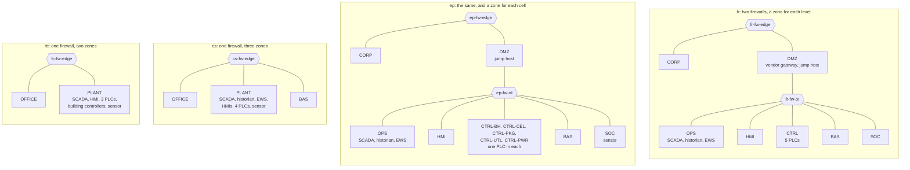
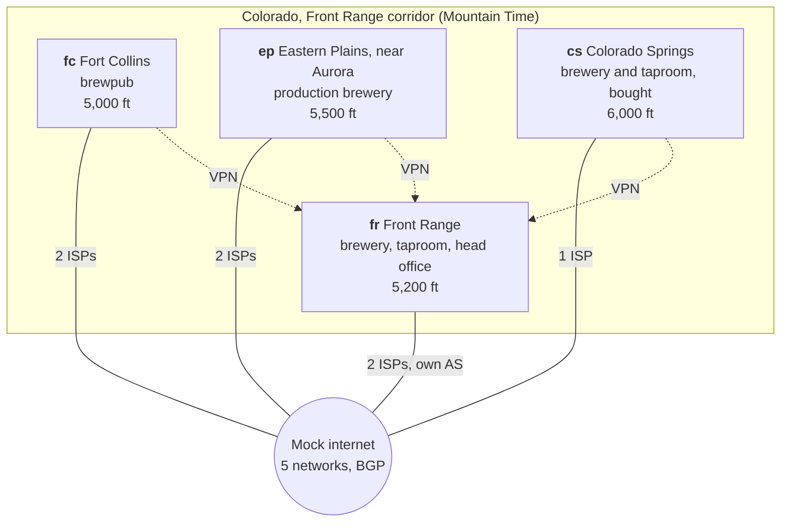
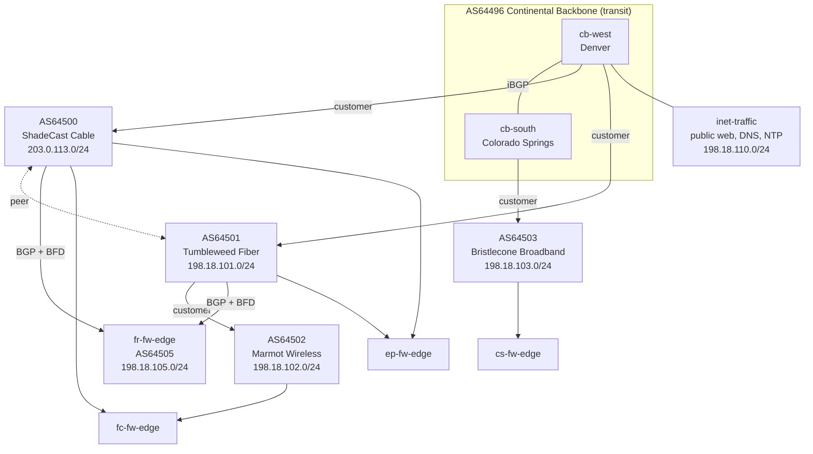
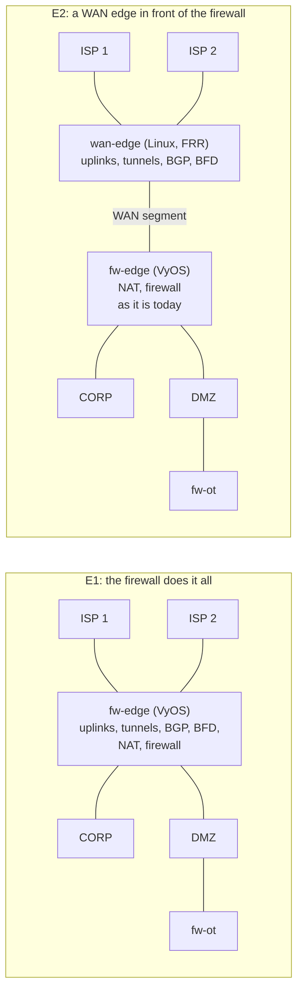
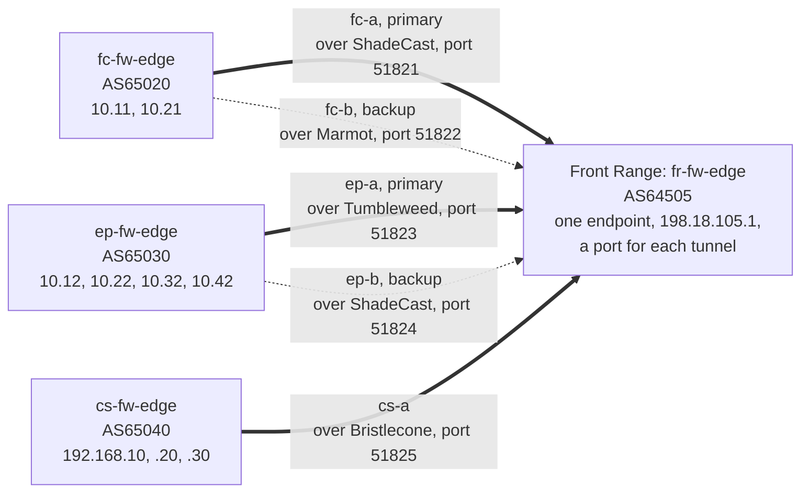
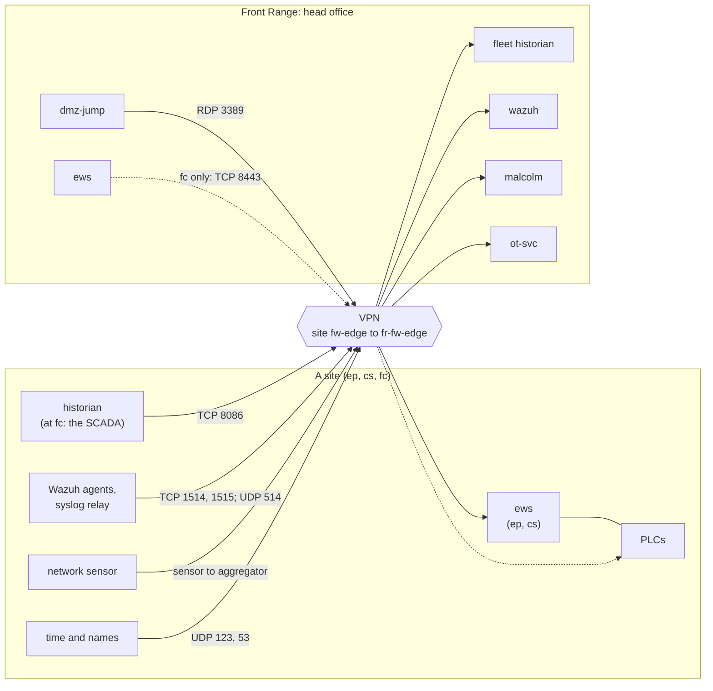
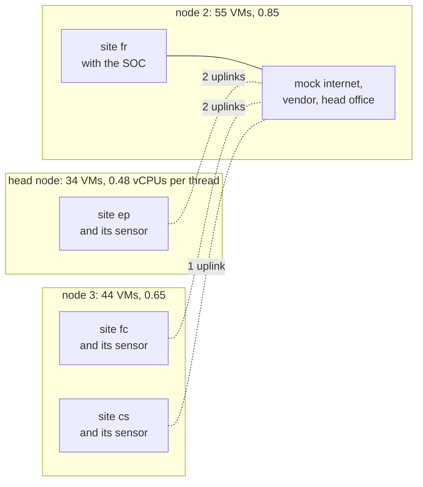
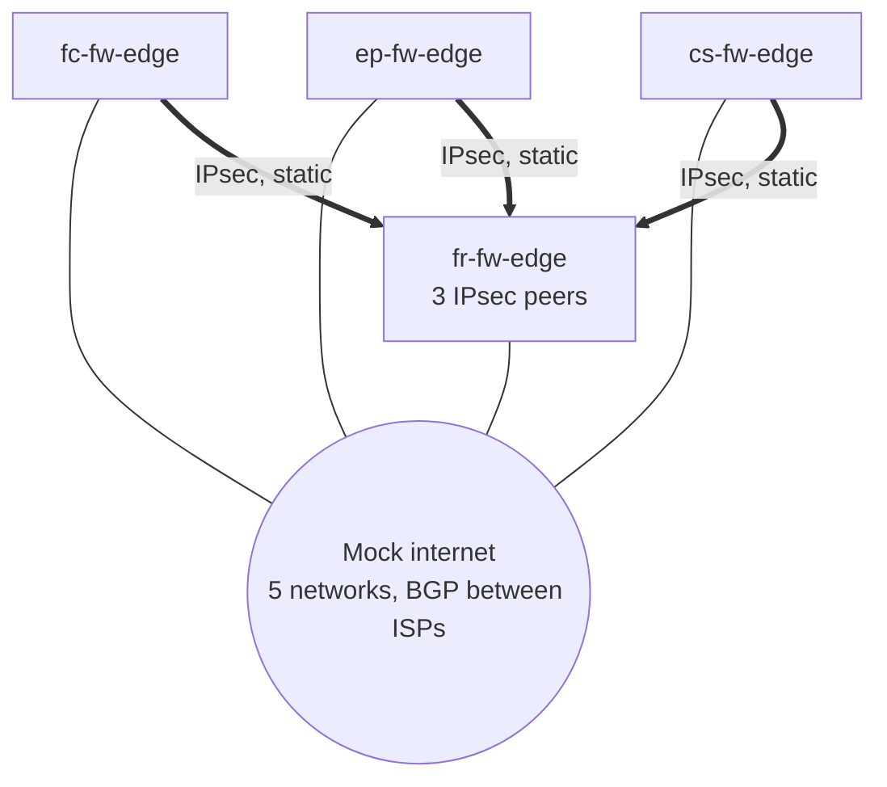
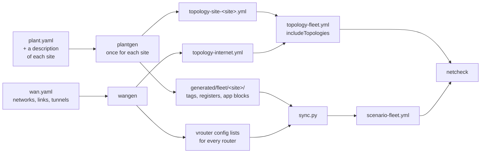
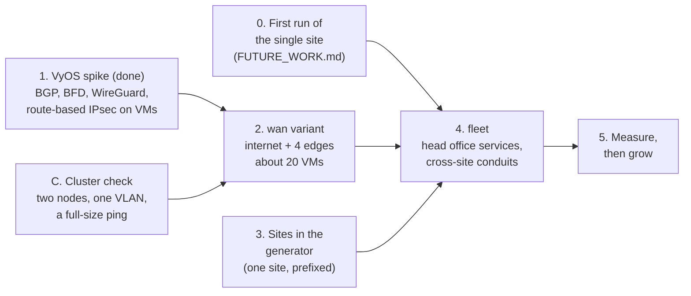

# CherryMountain Brewing: four breweries and a head office

> **Status:** options, with the decisions taken on 2026-11-22 and 2026-11-23
> marked in [section 9](#9-decisions-needed). Nothing here is built. Three
> spikes ran in a container with no VM. A fourth ran the WAN's core on four
> VyOS routers under phenix and minimega in CI, with a patch for phenix that
> delivers their configuration. Section 7 says what each one showed and what
> it did not. [DESIGN.md](../DESIGN.md) stays the design of the single-site
> range.
>
> **tl;dr:** a `fleet` variant can put four breweries in one phenix experiment,
> joined to a head office by a site-to-site VPN over a mock internet of five
> BGP networks. The four are not copies: a flagship with the head office, a
> newer production brewery, a brewery the company bought, and a brewpub, from
> 39 VMs down to 17, each with the network such a site would have. Three plans
> follow. The recommended one (Plan B) gives the head office its own AS on two
> ISPs and gives each site one tunnel per uplink, with BGP and BFD inside the
> tunnels. On VyOS routers a site lost two to three seconds when an uplink
> went silent, with WireGuard and with route-based IPsec. In the lab a site
> whose path crossed the failed ISP inside the internet lost nine. The whole
> range is 133 VMs, and on the cluster of three nodes of 48 cores and 512 GB
> no node carries more than 0.85 vCPUs for each thread.

## Contents

1. [What was asked, and what is fixed](#1-what-was-asked-and-what-is-fixed)
2. [The company](#2-the-company)
3. [What every plan shares](#3-what-every-plan-shares)
4. [The choices](#4-the-choices)
5. [Three plans](#5-three-plans)
6. [What has to change in the repository](#6-what-has-to-change-in-the-repository)
7. [Spike results](#7-spike-results)
8. [Stages](#8-stages)
9. [Decisions needed](#9-decisions-needed)
10. [References](#10-references)

---

## 1. What was asked, and what is fixed

**Asked for:**

- A new variant of the brewery range: four breweries in different places, with
  a head office at one of them.
- A site-to-site VPN between them, over a mock internet with BGP and more than
  one ISP.
- Sites that are not copies: they vary in size, and their networks differ a
  little, as the sites of a real business do. This was said on 2026-11-23,
  after the first version of these plans stamped one plant four times
  ([4.1](#41-what-each-site-is)).
- A host with 48 cores and 96 threads. Later notes widened it: the range runs
  on **a cluster of three minimega nodes, each with 48 cores and 512 GB**. The
  head node runs VMs, the cluster bridges VLANs between its nodes itself, and
  the MTU of its network is thought to be 1500
  ([4.8](#48-where-the-vms-run)).

**Assumed, because it was not said:** a node has two threads for each core,
like the first host.

**Fixed by phenix, minimega, and the range as it is.** Each row was read from
source or shown by a spike.

| # | Constraint | What it forces | Where it comes from |
|---|---|---|---|
| C1 | Two experiments cannot share a VLAN ID, and phenix has no supported link between experiments | The four sites and the internet are **one experiment** | minimega refuses a VLAN ID that another alias holds; a workflow creates one experiment (`api/workflow/spec.go`) |
| C2 | `includeTopologies` appends nodes and fails on a duplicate hostname. It cannot include one file four times with a prefix | **One topology file per site**, generated | `src/go/types/topology.go` lines 42 to 99 |
| C3 | SoH keeps one host per IP address | **No site may reuse another site's addresses**, even behind NAT | `api/soh/app.go` (`addrHosts[ip]=host`) |
| C4 | A VLAN alias is one L2 segment for the whole experiment | **Every site has its own VLAN aliases and IDs**, and `vlanRange` must grow past 100 to 199 | The four sites have 53 aliases, and the single-site range has 18 ([7.5](#75-site-profiles-four-sites-that-are-not-copies)) |
| C5 | phenix's `vrouter` app cannot render BGP, a tunnel interface, WireGuard, or BFD for VyOS. Its template has an empty `bgp` block marked TODO for Vyatta, and nothing for VyOS | The routers get that configuration **another way** ([4.3](#43-who-runs-bgp-and-how-the-routers-get-their-configuration)) | `src/go/tmpl/templates/vyatta.tmpl` line 531 |
| C6 | phenix renders IPsec for VyOS as policy-based tunnels with a pre-shared key, one fixed proposal, and any number of peers | A static hub-and-spoke VPN works **with phenix as it is** | `src/go/app/vrouter.go` (`processIPSec`); the `vyos-ipsec` spike |
| C7 | The `helics` app starts one root broker for an experiment | Four separate plant simulations need **their brokers started another way** ([4.7](#47-simulation)) | sceptre-phenix-apps `helics/app.py` lines 18 to 37 |
| C8 | **No part of the range has run on a phenix host** | A fleet multiplies what is unverified. The stages in [section 8](#8-stages) boot the WAN and one site before four | [DESIGN.md, Status](../DESIGN.md#status) |
| C9 | On one node the four sites, with the SOC and three sensors, are 190 vCPUs: 2.0 for each thread. The single-site design runs at about 1.1. On the three-node cluster no node is above 0.85 | **On one node the range would have to shrink.** On the cluster the placement is the choice ([4.8](#48-where-the-vms-run)). Either way the load of one site must be measured first | The site-profiles spike |
| C10 | A VLAN with VMs on two nodes needs a path between the nodes' bridges: a trunk on the cluster's switch, or phenix's GRE mesh, which needs room in the MTU of the nodes' network | **A full-size frame must cross between nodes.** This cluster bridges VLANs between its nodes itself, so the range sets nothing up and uses no mesh; the check in [4.8](#48-where-the-vms-run) confirms it | phenix `docs/content/gre-mesh.md`; minimega `doc/content/articles/cluster.md` |
| C11 | A PLC's program is written for its whole process area, and plantgen writes the addresses around it | **A site can leave out a whole area at no cost.** One unit less inside an area needs a program for that unit list ([4.1](#41-what-each-site-is)) | `plc/`, and the site-profiles spike |

## 2. The company

CherryMountain Brewery grew into **CherryMountain Brewing Company**. A company
with four breweries did not build the same brewery four times. It built one
and outgrew it, built a bigger one with what it had learned, opened a pub in
a town that drinks beer, and bought a competitor down the road. Each site's
plant and network date from how the site joined, and that is where the
differences come from. The Front Range brewery of [DESIGN.md](../DESIGN.md) is
the flagship and holds the head office.

| Code | Site | What it is | How it joined the company | Elevation | Water boils at | Time zone |
|---|---|---|---|---:|---:|---|
| `fr` | Front Range | Flagship brewery and taproom (the existing plant), **head office**. Denver stands for its jurisdiction, as in DESIGN.md | The first brewery. Its network was rebuilt to a standard after it grew: the design of DESIGN.md | 5,200 ft | 202 °F | Mountain |
| `ep` | Eastern Plains | Production brewery, on the plains near Aurora: the beer that goes to distributors | Built new by the company and its integrator, to the standard and one step past it | about 5,500 ft | about 202 °F | Mountain |
| `cs` | Colorado Springs | Brewery and taproom | **Bought** from another company, with the network that company's integrator built. It is being brought into the fleet | about 6,000 ft | about 201 °F | Mountain |
| `fc` | Fort Collins | Brewpub in the old town | Opened by the company as a pub. Nobody on site looks after its network | about 5,000 ft | about 203 °F | Mountain |

All four sites are on Colorado's Front Range urban corridor, within about 130
miles of each other. The elevations are the cities' round figures. The
utilities, prices, and local rules of each place are a separate analysis that
is being written; until it is here, this table has only what is certain.

The places differ in what the plant model can show: elevation changes the
boil a little, and each city has its own utilities, prices, and rules. The
sites differ in what the range can show:

| | `fr` | `ep` | `cs` | `fc` |
|---|---|---|---|---|
| Process | Brewhouse, cellar, packaging, utilities, on-site power, building | The same, with no taproom | No on-site power: no solar, battery, generator, or utility link | No packaging line and no on-site power |
| PLCs | 5 | 5 | 4 | 3 |
| Firewalls | Two, with a DMZ between them | Two, with a DMZ that has its own jump host | One | One |
| Zones behind them | Office, operations, HMI, control, building, security | The same, with control split into a zone for each process cell | Office, plant, building | Office, plant |
| What shares a network with a PLC | The other PLCs | Nothing but its own cell | The other PLCs, the HMIs, the SCADA, the historian, the engineering workstation | The other PLCs, the HMI, the SCADA, the building's controllers |
| Addresses | The company's plan | The company's plan | The plan it was bought with, in `192.168.0.0/16` | The company's plan |
| On site | Historian, engineering workstation, SOC, vendor gateway, fleet services | Historian, engineering workstation, jump host | Historian, engineering workstation | Neither: the SCADA is all there is |
| Uplinks | ShadeCast Cable and Tumbleweed Fiber, with the company's own AS | Tumbleweed Fiber and ShadeCast Cable | Bristlecone Broadband only | ShadeCast Cable, and Marmot Wireless as the backup |
| VMs | 39, and 3 for the head office | 33 | 25 | 17 |

[4.1](#41-what-each-site-is) has the reasons, the sizes, and what was left for
later. All of it is notional. The ISP names other than ShadeCast Cable are
placeholders that nobody has checked against real companies.



**Text alternative to the diagram.** Four site networks. At `fr`, the edge
firewall `fr-fw-edge` has the office network (CORP) and a DMZ with the vendor
gateway and a jump host. Behind the DMZ a second firewall, `fr-fw-ot`, has
five zones: OPS (SCADA, historian, engineering workstation), HMI, CTRL (the
five PLCs), BAS, and SOC. `ep` has the same two firewalls, a DMZ with its own
jump host, and the same zones, except that control is five VLANs, one for each
PLC, and its SOC zone holds a sensor. `cs` has one firewall, `cs-fw-edge`,
with three zones: OFFICE, PLANT (SCADA, historian, engineering workstation,
HMIs, four PLCs, and the sensor in one VLAN), and BAS. `fc` has one firewall,
`fc-fw-edge`, with two zones: OFFICE, and PLANT, which holds the SCADA, the
HMI, three PLCs, the building's controllers, and the sensor. The field
networks behind each PLC and the simulation's own network are not shown.



**Text alternative to the diagram.** All four sites are in Colorado, on
Mountain Time, along the Front Range corridor: Fort Collins (a brewpub) in the
north, Front Range (the existing brewery, with the head office), Eastern
Plains near Aurora (the production brewery), and Colorado Springs (the brewery
the company bought) in the south. Each site connects to the mock internet:
Front Range through two ISPs with its own AS, Fort Collins and Eastern Plains
through two ISPs each, and Colorado Springs through one. A VPN runs from each
of the three other sites to Front Range.

## 3. What every plan shares

These follow from the constraints, so they do not change between plans.

**One experiment, one file per site.** The variant is `fleet`: workflow
`phenix-fleet.yml`, experiment `cherrymountain-fleet`, bridge
`cherrymtn-fleet`. `topology-fleet.yml` includes `topology-site-fr.yml`,
`-fc.yml`, `-ep.yml`, `-cs.yml`, and `topology-internet.yml`. The site files
are generated and committed, like plantgen's output today. Each is generated
from the one plant and a short description of the site: what it leaves out and
how its network is cut ([4.1](#41-what-each-site-is)).

**Names and addresses.** The site-profiles spike generated the hostnames, the
VLAN aliases and IDs, the subnets, and the MGMT networks of the four sites
without a clash
([7.5](#75-site-profiles-four-sites-that-are-not-copies)). The route blocks
ran in the lab ([7.1](#71-wan-bgp-a-mock-internet-and-a-vpn-over-it)).

| Item | Rule | Example |
|---|---|---|
| Hostname | Site code, then today's name | `fc-plc-cellar`, `fr-fw-edge` |
| VLAN alias | Site code in capitals, then the zone | `FR-CTRL`, `EP-CTRL-CEL`, `FC-PLANT` |
| VLAN ID | A hundred for each site. A zone that `fr` has keeps `fr`'s last two digits; a zone it does not have takes 20 and up. The access links to the ISPs take 500 to 506; `vlanRange` is 100 to 599 | CTRL is 108 at `fr`; `EP-OPS` is 306, `EP-CTRL-BH` 320, `FC-PLANT` 221, `CS-PLANT` 421 |
| Private subnets of `fr`, `fc`, `ep` | The company's plan: today's, with the site's number added to the second octet | OPS is `10.20.30.0/24` at `fr` and `10.22.30.0/24` at `ep`; the brewpub's plant network is `10.21.10.0/24` |
| Private subnets of `cs` | The plan it was bought with | Office `192.168.10.0/24`, plant `192.168.20.0/24`, building `192.168.30.0/24`; field networks `192.168.21.0/24` to `192.168.24.0/24` |
| MGMT | Its own VLAN and /16 at each site. It is the simulation's network, not the company's | `172.16.0.0/16` at `fr`, `172.19.0.0/16` at `cs` |

| Site | Number | VLAN IDs | AS inside the VPN | What it announces into the VPN |
|---|---:|---|---:|---|
| `fr` | 0 | 104 to 117 | 64505 | `10.10.0.0/16`, `10.20.0.0/16`, `10.30.0.0/16`, `10.40.0.0/16` |
| `fc` | 1 | 209 to 221 | 65020 | `10.11.0.0/16`, `10.21.0.0/16` |
| `ep` | 2 | 304 to 324 | 65030 | `10.12.0.0/16`, `10.22.0.0/16`, `10.32.0.0/16`, `10.42.0.0/16` |
| `cs` | 3 | 409 to 421 | 65040 | `192.168.10.0/24`, `192.168.20.0/24`, `192.168.30.0/24` |

The site numbers count from 0 so that `fr` keeps today's addresses. The VLAN
hundreds and the AS numbers count from 1. A site's blocks are what the head
office lets it announce ([4.5](#45-the-vpn)).

The Front Range site keeps every private address of
[DESIGN.md §10.2](../DESIGN.md#102-vlan-and-ip-plan), and `fr-fw-edge` keeps
`203.0.113.2`. Its detection content (the addresses in its Suricata rules and
its Zeek script) stays valid. Two things on its public side move: the INET
segment shrinks from a /24 to a /29, which still holds `isp-rtr` (.1),
`fw-edge` (.2), and `util-rtr` (.3) and leaves the rest of `203.0.113.0/24`
for ShadeCast's other customers, and `inet-traffic` moves from `203.0.113.10`
to the transit carrier's hosted network. The single-site variants `full`,
`lite`, and `ci` do not change.

**Internet numbering.** Every public address and AS number comes from a range
reserved for documentation or testing, as the single-site plan's do.

| Network | AS | Role | Prefix | Router |
|---|---:|---|---|---|
| Continental Backbone | 64496 | Transit carrier | `198.18.0.0/24` (links), `198.18.110.0/24` (hosted services: `inet-traffic`) | `cb-west` (Denver), `cb-south` (Colorado Springs) |
| ShadeCast Cable | 64500 | Cable ISP along the Front Range (today's `isp-rtr`) | `203.0.113.0/24` | `shadecast` |
| Tumbleweed Fiber | 64501 | Fiber ISP, Denver area and the eastern plains | `198.18.101.0/24` | `tumbleweed` |
| Marmot Wireless | 64502 | Fixed-wireless ISP in northern Colorado, a customer of Tumbleweed | `198.18.102.0/24` | `marmot` |
| Bristlecone Broadband | 64503 | Access ISP, Colorado Springs | `198.18.103.0/24` | `bristlecone` |
| CherryMountain Brewing | 64505 | The head office's own AS, in Plan B and Plan C | `198.18.105.0/24` | `fr-fw-edge` |

AS 64496 to 64511 are reserved for documentation (RFC 5398). `203.0.113.0/24`,
`198.51.100.0/24`, and `192.0.2.0/24` are the documentation prefixes the range
already uses (RFC 5737), and `198.18.0.0/15` is reserved for benchmarking
(RFC 2544). The vendor (`198.51.100.0/24`) and the utility (`192.0.2.0/24`)
keep their prefixes and become customers of an ISP.

**The ISPs follow the rules real ISPs follow.** A route from a customer is
preferred over one from a peer, and a peer's over a provider's. A network
tells its peers and providers only its own and its customers' prefixes. An ISP
accepts from the head office, which is a customer with one prefix, only that
prefix. From another network it accepts any public prefix up to a /24, as much
of the real internet does, and that is what lets the hijack in
[4.2](#42-the-mock-internet) work. No private address space is accepted. The
lab checks the first two rules and that no ISP carries a private route
([7.1](#71-wan-bgp-a-mock-internet-and-a-vpn-over-it)). It does not offer an
ISP a prefix it should refuse.

**Build the WAN before the sites.** A `wan` variant holds the internet, the
four site edges, and one small host at each site: about 20 VMs. The WAN is the
same whatever is behind an edge. It boots without a plant, so the WAN can be
proved on VMs while the single-site range gets its own first run
([section 8](#8-stages)).

## 4. The choices

### 4.1 What each site is

**Decided (D4, on 2026-11-23): the four sites are not copies.** They vary in
size, and their networks differ a little, as the sites of a real business do.
The first version of these plans stamped the Front Range plant four times. The
mixes it compared (M1 to M5) are in the
[stamp spike](../../spikes/multisite-stamp/README.md).

**How different.** There are three ways to make sites differ.

| Option | What differs | For | Against |
|---|---|---|---|
| S1: size only | Which process areas a site has. Every site keeps the two firewalls and the zones of DESIGN.md | The least work: a site is a list of areas | Every network is the same network. A company that grew does not look like that, and a defender learns one layout |
| **S2: size, and how the network is cut** (recommended; the rest of this document assumes it) | The areas, and the number of firewalls, the zones, the address plan, what is on site, and the uplinks. Every device is one the range already has | Each difference has a reason in the company's history ([section 2](#2-the-company)). All of it is data to the generator: the site-profiles spike generated the four sites ([7.5](#75-site-profiles-four-sites-that-are-not-copies)) | Three kinds of firewall rule set to write and check where S1 has one: two firewalls, two firewalls with a VLAN for each cell, and one firewall |
| S3: S2, and other products | S2, and at the site that was bought: another firewall product, another PLC vendor and protocol, addresses that overlap the head office's behind NAT | The closest to a real acquisition | New images, new PLC programs, and a second firewall product to configure. Overlapping addresses break the health checks (C3) |

**One rule keeps S2 cheap:** a site differs by what it leaves out and by how
its network is cut, never by a new kind of device.

- **A site leaves out whole process areas.** A process area has one PLC and
  one program, and each of the building's controllers is a device of its own.
  Dropping an area drops the PLC, its I/O, and its part of the simulation, and
  plantgen leaves out everything that named them. One unit
  less inside an area (two fermenters where the plant has four) needs a PLC
  program for that unit list (C11), so no site does that in the first build.
- **The network is data.** plantgen took one firewall, a merged VLAN, a VLAN
  for each cell, and another address plan with no change to its code.

**The four sites.** The sizes are from the site-profiles spike.

| | `fr` | `ep` | `cs` | `fc` |
|---|---|---|---|---|
| Process areas | Brewhouse, cellar, packaging, utilities, power, building | The same; the building without the taproom's rooftop unit | Brewhouse, cellar, packaging, utilities, building | Brewhouse, cellar, utilities, building |
| PLCs, tags | 5, 516 | 5, 504 | 4, 458 | 3, 365 |
| Network | 2 firewalls, 8 routed zones | 2 firewalls, 12 routed zones | 1 firewall, 3 routed zones | 1 firewall, 2 routed zones |
| VMs | 39 | 33 | 25 | 17 |
| vCPUs | 62 | 42 | 33 | 21 |
| Memory (GB) | 151 | 65 | 53 | 33 |
| With its sensor | The SOC is here | 34 VMs, 46 vCPUs, 81 GB | 26 VMs, 37 vCPUs, 69 GB | 18 VMs, 25 vCPUs, 49 GB |

`fr`'s 39 VMs are the plant's 33, the SOC's 4 (18 vCPUs and 84 GB), and the
vendor's gateway and jump host.

- **`fr`, the standard.** The plant and the network of DESIGN.md, unchanged,
  with the SOC, the vendor's gateway, and the head office's additions
  ([4.6](#46-what-the-head-office-does)).
- **`ep`, the standard and one step past it.** The same plant without a
  taproom. Its integrator gave each process cell its own control VLAN, so a
  PLC shares a network with nothing but its own cell, and a PLC that reads
  another (the utilities PLC reads the cellar's interlocks) does it through
  `ep-fw-ot`. Its DMZ has its own jump host, so that its engineers do not
  depend on the head office. It has the solar, the battery, and the generator
  that `fr` has, and its own link to the utility.
- **`cs`, bought.** One firewall and three zones: office, plant, building.
  Everything that runs the plant is in one VLAN: PLCs, HMIs, SCADA, historian,
  engineering workstation. It keeps the address plan it came with, because
  renumbering a running plant is the last thing an integration does. What the
  company has done so far: its own firewall at the edge, the VPN, a sensor,
  and a small server for time, names, and logs. It has no on-site power in
  the first build.
- **`fc`, the brewpub.** One firewall and two zones. The plant VLAN holds the
  three PLCs, the HMI, the SCADA, and the building's controllers. It has no
  historian and no engineering workstation: its SCADA sends its data to the
  fleet historian through the VPN, and its PLCs are programmed from the head
  office ([4.6](#46-what-the-head-office-does)). It is the site that depends
  on the VPN most and has the least between its office and its PLCs.

**What the differences give an exercise.**

| Contrast | Where |
|---|---|
| The same foothold reaches different things | An office PC at `fc` is one firewall away from the PLCs. At `cs` the engineering workstation and the PLCs share a VLAN. At `fr` and `ep` two firewalls and a DMZ are in between, and at `ep` one PLC cannot reach another without the firewall |
| A WAN failure means different things | `fc` loses its trends at the head office and its engineering access. `ep` keeps both on site. `cs` has one uplink and nothing to fail over to |
| A site in the wrong hands | The brewpub's edge is the least defended router that speaks BGP inside the VPN. The head office takes from it only the pub's own prefixes ([4.5](#45-the-vpn)) |
| An integration half done | `cs` has the company's VPN and sensor on a network the company did not design, with addresses no other site uses |

**The size of the range.**

| Part | VMs | vCPUs | Memory (GB) |
|---|---:|---:|---:|
| Mock internet: 6 VyOS routers (I2 in [4.2](#42-the-mock-internet)) and 6 small hosts | 12 | 12 | 18 |
| The vendor's workstation, on the internet | 1 | 2 | 3 |
| Head-office additions: fleet historian, corporate server, a second office desktop | 3 | 6 | 12 |
| `fr` | 39 | 62 | 151 |
| `ep` and its sensor | 34 | 46 | 81 |
| `cs` and its sensor | 26 | 37 | 69 |
| `fc` and its sensor | 18 | 25 | 49 |
| **All of it** | **133** | **190** | **383** |

- **On the cluster** no node carries more than 0.85 vCPUs for each thread
  ([4.8](#48-where-the-vms-run)). On one node it would be 2.0, against the 1.1
  the single-site design assumes, and 75% of the memory.
- **Four copies were larger:** 157 VMs, 217 vCPUs, and 421 GB with a sensor at
  three of them.
- **These are counts, not load.** Most VMs idle, but the PLCs scan every
  100 ms, the kiosks render in software, and every PLC compiles its program on
  first boot. Nobody has measured a site.
- **The brewpub is the cheapest thing to boot first:** 17 VMs with a whole
  plant behind them. Nothing of the range has run (C8).
- **BFD makes overcommit visible.** A router VM that waits 900 ms for a CPU
  drops its BFD sessions and moves traffic for no reason. The range should use
  1 s intervals (3 s to detect) until a node is measured. The lab used
  300 ms. The VyOS runs used 1 s on a runner with 10 vCPUs of guests on 4
  threads, and no check saw a session drop without a fault
  ([7.4](#74-wan-bgp-on-vyos-routers)).

**Left for later.** Each fits the company's story, and none is in the first
build.

| Addition | What it needs |
|---|---|
| A standby generator at `cs`, with no solar and no battery | A `plc-power` program for that unit list |
| Fewer fermenters at `fc`, or one PLC for the whole pub | PLC programs for those unit lists |
| Bigger vessels at `ep` | The simulation holds the vessel sizes as constants |
| The old integrator's remote-access box at `cs`: a second way in that the head office does not control | A small VM at the site and a host on the internet |
| Marmot Wireless behind carrier NAT, so that `fc`'s backup tunnel starts from an address the head office cannot name | NAT traversal for the IPsec tunnel, which is not tested. The head office already only answers |
| A point of sale and a guest network at the taprooms | Hosts and a VLAN; nothing in the plant |

Four choices inside S2 are still the user's: D16 to D19 in
[section 9](#9-decisions-needed).

### 4.2 The mock internet



**Text alternative to the diagram.** The transit carrier, Continental Backbone
(AS 64496), has two routers joined by iBGP: `cb-west` in Denver and `cb-south`
in Colorado Springs. ShadeCast Cable (AS 64500) and Tumbleweed Fiber (AS 64501) are
customers of `cb-west` and also peer with each other directly. Marmot Wireless
(AS 64502) is a customer of Tumbleweed. Bristlecone Broadband (AS 64503) is a
customer of `cb-south`. `inet-traffic` hangs off `cb-west`. The head office's
edge, `fr-fw-edge` (AS 64505), speaks BGP with BFD to ShadeCast and to
Tumbleweed. `fc-fw-edge` connects to ShadeCast and Marmot, `ep-fw-edge` to
Tumbleweed and ShadeCast, and `cs-fw-edge` to Bristlecone; these three take
ISP-assigned addresses and speak no BGP with their ISPs.

This is the internet the lab ran. It is the smallest one that has a transit
carrier, a peering link, a small ISP behind a bigger one, and an ISP that
reaches the others only through the carrier,
so that an AS path can be two or three networks long and a failure has
somewhere to reroute.

| Option | Routers | Cost | For | Against |
|---|---|---|---|---|
| I1: a VM for each router, FRR on Linux | 6 | 6 vCPUs, 3 GB | The configuration is a file (`frr.conf`), and the lab's files carry over. Each router shows in the phenix UI, and a fault is a phenix action (disconnect a NIC, stop a VM) | A new small image (`cm-frr`) and a second way to configure a router. Link delay and loss need a `tc` unit; the `vrouter` app's emulators do not apply |
| **I2: a VM for each router, VyOS** (decided, D6) | 6 | 6 vCPUs, 12 GB | The image exists, and `isp-rtr` is VyOS today. Two ISPs ran this way in CI: their customer, peer, and provider rules are 65 commands in R1's `config` list ([7.4](#74-wan-bgp-on-vyos-routers)). Every router of the range then has one image and one way to get its configuration. Each router shows in the phenix UI, and the emulators work | 9 GB more than I1, which a node of 512 GB does not notice. Six more routers depend on R1 and on the VyOS rolling build |
| I3: the whole internet in one VM | 1 | 2 vCPUs, 2 GB | Ten FRR routers took 0.5 GB in the lab, so 20 or 30 networks, an exchange with a route server, and an RPKI validator would fit | One box in the UI. Faults are scripts inside it. The lab script would become a product |

minimega's own router image (minirouter, which runs BIRD) is not an option:
minimega can configure BGP on it, but phenix does not pass BGP to it.

I1 was the recommendation while no VyOS router had taken BGP from phenix and
memory was counted on one host. Both reasons are gone. I1 stays the choice if
R1 is not wanted ([4.3](#43-who-runs-bgp-and-how-the-routers-get-their-configuration)).

**The ISPs' timers are part of the design.** A site that is not next to a
failure waits for a BGP hold timer inside the internet
([7.1](#71-wan-bgp-a-mock-internet-and-a-vpn-over-it)). The lab's ISPs use 3 s
keepalives and a 9 s hold time, and the Colorado Springs site lost 9 s. With the
60 s and 180 s that routers ship with, it would lose three minutes. The
range's ISP routers should keep the short timers or run BFD between
themselves, and an exercise can lengthen them on purpose.

**What BGP adds to an exercise.** In the lab, Bristlecone announced the head
office's prefix. The transit carrier believed the shorter path and the Colorado
Springs site lost the head office. ShadeCast and Tumbleweed kept their customer
route, so the other two sites did not notice. A blue team sees the same thing
a real one would: one site's tunnel down, nothing wrong at either end.

### 4.3 Who runs BGP, and how the routers get their configuration

The ISP routers must speak BGP. Whether a **brewery** router does depends on
the plan: in Plan A none does. In Plan B and Plan C every site edge runs BGP
inside its tunnels, and the head office's also runs it with two ISPs.

phenix cannot render that for VyOS (C5). There are four ways to deliver it.

| Option | What it is | For | Against |
|---|---|---|---|
| **R1: a `config` list in the `vrouter` app** (recommended, needs a phenix change) | Each router's metadata lists VyOS `set` and `delete` commands. phenix writes them after its own, before the commit | One commit at first boot, with the rest of the configuration. It also carries what `cm-vyos-config.sh` does after boot today (logging, syslog, IKEv2, the NTP source), so that script could go. The change is small, its tests pass, and it is a draft pull request ([7.3](#73-a-config-list-for-the-vrouter-app)). In CI, 48 boots of VyOS routers committed their lists at first boot, 59 to 151 commands each ([7.4](#74-wan-bgp-on-vyos-routers)) | A change to phenix, on a fork branch until upstream takes it |
| R2: the post-boot script | `cm-vyos-config.sh` grows a BGP and tunnel section | No phenix change. The mechanism is in the range | A second commit after boot, which a `cc exec` starts. The script has not run on a VyOS VM, and its first form changed nothing and reported success ([DESIGN.md §10.3](../DESIGN.md#103-conduit-matrix-default-deny-stateful-logged)) |
| R3: BGP as a schema feature of phenix | `network.bgp` in the topology, as `network.ospf` is | The right upstream answer to the TODO | A large change (schema, types, template, Builder checks). It still would not cover tunnels or BFD |
| R4: keep BGP off VyOS | A Linux router with FRR does the WAN work at each site ([4.4](#44-where-the-tunnels-end), E2) | No phenix change and no VyOS syntax to verify. It is what the lab ran | One more VM at each site |

### 4.4 Where the tunnels end



**Text alternative to the diagram.** In E1, both ISPs connect to `fw-edge`, a
VyOS firewall that holds the uplinks, the tunnels, BGP, BFD, NAT, and the
firewall rules; CORP and the DMZ hang off it, and `fw-ot` is behind the DMZ. In
E2, both ISPs connect to a new node, `wan-edge`, a Linux router with FRR that
holds the uplinks, the tunnels, BGP, and BFD. `wan-edge` connects over one WAN
segment to `fw-edge`, which keeps NAT and the firewall rules as it has them
today, with CORP, the DMZ, and `fw-ot` behind it.

| | E1: on `fw-edge` | E2: on a `wan-edge` |
|---|---|---|
| Like | A small company's firewall that is also its VPN endpoint | A dual-WAN router or SD-WAN box in front of the firewall |
| New VMs | None | 4 (1 vCPU and 512 MB each) |
| Needs | R1, which ran on VyOS VMs, or R2 | A `cm-frr` image and generated files |
| Firewall rules for VPN traffic | On tunnel interfaces, which phenix's ACLs cannot name: through R1 or R2 | On `fw-edge`'s WAN interface, by source and destination, with phenix's ACLs as they are |
| Monitoring | VyOS logs to Wazuh, as the firewalls do today | The box can run a Wazuh agent |
| Evidence | The head office's edge and one site's edge ran on VyOS in CI, with WireGuard and with route-based IPsec ([7.4](#74-wan-bgp-on-vyos-routers)). Those routers had no firewall rules and no NAT | The lab is this, in namespaces |

**Recommendation:** E1 with R1, because it adds no VMs and puts the VPN where
a company this size has it. The spike it depended on passed. What it has not
shown is the WAN configuration next to a site's rulesets and NAT on the same
router, which is stage 2's work ([section 8](#8-stages)). E2 stays the
fallback.

### 4.5 The VPN



**Text alternative to the diagram.** The head office's edge, `fr-fw-edge`
(AS 64505), has one tunnel endpoint in its own prefix, `198.18.105.1`, and a
port for each tunnel. `fc-fw-edge` (AS 65020) has a primary tunnel `fc-a` over
ShadeCast (port 51821) and a backup tunnel `fc-b` over Marmot (port 51822).
`ep-fw-edge` (AS 65030) has a primary tunnel `ep-a` over Tumbleweed (port
51823) and a backup `ep-b` over ShadeCast (port 51824). `cs-fw-edge`
(AS 65040) has one tunnel, `cs-a`, over Bristlecone (port 51825). Each site
announces its own address blocks: `fc` two /16 blocks, `ep` four, and `cs`
three /24 networks of `192.168.0.0/16`.

| Option | Tunnels | Routing | Failover | Needs |
|---|---|---|---|---|
| **V1: static hub and spoke** | One policy-based IPsec tunnel from each site to the head office | None. The tunnel's selectors are the routes | None. A site with a dead ISP is cut off | Nothing new: phenix renders it (C6) |
| **V2: a tunnel per uplink, BGP inside** (recommended) | One route-based tunnel for each uplink of each site, to the head office: five in all | eBGP in every tunnel, each site its own private AS. The primary tunnel wins by local preference at both ends. BFD finds a dead tunnel | About 1 s in the lab for a site next to the fault. On VyOS, 2.2 to 3.0 s with the 1 s BFD interval a VM should use, and 5.4 s once. A site with one uplink waits for the ISPs: 9 s in the lab | R1, R2, or E2 |
| V3: V2 with a second hub | V2, and a tunnel for each uplink of `fc` and `cs` to a second hub at `ep`: eight in all. `ep` would need its own prefix, or an endpoint on each uplink | The same, with a preference between hubs | Survives the loss of the head office's whole site | The same, and more policy to get wrong |
| V4: full mesh | A tunnel between every two sites, for each uplink pair | The same | Sites reach each other directly | The most tunnels and the least reason: brewery sites talk to the head office, not to each other |

**How V2 behaves** (all shown in the lab, and the first three also on VyOS):

- **The head office's endpoint is in its own prefix**, which both of its ISPs
  announce. When the head office loses an ISP, the internet reroutes under
  the tunnels and no tunnel has to move.
- **A site pins each tunnel to one uplink by a mark.** The tunnel's packets
  carry a firewall mark, a rule sends that mark to its own routing table, and
  the table holds the uplink and, behind it, a blackhole. The two tunnels of a
  site never share an uplink, whatever address the endpoint has and whether
  the uplink's link is up or down. The first design pinned by the
  endpoint's address, and it did not hold
  ([7.1](#71-wan-bgp-a-mock-internet-and-a-vpn-over-it), finding 2).
- **The head office sends from its endpoint address.** Its default routes
  carry the endpoint as the preferred source, so a reply never leaves with the
  address of an uplink.
- **Only site prefixes cross a tunnel, and only a site's own.** The head
  office takes from each site that site's blocks
  ([section 3](#3-what-every-plan-shares)) and nothing else, and a site
  announces only its own. No end takes a default route or a public prefix,
  which would send the tunnel into itself. The first design let any prefix of
  `10.0.0.0/8` in from any site. A site's edge in the wrong hands could then
  announce a /24 inside another site's /16 and draw that traffic to itself.
  In the lab the brewpub's edge announced the Colorado Springs plant network, and
  the head office kept its one route, through the Colorado Springs tunnel
  ([7.1](#71-wan-bgp-a-mock-internet-and-a-vpn-over-it), finding 7).
- **Site to site goes through the head office**, where `fr-fw-edge` decides
  whether it may. In the lab a packet from `fc` reached `cs` in four hops.
- **The head office installs the default route of both ISPs**, not only the
  best one, so that it can lose an ISP. With wireguard-go, a tunnel that
  arrived through the other ISP also never came up with one default route
  ([7.1](#71-wan-bgp-a-mock-internet-and-a-vpn-over-it), finding 1). The
  kernel's WireGuard, which VyOS uses, did come up with one
  ([7.4](#74-wan-bgp-on-vyos-routers)).
- **The head office keeps the routes its ISPs send**
  (`soft-reconfiguration inbound`). Without it, FRR took a default route away
  from the head office at first boot in three of four jobs, and in one of
  them both ([7.4](#74-wan-bgp-on-vyos-routers)).

**IPsec or WireGuard.** The routing does not care: both give a routed
point-to-point interface.

| | Route-based IPsec (IKEv2, a VTI on VyOS) | WireGuard |
|---|---|---|
| In real breweries and their integrators | The usual site-to-site VPN | Growing, mostly for remote access |
| In the range today | The utility link (policy-based) | The vendor's path |
| What a defender sees | IKE and ESP: negotiation, identities, rekeys | One UDP port, nothing to parse |
| Endpoints | Fixed by configuration, once MOBIKE is off (VyOS leaves it on: `disable-mobike`) | **Roam**: a peer's endpoint becomes whatever address its last packet came from. The mark pin makes that harmless |
| A tunnel tied to its uplink | By its source address: a rule sends that address to the uplink's table | By a mark on the tunnel's packets |
| After a minute of silence | The IKE SA is still there (IKEv2 retransmits for about 165 s), and traffic returns with BGP | The same: nothing to renegotiate |
| After 200 s of silence | The site had given the peer up and its VTI was down. Back on the primary tunnel 36 s and 20 s after the repair with both ends opening tunnels, and 57 s and 59 s with the head office only answering | Back 8 or 9 s after the repair, four times |
| Known problem on VyOS | An open bug leaves a VTI down after its peer reconnects ([T9154](https://vyos.dev/T9154), not fixed on 2026-11-21). It did not show: the VTI came back. With one IKE group for both ends, the head office opens tunnels too, and once a tunnel had two IKE SAs after the long silence. With the head office only answering, it had one | None found |
| Configuration at a site, as VyOS commands | 93 | 66 |
| Evidence | Five passing runs on VyOS (28 of 28, 29 of 29 three times, then 30 of 30) | The lab with wireguard-go, and four passing runs on VyOS (29 of 29 three times, then 30 of 30) after the head office's fix |

**Decided (D3):** route-based IPsec between the sites, and WireGuard stays
the vendor's. Both passed every check on VyOS, so the choice is about what
the range shows: IPsec is what a brewery group's integrator would install,
and it gives a defender IKE and ESP to look at. WireGuard is the simpler and
the quicker to recover, and it is one setting away: the generator writes
either tunnel from the same model, as `vyos_sketch.py` does. The head office
only answers IKE (`close-action none`), so that a tunnel has one SA. The
price is a slower return from a long outage: 57 s and 59 s in the two runs
that had it, against 20 s and 36 s.

**Should the head office have its own AS?** It could instead take ISP-assigned
addresses on two uplinks, like `fc` and `ep`, with one hub endpoint on each.
That is closer to what a company of four breweries would buy, and it leaves
BGP to the ISPs. The plans give it an AS because that puts BGP inside the
company: its staff own a prefix, a policy, and the consequences, and the
hijack in [4.2](#42-the-mock-internet) has a victim. It is decision
[D5](#9-decisions-needed).

### 4.6 What the head office does



**Text alternative to the diagram.** Five flows cross the VPN between a site
and the head office. The site's historian sends to the fleet historian
(TCP 8086); at `fc`, which has no historian, the SCADA server sends. The
site's Wazuh agents and its syslog relay send to `wazuh` (TCP 1514 and 1515,
UDP 514). The site's network sensor sends to `malcolm`. The site asks the head
office's `ot-svc` for time and names (UDP 123 and 53). One flow goes the other
way: the head office's `dmz-jump` opens RDP to the `ews` of `ep` or `cs`, which
is the only way to those sites' PLCs. `fc` has no `ews`, and there the head
office's own `ews` reaches the pub's PLCs directly (TCP 8443).

| Function | Proposal | Other way |
|---|---|---|
| Security operations | The SOC module stays at `fr`. Agents and syslog from every site reach `wazuh` through the VPN | A SOC at each site: 84 GB each |
| Network monitoring | A sensor at each of the other three sites (decided, D7). The mirror app feeds each sensor its own site's VLANs, and the sensor forwards through the VPN what a real one would. One `mirror` entry lists the four monitor hosts | One `malcolm` at `fr` fed every site's VLANs out of band, which is not how a real fleet works. Or `fr` only, which leaves the blue team blind at the other sites on purpose |
| Process data | `ep` and `cs` keep their `historian`, which also writes to a fleet historian at `fr`, where a Grafana board shows all four breweries. `fc` has none: its SCADA writes to the fleet historian, and a tunnel that is down is a gap in the pub's trends | A historian at `fc` too (2 vCPUs, 6 GB) |
| Engineering | `ep`: the head office's `dmz-jump`, then the site's own jump host, then its `ews`. `cs`: the head office's `dmz-jump`, then the site's `ews`. `fc`: the head office's `ews` to the pub's three PLCs, the one conduit that reaches a PLC from outside its site (D18) | An `ews` at `fc` (2 vCPUs, 4 GB), reached as `cs`'s is. Or one `ews` at `fr` for every site, which gives one desktop every PLC in the company |
| Vendor access | One WireGuard gateway and one jump host, at `fr` | A gateway and a jump host at each site: 6 more VMs |
| Time and names | At `ep` and `cs` the site's `ot-svc` serves its site and asks `fr`'s for the rest. At `fc` the SCADA server keeps time for the PLCs, as it does in the `ci` variant, and the firewall forwards names | An `ot-svc` at `fc` |
| Utility link | `fr` keeps Summit Valley Power. `ep` has the same utility on its own tunnel. `cs` and `fc` have no generation and no link | Only `fr` has a DER link |

**What crosses the VPN, by site.**

| Flow | `ep` | `cs` | `fc` |
|---|---|---|---|
| Process data to the fleet historian | From the site's historian | From the site's historian | From the SCADA server |
| Logs to `wazuh` | Agents, and `ot-svc` as the relay | The same | Agents, and the firewall |
| Sensor to `malcolm` | From its security zone | From the plant VLAN | From the plant VLAN |
| Time and names | `ot-svc` asks `fr`'s | The same | The firewall and the SCADA server ask `fr`'s |
| Engineering, from the head office | RDP to the site's jump host, then to its `ews` | RDP to its `ews` | The head office's `ews` to the PLCs |

**At `fr`, `ep`, and `cs` no conduit reaches a PLC from outside its site.** At
`fc` one does, on purpose: a pub with no engineer is programmed from where the
engineer sits. These flows are the only new rows of the conduit matrix. Each
crosses the site's firewalls and `fr`'s, default deny. Site to site is denied
at `fr-fw-edge`.

### 4.7 Simulation

Each site runs its own plant, so each site gets its own federation: its own
`sim-ctl` and broker on its own MGMT VLAN. Federate and topic names stay as
they are, a site can be restarted alone, and each site keeps its own clock and
time zone.

- **Brokers.** The `helics` app starts one root broker (C7). Either the
  `cherrymountain` app starts each site's broker (it renders `sim-ctl`'s units
  already, and the `ot-sim` app accepts a broker per host), or the four sites
  share one federation with every name prefixed, which changes about 50 topic
  strings in the federates. The first is the proposal. It needs a small spike.
- **A site runs the federates of its areas.** `fc` has no packaging and no
  power federate, and `cs` no power federate. plantgen generated each site's
  federation once the snapshot's key list and five keys that name variants
  followed the site
  ([7.5](#75-site-profiles-four-sites-that-are-not-copies)).
- **What a site sets.** The elevation and pressure, the weather file, the time
  zone, and the tariff. Today the federates hold some of them as constants
  (the pressure in `recipe.py`, the latitude and longitude in `weather.py`, the
  CO₂ density in `building.py`, and the default tariff in `tariff.py`).

### 4.8 Where the VMs run

The range was sized for one host. It will run on a cluster of three minimega
nodes, each with 48 cores, 96 threads, and 512 GB. It stays one experiment
(C1): phenix starts an experiment across nodes, and minimega carries its VLANs
between them. What is known about the cluster:

- **Three nodes, and the head node runs VMs.** The workflow says
  `deployMode: all`, because phenix by default places no VM on the node it
  runs on.
- **The cluster bridges VLANs between its nodes itself.** The range sets
  nothing up for it and does not turn on phenix's GRE mesh.
- **The MTU of its network is thought to be 1500.** That is enough without a
  mesh: a guest's frame crosses with a VLAN tag and no tunnel header.

This section was read from phenix's and minimega's source and documentation.
None of it ran: the spikes had one machine. The sites differ in size
([4.1](#41-what-each-site-is)), so which sites share a node now matters.



**Text alternative to the diagram.** Three nodes. The head node runs the
Eastern Plains site and its sensor: 34 VMs at 0.48 vCPUs per thread. Node 2
runs the Front Range site, with the SOC, and what the range has outside any
site (the mock internet, the vendor's workstation, the head office's
additions): 55 VMs at 0.85. Node 3 runs the Colorado Springs and Fort Collins sites,
each with its sensor: 44 VMs at 0.65. The only networks that leave a node are
a site's uplinks to its ISPs: two for `ep`, two for `fc`, and one for `cs`.

**The four sites on the cluster**, from the site-profiles spike
([7.5](#75-site-profiles-four-sites-that-are-not-copies)).

| Layout | Node | Runs | VMs | vCPUs | Memory (GB) | vCPUs per thread | Memory used |
|---|---|---|---:|---:|---:|---:|---:|
| **L1: the head office next to the internet** (proposed) | Head node | `ep` | 34 | 46 | 81 | 0.48 | 16% |
| | Node 2 | The shared part, `fr` | 55 | 82 | 184 | 0.85 | 36% |
| | Node 3 | `cs`, `fc` | 44 | 62 | 118 | 0.65 | 23% |
| L2: the two small sites on the head node | Head node | `cs`, `fc` | 44 | 62 | 118 | 0.65 | 23% |
| | Node 2 | The shared part, `fr` | 55 | 82 | 184 | 0.85 | 36% |
| | Node 3 | `ep` | 34 | 46 | 81 | 0.48 | 16% |
| L3: the head office alone on a node | Head node | The shared part, `cs` | 42 | 57 | 102 | 0.59 | 20% |
| | Node 2 | `fr` | 39 | 62 | 151 | 0.65 | 29% |
| | Node 3 | `ep`, `fc` | 52 | 71 | 130 | 0.74 | 25% |

"The shared part" is what the range has outside any site: the mock internet,
the vendor's workstation, and the head office's additions (16 VMs, 20 vCPUs,
33 GB). The single-site design assumes about 1.1 vCPUs per thread, and every
node of every layout is under that. Memory is not the limit: the whole range
is 75% of one node. L1 gives the head node the least, because it also runs
phenix and serves the images, and it keeps the head office's two BGP uplinks
on one node. L3 is the most even. On one node the range would put 1.98 vCPUs
on each thread.

**Which node runs a VM.**

| Option | How | For | Against |
|---|---|---|---|
| **P1: each site on one node, written in the workflow** (recommended) | The generator writes `schedules` (VM to node) into `phenix-fleet.yml`. The site-profiles spike wrote that map for the 117 site VMs on the three nodes, and the file validates against phenix's Workflow schema | What a site does stays on its node: PLC polling, HMI screens, the federation, the mirror to the site's sensor. Only uplinks to the ISPs cross between nodes, which is where a WAN belongs. A node that fails takes whole sites with it, not parts of every site. Every start places the VMs the same way, so two measurements compare | The node names of one cluster are in a committed file. Another cluster needs its own copy, or a step that fills the names in |
| P2: phenix's `subnet-compute` scheduler | `phenix experiment schedule cherrymountain-fleet subnet-compute`, after the experiment is created | No node names in the repository | It groups VMs by the VLAN of their first interface. The first interfaces of the single-site core are on 15 different VLANs, so each site is spread over the nodes and its own traffic crosses between them |
| P3: no schedule | minimega places each VM at start | Nothing to write | The placement is not the range's to decide, and can differ between starts |

**How a VLAN reaches another node.** This cluster does it itself (N2 below),
so there is nothing to choose. The other way is here for a cluster that does
not.

| Option | How | For | Against |
|---|---|---|---|
| N1: phenix's GRE mesh | `useGREMesh: true` in the workflow. phenix joins the nodes' copies of the experiment's bridge with GRE tunnels | The cluster's switch needs no VLAN configuration | The nodes' network needs room for the GRE header: an MTU of 1600 or more for guests at 1500. phenix does not set it |
| **N2: the cluster carries the VLANs** (this cluster) | Each node's bridge reaches the others' through the cluster's own network, with the VLAN tags | No tunnel, so an MTU of 1500 between nodes is enough | The range's VLAN IDs, 100 to 599, must be free on the cluster while it runs |

With P1 little crosses between nodes either way: five access links, each with
one or two tunnels inside.

- **Check a full-size frame once.** A WAN link carries IPsec packets that are
  already full size. A path between nodes that is short of room drops or
  fragments exactly those packets, while small pings pass. The range has met
  this once: the mirror's GRE port lost full-size frames until
  `df_default=false` was set
  ([DESIGN.md §14](../DESIGN.md#14-blue-team-monitoring)). The check is a ping
  of 1472 bytes that may not be fragmented, between two guests on different
  nodes (`ping -M do -s 1472`). It is stage C in [section 8](#8-stages).
- **Images.** phenix looks for each image on the node it runs on before a
  start, and minimega copies an image to a node that lacks it when a VM there
  needs it. The first start on each node waits for those copies (the VyOS
  image is 1.2 GB).
- **Steps on each node.** What the runbook does on the host
  ([DESIGN.md §15.9](../DESIGN.md#159-operations)) is done on every node. The
  `cherrymountain` app already sets the mirror's `df_default=false` on every
  cluster host.
- **Monitoring.** One central `malcolm` would pull the mirror of three sites'
  VLANs across the cluster's network to node 2. A sensor at each site, which
  is decided (D7), keeps each mirror on its node and sends through the VPN
  what a real sensor would ([4.6](#46-what-the-head-office-does)). The mirror
  app puts every monitor host on one mirror VLAN, so that VLAN is on all three
  nodes, and it mirrors to a sensor only from nodes that run VMs on the VLANs
  the sensor lists. This was read in the app's source; the app has not run
  here with more than one monitor host.
- **BFD.** At 0.48 to 0.85 vCPUs per thread a router rarely waits for a CPU,
  so the 1 s interval has more margin than on one node. It stays until a node
  is measured.
- **Not known.** The names of the nodes, which the workflow needs; the VLAN
  IDs the cluster has free; and whether its phenix accepts `schedules` and
  `deployMode` in a workflow (the fork's `main` at `86fd732` does).

## 5. Three plans

| | Plan A: static hub and spoke | Plan B: dual-homed overlay (recommended) | Plan C: Plan B and more |
|---|---|---|---|
| Internet | The five networks of [4.2](#42-the-mock-internet), as VyOS routers (I2) | The same | I3: 20 or more networks in one VM, with an exchange and an RPKI validator |
| Uplinks | One ISP for each site | Two for `fr`, `fc`, and `ep`; one for `cs` | The same |
| BGP at a brewery | None | Every site edge, inside the tunnels; the head office also with its ISPs | The same |
| VPN | V1: policy-based IPsec to the head office | V2: a route-based IPsec tunnel per uplink, BGP and BFD | V3: V2 with a second hub at `ep` |
| Tunnel end | `fw-edge`, as phenix renders it | E1 (`fw-edge`, with R1), which ran on VyOS in CI; or E2 | The same |
| Failover | None | 2 to 3 s next to the fault on VyOS; the ISPs' hold time for a site with one uplink | The same, and the head office's site can fail |
| Monitoring | Central | A sensor at each of the other three sites (D7) | The same |
| Changes to phenix | None | R1 (or none, with E2) | The same |
| New images | None | A sensor image | An internet image, a sensor image |
| Sites | The four of [4.1](#41-what-each-site-is), without the sensors | The four of [4.1](#41-what-each-site-is) | The same |
| What it teaches | Segmentation across sites; one ISP outage is one site outage | That, and WAN failover, BGP at a company edge, a hijack of the company's prefix | That, and route validation, hub failure, monitoring across a WAN |

### Plan A: static hub and spoke



**Text alternative to the diagram.** Each of the four site edges has one
connection to the mock internet, where the ISPs run BGP between themselves.
`fc-fw-edge`, `ep-fw-edge`, and `cs-fw-edge` each have one static IPsec tunnel
to `fr-fw-edge`, which has three IPsec peers.

- **For.** It uses only what phenix renders today. The VyOS routers stay as
  they are, with three peers added at `fr` and one at each site. The
  `vyos-ipsec` spike ran that feature with one peer and one selector; three
  peers on one router have not run.
- **Against.** No brewery router speaks BGP, so the BGP is scenery. A second
  uplink cannot help: the tunnel is tied to one pair of addresses. Each pair of
  subnets that may talk is a tunnel selector, so the list at `fr` grows with
  every conduit. Moving to Plan B later replaces the VPN.

### Plan B: dual-homed overlay

The diagrams in [4.2](#42-the-mock-internet) and [4.5](#45-the-vpn) are this
plan.

- **For.** It is what was asked for, with a reason for each part: two ISPs
  are worth having only if something fails over, and BGP is worth having only
  if the company takes part in it. The lab ran the whole design.
- **Against.** The site edges need configuration phenix cannot render, so the
  plan carries a change to phenix (R1) or a VM more at each site (E2). On VyOS
  it has run as two ISPs, the head office, and one site
  ([7.4](#74-wan-bgp-on-vyos-routers)): not yet the whole internet, and not
  next to a site's firewall rules.

### Plan C: Plan B and more

Plan C is Plan B with two additions that do not depend on each other. Each
can be added later. A third, a sensor at each site, became part of Plan B when
D7 was decided.

1. **A second hub at `ep`** (V3). `fc` and `cs` get tunnels to both hubs, and
   the hubs to each other.
2. **A wider internet** (I3): 20 or more networks in one VM, an exchange
   point with a route server, and an RPKI validator, so that the hijack has a
   defense to configure.

- **For.** The most to defend and the most that can go wrong on purpose.
- **Against.** The most new parts, on a range that has not run one site yet.
  Its size is no longer the objection on a cluster.

## 6. What has to change in the repository

Read from the code, apart from the plantgen rows, which the stamp spike and
the site-profiles spike ran.

| Part | Today | For a fleet | Size |
|---|---|---|---|
| `plant/plant.yaml` and plantgen | Hosts, VLANs, subnets, and variants are data. One lookup of `sim-ctl` by name (`render.py` line 348). A time source must be a host of the variant. Five federate keys name the variants `full` and `lite` | A `sites` list (code, number, elevation, weather, time zone, tariff), one output directory for each site, the one lookup fixed. A time source outside the site is accepted, and a flag on a variant replaces the lists of names | Small |
| A site's description | — | For each site: the areas it leaves out, the hosts it leaves out, its zones (which of today's VLANs become which, with what subnet and which router), its uplinks, its time source, and the snapshot's keys. The kit's `Profile` is the start: about 20 lines for the largest change | Small |
| Topology files | Written by hand (1,900 lines for the three modules) | Generated from the site list, one file a site | Medium |
| `sync.py` | Variant and PLC names are literals | A loop over sites | Small |
| `cherrymountain` app | One variant, one `sim-ctl`, the first historian | Hosts grouped by a `site` label; a broker for each site | Medium |
| FUXA builder | Keys on hostnames (`scada-fuxa`, `removeprefix("plc-")`) | Keys on roles. The brewpub's one SCADA also shows the building's points | Small |
| PLC programs | Hold no addresses; the app replaces the plugin configuration at boot. One program for each PLC, for its whole area | Every site uses the same five programs, or fewer. A unit list inside an area would need its own program (C11) | None |
| Federates | 50 topic strings and four site constants are literals | The constants come from the site; the topics stay if each site has its own federation | Small |
| Static injects | About 26 of 79 hold plant addresses or hostnames (`dnsmasq`, BBMD, Wazuh, the Suricata rules, the Zeek script) | Rendered for each site | Medium |
| `scenario-*.yml` | The firewall rulesets and the SoH overlay are written by hand (more than 200 addresses) | Rendered for each site, with the cross-site conduits. Three conduit matrices where there is one: two firewalls, two firewalls with a VLAN for each cell, and one firewall | Large |
| `tools/netcheck` | The address plan, 44 nodes, and 29 conduits are Python literals. It models static routes, NAT, and policy IPsec, and no routing protocol | The plan generated for each site; the overlay's routes supplied as what BGP is expected to install | Large |
| WAN | — | A `wan.yaml` (networks, links, relations, tunnels) and a generator for `topology-internet.yml` and every router's `config` list (or, with I1, each `frr.conf`). The lab's model and `vyos_sketch.py` are the start: they wrote the lists the VyOS runs used | Medium |
| phenix | — | R1, if chosen | Small (written, and run in CI on the fork branch) |



**Text alternative to the diagram.** Two inputs feed two generators.
`plant.yaml`, with a description of each site, feeds plantgen, which runs
once for each site and writes that site's generated files and its topology file. `wan.yaml`,
which lists the networks, links, and tunnels, feeds a new generator, `wangen`,
which writes the internet's topology file and the `vrouter` configuration list
of every router. `sync.py` embeds the
generated app blocks and the configuration lists in `scenario-fleet.yml`.
`topology-fleet.yml` includes the site files and the internet file. `netcheck`
reads the fleet topology and scenario.

## 7. Spike results

### 7.1 `wan-bgp`: a mock internet and a VPN over it

Kit: [spikes/wan-bgp](../../spikes/wan-bgp/README.md). Ten routers as network
namespaces, each with its own FRR 8.4.4, built as the diagrams in
[4.2](#42-the-mock-internet) and [4.5](#45-the-vpn) show, with two
differences: a site announces one /24, not its blocks, and the head office's
ShadeCast link is a /30 with no utility on it. The tunnels are WireGuard
(wireguard-go). It is Plan B with E2.

Every fault is on ShadeCast and silent: packets are dropped and the links stay
up. Each site pinged the head office's host ten times a second through each
event, and the figures are the longest run of lost pings over the runs of the
final design.

| Event | Fort Collins (primary uplink on ShadeCast) | Eastern Plains (backup uplink on ShadeCast) | Colorado Springs (behind Bristlecone) |
|---|---|---|---|
| ShadeCast drops Fort Collins's uplink | 0.8 to 0.9 s, then its tunnel over Marmot | not on the path | not on the path |
| ShadeCast drops the head office's uplink | 0.6 to 1.0 s | not on the path | not on the path |
| All of ShadeCast fails | 0.8 to 0.9 s | not on the path | not on the path |
| All of ShadeCast fails, with the transit carrier routing to the head office through it | 0.8 s | not on the path | **8.8 to 9.8 s** |
| Each repair | no loss | no loss | no loss |

- **Two kinds of outage.** A site next to the fault has a BFD session that
  finds it: three intervals of 300 ms, about one second. A site that is not
  next to it waits for a BGP hold timer somewhere in the internet. Colorado Springs
  has one uplink and no part in the fault, and it lost the head office for as
  long as the transit carrier kept sending toward a dead ISP. The lab's ISPs
  use 3 s keepalives and a 9 s hold time; real routers ship with 60 s and
  180 s. The range's ISP routers should keep short timers, or run BFD between
  themselves.
- **The checks.** The last run passed all 28, the one before it all 27, and
  the two before that all 26 they had: the 13 BGP sessions come up
  in 8 to 9 s; paths follow the customer, peer, and provider rules; no ISP
  carries a private route; a site learns only site prefixes through a tunnel;
  every site reaches the head office and every other site. Four earlier runs
  of the same design had 23 checks. In two of them one check failed for a
  fault of the kit, since fixed.
- **Finding 1: with wireguard-go, a head office on two ISPs must install both
  default routes.** With only the better one installed, the three tunnels that
  arrived through the other ISP never came up: each handshake came in, and no
  answer left. With both installed (BGP multipath), all five came up. The
  kernel's WireGuard does not tie its answer to the interface a packet came in
  on (read in its source), so VyOS may behave differently.
- **Finding 2: a WireGuard endpoint roams, so a tunnel cannot be tied to an
  uplink by its endpoint's address.** The first design gave the head office
  two endpoint addresses and gave each site a host route for each. After one
  failure and repair, a site's tunnel pointed at `203.0.113.2`, the head
  office's address on the ShadeCast link, not at `198.18.105.1`. The host
  route no longer matched, so the tunnel followed the site's default route.
  A backup tunnel that drifts this way ends up on the primary uplink and
  fails with it. It also hid a fault: in two of three runs a site lost nothing
  when the head office lost an ISP, because its tunnel had already moved to a
  path around the fault. The final design ties a tunnel to its uplink by a
  firewall mark and gives the head office one endpoint, which its default
  routes also carry as the source address. No endpoint moved in those runs,
  and every tunnel still left through its own uplink after all the faults. The
  kernel's WireGuard lets the route choose the source address whenever a reply
  leaves through another interface than the request came in on, so on VyOS the
  preferred source matters even with no fault.
- **Finding 3: the mark's routing table must end in a blackhole.** When an
  uplink's link goes down, its route leaves the table, and without the
  blackhole the tunnel would leave through the other uplink. With it, the
  tunnel stayed down until the link came back.
- **Finding 4: an origin hijack is partial.** Bristlecone announced the head
  office's prefix. The transit carrier took the shorter path, and the Colorado
  Springs site lost the head office. ShadeCast and Tumbleweed kept their
  customer route, and their sites stayed up.
- **Finding 5: ten FRR routers took 0.5 GB of memory**, tunnels included. An
  internet in one VM (I3) is practical.
- **Finding 6: the head office must keep the routes its ISPs send.** The VyOS
  runs found that FRR can take a default route away from the head office at
  start ([7.4](#74-wan-bgp-on-vyos-routers)). The lab then showed the same
  mark on FRR 8.4.4, which keeps the route where FRR 10.7.1 removes it. The
  lab has the setting and a check for it now.
- **Finding 7: the head office must filter each site's routes by site.** The
  sites now differ, and one of them has its own address plan, so the filter
  "any `10.0.0.0/8` prefix from any site" became a list for each site. The
  last run gave the Colorado Springs site `192.168.20.0/24` and put the brewpub's
  host on its flat plant network. Then the brewpub's edge, with its own
  export filter opened, announced the Colorado Springs plant network. The head
  office kept its one route, through the Colorado Springs tunnel, and another site
  still reached the Colorado Springs host. The ISPs now refuse all private space,
  not only `10.0.0.0/8`.
- **Not tested here:** VyOS, IPsec, and WireGuard in the kernel, which
  [7.4](#74-wan-bgp-on-vyos-routers) ran; link delay and loss; the ISPs'
  filters against a prefix they should refuse; firewall rules on tunnel
  traffic; a site's internet access when its first uplink dies (its static
  default route has no health check).

### 7.2 `multisite-stamp`: four sites from one plant

Kit: [spikes/multisite-stamp](../../spikes/multisite-stamp/README.md).

- **plantgen generates a site** with its own hostnames, VLAN aliases, and
  subnets after one line changes. The `full` output for site `fc` (31 files)
  holds no name or address of the first site in its configuration.
- **Four stamped site topologies** (132 nodes) have no duplicate hostname and
  validate against phenix's Topology schema. The one duplicate address is each
  `fw-edge`'s WAN address, which the WAN plan assigns.
- **The budgets of four copies** (mixes M1 to M5) are in this kit's README.
  The sizes of the sites as decided are from the site-profiles spike
  ([7.5](#75-site-profiles-four-sites-that-are-not-copies)).
- **On a cluster,** the kit spreads four copies with their sensors (M2) over
  one to five nodes and writes
  a `phenix-fleet.yml` for the three-node cluster
  ([4.8](#48-where-the-vms-run)): the 60 VLAN IDs, `schedules` that name a
  node for each of the 132 site VMs, and `deployMode: all`. No VLAN ID is
  given twice, and the file validates against phenix's Workflow schema.
- **Not tested:** phenix merging the files or reading the workflow, a
  cluster, and every other tool on a stamped site.

### 7.3 A `config` list for the `vrouter` app

Patch: [spikes/wan-bgp/patches/vrouter-config-passthrough.patch](../../spikes/wan-bgp/patches/vrouter-config-passthrough.patch),
against sceptre-phenix at `86fd732` (the head of `main` on 2026-11-22).

```yaml
- name: vrouter
  hosts:
    - hostname: fr-fw-edge
      metadata:
        config:
          - set protocols bgp system-as 64505
          - set protocols bgp neighbor 203.0.113.1 remote-as 64500
```

- **What it does.** For a VyOS router, phenix writes each line after the
  configuration it generates and before `commit`. A line must start with `set`
  or `delete`. A control character, a double quote, or a character the shell
  acts on outside single quotes is an error, because the file is a `vbash`
  script. On a router that is not VyOS, `config` is an error.
- **Tested.** Unit tests for the rendering, a router without the option, and
  tables of accepted and refused lines. Every line the check accepts is run
  in `bash`, whose words must be the words of the line, and a fuzz target
  checks the function against a model. `go test ./app ./tmpl` passes.
- **A draft pull request.** The change is
  [GhostofGoes/sceptre-phenix#27](https://github.com/GhostofGoes/sceptre-phenix/pull/27),
  and both patch files here are that change. Its check also refuses `[` and
  `]`, which a shell reads as a file name pattern; the form that ran in runs
  24 to 28 did not, and none of its lines had them. Run 29 had this form.
- **For the fork too.** The range pins the fork branch `ci-e2e-minimega`,
  whose `vrouter.go` is older, so the patch does not apply there.
  [vrouter-config-passthrough.ci-e2e-minimega.patch](../../spikes/wan-bgp/patches/vrouter-config-passthrough.ci-e2e-minimega.patch)
  is the same change for that branch at `afbcba7`, and
  `go test ./app ./tmpl` passes there as well.
- **On VyOS.** The patch for `ci-e2e-minimega` was applied to phenix in CI,
  and 48 boots of VyOS routers committed what it rendered
  ([7.4](#74-wan-bgp-on-vyos-routers)).
- **Not tested.** The patch for `main` on a router. The lint that phenix's CI
  runs (`golangci-lint`). The patches are files in this repository, not a
  branch of phenix.

### 7.4 `wan-bgp` on VyOS routers

Kit: [spikes/wan-bgp](../../spikes/wan-bgp/README.md#the-same-wan-on-vyos-routers),
the `wan-bgp-vyos` job of the spikes workflow, on a GitHub runner with KVM.
phenix and minimega boot four VyOS routers and two hosts: ShadeCast and
Tumbleweed, which peer; the head office's edge on both; and the Fort Collins
edge on both, with Tumbleweed in Marmot's place. Every router gets its BGP,
BFD, policy, and tunnels as R1's `config` list. One job builds the tunnels
with WireGuard and one with route-based IPsec. It is Plan B with E1 and I2,
without the transit carrier.

| Run | WireGuard | Route-based IPsec |
|---|---|---|
| [24](https://github.com/GhostofGoes/sceptre-phenix-topologies/actions/runs/45067417980) | 18 of 20: one default route missing at the head office, so the faults did not run | 28 of 28 |
| [25](https://github.com/GhostofGoes/sceptre-phenix-topologies/actions/runs/45070332103) | 27 of 28: the same route missing; back after a second request, and the faults passed | 16 of 20: both default routes missing, so no tunnel came up |
| [27](https://github.com/GhostofGoes/sceptre-phenix-topologies/actions/runs/45072901676), with the fix | **29 of 29** | **29 of 29** |
| [28](https://github.com/GhostofGoes/sceptre-phenix-topologies/actions/runs/45075247853), the same code | **29 of 29** | **29 of 29** |
| [29](https://github.com/GhostofGoes/sceptre-phenix-topologies/actions/runs/45082278191), with the pull request's patch and a head office that only answers IKE | **29 of 29** | **29 of 29** |
| [30](https://github.com/GhostofGoes/sceptre-phenix-topologies/actions/runs/45092312260), with a route filter for each site and a site that announces another site's network | **30 of 30** | **30 of 30** |

| Event | WireGuard | Route-based IPsec |
|---|---|---|
| ShadeCast goes silent toward the site | 2.4 to 3.0 s, five times | 2.6 to 3.0 s, five times |
| ShadeCast goes silent toward the head office | 2.2 to 2.6 s, five times | 2.2 to 2.8 s four times, and 5.4 s once |
| Each repair | no loss | no loss |
| The site's ShadeCast uplink set down | None of the first tunnel's packets left through the other uplink | The same |
| 200 s of silence, then the repair | Back on the primary tunnel after 8 or 9 s, four times | Back after 20 s, 36 s, 57 s, and 59 s; the VTI had gone down and came back |

- **R1 works on VyOS.** All 48 router boots committed the rendered script at
  first boot, and VyOS refused no line: 59 to 65 commands for an ISP, 66 to
  151 for a site edge.
- **The outages are three BFD intervals.** With 1 s and three missed,
  nineteen of twenty silent faults cost 2.2 to 3.0 s and one cost 5.4 s. The lab's one
  second was its 300 ms interval.
- **No endpoint moved and no tunnel changed uplinks**, through every fault,
  with a mark for WireGuard and a source-address rule for IPsec.
- **FRR can take a default route away from the head office at first boot.**
  The head office asks each ISP for its routes again five seconds after its
  route-maps load, which is when its sessions come up. An ISP that gets the
  request before its first announcement has gone out answers later, and that
  answer leaves out the route of `default-originate`. The head office then
  drops the route as stale, and nothing brings it back. This was read in
  FRR's source and fits the counters of both routers; the first seconds were
  not captured in a debug log. It happened in three of the first four jobs.
  With `soft-reconfiguration inbound` on the head office's ISP sessions the
  head office asks for nothing, and runs 27 to 30 passed: eight jobs of
  eight, where three of four had failed.
- **The head office refuses another site's network.** In run 30 the routers
  had a route filter for each site. The site's edge announced a Colorado Springs
  network on both tunnels, and the head office had no path for it in BGP and
  no route in the kernel, with either tunnel
  ([7.1](#71-wan-bgp-a-mock-internet-and-a-vpn-over-it), finding 7).
- **The kernel's WireGuard came up with one default route**, so finding 1 of
  [7.1](#71-wan-bgp-a-mock-internet-and-a-vpn-over-it) is wireguard-go's.
- **IPsec recovers by itself.** A minute of silence does not end an IKE SA.
  After 200 s the site had given its peer up, and the VTI came back each
  time: after 36 s and 20 s with both ends opening tunnels, and after 57 s
  and 59 s with the head office only answering, which leaves one SA for a
  tunnel and is what the sketch has now. T9154 did not show.
- **The VyOS image needed a fix to build.** vyos-build renamed its kernel
  package, and the images repository's script asks for one that does not
  exist. `spikes/ci/build_image.sh` patches the script. The images repository
  needs the same change, or no VyOS image builds from it.
- **Not tested:** the transit carrier, the third ISP, and three of the four
  sites; the nine-second outage and the hijack; a router with firewall rules,
  NAT, and one vCPU; the patch for phenix `main` on a router; more than one
  node.

### 7.5 `site-profiles`: four sites that are not copies

Kit: [spikes/site-profiles](../../spikes/site-profiles/README.md). It edits a
copy of the plant file for each of the four sites of
[4.1](#41-what-each-site-is) in seven steps, runs the real plantgen after each
step, builds each site's phenix nodes, and sizes the result.

- **plantgen generates all four sites.** It needed the one line the stamp
  spike found, and three kinds of edit to the plant file. A time source must
  be a host of the site, where a real edge follows one outside it. The
  ground-truth snapshot's key list must name only federates the site runs.
  And five federate keys are limited to the variants `full` and `lite` by
  name, so a variant with another name loses them without a word; adding the
  site's name to those lists is the step that made every site generate.
- **What a site drops needs no more than saying so.** Taking out every FUXA
  source, DNP3 upstream, conduit, and agent that named a missing host changed
  no generated file: plantgen had left them out already.
- **The network is data.** One firewall, a plant VLAN made of three, a control
  VLAN for each cell, and `192.168.0.0/16` passed every check of plantgen, and
  changed only the files that hold an address: 2 at `ep`, 9 at `cs`, 4 at
  `fc`.
- **Four sites in one experiment:** 117 nodes, no duplicate hostname, no
  duplicate address, 53 VLAN aliases, and four topology files that validate
  against phenix's Topology schema. The largest router is `ep-fw-ot`, with 11
  interfaces.
- **The sizes** in [4.1](#41-what-each-site-is) and the placements in
  [4.8](#48-where-the-vms-run) come from this kit, with a `phenix-fleet.yml`
  that names a node for each of the 117 site VMs and gives an ID to each of
  the 54 VLAN aliases. No ID is given twice, and the file validates against
  phenix's Workflow schema.
- **Not tested:** any VM; every tool but plantgen; the firewall rules of a
  site with one firewall, a flat plant VLAN, or a VLAN for each cell; a unit
  dropped inside a PLC's area; the brewpub's SCADA showing the building's
  points; a sensor image.

## 8. Stages



**Text alternative to the diagram.** Stage 0 (the first run of the single
site), stage 2 (the `wan` variant), and stage 3 (sites in the generator) all
lead to stage 4 (the fleet). Stage 1 (the VyOS spike, which is done) and stage
C (the cluster check) lead to stage 2. Stage 4 leads to stage 5 (measure, then grow).

| Stage | What | Done when |
|---|---|---|
| 0 | The single site's first run on a phenix host. It is [FUTURE_WORK.md](../FUTURE_WORK.md#the-first-run-on-a-phenix-host) already, and the fleet depends on it | One site passes SoH, and its host load is recorded |
| 1 | **Done.** A spike on VyOS VMs in CI: four VyOS routers, with R1's `config` list carrying the commands of [spikes/wan-bgp/vyos-sketch](../../spikes/wan-bgp/vyos-sketch), once with WireGuard and once with a VTI ([7.4](#74-wan-bgp-on-vyos-routers)) | The commit succeeded at first boot, BGP came up in the tunnels, and a silent uplink failed over and came back, for both tunnels. It settles D2 and leaves D3 a choice between two that work |
| 2 | The `wan` variant: `wan.yaml`, its generator, the six internet routers, the four site edges with their firewall rules and NAT next to the WAN configuration, a host at each site | The lab's checks pass on VMs, as SoH tests and a SCORCH run for each fault, with the transit carrier and all four sites |
| 3 | Sites in plantgen, `sync.py`, the app, and the FUXA builder, from a description of each site | `ep` (the standard, with a prefix) and `fc` (the smallest, with one firewall) generate and pass the offline checks; after stage 0, `fc` boots alone: 17 VMs |
| C | On the cluster: two small VMs on one VLAN, pinned to different nodes with `schedules` and `deployMode: all` | A ping of 1472 bytes that may not be fragmented passes between them, and the experiment stops cleanly on both nodes |
| 4 | The `fleet` variant: the site files, the head-office services, the cross-site conduits, `netcheck` for the fleet. One site first, then all four, placed as in [4.8](#48-where-the-vms-run) | Every conduit and every blocked path passes SoH across the VPN |
| 5 | Measure each node with the fleet running | Load and steal time are recorded for each node, and the BFD interval is set from them |

Stage 1 ran on a GitHub runner, as the Phase 0 VM spikes did. Stage C needs
the cluster and an hour: it is the first thing to run there, because every
later stage depends on a full-size frame crossing between nodes. Stage 2
follows both and is about 20 small VMs, with the internet on one node and the
site edges on the others. Stage 3 is generator work with offline checks,
and does not wait for anything; booting its one site is stage 0's risk again,
so that part follows stage 0.

## 9. Decisions needed

The last column has what was decided, on 2026-11-22 unless it says another
day. A row that says "not answered" still stands as recommended.

| # | Decision | Options | Recommended | Decided |
|---|---|---|---|---|
| D1 | The plan | A, B, or C ([section 5](#5-three-plans)) | **B** | Not answered. D3, D6, and D7 were decided as Plan B has them |
| D2 | Where the tunnels and BGP run at a site | E1 on `fw-edge` with R1 (a phenix change) or R2 (the script); E2 on a `wan-edge` VM ([4.3](#43-who-runs-bgp-and-how-the-routers-get-their-configuration), [4.4](#44-where-the-tunnels-end)) | **E1 with R1**. The VyOS spike passed | Not answered. The phenix change is a draft pull request (D11) |
| D3 | The tunnel between sites | Route-based IPsec or WireGuard ([4.5](#45-the-vpn)). Both passed on VyOS | **Route-based IPsec**, because it is what such a company runs and gives a defender more to see. WireGuard is simpler and recovers faster, and stays one setting away | **Route-based IPsec** |
| D4 | The sites | Four copies of the plant (the mixes M1 to M5), or sites that differ: S1, S2, or S3 ([4.1](#41-what-each-site-is)) | **S2**: the size, and how the network is cut | **Not copies** (2026-11-23): sites of varying size, with networks that differ a little, as a real business has. Planned as S2 |
| D5 | The head office's uplinks | Its own AS on two ISPs, or ISP-assigned addresses like the other sites ([4.5](#45-the-vpn)) | **Its own AS** | Not answered |
| D6 | The ISP routers | I1 (FRR VMs), I2 (VyOS VMs), or I3 (one VM) ([4.2](#42-the-mock-internet)) | **I2**, since two ISPs ran as VyOS in CI and memory is no longer short. It was I1 | **I2: VyOS** |
| D7 | Monitoring of the other sites | Central with the out-of-band mirror, a sensor at each site, or none ([4.6](#46-what-the-head-office-does)) | On the cluster, **a sensor at each site**. On one node, central to start | **A sensor at each site** |
| D8 | The simulation | A federation for each site, or one for all ([4.7](#47-simulation)) | **One for each site** | Not answered |
| D9 | The sites | The four places, their codes, and the ISP names ([section 2](#2-the-company)) | As written; the names need a check | Not answered |
| D10 | The cluster | How many nodes run VMs; whether the node that runs phenix is one of them; the MTU of the nodes' network; which phenix it runs ([4.8](#48-where-the-vms-run)) | — (facts to supply). Still to supply: the node names, and which phenix it runs | **Three nodes. The head node runs VMs. The MTU is thought to be 1500. The cluster bridges VLANs between its nodes itself** |
| D11 | The phenix patch | Open it as a branch and pull request on the fork, or keep it as a patch file that CI applies | **A branch and a pull request on the fork**, now that the spike passed. Nothing was opened | **A draft pull request:** [GhostofGoes/sceptre-phenix#27](https://github.com/GhostofGoes/sceptre-phenix/pull/27) |
| D12 | The VyOS image build | Fix `build-vyos.sh` in the images repository for vyos-build's new kernel package name, or leave the patch in `spikes/ci/build_image.sh` ([7.4](#74-wan-bgp-on-vyos-routers)) | **Fix it in the images repository**: until then no VyOS image builds from it | **Fixed** on the branch `fix-vyos-kernel-revision` of the images repository (`c57351b`). Not merged, and no pull request |
| D13 | Which node runs a VM | P1 (each site on one node, in the workflow), P2 (`subnet-compute`), or P3 (minimega decides) ([4.8](#48-where-the-vms-run)) | **P1** | Not answered. [4.8](#48-where-the-vms-run) places the sites by P1 |
| D14 | How a VLAN reaches another node | N1 (phenix's GRE mesh, with an MTU of 1600 or more between nodes) or N2 (the cluster carries the VLANs) ([4.8](#48-where-the-vms-run)) | Whichever the cluster has | **N2**: the cluster does it (from D10) |
| D15 | The FRR behavior that drops a default route | Report it to FRR and VyOS, or only work around it ([7.4](#74-wan-bgp-on-vyos-routers)) | **Report it**, with a debug log of the first seconds, which no run captured yet | **Not reported** |

| D16 | The control network at `ep` | A VLAN for each process cell, or one VLAN for the PLCs as at `fr` ([4.1](#41-what-each-site-is)) | **A VLAN for each cell**: it is the one site that is stricter than the standard | Open |
| D17 | The addresses at `cs` | The plan it was bought with (`192.168.0.0/16`), or renumbered into the company's plan | **Its own plan**: the head office then filters and routes something it did not design | Open |
| D18 | Engineering and history at `fc` | Neither on site (the head office's `ews` reaches the pub's PLCs, and the SCADA writes to the fleet historian), or an `ews`, or an `ews` and a historian ([4.6](#46-what-the-head-office-does)) | **Neither on site**: it is what a pub has, and it makes the VPN matter to the plant | Open |
| D19 | The sensors at `cs` and `fc` | The same sensor as `ep` (4 vCPUs, 16 GB), a lighter one, or none at the pub | **The same**, until a sensor image exists to measure | Open |

## 10. References

- RFC 5398, *Autonomous System (AS) Number Reservation for Documentation Use*
  (AS 64496 to 64511).
- RFC 5737, *IPv4 Address Blocks Reserved for Documentation*.
- RFC 2544, *Benchmarking Methodology for Network Interconnect Devices*,
  appendix C (`198.18.0.0/15`).
- RFC 6996, *Autonomous System (AS) Reservation for Private Use* (64512 to
  65534).
- RFC 4271, *A Border Gateway Protocol 4 (BGP-4)*.
- RFC 5880 and RFC 5881, *Bidirectional Forwarding Detection (BFD)*.
- RFC 7454, *BGP Operations and Security*.
- L. Gao and J. Rexford, "Stable Internet Routing Without Global
  Coordination", IEEE/ACM Transactions on Networking, 2001 (the
  customer, peer, and provider rules).
- RFC 7313, *Enhanced Route Refresh Capability for BGP-4* (the begin and end
  markers of a route refresh, and the stale routes between them).
- FRRouting, <https://docs.frrouting.org/>, and its source,
  <https://github.com/FRRouting/frr> (branch `stable/10.7` at `7d9492e`, read
  on 2026-11-22: `bgpd/bgp_packet.c` and `bgpd/bgp_updgrp_adv.c`).
- phenix, `docs/content/gre-mesh.md`, `bridge-mode.md`, and `experiments.md`
  (schedulers), and `src/go/api/workflow/spec.go`, in the fork at `86fd732`.
- minimega, `doc/content/articles/cluster.md`, `namespaces.md`, and `file.md`,
  at `f043e6a`.
- VyOS, <https://docs.vyos.io/>, and its source,
  <https://github.com/vyos/vyos-1x> (branch `rolling` at `f1789c0`, read on
  2026-11-22 for every command in `vyos-sketch`).
- VyOS tasks T9154 (<https://vyos.dev/T9154>) and T6574
  (<https://vyos.dev/T6574>): a VTI that stays down after its peer reconnects
  or rekeys.
