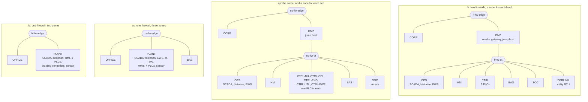
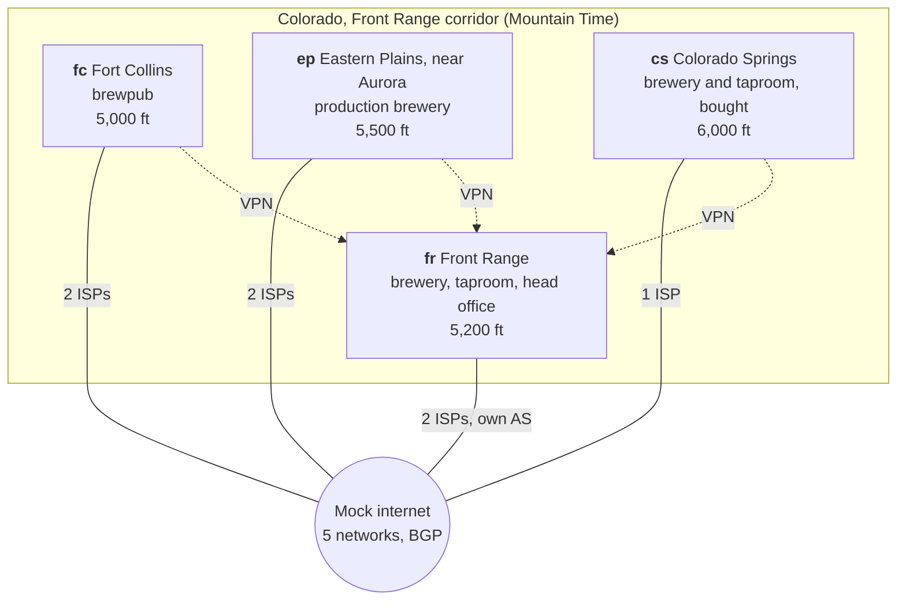
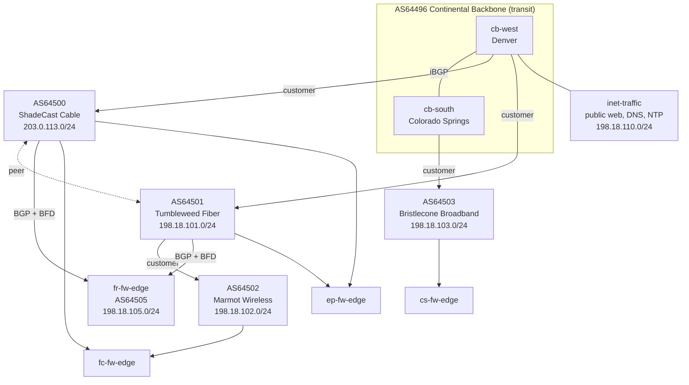
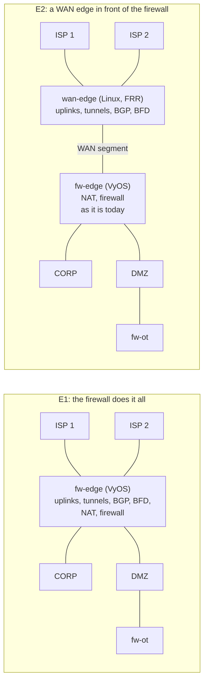
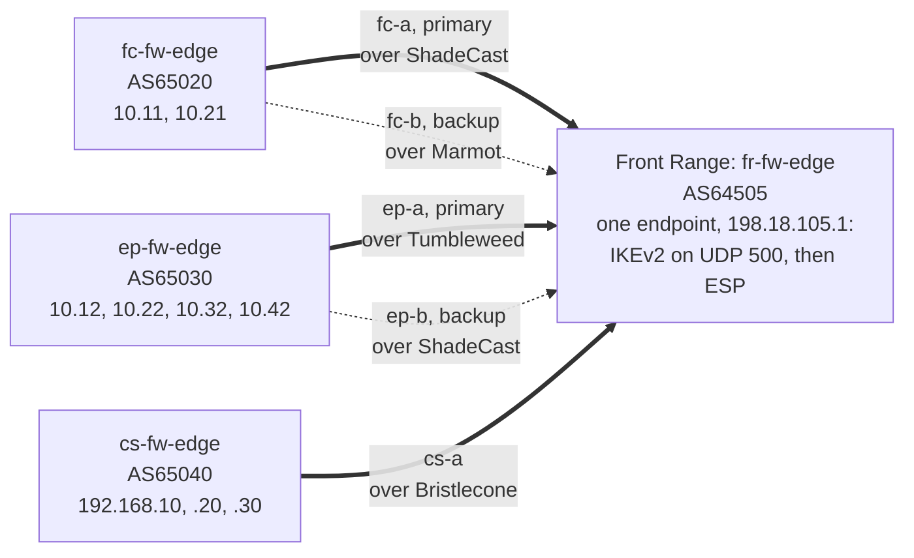
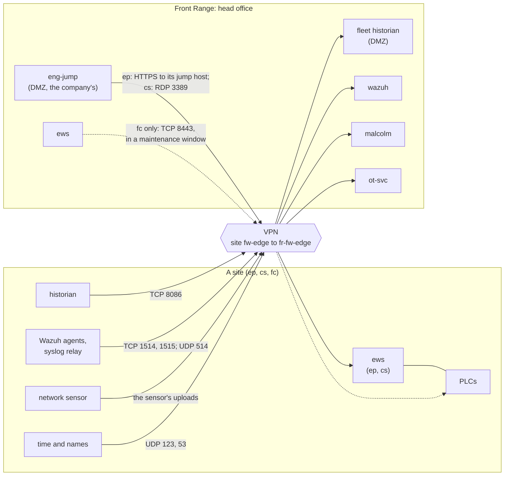
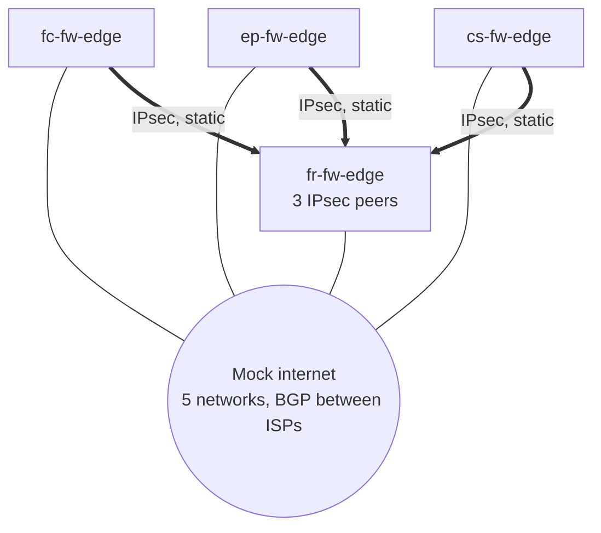
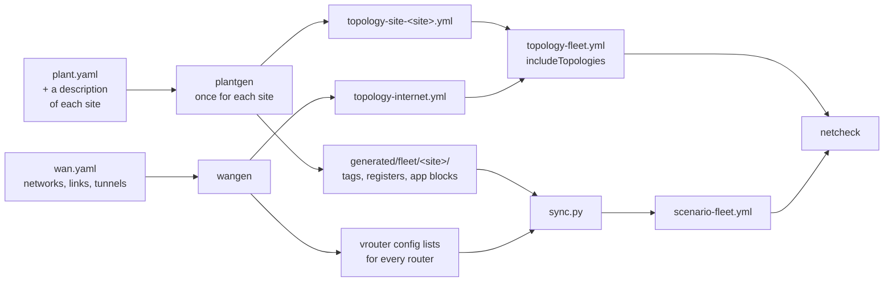
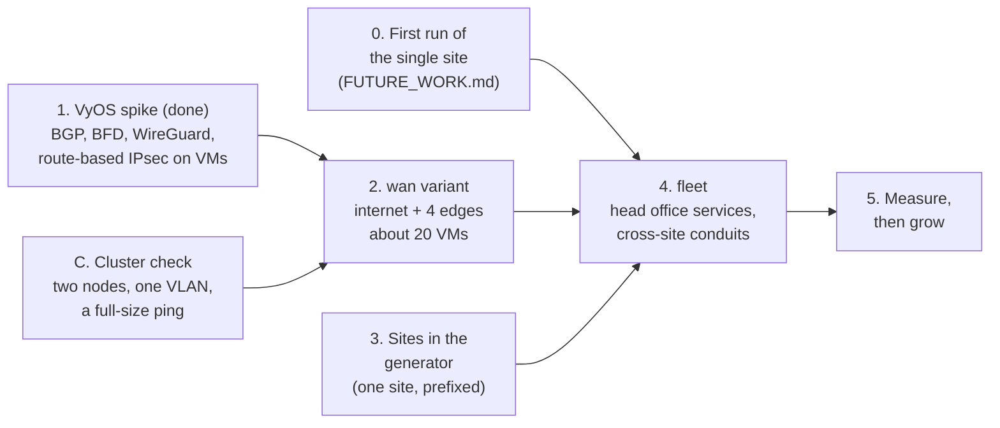

# CherryMountain Brewing: four breweries and a head office

> Status: this document gives options.
> [Section 9](#9-decisions-needed) marks the decisions of 2026-11-22 and
> 2026-11-23. Nobody built any part of this plan.
> [DESIGN.md](../DESIGN.md) stays the design of the single-site range.
>
> Three spikes ran in a container with no VM. A spike is a short test of one
> idea. A fourth spike ran the core of the WAN on four VyOS routers under
> phenix and minimega in CI. That spike used a patch for phenix that delivers
> the configuration of the routers. Section 7 says what each spike showed and
> what it did not show.
>
> Summary: a `fleet` variant can put four breweries in one phenix experiment.
> A site-to-site VPN joins them to a head office over a mock internet of five
> BGP networks. The four breweries are not copies. They are a flagship with
> the head office, a newer production brewery, a brewery that the company
> bought, and a brewpub. The sizes go from 39 VMs down to 18, and each site
> has the network that such a site has.
>
> Three plans follow. This document recommends Plan B. Plan B gives the head
> office its own AS on two ISPs. It gives each site one tunnel for each
> uplink, with BGP and BFD inside the tunnels.
>
> On VyOS routers, a site lost 2.2 to 3.0 seconds when an uplink went silent,
> with WireGuard and with route-based IPsec. Three times with IPsec, the site
> lost 5.0 to 5.4 seconds. In the lab, one site had a path that crossed the
> failed ISP inside the internet. That site lost nine seconds.
>
> The whole range is 136 VMs. The cluster has three nodes, each with 48 cores
> and 512 GB. On the cluster, no node carries more than 0.88 vCPUs for each
> thread. [REGIONS.md](REGIONS.md) gives the utilities, prices, and rules of
> the four places.

## Contents

1. [What was asked, and what is fixed](#1-what-was-asked-and-what-is-fixed)
2. [The company](#2-the-company)
3. [What every plan shares](#3-what-every-plan-shares)
4. [The choices](#4-the-choices)
5. [Three plans](#5-three-plans)
6. [What has to change in the repository](#6-what-has-to-change-in-the-repository)
7. [Spike results](#7-spike-results)
8. [Stages](#8-stages)
9. [Decisions needed](#9-decisions-needed)
10. [References](#10-references)

---

## 1. What was asked, and what is fixed

Asked for:

- A new variant of the brewery range. The variant has four breweries in
  different places, with a head office at one of them.
- A site-to-site VPN between the breweries, over a mock internet with BGP and
  more than one ISP.
- Sites that are not copies. The sites vary in size, and their networks differ
  a little, as the sites of a real business do. The user said this on
  2026-11-23, after the first version of these plans stamped one plant four
  times ([4.1](#41-what-each-site-is)).
- A host with 48 cores and 96 threads. Later notes widened the request. The
  range runs on a cluster of three minimega nodes, each with 48 cores and
  512 GB. The head node runs VMs, and the cluster bridges VLANs between its
  nodes itself. The MTU of its network is probably 1500
  ([4.8](#48-where-the-vms-run)).

Assumed, because the request did not say it: a node has two threads for each
core, like the first host.

The constraints in this table come from phenix, minimega, and the range as it
is. Each row comes from a reading of the source or from a spike.

| # | Constraint | What it forces | Where it comes from |
|---|---|---|---|
| C1 | Two experiments cannot share a VLAN ID, and phenix has no supported link between experiments | The four sites and the internet are one experiment | minimega refuses a VLAN ID that another alias holds. A workflow creates one experiment (`api/workflow/spec.go`) |
| C2 | `includeTopologies` appends nodes and fails on a duplicate hostname. It cannot include one file four times with a prefix | One topology file for each site, which a generator writes | `src/go/types/topology.go` lines 42 to 99 |
| C3 | SoH keeps one host for each IP address | A site must not reuse the addresses of another site, even behind NAT | `api/soh/app.go` (`addrHosts[ip]=host`) |
| C4 | A VLAN alias is one L2 segment for the whole experiment | Every site has its own VLAN aliases and IDs, and `vlanRange` must grow past 100 to 199 | The four sites have 53 aliases, and the single-site range has 18 ([7.5](#75-site-profiles-four-sites-that-are-not-copies)) |
| C5 | phenix's `vrouter` app cannot render BGP, a tunnel interface, WireGuard, or BFD for VyOS. Its template has an empty `bgp` block with a TODO mark for Vyatta, and it has nothing for VyOS | The routers get that configuration another way ([4.3](#43-who-runs-bgp-and-how-the-routers-get-their-configuration)) | `src/go/tmpl/templates/vyatta.tmpl` line 531 |
| C6 | phenix renders IPsec for VyOS as policy-based tunnels with a pre-shared key, one fixed proposal, and any number of peers | A static hub-and-spoke VPN works with phenix as it is. In hub and spoke, each site has one tunnel to a central site | `src/go/app/vrouter.go` (`processIPSec`), and the `vyos-ipsec` spike |
| C7 | The `helics` app starts one root broker for an experiment | Four separate plant simulations need another way to start their brokers ([4.7](#47-simulation)) | sceptre-phenix-apps `helics/app.py` lines 18 to 37 |
| C8 | No part of the range ran on a phenix host | A fleet multiplies the parts that nobody tested. The stages in [section 8](#8-stages) boot the WAN and one site before they boot four | [DESIGN.md, Status](../DESIGN.md#status) |
| C9 | On one node, the whole range, with the SOC and three sensors, is 195 vCPUs. That is 2.03 for each thread. The single-site design assumes about 1.1. On the three-node cluster, no node is above 0.88 | On one node, the range must shrink. On the cluster, the placement is the choice ([4.8](#48-where-the-vms-run)). In both cases, someone must measure the load of one site first | The site-profiles spike |
| C10 | A VLAN with VMs on two nodes needs a path between the bridges of the nodes. The path is a trunk on the cluster's switch or phenix's GRE mesh. The GRE mesh needs room in the MTU of the nodes' network. Each experiment bridge needs its own trunk port or tunnel | A full-size frame must cross between nodes, on the fleet's own bridge. This cluster probably bridges VLANs between its nodes itself, so the range uses no mesh. Nobody knows whether that covers a new bridge (`cherrymtn-fleet`). Stage C in [4.8](#48-where-the-vms-run) tests it, and that stage did not run | phenix `docs/content/gre-mesh.md` and `troubleshooting.md`, and minimega `doc/content/articles/cluster.md` |
| C11 | The program of a PLC covers its whole process area, and plantgen writes the addresses around the program | A site can leave out a whole area at no cost. An area with one unit less needs a program for that unit list ([4.1](#41-what-each-site-is)) | `plc/`, and the site-profiles spike |

## 2. The company

CherryMountain Brewery grew into CherryMountain Brewing Company. A company
with four breweries did not build the same brewery four times. It built one
brewery and outgrew it. It built a bigger one with what it learned. It opened
a pub in a town that drinks beer, and it bought a competitor down the road.

The plant and the network of each site date from how the site joined, and the
differences come from there. The Front Range brewery of
[DESIGN.md](../DESIGN.md) is the flagship and holds the head office.

| Code | Site | What it is | How it joined the company | Elevation | Water boils at | Time zone |
|---|---|---|---|---:|---:|---|
| `fr` | Front Range | Flagship brewery and taproom (the existing plant), and the head office. Denver stands for its jurisdiction, as in DESIGN.md | The first brewery. After the brewery grew, the company rebuilt its network to a standard. That standard is the design of DESIGN.md | 5,200 ft | 202 °F | Mountain |
| `ep` | Eastern Plains | Production brewery, on the plains near Aurora. It makes the beer that goes to distributors | The company and its integrator built it new, to the standard and one step past it | about 5,500 ft | about 202 °F | Mountain |
| `cs` | Colorado Springs | Brewery and taproom | The company bought it from another company, with the network that the integrator of that company built. The company now brings it into the fleet | about 6,000 ft | about 201 °F | Mountain |
| `fc` | Fort Collins | Brewpub in the old town | The company opened it as a pub. Nobody on site looks after its network | about 5,000 ft | about 203 °F | Mountain |

All four sites are on Colorado's Front Range urban corridor, within about 130
miles of each other. The elevations are the cities' round figures.
[REGIONS.md](REGIONS.md) gives the utilities, prices, and local rules of each
place.

Three of the differences reach the control logic of the plant. They are the
bulk CO₂ shutoff point, what each electric bill rewards, and what a water
shortage can order. One difference reaches the company. Colorado does not let
the same owners hold a brewery license and a brew pub license
([REGIONS.md §7, §8](REGIONS.md#8-what-the-places-change-in-the-design)).

The places differ in what the plant model can show. Elevation changes the
boil a little, and each city has its own utilities, prices, and rules. The
sites differ in what the range can show:

| | `fr` | `ep` | `cs` | `fc` |
|---|---|---|---|---|
| Process | Brewhouse, cellar, packaging, utilities, on-site power, and building | The same, with no taproom. The rooftop unit cools the office and a tasting room | No on-site power. It has no solar, battery, generator, or utility link | No packaging line and no on-site power |
| PLCs | 5 | 5 | 4 | 3 |
| Firewalls | Two, with a DMZ between them | Two, with a DMZ that has its own jump host (a host that relays logins into a zone) | One | One |
| Zones behind them | Office, operations, HMI, control, security, utility link, and building | The same, with a control zone for each process cell | Office, plant, and building | Office and plant |
| What shares a network with a PLC | The other PLCs | Only its own cell | The other PLCs, the HMIs, the SCADA, the historian, and the engineering workstation | The other PLCs, the HMI, the SCADA, the historian, and the building's controllers |
| Addresses | The company's plan | The company's plan | The plan that it had when the company bought it, in `192.168.0.0/16` | The company's plan |
| On site | A historian, an engineering workstation, the SOC, the vendor gateway, the fleet services, and the company's engineering jump host | A historian, an engineering workstation, and a jump host | A historian and an engineering workstation | A small historian, and no engineering workstation (D18) |
| Uplinks | ShadeCast Cable and Tumbleweed Fiber, with the company's own AS | Tumbleweed Fiber and ShadeCast Cable | Bristlecone Broadband only | ShadeCast Cable, and Marmot Wireless as the backup |
| VMs | 39, and 4 for the head office | 34 | 25 | 18 |

[4.1](#41-what-each-site-is) gives the reasons, the sizes, and the items that
the plan leaves for later. All of it is notional. The ISP names other than
ShadeCast Cable are placeholders. Nobody compared them with the names of real
companies.



Text alternative to the diagram: the diagram shows four site networks.

At `fr`, the edge firewall `fr-fw-edge` has the office network (CORP) and a
DMZ with the vendor gateway and a jump host. Behind the DMZ, a second
firewall, `fr-fw-ot`, has six zones. The zones are OPS, HMI, CTRL, BAS, SOC,
and DERLINK. OPS holds the SCADA, the historian, and the engineering
workstation. CTRL holds the five PLCs, and DERLINK holds the utility's RTU.

`ep` has the same two firewalls and a DMZ with its own jump host. It has the
same zones, except that control is five VLANs, one for each PLC, and its SOC
zone holds a sensor.

`cs` has one firewall, `cs-fw-edge`, with three zones: OFFICE, PLANT, and
BAS. PLANT holds the SCADA, the historian, the engineering workstation, the
server for time and names, HMIs, four PLCs, and the sensor in one VLAN.

`fc` has one firewall, `fc-fw-edge`, with two zones: OFFICE and PLANT. PLANT
holds the SCADA, a small historian, the HMI, three PLCs, the building's
controllers, and the sensor. The diagram does not show the field networks
behind each PLC or the simulation's own network.



Text alternative to the diagram: all four sites are in Colorado, on Mountain
Time, along the Front Range corridor. Fort Collins (a brewpub) is in the
north. Then come Front Range (the existing brewery, with the head office) and
Eastern Plains near Aurora (the production brewery). Colorado Springs (the
brewery that the company bought) is in the south.

Each site connects to the mock internet. Front Range connects through two
ISPs with its own AS. Fort Collins and Eastern Plains each connect through two
ISPs, and Colorado Springs connects through one. A VPN runs from each of the
three other sites to Front Range.

## 3. What every plan shares

These items follow from the constraints, so they do not change between plans.

One experiment, one file for each site: the variant is `fleet`. Its workflow
is `phenix-fleet.yml`, its experiment is `cherrymountain-fleet`, and its
bridge is `cherrymtn-fleet`. `topology-fleet.yml` includes
`topology-site-fr.yml`, `-fc.yml`, `-ep.yml`, `-cs.yml`, and
`topology-internet.yml`. A generator writes the site files, and the team
commits them, like plantgen's output today. The generator writes each file
from the one plant and a short description of the site. The description says
what the site leaves out and how its network is cut
([4.1](#41-what-each-site-is)).

Names and addresses: the site-profiles spike generated the names and
addresses of the four sites without a clash
([7.5](#75-site-profiles-four-sites-that-are-not-copies)). These are the
hostnames, the VLAN aliases and IDs, the subnets, and the MGMT networks. The
route blocks ran in the lab
([7.1](#71-wan-bgp-a-mock-internet-and-a-vpn-over-it)).

| Item | Rule | Example |
|---|---|---|
| Hostname | Site code, then today's name | `fc-plc-cellar`, `fr-fw-edge` |
| VLAN alias | Site code in capitals, then the zone | `FR-CTRL`, `EP-CTRL-CEL`, `FC-PLANT` |
| VLAN ID | A hundred for each site. A zone that `fr` has keeps `fr`'s last two digits. A zone that it does not have takes 20 and up. The access links to the ISPs take 500 to 506, and `vlanRange` is 100 to 599 | CTRL is 108 at `fr`. `EP-OPS` is 306, `EP-CTRL-BH` is 320, `FC-PLANT` is 221, and `CS-PLANT` is 421 |
| Private subnets of `fr`, `fc`, and `ep` | The company's plan. It is today's plan, with the site's number added to the second octet | OPS is `10.20.30.0/24` at `fr` and `10.22.30.0/24` at `ep`. The brewpub's plant network is `10.21.10.0/24` |
| Private subnets of `cs` | The plan that it had when the company bought it | Office `192.168.10.0/24`, plant `192.168.20.0/24`, and building `192.168.30.0/24`. Field networks `192.168.21.0/24` to `192.168.24.0/24` |
| MGMT | Its own VLAN and /16 at each site. It is the simulation's network, not the company's | `172.16.0.0/16` at `fr`, `172.19.0.0/16` at `cs` |

| Site | Number | VLAN IDs | AS inside the VPN | What it announces into the VPN |
|---|---:|---|---:|---|
| `fr` | 0 | 104 to 117 | 64505 | `10.10.0.0/16`, `10.20.0.0/16`, `10.30.0.0/16`, `10.40.0.0/16` |
| `fc` | 1 | 209 to 221 | 65020 | `10.11.0.0/16`, `10.21.0.0/16` |
| `ep` | 2 | 304 to 324 | 65030 | `10.12.0.0/16`, `10.22.0.0/16`, `10.32.0.0/16`, `10.42.0.0/16` |
| `cs` | 3 | 409 to 421 | 65040 | `192.168.10.0/24`, `192.168.20.0/24`, `192.168.30.0/24` |

The site numbers count from 0 so that `fr` keeps today's addresses. The VLAN
hundreds and the AS numbers count from 1. The blocks of a site are the
prefixes that the head office lets the site announce ([4.5](#45-the-vpn)).

The Front Range site keeps every private address of
[DESIGN.md §10.2](../DESIGN.md#102-vlan-and-ip-plan), and `fr-fw-edge` keeps
`203.0.113.2`. Its detection content (the addresses in its Suricata rules and
its Zeek script) stays valid.

Two things on its public side move. First, the INET segment shrinks from a
/24 to a /29. The smaller segment still holds `isp-rtr` (.1), `fw-edge` (.2),
and `util-rtr` (.3). It leaves the rest of `203.0.113.0/24` for ShadeCast's
other customers. Second, `inet-traffic` moves from `203.0.113.10` to the
transit carrier's hosted network.

`203.0.113.10` then becomes the uplink address of `fc`, so the generator must
move every reference to it. The references are in the scenario, `netcheck`,
`plant.hosts`, the DNS records, and the topology. A reference that the
generator misses sends traffic meant for `inet-traffic` to the brewpub's
edge. `netcheck` must fail on any reference that is left.

At `fr`, the fleet removes the static default route that `fw-edge` has in
`topology-core.yml`. If the route stays, phenix installs it at
distance 1, ahead of the two BGP defaults. The site then loses the multipath,
the failover, and the endpoint source address. SoH makes sure that the
default route of the head office is from BGP, with two next hops. The
single-site variants `full`, `lite`, and `ci` do not change.

Internet numbering: every public address and AS number comes from a range
that an RFC reserves for documentation or testing. The addresses and numbers of
the single-site plan come from such ranges too.

| Network | AS | Role | Prefix | Router |
|---|---:|---|---|---|
| Continental Backbone | 64496 | Transit carrier | `198.18.0.0/24` (links), `198.18.110.0/24` (hosted services: `inet-traffic`) | `cb-west` (Denver), `cb-south` (Colorado Springs) |
| ShadeCast Cable | 64500 | Cable ISP along the Front Range (today's `isp-rtr`) | `203.0.113.0/24` | `shadecast` |
| Tumbleweed Fiber | 64501 | Fiber ISP, Denver area and the eastern plains | `198.18.101.0/24` | `tumbleweed` |
| Marmot Wireless | 64502 | Fixed-wireless ISP in northern Colorado, a customer of Tumbleweed | `198.18.102.0/24` | `marmot` |
| Bristlecone Broadband | 64503 | Access ISP, Colorado Springs | `198.18.103.0/24` | `bristlecone` |
| CherryMountain Brewing | 64505 | The head office's own AS, in Plan B and Plan C | `198.18.105.0/24` | `fr-fw-edge` |

RFC 5398 reserves AS 64496 to 64511 for documentation. `203.0.113.0/24`,
`198.51.100.0/24`, and `192.0.2.0/24` are the documentation prefixes that the
range already uses (RFC 5737). RFC 2544 reserves `198.18.0.0/15` for
benchmarking. The vendor (`198.51.100.0/24`) and the utility (`192.0.2.0/24`)
keep their prefixes and become customers of an ISP.

The ISPs follow the rules that real ISPs follow. An ISP prefers a route from
a customer to a route from a peer. It prefers a route from a peer to a route
from a provider. A network tells its peers and providers only its own
prefixes and the prefixes of its customers. The head office is a customer
with one prefix, and an ISP accepts only that prefix from it.

From another network, an ISP accepts any public prefix up to a /24, as much
of the real internet does. That rule lets the hijack in
[4.2](#42-the-mock-internet) work. In a hijack, a network announces a prefix
of another network.

An ISP accepts no private address space. The lab tests
the first two rules by local preference and by the neighbor that a route came
from. The lab also offers an ISP a private prefix and a /25, and the ISP
refuses them ([7.1](#71-wan-bgp-a-mock-internet-and-a-vpn-over-it)).

Build the WAN before the sites. A `wan` variant holds the internet, the four
site edges, and one small host at each site. That is about 20 VMs. The WAN is
the same whatever is behind an edge. It boots without a plant. Thus the team
can prove the WAN on VMs while the single-site range gets its own first run
([section 8](#8-stages)).

## 4. The choices

### 4.1 What each site is

Decided (D4, on 2026-11-23): the four sites are not copies. They vary in
size, and their networks differ a little, as the sites of a real business do.
The first version of these plans stamped the Front Range plant four times.
The [stamp spike](../../spikes/multisite-stamp/README.md) holds the mixes
that the first version compared (M1 to M5).

How different: there are three ways to make sites differ.

| Option | What differs | For | Against |
|---|---|---|---|
| S1: size only | Which process areas a site has. Every site keeps the two firewalls and the zones of DESIGN.md | The least work. A site is a list of areas | Every network is the same network. A company that grew does not look like that, and a defender learns one layout |
| S2: size, and how the network is cut (recommended, and the rest of this document assumes it) | The areas, the number of firewalls, the zones, the address plan, what is on site, and the uplinks. Every device is one that the range already has | Each difference has a reason in the company's history ([section 2](#2-the-company)). All of it is data to the generator. The site-profiles spike generated the four sites ([7.5](#75-site-profiles-four-sites-that-are-not-copies)) | Three kinds of firewall rule set to write and test, where S1 has one. The kinds are two firewalls, two firewalls with a VLAN for each cell, and one firewall |
| S3: S2, and other products | S2, and more differences at the site that the company bought. The differences are another firewall product, another PLC vendor and protocol, and addresses that overlap the head office's addresses behind NAT | The closest to a real acquisition | New images, new PLC programs, and a second firewall product to configure. Overlapping addresses break the health checks (C3) |

One rule keeps S2 cheap. A site differs by what it leaves out and by how its
network is cut, never by a new kind of device.

- A site leaves out whole process areas. A process area has one PLC and one
  program, and each of the building's controllers is a device of its own.
  When a site drops an area, it drops the PLC, its I/O, and its part of the
  simulation. Then plantgen leaves out everything that named them. An area
  with one unit less needs a PLC program for that unit list (C11). An example
  is two fermenters where the plant has four. Thus no site does that in the
  first build.
- The network is data. With no change to its code, plantgen took one
  firewall, a merged VLAN, a VLAN for each cell, and another address plan.

The four sites: the sizes are from the site-profiles spike.

| | `fr` | `ep` | `cs` | `fc` |
|---|---|---|---|---|
| Process areas | Brewhouse, cellar, packaging, utilities, power, and building | The same. The taproom's rooftop unit cools the office and a tasting room | Brewhouse, cellar, packaging, utilities, and building | Brewhouse, cellar, utilities, and building |
| PLCs, tags | 5, 516 | 5, 516 | 4, 458 | 3, 365 |
| Network | 2 firewalls, 8 routed zones | 2 firewalls, 12 routed zones | 1 firewall, 3 routed zones | 1 firewall, 2 routed zones |
| VMs | 39 | 34 | 25 | 18 |
| vCPUs | 62 | 43 | 33 | 23 |
| Memory (GB) | 151 | 66 | 53 | 39 |
| With its sensor | The SOC is here | 35 VMs, 47 vCPUs, 82 GB | 26 VMs, 37 vCPUs, 69 GB | 19 VMs, 27 vCPUs, 55 GB |

The 39 VMs of `fr` are the plant's 33, the SOC's 4 (18 vCPUs and 84 GB), and
the vendor's gateway and jump host.

- `fr`, the standard: it has the plant and the network of DESIGN.md,
  unchanged. It also has the SOC, the vendor's gateway, and the head office's
  additions ([4.6](#46-what-the-head-office-does)).
- `ep`, the standard and one step past it: it has the same plant without a
  taproom. Its integrator gave each process cell its own control VLAN, so a
  PLC shares a network only with its own cell. A PLC that reads another PLC
  does it through `ep-fw-ot`. For example, the utilities PLC reads the
  cellar's interlocks. Its DMZ has its own jump host, so that its engineers
  do not depend on the head office. The jump host holds the company's
  accounts, not the vendor's, and the company's engineers reach it over HTTPS
  ([4.6](#46-what-the-head-office-does)).

  The site has the solar, the battery, and the generator that `fr` has, and
  its own link to the utility. It has no taproom, but it keeps the rooftop
  unit, which cools its office and a tasting room. The building federate, the
  power PLC's load shedding, and the building SCADA's screen all assume that
  unit (C11).
- `cs`, bought: it has one firewall and three zones, which are office, plant,
  and building. Everything that runs the plant is in one VLAN. That means the
  PLCs, the HMIs, the SCADA, the historian, and the engineering workstation.
  It keeps the address plan that it came with, because the last thing that an
  integration does is to renumber a running plant. So far, the company added
  its own firewall at the edge, the VPN, a sensor, and a small server for
  time, names, and logs. It has no on-site power in the first build.
- `fc`, the brewpub: it has one firewall and two zones. The plant VLAN holds
  the three PLCs, the HMI, the SCADA, a small historian, and the building's
  controllers. The historian is there because a brewpub is a brewery to TTB
  and the state. A brewery keeps its records at the brewery
  ([REGIONS.md §7](REGIONS.md#7-breweries-and-a-pub-licences-and-records)).
  The SCADA writes to the historian, and the historian forwards a copy to the
  fleet historian.

  The pub has no engineering workstation. Engineers program its PLCs from the
  head office, and the site keeps a copy of each program
  ([4.6](#46-what-the-head-office-does)). It is the site that depends on the
  VPN most, and it has the least between its office and its PLCs.

What the differences give an exercise:

| Contrast | Where |
|---|---|
| The same foothold reaches different things | An office PC at `fc` is one firewall away from the PLCs. At `cs`, the engineering workstation and the PLCs share a VLAN. At `fr` and `ep`, two firewalls and a DMZ are in between. At `ep`, one PLC cannot reach another without the firewall |
| A WAN failure means different things | `fc` keeps brewing and keeps its records. It loses its engineering access and the head office's view of it. `ep` keeps both on site. `cs` has one uplink and nothing to fail over to |
| A site in the wrong hands | The brewpub's edge is the least defended router that speaks BGP inside the VPN. The head office takes only the pub's own prefixes from it ([4.5](#45-the-vpn)) |
| An integration half done | `cs` has the company's VPN and sensor on a network that the company did not design, with addresses that no other site uses |

The size of the range:

| Part | VMs | vCPUs | Memory (GB) |
|---|---:|---:|---:|
| Mock internet: 6 VyOS routers (I2 in [4.2](#42-the-mock-internet)) and 6 small hosts | 12 | 12 | 18 |
| The vendor's workstation, on the internet | 1 | 2 | 3 |
| Head-office additions: fleet historian, corporate server, a second office desktop, and the company's engineering jump host | 4 | 8 | 16 |
| `fr` | 39 | 62 | 151 |
| `ep` and its sensor | 35 | 47 | 82 |
| `cs` and its sensor | 26 | 37 | 69 |
| `fc` and its sensor | 19 | 27 | 55 |
| All of it | 136 | 195 | 394 |

- On the cluster, no node carries more than 0.88 vCPUs for each thread
  ([4.8](#48-where-the-vms-run)). On one node, the figure is 2.03, against
  the 1.1 that the single-site design assumes. On one node, the range also
  uses 77% of the memory.
- Two services outgrow their single-site size. The size of Wazuh is the
  vendor's all-in-one figure for up to 25 agents, and the fleet has about 30
  to 34. The design sized Malcolm's 24 GB of indexes for the mirror of one
  site. These figures include neither growth.
- Four copies were larger. They were 157 VMs, 217 vCPUs, and 421 GB with a
  sensor at three of them.
- These are counts, not load. Most VMs idle, but the PLCs scan every 100 ms
  and the kiosks render in software. Every PLC also compiles its program on
  first boot. Nobody measured a site.
- The brewpub is the cheapest thing to boot first. It is 18 VMs with a whole
  plant behind them. No part of the range ran (C8).
- BFD makes overcommit visible. Overcommit means more vCPUs than the host has
  threads. A router VM that waits 900 ms for a CPU drops its BFD sessions and
  moves traffic for no reason. The range must use 1 s intervals (3 s to
  detect) until someone measures a node. The lab used 300 ms. The VyOS runs
  used 1 s on a runner with 10 vCPUs of guests on 4 threads. No check saw a
  session drop without a fault ([7.4](#74-wan-bgp-on-vyos-routers)).

Left for later: each addition fits the company's story, and none is in the
first build.

| Addition | What it needs |
|---|---|
| A standby generator at `cs`, with no solar and no battery | A `plc-power` program for that unit list |
| Fewer fermenters at `fc`, or one PLC for the whole pub | PLC programs for those unit lists |
| Bigger vessels at `ep` | The simulation holds the vessel sizes as constants |
| The old integrator's remote-access box at `cs`. It is a second way in that the head office does not control | A small VM at the site and a host on the internet |
| Marmot Wireless behind carrier NAT, so that the backup tunnel of `fc` starts from an address that the head office cannot name | NAT traversal for the IPsec tunnel, which nobody tested. The head office already only answers |
| A point of sale and a guest network at the taprooms | Hosts and a VLAN, and nothing in the plant |

Four choices inside S2 went to the user. The user decided D16, D17, and D19
on 2026-11-23 as recommended. For D18, the user answered with what a company
does when the law regulates it as breweries and as a pub
([section 9](#9-decisions-needed)).

### 4.2 The mock internet



Text alternative to the diagram: the transit carrier, Continental Backbone
(AS 64496), has two routers with iBGP between them. They are `cb-west` in
Denver and `cb-south` in Colorado Springs. ShadeCast Cable (AS 64500) and
Tumbleweed Fiber (AS 64501) are customers of `cb-west` and also peer with
each other directly. Marmot Wireless (AS 64502) is a customer of Tumbleweed.
Bristlecone Broadband (AS 64503) is a customer of `cb-south`. `inet-traffic`
connects to `cb-west`.

The head office's edge, `fr-fw-edge` (AS 64505), speaks BGP with BFD to
ShadeCast and to Tumbleweed. `fc-fw-edge` connects to ShadeCast and Marmot,
`ep-fw-edge` connects to Tumbleweed and ShadeCast, and `cs-fw-edge` connects
to Bristlecone. These three edges take ISP-assigned addresses and speak no
BGP with their ISPs.

This is the internet that the lab ran. It is the smallest internet that has
these four parts:

- A transit carrier.
- A peering link.
- A small ISP behind a bigger one.
- An ISP that reaches the others only through the carrier.

With these parts, an AS path can be two or three networks long, and a failure
has somewhere to reroute.

| Option | Routers | Cost | For | Against |
|---|---|---|---|---|
| I1: a VM for each router, FRR on Linux | 6 | 6 vCPUs, 3 GB | The configuration is a file (`frr.conf`), and the lab's files carry over. Each router shows in the phenix UI, and a fault is a phenix action (disconnect a NIC, stop a VM) | A new small image (`cm-frr`) and a second way to configure a router. Link delay and loss need a `tc` unit. The `vrouter` app's emulators do not apply |
| I2: a VM for each router, VyOS (decided, D6) | 6 | 6 vCPUs, 12 GB | The image exists, and `isp-rtr` is VyOS today. Two ISPs ran this way in CI. Their customer, peer, and provider rules are 65 commands in R1's `config` list ([7.4](#74-wan-bgp-on-vyos-routers)). Every router of the range then has one image and one way to get its configuration. Each router shows in the phenix UI, and the emulators work | 9 GB more than I1, which a node of 512 GB does not notice. Six more routers depend on R1 and on the VyOS rolling build |
| I3: the whole internet in one VM | 1 | 2 vCPUs, 2 GB | Ten FRR routers took 0.5 GB in the lab. Thus 20 or 30 networks, an exchange with a route server, and an RPKI validator can fit | One box in the UI. Faults are scripts inside it. The lab script becomes a product |

The router image of minimega (minirouter, which runs BIRD) is not an option.
Although minimega can configure BGP on it, phenix does not pass BGP to it.

I1 was the recommendation at first. At that time, no VyOS router took BGP
from phenix, and the plan counted memory on one host. Both reasons are gone.
If the project does not use R1, I1 stays the choice
([4.3](#43-who-runs-bgp-and-how-the-routers-get-their-configuration)).

The ISPs' timers are part of the design. A site that is not next to a failure
waits for a BGP hold timer inside the internet
([7.1](#71-wan-bgp-a-mock-internet-and-a-vpn-over-it)). The lab's ISPs use 3 s
keepalives and a 9 s hold time, and the Colorado Springs site lost 9 s. With
the 60 s and 180 s that routers ship with, the site loses three minutes. The
ISP routers of the range must keep the short timers or run BFD between
themselves. An exercise can lengthen the timers on purpose.

What BGP adds to an exercise: in the lab, Bristlecone announced the head
office's prefix. The transit carrier believed the shorter path, and the
Colorado Springs site lost the head office. ShadeCast and Tumbleweed kept
their customer route, so the other two sites did not notice. A blue team sees
the same thing that a real one sees. The tunnel of one site is down, and
nothing is wrong at either end.

### 4.3 Who runs BGP, and how the routers get their configuration

The ISP routers must speak BGP. Whether a brewery router speaks BGP depends
on the plan. In Plan A, none does. In Plan B and Plan C, every site edge runs
BGP inside its tunnels, and the head office's edge also runs it with two
ISPs.

phenix cannot render that for VyOS (C5). There are four ways to deliver it.

| Option | What it is | For | Against |
|---|---|---|---|
| R1: a `config` list in the `vrouter` app (recommended, needs a phenix change) | The metadata of each router lists VyOS `set` and `delete` commands. Then phenix writes them after its own commands, before the commit | One commit at first boot, with the rest of the configuration. It also carries what `cm-vyos-config.sh` does after boot today (logging, syslog, IKEv2, the NTP source), so the project can remove that script. The change is small, its tests pass, and it is a draft pull request ([7.3](#73-a-config-list-for-the-vrouter-app)). In CI, 72 boots of VyOS routers committed their lists at first boot, with 59 to 201 commands each ([7.4](#74-wan-bgp-on-vyos-routers)) | A change to phenix, on a fork branch until upstream takes it |
| R2: the post-boot script | `cm-vyos-config.sh` grows a BGP and tunnel section | No phenix change. The mechanism is in the range | A second commit after boot, which a `cc exec` starts. The script did not run on a VyOS VM. Its first form changed nothing and reported success ([DESIGN.md §10.3](../DESIGN.md#103-conduit-matrix-default-deny-stateful-logged)) |
| R3: BGP as a schema feature of phenix | `network.bgp` in the topology, as `network.ospf` is | The right upstream answer to the TODO | A large change (schema, types, template, Builder checks). It still does not cover tunnels or BFD |
| R4: keep BGP off VyOS | A Linux router with FRR does the WAN work at each site ([4.4](#44-where-the-tunnels-end), E2) | No phenix change and no VyOS syntax to test. It is what the lab ran | One more VM at each site |

### 4.4 Where the tunnels end



Text alternative to the diagram: in E1, both ISPs connect to `fw-edge`. It is
a VyOS firewall that holds the uplinks, the tunnels, BGP, BFD, NAT, and the
firewall rules. CORP and the DMZ connect to it, and `fw-ot` is behind the
DMZ.

In E2, both ISPs connect to a new node, `wan-edge`. It is a Linux router with
FRR that holds the uplinks, the tunnels, BGP, and BFD. `wan-edge` connects
over one WAN segment to `fw-edge`. That firewall keeps NAT and the firewall
rules as it has them today, with CORP, the DMZ, and `fw-ot` behind it.

| | E1: on `fw-edge` | E2: on a `wan-edge` |
|---|---|---|
| Like | A small company's firewall that is also its VPN endpoint | A dual-WAN router or SD-WAN box in front of the firewall |
| New VMs | None | 4 (1 vCPU and 512 MB each) |
| Needs | R1, which ran on VyOS VMs, or R2 | A `cm-frr` image and generated files |
| Firewall rules for VPN traffic | On tunnel interfaces, which phenix's ACLs cannot name. R1 or R2 delivers the rules | On the WAN interface of `fw-edge`, by source and destination, with phenix's ACLs as they are |
| Monitoring | VyOS logs to Wazuh, as the firewalls do today | The box can run a Wazuh agent |
| Evidence | The head office's edge and one site's edge ran on VyOS in CI, with WireGuard and with route-based IPsec ([7.4](#74-wan-bgp-on-vyos-routers)). Those routers had no firewall rules and no NAT | The lab is this, in namespaces |

Recommendation: E1 with R1, because it adds no VMs and puts the VPN where a
company of this size has it. The spike that it depended on passed. The spike
did not show the WAN configuration next to a site's rulesets and NAT on the
same router. That is the work of stage 2 ([section 8](#8-stages)). E2 stays
the fallback.

### 4.5 The VPN



Text alternative to the diagram: the head office's edge, `fr-fw-edge`
(AS 64505), has one tunnel endpoint in its own prefix, `198.18.105.1`. Each
tunnel is route-based IPsec (D3). It uses IKEv2 on UDP 500, then ESP, between
the address of a site uplink and that endpoint. `fc-fw-edge` (AS 65020) has a
primary tunnel `fc-a` over ShadeCast and a backup tunnel `fc-b` over Marmot.
`ep-fw-edge` (AS 65030) has a primary tunnel `ep-a` over Tumbleweed and a
backup `ep-b` over ShadeCast. `cs-fw-edge` (AS 65040) has one tunnel, `cs-a`,
over Bristlecone.

Each site announces its own address blocks. `fc` announces two /16 blocks,
`ep` announces four, and `cs` announces three /24 networks of
`192.168.0.0/16`. The WireGuard form of the same design, which the lab ran,
gives each tunnel a UDP port of its own, 51821 to 51825.

| Option | Tunnels | Routing | Failover | Needs |
|---|---|---|---|---|
| V1: static hub and spoke | One policy-based IPsec tunnel from each site to the head office | None. The tunnel's selectors are the routes | None. A dead ISP cuts off its site | Nothing new, because phenix renders it (C6) |
| V2: a tunnel for each uplink, BGP inside (recommended) | One route-based tunnel for each uplink of each site, to the head office. That is five in all | eBGP in every tunnel, and each site has its own private AS. The primary tunnel wins by local preference at both ends. BFD finds a dead tunnel | About 1 s in the lab for a site next to the fault. On VyOS, 2.2 to 3.0 s with the 1 s BFD interval that a VM must use. Three times on VyOS, 5.0 to 5.4 s (IPsec, the head office's uplink). A site with one uplink waits for the ISPs, which took 9 s in the lab | R1, R2, or E2 |
| V3: V2 with a second hub | V2, and a tunnel for each uplink of `fc` and `cs` to a second hub at `ep`. That is eight in all. `ep` then needs its own prefix, or an endpoint on each uplink | The same, with a preference between hubs | It survives the loss of the head office's whole site | The same, and more policy to get wrong |
| V4: full mesh | A tunnel between every two sites, for each uplink pair | The same | Sites reach each other directly | The most tunnels and the least reason. Brewery sites talk to the head office, not to each other |

How V2 behaves: each item says which test showed it.

- The head office's endpoint is in its own prefix, which both of its ISPs
  announce. When the head office loses an ISP, the internet reroutes under
  the tunnels, and no tunnel has to move.
- A site pins each tunnel to one uplink. With IPsec, the tunnel's packets
  leave from that uplink's address, and a rule sends that source address to
  the uplink's own routing table. With WireGuard, a firewall mark does the
  same. The table holds the uplink and, behind it, a blackhole (a route that
  drops packets). The two tunnels of a site never share an uplink, whatever
  address the endpoint has and whether the uplink's link is up or down.

  The first design pinned by the endpoint's address, and it did not hold
  (finding 2 of [7.1](#71-wan-bgp-a-mock-internet-and-a-vpn-over-it)). The
  lab and VyOS showed this.
- The head office sends from its endpoint address. Its default routes carry
  the endpoint as the preferred source, so a reply never leaves with the
  address of an uplink. The lab and VyOS showed this.
- An edge sends its own traffic into a tunnel from its LAN address. If it
  does not, its syslog, NTP, and DNS leave from the tunnel's /31. That
  address is in no site's blocks, and the rules of the far side must then
  admit it. A route map on the routes that BGP installs sets the source, as
  the head office's route map does for its defaults. The VyOS runs showed this
  from run 33 on.
- The edge drops a packet for a private address that has no tunnel route.
  Each edge has a blackhole for each of its own blocks (distance 250). It
  also has a blackhole for all of `10.0.0.0/8`, `172.16.0.0/12`, and
  `192.168.0.0/16` (distance 254). While a tunnel is down, or for an address
  that nobody uses, the edge drops a packet. The packet does not follow the
  default route out of an uplink unencrypted.

  VyOS announces a `network` whether or not a route stands behind it, so
  nothing else stopped such a packet. Without the blackholes, the Bristlecone hijack
  sends the traffic of `cs` for the head office to Bristlecone, the hijacker,
  in clear. The lab showed this, and the VyOS runs showed it from run 33 on.
- A tunnel carries full-size packets. Each VTI has an MTU of 1,400 and clamps
  TCP's maximum segment size to it. Thus a segment fits in ESP inside a
  1,500-byte underlay, and it does not depend on path MTU discovery. In
  run 33, a 1,372-byte ping with fragmentation forbidden crossed each tunnel.
  The edge refused a ping of one byte more. With WireGuard, the figures are
  1,420 and 1,392.
- Only site prefixes cross a tunnel, and only a site's own. The head office
  takes from each site that site's blocks
  ([section 3](#3-what-every-plan-shares)) and nothing else. A site announces
  only its own blocks. No end takes a default route or a public prefix,
  because such a route sends the tunnel into itself.

  The first design let any prefix of `10.0.0.0/8` in from any site. With that
  design, a site's edge in the wrong hands can announce a /24 inside another
  site's /16 and draw that traffic to itself. In the lab, the brewpub's edge
  announced the Colorado Springs plant network. The head office kept its one
  route, through the Colorado Springs tunnel
  (finding 7 of [7.1](#71-wan-bgp-a-mock-internet-and-a-vpn-over-it)).
- Site-to-site traffic goes through the head office, where `fr-fw-edge`
  decides whether to permit it. In the lab, a packet from `fc` reached `cs`
  in four hops.
- The head office installs the default route of both ISPs, not only the best
  one, so that its traffic uses both. With wireguard-go and one default
  route, a tunnel that arrived through the other ISP also never came up
  (finding 1 of [7.1](#71-wan-bgp-a-mock-internet-and-a-vpn-over-it)). The
  kernel's WireGuard, which VyOS uses, did come up with one default route
  ([7.4](#74-wan-bgp-on-vyos-routers)).

  There is a limit. Each ISP sends its default route whatever it holds
  (`default-originate`). Thus an ISP that lost its transit still offers a
  default route. The flows that hash to that ISP reach only its peer and
  customers. Stage 2 does one of two things. In the first, the head office
  takes each ISP's routes as well as the default, with the endpoint as the
  source of all of them. In the second, the default becomes conditional on a
  transit prefix.
- The head office keeps the routes that its ISPs send
  (`soft-reconfiguration inbound`). Without this configuration, FRR took a
  default route away from the head office at first boot in three of four
  jobs. In one of those jobs, FRR took both
  ([7.4](#74-wan-bgp-on-vyos-routers)).

What V2 still needs, for stage 2:

- Each tunnel admits only its site's sources. A firewall rule on each VTI
  drops and logs a packet whose source is not in that site's blocks. Without
  the rule, a site's edge in the wrong hands can send one-way UDP (syslog,
  NTP, DNS). That UDP can carry the source of another site or of the head
  office. Spoofed TCP is blind, because replies go to the real owner.
- The head office's NAT covers both ISPs. Today, the configuration binds its
  masquerade and its DNAT to the ShadeCast interface. With a default route
  through each ISP, a CORP flow can leave through Tumbleweed un-NATed, and
  its reply dies at the transit carrier. The SNAT moves to an address of the
  head office's own prefix on both uplinks, `198.18.105.2`. That address is
  not the endpoint, so that it never takes UDP 500 or 4500. The DNAT on
  `203.0.113.2` stays, so the detection content holds, and its replies must
  leave through ShadeCast.
- A site's own internet access fails over too. A site's static default route
  through its first uplink stays installed while the link is up. Thus under a
  silent fault, its tunnel moves in three seconds, and the site loses its
  internet traffic for the whole fault. VyOS's `protocols failover route`
  with a health check pinned to the uplink can move the default route.
  Otherwise, the exercise says that internet access does not fail over.

IPsec or WireGuard: the routing does not care. Both give a routed
point-to-point interface.

| | Route-based IPsec (IKEv2, a VTI on VyOS) | WireGuard |
|---|---|---|
| In real breweries and their integrators | The usual site-to-site VPN | Growing, mostly for remote access |
| In the range today | The utility link (policy-based) | The vendor's path |
| What a defender sees | IKE and ESP. The defender sees the proposals, the SPIs, and each rekey (a `CREATE_CHILD_SA` exchange). IKE encrypts the identities, and here they are the endpoint addresses anyway | One UDP port, and nothing to parse |
| Endpoints | The configuration fixes them, once MOBIKE is off. VyOS leaves it on, and `disable-mobike` turns it off | They roam. The endpoint of a peer becomes whatever address its last packet came from. The mark pin makes that harmless |
| A tunnel tied to its uplink | By its source address. A rule sends that address to the uplink's table | By a mark on the tunnel's packets |
| After a minute of silence | The IKE SA is still there (IKEv2 retransmits for about 165 s), and traffic returns with BGP | The same. There is nothing to renegotiate |
| After 200 s of silence | The site gave the peer up, and its VTI was down. When both ends opened tunnels, the site was back on the primary tunnel 36 s and 20 s after the repair. When the head office only answered, it was back 27 to 62 s after the repair (five runs) | Back 8 or 9 s after the repair, seven times |
| Known problem on VyOS | An open bug leaves a VTI down after its peer reconnects ([T9154](https://vyos.dev/T9154), not fixed on 2026-11-21). The bug did not show, and the VTI came back. With one IKE group for both ends, the head office opens tunnels too. In that case, a tunnel once had two IKE SAs after the long silence. When the head office only answered, the tunnel had one | None found |
| Configuration at a site, as VyOS commands | 93 | 66 |
| Evidence | Seven passing runs on VyOS (28 of 28, 29 of 29 three times, 30 of 30 twice, then 39 of 39) | The lab with wireguard-go. Also six passing runs on VyOS after the head office's fix (29 of 29 three times, 30 of 30 twice, then 39 of 39) |

Decided (D3): route-based IPsec between the sites, and WireGuard stays the
vendor's. Both passed every check on VyOS, so the choice is about what the
range shows. IPsec is what the integrator of a brewery group installs, and it
gives a defender IKE and ESP to look at. WireGuard is simpler and recovers
more quickly, and it is one configuration value away. The generator writes
either tunnel from the same model, as `vyos_sketch.py` does.

The head office only answers IKE (`close-action none`), so that a tunnel has
one SA. The price is a slower return from a long outage. The return took 27
to 62 s in the five runs that had this configuration, against 20 s and 36 s.

A review found a second price. When a head office restarts, every site holds
a dead SA until the site's dead-peer detection gives up, after about 175 s.
When strongSwan gets an IKE message for an SA that it does not know, it drops
the message and does not answer. The kernel drops ESP for an unknown SPI
without a word. Thus nothing tells the site sooner.

If the head office opens tunnels too (`connection-type initiate`), its first
IKE_AUTH carries INITIAL_CONTACT, and the site drops its stale SA at once.
But the two-SA case after a long outage then comes back. Neither
configuration ran with a head office reboot. That is decision D21.

Does the head office need its own AS? The other choice is that it takes
ISP-assigned addresses on two uplinks, like `fc` and `ep`, with one hub
endpoint on each. That is closer to what a company of four breweries buys,
and it leaves BGP to the ISPs. The plans give the head office an AS because
that puts BGP inside the company. Its staff own a prefix, a policy, and the
consequences, and the hijack in [4.2](#42-the-mock-internet) has a victim. It
is decision [D5](#9-decisions-needed).

### 4.6 What the head office does



Text alternative to the diagram: Five flows cross the VPN between a site and
the head office. The site's historian sends to the fleet historian (TCP 8086),
which sits in `fr`'s DMZ. The site's Wazuh agents and its syslog relay send to
`wazuh` (TCP 1514 and 1515, UDP 514). The site's network sensor sends its
uploads to `malcolm`. The site asks the head office's `ot-svc` for time and
names (UDP 123 and 53).

One flow goes the other way. It starts at the company's engineering jump host,
`eng-jump`, in `fr`'s DMZ. That host reaches the engineering workstation of
`ep` (over HTTPS to the site's own jump host, then RDP) or of `cs` (RDP). At
each of those sites, the workstation is the only way to the PLCs.

`fc` has no `ews`. There, the head office's own `ews` reaches the pub's PLCs
(TCP 8443). It uses a rule that the pub's edge keeps closed outside a
maintenance window (a planned time for engineering work).

| Function | Proposal | Other way |
|---|---|---|
| Security operations | The SOC module stays at `fr`. Agents and syslog from every site reach `wazuh` through the VPN. Wazuh grows past the vendor's all-in-one size, which is for up to 25 agents. The fleet has about 30 to 34 agents | A SOC at each site: 84 GB each |
| Network monitoring | A sensor at each of the other three sites (decided, D7 and D19). The mirror app feeds each sensor the VLANs of its own site. The sensor sends what it records through the VPN. The mirror app has two limits. First, it puts the mirror NIC of every monitor host on one MIRROR VLAN with one address range. That VLAN can join the four sites beneath the VPN. Until the app takes a VLAN for each monitor host, each sensor's mirror NIC accepts only GRE from the taps and forwards no packets. MIRROR is also out of bounds, like MGMT. Second, a sensor sees one direction of a flow when the other end is not mirrored (DESIGN §14). As a result, the sensor does not see one-way UDP that leaves the site, such as syslog to `wazuh`. At `cs` and `fc` the sensor's own NIC is on a mirrored VLAN, so the sensor records its own uploads | One `malcolm` at `fr` that receives every site's VLANs out of band. A real fleet does not work that way. Or monitoring at `fr` only, which leaves the blue team blind at the other sites on purpose |
| Process data | Each site keeps a historian. That historian also writes to a fleet historian in `fr`'s DMZ, where a Grafana board shows all four breweries. The sites' data ends in the DMZ, so no data from another site reaches `fr`'s OT zones on this path. At `fc` the historian is a small one. A brewery keeps its records at the brewery (D18). A tunnel that is down is then a gap at the head office only. FUXA's store must point at the site's own historian. Today the app takes the first historian that it finds | No historian at `fc`, and its SCADA writes to the fleet historian. A tunnel outage is then a hole in records that the pub must keep |
| Engineering | The company's own jump host, `eng-jump`, sits in `fr`'s DMZ. Engineers reach it from CORP over HTTPS, with named accounts, multifactor sign-in, and recorded sessions. From it, an engineer reaches `ep` over HTTPS to the site's jump host, then by RDP to its `ews`. The engineer reaches `cs` by RDP to its `ews`. For `fc`, the engineer uses RDP to `fr`'s `ews`. That workstation reaches the pub's three PLCs through one rule that `fc-fw-edge` keeps closed outside a maintenance window (D18). The pub keeps a copy of each PLC program. The vendor's `dmz-jump` reaches no other site | The vendor's `dmz-jump` for all of it. Only the vendor's technicians can use that host, and it then holds RDP into `cs`'s flat plant VLAN. Or an `ews` at `fc` (2 vCPUs, 4 GB) that nobody at a pub will use |
| Vendor access | One WireGuard gateway and one jump host, at `fr`, for `fr` | A gateway and a jump host at each site: 6 more VMs |
| Time and names | At `ep` and `cs` the site's `ot-svc` serves its site and asks `fr`'s for the rest. At `fc` the SCADA server keeps time for the PLCs, as it does in the `ci` variant, and the firewall forwards names | An `ot-svc` at `fc` |
| Utility link | `fr` keeps Summit Valley Power. `ep` has the same utility on its own tunnel, so the utility's side has two sites. `utility-derms` gains a second upstream RTU. `util-rtr` gains a second policy-based IPsec peer, which is tied to one of `ep`'s uplinks. The WAN generator writes both ([section 6](#6-what-has-to-change-in-the-repository)). `cs` and `fc` have no generation and no link | Only `fr` has a DER link |

What crosses the VPN, by site:

| Flow | `ep` | `cs` | `fc` |
|---|---|---|---|
| Process data to the fleet historian | From the site's historian | From the site's historian | From the site's historian |
| Logs to `wazuh` | Agents, and `ot-svc` as the relay | The same | Agents, and the firewall |
| Sensor to `malcolm` | From its security zone | From the plant VLAN | From the plant VLAN |
| Time and names | `ot-svc` asks `fr`'s | The same | The firewall and the SCADA server ask `fr`'s |
| Engineering, from the head office | `eng-jump` over HTTPS to the site's jump host, then RDP to its `ews` | `eng-jump` by RDP to its `ews` | `fr`'s `ews` to the PLCs, in a maintenance window |

At `fr`, `ep`, and `cs` no conduit reaches a PLC from outside its site. A
conduit is a permitted path between two zones. At `fc` one conduit does, on
purpose. The pub has no engineer, so an engineer programs it from where that
engineer sits. The rule stays closed until someone opens a window.

Each flow crosses the site's firewalls and `fr`'s, and each firewall denies by
default. `fr-fw-edge` denies traffic from site to site. Under E1 a flow into
`fr`'s OT zones crosses the DMZ.
[DESIGN.md §10.3](../DESIGN.md#103-conduit-matrix-default-deny-stateful-logged)
allows that for two flows only.

Process data and engineering end in the DMZ (the fleet historian, `eng-jump`).
Logs, the sensor's uploads, and time and names reach the SOC and OPS zones.
Each of those is a documented exception like DESIGN's two. The matrix also
needs rows for the viewers of the fleet Grafana board and for `ep`'s utility
link.

### 4.7 Simulation

Each site runs its own plant, so each site gets its own federation. A
federation is a group of simulation programs (federates) that run together.
Each site has its own `sim-ctl` and broker on its own MGMT VLAN. Federate and
topic names stay as they are. Each site can restart alone, and each site keeps
its own clock and time zone.

- Brokers: The `helics` app starts one root broker (C7). There are two
  options. In the first, the `cherrymountain` app starts each site's broker.
  That app renders `sim-ctl`'s units already, and the `ot-sim` app accepts a
  broker per host. In the second, the four sites share one federation with
  every name prefixed, which changes about 50 topic strings in the federates.
  The first is the proposal, and it needs a small spike.
- A site runs the federates of its areas. `fc` has no packaging and no power
  federate, and `cs` has no power federate. After the snapshot's key list and
  five keys that name variants followed the site, plantgen generated each
  site's federation ([7.5](#75-site-profiles-four-sites-that-are-not-copies)).
- A site sets the elevation and pressure, the weather file, the time zone, and
  the tariff. Today the federates hold some of them as constants. Those are
  the pressure in `recipe.py`, the latitude and longitude in `weather.py`, the
  CO₂ density in `building.py`, and the default tariff in `tariff.py`.

### 4.8 Where the VMs run

The design sized the range for one host. The range will run on a cluster of
three minimega nodes, each with 48 cores, 96 threads, and 512 GB. It stays one
experiment (C1). On a cluster, phenix starts an experiment across nodes, and
minimega carries its VLANs between them. The known facts about the cluster
are:

- The cluster has three nodes, and the head node runs VMs. The workflow says
  `deployMode: all`, because phenix by default places no VM on the node that
  it runs on.
- The cluster bridges VLANs between its nodes itself. The range does not turn
  on phenix's GRE mesh. The documentation of phenix says that each experiment
  bridge needs a trunk port or a tunnel. As a result, the fleet's bridge,
  `cherrymtn-fleet`, possibly needs a trunk of its own on each node
  (`minimega -e 'bridge trunk <bridge> <interface>'`). `phenix doctor` has a
  check for that trunk. Stage C finds out.
- The MTU of its network is thought to be 1500. That is enough without a mesh,
  because a guest's frame crosses with a VLAN tag and no tunnel header.

This section comes from the source and documentation of phenix and minimega.
None of it ran, because the spikes had one machine. The sites differ in size
([4.1](#41-what-each-site-is)), so which sites share a node now matters.


Text alternative to the diagram: The cluster has three nodes. The head node
runs the Eastern Plains site and its sensor. That is 35 VMs at 0.49 vCPUs per
thread. Node 2 runs the Front Range site, with the SOC, and what the range has
outside any site. That part is the mock internet, the vendor's workstation,
and the head office's additions. The total is 56 VMs at 0.88.

Node 3 runs the Colorado Springs and Fort Collins sites, each with its sensor.
The total is 45 VMs at 0.67. The networks that leave a node are a site's
uplinks to its ISPs (two for `ep`, two for `fc`, and one for `cs`). Until the
mirror app takes a VLAN for each monitor host, the one mirror VLAN also leaves
a node ([4.6](#46-what-the-head-office-does)).

The four sites on the cluster, from the site-profiles spike
([7.5](#75-site-profiles-four-sites-that-are-not-copies)):

| Layout | Node | Runs | VMs | vCPUs | Memory (GB) | vCPUs per thread | Memory used |
|---|---|---|---:|---:|---:|---:|---:|
| L1: the head office next to the internet (proposed) | Head node | `ep` | 35 | 47 | 82 | 0.49 | 16% |
| | Node 2 | The shared part, `fr` | 56 | 84 | 188 | 0.88 | 37% |
| | Node 3 | `cs`, `fc` | 45 | 64 | 124 | 0.67 | 24% |
| L2: the two small sites on the head node | Head node | `cs`, `fc` | 45 | 64 | 124 | 0.67 | 24% |
| | Node 2 | The shared part, `fr` | 56 | 84 | 188 | 0.88 | 37% |
| | Node 3 | `ep` | 35 | 47 | 82 | 0.49 | 16% |
| L3: the head office alone on a node | Head node | The shared part, `cs` | 43 | 59 | 106 | 0.61 | 21% |
| | Node 2 | `fr` | 39 | 62 | 151 | 0.65 | 29% |
| | Node 3 | `ep`, `fc` | 54 | 74 | 137 | 0.77 | 27% |

"The shared part" is what the range has outside any site. It is the mock
internet, the vendor's workstation, and the head office's additions (17 VMs,
22 vCPUs, 37 GB). The single-site design assumes about 1.1 vCPUs per thread,
and every node of every layout is under that. Memory is not the limit, because
the whole range is 77% of one node.

L1 gives the head node the least, because that node also runs phenix and
serves the images. L1 also keeps the head office's two BGP uplinks on one
node. L3 is the most even. On one node the range puts 2.03 vCPUs on each
thread.

Which node runs a VM:

| Option | How | For | Against |
|---|---|---|---|
| P1: each site on one node, written in the workflow (recommended) | The generator writes `schedules` (VM to node) into `phenix-fleet.yml` for every VM, and that includes the shared part. At start, minimega places any VM that has no node, so a VM that the map omits can land on any node. The site-profiles spike wrote that map for the 119 site VMs on the three nodes. The file conforms to phenix's Workflow schema | What a site does stays on its node: PLC polling, HMI screens, the federation, the mirror to the site's sensor. Only uplinks to the ISPs cross between nodes, and a WAN belongs there. A node that fails takes whole sites with it, not parts of every site. Every start places the VMs the same way, so two measurements compare | The node names of one cluster are in a committed file. Another cluster needs its own copy, or a step that fills in the names |
| P2: phenix's `subnet-compute` scheduler | `phenix experiment schedule cherrymountain-fleet subnet-compute`, after the experiment exists | No node names in the repository | It groups VMs by the VLAN of their first interface. The first interfaces of the single-site core are on 15 different VLANs. As a result, the scheduler spreads each site over the nodes, and the site's own traffic crosses between them |
| P3: no schedule | minimega places each VM at start | Nothing to write | The placement is not the range's to decide, and can differ between starts |

How a VLAN reaches another node: This cluster does it itself (N2 below), so
there is no choice to make. The other way is here for a cluster that does not.

| Option | How | For | Against |
|---|---|---|---|
| N1: phenix's GRE mesh | `useGREMesh: true` in the workflow. phenix joins the nodes' copies of the experiment's bridge with GRE tunnels | The cluster's switch needs no VLAN configuration | The nodes' network needs room for the GRE header: an MTU of 1600 or more for guests at 1500. phenix does not set it |
| N2: the cluster carries the VLANs (this cluster) | Each node's bridge reaches the others' through the cluster's own network, with the VLAN tags | No tunnel, so an MTU of 1500 between nodes is enough | The range's VLAN IDs, 100 to 599, must be free on the cluster while it runs |

With P1 little crosses between nodes either way: five access links, each with
one or two tunnels inside.

- Test a full-size frame once, on the fleet's bridge. A WAN link carries IPsec
  packets that are already full size. A path between nodes that is short of
  room drops or fragments exactly those packets, while small pings pass. The
  range met this once. The mirror's GRE port lost full-size frames until the
  port had `df_default=false`
  ([DESIGN.md §14](../DESIGN.md#14-blue-team-monitoring)).

  The check is a ping of 1472 bytes that no device can fragment
  (`ping -M do -s 1472`). It runs between two guests on different nodes on
  `cherrymtn-fleet`. It runs after `phenix doctor`'s bridge-trunk check passes
  on all three nodes. It is stage C in [section 8](#8-stages).
- Images: Before a start, phenix looks for each image on the node that it runs
  on. When a VM needs an image that its node lacks, minimega copies the image
  to that node. The first start on each node waits for those copies (the VyOS
  image is 1.2 GB).
- Steps on each node: Do on every node what the runbook does on the host
  ([DESIGN.md §15.9](../DESIGN.md#159-operations)). The `cherrymountain` app
  already sets the mirror's `df_default=false` on every cluster host.
- Monitoring: With one central `malcolm`, the mirror of three sites' VLANs
  crosses the cluster's network to node 2. A sensor at each site, which is
  decided (D7), keeps each mirror on its node. It sends through the VPN what a
  real sensor sends ([4.6](#46-what-the-head-office-does)).

  The mirror app puts every monitor host on one mirror VLAN, so that VLAN is
  on all three nodes. The app mirrors to a sensor only from nodes that run VMs
  on the VLANs that the sensor lists. This comes from the app's source. The
  app did not run here with more than one monitor host.
- BFD: At 0.49 to 0.88 vCPUs per thread, a router rarely waits for a CPU. As a
  result, the 1 s interval has more margin than on one node. The interval
  stays until a measurement of a node exists.
- Three things are not known. The first is the names of the nodes, which the
  workflow needs. The second is the VLAN IDs that the cluster has free. The
  third is whether the cluster's phenix accepts `schedules` and `deployMode`
  in a workflow (the fork's `main` at `86fd732` does).

## 5. Three plans

| | Plan A: static hub and spoke | Plan B: dual-homed overlay (recommended) | Plan C: Plan B and more |
|---|---|---|---|
| Internet | The five networks of [4.2](#42-the-mock-internet), as VyOS routers (I2) | The same | I3: 20 or more networks in one VM, with an exchange and an RPKI validator |
| Uplinks | One ISP for each site | Two for `fr`, `fc`, and `ep`, and one for `cs` | The same |
| BGP at a brewery | None | Every site edge, inside the tunnels. The head office also with its ISPs | The same |
| VPN | V1: policy-based IPsec to the head office | V2: a route-based IPsec tunnel per uplink, BGP and BFD | V3: V2 with a second hub at `ep` |
| Tunnel end | `fw-edge`, as phenix renders it | E1 (`fw-edge`, with R1), which ran on VyOS in CI, or E2 | The same |
| Failover | None | 2.2 to 3.0 s next to the fault on VyOS, and three times 5.0 to 5.4 s. For a site with one uplink, the ISPs' hold time (9 s in the lab, not run on VyOS) | The same, and the head office's site can fail |
| Monitoring | Central | A sensor at each of the other three sites (D7) | The same |
| Changes to phenix | None | R1 (or none, with E2) | The same |
| New images | None | A sensor image | An internet image, a sensor image |
| Sites | The four of [4.1](#41-what-each-site-is), without the sensors | The four of [4.1](#41-what-each-site-is) | The same |
| What it teaches | Segmentation across sites. One ISP outage is one site outage | That, and WAN failover, BGP at a company edge, a hijack of the company's prefix | That, and route validation, hub failure, and monitoring across a WAN |

### Plan A: static hub and spoke



Text alternative to the diagram: Each of the four site edges has one
connection to the mock internet, where the ISPs run BGP between themselves.
`fc-fw-edge`, `ep-fw-edge`, and `cs-fw-edge` each have one static IPsec tunnel
to `fr-fw-edge`, which has three IPsec peers.

- For: It uses only what phenix renders today. The VyOS routers stay as they
  are, with three more peers at `fr` and one more at each site. The
  `vyos-ipsec` spike ran that feature with one peer and one selector. Three
  peers on one router did not run.
- Against: No brewery router speaks BGP, so the BGP is scenery. A second
  uplink cannot help, because the tunnel is tied to one pair of addresses.
  Each pair of subnets that can talk is a tunnel selector, so the list at `fr`
  grows with every conduit. A later move to Plan B replaces the VPN.

### Plan B: dual-homed overlay

The diagrams in [4.2](#42-the-mock-internet) and [4.5](#45-the-vpn) are this
plan. A dual-homed site has two uplinks. The overlay is the network that the
tunnels make.

- For: It is what the request asked for, with a reason for each part. Two ISPs
  are worth having only if something fails over. BGP is worth having only if
  the company takes part in it. The lab ran its routing, with WireGuard in
  namespaces. VyOS ran its core in CI with both kinds of tunnel. No single run
  had all of it.
- Against: The site edges need configuration that phenix cannot render. As a
  result, the plan carries a change to phenix (R1) or one more VM at each site
  (E2). On VyOS it ran as two ISPs, the head office, and one site
  ([7.4](#74-wan-bgp-on-vyos-routers)). It did not yet run as the whole
  internet, and not next to a site's firewall rules.

### Plan C: Plan B and more

Plan C is Plan B with two additions that do not depend on each other. Each
addition can come later. A third addition, a sensor at each site, became part
of Plan B with the decision on D7.

1. A second hub at `ep` (V3). `fc` and `cs` get tunnels to both hubs, and the
   hubs get tunnels to each other.
2. A wider internet (I3). It has 20 or more networks in one VM, an exchange
   point with a route server, and an RPKI validator. The hijack then has a
   defense to configure.

- For: It has the most to defend and the most that can go wrong on purpose.
- Against: It has the most new parts, on a range that did not run one site
  yet. Its size is no longer the objection on a cluster.

## 6. What has to change in the repository

This table comes from a read of the code, apart from the plantgen rows. The
stamp spike and the site-profiles spike ran those rows.

| Part | Today | For a fleet | Size |
|---|---|---|---|
| `plant/plant.yaml` and plantgen | Hosts, VLANs, subnets, and variants are data. One lookup of `sim-ctl` by name (`render.py` line 348). A time source must be a host of the variant. Five federate keys name the variants `full` and `lite` | A `sites` list (code, number, elevation, weather, time zone, tariff), one output directory for each site, and a fix for the one lookup. A time source can be outside the site, and a flag on a variant replaces the lists of names | Small |
| A site's description | None | For each site: the areas and the hosts that it leaves out, its zones, its uplinks, its time source, and the snapshot's keys. A zone entry says which of today's VLANs become which, with what subnet and which router. The `Profile` of the kit (the code of a spike) is the start: about 20 lines for the largest change | Small |
| Topology files | Written by hand (1,900 lines for the three modules) | Generated from the site list, one file for each site | Medium |
| `sync.py` | Variant and PLC names are literals | A loop over sites | Small |
| `cherrymountain` app | One variant, one `sim-ctl`, the first historian | Hosts grouped by a `site` label. A broker for each site. FUXA's store points at the site's own historian | Medium |
| FUXA builder | Keys on hostnames (`scada-fuxa`, `removeprefix("plc-")`). Its screens assume the whole plant. The overview reads packaging and power tags. A SCADA that has the building's points gets the building screen only | Keys on roles, with screens built from the areas that a site has. The brewpub's one SCADA then shows its process and its building. BACnet discovery at `fc`, which has no BBMD, needs the plant network's directed broadcast, as `bas-fuxa` has | Medium |
| PLC programs | Hold no addresses. The app replaces the plugin configuration at boot. One program for each PLC, for its whole area | Every site uses the same five programs, or fewer. A unit list inside an area needs its own program (C11) | None |
| Federates | 50 topic strings and four site constants are literals | The constants come from the site. The topics stay if each site has its own federation | Small |
| Static injects | About 26 of 79 hold plant addresses or hostnames (`dnsmasq`, BBMD, Wazuh, the Suricata rules, the Zeek script) | Rendered for each site | Medium |
| `scenario-*.yml` | A person writes the firewall rulesets and the SoH overlay by hand (more than 200 addresses) | Rendered for each site, with the cross-site conduits. Three conduit matrices where there is one: two firewalls, two firewalls with a VLAN for each cell, and one firewall | Large |
| `tools/netcheck` | The address plan, 44 nodes, and 29 conduits are Python literals. It models static routes, NAT, and policy IPsec, and no routing protocol | The plan generated for each site. The overlay's routes supplied as the routes that BGP will install | Large |
| WAN | None | A `wan.yaml` (networks, links, relations, tunnels) and a generator. The generator writes `topology-internet.yml` and every router's `config` list (or, with I1, each `frr.conf`). It also writes the utility's side of `ep`'s link: a second upstream RTU at `utility-derms` and a second IPsec peer at `util-rtr`. The lab's model and `vyos_sketch.py` are the start. They wrote the lists that the VyOS runs used | Medium |
| Mirror app (sceptre-phenix-apps) | One mirror VLAN and one address range for every monitor host | A VLAN and range for each monitor host. Until then, a firewall on each sensor's mirror NIC ([4.6](#46-what-the-head-office-does)) | Small |
| phenix | None | R1, if chosen. SoH ignores only the VLAN named `MGMT`, so `FR-MGMT` and the others show in its graph (cosmetic). The packet-capture scenario adds its nodes on a VLAN named `MGMT` that reaches no site. The fix is an option for the ignored VLANs, or no capture scenario in the fleet | Small (R1 written, and run in CI on the fork branch) |



Text alternative to the diagram: Two inputs feed two generators. `plant.yaml`,
with a description of each site, feeds plantgen. That generator runs once for
each site and writes that site's generated files and its topology file.
`wan.yaml`, which lists the networks, links, and tunnels, feeds a new
generator, `wangen`. That generator writes the internet's topology file and
the `vrouter` configuration list of every router.

`sync.py` embeds the generated app blocks and the configuration lists in
`scenario-fleet.yml`. `topology-fleet.yml` includes the site files and the
internet file. `netcheck` reads the fleet topology and scenario.

## 7. Spike results

### 7.1 `wan-bgp`: a mock internet and a VPN over it

Kit: [spikes/wan-bgp](../../spikes/wan-bgp/README.md). The lab has ten routers
as network namespaces, each with its own FRR 8.4.4. Their layout is as the
diagrams in [4.2](#42-the-mock-internet) and [4.5](#45-the-vpn) show, with two
differences. A site announces one /24, not its blocks, and the head office's
ShadeCast link is a /30 with no utility on it. The tunnels are WireGuard
(wireguard-go). It is Plan B with E2.

Every fault is on ShadeCast and silent: the fault drops packets and the links
stay up. Each site pinged the head office's host ten times a second through
each event. The figures are the longest run of lost pings over the runs of the
final design.

| Event | Fort Collins (primary uplink on ShadeCast) | Eastern Plains (backup uplink on ShadeCast) | Colorado Springs (behind Bristlecone) |
|---|---|---|---|
| ShadeCast drops Fort Collins's uplink | 0.8 to 0.9 s, then its tunnel over Marmot | not on the path | not on the path |
| ShadeCast drops the head office's uplink | 0.6 to 1.0 s | not on the path | not on the path |
| All of ShadeCast fails | 0.8 to 1.0 s | not on the path | not on the path |
| All of ShadeCast fails, with the transit carrier routing to the head office through it | 0.8 to 1.0 s | not on the path | 8.8 to 9.8 s |
| Each repair | no loss | no loss | no loss |

- Two kinds of outage: A site next to the fault has a BFD session that finds
  it in three intervals of 300 ms, about one second. A site that is not next
  to the fault waits for a BGP hold timer somewhere in the internet. Colorado
  Springs has one uplink and no part in the fault. It lost the head office for
  as long as the transit carrier kept sending toward a dead ISP. The lab's
  ISPs use 3 s keepalives and a 9 s hold time, but real routers ship with 60 s
  and 180 s. The range's ISP routers must keep short timers, or run BFD
  between themselves.
- The checks: The last run passed all 30. The checks show these results:
  - The 13 BGP sessions come up in 8 to 9 s.
  - Paths follow the customer, peer, and provider rules, by local preference
    and by the neighbor that each route came from.
  - An ISP refuses a private prefix and a /25 from a customer, and carries no
    private route.
  - A site learns only site prefixes through a tunnel.
  - No edge sends an unused private address out of an uplink.
  - Every site reaches the head office and every other site.

  Earlier runs of the same design passed all 28, 27, and 26 checks that they
  had. Four runs before those had 23 checks. In two of those four, one check
  failed for a fault of the kit, which is fixed now.
- A review made the checks able to fail. Before the review, several checks
  passed whatever happened:
  - The policy checks read only AS paths, which are shortest on the preferred
    route anyway.
  - The lab offered no ISP a prefix to refuse.
  - A fault was able to miss the path that it was meant to cut, and the check
    still passed.
  - The hold-timer outage had no lower bound that excluded a BFD outage.
  - The pinned lookup passed on any error.

  Each check must now be true to pass, and each fault must cut a path that
  crosses it. The figures above did not change.
- Finding 1: With wireguard-go, a head office on two ISPs must install both
  default routes. With only the better route installed, the three tunnels that
  arrived through the other ISP never came up. Each handshake came in, and no
  answer left. With both installed (BGP multipath), all five came up. The
  kernel's WireGuard does not tie its answer to the interface that a packet
  came in on (read in its source). As a result, VyOS can behave differently.
- Finding 2: A WireGuard endpoint roams, so the endpoint's address cannot tie
  a tunnel to an uplink. To roam is to follow the peer's last source address.
  The first design gave the head office two endpoint addresses and gave each
  site a host route for each. After one failure and repair, a site's tunnel
  pointed at `203.0.113.2`, the head office's address on the ShadeCast link,
  not at `198.18.105.1`. The host route no longer matched, so the tunnel
  followed the site's default route. A backup tunnel that drifts this way ends
  up on the primary uplink and fails with it.

  The drift also hid a fault. In two of three runs a site lost nothing when
  the head office lost an ISP. Its tunnel was already on a path around the
  fault. The final design ties a tunnel to its uplink by a firewall mark and
  gives the head office one endpoint. The head office's default routes also
  carry that endpoint as the source address. No endpoint moved in those runs,
  and every tunnel still left through its own uplink after all the faults.

  The kernel's WireGuard lets the route choose the source address whenever a
  reply leaves through another interface than the request came in on. As a
  result, on VyOS the preferred source matters even with no fault.
- Finding 3: The mark's routing table must end in a blackhole. When an
  uplink's link goes down, its route leaves the table. Without the blackhole,
  the tunnel then leaves through the other uplink. With the blackhole, the
  tunnel stayed down until the link came back.
- Finding 4: An origin hijack is partial. Bristlecone announced the head
  office's prefix. The transit carrier took the shorter path, and the Colorado
  Springs site lost the head office. ShadeCast and Tumbleweed kept their
  customer route, and their sites stayed up.
- Finding 5: Ten FRR routers took about 0.3 GB of memory, with the tunnels.
  That figure is proportional memory (PSS). Earlier runs summed resident
  memory, which counts shared libraries once for every process, and said 0.5
  GB. An internet in one VM (I3) is practical.
- Finding 6: The head office must keep the routes that its ISPs send. The VyOS
  runs found that FRR can take a default route away from the head office at
  start ([7.4](#74-wan-bgp-on-vyos-routers)). The lab then showed the same
  mark on FRR 8.4.4, which keeps the route where FRR 10.7.1 removes it. The
  lab now has the configuration and a check for it.
- Finding 7: The head office must filter each site's routes by site. The sites
  now differ, and one of them has its own address plan. As a result, the
  filter "any `10.0.0.0/8` prefix from any site" became a list for each site.

  The last run gave the Colorado Springs site `192.168.20.0/24` and put the
  brewpub's host on its flat plant network. Then the brewpub's edge, with its
  own export filter opened, announced the Colorado Springs plant network. The
  head office kept its one route, through the Colorado Springs tunnel, and
  another site still reached the Colorado Springs host. The ISPs now refuse
  all private space, not only `10.0.0.0/8`.
- Finding 8: An edge needs discard routes (routes that drop their packets).
  VyOS announces a `network` whether or not a route stands behind it. A site's
  only other routes are its static defaults. So while a tunnel was down, or
  for an address that nobody uses, a private destination followed the default
  route out of an uplink unencrypted. Each edge now has a blackhole for its
  own blocks and for all private space. The lab makes sure that no edge sends
  such an address out ([4.5](#45-the-vpn)).
- Not tested here:
  - VyOS, IPsec, and WireGuard in the kernel, which
    [7.4](#74-wan-bgp-on-vyos-routers) ran.
  - Link delay and loss.
  - A public prefix that a customer did not register. The ISPs accept any
    public /24 from a customer, which is what lets the hijack work.
  - Firewall rules on tunnel traffic.
  - A site's internet access when its first uplink dies. Its static default
    route has no health check.

### 7.2 `multisite-stamp`: four sites from one plant

Kit: [spikes/multisite-stamp](../../spikes/multisite-stamp/README.md).

- After one line changes, plantgen generates a site with its own hostnames,
  VLAN aliases, and subnets. The `full` output for site `fc` (31 files) holds
  no name or address of the first site in its configuration.
- Four stamped site topologies (132 nodes) have no duplicate hostname and
  conform to phenix's Topology schema. The one duplicate address is each
  `fw-edge`'s WAN address, which the WAN plan assigns.
- The budgets of four copies (mixes M1 to M5) are in this kit's README. The
  sizes of the sites as decided come from the site-profiles spike
  ([7.5](#75-site-profiles-four-sites-that-are-not-copies)).
- On a cluster, the kit spreads four copies with their sensors (M2) over one
  to five nodes. It writes a `phenix-fleet.yml` for the three-node cluster
  ([4.8](#48-where-the-vms-run)). That file has the 60 VLAN IDs, `schedules`
  that name a node for each of the 132 site VMs, and `deployMode: all`. No
  VLAN ID occurs twice, and the file conforms to phenix's Workflow schema.
- Not tested: How phenix merges the files or reads the workflow, a cluster,
  and every other tool on a stamped site.

### 7.3 A `config` list for the `vrouter` app

Patch: [spikes/wan-bgp/patches/vrouter-config-passthrough.patch](../../spikes/wan-bgp/patches/vrouter-config-passthrough.patch),
against sceptre-phenix at `86fd732` (the head of `main` on 2026-11-22).

```yaml
- name: vrouter
  hosts:
    - hostname: fr-fw-edge
      metadata:
        config:
          - set protocols bgp system-as 64505
          - set protocols bgp neighbor 203.0.113.1 remote-as 64500
```

- What it does: For a VyOS router, phenix writes each line after the
  configuration that it generates and before `commit`. A line must start with
  `set` or `delete`, and the next word must start with a lowercase letter. The
  reason is that VyOS hands `set -x` and `set +o` to the shell's own `set`
  (VyOS T1604). Those two lines change the options of the script, and `set -n`
  stops the commit without a word.

  The file is a `vbash` script. As a result, a control character, a double
  quote, or a character that the shell acts on outside single quotes is an
  error. `config` is an error on a host that is not a VyOS router or firewall,
  or on a host whose metadata the app otherwise drops.
- What it is for: The check catches a line that the shell misreads. It is not
  a sandbox. Whoever writes `config` controls the router, because VyOS
  configuration can run commands (`system task-scheduler`). VyOS also
  evaluates what some completion scripts print, and that output can hold
  values that an earlier line stored. The pull request's documentation says
  so.
- Tested: Unit tests cover the rendering, a router without the option, and
  tables of accepted and refused lines. A test runs every line that the check
  accepts in `bash`, whose words must be the words of the line. A fuzz target
  (a test that feeds random input) compares the function with a model.
  `go test ./app ./tmpl` passes.
- A draft pull request: The change is
  [GhostofGoes/sceptre-phenix#27](https://github.com/GhostofGoes/sceptre-phenix/pull/27),
  and both patch files here are that change. Its check also refuses `[` and
  `]`, which a shell reads as a file name pattern. It also refuses a first
  word that does not start with a lowercase letter. The forms that ran in runs
  24 to 31 did not refuse them, and none of their lines had either. Run 32 has
  this form.
- For the fork too: The range pins the fork branch `ci-e2e-minimega`, whose
  `vrouter.go` is older, so the patch does not apply there. The file
  [vrouter-config-passthrough.ci-e2e-minimega.patch](../../spikes/wan-bgp/patches/vrouter-config-passthrough.ci-e2e-minimega.patch)
  is the same change for that branch at `afbcba7`, and `go test ./app ./tmpl`
  passes there as well.
- On VyOS: CI applied the patch for `ci-e2e-minimega` to phenix, and 72 boots
  of VyOS routers committed what it rendered
  ([7.4](#74-wan-bgp-on-vyos-routers)).
- Not tested: The patch for `main` on a router, and the lint that phenix's CI
  runs (`golangci-lint`). The patches are files in this repository, not a
  branch of phenix.

### 7.4 `wan-bgp` on VyOS routers

Kit:
[spikes/wan-bgp](../../spikes/wan-bgp/README.md#the-same-wan-on-vyos-routers),
the `wan-bgp-vyos` job of the spikes workflow, on a GitHub runner with KVM.
There, phenix and minimega boot four VyOS routers and two hosts. The routers
are ShadeCast and Tumbleweed, which peer, the head office's edge on both, and
the Fort Collins edge on both. For the Fort Collins edge, Tumbleweed takes
Marmot's place.

Every router gets its BGP, BFD, policy, and tunnels as R1's `config` list. One
job builds the tunnels with WireGuard and one with route-based IPsec. It is
Plan B with E1 and I2, without the transit carrier.

| Run | WireGuard | Route-based IPsec |
|---|---|---|
| [24](https://github.com/GhostofGoes/sceptre-phenix-topologies/actions/runs/45067417980) | 18 of 20: one default route missing at the head office, so the faults did not run | 28 of 28 |
| [25](https://github.com/GhostofGoes/sceptre-phenix-topologies/actions/runs/45070332103) | 27 of 28: the same route missing. It came back after a second request, and the faults passed | 16 of 20: both default routes missing, so no tunnel came up |
| [27](https://github.com/GhostofGoes/sceptre-phenix-topologies/actions/runs/45072901676), with the fix | 29 of 29 | 29 of 29 |
| [28](https://github.com/GhostofGoes/sceptre-phenix-topologies/actions/runs/45075247853), the same code | 29 of 29 | 29 of 29 |
| [29](https://github.com/GhostofGoes/sceptre-phenix-topologies/actions/runs/45082278191), with the pull request's patch and a head office that only answers IKE | 29 of 29 | 29 of 29 |
| [30](https://github.com/GhostofGoes/sceptre-phenix-topologies/actions/runs/45092312260), with a route filter for each site and a site that announces another site's network | 30 of 30 | 30 of 30 |
| [31](https://github.com/GhostofGoes/sceptre-phenix-topologies/actions/runs/45120050629), the renamed sites | 30 of 30 | 30 of 30 |
| [32](https://github.com/GhostofGoes/sceptre-phenix-topologies/actions/runs/45126127571), with the review's changes and nine more checks | 38 of 39: the new BFD check counted the profile's lines as sessions | 38 of 39: the same |
| [33](https://github.com/GhostofGoes/sceptre-phenix-topologies/actions/runs/45131775836), with that count fixed | 39 of 39 | 39 of 39 |

| Event | WireGuard | Route-based IPsec |
|---|---|---|
| ShadeCast goes silent toward the site | 2.4 to 3.0 s, eight times | 2.6 to 3.0 s, eight times |
| ShadeCast goes silent toward the head office | 2.2 to 2.8 s, eight times | 2.2 to 2.8 s five times, and 5.0, 5.2, and 5.4 s once each |
| Each repair | no loss | no loss |
| The site's ShadeCast uplink set down | None of the first tunnel's packets left through the other uplink | The same |
| 200 s of silence, then the repair | Back on the primary tunnel after 8 or 9 s, seven times | Back after 20 and 36 s when both ends open tunnels, and after 27 to 62 s when the head office only answers (five times). The VTI went down and came back |

- R1 works on VyOS. All 72 router boots committed the rendered script at first
  boot, and VyOS refused no line. The lists have 59 to 65 commands for an ISP,
  and 66 to 201 for a site edge. Since run 33 the job also makes sure that
  each router holds every line of its list after the commit.
- The outages are three BFD intervals. With 1 s and three missed, 29 of 32
  silent faults cost 2.2 to 3.0 s. Three cost 5.0 to 5.4 s, all with IPsec and
  the head office's uplink. No one looked into the cause. The lab's one second
  came from its 300 ms interval.
- No endpoint moved and no tunnel changed uplinks, through every fault, with a
  mark for WireGuard and a source-address rule for IPsec.
- FRR can take a default route away from the head office at first boot. The
  head office asks each ISP for its routes again five seconds after its
  route-maps load, which is when its sessions come up. An ISP that gets the
  request before its first announcement goes out answers later. That answer
  leaves out the route of `default-originate`. The head office then drops the
  route as stale, and nothing brings it back.

  This explanation comes from FRR's source and fits the counters of both
  routers. No debug log captured the first seconds. It happened in three of
  the first four jobs. With `soft-reconfiguration inbound` on the head
  office's ISP sessions, the head office asks for nothing. Runs 27 to 30 then
  passed: eight jobs of eight, where three of four failed before.
- The head office refuses another site's network. In run 30 the routers had a
  route filter for each site. The site's edge announced a Colorado Springs
  network on both tunnels. The head office had no path for it in BGP and no
  route in the kernel, with either tunnel (finding 7 of
  [7.1](#71-wan-bgp-a-mock-internet-and-a-vpn-over-it)).
- The kernel's WireGuard came up with one default route, so finding 1 of
  [7.1](#71-wan-bgp-a-mock-internet-and-a-vpn-over-it) is wireguard-go's.
- IPsec recovers by itself. A minute of silence does not end an IKE SA. After
  200 s the site gave its peer up, and the VTI came back each time.

  The VTI came back after 36 s and 20 s with both ends opening tunnels. It
  came back after 27 to 62 s (five runs) with the head office only answering.
  That mode leaves one SA for a tunnel and is what the sketch has now. T9154
  did not show.
- The VyOS image needed a fix to build. The tool vyos-build renamed its kernel
  package and its rolling images. The images repository's script then asked
  for a package and a directory that do not exist.

  `spikes/ci/build_image.sh` patches the script. The images repository's
  `main` took both fixes on 2026-11-23 (`0caad08`, `68e4b08`), from another
  change. The draft pull request
  [GhostofGoes/sceptre-phenix-images#4](https://github.com/GhostofGoes/sceptre-phenix-images/pull/4)
  now holds only what is left. That is a fallback that picks only a kernel
  package of the form that vyos-build installs.
- Not tested:
  - The transit carrier, the third ISP, and three of the four sites.
  - The nine-second outage and the hijack.
  - A router with firewall rules, NAT, and one vCPU.
  - The patch for phenix `main` on a router.
  - More than one node.

### 7.5 `site-profiles`: four sites that are not copies

Kit: [spikes/site-profiles](../../spikes/site-profiles/README.md). It edits a
copy of the plant file for each of the four sites of
[4.1](#41-what-each-site-is) in seven steps. It runs the real plantgen after
each step, builds each site's phenix nodes, and sizes the result.

- plantgen generates all four sites. It needed the one line that the stamp
  spike found, and three kinds of edit to the plant file. First, a time source
  must be a host of the site, where a real edge follows one outside it.
  Second, the ground-truth snapshot's key list must name only federates that
  the site runs. Third, five federate keys are limited to the variants `full`
  and `lite` by name, so a variant with another name loses them without a
  word. The step that made every site generate was to add the site's name to
  those lists.
- What a site drops needs no more than saying so. The removal of every FUXA
  source, DNP3 upstream, conduit, and agent that named a missing host changed
  no generated file. The reason is that plantgen left them out already.
- plantgen accepted these networks. One firewall, a plant VLAN made of three,
  a control VLAN for each cell, and `192.168.0.0/16` passed every check of
  plantgen. They changed only the files that hold an address: 2 at `ep`, 9 at
  `cs`, 4 at `fc`.

  But plantgen does not see the firewalls' interfaces, routes, or rulesets.
  The kit wrote the interfaces. It dropped every node's routes, the Wazuh
  agents of the sites with no manager, and the vendor and capture lists. A
  generator must write all of those for each site.
- Four sites are in one experiment. It has 119 nodes, no duplicate hostname,
  no duplicate address, and 53 VLAN aliases in the site files (54 with
  MIRROR). The four topology files conform to phenix's Topology schema. The
  largest router is `ep-fw-ot`, with 11 interfaces. Any problem that the kit
  finds now fails its run, and the last run had none.
- The sizes in [4.1](#41-what-each-site-is) and the placements in
  [4.8](#48-where-the-vms-run) come from this kit. Its `phenix-fleet.yml`
  names a node for each of the 119 site VMs and gives an ID to each of the 54
  VLAN aliases. No ID occurs twice, and the file conforms to phenix's Workflow
  schema.
- Not tested:
  - Any VM.
  - Every tool but plantgen.
  - The firewall rules of a site with one firewall, a flat plant VLAN, or a
    VLAN for each cell.
  - A unit dropped inside a PLC's area.
  - The display of the building's points on the brewpub's SCADA.
  - A sensor image.

## 8. Stages



Text alternative to the diagram: Three stages lead to stage 4 (the fleet).
They are stage 0 (the first run of the single site), stage 2 (the `wan`
variant), and stage 3 (sites in the generator). Stage 1 (the VyOS spike, which
is done) and stage C (the cluster check) lead to stage 2. Stage 4 leads to
stage 5 (measure, then grow).

| Stage | What | Done when |
|---|---|---|
| 0 | The single site's first run on a phenix host. It is in [FUTURE_WORK.md](../FUTURE_WORK.md#the-first-run-on-a-phenix-host) already, and the fleet depends on it | One site passes SoH, and a record of its host load exists |
| 1 | Done. A spike on VyOS VMs in CI. It has four VyOS routers, and R1's `config` list carries the commands of [spikes/wan-bgp/vyos-sketch](../../spikes/wan-bgp/vyos-sketch). It ran once with WireGuard and once with a VTI ([7.4](#74-wan-bgp-on-vyos-routers)) | The commit succeeded at first boot, BGP came up in the tunnels, and a silent uplink failed over and came back, for both tunnels. It settles D2 and leaves D3 a choice between two that work |
| 2 | The `wan` variant: `wan.yaml`, its generator, the six internet routers, the four site edges, and a host at each site. The site edges have their firewall rules and NAT next to the WAN configuration. The stage adds what review found that V2 still needs ([4.5](#45-the-vpn)). The first items are a source filter on each tunnel and the head office's NAT on both ISPs. The others are the ISPs' default route when one loses its transit, a site's internet failover, and D21 | The lab's checks pass on VMs, as SoH tests and a SCORCH run for each fault, with the transit carrier and all four sites. The head office survives a reboot |
| 3 | Sites in plantgen, `sync.py`, the app, and the FUXA builder, from a description of each site. The firewall rulesets of the three layouts (two firewalls, a VLAN for each cell, one firewall). A broker for each site (a small spike) | `ep` (the standard, with a prefix) and `fc` (the smallest, with one firewall) generate and pass the offline checks. After stage 0, `fc` boots alone: 18 VMs |
| C | On the cluster: two small VMs on one VLAN of the fleet's own bridge, `cherrymtn-fleet`, pinned to different nodes with `schedules` and `deployMode: all` | `phenix doctor`'s bridge-trunk check passes on all three nodes. A ping of 1472 bytes that no device can fragment passes between the VMs. The experiment stops cleanly on both nodes |
| 4 | The `fleet` variant. It has the site files, the head-office services, the cross-site conduits, and `netcheck` for the fleet. It also has the sensor image and the mirror app's VLAN for each monitor host. One site first, then all four, placed as in [4.8](#48-where-the-vms-run) | Every conduit that answers passes SoH across the VPN. `netcheck` passes the conduits that do not answer (syslog, BBMD, IKE and ESP), and every blocked path |
| 5 | Measure each node while the fleet runs | A record of load and steal time exists for each node, and those figures set the BFD interval. Steal time is the time that a VM waits for a host CPU |

Stage 1 ran on a GitHub runner, as the Phase 0 VM spikes did. Stage C needs
the cluster and an hour. It is the first thing to run there, because every
later stage depends on a full-size frame that crosses between nodes. Stage 2
follows both and is about 20 small VMs, with the internet on one node and the
site edges on the others. Stage 3 is generator work with offline checks, and
does not wait for anything. The boot of its one site is stage 0's risk again,
so that part follows stage 0.

## 9. Decisions needed

The last column has the decision, made on 2026-11-22 unless the cell says
another day. A row that says "not answered" still stands as recommended.

| # | Decision | Options | Recommended | Decided |
|---|---|---|---|---|
| D1 | The plan | A, B, or C ([section 5](#5-three-plans)) | B | Not answered. The decisions on D3, D6, and D7 are as Plan B has them |
| D2 | Where the tunnels and BGP run at a site | E1 on `fw-edge` with R1 (a phenix change) or R2 (the script), or E2 on a `wan-edge` VM ([4.3](#43-who-runs-bgp-and-how-the-routers-get-their-configuration), [4.4](#44-where-the-tunnels-end)) | E1 with R1. The VyOS spike passed | Not answered. The phenix change is a draft pull request (D11) |
| D3 | The tunnel between sites | Route-based IPsec or WireGuard ([4.5](#45-the-vpn)). Both passed on VyOS | Route-based IPsec, because it is what such a company runs and gives a defender more to see. WireGuard is simpler and recovers faster, and stays one configuration change away | Route-based IPsec |
| D4 | The sites | Four copies of the plant (the mixes M1 to M5), or sites that differ: S1, S2, or S3 ([4.1](#41-what-each-site-is)) | S2: the size, and how the network is cut | Not copies (2026-11-23): sites of varying size, with networks that differ a little, as a real business has. Planned as S2 |
| D5 | The head office's uplinks | Its own AS on two ISPs, or ISP-assigned addresses like the other sites ([4.5](#45-the-vpn)) | Its own AS | Not answered |
| D6 | The ISP routers | I1 (FRR VMs), I2 (VyOS VMs), or I3 (one VM) ([4.2](#42-the-mock-internet)) | I2, because two ISPs ran as VyOS in CI and memory is no longer short. It was I1 | I2: VyOS |
| D7 | Monitoring of the other sites | Central with the out-of-band mirror, a sensor at each site, or none ([4.6](#46-what-the-head-office-does)) | On the cluster, a sensor at each site. On one node, central to start | A sensor at each site |
| D8 | The simulation | A federation for each site, or one for all ([4.7](#47-simulation)) | One for each site | Not answered |
| D9 | The sites | The four places, their codes, and the ISP names ([section 2](#2-the-company)) | As written. The names need a check | Not answered |
| D10 | The cluster | How many nodes run VMs. Whether the node that runs phenix is one of them. The MTU of the nodes' network. Which phenix the cluster runs ([4.8](#48-where-the-vms-run)) | None (facts to supply). Still to supply: the node names, and which phenix the cluster runs | Three nodes. The head node runs VMs. The MTU is thought to be 1500. The cluster bridges VLANs between its nodes itself |
| D11 | The phenix patch | Open it as a branch and pull request on the fork, or keep it as a patch file that CI applies | A branch and a pull request on the fork, now that the spike passed. No one opened anything | A draft pull request: [GhostofGoes/sceptre-phenix#27](https://github.com/GhostofGoes/sceptre-phenix/pull/27) |
| D12 | The VyOS image build | Fix `build-vyos.sh` in the images repository for vyos-build's new kernel package name, or leave the patch in `spikes/ci/build_image.sh` ([7.4](#74-wan-bgp-on-vyos-routers)) | Fix it in the images repository: until then no VyOS image builds from it | Fixed on `main` of the images repository (2026-11-23, `0caad08` and `68e4b08`, from another change). A merge joined the draft pull request [GhostofGoes/sceptre-phenix-images#4](https://github.com/GhostofGoes/sceptre-phenix-images/pull/4) with `main`, and it now holds only a stricter kernel fallback. It stays a draft (decided 2026-11-23) |
| D13 | Which node runs a VM | P1 (each site on one node, in the workflow), P2 (`subnet-compute`), or P3 (minimega decides) ([4.8](#48-where-the-vms-run)) | P1 | Not answered. [4.8](#48-where-the-vms-run) places the sites by P1 |
| D14 | How a VLAN reaches another node | N1 (phenix's GRE mesh, with an MTU of 1600 or more between nodes) or N2 (the cluster carries the VLANs) ([4.8](#48-where-the-vms-run)) | Whichever the cluster has | N2: the cluster does it (from D10) |
| D15 | The FRR behavior that drops a default route | Report it to FRR and VyOS, or only work around it ([7.4](#74-wan-bgp-on-vyos-routers)) | Report it, with a debug log of the first seconds, which no run captured yet | Not reported |
| D16 | The control network at `ep` | A VLAN for each process cell, or one VLAN for the PLCs as at `fr` ([4.1](#41-what-each-site-is)) | A VLAN for each cell: it is the one site that is stricter than the standard | A VLAN for each cell (2026-11-23) |
| D17 | The addresses at `cs` | The plan it was bought with (`192.168.0.0/16`), or renumbered into the company's plan | Its own plan: the head office then filters and routes something it did not design | Its own plan (2026-11-23). The reply named D16 twice. This document reads the second as D17, and a correction is possible |
| D18 | Engineering and history at `fc` | Neither on site, an `ews`, a historian, or both ([4.6](#46-what-the-head-office-does)). The question on 2026-11-23 was: what does a company regulated as breweries and a pub do? | A small historian and no `ews`. A brewpub is a brewery to TTB and the state. A brewery makes and keeps its records at the brewery, so the pub keeps its own store and sends a copy to the head office. No rule asks for an `ews`, and nobody at a pub will use one. The head office programs the PLCs through its own jump host, with multifactor sign-in and a recorded session. It uses a rule that the pub's edge keeps closed outside a maintenance window. The pub keeps a copy of each program ([REGIONS.md §7](REGIONS.md#7-breweries-and-a-pub-licences-and-records)) | Answered (2026-11-23) as recommended. This document now plans it |
| D19 | The sensors at `cs` and `fc` | The same sensor as `ep` (4 vCPUs, 16 GB), a lighter one, or none at the pub | The same, until a sensor image exists to measure | The same (2026-11-23) |
| D20 | How the company is licensed, which decides what `fc` is in law. Researched in depth on 2026-11-23 ([REGIONS.md §7](REGIONS.md#7-breweries-and-a-pub-licences-and-records)) | P2: every site is a brewery with a wholesaler's beer license, and each taproom is that license's sales room. With this option, `fc` adds a kitchen under a food license. P3: every site is a brew pub. P1: the pub belongs to an unrelated company, which holds a brew pub license. P4: a CherryMountain brewery with another company's restaurant next door. Colorado bars the same owners and shareholders from holding a brewery or wholesaler's license together with a brew pub, restaurant, or tavern license ([§7.1](REGIONS.md#71-one-owner-cannot-hold-both-colorado-licences)) | P2, on firmer ground. The state's data show companies with a taproom at each of several breweries. Food changes nothing, because the Code neither requires nor forbids it there. The limit is the drink: a brewery's taproom pours beer only. A full bar at the pub needs P3, P1, or P4. With P3, `ep` gains a pub and a kitchen. With P1 or P4, the VPN joins two companies, whose contract must keep them apart | Open |
| D21 | Who opens the IPsec tunnels | The site only (the head office answers). That gives one SA for each tunnel, and about 175 s of outage at every site after a head office restart. Both ends. Then the site drops its stale SA at once, and a tunnel can have two SAs after a long outage ([4.5](#45-the-vpn)) | Test both in stage 2 with a head office reboot, a site reboot, and a long outage. Keep the one with no stuck tunnel. The expected winner is both ends | Test both in stage 2 (2026-11-23) |
| D22 | The rooftop unit at `ep`, which has no taproom ([4.1](#41-what-each-site-is)) | Keep it, for the office and a tasting room. Or drop it, and then the building federate, the power PLC's load shedding, and the building SCADA's screen must work without it | Keep it: no site then drops a unit inside an area (C11) | Keep it (2026-11-23) |
| D23 | How the company's engineers reach the other sites ([4.6](#46-what-the-head-office-does)) | The vendor's `dmz-jump`, or a jump host of the company's own in `fr`'s DMZ (one more VM) | The company's own, `eng-jump`: named accounts, multifactor sign-in, recorded sessions. The vendor's host reaches no other site | The company's own (2026-11-23) |
| D24 | The utility's peak-hour signal at `fc` ([REGIONS.md §6.2](REGIONS.md#62-electricity)) | An OpenADR client that holds the boiler off in the hour that sets the bill. That is a new flow from the internet into the pub. Or the tariff as documentation only | Later: `fc` has no power area and no revenue meter in the first build, so nothing uses the signal | Later (2026-11-23) |
| D25 | The WAN items that review left open ([4.5](#45-the-vpn)) | Build them into the spike now, or in stage 2 with the firewall rules and NAT that they depend on | Stage 2. The items are a source filter on each tunnel and the head office's NAT on both ISPs. The others are the ISPs' default route when one loses its transit, and a site's internet failover | Stage 2 (2026-11-23) |

## 10. References

- RFC 5398, *Autonomous System (AS) Number Reservation for Documentation Use*
  (AS 64496 to 64511).
- RFC 5737, *IPv4 Address Blocks Reserved for Documentation*.
- RFC 2544, *Benchmarking Methodology for Network Interconnect Devices*,
  appendix C (`198.18.0.0/15`).
- RFC 6996, *Autonomous System (AS) Reservation for Private Use* (64512 to
  65534).
- RFC 4271, *A Border Gateway Protocol 4 (BGP-4)*.
- RFC 5880 and RFC 5881, *Bidirectional Forwarding Detection (BFD)*.
- RFC 7454, *BGP Operations and Security*.
- L. Gao and J. Rexford, "Stable Internet Routing Without Global
  Coordination", IEEE/ACM Transactions on Networking, 2001 (the
  customer, peer, and provider rules).
- RFC 7313, *Enhanced Route Refresh Capability for BGP-4* (the begin and end
  markers of a route refresh, and the stale routes between them).
- FRRouting, <https://docs.frrouting.org/>, and its source,
  <https://github.com/FRRouting/frr> (branch `stable/10.7` at `7d9492e`, read
  on 2026-11-22: `bgpd/bgp_packet.c` and `bgpd/bgp_updgrp_adv.c`).
- phenix, `docs/content/gre-mesh.md`, `bridge-mode.md`, and `experiments.md`
  (schedulers), and `src/go/api/workflow/spec.go`, in the fork at `86fd732`.
- minimega, `doc/content/articles/cluster.md`, `namespaces.md`, and `file.md`,
  at `f043e6a`.
- VyOS, <https://docs.vyos.io/>, and its source,
  <https://github.com/vyos/vyos-1x> (branch `rolling` at `f1789c0`, read on
  2026-11-22 for every command in `vyos-sketch`).
- VyOS tasks T9154 (<https://vyos.dev/T9154>) and T6574
  (<https://vyos.dev/T6574>): a VTI that stays down after its peer reconnects
  or rekeys.
