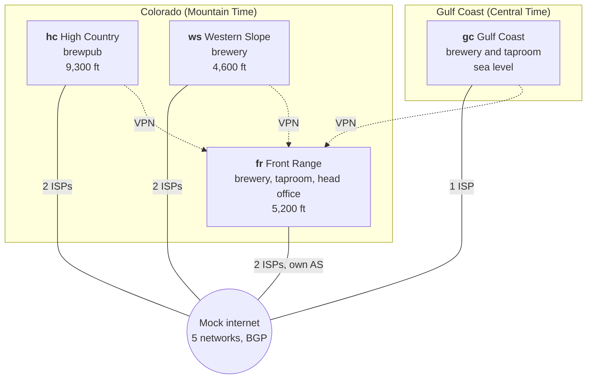
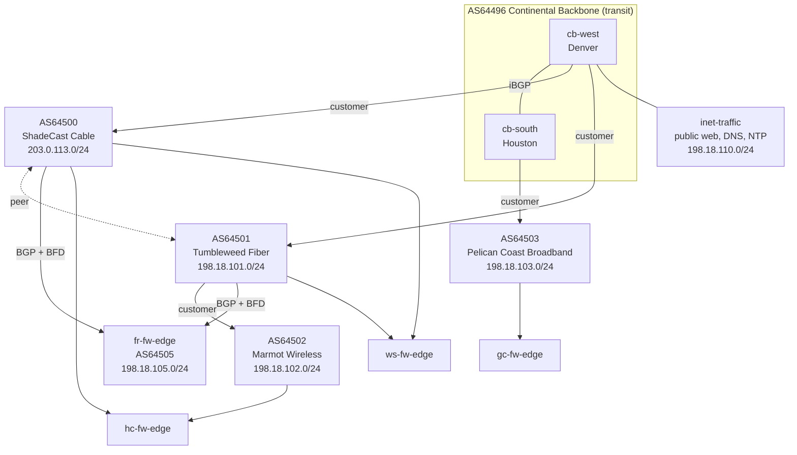
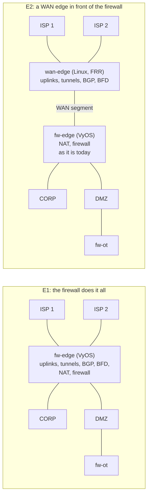
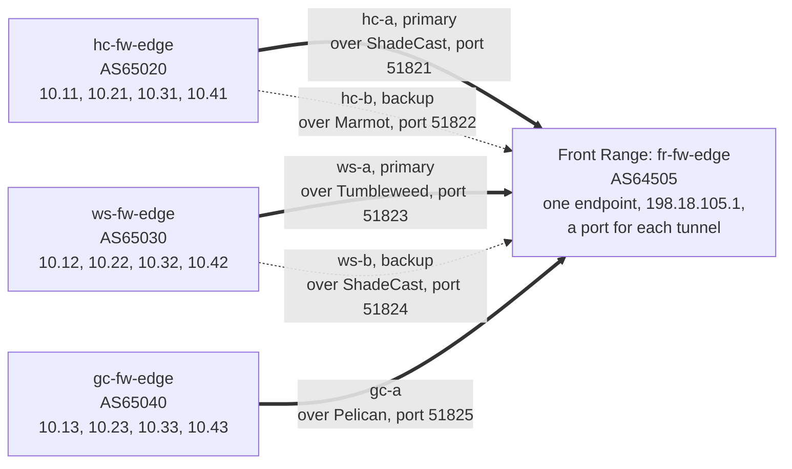
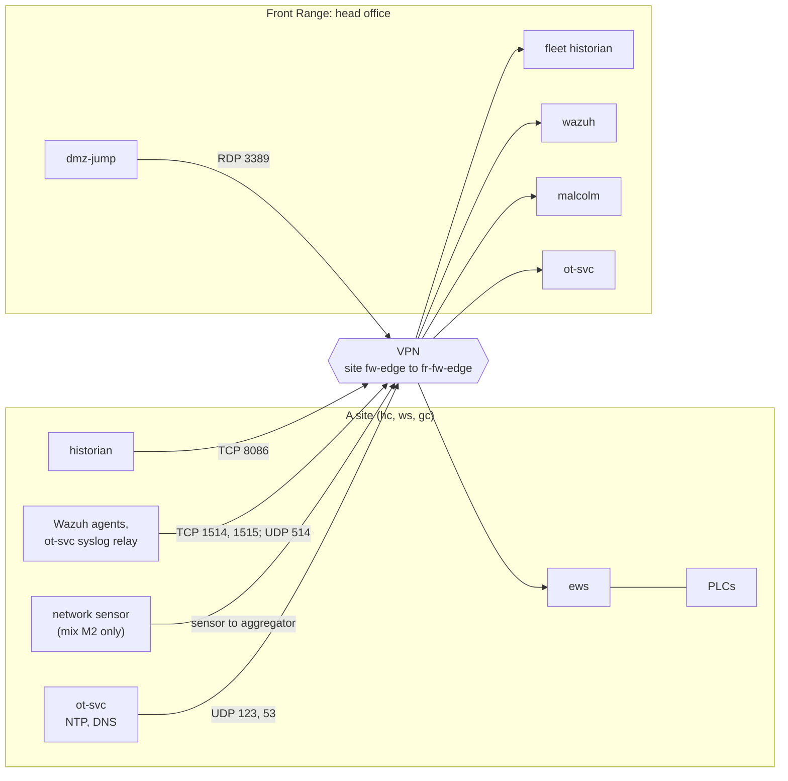
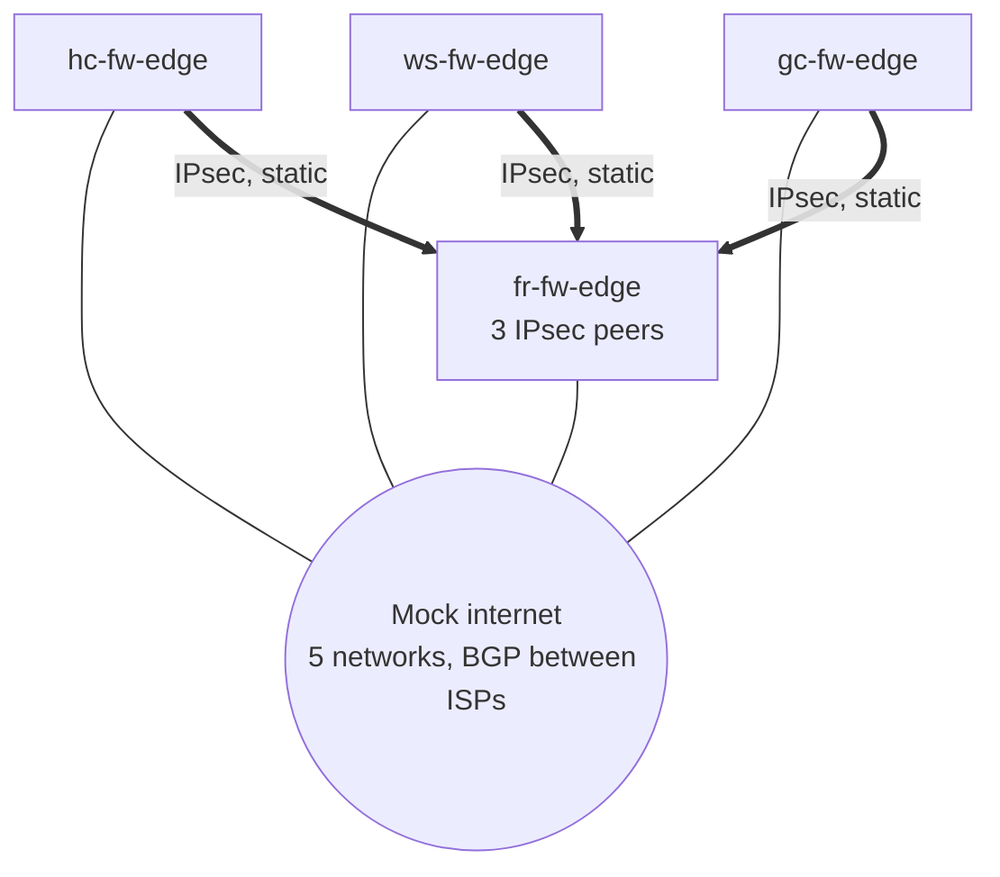
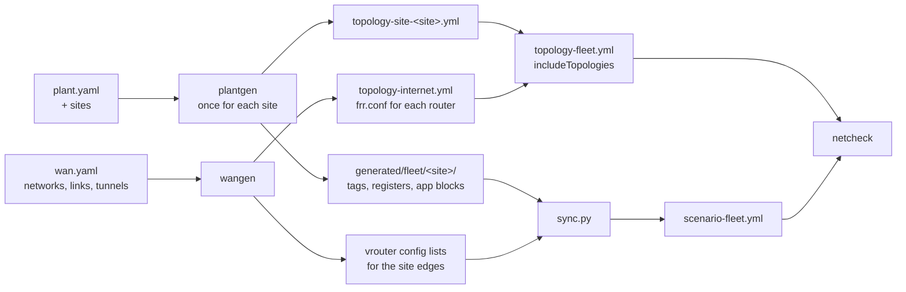
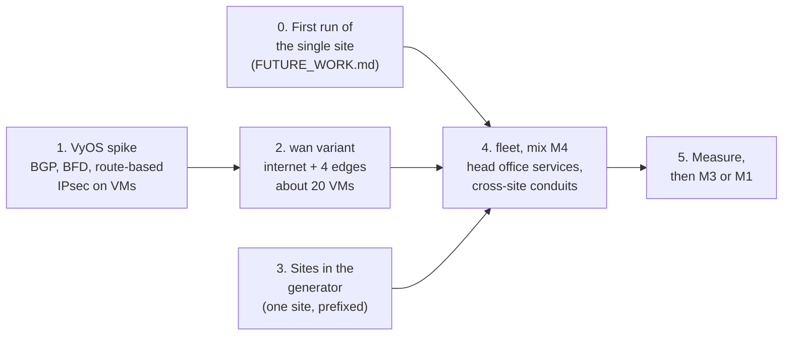

# CherryMountain Brewing: four breweries and a head office

> **Status:** options for a decision. Nothing here is built. Two spikes ran in a
> container with no VM, and a patch for phenix passes its unit tests; section 7
> says what each one showed and what it did not.
> [DESIGN.md](../DESIGN.md) stays the design of the single-site range.
>
> **tl;dr:** a `fleet` variant can put four breweries in one phenix experiment,
> joined to a head office by a site-to-site VPN over a mock internet of five
> BGP networks. Three plans follow. The recommended one (Plan B) gives the head
> office its own AS on two ISPs and gives each site one tunnel per uplink, with
> BGP and BFD inside the tunnels. In the lab the site on a failed ISP lost about
> one second of traffic, and a site whose path crossed that ISP inside the
> internet lost nine.

## Contents

1. [What was asked, and what is fixed](#1-what-was-asked-and-what-is-fixed)
2. [The company](#2-the-company)
3. [What every plan shares](#3-what-every-plan-shares)
4. [The choices](#4-the-choices)
5. [Three plans](#5-three-plans)
6. [What has to change in the repository](#6-what-has-to-change-in-the-repository)
7. [Spike results](#7-spike-results)
8. [Stages](#8-stages)
9. [Decisions needed](#9-decisions-needed)
10. [References](#10-references)

---

## 1. What was asked, and what is fixed

**Asked for:**

- A new variant of the brewery range: four breweries in different places, with
  a head office at one of them.
- A site-to-site VPN between them, over a mock internet with BGP and more than
  one ISP.
- A host with 48 cores and 96 threads.

**Assumed, because it was not said:** the host has the 512 GB of memory that
[DESIGN.md §11](../DESIGN.md#11-node-inventory-and-resources) sizes the full
variant for. Every site mix in this document needs more than 256 GB as sized
([4.1](#41-how-big-each-site-is)).

**Fixed by phenix, minimega, and the range as it is.** Each row was read from
source or shown by a spike.

| # | Constraint | What it forces | Where it comes from |
|---|---|---|---|
| C1 | Two experiments cannot share a VLAN ID, and phenix has no supported link between experiments | The four sites and the internet are **one experiment** | minimega refuses a VLAN ID that another alias holds; a workflow creates one experiment (`api/workflow/spec.go`) |
| C2 | `includeTopologies` appends nodes and fails on a duplicate hostname. It cannot include one file four times with a prefix | **One topology file per site**, generated | `src/go/types/topology.go` lines 42 to 99 |
| C3 | SoH keeps one host per IP address | **No site may reuse another site's addresses**, even behind NAT | `api/soh/app.go` (`addrHosts[ip]=host`) |
| C4 | A VLAN alias is one L2 segment for the whole experiment | **Every site has its own VLAN aliases and IDs**, and `vlanRange` must grow past 100 to 199 | The stamp spike counted 57 aliases for four sites |
| C5 | phenix's `vrouter` app cannot render BGP, a tunnel interface, WireGuard, or BFD for VyOS. Its template has an empty `bgp` block marked TODO for Vyatta, and nothing for VyOS | The routers get that configuration **another way** ([4.3](#43-who-runs-bgp-and-how-the-routers-get-their-configuration)) | `src/go/tmpl/templates/vyatta.tmpl` line 531 |
| C6 | phenix renders IPsec for VyOS as policy-based tunnels with a pre-shared key, one fixed proposal, and any number of peers | A static hub-and-spoke VPN works **with phenix as it is** | `src/go/app/vrouter.go` (`processIPSec`); the `vyos-ipsec` spike |
| C7 | The `helics` app starts one root broker for an experiment | Four separate plant simulations need **their brokers started another way** ([4.7](#47-simulation)) | sceptre-phenix-apps `helics/app.py` lines 18 to 37 |
| C8 | **No part of the range has run on a phenix host** | A fleet multiplies what is unverified. The stages in [section 8](#8-stages) boot the WAN and one site before four | [DESIGN.md, Status](../DESIGN.md#status) |
| C9 | Four full plants with the SOC are 205 vCPUs: 2.1 for each thread of this host. The single-site design runs at about 1.1 | **The site mix is a choice** ([4.1](#41-how-big-each-site-is)), and the load of one site must be measured first | The stamp spike |

## 2. The company

CherryMountain Brewery grew into **CherryMountain Brewing Company**. The
Front Range brewery of [DESIGN.md](../DESIGN.md) is the flagship and holds the
head office. Three more breweries followed. The places differ in what the
range can show: elevation changes the boil, climate changes the building and
glycol loads, and a second state brings a second time zone and utility.

| Code | Site | What it is | Elevation | Water boils at | Climate | Time zone | Uplinks |
|---|---|---|---:|---:|---|---|---|
| `fr` | Front Range | Flagship brewery and taproom (the existing plant), **head office** | 5,200 ft | 202 °F | Denver TMY3, as today | Mountain | ShadeCast Cable and Tumbleweed Fiber, with the company's own AS |
| `hc` | High Country | Brewpub in a ski town | about 9,300 ft | about 195 °F | Long, cold heating season | Mountain | ShadeCast Cable, and Marmot Wireless as the backup |
| `ws` | Western Slope | Second production brewery | about 4,600 ft | about 204 °F | Hot, dry summers; strong sun | Mountain | Tumbleweed Fiber and ShadeCast Cable |
| `gc` | Gulf Coast | First brewery outside Colorado | near sea level | 212 °F | Hot and humid; storm season | Central | Pelican Coast Broadband only |

All of it is notional. The ISP names other than ShadeCast Cable are
placeholders that nobody has checked against real companies.



**Text alternative to the diagram.** Three sites are in Colorado on Mountain
Time: Front Range (the existing brewery, with the head office), High Country
(a brewpub), and Western Slope (a second brewery). The fourth, Gulf Coast, is
on Central Time. Each site connects to the mock internet: Front Range through
two ISPs with its own AS, High Country and Western Slope through two ISPs
each, and Gulf Coast through one. A VPN runs from each of the three other
sites to Front Range.

## 3. What every plan shares

These follow from the constraints, so they do not change between plans.

**One experiment, one file per site.** The variant is `fleet`: workflow
`phenix-fleet.yml`, experiment `cherrymountain-fleet`, bridge
`cherrymtn-fleet`. `topology-fleet.yml` includes `topology-site-fr.yml`,
`-hc.yml`, `-ws.yml`, `-gc.yml`, and `topology-internet.yml`. The site files
are generated and committed, like plantgen's output today.

**Names and addresses.** The stamp spike generated the hostnames, the VLAN
aliases, the subnets, and the MGMT networks without a clash
([7.2](#72-multisite-stamp-four-sites-from-one-plant)). The VLAN IDs and the
route blocks are the proposal: nothing has generated them yet.

| Item | Rule | Example |
|---|---|---|
| Hostname | Site code, then today's name | `hc-plc-cellar`, `fr-fw-edge` |
| VLAN alias | Site code in capitals, then today's alias | `HC-CTRL` |
| VLAN ID | Today's ID plus 100 for each site after the first | CTRL is 108 at `fr`, 208 at `hc`, 308 at `ws`, 408 at `gc`; internet links use 500 to 539; `vlanRange` 100 to 599 |
| Private subnets | Today's plan, with the site's number added to the second octet | CTRL is `10.20.10.0/24` at `fr`, `10.21.10.0/24` at `hc`, `10.22.10.0/24` at `ws`, `10.23.10.0/24` at `gc` |
| MGMT | Its own VLAN and /16 at each site | `172.16.0.0/16` at `fr`, `172.17.0.0/16` at `hc` |
| A site as routes | Four blocks | `hc` is `10.11.0.0/16` (IT), `10.21.0.0/16` (OT), `10.31.0.0/16` (BAS), `10.41.0.0/16` (SOC) |

| Site | Added to the second octet | VLAN IDs | AS inside the VPN |
|---|---:|---|---:|
| `fr` | 0 | 104 to 117 | 64505 |
| `hc` | 1 | 204 to 217 | 65020 |
| `ws` | 2 | 304 to 317 | 65030 |
| `gc` | 3 | 404 to 417 | 65040 |

The second octet counts from 0 so that `fr` keeps today's addresses. The VLAN
hundreds and the AS numbers count from 1.

The Front Range site keeps every private address of
[DESIGN.md §10.2](../DESIGN.md#102-vlan-and-ip-plan), and `fr-fw-edge` keeps
`203.0.113.2`. Its detection content (the addresses in its Suricata rules and
its Zeek script) stays valid. Two things on its public side move: the INET
segment shrinks from a /24 to a /29, which still holds `isp-rtr` (.1),
`fw-edge` (.2), and `util-rtr` (.3) and leaves the rest of `203.0.113.0/24`
for ShadeCast's other customers, and `inet-traffic` moves from `203.0.113.10`
to the transit carrier's hosted network. The single-site variants `full`,
`lite`, and `ci` do not change.

**Internet numbering.** Every public address and AS number comes from a range
reserved for documentation or testing, as the single-site plan's do.

| Network | AS | Role | Prefix | Router |
|---|---:|---|---|---|
| Continental Backbone | 64496 | Transit carrier | `198.18.0.0/24` (links), `198.18.110.0/24` (hosted services: `inet-traffic`) | `cb-west` (Denver), `cb-south` (Houston) |
| ShadeCast Cable | 64500 | Access ISP, Front Range and mountains (today's `isp-rtr`) | `203.0.113.0/24` | `shadecast` |
| Tumbleweed Fiber | 64501 | Access ISP, Front Range and Western Slope | `198.18.101.0/24` | `tumbleweed` |
| Marmot Wireless | 64502 | Fixed-wireless ISP in the mountains, a customer of Tumbleweed | `198.18.102.0/24` | `marmot` |
| Pelican Coast Broadband | 64503 | Access ISP, Gulf Coast | `198.18.103.0/24` | `pelican` |
| CherryMountain Brewing | 64505 | The head office's own AS, in Plan B and Plan C | `198.18.105.0/24` | `fr-fw-edge` |

AS 64496 to 64511 are reserved for documentation (RFC 5398). `203.0.113.0/24`,
`198.51.100.0/24`, and `192.0.2.0/24` are the documentation prefixes the range
already uses (RFC 5737), and `198.18.0.0/15` is reserved for benchmarking
(RFC 2544). The vendor (`198.51.100.0/24`) and the utility (`192.0.2.0/24`)
keep their prefixes and become customers of an ISP.

**The ISPs follow the rules real ISPs follow.** A route from a customer is
preferred over one from a peer, and a peer's over a provider's. A network
tells its peers and providers only its own and its customers' prefixes. An ISP
accepts from the head office, which is a customer with one prefix, only that
prefix. From another network it accepts any public prefix up to a /24, as much
of the real internet does, and that is what lets the hijack in
[4.2](#42-the-mock-internet) work. Nothing in `10.0.0.0/8` is accepted. The
lab checks the first two rules and that no ISP carries a private route
([7.1](#71-wan-bgp-a-mock-internet-and-a-vpn-over-it)). It does not offer an
ISP a prefix it should refuse.

**Build the WAN before the sites.** A `wan` variant holds the internet, the
four site edges, and one small host at each site: about 20 VMs. It boots
without a plant, so the WAN can be proved on VMs while the single-site range
gets its own first run ([section 8](#8-stages)).

## 4. The choices

### 4.1 How big each site is

A site is the single-site core without the nodes that belong to the internet
(`isp-rtr`, `inet-traffic`, `util-rtr`, `utility-derms`). plantgen variants
already cut a plant down by area and host, as `ci` does.

| Site profile | VMs | vCPUs | Memory (GB) | What runs |
|---|---:|---:|---:|---|
| Full plant | 33 | 41 | 63 | Everything a site has in `lite` |
| Brewpub | 23 | 30 | 50 | Brewhouse, cellar, the utilities that serve them (glycol, steam, CIP), building automation; no packaging line, no on-site generation, no DER link |
| Cellar slice | 10 | 14 | 29 | The `ci` variant behind the two site firewalls, with a `historian` and an `ews`: one fermentation cell |

| Mix | VMs | vCPUs | Memory (GB) | vCPUs per thread |
|---|---:|---:|---:|---:|
| M1: four full plants, central SOC | 154 | 205 | 364 | 2.1 |
| M2: M1, and a network sensor at each of the other three sites | 157 | 217 | 412 | 2.3 |
| M3: two full plants (`fr`, `ws`) and two brewpubs (`hc`, `gc`), central SOC | 134 | 183 | 338 | 1.9 |
| M4: one full plant (`fr`) and three cellar slices, central SOC | 85 | 124 | 262 | 1.3 |
| M5: four full plants, no SOC and no vendor access | 147 | 182 | 273 | 1.9 |

Each mix includes a 12-VM internet (FRR routers, I1 in [4.2](#42-the-mock-internet))
and three head-office VMs.

- **What the ratio compares with.** The single-site design assumes its 68
  vCPUs on a host of 32 cores, which is about 1.1 for each thread. It has not
  run. On this host one full site alone would be 0.7.
- **Memory.** Every mix needs more than 256 GB as sized. M4's 262 GB includes
  84 GB for the SOC, of which Malcolm has 48 and can run in 24
  ([DESIGN.md §11](../DESIGN.md#11-node-inventory-and-resources)).
- **Every profile keeps a `historian` and an `ews`**, because the head
  office's conduits end there ([4.6](#46-what-the-head-office-does)).
- **These are counts, not load.** Most VMs idle, but the PLCs scan every
  100 ms, the kiosks render in software, and every PLC compiles its program on
  first boot. Nobody has measured a site.
- **BFD makes overcommit visible.** A router VM that waits 900 ms for a CPU
  drops its BFD sessions and moves traffic for no reason. The range should use
  1 s intervals (3 s to detect) until the host is measured. The lab used
  300 ms.
- **Recommendation:** make the profile a setting of each site in the
  generator. Bring the fleet up as **M4**, measure the host, then promote sites
  to brewpubs or full plants (M3, then M1) as far as the host allows.

### 4.2 The mock internet



**Text alternative to the diagram.** The transit carrier, Continental Backbone
(AS 64496), has two routers joined by iBGP: `cb-west` in Denver and `cb-south`
in Houston. ShadeCast Cable (AS 64500) and Tumbleweed Fiber (AS 64501) are
customers of `cb-west` and also peer with each other directly. Marmot Wireless
(AS 64502) is a customer of Tumbleweed. Pelican Coast Broadband (AS 64503) is a
customer of `cb-south`. `inet-traffic` hangs off `cb-west`. The head office's
edge, `fr-fw-edge` (AS 64505), speaks BGP with BFD to ShadeCast and to
Tumbleweed. `hc-fw-edge` connects to ShadeCast and Marmot, `ws-fw-edge` to
Tumbleweed and ShadeCast, and `gc-fw-edge` to Pelican; these three take
ISP-assigned addresses and speak no BGP with their ISPs.

This is the internet the lab ran. It is the smallest one that has a transit
carrier, a peering link, a small ISP behind a bigger one, and a remote region,
so that an AS path can be two or three networks long and a failure has
somewhere to reroute.

| Option | Routers | Cost | For | Against |
|---|---|---|---|---|
| **I1: a VM for each router, FRR on Linux** (recommended) | 6 | 6 vCPUs, 3 GB | The configuration is a file (`frr.conf`), and the lab's files carry over. Each router shows in the phenix UI, and a fault is a phenix action (disconnect a NIC, stop a VM) | A new small image (`cm-frr`). Link delay and loss need a `tc` unit; the `vrouter` app's emulators do not apply |
| I2: a VM for each router, VyOS | 6 | 6 vCPUs, 12 GB | The image exists, and `isp-rtr` is VyOS today. The emulators work | VyOS gets its BGP by one of the routes in [4.3](#43-who-runs-bgp-and-how-the-routers-get-their-configuration), for six more routers |
| I3: the whole internet in one VM | 1 | 2 vCPUs, 2 GB | Ten FRR routers took 0.5 GB in the lab, so 20 or 30 networks, an exchange with a route server, and an RPKI validator would fit | One box in the UI. Faults are scripts inside it. The lab script would become a product |

minimega's own router image (minirouter, which runs BIRD) is not an option:
minimega can configure BGP on it, but phenix does not pass BGP to it.

**The ISPs' timers are part of the design.** A site that is not next to a
failure waits for a BGP hold timer inside the internet
([7.1](#71-wan-bgp-a-mock-internet-and-a-vpn-over-it)). The lab's ISPs use 3 s
keepalives and a 9 s hold time, and the Gulf Coast site lost 9 s. With the
60 s and 180 s that routers ship with, it would lose three minutes. The
range's ISP routers should keep the short timers or run BFD between
themselves, and an exercise can lengthen them on purpose.

**What BGP adds to an exercise.** In the lab, Pelican announced the head
office's prefix. The transit carrier believed the shorter path and the Gulf
Coast site lost the head office. ShadeCast and Tumbleweed kept their customer
route, so the other two sites did not notice. A blue team sees the same thing
a real one would: one site's tunnel down, nothing wrong at either end.

### 4.3 Who runs BGP, and how the routers get their configuration

The ISP routers must speak BGP. Whether a **brewery** router does depends on
the plan: in Plan A none does. In Plan B and Plan C every site edge runs BGP
inside its tunnels, and the head office's also runs it with two ISPs.

phenix cannot render that for VyOS (C5). There are four ways to deliver it.

| Option | What it is | For | Against |
|---|---|---|---|
| **R1: a `config` list in the `vrouter` app** (recommended, needs a phenix change) | Each router's metadata lists VyOS `set` and `delete` commands. phenix writes them after its own, before the commit | One commit at first boot, with the rest of the configuration. It also carries what `cm-vyos-config.sh` does after boot today (logging, syslog, IKEv2, the NTP source), so that script could go. The patch is 167 lines and its tests pass ([7.3](#73-a-config-list-for-the-vrouter-app)) | A change to phenix, on a fork branch until upstream takes it. Not run on a VyOS VM |
| R2: the post-boot script | `cm-vyos-config.sh` grows a BGP and tunnel section | No phenix change. The mechanism is in the range | A second commit after boot, which a `cc exec` starts. The script has not run on a VyOS VM, and its first form changed nothing and reported success ([DESIGN.md §10.3](../DESIGN.md#103-conduit-matrix-default-deny-stateful-logged)) |
| R3: BGP as a schema feature of phenix | `network.bgp` in the topology, as `network.ospf` is | The right upstream answer to the TODO | A large change (schema, types, template, Builder checks). It still would not cover tunnels or BFD |
| R4: keep BGP off VyOS | A Linux router with FRR does the WAN work at each site ([4.4](#44-where-the-tunnels-end), E2) | No phenix change and no VyOS syntax to verify. It is what the lab ran | One more VM at each site |

### 4.4 Where the tunnels end



**Text alternative to the diagram.** In E1, both ISPs connect to `fw-edge`, a
VyOS firewall that holds the uplinks, the tunnels, BGP, BFD, NAT, and the
firewall rules; CORP and the DMZ hang off it, and `fw-ot` is behind the DMZ. In
E2, both ISPs connect to a new node, `wan-edge`, a Linux router with FRR that
holds the uplinks, the tunnels, BGP, and BFD. `wan-edge` connects over one WAN
segment to `fw-edge`, which keeps NAT and the firewall rules as it has them
today, with CORP, the DMZ, and `fw-ot` behind it.

| | E1: on `fw-edge` | E2: on a `wan-edge` |
|---|---|---|
| Like | A small company's firewall that is also its VPN endpoint | A dual-WAN router or SD-WAN box in front of the firewall |
| New VMs | None | 4 (1 vCPU and 512 MB each) |
| Needs | R1 or R2, and VyOS syntax checked on a VM | A `cm-frr` image and generated files |
| Firewall rules for VPN traffic | On tunnel interfaces, which phenix's ACLs cannot name: through R1 or R2 | On `fw-edge`'s WAN interface, by source and destination, with phenix's ACLs as they are |
| Monitoring | VyOS logs to Wazuh, as the firewalls do today | The box can run a Wazuh agent |
| Evidence | The commands are written ([spikes/wan-bgp/vyos-sketch](../../spikes/wan-bgp/vyos-sketch), 286 for the four edges) and each path was read in VyOS's source. None has run | The lab is this, in namespaces |

**Recommendation:** E1 with R1 is the target, because it adds no VMs and puts
the VPN where a company this size has it. It depends on a spike on VyOS VMs
([section 8](#8-stages), stage 1). If that spike fails, E2 is the fallback, and
it already has running evidence.

### 4.5 The VPN



**Text alternative to the diagram.** The head office's edge, `fr-fw-edge`
(AS 64505), has one tunnel endpoint in its own prefix, `198.18.105.1`, and a
port for each tunnel. `hc-fw-edge` (AS 65020) has a primary tunnel `hc-a` over
ShadeCast (port 51821) and a backup tunnel `hc-b` over Marmot (port 51822).
`ws-fw-edge` (AS 65030) has a primary tunnel `ws-a` over Tumbleweed (port
51823) and a backup `ws-b` over ShadeCast (port 51824). `gc-fw-edge`
(AS 65040) has one tunnel, `gc-a`, over Pelican (port 51825). Each site
announces its four address blocks.

| Option | Tunnels | Routing | Failover | Needs |
|---|---|---|---|---|
| **V1: static hub and spoke** | One policy-based IPsec tunnel from each site to the head office | None. The tunnel's selectors are the routes | None. A site with a dead ISP is cut off | Nothing new: phenix renders it (C6) |
| **V2: a tunnel per uplink, BGP inside** (recommended) | One route-based tunnel for each uplink of each site, to the head office: five in all | eBGP in every tunnel, each site its own private AS. The primary tunnel wins by local preference at both ends. BFD finds a dead tunnel | About 1 s in the lab for a site next to the fault, and about 3 s with the BFD timers a VM should use. A site with one uplink waits for the ISPs: 9 s in the lab | R1, R2, or E2 |
| V3: V2 with a second hub | V2, and a tunnel for each uplink of `hc` and `gc` to a second hub at `ws`: eight in all. `ws` would need its own prefix, or an endpoint on each uplink | The same, with a preference between hubs | Survives the loss of the head office's whole site | The same, and more policy to get wrong |
| V4: full mesh | A tunnel between every two sites, for each uplink pair | The same | Sites reach each other directly | The most tunnels and the least reason: brewery sites talk to the head office, not to each other |

**How V2 behaves** (all shown in the lab):

- **The head office's endpoint is in its own prefix**, which both of its ISPs
  announce. When the head office loses an ISP, the internet reroutes under
  the tunnels and no tunnel has to move.
- **A site pins each tunnel to one uplink by a mark.** The tunnel's packets
  carry a firewall mark, a rule sends that mark to its own routing table, and
  the table holds the uplink and, behind it, a blackhole. The two tunnels of a
  site never share an uplink, whatever address the endpoint has and whether
  the uplink's link is up or down. The first design pinned by the
  endpoint's address, and it did not hold
  ([7.1](#71-wan-bgp-a-mock-internet-and-a-vpn-over-it), finding 2).
- **The head office sends from its endpoint address.** Its default routes
  carry the endpoint as the preferred source, so a reply never leaves with the
  address of an uplink.
- **Only site prefixes cross a tunnel.** Each end filters to `10.0.0.0/8`,
  /16 to /24. A default route or a public prefix learned through a tunnel would
  send the tunnel into itself.
- **Site to site goes through the head office**, where `fr-fw-edge` decides
  whether it may. In the lab a packet from `hc` reached `gc` in four hops.
- **The head office installs the default route of both ISPs**, not only the
  best one. With one default route, a tunnel that arrived through the other
  ISP never came up ([7.1](#71-wan-bgp-a-mock-internet-and-a-vpn-over-it),
  finding 1). That was wireguard-go. The kernel's WireGuard, which VyOS uses,
  chooses its route differently and may not need it.

**IPsec or WireGuard.** The routing does not care: both give a routed
point-to-point interface.

| | Route-based IPsec (IKEv2, a VTI on VyOS) | WireGuard |
|---|---|---|
| In real breweries and their integrators | The usual site-to-site VPN | Growing, mostly for remote access |
| In the range today | The utility link (policy-based) | The vendor's path |
| What a defender sees | IKE and ESP: negotiation, identities, rekeys | One UDP port, nothing to parse |
| Endpoints | Fixed by configuration, once MOBIKE is off (VyOS leaves it on: `disable-mobike`) | **Roam**: a peer's endpoint becomes whatever address its last packet came from. The mark pin makes that harmless |
| Known problem on VyOS | An open bug leaves a VTI down after its peer reconnects, although the tunnel is up ([T9154](https://vyos.dev/T9154), high priority, not fixed on 2026-11-21). That is the repair half of every failover | None found |
| Evidence | None: the lab's kernel has no ESP | The lab, with wireguard-go |

**Recommendation:** WireGuard for the first build. The lab ran its whole
design, and the one VyOS bug found is on the IPsec side, in the case this
design exists for. IPsec is the more usual choice for site-to-site, and the
VyOS spike should try it too: if the VTI recovers there, the range can have
IPsec between sites and keep WireGuard for the vendor.

**Should the head office have its own AS?** It could instead take ISP-assigned
addresses on two uplinks, like `hc` and `ws`, with one hub endpoint on each.
That is closer to what a company of four breweries would buy, and it leaves
BGP to the ISPs. The plans give it an AS because that puts BGP inside the
company: its staff own a prefix, a policy, and the consequences, and the
hijack in [4.2](#42-the-mock-internet) has a victim. It is decision
[D5](#9-decisions-needed).

### 4.6 What the head office does



**Text alternative to the diagram.** Five flows cross the VPN between a site
and the head office. The site's historian sends to the fleet historian
(TCP 8086). The site's Wazuh agents and its `ot-svc` syslog relay send to
`wazuh` (TCP 1514 and 1515, UDP 514). A network sensor, in mix M2 only, sends
to `malcolm`. The site's `ot-svc` asks the head office's `ot-svc` for time and
names (UDP 123 and 53). One flow goes the other way: the head office's
`dmz-jump` opens RDP to the site's `ews`, which is the only way to the site's
PLCs.

| Function | Proposal | Other way |
|---|---|---|
| Security operations | The SOC module stays at `fr`. Agents and syslog from every site reach `wazuh` through the VPN | A SOC at each site: 84 GB each |
| Network monitoring | One `malcolm` at `fr`. The mirror app feeds it every site's VLANs out of band, which costs nothing and is not how a real fleet works | A sensor at each site that forwards over the VPN (M2): real, 4 vCPUs and 16 GB a site. Or `fr` only, which leaves the blue team blind at the other sites on purpose |
| Process data | Each site keeps its `historian`. It also writes to a fleet historian at `fr`, where a Grafana board shows all four breweries | `fr`'s own historian doubles as the fleet's |
| Engineering | Each site keeps its `ews`. Head-office engineers and the vendor go through `fr`'s `dmz-jump` to a site's `ews` | One `ews` at `fr` that programs every site's PLCs. Fewer VMs, and it gives one desktop every PLC in the company |
| Vendor access | One WireGuard gateway and one jump host, at `fr` | A gateway and a jump host at each site: 6 more VMs |
| Time and names | Each site's `ot-svc` serves its site and asks `fr`'s for the rest | — |
| Utility link | `fr` keeps Summit Valley Power. `ws` gets the same utility on its own tunnel, and `gc` a second utility. The `hc` brewpub has no generation and no link | Only `fr` has a DER link |

**No conduit reaches a site's PLCs from outside the site.** The five flows of
the diagram are the only new rows of the conduit matrix. Each crosses a site's
`fw-edge` and `fw-ot` and `fr`'s, default deny. Site to site is denied at
`fr-fw-edge`.

### 4.7 Simulation

Each site runs its own plant, so each site gets its own federation: its own
`sim-ctl` and broker on its own MGMT VLAN. Federate and topic names stay as
they are, a site can be restarted alone, and each site keeps its own clock and
time zone.

- **Brokers.** The `helics` app starts one root broker (C7). Either the
  `cherrymountain` app starts each site's broker (it renders `sim-ctl`'s units
  already, and the `ot-sim` app accepts a broker per host), or the four sites
  share one federation with every name prefixed, which changes about 50 topic
  strings in the federates. The first is the proposal. It needs a small spike.
- **What a site sets.** The elevation and pressure, the weather file, the time
  zone, and the tariff. Today the federates hold some of them as constants
  (the pressure in `recipe.py`, the latitude and longitude in `weather.py`, the
  CO₂ density in `building.py`, and the default tariff in `tariff.py`).

## 5. Three plans

| | Plan A: static hub and spoke | Plan B: dual-homed overlay (recommended) | Plan C: Plan B and more |
|---|---|---|---|
| Internet | The five networks of [4.2](#42-the-mock-internet), as FRR routers (I1) | The same | I3: 20 or more networks in one VM, with an exchange and an RPKI validator |
| Uplinks | One ISP for each site | Two for `fr`, `hc`, and `ws`; one for `gc` | The same |
| BGP at a brewery | None | Every site edge, inside the tunnels; the head office also with its ISPs | The same |
| VPN | V1: policy-based IPsec to the head office | V2: a tunnel per uplink, BGP and BFD | V3: V2 with a second hub at `ws` |
| Tunnel end | `fw-edge`, as phenix renders it | E1 (`fw-edge`, with R1), or E2 | The same |
| Failover | None | About 3 s next to the fault; the ISPs' hold time for a site with one uplink | The same, and the head office's site can fail |
| Monitoring | Central | Central | A sensor at each site (M2) |
| Changes to phenix | None | R1 (or none, with E2) | The same |
| New images | `cm-frr` | `cm-frr` | `cm-frr`, an internet image, a sensor image |
| Site mix to start | M4 | M4, then M3 or M1 | M3, then M2 |
| What it teaches | Segmentation across sites; one ISP outage is one site outage | That, and WAN failover, BGP at a company edge, a hijack of the company's prefix | That, and route validation, hub failure, monitoring across a WAN |

### Plan A: static hub and spoke



**Text alternative to the diagram.** Each of the four site edges has one
connection to the mock internet, where the ISPs run BGP between themselves.
`hc-fw-edge`, `ws-fw-edge`, and `gc-fw-edge` each have one static IPsec tunnel
to `fr-fw-edge`, which has three IPsec peers.

- **For.** It uses only what phenix renders today. The VyOS routers stay as
  they are, with three peers added at `fr` and one at each site. The
  `vyos-ipsec` spike ran that feature with one peer and one selector; three
  peers on one router have not run.
- **Against.** No brewery router speaks BGP, so the BGP is scenery. A second
  uplink cannot help: the tunnel is tied to one pair of addresses. Each pair of
  subnets that may talk is a tunnel selector, so the list at `fr` grows with
  every conduit. Moving to Plan B later replaces the VPN.

### Plan B: dual-homed overlay

The diagrams in [4.2](#42-the-mock-internet) and [4.5](#45-the-vpn) are this
plan.

- **For.** It is what was asked for, with a reason for each part: two ISPs
  are worth having only if something fails over, and BGP is worth having only
  if the company takes part in it. The lab ran the whole design.
- **Against.** The site edges need configuration phenix cannot render, so the
  plan carries decision [D2](#9-decisions-needed). Nothing of it has run on
  VyOS: the lab's tunnels are wireguard-go on Linux.

### Plan C: Plan B and more

Plan C is Plan B with three additions that do not depend on each other. Each
can be added later.

1. **A second hub at `ws`** (V3). `hc` and `gc` get tunnels to both hubs, and
   the hubs to each other.
2. **A wider internet** (I3): 20 or more networks in one VM, an exchange
   point with a route server, and an RPKI validator, so that the hijack has a
   defense to configure.
3. **A network sensor at each site** (M2) that forwards to `malcolm` over the
   VPN.

- **For.** The most to defend and the most that can go wrong on purpose.
- **Against.** The most VMs (157 and 217 vCPUs with M2) and the most new
  parts, on a host and a range that have not run one site yet.

## 6. What has to change in the repository

Read from the code, apart from the plantgen row, which the stamp spike ran.

| Part | Today | For a fleet | Size |
|---|---|---|---|
| `plant/plant.yaml` and plantgen | Hosts, VLANs, subnets, and variants are data. One lookup of `sim-ctl` by name (`render.py` line 348) | A `sites` list (code, number, profile, elevation, weather, time zone, tariff), one output directory for each site, the one lookup fixed | Small |
| Topology files | Written by hand (1,900 lines for the three modules) | Generated from the site list, one file a site | Medium |
| `sync.py` | Variant and PLC names are literals | A loop over sites | Small |
| `cherrymountain` app | One variant, one `sim-ctl`, the first historian | Hosts grouped by a `site` label; a broker for each site | Medium |
| FUXA builder | Keys on hostnames (`scada-fuxa`, `removeprefix("plc-")`) | Keys on roles | Small |
| PLC programs | Hold no addresses; the app replaces the plugin configuration at boot | One ZIP for each profile serves every site | None |
| Federates | 50 topic strings and four site constants are literals | The constants come from the site; the topics stay if each site has its own federation | Small |
| Static injects | About 26 of 79 hold plant addresses or hostnames (`dnsmasq`, BBMD, Wazuh, the Suricata rules, the Zeek script) | Rendered for each site | Medium |
| `scenario-*.yml` | The firewall rulesets and the SoH overlay are written by hand (more than 200 addresses) | Rendered for each site, with the cross-site conduits | Medium |
| `tools/netcheck` | The address plan, 44 nodes, and 29 conduits are Python literals. It models static routes, NAT, and policy IPsec, and no routing protocol | The plan generated for each site; the overlay's routes supplied as what BGP is expected to install | Large |
| WAN | — | A `wan.yaml` (networks, links, relations, tunnels) and a generator for `topology-internet.yml`, each `frr.conf`, and the site edges' WAN configuration. The lab's model is the start | Medium |
| phenix | — | R1, if chosen | Small (written) |



**Text alternative to the diagram.** Two inputs feed two generators.
`plant.yaml`, with a list of sites, feeds plantgen, which runs once for each
site and writes that site's generated files and its topology file. `wan.yaml`,
which lists the networks, links, and tunnels, feeds a new generator, `wangen`,
which writes the internet's topology file with an `frr.conf` for each router
and the `vrouter` configuration lists for the site edges. `sync.py` embeds the
generated app blocks and the configuration lists in `scenario-fleet.yml`.
`topology-fleet.yml` includes the site files and the internet file. `netcheck`
reads the fleet topology and scenario.

## 7. Spike results

### 7.1 `wan-bgp`: a mock internet and a VPN over it

Kit: [spikes/wan-bgp](../../spikes/wan-bgp/README.md). Ten routers as network
namespaces, each with its own FRR 8.4.4, built as the diagrams in
[4.2](#42-the-mock-internet) and [4.5](#45-the-vpn) show, with two
differences: a site announces one /24, not four blocks, and the head office's
ShadeCast link is a /30 with no utility on it. The tunnels are WireGuard
(wireguard-go). It is Plan B with E2.

Every fault is on ShadeCast and silent: packets are dropped and the links stay
up. Each site pinged the head office's host ten times a second through each
event, and the figures are the longest run of lost pings over the runs of the
final design.

| Event | High Country (primary uplink on ShadeCast) | Western Slope (backup uplink on ShadeCast) | Gulf Coast (behind Pelican) |
|---|---|---|---|
| ShadeCast drops High Country's uplink | 0.8 to 0.9 s, then its tunnel over Marmot | not on the path | not on the path |
| ShadeCast drops the head office's uplink | 0.6 to 1.0 s | not on the path | not on the path |
| All of ShadeCast fails | 0.8 to 0.9 s | not on the path | not on the path |
| All of ShadeCast fails, with the transit carrier routing to the head office through it | 0.8 s | not on the path | **8.8 to 9.0 s** |
| Each repair | no loss | no loss | no loss |

- **Two kinds of outage.** A site next to the fault has a BFD session that
  finds it: three intervals of 300 ms, about one second. A site that is not
  next to it waits for a BGP hold timer somewhere in the internet. Gulf Coast
  has one uplink and no part in the fault, and it lost the head office for as
  long as the transit carrier kept sending toward a dead ISP. The lab's ISPs
  use 3 s keepalives and a 9 s hold time; real routers ship with 60 s and
  180 s. The range's ISP routers should keep short timers, or run BFD between
  themselves.
- **The checks.** The last two runs passed all 26: the 13 BGP sessions come up
  in 8 to 9 s; paths follow the customer, peer, and provider rules; no ISP
  carries a private route; a site learns only site prefixes through a tunnel;
  every site reaches the head office and every other site. Four earlier runs
  of the same design had 23 checks. In two of them one check failed for a
  fault of the kit, since fixed.
- **Finding 1: with wireguard-go, a head office on two ISPs must install both
  default routes.** With only the better one installed, the three tunnels that
  arrived through the other ISP never came up: each handshake came in, and no
  answer left. With both installed (BGP multipath), all five came up. The
  kernel's WireGuard does not tie its answer to the interface a packet came in
  on (read in its source), so VyOS may behave differently.
- **Finding 2: a WireGuard endpoint roams, so a tunnel cannot be tied to an
  uplink by its endpoint's address.** The first design gave the head office
  two endpoint addresses and gave each site a host route for each. After one
  failure and repair, a site's tunnel pointed at `203.0.113.2`, the head
  office's address on the ShadeCast link, not at `198.18.105.1`. The host
  route no longer matched, so the tunnel followed the site's default route.
  A backup tunnel that drifts this way ends up on the primary uplink and
  fails with it. It also hid a fault: in two of three runs a site lost nothing
  when the head office lost an ISP, because its tunnel had already moved to a
  path around the fault. The final design ties a tunnel to its uplink by a
  firewall mark and gives the head office one endpoint, which its default
  routes also carry as the source address. No endpoint moved in those runs,
  and every tunnel still left through its own uplink after all the faults. The
  kernel's WireGuard lets the route choose the source address whenever a reply
  leaves through another interface than the request came in on, so on VyOS the
  preferred source matters even with no fault.
- **Finding 3: the mark's routing table must end in a blackhole.** When an
  uplink's link goes down, its route leaves the table, and without the
  blackhole the tunnel would leave through the other uplink. With it, the
  tunnel stayed down until the link came back.
- **Finding 4: an origin hijack is partial.** Pelican announced the head
  office's prefix. The transit carrier took the shorter path, and the Gulf
  Coast site lost the head office. ShadeCast and Tumbleweed kept their
  customer route, and their sites stayed up.
- **Finding 5: ten FRR routers took 0.5 GB of memory**, tunnels included. An
  internet in one VM (I3) is practical.
- **Not tested:** VyOS; IPsec (the lab's kernel has no ESP); WireGuard in the
  kernel (the lab used wireguard-go); link delay and loss; the ISPs' filters
  against a prefix they should refuse; firewall rules on tunnel traffic; a
  site's internet access when its first uplink dies (its static default route
  has no health check).

### 7.2 `multisite-stamp`: four sites from one plant

Kit: [spikes/multisite-stamp](../../spikes/multisite-stamp/README.md).

- **plantgen generates a site** with its own hostnames, VLAN aliases, and
  subnets after one line changes. The `full` output for site `hc` (31 files)
  holds no name or address of the first site in its configuration.
- **Four stamped site topologies** (132 nodes) have no duplicate hostname and
  validate against phenix's Topology schema. The one duplicate address is each
  `fw-edge`'s WAN address, which the WAN plan assigns.
- **The budgets** in [4.1](#41-how-big-each-site-is) come from this kit.
- **Not tested:** phenix merging the files, and every other tool on a stamped
  site.

### 7.3 A `config` list for the `vrouter` app

Patch: [spikes/wan-bgp/patches/vrouter-config-passthrough.patch](../../spikes/wan-bgp/patches/vrouter-config-passthrough.patch),
against sceptre-phenix at `86fd732` (the head of `main` on 2026-11-22).

```yaml
- name: vrouter
  hosts:
    - hostname: fr-fw-edge
      metadata:
        config:
          - set protocols bgp system-as 64505
          - set protocols bgp neighbor 203.0.113.1 remote-as 64500
```

- **What it does.** For a VyOS router, phenix writes each line after the
  configuration it generates and before `commit`. A line must start with `set`
  or `delete`. A control character, a double quote, or a character the shell
  acts on outside single quotes is an error, because the file is a `vbash`
  script. On a router that is not VyOS, `config` is an error.
- **Tested.** 167 lines with three unit tests (one rendering, one without the
  option, ten refused inputs). `go test ./app ./tmpl` passes.
- **For the fork too.** The range pins the fork branch `ci-e2e-minimega`,
  whose `vrouter.go` is older, so the patch does not apply there.
  [vrouter-config-passthrough.ci-e2e-minimega.patch](../../spikes/wan-bgp/patches/vrouter-config-passthrough.ci-e2e-minimega.patch)
  is the same change for that branch at `afbcba7` (159 lines, two tests), and
  `go test ./app ./tmpl` passes there as well.
- **Not tested.** No VyOS router has taken a rendered file. The lint that
  phenix's CI runs (`golangci-lint`) did not run. The patches are files in
  this repository, not a branch of phenix.

## 8. Stages



**Text alternative to the diagram.** Stage 0 (the first run of the single
site), stage 2 (the `wan` variant), and stage 3 (sites in the generator) all
lead to stage 4 (the fleet at mix M4). Stage 1 (the VyOS spike) leads to stage
2. Stage 4 leads to stage 5 (measure, then grow the mix).

| Stage | What | Done when |
|---|---|---|
| 0 | The single site's first run on a phenix host. It is [FUTURE_WORK.md](../FUTURE_WORK.md#the-first-run-on-a-phenix-host) already, and the fleet depends on it | One site passes SoH, and its host load is recorded |
| 1 | A spike on VyOS VMs in CI, as `vyos-ipsec` ran: two VyOS routers and an FRR router, with R1's `config` list carrying the commands of [spikes/wan-bgp/vyos-sketch](../../spikes/wan-bgp/vyos-sketch) (BGP, BFD, a WireGuard tunnel with a mark pin), then the same with a VTI | The commit succeeds at first boot; BGP comes up in the tunnel; a blocked link fails over and comes back. This settles D2 and D3 |
| 2 | The `wan` variant: `wan.yaml`, its generator, the `cm-frr` image, the four site edges, a host at each site | The lab's checks pass on VMs, as SoH tests and a SCORCH run for each fault |
| 3 | Sites in plantgen, `sync.py`, the app, and the FUXA builder | The `lite` variant generates as a prefixed site and passes the offline checks; after stage 0, it boots alone |
| 4 | The `fleet` variant at mix M4: the site files, the head-office services, the cross-site conduits, `netcheck` for the fleet | Every conduit and every blocked path passes SoH across the VPN |
| 5 | Measure the host with M4 running, then promote sites | The host's load and steal time are recorded for each mix |

Stage 1 runs on a GitHub runner, as the Phase 0 VM spikes did. Stage 2 follows
it and is about 20 small VMs. Stage 3 is generator work with offline checks,
and does not wait for anything; booting its one site is stage 0's risk again,
so that part follows stage 0.

## 9. Decisions needed

| # | Decision | Options | Recommended |
|---|---|---|---|
| D1 | The plan | A, B, or C ([section 5](#5-three-plans)) | **B** |
| D2 | Where the tunnels and BGP run at a site | E1 on `fw-edge` with R1 (a phenix change) or R2 (the script); E2 on a `wan-edge` VM ([4.3](#43-who-runs-bgp-and-how-the-routers-get-their-configuration), [4.4](#44-where-the-tunnels-end)) | **E1 with R1**, after the VyOS spike; E2 if it fails |
| D3 | The tunnel | WireGuard or route-based IPsec ([4.5](#45-the-vpn)) | **WireGuard** first; IPsec if the VyOS spike shows its VTI recovers |
| D4 | The site mix | M1 to M5 ([4.1](#41-how-big-each-site-is)) | **Start at M4**, then measure |
| D5 | The head office's uplinks | Its own AS on two ISPs, or ISP-assigned addresses like the other sites ([4.5](#45-the-vpn)) | **Its own AS** |
| D6 | The ISP routers | I1 (FRR VMs), I2 (VyOS VMs), or I3 (one VM) ([4.2](#42-the-mock-internet)) | **I1** |
| D7 | Monitoring of the other sites | Central with the out-of-band mirror, a sensor at each site, or none ([4.6](#46-what-the-head-office-does)) | **Central** to start |
| D8 | The simulation | A federation for each site, or one for all ([4.7](#47-simulation)) | **One for each site** |
| D9 | The sites | The four places, their codes, and the ISP names ([section 2](#2-the-company)) | As written; the names need a check |
| D10 | The host's memory | 512 GB, as assumed? Every mix needs more than 256 GB as sized | — |
| D11 | The phenix patch | Open it as a branch and pull request on the fork, or keep it as a patch file | **A patch file for stage 1**, which applies it in CI as the `serial-pr130` job applies its patch; a branch and pull request when the spike passes |
| D12 | The VyOS spike | It adds a job to `cherrymountain-spikes.yml` and runs on GitHub's runners | **Run it** |

## 10. References

- RFC 5398, *Autonomous System (AS) Number Reservation for Documentation Use*
  (AS 64496 to 64511).
- RFC 5737, *IPv4 Address Blocks Reserved for Documentation*.
- RFC 2544, *Benchmarking Methodology for Network Interconnect Devices*,
  appendix C (`198.18.0.0/15`).
- RFC 6996, *Autonomous System (AS) Reservation for Private Use* (64512 to
  65534).
- RFC 4271, *A Border Gateway Protocol 4 (BGP-4)*.
- RFC 5880 and RFC 5881, *Bidirectional Forwarding Detection (BFD)*.
- RFC 7454, *BGP Operations and Security*.
- L. Gao and J. Rexford, "Stable Internet Routing Without Global
  Coordination", IEEE/ACM Transactions on Networking, 2001 (the
  customer, peer, and provider rules).
- FRRouting, <https://docs.frrouting.org/>.
- VyOS, <https://docs.vyos.io/>, and its source,
  <https://github.com/vyos/vyos-1x> (branch `rolling` at `f1789c0`, read on
  2026-11-22 for every command in `vyos-sketch`).
- VyOS tasks T9154 (<https://vyos.dev/T9154>) and T6574
  (<https://vyos.dev/T6574>): a VTI that stays down after its peer reconnects
  or rekeys.
