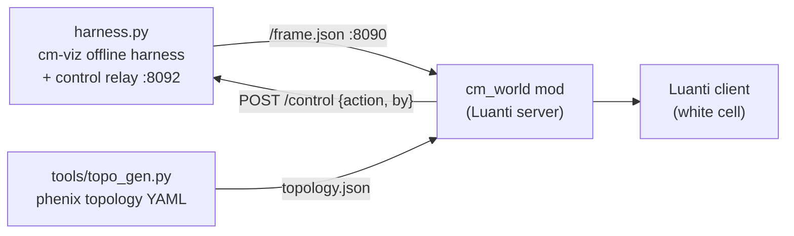

# luanti-world: the plant as a voxel world

Question: can [Luanti](https://www.luanti.org/) (formerly Minetest), an open-source
voxel engine with no accounts, render cm-viz's frames as a walkable world? Can the
white cell act on the plant from inside it, and can the phenix topology be shown the
same way? Can CI test it with no display?

Result: **go for a white-cell and demo view, as a second reader of cm-viz's frame.**
The cellar, fermenters and power scenes run live from `/frame.json` with no change to
cm-viz or the simulation. A console in the world drives the plant through an
allowlisted relay. The topology becomes a city. A headless smoke test passes on
Debian's minetestserver 5.6.1 and on Luanti 5.18.0. See [Findings](#findings) and
[Known gaps](#known-gaps).

The Minecraft feasibility study that led here compared Paper and Luanti. Paper was
dropped for now: it needs Microsoft accounts, a jar we may not redistribute, and
Mojang's approval for organizational demos. Luanti needs none of these.

## What it is



Text alternative: `harness.py` runs cm-viz unchanged (the offline harness, the page,
`/frame.json` on 127.0.0.1:8090) and adds a relay on 127.0.0.1:8092. The `cm_world`
mod polls `/frame.json` twice a second with Luanti's HTTP API and redraws what
changed. A console button names an action to the relay, which turns it into a
scenario step. `topo_gen.py` lays out the phenix topology once, ahead of time.

| Path | What it is |
|---|---|
| `harness.py` | cm-viz's `LocalSource` and server, plus the relay: six allowlisted actions (`fans-on`, `fans-off`, `co2-release`, `spunding-attack`, `utility-open`, `utility-close`), each logged with who sent it. Anything else gets a 400. In the range this is a relay to the sim-ctl event API |
| `mod/cm_world/` | The Luanti mod: `cellar.lua` (cellar and fermenters), `power.lua`, `controls.lua` (the console), `topology.lua`, `tour.lua` (camera presets, `/cmcam`, the screenshot tour), `common.lua` (nodes, cm-viz's colors, helpers) |
| `mod/cm_world/topology.json` | The full plant's topology city, written by `tools/topo_gen.py` from `phenix-configs/topology-{core,soc,remote-access}.yml` |
| `tools/smoke_test.py` | The headless test (no client, no display) |
| `tools/run_live.sh`, `tools/shoot_tour.sh` | A live session under Xvfb with screenshots on a tour |
| `confs/` | The client configs for the evidence runs |
| `ci/luanti-smoke.yml` | A sketch of a CI job; not wired into any workflow |
| `evidence/` | Screenshots (JPEG), the mod's status after each shot, relay logs, smoke test output |

## How the plant maps onto blocks

One meter of cm-viz is two blocks, so the 22 × 12 × 5.5 m cellar is 44 × 24 × 11.
Colors come from `viz/cherrymountain_viz/web/scenes/common.js`, so the two views mean
the same thing.

| cm-viz | In the world |
|---|---|
| CO₂ layer | A see-through layer of tinted blocks, its height from the sensed ppm (cm-viz's own formula) and its color from the tier |
| HMI's layer when it disagrees | A ring of blue lamps on the walls at the height the HMI shows |
| CO₂ sensors | Lamps in tier colors with a ppm label |
| Purge fans | A rotor that turns only while the fan really runs, a green or red lamp, and a label (`running`, `commanded, stopped`, `off`) |
| Vessels | Glass shells with steel cones and legs; the fill is a column whose height is `level_pct` and whose color is the temperature ramp |
| PSV, spunding, glycol jackets | Lamps on each vessel; a vent plume (particles) for leaks, PSV lifts and spunding |
| Glycol header | Recolored by its supply temperature |
| Power | A one-line diagram you can walk: copper conductors that turn grey on a dead bus, glowing chevrons that move with the flow, load columns whose height follows log(kW), the BESS SOC and genset fuel as columns, lamps for the breaker and ATS |
| Findings, sim time | A HUD with cm-viz's own findings, the sim time, and the last console action |
| Topology | A terrace per Purdue level (internet highest, field networks on the ground), a platform per VLAN, a tower per host (height from vCPUs, cap color by role), a cable from each router, firewall or dual-homed host to its other VLANs. MGMT is left out |

## Findings

Live run 1 (`co2-attack` at 5× speed; `confs/live1.conf`). The console's
`fans-on` was pressed at sim t = 1,038 s by the button's own handler (the
`cm_world.autopress` test hook).

| Shot | Sim t (s) | CO₂ avg (ppm) | Tier | Layer (blocks) | Fans |
|---|---|---|---|---|---|
| `01-cellar-8` | 82 | 1,638 | ok | 0 | off |
| `02-cellar-60` | 343 | 9,306 | 1 | 2 | off |
| `04-cellar-120` | 641 | 17,498 | 2 | 3 | off |
| `05-cellar-200` | 1,040 | 27,181 | 2 | 4 | press sent |
| `07-cellar-260` | 1,341 | 17,926 | 2 | 3 | running |
| `08-cellar-330` | 1,694 | 13,815 | 1 | 2 | running |

After the press, cm-viz's "purge fan commanded off while tier 1 is active" findings
cleared, the rotors turned, and the layer fell. The relay log has exactly one entry
(`evidence/live1-co2-attack/relay-log.json`).

Live run 2a (`spunding-attack` from t = 3,380 s at 2×): FV-102 reached 14.1 psig and its
PSV lifted (red lamp, plume, label, and the HUD's "relief valve lifted, venting 25.0
g/s" and "spunding setpoint 30.0 psig is above the 15 psig MAWP"), in
`evidence/live2a-spunding/02-fermenters-30.jpg`.

Live run 2b (midday, 5×; the console's `utility-open` and later `utility-close`): every
MSB branch went grey, the genset started, the ATS moved to emergency and EP-1 stayed
live on the genset with its chevrons moving. After `utility-close`, the MSB came back
(`evidence/live2b-outage/`).

Smoke test (`tools/smoke_test.py`, `evidence/smoke/`): it passed on both engines in
61 s. The scenes built in 1.0 to 1.4 s, and the first frame arrived in 2 s. The
`co2-attack` scenario reached tier 1 in the world in 19 s at 10× speed. `fans-on`
reached the plant in 39 s. The relay refused the off-list action `nope`, and the mod
logged the refusal.

| Engine | Result | Apply time per frame |
|---|---|---|
| Debian `minetestserver` 5.6.1 (apt) | PASSED | 1 to 5 ms |
| Luanti 5.18.0 (`linuxserver/luanti` image, with Debian's minetest_game mounted) | PASSED, no warnings from the mod | about 2 ms |

Other observations:

- Applying a frame takes 1 to 5 ms on the server. A gas-layer change rewrites up to
  about 3,300 cells with one VoxelManip pass. Twice a second is far inside the budget.
- Luanti's HTTP API needs `secure.http_mods = cm_world`, and mod security blocks
  writes outside the world directory. Both are good defaults for the range.
- The client renders with Mesa's software GL under Xvfb at 1600 × 900, so
  screenshots need no GPU.
- Luanti 5.18 binds IPv6 by default, and the container then fails with "Address family
  not supported". The smoke test sets `enable_ipv6 = false` and `ipv6_server = false`.
- The engine is LGPL-2.1+. minetest_game is LGPL-2.1+ code with CC BY-SA 3.0
  media. No account, no download at run time, and no usage guidelines get in the way
  of a demo.

## Known gaps

- The screenshots are from the 5.6.1 client (Ubuntu noble's package). The 5.18
  client was not tried; the 5.18 server ran headless only.
- The utility lamp on top of the utility pole did not follow `utility_ok` in run 2b
  (the label did). It is fixed in `power.lua` after the run, but not re-shot.
- The topology city's level titles sit away from their terraces. Labels on dense
  platforms overlap, and the `fw-ot` cables (7 VLANs) cross the city.
- The topology is static. Live link or alert state needs a new source (minimega or
  Malcolm).
- There is no operator-view toggle yet (cm-viz's `o` key). The HMI ring is the only
  operator layer.
- Two players see the same world. A white cell and a demo audience at the same time
  need two servers, or the operator layer on a separate area.
- The relay is a stand-in. In the range it must sit on sim-ctl's side of the
  autotunnel, call the event API, and keep its allowlist and log.

## Run it

```shell
cd cherrymountain-brewery/spikes/luanti-world
sudo apt-get install minetest minetest-server xvfb imagemagick   # 5.6.1 on noble
python3 -m venv .venv && .venv/bin/pip install -e '../../viz[local]' -e ../../sim pyyaml

# Headless test (what CI would run). --engine docker uses linuxserver/luanti (5.18).
.venv/bin/python tools/smoke_test.py --engine local

# A live session with screenshots
Xvfb :99 -screen 0 1600x900x24 &
PYTHON=.venv/bin/python tools/run_live.sh /tmp/live1 confs/live1.conf co2-attack 5 420

# Play it yourself: run the harness, then open the world in the Luanti client with
# secure.http_mods = cm_world. Fly with the console's buttons (punch or right-click),
# or use /cm fans-on and /cmcam cellar|fermenters|controls|power|topology.
.venv/bin/python harness.py --helics ../../plant/generated/full/helics.json --scenario co2-attack --speed 5

# Rebuild the topology city
.venv/bin/python tools/topo_gen.py ../../phenix-configs/topology-{core,soc,remote-access}.yml --out mod/cm_world/topology.json
```

## Next steps

1. Decide where the server runs in the range (its own small VM, or a container on the
   phenix host) and put the relay in front of the sim-ctl event API, behind the
   autotunnel like cm-viz.
2. Package Luanti 5.18 and minetest_game in `sceptre-phenix-images` for the air gap.
3. Add the operator-view toggle, a brewhouse area, and replay from the ground-truth
   OpenSearch (cm-viz's own future work).
4. Lay out the four-site fleet from `phenix-configs/topology-wan.yml` as four
   islands, and feed link state into the city.
5. Wire `ci/luanti-smoke.yml` into the spike workflow.
