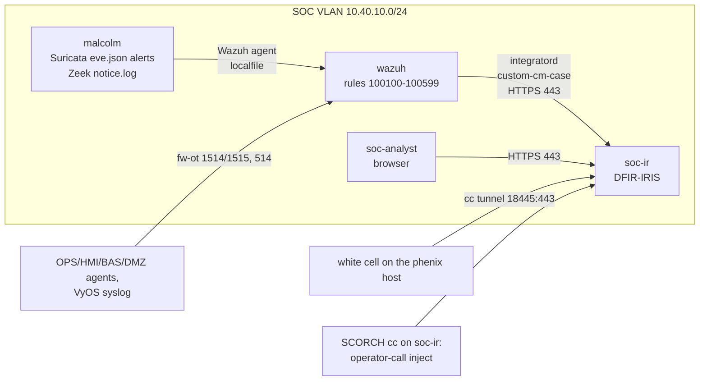

# Spike: case management (TheHive) for the SOC

**Question.** Should the range add a case-management and incident-response
tool next to Wazuh and Malcolm, and if so, is that tool TheHive? Five parts:
(1) the training value over what Wazuh and Malcolm already give, (2) TheHive's
licensing against the all-open-source goal ([DESIGN §2](../../docs/DESIGN.md#2-goals-and-non-goals),
[§20](../../docs/DESIGN.md#20-licensing)), (3) how alerts get from Wazuh and Malcolm
into cases, (4) where the tool sits and what it costs against the host budget
([§11](../../docs/DESIGN.md#11-node-inventory-and-resources)), and (5) the risks.
**Decides:** whether the SOC module gets a fourth VM, which product it runs,
and the integration path.

**Answer in one line.** No to TheHive: its license fails §2 and §20, and it
needs about three times the VM memory (8 GB against 3 GB; 4.4 GiB against 0.76
GiB idle in containers). Yes, conditionally, to **DFIR-IRIS 2.4**
(LGPL-3.0). It goes on one small VM, `soc-ir` (2 vCPU / 3 GB), in the `full`
variant only. Wazuh feeds it through one custom integration, and Malcolm's
alerts are routed through Wazuh. Both parts were proved in Docker; see
[Result](#result).

## Background

What the SOC has today ([§14](../../docs/DESIGN.md#14-blue-team-monitoring),
`phenix-configs/topology-soc.yml`):

- **Wazuh 4.14** on `wazuh` (4 vCPU / 8 GB) collects the following:
  - host logs from the agents in OPS, HMI, BAS, DMZ, and SOC
  - VyOS and `ot-svc` syslog
  - the CherryMountain rules 100100 to 100499. The 1003xx block is the
    Guacamole and vendor-session rules.
- **Malcolm** on `malcolm` (8 vCPU / 24 GB) runs Zeek with ICSNPP, Suricata
  (sids 9000110 to 9000199), Arkime, and OpenSearch. It is fed by the `mirror`
  app.
- **`soc-analyst`** (2 vCPU / 3 GB) opens the two consoles in Chromium
  (`cm-analyst-console`).
- The SCORCH `vendor-maintenance` run ends in a `break` for "analyst review"
  ([§15.6](../../docs/DESIGN.md#156-scorch-pipelines)).
- [§15.9](../../docs/DESIGN.md#159-operations) has a TODO to compare ground truth
  against what Malcolm detected.

What is missing is the *respond* half. Neither console can do any of these:

- give an alert a status (new, assigned, closed) or an owner
- group alerts into an incident
- carry a playbook's tasks
- hold observables, affected assets, and evidence across tools
- keep the investigation timeline that a white cell can score

[§18A.7](../../docs/DESIGN.md#18a7-ics-cybersecurity) lists CISA CPG 1.C (incident
response plans) and 5.B (incident reporting) as *Documented* only.

The host budget is tight. `full` asks 113 GB of 128 GB (67 vCPUs on 32 cores).
That leaves about 15 GB for the host, phenix, and the page cache
([§15.9](../../docs/DESIGN.md#159-operations)).

## Options compared

"Fit" is the fit for this range: offline, unattended at boot, small, and OT
playbooks.

| Option | License | Status (checked 2026-11-09) | Case features | Ingest API | Footprint | Offline | Fit |
|---|---|---|---|---|---|---|---|
| **TheHive 5.8 / 6.0** (StrangeBee) | Proprietary EULA; Community: non-commercial, 2 users, 1 org, no redistribution | Active (5.8.1 and 6.0.0 on Docker Hub in Oct 2026) | Best in class: alerts, merge, similar alerts by observable, case templates, tasks, TTPs, dashboards, Cortex and MISP connectors | `POST /api/v1/alert`, unique per type, source, and sourceRef | Supported stack TheHive + Cassandra + Elasticsearch: **4.4 GiB idle** in containers (measured); vendor sizing 8 GB / 4 vCPU for testing | Runs offline, but the license needs a portal activation; 14-day trial, then read-only | **No:** fails §2/§20; 2-user cap |
| **TheHive 4** | AGPL-3.0 | End of support 2022-12-31; public access ended July 2025; repository archived | As 5.x, older | v0/v1 API | Cassandra + Lucene/ES, JVM | Yes | **No:** abandoned, no fixes, no maintained fork found |
| **DFIR-IRIS 2.4.29** | **LGPL-3.0** | Active; 2.4.29 is the latest stable release, 2.5.0-beta.1 and 3.0.0-beta.1 are in progress | Alerts (status, owner, merge or escalate into new or existing cases, related alerts by IOC and asset), cases, **typed assets** (custom types such as PLC), IOCs, tasks, notes, timeline (alerts become events), case templates, customers | `POST /alerts/add`; admin key settable at first boot (`IRIS_ADM_API_KEY`) | **0.76 GiB idle** in containers (measured: app, worker, Postgres, RabbitMQ) | Yes (needs no license or online step) | **Yes** |
| Wazuh's own features | GPL-2.0 | 4.14: no case management. The 5.0-rc "Incident response" section tracks active responses only | None (alerts and threat hunting only) | n/a | 0 | Yes | Baseline only |
| OpenSearch Alerting / Security Analytics (in Malcolm's and Wazuh's OpenSearch) | Apache-2.0 | Active | Monitors, triggers, findings, alerts and notifications; correlation graph. No cases, tasks, assignment, or timeline | Notifications channels (webhook) | 0 (already there) | Yes | Feed, not a case tool |
| Catalyst (SecurityBrewery) | AGPL-3.0 | **Archived 2026-07-18** | Tickets, tasks, timelines, reactions (webhooks) | OpenAPI | Small (Go) | Yes | **No:** archived |
| RTIR 6.0.4 (Best Practical) | GPL-2.0 | Active (6.0.4 released 2026-10-29) | CSIRT queues: incident reports, incidents, investigations, countermeasures; constituencies; IP lookup | RT REST2 | Perl + RT + database | Yes, but a heavy offline build (CPAN) | Possible; email-centric CSIRT workflow, weaker for SOC alert triage |
| Shuffle (SOAR) as glue | AGPL-3.0 | Active | None (automation only) | Webhooks | Own OpenSearch 3.2 with a 3 GB heap, plus workers that pull apps | Apps come from the internet | **No:** heavy, and not a case tool |
| Nothing (status quo) | — | — | Analyst notes on `soc-analyst` | — | 0 | Yes | Fallback if the host cannot spare 3 GB |

**Training value, concretely.** These are the things a case tool adds that
Wazuh's dashboard and Malcolm do not:

- **Triage discipline.** Every forwarded alert has a status and an owner. The
  white cell can see whether the analyst acknowledged the 100302 "cmadmin from
  the vendor tunnel" alert or let it age.
- **Incident grouping.** A vendor session produces Wazuh 100201, 100301, 100311
  and 100402, and 100411 for the upload. Malcolm adds Suricata 9000151 and the
  Zeek `PLC_Change_During_Vendor_Session`. In a case tool these become one
  case, with the vendor IP, the account, the EWS, and the PLC as observables
  and assets.
- **ICS playbooks as case templates.** Two examples:
  - **CM-IR-02 "PLC program or mode change"** (proved below): identify the
    approval record, name the PLC and its process area, ask operations whether
    the process is safe *before* containment, cut the vendor path, preserve the
    Guacamole recording and the Arkime sessions, restore the baseline ZIP, and
    record the reporting decision ([§18A.7](../../docs/DESIGN.md#18a7-ics-cybersecurity)
    CIRCIA).
  - **CM-IR-05 "CO₂ life-safety event with cyber indicators"**: people first.
    Confirm the purge fans and the hardwired relay
    ([§6.7](../../docs/DESIGN.md#67-cellar-co2-life-safety-interlock)), and do not
    isolate `bas-vent` while it runs the purge. The evidence is the BACnet
    `WriteProperty` alerts (sids 9000113 to 9000116, Zeek
    `BACnet_Write_Unexpected`) and the BBMD BDT activity.

  These are the ICS-specific decisions that make an OT exercise different from
  an IT one, and today they have nowhere to live.
- **Assets.** IRIS tracks affected assets by type. The proof added a `PLC`
  asset type, and `plc-cellar` arrived typed as one. TheHive 5 carries hosts
  only as observables.
- **Scoring.** Alert creation, acknowledgement, case creation, and task
  closure times, read back over the API, give the white cell these numbers to
  compare with ground truth (sim time, [§9.5](../../docs/DESIGN.md#95-scenario-events-and-ground-truth)):
  - time to detect
  - time to acknowledge
  - time to declare
  - time to contain and recover

  That extends the §15.9 "ground truth against Malcolm" TODO from *detection*
  to *response*.

## Recommendation

1. **Do not adopt TheHive** (any version), and do not adopt Cortex on its own.
   The license is the deciding reason (see [Licensing](#licensing)). The
   resources (4.4 GiB idle for the supported stack against 0.76 GiB for IRIS)
   and the JVM/Cassandra operations confirm it.
2. **Adopt DFIR-IRIS 2.4.29 as an optional SOC component, `full` only.** It
   runs on a new VM, `soc-ir` (2 vCPU / 3 GB / 16 GB disk), in a new topology
   module, `topology-ir.yml`, that `topology-full.yml` includes. One include
   line takes it out. It does not go in `lite` (no SOC) or `ci`. The mapping
   tests run in CI with the SOC tests.
3. **Integration.** One Wazuh custom integration, `custom-cm-case` (proved
   here), sends CherryMountain alerts of level 7 and up to IRIS. **Malcolm's
   network alerts reach IRIS through Wazuh.** The existing Wazuh agent on
   `malcolm` tails Malcolm's live Suricata `eve.json` alerts and its Zeek
   notices, and new rules 100500 to 100599 map them. So there is one funnel,
   one severity map, one dedup point, and cross-source correlation in Wazuh.
   OpenSearch Alerting webhooks from Malcolm straight to IRIS are the fallback.
4. **Gate it.** This is a go only if the [plan](#plan)'s Phase 1 VM boots
   offline and stays within 3 GB. If the host cannot spare the 3 GB, the
   fallback is no case tool. In that case, build the white-cell scoring
   against Wazuh and Malcolm only, and give the analyst a report template.

## Licensing

**TheHive 5 and 6 (StrangeBee).** All of the following is from primary
sources, checked 2026-11-09.

- **Closed source, commercial.** TheHive's GitHub README: "TheHive is now
  distributed as a commercial version". It says the 3 and 4 repositories are
  archived and their packages withdrawn.
- **Plans.** Community (free), Gold, Platinum, and, from 6.0, One. The
  on-prem paid plans are "an annual subscription starting at €26,000" (pricing
  page).
- **Community Edition page:** "reserved for non-commercial use such as
  learning, academic research and personal home labs"; **two users maximum
  and one organization**.
  - The license is requested on the StrangeBee License Portal with a work or
    academic email; free mail providers are refused.
  - Activation needs a running instance.
  - A new install runs **14 days with Platinum features, then becomes
    read-only** without a license.
- **Activation** (docs): copy a challenge from TheHive, paste it into the
  portal, then paste the generated key back. The docs do not say whether this
  works air-gapped, so it is unverified for an offline range.
- **License text.** The Community T&C page links to *TheHive 5 General Terms –
  Community Version*, "Last Updated: July 29, 2022" (the PDF, uploaded in
  2024-06):
  - §1.1: install "one copy of the Software within the Customer Network".
  - §1.2: each login ID is for one Authorized User only, and "Use of a single
    login ID by multiple Authorized Users shall constitute a breach".
  - §1.3: "primarily for an initial discovery, testing, training, and
    education purposes". The customer may not reverse engineer; may not
    "re-sell, sub-license or distribute the Software (in its whole or any part
    thereof)"; may not provide "service bureau, time-sharing or other computer
    services to third parties"; and may not commercially exploit it.
  - Preamble and §11.6: StrangeBee may change the terms "effective immediately
    upon being posted", and the unlimited subscription term "at its own
    discretion at any time".
  - §9.4: on termination, the customer must delete every copy.
- **Measured.** A fresh TheHive 5.8.1 enforced the trial quotas over the API:
  - the license is `platinum-trial`, valid from 2026-11-09T18:25:34Z, expiring
    **2026-11-24T23:59:59Z**
  - `{"organisations": 1, "users.normal": 2}`
  - a second organization was refused with `LicenseLimitExceeded ... (1/1)`
  - a third normal user was refused with `LicenseLimitExceeded ... (2/2)`
  - service accounts were accepted and do not count

**Verdict on TheHive: no-go.**

- **§2** requires "only open-source software, with permissive or copyleft OSI
  licenses", and TheHive 5/6 is proprietary. **§20** already excludes Security
  Onion (ELv2), EMQX (BSL), and Labshock (non-commercial); TheHive Community is
  non-commercial *and* closed, so it fails on both counts.
- The repository's GPL-3.0 is not the problem: `phenix image build` would
  download TheHive, and the repository would ship nothing of it. But:
  - **built images could not be shared**: §1.3(b) forbids distributing it, and
    the range shares prebuilt images (for example `vyos` through oras);
  - a team exercise breaks the **2-user cap**, and sharing an analyst login
    breaks §1.2;
  - "non-commercial" excludes most organizations that run a cyber range;
  - every fresh experiment either repeats a portal activation or runs on the
    14-day trial. Re-arming the trial by rebuilding is not a licensing basis.

**TheHive 4: no-go.**

- It was AGPL-3.0, but it reached end of support on 2022-12-31, and "July 2025:
  TheHive 3 & 4 — End of Public Access" (TheHive Project blog).
- The repositories are archived and the packages withdrawn. Old
  `thehiveproject/thehive4` tags were still on Docker Hub when checked, with the
  last push on 2022-09-13.
- Only scattered personal forks exist, and none is maintained. Running
  unpatched 2022 software as the range's IR tool teaches the wrong lesson.

**Cortex: open source, but not useful here alone.**

- Cortex is AGPL-3.0 (StrangeBee docs and GitHub) and needs no license.
- It is maintained: `thehiveproject/cortex` 4.0 (2026-03), 4.1 (2026-06), and
  4.2.0 (2026-10-22).
- It runs every analyzer and responder as a Docker container. The images come
  from a catalog at `catalogs.download.strangebee.com` and the registry, so an
  air-gapped range needs a mirror.
- Most analyzers query internet services. The useful offline pieces are a few
  local ones and responders such as `Wazuh` and `Elasticsearch` (in
  Cortex-Analyzers' `responders/`).
- Its natural client is TheHive. IRIS reaches Cortex only through a community
  module (not evaluated).

**DFIR-IRIS: compatible.**

- IRIS is LGPL-3.0 (`LICENSE.txt` at v2.4.29, and the compose file header).
- Its stack:
  - PostgreSQL (PostgreSQL License, already in §20)
  - RabbitMQ (MPL-2.0 core, per its `LICENSE`)
  - nginx (BSD-2-Clause, already in §20)
- All are OSI-approved, with no user caps, activation, or redistribution limit.
  §20 gains three rows: DFIR-IRIS LGPL-3.0, RabbitMQ MPL-2.0, and TheHive in
  the excluded list.

## Integration design



**Strategies compared.** The same choices apply to TheHive and to IRIS.

| Path | How | For | Against | Choice |
|---|---|---|---|---|
| Wazuh: integratord custom script | `<integration><name>custom-cm-case</name>` runs a script per matching alert with `<alert file> <api key> <hook url> [<options file>]` | Native, per-alert, filters by `level`, `group`, `rule_id`; 2.4 s end to end (measured) | No queue: an alert sent while the case tool is down is lost unless the script spools it; the API key sits in `ossec.conf` | **Chosen**, with a spool-and-replay file (Phase 2) |
| Wazuh: `custom-w2thive` (Wazuh blog, 2022) | Same mechanism; thehive4py 1.8.1 | Documented | Written for TheHive 4.1.18 and Wazuh 4.2.5; random 6-character `sourceRef`, so no dedup; no severity map; no IRIS | Superseded by `custom-cm-case` |
| Wazuh: pull from the indexer | Poll `wazuh-alerts-*` with `search_after` | Catches up after outages | More code, needs indexer credentials on the case VM; latency is the poll interval | Later, as the replay path if the spool is not enough |
| Wazuh → Shuffle → case tool | Webhook into a SOAR | Visual workflows | A second OpenSearch (3 GB heap) and apps pulled from the internet | No |
| Malcolm → Wazuh → case tool | Agent on `malcolm` tails `/opt/malcolm/suricata-logs` (eve alerts) and `zeek-logs/live` notices (`TODO(verify)`: file names and formats in Malcolm 26.10.0); rules 100500–100599 by sid and notice | One funnel and mapper; correlation with host events (100411 with sid 9000150/9000151); Wazuh becomes the SIEM of record | More EPS on the manager (filter on `event_type: alert`); duplicates Malcolm's alerts in the Wazuh indexer (16 GB disk) | **Chosen** |
| Malcolm → case tool directly | OpenSearch Alerting doc-level monitor, Notifications channel (`POST /_plugins/_notifications/configs`, `config_type: webhook`) with the IRIS JSON in the message template | No new rules; native | Mustache templates across Malcolm upgrades; the API key stored in OpenSearch; a second mapper | Fallback |
| Cortex analyzers and responders | Docker-run analyzers from a mirrored catalog | Enrichment; responders (`Wazuh`) that act | Mostly internet services; a responder that blocks traffic in OT can trip the process | No (revisit for responders as a teaching point) |
| MISP | Local MISP for the range's own IOCs | Sharing practice | No feeds offline; another VM | No (IRIS has a MISP module if wanted) |

**Alert to case mapping** (`poc/cm_wazuh_case.py`):

- **Severity bands.** Wazuh levels map to case-tool severities:

  | Wazuh level | Case severity (TheHive / IRIS id) | CherryMountain rules today |
  |---|---|---|
  | < 7 | not forwarded (baseline, stays in Wazuh) | 100100, 100103, 100200–100202, 100300, 100301, 100310, 100311, 100410 |
  | 7–9 | Low (1 / 4) | 100203, 100303, 100313, 100400, 100402, 100411, 100412 |
  | 10–11 | Medium (2 / 1) | 100101, 100102, 100104, 100204, 100205, 100305, 100306, 100413 |
  | 12–13 | High (3 / 5) | 100105, 100302, 100304, 100314, 100401, 100307, 100308 |
  | 14–16 | Critical (4 / 6) | none today: reserve level 14 for the life-safety rules of the Malcolm funnel (a BACnet write to `bas-vent`) and the white cell's operator call |

  IRIS's default severity ids are not ordered (Medium is 1). The script uses
  the ids read from a fresh 2.4.29.
- **Filter.** The integration block uses `level` 7 and `group` cherrymountain.
  Wazuh ANDs combined filters, so an "OR" needs a second block. Raising the
  level to 10 drops the approved-vendor-session alerts if they distract.
- **Dedup.**
  - The reference is `wazuh-<alert id>`. TheHive refuses a duplicate type,
    source, and sourceRef. IRIS has no uniqueness, so the script queries
    `GET /alerts/filter?source_reference=` first. Both were measured: a
    re-delivery made no new alert.
  - Firewall drops (`cm_firewall`) fold into one alert per rule, source,
    destination, port, and 15-minute bucket. Rule 100104 still aggregates
    scans inside Wazuh.
- **Observables.** IPs (source and destination become IRIS `ip-src`/`ip-dst`),
  the reporting host, the PLC named by `cm-plc-tool`, accounts, and the
  WireGuard peer. Hosts become IRIS assets: `fw-*` as Firewall, PLCs as a
  provisioned `PLC` type, and the rest as Linux server.
- **Playbook.** The first matching rule group selects the case template:

  | Rule group | Case template |
  |---|---|
  | `cm_tamper` | CM-IR-04 |
  | `cm_program_change` | CM-IR-02 |
  | `cm_vendor_outside_window` | CM-IR-01 |
  | `cm_blocked_conduit`, `cm_scan` | CM-IR-03 |

  The life-safety rules 1005xx will select CM-IR-05.
- **Hook from the white cell.** SCORCH `cellar-co2-leak` gains a `cc` step on
  `soc-ir` that posts an "operator call" alert (source `operator-call`, written
  as a shift lead would say it). The SOC then hears about the CO₂ event the
  way a real one would, without a process-alarm feed (see [Gaps](#gaps-found-in-the-existing-soc)).

## Topology placement and conduits

- **Node `soc-ir`.**
  - Zone SOC, VLAN 116, `10.40.10.13/24`, gateway `10.40.10.1` (fw-ot), DNS
    `10.20.30.13`, label `zone: soc`.
  - Image `cm-ir.qc2`, 2 vCPU / 3072 MB.
  - Autotunnel `["18445:443"]` (the label key only, as in
    [§15.3](../../docs/DESIGN.md#153-topology-modules-and-variants)).
  - A Wazuh agent in the `soc` group (add it to `app.wazuh.agents`; netcheck
    keeps that list equal to the conduits).
  - New module `topology-ir.yml` (`cherrymountain-ir`), included after
    `topology-soc.yml`. `soc-analyst` gets a third URL in `ANALYST_URLS`.
- **Why a VM and not co-location.**
  - `wazuh` is a package install with no Docker. Adding Docker and IRIS there
    couples the SIEM's failure to the case tool's and adds about 2 GB.
  - `soc-analyst` uses `cm-desktop`, shared with the HMIs, corp, and the
    vendor laptop. Docker and about 3 GB of IRIS images would land in every
    desktop node or force an image fork.
  - A 3 GB VM costs one VM's worth of base OS, keeps SoH per service, and can
    be dropped by removing one include.
- **Conduits.** Every new flow is intra-SOC except time and DNS, which the
  existing "all routed OT zones → ot-svc" row of §10.3 already covers. So there
  are no new fw-ot rows, and nothing in OT can reach `soc-ir`.

  | Source | Destination | Port | Purpose |
  |---|---|---|---|
  | wazuh (.11) | soc-ir (.13) | TCP 443 | integratord → IRIS API |
  | soc-analyst (.12) | soc-ir | TCP 443 | Analyst browser |
  | malcolm (.10) | soc-ir | TCP 443 | Only with the OpenSearch-webhook fallback |
  | soc-ir | wazuh | TCP 1514/1515 | Its own Wazuh agent (intra-zone) |
  | soc-ir | ot-svc | UDP 123, UDP/TCP 53 | Time and DNS, as for the other SOC hosts |

  A host nftables policy on `soc-ir` accepts 443 only from .10–.12, and fw-ot
  keeps its default deny. Add the rows to the §10.3 "intra-SOC" line, and add
  a netcheck test that no cross-zone row targets `soc-ir`.

## Resource estimate

**`soc-ir` (DFIR-IRIS) sizing.** The measured idle total is **756 MiB**: app
181, worker 391, Postgres 54, and RabbitMQ 130, under 1 % CPU. A noble minbase
with Docker adds about 0.5 GB, plus nginx and headroom for the worker (modules,
background jobs) and Postgres's cache. That gives **2 vCPU / 3 GB**. The
disk is 16 GB: about 3 GB of images (the app 2.24 GB, the db 381 MB,
RabbitMQ 227 MB, and nginx 109 MB compressed) plus the database.

**TheHive, for comparison.** The supported stack measured **4.43 GiB** idle:
TheHive 1.72, Cassandra 1.29, Elasticsearch 1.42, with StrangeBee's
testing-profile heaps. StrangeBee's own figures are 8 GB / 4 vCPU for testing,
and 4 GB and 3 cores *per service* below 10 users. Cortex adds a 1 GB heap
with a 2 GB limit, plus its analyzer containers. So TheHive needs **4 vCPU /
8 GB**, or **10 GB with Cortex**, and StrangeBee recommends 100 GB of disk.

| Variant | VMs | vCPUs | RAM | Headroom of 128 GB | Note |
|---|---|---|---|---|---|
| `full` today | 43 | 67 | 113 GB | ~15 GB | [§11](../../docs/DESIGN.md#11-node-inventory-and-resources) |
| **`full` + soc-ir (recommended)** | **44** | **69** | **116 GB** | **~12 GB** | Add "drop `topology-ir.yml` (−3 GB)" to the §15.9 memory ladder, after the slim Malcolm |
| `full` + slim Malcolm + soc-ir | 44 | 65 | 104 GB | ~24 GB | Recommended on a loaded host |
| `full` + TheHive (no Cortex) | 44 | 71 | 121 GB | ~7 GB | Rejected; needs the slim Malcolm to be safe |
| `full` + TheHive + Cortex | 44 | 71 | 123 GB | ~5 GB | Rejected |
| `lite` | 37 | 48 | 71 GB | — | Unchanged: no SOC |
| `ci` | 5 | 7 | ~8 GB | — | Unchanged; the mapping tests (`poc/test_cm_wazuh_case.py`, later `tests/soc`) run in the Lint workflow |

**Boot time against SoH** (`startupDelay: 10m`, `c2Timeout: 15m`):

- **IRIS.** The API answered **10 s** after the containers started on the
  first boot (database creation and migrations included), and **3 s** after an
  unclean kill. On the VM add the boot and the first `cm-load-images` of
  about 3 GB of skopeo directories. The estimate is 3–5 minutes on the first boot
  and under one minute later, inside `startupDelay`.
- **TheHive.** Cassandra was ready in 64 s and TheHive's API 95 s after it.
  That is about 3 minutes in Docker on 4 vCPUs, so likely 5–8 minutes on a
  loaded host, like Wazuh.

**Image build** (`cm-ir`, in the style of `cm-guacamole` and `cm-malcolm`):

- noble minbase, 16G, Docker CE and the compose plugin, and skopeo.
- `skopeo copy` of the four images, **pinned by digest**, into
  `/var/lib/cm-ir/images`, listed in `/etc/cherrymountain/images.list` for the
  existing `cm-load-images.service`.
- The compose file, `cm-ir-provision`, `cm-ir-health`, the case templates
  (JSON), and the asset types are injected by the topology from
  `phenix-injects/ir/`.
- The range has no internet. The image build does, but Docker Hub answered
  **429 Too Many Requests** during this spike, so pull from GHCR (IRIS) and a
  mirror for RabbitMQ (`public.ecr.aws/docker/library/rabbitmq`), by digest.
- On `cm-wazuh`, the integration needs Pydantic for Wazuh's embedded Python
  3.10. The wheels are installed with `pip --no-index --target
  /var/ossec/integrations/cm-lib` from wheels downloaded at build, so Wazuh's
  own framework packages are untouched. This is what the proof did.

## Plan

Phase 0 is this spike. Phase 1 starts only with the owner's go.

| Phase | Work | Exit criteria | Est. |
|---|---|---|---|
| 1. Image and module | `cm-ir` image; `topology-ir.yml`; `phenix-injects/ir/` (compose by digest, `cm-ir-provision`, `cm-ir-health`, `65-ir.sh`, nftables); `cherrymountain` app: `RangeSecrets` gains `iris_admin_password`, `iris_admin_api_key`, the Postgres passwords, `iris_secret_key`, `iris_password_salt`, and a **per-experiment range CA** that signs `soc-ir`'s certificate; SoH `dockerContainers` and `cm-ir-health`; README section; §11, §14, §15, §19, §20 edits | A fresh `full` apply boots `soc-ir` with no internet; IRIS on 443 with the CA-signed certificate; SoH green; steady RSS ≤ 3 GB; `phenix experiment stop/start` keeps the cases (same `secrets.json`) | 2–3 days |
| 1 go/no-go | Owner review | No-go if the VM needs more than 3 GB or cannot boot offline. Fall back to no case tool | — |
| 2. Wazuh → IRIS | `custom-cm-case` in `cm-wazuh` (offline wheels); the app renders the `<integration>` blocks and the key; spool-and-replay on failure; service account with alert rights only (`TODO(verify)`: set its key in Postgres at provision, else use the admin key); provision asset types (PLC, RIO, HMI, EWS, SCADA server, BBMD, VyOS) and the templates CM-IR-01 to CM-IR-05; tests in `tests/soc` against the fixtures | SCORCH `vendor-maintenance` produces the expected IRIS alerts within 60 s and no duplicates across a manager restart | 1–2 days |
| 3. Malcolm through Wazuh | `soc.conf` localfiles on `malcolm` for Suricata eve alerts and Zeek notices; decoders; rules 100500–100599 (sid 9000xxx and the CherryMountain notices, life-safety at level 14); a correlation rule (100411 with sid 9000151 within N minutes); `samples.txt` lines and logtest | Suricata 9000150/9000151 and `PLC_Change_During_Vendor_Session` reach IRIS from a pcap in `pcap/upload`; manager EPS stays under its limit | 2 days |
| 4. Exercises and scoring | The `operator-call` inject (SCORCH `cc` on `soc-ir`) for `cellar-co2-leak`; `cm-ir-score` on the host: ground-truth events (sim-ctl OpenSearch) against IRIS alert, ack, case, and task times; cleanup exports the IRIS cases (JSON) to Files | A dry run gives a scored timeline (TTD, TTA, time to case, time to contain) | 2–3 days |
| 5. VM validation | First run on the 128 GB host with the full module set; boot time; memory | Matches the estimates above; §15.9 runbook updated (reset clears IRIS) | 1–2 days |

**Total: 8–12 working days.** **Go/no-go:**

- TheHive: **no-go**.
- IRIS: **go for Phase 1**, with a second gate after Phase 1 on resources and
  offline boot.

## Risks

| Risk | Applies to | Likelihood / impact | Mitigation |
|---|---|---|---|
| License change | TheHive: terms change "effective immediately upon being posted"; IRIS: LGPL, low | High for TheHive; low for IRIS | TheHive rejected; IRIS pinned by version and digest |
| Resource pressure on a 128 GB host | Both (IRIS +3 GB, TheHive +8–10 GB) | Medium | Separate module, dropped first in the §15.9 ladder; slim Malcolm |
| JVM memory and GC (TheHive, Cassandra, Elasticsearch) | TheHive | High (three heaps) | Avoided with IRIS (Python and Postgres) |
| Cassandra under VM snapshot, restore, or kill | TheHive | Medium. One `kill -9` of all three recovered in 62 s with data intact; snapshot restore with a clock jump is untested. The single-container BerkeleyDB mode hung (HTTP 500 on login) after the host disk filled, until restarted | Avoided with IRIS: Postgres recovered from `kill -9` in 3 s |
| Integration-script maintenance | Both | Medium | Wazuh 5.0 is in release candidate; IRIS 2.5 ("API v2") and 3.0 are in beta. Pin Wazuh 4.14 and IRIS 2.4.29, keep the fixture tests, and treat any upgrade as a re-spike |
| Alert loss while the case tool is down | Both | Medium (integratord does not queue) | Spool failed alerts; replay on the next run or with a timer; the Wazuh indexer stays the record |
| Analyst distraction (case admin instead of triage) | Both | Medium | Forward level ≥ 7 only (≥ 10 if noisy); templates pre-provisioned; the white cell may switch the module off per exercise |
| Ground-truth leakage | Both | Medium | Nothing from sim-ctl or ground truth goes into IRIS. White-cell injects read like real calls. Scoring is read-only through the API. IRIS prints the admin password in the app container's log on first boot (seen in the proof): root-only on the VM, but keep `docker logs` out of player reach |
| TLS and credentials | Both | Medium | All secrets from the app's `secrets.json` (`IRIS_ADM_API_KEY` is settable at first boot); a per-experiment CA; the integration verifies TLS (`Options.ca_file`), never `-k`. The service account's key mechanism is `TODO(verify)` |
| End-of-life parts inside IRIS images | IRIS | Medium | `iriswebapp_db` 2.4.29 runs **PostgreSQL 12.22**, past its 2024-11-21 end of life. Range-internal and SOC-only; track IRIS's move to a newer Postgres; do not expose it |
| Registry rate limits at image build | Both | Medium (Docker Hub 429 seen) | Digests; GHCR and ECR mirrors; skopeo at build, never a pull at boot |
| Wazuh disk | Both (the integration lives on `wazuh`) | Low | Wazuh ships a 320 MB vulnerability feed that its first start unpacks to **2.5 GB** in `/var/ossec/tmp`, internet or not (the container grew 3 GB in five minutes in the proof). `cm-wazuh-provision` already disables vulnerability detection before the first start: keep it that way on the 16 GB disk |
| One analyst seat | Both | Low | A team exercise needs more `cm-desktop` analyst VMs (3 GB each); IRIS has no user cap, while TheHive Community stops at 2 |

## Result

Docker on this sandbox (4 vCPU, 16 GB, Docker 29.9): TheHive 5.8.1, Cassandra
4.1, Elasticsearch 8.19.23, Wazuh manager 4.14.1, and DFIR-IRIS 2.4.29. The
dates are 2026-11-09 (UTC). Scripts are in [`poc/`](poc/).

**TheHive 5.8.1, single container** (local BerkeleyDB, Lucene, local files;
`poc/run_poc.sh thehive`):

- The image itself warns that this mode is unsupported: "Starting from TheHive
  5.1, lucene index is **no longer supported**". Filtered queries logged "The
  index engine is not Elasticsearch" and fell back.
- Idle: **1.32 GiB, 5–9 % of one core**. The image is 1.13 GB (482 MB
  compressed).
- License: as in [Licensing](#licensing). It enforced 1 organization and 2
  normal users, and service accounts were accepted.

**TheHive 5.8.1 + Cassandra 4.1 + Elasticsearch 8.19.23** (the supported
topology, with StrangeBee's testing heaps of 1280M, 1024M, and 1G):

- Cassandra was ready in 64 s, and TheHive's API **95 s** after its start
  (first start, schema creation).
- At start, TheHive and Cassandra peaked at 271 % and 108 % CPU.
- Idle: **TheHive 1.72 GiB, Cassandra 1.29 GiB, Elasticsearch 1.42 GiB = 4.43
  GiB**, about 8–10 % of one core in total.
- After `docker kill` (SIGKILL) of all three and a restart, the API was back in
  **62 s** and both alerts were intact.
- Docker Hub refused `elasticsearch:8.19.23` with **429 Too Many Requests**, so
  it came from `docker.elastic.co`.

**Wazuh 4.14.1 → TheHive, end to end** (`run_poc.sh wazuh`, then `send`):

- **The setup.**
  - The manager loaded `phenix-injects/wazuh/cherrymountain_rules.xml` and the
    decoders unchanged.
  - The `custom-cm-case` integration used `level` 7 and `group` cherrymountain.
  - Pydantic 2.12.5 was installed offline into `integrations/cm-lib` for the
    embedded Python 3.10.
- **Six lines from `samples.txt`** produced **4 TheHive alerts in 7 s**:

  | Rule | Level | Severity in TheHive |
  |---|---|---|
  | 100105 | 12 | high |
  | 100302 | 12 | high (inside the approved window, so not 100307) |
  | 100101, sent twice | 10 | medium: **one** alert, the second refused as a duplicate of the bucket |
  | 100411 | 8 | low |
  | 100201 | 6 | not forwarded |

- **Re-delivery.** Running the 100411 alert file through the integration again
  logged `duplicate`, and the count stayed at 4.
- **Latency.** For one more event (100412), the time from the log line to the
  TheHive alert was **2.4 s**.
- **Observables** on that alert: `ip 10.20.10.12`, `hostname ews`, `hostname
  plc-cellar` (tag `ics-asset`), and `other ridgeline` (account).
- **Template.** The alert carried `caseTemplate: CM-IR-02 PLC program or mode
  change`, once that template existed in the org (an org-admin service account
  created it from `poc/case-template-plc-change.json`). Promoting the alert
  made **case #1 with the template's 7 tasks**.
- **The proof's own fixes.**
  - `wazuh-control status` exits 1 while optional daemons are off, so the
    script waits on `wazuh-analysisd`.
  - pip inside the container failed TLS through this sandbox's proxy, so the
    wheels are downloaded on the host and installed `--no-index`. That is the
    same shape as an offline image build.
- **Incidents during the run.**
  - Wazuh's first start unpacked its vulnerability feed (2.5 GB) and filled
    the sandbox disk.
  - TheHive's BerkeleyDB instance then answered 500 to every authenticated
    call until its container was restarted.

**DFIR-IRIS 2.4.29** (`run_poc.sh iris`, then `iris-send`; app, worker,
Postgres, and RabbitMQ; no nginx):

- The API answered **10 s** after the containers started, on the first boot
  with database creation.
- Idle: **756 MiB** (app 181, worker 391, Postgres 54, RabbitMQ 130), under
  1 % CPU.
- `docker kill` of all four, then a start: ready in **3 s**, 4 alerts intact.
- The same script and the same Wazuh alerts (saved from the run above) gave 4
  IRIS alerts. 100201 was dropped, and the re-post of 100302 was found as a
  duplicate through `GET /alerts/filter?source_reference=`.
- **Asset types.** A `PLC` asset type was added over the API (id 22), and
  `plc-cellar` arrived as a PLC asset.
- **Escalation.** Escalating the 100411 alert with a case template (CM-IR-02,
  converted from the TheHive JSON) gave a case with **7 tasks, 2 assets** (`ews`
  as Linux server, `plc-cellar` as PLC), **2 IOCs** (`ip-dst 10.20.10.12`,
  `account ridgeline`), and the alert as a timeline event.
- **API pitfall.** The escalation's `iocs_import_list` and
  `assets_import_list` take **UUIDs**. Names are accepted and silently import
  nothing.
- **Default ids.** IRIS's default severity ids are Medium 1, Unspecified 2,
  Informational 3, Low 4, High 5, Critical 6; the script maps them explicitly.

**Offline checks.** `python3 -m pytest spikes/thehive/poc` gives 16 passed. It
covers the severity bands, dedup buckets, playbook selection, and both
backends' bodies, against real alerts from the run (`poc/fixtures/`). The
script also runs under Wazuh's embedded Python 3.10 (`--dry-run`).

### How to run the proof

```bash
cd cherrymountain-brewery/spikes/thehive/poc
WORK=/some/scratch ./run_poc.sh thehive    # TheHive 5.8.1 single container, org, service key
WORK=/some/scratch ./run_poc.sh wazuh      # Wazuh 4.14.1 manager + rules + integration (internal network)
WORK=/some/scratch ./run_poc.sh send       # samples -> TheHive alerts, re-delivery dedup
WORK=/some/scratch ./run_poc.sh iris       # DFIR-IRIS 2.4.29 with generated secrets
WORK=/some/scratch ./run_poc.sh iris-send  # replays the alerts that send saved
WORK=/some/scratch ./run_poc.sh clean
```

The run needs about 5 GB of free disk for the images. Never enable
vulnerability detection in the Wazuh container; the script disables it. The
TheHive admin credentials are the image defaults on a throwaway container
bound to 127.0.0.1. The IRIS secrets are generated into `$WORK/iris.env`
(0600).

## Gaps found in the existing SOC

Found while reading §13–§15 and the injects. Each one is independent of the
case tool.

1. **Malcolm's detections never reach Wazuh.** `agent-conf/soc.conf` is empty,
   so the agent on `malcolm` ships nothing of Malcolm's. The two consoles
   cannot be correlated: the PLC-change chain is in Zeek
   (`PLC_Change_During_Vendor_Session`), and its host half (100402, 100411) is
   in Wazuh. Phase 3 fixes this with or without a case tool.
2. **Process alarms never reach the SOC.** `cherrymountain_rules.xml` has no
   decoder or rule for FUXA alarms (CO₂ tiers, interlock trips, ATS transfer),
   and the OPS, HMI, and BAS agent groups collect nothing FUXA-specific. In a
   CO₂ incident the SOC sees only Malcolm's BACnet alerts, and the operator's
   call is not modeled. The `operator-call` inject is the cheap fix, and a
   FUXA alarm-to-syslog bridge is the real one.
3. **Console passwords are made on the VMs, not by the app.**
   - Wazuh's dashboard and API passwords come from `wazuh-passwords-tool.sh`
     and land in `/var/lib/cm-wazuh/passwords.txt`.
   - Malcolm's admin password lands in `/var/lib/cm-malcolm/admin-password`.
   - So the analyst needs the white cell's root console to log in. That is
     inconsistent with the §13 table, where every other credential comes from
     `secrets.json`.
4. **No range CA.** Each SOC console has a self-signed certificate, and
   `cm-analyst-console` starts Chromium with `--ignore-certificate-errors`.
   That teaches analysts to click through TLS errors, and any SOC-to-SOC
   integration would have to turn verification off. A per-experiment CA from
   the app (Phase 1) would serve Wazuh's dashboard, Malcolm, and IRIS.
5. **Nothing keeps the analyst's work product.**
   - The §15.9 reset clears Malcolm, Wazuh, the historian, and ground truth.
   - The `cherrymountain` app's cleanup exports only FUXA and InfluxDB.
   - Whatever the analyst concluded is lost at reset.
6. **The severity range in use stops at 13.** No CherryMountain rule is level
   14 or higher, so nothing from Wazuh is ever "critical". The life-safety
   path needs its own rule level (Phase 3).
7. **The vendor approval record** ([§19](../../docs/DESIGN.md#19-risks-and-open-questions),
   §18A.9 #12) is still a hard-coded time window in rules 100204, 100205, and
   100305 to 100308. A case tool is a natural home for the per-session
   approval (a "vendor work order" case with a window). This is out of scope
   here, but worth noting for the §13 owner.
8. **Confirmed, not a gap.** `cm-wazuh-provision` turns vulnerability
   detection off before the manager's first start. The proof showed why this
   matters: the bundled feed unpacks to 2.5 GB, which is 16 % of the indexer
   VM's disk.

## References

All of these were fetched on 2026-11-09.

- StrangeBee, *TheHive Community Edition*. https://strangebee.com/thehive-community-edition/
- StrangeBee, *TheHive on-prem plans*. https://strangebee.com/thehive-pricing-on-prem/
- StrangeBee, *TheHive 5 General Terms – Community Version*, Last Updated July
  29, 2022 (PDF linked from the Community T&C page).
  https://strangebee.com/wp-content/uploads/2024/06/TheHive-5-Community-License-General-Terms-latest.pdf
  and https://strangebee.com/terms-conditions-thehive-community-license/
- StrangeBee, *Legal*. https://strangebee.com/legal-strangebee/
- StrangeBee docs, *About Licenses*. https://docs.strangebee.com/thehive/installation/licenses/about-licenses/
- StrangeBee docs, license activation. https://docs.strangebee.com/thehive/installation/licenses/license/
- StrangeBee docs, *System Requirements* (TheHive 6). https://docs.strangebee.com/thehive/installation/system-requirements/
- StrangeBeeCorp/docker: `testing/docker-compose.yml`, `testing/dot.env.template`,
  `versions.env` (TheHive 6.0.0, Cassandra 4.1.12, Elasticsearch 8.19.23, Cortex 4.2.0).
  https://github.com/StrangeBeeCorp/docker
- TheHive-Project/TheHive README. https://raw.githubusercontent.com/TheHive-Project/TheHive/main/README.md
- TheHive Project blog, 2025 (TheHive 3 and 4 timeline). https://blog.thehive-project.org/2025
- TheHive-Project/Cortex. https://github.com/TheHive-Project/Cortex
- StrangeBee docs, *Cortex*. https://docs.strangebee.com/cortex/
- StrangeBee docs, *Run Cortex with Docker*. https://docs.strangebee.com/cortex/installation-and-configuration/run-cortex-with-docker/
- TheHive-Project/Cortex-Analyzers, `responders/`. https://github.com/TheHive-Project/Cortex-Analyzers/tree/master/responders
- Docker Hub tag listings for `strangebee/thehive`, `thehiveproject/cortex`, and
  `thehiveproject/thehive4`. https://hub.docker.com/v2/repositories/strangebee/thehive/tags
  (and the same path for the other two)
- Wazuh docs, *Integration with external APIs*. https://documentation.wazuh.com/current/user-manual/manager/integration-with-external-apis.html
- Wazuh blog, *Using Wazuh and TheHive for threat protection and incident
  response* (2022-04-06). https://wazuh.com/blog/using-wazuh-and-thehive-for-threat-protection-and-incident-response/
- Wazuh 5.0-rc docs, *Incident response*. https://documentation.wazuh.com/5.0-rc/getting-started/use-cases/incident-response.html
- Malcolm docs, `alerting.md`. https://raw.githubusercontent.com/idaholab/Malcolm/main/docs/alerting.md
- OpenSearch docs, *Security Analytics*. https://docs.opensearch.org/latest/security-analytics/
- OpenSearch docs, *Notifications API*. https://docs.opensearch.org/latest/observing-your-data/notifications/api/
- DFIR-IRIS: repository, releases, `LICENSE.txt`, `.env.model`, and
  `docker-compose.base.yml` at v2.4.29. https://github.com/dfir-iris/iris-web
  and https://github.com/dfir-iris/iris-web/releases
- DFIR-IRIS docs, *Alerts*. https://docs.dfir-iris.org/latest/operations/alerts/
- GHCR tag listings for `dfir-iris/iriswebapp_app`, `iriswebapp_db`, and
  `iriswebapp_nginx`. https://ghcr.io/v2/dfir-iris/iriswebapp_app/tags/list
- SecurityBrewery/catalyst. https://github.com/SecurityBrewery/catalyst
- Best Practical, *RTIR*. https://requesttracker.com/rtir ; release index
  https://download.bestpractical.com/pub/rt/release/ ; RTIR README (license)
  https://raw.githubusercontent.com/bestpractical/rtir/6.0-trunk/README.md
- Shuffle: repository and `docker-compose.yml`. https://github.com/Shuffle/Shuffle
- RabbitMQ server `LICENSE`. https://raw.githubusercontent.com/rabbitmq/rabbitmq-server/main/LICENSE
- PostgreSQL, *Versioning Policy*. https://www.postgresql.org/support/versioning/
