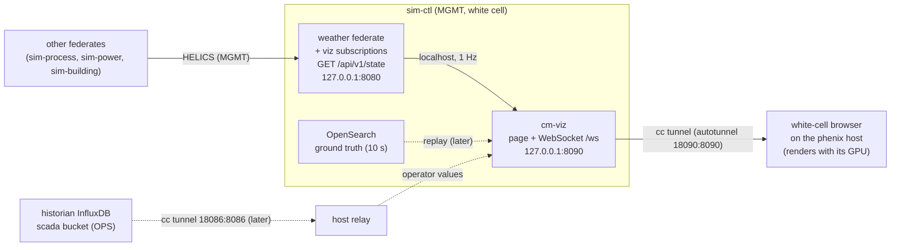

# Spike: a 3D view of the plant (viz3d)

**Question.** Can CherryMountain have a GRFICS-style 3D view in which attacks
have visible physical consequences, built only from open-source parts, with no
GPU in the range VMs, without touching the OT conduits, and without putting the
HELICS federation at risk? Which parts of the plant earn a 3D view, which
engine, where does the view get its state, where does it run, and what does it
cost? **Decides:** whether a 3D view enters the design (a new white-cell
component next to §9.5 ground truth and §15.3 autotunnel), its data path and
node, and the scope of the first build.

**Status:** planned. A local proof of concept (`poc/`) ran in this round; the
spike itself, in phenix, is the [Spike plan](#spike-plan) below.

## Background: how GRFICS does it

GRFICSv3 (commit `8d611b7`, 2026-10-20) and GRFICSv2 (commit `b4dab37`) were
cloned into a scratch directory outside this repository and read. Nothing from
them was run, and nothing from them is copied here.

**Architecture (v3).** One `simulation` container holds everything physical:

- **Process model.** A C++ Tennessee Eastman model (`simulation/simulation/main.cc`,
  `TE_process.cc`) steps every 100 ms (`process_rate = 100000` µs) under one
  mutex and serves its whole state as JSON over TCP port 55555
  (`{"request":"read"}`, `{"request":"write", ...}`). The comment says
  localhost, but the code binds `INADDR_ANY`.
- **Remote I/O.** Six Python pymodbus servers (`remote_io/modbus/feed1.py`,
  `feed2`, `purge`, `product`, `tank`, `analyzer`) poll that socket and serve
  Modbus to the OpenPLC PLC. This is the same remote-I/O pattern CherryMountain
  uses with ot-sim.
- **3D view.** A Unity 2019.4.41f1 WebGL build (`Build/ChemicalPlant.json`:
  WebGL 2.0 with a 1.0 fallback, no multithreading), served by nginx and
  php-fpm on port 80 of the same container. `data/index.php` proxies the
  browser's requests to the model's socket. In v2 the page hands the URL to
  the Unity code (`SendMessage('SimulationConnector', 'StartNetworking',
  '/data')`), and the compiled Unity code polls it. In v3 the dashboard polls
  the same endpoint for status every 3 s (`SIM_POLL_MS`).
- **Truth, not the PLC's view.** The 3D view reads the model directly, never
  Modbus or the PLC. The operator's view is a separate HMI (ScadaLTS in v3,
  ScadaBR in v2). That split is why an attack is visible: the plant moves even
  when the HMI says otherwise.
- **Out-of-band control.** v3 adds a fault-injection page (physical faults
  posted to the model; "cyber injects" sent to a control daemon on the Kali
  container) over an admin bridge network, `a-grfics-admin`, that the
  monitored networks never carry (`docs/cyber-vs-physical-fault-injection-design.md`).
  It also has a "noise floor" scheduler that adds benign events so a real fault
  does not stand out. CherryMountain's MGMT plane and cc tunnels play the same
  role.

**Delivery.** Docker publishes port 80, and the browser on the host renders the
WebGL, so the container needs no GPU. v3 also packages the simulation as a
`.deb` for a VM deployment (`packaging/simulation`: nginx, php-fpm, systemd
units, and a `vm-overlay.js` that disables the Docker-only links). v2 was five
VirtualBox VMs, and its simulation VM served the same kind of Unity build from
Apache.

**Size and performance.** The v3 Unity data file is 201,747,227 bytes (about
192 MiB; a Git LFS object), the wasm code 5.8 MB; the web root also holds a
28 MB `LowQuality.mp4`. v2's data file is 92,446,046 bytes. Every browser
downloads about 200 MB on first load (`cacheControl: must-revalidate`). GRFICS
documents no CPU or GPU requirement for the viewer; it relies on the viewer's
GPU.

**Licensing.** Both repositories are GPL-3.0. The Unity project (scenes, C#
scripts, models) is in neither: only the compiled build is, and it bundles
Unity's proprietary runtime (`UnityLoader.js` and the wasm framework), which
Unity's terms govern, not the GPL. So GRFICS's own source files (PHP, C++,
Python, JavaScript) could be copied into this GPL-3.0 repository with their
notices kept. The 3D build cannot be changed (there is no source), carries a
proprietary runtime that §2's open-source rule excludes, and shows a chemical
plant, not a brewery. This design reuses the pattern only.

**Lessons for CherryMountain.**

1. Serve from the simulation side and render on the viewer's machine: no GPU
   in the range.
2. Read truth from the model, not from the PLC, and show the operator's view
   beside it.
3. Keep anything that controls the view out of band.
4. Avoid a 200 MB opaque binary: this repository needs a diffable asset path
   that builds offline in the image recipes.

## What to visualize, ranked

Training value and effort are scored 1 to 5 (effort 5 is the most work).
"Data today" says whether the federates already publish what the scene needs.

| Rank | Aspect | Value | Effort | Why | Data today |
|---:|---|---:|---:|---|---|
| 1 | **Cellar CO₂ life safety**: gas building up near the floor, the four low sensors, the purge fans, the alarm beacon, the carbonation inhibit | 5 | 2 | A life-safety consequence that is invisible in a real cellar and that an HMI can hide. It exercises the §6.7 interlock and the SCORCH `cellar-co2-leak` run. The model already separates the well-mixed room value (no sensor reads it) from the stratified value the sensors read (×1.25) | Yes: `building/cellar.co2_ppm`, `bas-vent.co2_N_ppm`, tiers, fan command and status, `vent.co2_relay_ok`, and `cellar/co2.vent_gps` |
| 2 | **Fermenters and bright tanks**: fill, temperature, pressure against the 15 psig MAWP, spunding vent, leaks | 4 | 2 | Same room and scene as rank 1. Shows a glycol valve forced open or shut (temperature drift), a spunding setpoint raised (pressure), a carbonation stone forced on. The fill level has no transmitter, so only the model knows it | Mostly: temperatures, pressures, spunding state, BBT levels. FV fill and per-vessel leak are model state only. There is **no 15 psig mechanical relief** in the model (the spunding valve is an ideal relief at a writable setpoint), so an overpressure attack has no physical limit or visible consequence yet |
| 3 | **Plant power**: PV, BESS, genset, ATS, breakers | 4 | 3 | DNP3 and Modbus breaker commands (§7.5) and the utility outage have large, visible consequences: the brewhouse goes dark, the genset starts, the ATS moves EP-1, the BESS state of charge falls, PV is curtailed. Needs an exterior scene (roof, yard) | Yes: every `power/` point, bus-energized flags |
| 4 | Brewhouse: HLT, MLT, kettle levels and temperatures, steam | 3 | 4 | Long timescales (an 11 h brew day), many vessels and pipes. Hot-side consequences such as boil-over are not modeled | Yes for levels, temperatures, valves |
| 5 | Glycol and steam utilities | 3 | 3 | A chiller fault shows best as every fermenter warming, which rank 2 already shows. A chiller model adds little; tint the jacket lines in the cellar scene with the glycol supply temperature instead | Yes |
| 6 | Bottling line | 2 | 5 | The most motion (GRFICS-like), but the consequence is lost production, not safety, and the model gives line states and counts, not bottle positions, so every bottle would be animation. FUXA's 2.5D view already covers PackML | States and counts only |
| 7 | BAS spaces: taproom HVAC, cold room | 2 | 2 | Comfort and keg temperature; little cyber-physical drama. A 2.5D floor plan is enough | Yes |

Ranks 1 and 2 are one scene (the cellar), which the proof of concept built.
Rank 3 is the second scene.

## Options compared

The repository is GPL-3.0 and §2 allows only open-source software with OSI
licenses. "Measured" means this round's proof of concept measured it
([Result](#result)); everything else is from the sources in
[References](#references).

| | three.js or Babylon.js in the browser | Godot 4, HTML5 export | Unity WebGL (GRFICS) | Blender-authored glTF + a web viewer | 2.5D / SVG (standalone, or FUXA widgets) |
|---|---|---|---|---|---|
| **License** | three.js MIT; Babylon.js Apache-2.0. Both compatible | Engine MIT; exports must carry its notice. Compatible | Proprietary editor and runtime (Unity's Editor Software Terms; Personal plan up to $200,000 revenue). **Excluded by §2** | Blender GPL, and what it makes is the user's; glTF 2.0 is an open format. Compatible | Own code (GPL-3.0); FUXA MIT |
| **Asset pipeline** | Geometry in code, generated from plant data like plantgen; glTF for detailed props. Text, diffable | Editor scenes (text `.tscn`) plus glTF imports; the editor is the tool | Binary Unity project, not in GRFICS's repository | Blender files (binary, Git LFS) exported to `.glb`; needs a modeler | Hand-drawn or generated SVG; FUXA widgets are SVG with embedded JavaScript bound to tags |
| **Live data** | WebSocket or fetch, JSON, native | `WebSocketPeer`/`HTTPRequest` in GDScript | `UnityWebRequest` polling (GRFICS polls a PHP proxy) or a JavaScript plugin | Not a runtime: pairs with the three.js or Babylon.js column | Standalone: the same WebSocket. FUXA widgets: FUXA tags, so the **operator's** view, never truth |
| **Delivery in phenix** | Static files and a small Python service in `cm-sim`; one autotunnel entry | Export (wasm + pck) built in the image, or committed through LFS | Build needs an activated Unity editor; GRFICS commits the build output | Same as three.js; `.glb` files next to the page | Standalone: same service as three.js. FUXA: inside the generated project (§12.2) |
| **Without a GPU** | **Measured** (three.js): runs on SwiftShader and on Mesa llvmpipe; on the analyst's own GPU when viewed through the autotunnel | WebGL 2 only (Compatibility renderer); same software paths in principle; not measured | WebGL 2/1; ~200 MB first load; not measured | As three.js | **Measured**: about 1 % of a core; no WebGL needed |
| **Build reproducibility** | Pinned by version and SHA-256 (`fetch_vendor.sh`); no npm build step | Pinned editor and export templates in the recipe, or LFS artifacts | Not reproducible without a Unity license in the build | Pinned Blender for headless export, or committed `.glb` | Trivial (standalone); FUXA project JSON is undocumented and changes between releases (§19) |
| **Maintenance** | Low: one small JavaScript app; three.js ships monthly and breaks APIs, so pin and bump deliberately | Medium to high: a second toolchain (GDScript, editor versions, templates); C# cannot export to the web in Godot 4 | High, and excluded | Medium: modeling skill and binary files | Low (standalone); medium inside FUXA |

**Godot** is a reasonable engine, but for one scene of tanks, gas, and fans it
adds an editor, export templates, and a scripting language to the image
recipes and to the skills a maintainer needs, for no gain over a page the
bridge can serve as plain files. **Babylon.js** would do as well as three.js;
three.js is smaller and was measured here. **Unity** is out on license alone.
**glTF from Blender** is an asset path, not an engine, and the proof of concept
shows the three.js viewer loads glTF.

## Recommendation

**Go for a white-cell 3D view**, as follows:

1. **Engine:** three.js (MIT) in the browser, with the scene's geometry built in
   code from plant data (vessel sizes and positions), and glTF from Blender only
   for props that code draws badly. Vendored at a pinned version and SHA-256.
2. **Fallback:** the 2.5D SVG page, served by the same service from the same
   frames, for any viewer without WebGL, for VNC, and for low-CPU displays.
3. **Data path:** a read-only snapshot on `sim-ctl`. The weather federate (a
   federation member on `sim-ctl` that already serves the event API) subscribes
   to the keys the scene needs and serves `GET /api/v1/state`; a new `cm-viz`
   service on `sim-ctl` turns it into WebSocket frames and serves the page. See
   [Data coupling design](#data-coupling-design).
4. **Where it runs:** `cm-viz` on `sim-ctl` (MGMT), bound to `127.0.0.1`, reached
   only through the autotunnel; rendered by the white cell's browser on the
   phenix host. No new VM, no new conduit. See
   [Topology placement](#topology-placement).
5. **What first:** the cellar scene (ranks 1 and 2), then plant power (rank 3).
6. **Who sees it:** the white cell, and trainees only when the white cell
   decides (a walk-down inject, the debrief). The view is ground truth, so
   showing it during an exercise removes the detection problem the exercise
   is about.

## Data coupling design

Text alternative: the federates publish over HELICS on MGMT to the weather
federate on `sim-ctl`, which keeps the latest values and serves them as a
snapshot on `127.0.0.1:8080`. `cm-viz`, also on `sim-ctl`, reads the snapshot
once a second and pushes frames over a WebSocket on `127.0.0.1:8090`, where it
also serves the page. The white cell's browser on the phenix host reaches it
through a minimega cc tunnel (the autotunnel), which carries no range network
traffic. Later, `cm-viz` can replay ground truth from OpenSearch, and a relay
on the host can bring in the operator's values from the historian through a
second cc tunnel.

**The sources, compared.**

| Source | What it shows | Rate and lag | Risk to the range | Verdict |
|---|---|---|---|---|
| HELICS observer federate (a new member that only subscribes) | Every published value | 1 s (building 10 s) | HELICS 3.1+ has observers and 3.4+ late joining, and observers do not hold back anyone's time. But late joining needs the root broker started with `--dynamic`, and the phenix `helics` app starts the broker (whether it can pass the flag is unverified). Counting the observer in `--federates` instead would make the whole federation wait for the viewer to start. Values published before it joins are not delivered unless buffered | Fallback, if the weather subscriptions disturb timing |
| **sim-ctl event API, extended** (`GET /api/v1/state` on the weather federate) | Every value the weather federate subscribes to, plus truth-only points | 1 s (building 10 s); local poll | The weather federate gains inputs, so it now waits on its publishers like every other federate (the federation already has such loops, for example process → power → process). The HTTP server already runs in its own thread and is handed a snapshot each step (`EventApi.update`), so a slow browser cannot stall the federate. No new member, no broker change | **Recommended** |
| Ground-truth OpenSearch | Published values and model state (fermenter kinetics) | Written every 10 s by design (`TruthWriter.interval_s`), plus bulk and index-refresh lag | None to HELICS; polling load on the white cell's OpenSearch; none in `ci` | Replay and debrief, not live |
| Modbus or OPC UA reads from ot-sim or the PLCs | What the devices or PLCs hold: the field view, not truth | Poll rate | A white-cell host on OT networks (a new conduit that Malcolm sees and the blue team would chase), or MGMT reaching device ports (the MGMT nftables policy forbids it) | Rejected |
| WebSocket bridge (`cm-viz`) | Transport, not a source | 1 Hz frames, about 2 KB each | Read-only; ignores anything a browser sends | **Recommended** as the transport |

**Snapshot contract (proposed).** `GET /api/v1/state` returns
`{"t_s": <granted time>, "sim_time": <ISO 8601>, "values": {"<key>": <value>, ...}}`,
built from the weather federate's inputs at the end of each step and swapped
in whole. plantgen writes the key list (the scene's keys plus the KPI keys).
New truth-only publications are needed for what no device exposes:
`cellar/fvNNN.level_pct` and `cellar/fvNNN.leak_gps`, and a relief state once
the model has a relief valve.

**Ground truth beside the operator's view.** Three layers, each labeled on
screen:

1. **Truth:** the model, including values nothing measures: fermenter fill, the
   well-mixed room CO₂, whether the fans really turn.
2. **Field view:** what the devices serve. These are the HELICS values ot-sim
   publishes (sensor noise, the ×1.25 stratification), so they come free with
   the snapshot. They differ from truth by physics and placement, not attack.
3. **Operator view:** what the HMI shows. That is FUXA's data, which FUXA's DAQ
   writes to the historian's `scada` bucket. `sim-ctl` cannot reach OPS (by
   design), so phase 1 shows FUXA beside the 3D view (its autotunnel already
   exists), and phase 2 adds a relay on the phenix host that reads the bucket
   through a cc tunnel and hands the values to `cm-viz`. A cc tunnel rides
   miniccc's channel, not the range network, so no new flow appears in Malcolm
   or the conduit matrix.

The proof of concept shows the format: a table of truth beside "HMI shows",
with diverging rows in red. A "show what the operator believes" toggle that
redraws the scene from layer 3 (with unknowns such as fill shown hatched)
would make the point in 3D.

**Rates, latency, and the clock.**

- The federates step once a second, and the building federate (the CO₂ room)
  every 10 s; the HMI polls about once a second; operators act in minutes. One
  frame a second matches the source, with a target of 2 s end to end at the
  95th percentile. Faster frames add nothing.
- Motion (fans, plumes, levels) is animated in the browser and eased toward
  each frame (0.4 s in the proof of concept), so the data rate can stay low.
  Easing invents intermediate values; the HUD shows the frame's own numbers.
- Every frame carries the federate time, the simulated date and time, and wall
  stamps. The view shows the simulated time; the cellar's kinetics run 48×
  faster (§9.4), so fermentation progress needs its own clock on screen.
- A view that stops updating must not look healthy (the lesson of FUXA's
  "connected" flag, §8.1): the page shows a red banner after 3 s without a
  frame.

## Topology placement

- **Node and zone:** `sim-ctl` on MGMT, the white cell's node, which already
  holds the event API, OpenSearch, and Grafana. `cm-viz` is a hardened systemd
  unit in `cm-sim` (`DynamicUser`, read-only paths), bound to
  `127.0.0.1:8090`, like the event API on 8080.
- **Conduits:** none. No new NIC, no listener on the MGMT address (the MGMT
  nftables policy stays as it is), nothing on any OT conduit, nothing in
  `netcheck`'s matrix.
- **Access:** add `18090:8090` to `sim-ctl`'s `phenix/startup-autotunnel`
  annotation. The host port is random, so the white cell finds it with
  `cc tunnel list sim-ctl`, as for Grafana and the event API today (§15.3).
  **Not through Guacamole:** `dmz-jump` is the vendor's jump host in the DMZ and
  an exercise target, so routing a ground-truth view through it would break the
  zone model and hand truth to the attacker's path.
- **Without the fork's autotunnel loop** (upstream phenix), the fallback is the
  REST forward the autotunnel spike used, or, at a cost, a desktop VM on MGMT
  viewed through phenix's VNC (the optional in-range renderer in the
  [Resource estimate](#resource-estimate)).
- **Variants:**
  - `full` and `lite`: as above; both have the weather federate and the event
    API.
  - `ci`: none. It has only the cellar federate and no event API, and it exists
    to test the slice. The page and frame schema are tested offline instead
    (the proof of concept's harness runs in CI without VMs).

## Resource estimate

| Item | Cost | Basis |
|---|---|---|
| `cm-viz` on `sim-ctl` | under 1 % of one vCPU at 1 frame/s with 20 browsers; about 90 MiB, less without the in-process simulation | Measured with the proof of concept (which also runs the seven federates in-process) |
| Weather federate | about 100 more subscriptions; negligible | |
| Disk in `cm-sim` | about 2.5 MB of static files | three.js 0.186.1 unminified (2.1 MB) and the page |
| Network per viewer | about 16 kbit/s at 1 frame/s; one-time page load of about 2.2 MB (about 0.45 MB gzipped) | Measured; GRFICSv3 loads about 200 MB |
| White-cell browser | the analyst's GPU | |
| **Host-fit budget (§11)** | **unchanged**: 43 VMs, 67 vCPUs, 113 GB; `sim-ctl` stays 2 vCPU / 6 GB | |
| Optional in-range renderer (not recommended by default) | a `cm-desktop` VM on MGMT, 2 vCPU / 3 GB, which would make 44 VMs, 69 vCPUs, 116 GB; it needs a WebGL flag and a frame-rate cap, and the headed browser alone held about 1.1 GiB | Measured with 2 CPUs ([Result](#result)) |

## Spike plan

The proof of concept answered "can it render without a GPU, and does the data
model hold up" locally. The spike answers "does it work in phenix, through the
real tunnel, without disturbing the federation". It runs as a job in the
existing `cherrymountain-spikes.yml` workflow, like the autotunnel spike.

**Fixture.** A four-VM slice: `sim-ctl` (broker, weather with the snapshot,
`cm-viz`, OpenSearch), `sim-process` (cellar), `sim-building`, and one
`cm-desktop` VM on MGMT for the in-range rendering test. No field devices or
PLCs: the cellar runs on its own (no autopilot), and the scenario events come
from `plantevent`.

**Steps.**

1. **Snapshot (sim, about 0.5 day).** plantgen writes a `viz` key list and the
   truth-only points (`cellar/fvNNN.level_pct`, `leak_gps`); the weather
   federate subscribes to them and to the KPI keys, and serves
   `GET /api/v1/state`. Unit tests with the offline harness.
2. **`cm-viz` (about 0.5 to 1 day).** `bridge.py` reduced to a `simctl` source,
   a systemd unit in `cm-sim`, three.js fetched at image build with its pinned
   hash, and `18090:8090` on `sim-ctl`.
3. **Through the tunnel (about 1 day).** On the phenix host, Playwright loads the
   page through the autotunnel and records: the page load time, frame age at
   the 50th and 95th percentiles, the simulated time against the federation's
   granted time, and the time from a `plantevent co2-release` to the leak in
   the frames.
4. **Failure behavior (part of step 3).** Stop the weather federate: the stale
   banner within 3 s. `vm kill` and `vm start` `sim-ctl`: the tunnel comes back
   on a new host port; record what the viewer must do (look the port up again
   and reload).
5. **Federation timing (about 0.5 day, mostly waiting).** One hour with and
   without the viz subscriptions: the weather federate's real-time lag and
   every federate's granted time, from the logs.
6. **In-range rendering (about 0.5 day).** In the `cm-desktop` VM (2 vCPU, the
   pinned Chromium 150): the stock `cm-range` flags, then with
   `--enable-unsafe-swiftshader`, then with `--use-angle=gl --ignore-gpu-blocklist`
   (Mesa llvmpipe); frames per second and CPU, at 1280×720, capped at 15 frames
   per second. View it through phenix's VNC and record the frame rate and
   bandwidth the viewer sees.
7. **Operator view probe (optional, 0.5 day).** Read the historian's `scada`
   bucket through a cc tunnel on the host and compare the CO₂ tags with truth;
   record FUXA's DAQ lag.

**Exit criteria.**

- [ ] The page renders in the white cell's browser through the autotunnel, and
      frame age at the 95th percentile is at most 2 s.
- [ ] The simulated time in the frames matches the federation's within one
      step.
- [ ] A `co2-release` from `plantevent` shows in the view within 15 s (the
      building federate steps every 10 s).
- [ ] The stale banner shows within 3 s of the source stopping, and the view
      recovers after `sim-ctl` restarts (with a documented port lookup).
- [ ] With the viz subscriptions, no federate's real-time lag or granted time
      is worse than without them over one hour.
- [ ] `cm-viz` uses under 5 % of one vCPU and under 100 MiB on `sim-ctl` with
      five browsers.
- [ ] Nothing new on the network: `ss` on `sim-ctl` shows `127.0.0.1:8090` only,
      and `netcheck` is unchanged.
- [ ] In the VM, either a documented flag set gives at least 10 frames per
      second at 1280×720 within 2 vCPUs, or the SVG page is the in-range view.

**Go / no-go.** **Go** if the first seven pass; the last decides only whether
the in-range view is 3D or SVG. **No-go** on the tunnel or the federation
criteria: keep the SVG page and the bridge (still worth having), and serve the
3D view from OpenSearch for replay and debrief only, or move the source to a
HELICS observer if the broker can start with `--dynamic`.

**Estimated time:** about 3 to 4 days, including the CI job. After a go, the
build-out is separate: the cellar scene to production quality (3 to 4 days),
the operator-view relay (2 to 3 days), the power scene (4 to 6 days), and replay
from OpenSearch (2 to 3 days).

## Risks

| Risk | Mitigation |
|---|---|
| **WebGL in VMs.** Chromium has deprecated its automatic SwiftShader fallback for WebGL (the deprecation began in Chrome 130; the intent ships it in Desktop 137); without a GPU a headed Chromium needs `--enable-unsafe-swiftshader` or a blocklist override. `cm-desktop` runs Chromium with `--disable-gpu` and neither flag, so **no range desktop can create a WebGL context today** (reproduced with Chromium 153 and the same flags; `cm-desktop` pins 150) | Render on the white cell's host. If an in-range view is ever needed, add `--enable-unsafe-swiftshader` (it worked with `cm-desktop`'s flags) or the llvmpipe flags on that one desktop, cap the frame rate, or use the SVG page. The page says plainly when WebGL is missing |
| **Software rendering is expensive.** SwiftShader took about 3 of 4 cores for 31 to 35 frames per second, and 1.85 of 2 | Cap the frame rate (15 frames per second roughly halved the CPU), keep the scene small, prefer llvmpipe (faster, 0.73 of a core capped at 15), or use SVG |
| **VNC and Guacamole.** A continuously animated 3D view changes most of the screen every frame, which a VNC or Guacamole session must re-encode and send | Do not use them for the 3D view; the SVG page changes only at the frame rate. Spike step 6 measures it |
| **Tunnel ports move.** The autotunnel's host port is random and changes when a tunnel is re-created (§15.3), so the page's URL changes after a `sim-ctl` restart, and a WebSocket cannot follow | Look the port up with `cc tunnel list`, as `plantevent` does; a stable host-side forward would help every white-cell tool (open upstream item, §16) |
| **Upstream phenix** creates no tunnels for CLI-started experiments and never re-creates one | The fork's loop (§15.3), the REST forward, or a VNC-viewed desktop on MGMT |
| **Truth leaks to trainees** | Bound to `127.0.0.1`; no MGMT listener; no link from any HMI; never through Guacamole; shown to trainees only by a white-cell decision |
| **Coupling to the federation.** New inputs make the weather federate wait on its publishers | The snapshot is swapped whole and served from the API thread; `cm-viz` only polls; never a HELICS member itself. Spike step 5 measures it; the observer federate is the fallback |
| **The physics on screen are not CFD.** The cellar is one well-mixed zone with a constant stratification factor, so the gas "layer" is a picture of a number | Label it on screen and in the docs; do not teach dispersion from it |
| **Model gaps.** No 15 psig mechanical relief valve (an overpressure attack has no limit and no visible vent); fermenter fill and per-vessel leaks are not published | Add the relief to the cellar model and the truth-only points (spike step 1); add a "relief lifted" state the scene can show |
| **`GET /api/v1/kpis` returns zeros** in `full` and `lite`: the KPI keys are published, but the weather federate subscribes to nothing in `helics.json` (an offline 10-minute run returns 0 for every KPI) | The snapshot step's subscriptions fix it; until then the `cherrymountain` app's KPIs are zeros |
| **Asset effort** grows with detail | Geometry in code from plant data; glTF only for props; Git LFS for any `.glb` |
| **three.js API churn** (monthly releases) | Pin the version and hash; bump deliberately with the Playwright check |
| **Clock confusion.** Speed-ups, the 48× fermentation clock, and the building's 10 s step | Show the simulated time and the kinetic clock; show the frame's own numbers in the HUD |

## Result

**Decision for this round: go (local proof).** The recommended path works on a
host with no GPU: the real federates drive a three.js cellar through a
WebSocket bridge, Chromium renders it in software, and the truth beside the
operator's view makes a replayed HMI obvious. The phenix run (the
[Spike plan](#spike-plan)) is still to do.

**Setup.** A 4-vCPU, 15 GiB host with no GPU (no `/dev/dri`). Chromium
153.0.8010.12 from Playwright 1.63: its headless shell, and the headed browser
under Xvfb with Mesa (llvmpipe, LLVM 20.1.2). Python 3.13, three.js 0.186.1,
websockets 15.0.1. The bridge ran all seven federates in-process with the
offline harness and `plant/generated/full/helics.json`, at real time, in the
`co2-attack` scenario fast-forwarded 20 simulated minutes (the worst case for
the renderer: the leak plume, the vents, the gas layer). Each measurement is a
10 s window after a 3 s warm-up, at 1280×720 unless noted. "CPUs" is the
`taskset` limit on the browser, which approximates a small VM but is not one.
Run with `poc/run_evidence.sh`; the numbers are in `evidence/results-*.json`.

**Rendering without a GPU.**

| Case | CPUs | Renderer | Frames/s | Browser CPU (cores) | Browser RSS (MiB) |
|---|---:|---|---:|---:|---:|
| Headless, Playwright's default flags (they include `--enable-unsafe-swiftshader`) | 4 | SwiftShader (Vulkan, Subzero) | 31.4 | 3.01 | 536 |
| The same at 1920×1080 | 4 | SwiftShader | 15.5 | 2.58 | 586 |
| The same, capped (`?fps=15`) | 4 | SwiftShader | 15.0 | 1.55 | 521 |
| The same, antialiasing on | 4 | SwiftShader | 17.2 | 3.01 | 551 |
| Headless, flag removed (the headless shell still falls back) | 4 | SwiftShader | 28.6 | 2.73 | 536 |
| Headed, `--enable-unsafe-swiftshader` | 4 | SwiftShader | 33.3 | 3.25 | 1,108 |
| Headed, Mesa (`--use-gl=angle --use-angle=gl --ignore-gpu-blocklist`) | 4 | llvmpipe, OpenGL 4.5 | 55.0 | 2.42 | 1,177 |
| **Headed, no flags** | 4 | **none**: "Could not create a WebGL context" | | | |
| **Headed, `cm-desktop`'s flags** (`--no-sandbox --disable-gpu --disable-dev-shm-usage`) | 4 | **none**: `GL_VENDOR = Disabled` | | | |
| Headed, `cm-desktop`'s flags plus `--enable-unsafe-swiftshader` | 4 | SwiftShader | 34.3 | 3.25 | 1,112 |
| Headless SwiftShader | 2 | SwiftShader | 21.1 | 1.86 | 535 |
| Headless SwiftShader, capped at 15 | 2 | SwiftShader | 15.0 | 1.39 | 520 |
| Headed SwiftShader | 2 | SwiftShader | 19.9 | 1.84 | 1,101 |
| Headed Mesa | 2 | llvmpipe | 36.7 | 1.53 | 1,192 |
| Headed Mesa, capped at 15 | 2 | llvmpipe | 15.0 | 0.73 | 1,150 |
| Headless SwiftShader | 1 | SwiftShader | 11.9 | 0.98 | 522 |
| SVG page (2.5D), headless | 4 and 2 | none needed | redrawn once a second | 0.01 | 409 |

The normal-running and leak scenes rendered at 35.4 and 33.2 frames per second
(4 CPUs, headless), about the same as the attack scene.

**What the numbers say.**

- WebGL works with no GPU, but only by opting in. A headed Chromium with no
  flags, and one with `cm-desktop`'s flags, cannot create a WebGL context, and
  the page says so (`evidence/no-webgl-headed.png`). Adding
  `--enable-unsafe-swiftshader` to `cm-desktop`'s flags is enough. Playwright's
  own defaults hide the problem: they pass that flag, and its headless shell
  falls back even without it.
- Software rendering takes every core it is given: about 3 cores of 4, and
  1.85 of 2, for 20 to 35 frames per second. A 15 frames per second cap halves
  it. Mesa's llvmpipe is faster than SwiftShader (55 against 33 frames per
  second on 4 CPUs; 36.7 against 19.9 on 2), and capped at 15 it needs 0.73 of a
  core. A 2-vCPU desktop VM can show the scene at 15 frames per second with
  llvmpipe and still have a core free; the criterion in the spike plan checks
  it in a real VM.
- The SVG page costs about 1 % of a core, because it redraws only when a frame
  arrives.
- The headed browser holds about twice the memory of the headless shell (about
  1.1 GiB against 0.5 GiB), which matters for a 3 GB desktop VM.

**Data path.**

| Measure | Result |
|---|---|
| Frame | 1,858 to 1,986 bytes of JSON, one a second (the federates' step); 15 to 19 kbit/s per viewer |
| 20 viewers on one bridge | 316.8 kbit/s, 0.7 % of a core, 87 MiB (with the seven federates in the same process) |
| Frame age, bridge to browser, 95th percentile | 24 to 60 ms on 4 CPUs, 46 to 53 ms on 2, 83 to 92 ms on 1 |
| State age, sampled to browser, 95th percentile | at most 523 ms, set by the bridge polling a 1 Hz source twice a second |
| Offline harness | 600 simulated seconds of all seven federates in 0.66 s (1.1 ms per simulated second) |
| First frame after navigation | about 0.6 s (headless, 4 CPUs), 0.3 to 2.1 s across cases, from a local server |
| Page payload | 2.14 MB of three.js (`three.core.js` 1,458,113 B and `three.module.js` 662,772 B; 288,150 and 131,382 B gzipped; the proof of concept serves them uncompressed), 18 KB of app code. GRFICSv3's Unity data file alone is 201.7 MB |
| glTF | The 8 vessel and fan groups (82 meshes) exported to a 628,912-byte GLB in 139 to 366 ms and loaded back with `GLTFLoader` in 12 to 19 ms; 80 meshes came back, because the exporter skips the two hidden meshes of the empty FV-101. The viewer takes glTF from Blender the same way |
| VNC estimate | A whole 1280×720 frame of the 3D view is 78 to 88 KB as JPEG quality 80 (130 KB at 1080p), so continuous animation at 15 frames per second is on the order of 10 Mbit/s if each frame went whole. The SVG frame is 49 to 52 KB but changes once a second, in small regions. An estimate, not a VNC measurement |

**What the scenarios showed** (the screenshots in `evidence/`, 256-color PNGs
under 90 KB each):

| Screenshot | Simulation truth | What the HMI shows |
|---|---|---|
| `normal-cellar-3d-720.png`, `normal-cellar-svg-720.png` (simulated 04:35) | FV-102 venting through its spunding valve at 0.59 g/s; about 1,100 ppm at the sensors | The same |
| `leak-cellar-3d-720.png` (40 g/s at FV-102 for 20 minutes, fans working) | 11,089 ppm at the sensors (8,805 well mixed), tier 1, fans on | The same: the interlock works and the operator sees it |
| `attack-cellar-3d-720.png`, `attack-cellar-svg-720.png` (the same leak; the fans stopped by a BACnet write at second 90; the HMI frozen at second 90) | 31,313 ppm at the sensors (24,864 well mixed), tier 3, fans off, the carbonation relay open | 1,641 ppm, normal, relay closed, all three in red |
| `no-webgl-headed.png` | | The page's message when WebGL is missing |

**Side findings for DESIGN.md** (not changed here; this round edits only
`spikes/viz3d/`):

1. `GET /api/v1/kpis` returns zeros in `full` and `lite`: the weather federate has
   no subscriptions in `helics.json`, although every KPI key is published. An
   offline run returned 0 for every KPI after 10 simulated minutes.
2. The cellar model has no 15 psig mechanical relief valve (§6.3 says the
   vessels have one); the spunding valve is an ideal relief at a writable
   setpoint, so a written setpoint above MAWP lets the modeled pressure rise
   with no limit.
3. Fermenter fill is model state only (no transmitter, no publication).
4. No `cm-desktop` VM can render WebGL with its current Chromium flags.

**Not proven here:** anything in phenix or minimega; latency and throughput
through a cc tunnel; VNC and Guacamole; a real 2-vCPU VM (only `taskset`);
Chromium 150 (`cm-desktop`'s pin); the weather snapshot endpoint and its effect
on HELICS timing; Godot, Babylon.js, and Blender (only a glTF round trip in
three.js).

## References

Sources read for this spike (fetched or cloned on 2026-11-09):

- GRFICSv3, <https://github.com/Fortiphyd/GRFICSv3>, cloned at commit
  `8d611b773fa74e3a82ff149c447cff8380eaa99a`. Read: `README.md`, `LICENSE`,
  `docker-compose.yml`, `simulation/Dockerfile`, `simulation/nginx_config`,
  `simulation/supervisord.conf`, `simulation/simulation/main.cc`,
  `simulation/simulation/remote_io/modbus/feed1.py`,
  `simulation/web_visualization/index.html`,
  `simulation/web_visualization/data/index.php`,
  `simulation/web_visualization/Build/` (the build manifest and the LFS
  pointers), `packaging/simulation/`, `packaging/build-simulation-deb.sh`,
  `docs/cyber-vs-physical-fault-injection-design.md`.
- GRFICSv2, <https://github.com/Fortiphyd/GRFICSv2>, cloned at commit
  `b4dab371d805960ab845cedf40269ab08d75af43`. Read: `README.md`, `LICENSE`,
  `simulation_vm/web_visualization/index.html`, `Build/ChemicalPlant.json`.
- HELICS, dynamic federations and observer federates:
  <https://docs.helics.org/en/latest/user-guide/advanced_topics/dynamic_federations.html>
- Chromium, using Chromium with SwiftShader:
  <https://chromium.googlesource.com/chromium/src/+/HEAD/docs/gpu/swiftshader.md>;
  blink-dev, "Intent to Remove: SwiftShader Fallback":
  <https://groups.google.com/a/chromium.org/g/blink-dev/c/yhFguWS_3pM>
- three.js license: <https://github.com/mrdoob/three.js/blob/dev/LICENSE>; the
  npm package `three@0.186.1` (`registry.npmjs.org`), used by the proof of
  concept.
- Babylon.js license: <https://github.com/BabylonJS/Babylon.js/blob/master/license.md>
- Godot, exporting for the web:
  <https://docs.godotengine.org/en/stable/tutorials/export/exporting_for_web.html>;
  license: <https://godotengine.org/license/>
- Unity, Web browser compatibility:
  <https://docs.unity3d.com/6000.2/Documentation/Manual/webgl-browsercompatibility.html>;
  pricing and Editor Software Terms changes: <https://unity.com/pricing-updates>
- Blender license: <https://www.blender.org/about/license/>
- FUXA documentation, widgets: <https://frangoteam.github.io/FUXA/HowTo-Widgets/>;
  pipe animation: <https://frangoteam.github.io/FUXA/HowTo-animate-Pipe/>
- websockets 15.0.1, installed from PyPI for the bridge; BSD-3-Clause according
  to its package metadata.
- This repository: `DESIGN.md` (§2, §6.3, §6.7, §8, §9, §10, §11, §12.2, §15,
  §18, §19, §20), `sim/` (`local.py`, `federate.py`, `cellar.py`,
  `building.py`, `weather.py`, `simctl.py`, `groundtruth.py`),
  `plant/generated/{ci,lite,full}/helics.json`, `phenix-images/cm-desktop.yml`,
  `phenix-images/cm-sim.yml`, `phenix-configs/topology-core.yml`, and the
  `cm-kiosk` script of the `cherrymountain` app.
