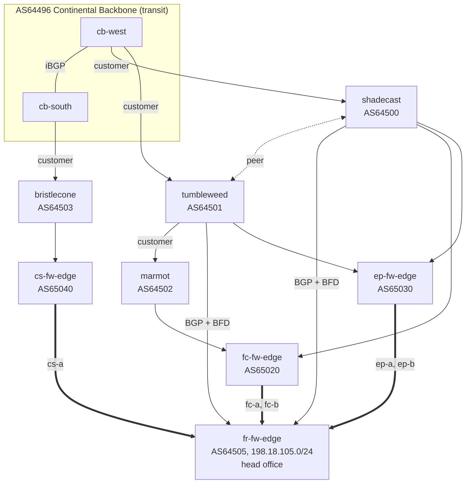
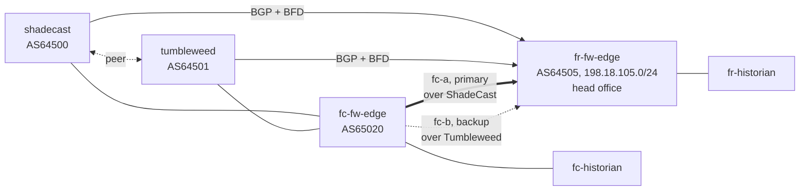

# Spike: a mock internet with BGP, and a site-to-site VPN over it

A spike is a short experiment that answers one question.

Question: Can four brewery sites reach their head office through a VPN over a
mock internet? The mock internet has several ISPs that speak BGP. Do the sites
keep that connection when an uplink or a whole ISP fails? An uplink is the
link from a site to an ISP.

Decides: This spike decides the WAN of the multi-site range. The WAN is the
networks and their rules, the tunnels, and how a site ties a tunnel to an
uplink ([PLANS.md](../../docs/multisite/PLANS.md) sections 4.2 to 4.5).

## What it builds

The lab has ten routers, and a host behind the edge router of each site. Each
router is a network namespace with its own FRR (zebra, bgpd, bfdd, staticd).
A network namespace is a separate network stack inside one Linux kernel.
Nothing in this lab is a VM.
[The same WAN on VyOS routers](#the-same-wan-on-vyos-routers) describes the
part of the lab that ran on VyOS VMs in CI, under phenix and minimega.



Text alternative to the diagram: The transit carrier (AS 64496) has two
routers, `cb-west` and `cb-south`, and iBGP joins them. An AS (autonomous
system) is a network with one routing policy. A transit carrier carries
traffic between other networks. `shadecast` (AS 64500) and `tumbleweed`
(AS 64501) are customers of `cb-west`, and they peer with each other. `marmot`
(AS 64502) is a customer of `tumbleweed`, and `bristlecone` (AS 64503) is a
customer of `cb-south`.

The edge of the head office, `fr-fw-edge` (AS 64505), announces
`198.18.105.0/24` to `shadecast` and `tumbleweed` over BGP with BFD.
`fc-fw-edge` has uplinks to `shadecast` and `marmot`. `ep-fw-edge` has uplinks
to `tumbleweed` and `shadecast`. `cs-fw-edge` has one uplink, to
`bristlecone`. Each site has one WireGuard tunnel to the head office for each
uplink: `fc-a` and `fc-b`, `ep-a` and `ep-b`, and `cs-a`.

- The ISPs: An ISP prefers a customer's route to a peer's route, and a peer's
  route to a provider's route. An ISP tells peers and providers only its own
  prefixes and the prefixes of its customers. From the head office, an ISP
  accepts only the one prefix of the head office. From another network, an
  ISP accepts any public prefix up to a /24, and no private address space.
- The head office: It takes a default route from each ISP and installs both.
  It announces its own prefix to each ISP, and no other prefix.
- The other sites: Each site has addresses that its ISPs assigned, and a
  static default route for each uplink. These sites speak no BGP with their
  ISPs.
- The site prefixes: Each site announces one /24, the network of its one
  host. A site of the range announces its blocks
  ([PLANS.md](../../docs/multisite/PLANS.md) section 3), and `vyos_sketch.py`
  writes those. The sites are not copies. The host of the brewpub is on the
  one flat plant network of the brewpub (`10.21.10.0/24`). The company bought
  the Colorado Springs site, and that site has its own address plan
  (`192.168.20.0/24`). The hosts keep the names `<site>-historian`.
- The ShadeCast link of the head office: In this lab, the link is a /30. In
  the range, the link is today's INET segment, which also holds the router of
  the utility.
- The tunnels: Each tunnel carries eBGP with BFD (300 ms, three missed). The
  primary tunnel of a site wins by local preference at both ends. Only site
  prefixes cross a tunnel, and only the prefixes of that site. The head
  office takes from each site only the blocks of that site (`SITE-FC`,
  `SITE-EP`, `SITE-CS`). A site announces only its own blocks.
- The underlay BGP timers: The underlay is the network that carries the
  tunnels. BGP ends a silent session after the hold time. The timers are 3 s
  keepalive and 9 s hold, not the real default of 60 s and 180 s. With these
  timers, a silent failure in the core ends in seconds.

## Prerequisites

- Linux with network namespaces, root access, `iproute2`, `nftables`, and
  `traceroute`.
- FRR (8.4.4 here), `wireguard-tools`, and either WireGuard in the kernel or
  `wireguard-go`.
- Python 3.12 or later with `pydantic`.

```shell
apt-get install iproute2 frr wireguard-tools wireguard-go nftables traceroute iputils-ping
```

## Steps

```shell
cd cherrymountain-brewery/spikes/wan-bgp
sudo -E python netns_lab.py                    # build, check, tear down (about 6 minutes)
sudo -E python netns_lab.py --keep             # leave the lab up; `--down` removes it
sudo -E python netns_lab.py --pin destination  # the first design, which drifts (finding 2)
python vyos_sketch.py                          # every router as VyOS commands
```

A kept lab is ten namespaces. To open the FRR shell in one namespace, run a
command such as `ip netns exec fr-fw-edge vtysh -N fr-fw-edge`.

The run writes its output under `$CM_EVIDENCE_DIR/wan-bgp-netns` (default
`evidence/`). The output is `summary.md`, `result.json`, the `frr.conf` of
each router, and the final BGP and routing tables of each router.

How the kit injects a fault: The kit is the runnable code of this spike. It
adds an nftables table on the router of the ISP. The table drops packets on
one interface, or on all interfaces, and leaves the links up. No neighbor
sees a carrier loss. Only BFD or a BGP hold timer can notice the fault. The
rules count the packets that they drop, so a run shows that the fault was
real.

Through each fault and each repair, every site pings the host of the head
office ten times a second. The longest run of lost pings is the outage. One
fault is loud: the kit sets the uplink of a site down, to show where the
tunnel of that site goes.

## Pass / fail

- [x] Every BGP session comes up. Every AS reaches every other AS on a path
      that follows the customer, peer, and provider rules. The checks read
      the local preference of each route and the neighbor that each route
      came from.
- [x] No ISP carries a private route. An ISP refuses a private prefix and a
      /25 that a customer offers. Through a tunnel, a site learns only site
      prefixes.
- [x] No edge sends a packet for an unused private address out of an uplink.
      Each edge has a blackhole for its own blocks and for all private
      space. A blackhole is a route that drops packets.
- [x] Every site reaches the head office and every other site.
- [x] When one uplink goes silent, a site with two uplinks keeps the head
      office. After the repair, the site returns to the primary tunnel.
- [x] Every site keeps the head office when the head office loses one ISP,
      and when a whole ISP goes dark. Each fault starts when the lab is
      converged (all routes are stable) and `fc` is on its primary tunnel.
      The underlay of that tunnel crosses the failed link, and `fc` must see
      a gap.
- [x] A site whose path crosses the dead ISP in the core loses the head
      office for about the BGP hold time. The outage is at least the hold
      time less one keepalive (6 s). The outage is at most the hold time and
      three seconds (12 s).
- [x] After the faults, every tunnel still leaves through its own uplink, and
      a tunnel whose uplink is down stays down.
- [x] When a site announces the network of another site, the head office
      refuses that network.

## Result

- Decision: Go for this WAN. The WAN has five networks, a head office with
  its own AS on two ISPs, and one tunnel for each uplink of each site. Each
  tunnel has eBGP and BFD inside. Three things changed from the first design:
  - The head office installs the default route of both ISPs (finding 1).
  - A site ties a tunnel to an uplink by a firewall mark, not by the address
    of the endpoint (finding 2). A firewall mark is a number that the kernel
    attaches to a packet.
  - The routing table of the mark ends in a blackhole (finding 3).
- Run: The lab ran in a container with no VM. The kernel was Linux 6.18 with
  no WireGuard, no ESP, and no netem. The other software was FRR 8.4.4 and
  wireguard-go 0.0.20230223. The branch was `feat-secret-topo` at `fb43c7f`.
  The final design ran ten times.
  - The last run passed all 30 checks. Before that run, a review made the
    checks able to fail:
    - The policy checks read local preference and the neighbor that a route
      came from.
    - The kit offers an ISP prefixes that the ISP must refuse.
    - Each fault must cut a path that crosses it.
    - The hold-timer outage has a lower bound.
    - The pinned lookup must end in the blackhole.
    - Every edge has discard routes.
  - The run before that passed 29 of 30. The one failure was a fault of the
    kit: the kit counted the route that it added to make Marmot offer a
    private prefix.
  - The run before those passed all 28 checks. That run had a route filter
    for each site, and a site that announces the network of another site
    (finding 8).
  - The run before it passed all 27. In that run, the head office kept the
    routes that its ISPs send (finding 7). Another check in that run looks
    for a stale default route at the head office.
  - The two runs before that passed all 26 checks that they had.
  - The four runs before those had 23 checks. The design did not yet have the
    blackhole or the two last events. In two of those four runs, one check
    failed for a fault of the kit. The kit left the blackhole route of
    Bristlecone in place after the hijack. In a hijack, a network announces a
    prefix of another network.
- Evidence: [evidence/wan-bgp-netns](evidence/wan-bgp-netns) has the summary,
  the result, and the `frr.conf` of each router from the last run of the
  final design. The directory
  [evidence/wan-bgp-netns-destination](evidence/wan-bgp-netns-destination)
  has the summary of a run with `--pin destination`.

### Outages

The table gives the longest run of lost pings from the host of each site to
the host of the head office. The rate is ten pings a second, and the values
are from the runs of the final design.

Every fault is on ShadeCast. `fc` has its primary uplink there. `ep` has only
its backup uplink there, and `cs` is behind Bristlecone. Therefore, in the
first three events, neither of those two sites was on the failed path. In
those events, the transit carrier reached the head office through Tumbleweed.
The carrier chose Tumbleweed from two equal customer routes.

| Event | `fc` | `ep` | `cs` | What moved |
|---|---|---|---|---|
| ShadeCast drops the uplink of `fc` | 0.8 to 0.9 s | Not on the path | Not on the path | `fc` moved to its tunnel over Marmot |
| ShadeCast drops the uplink of the head office | 0.6 to 1.0 s | Not on the path | Not on the path | ShadeCast reaches the head office through its peer. Until then, `fc` uses its backup tunnel |
| All of ShadeCast goes dark | 0.8 to 1.0 s | Not on the path | Not on the path | `fc` moved to Marmot |
| All of ShadeCast goes dark while the transit carrier routes to the head office through ShadeCast | 0.8 to 1.0 s | Not on the path | 8.8 to 9.8 s | `fc` moved to Marmot. The transit carrier moved to Tumbleweed when its BGP hold timer ran out |
| Each repair | None | None | None | The traffic moved back to the primary tunnel and the direct route |
| The kit sets down the link of the ShadeCast uplink of `fc` | Not timed | | | `fc` moved to Marmot. Its first tunnel stayed down, and came back 2 s after the link came back |

- Next to a BFD session, the outage is about one second. The first three
  outages are three BFD intervals of 300 ms. In a VM that must wait for a
  CPU, 300 ms is too short. With an interval of 1 s, the estimated outage is
  about 3 s.
- Anywhere else, the outage is the BGP hold time. `cs` has one uplink and no
  part in the fault. It lost the head office for as long as the transit
  carrier sent traffic toward a dead ISP. That time was 8.8 to 9.8 s with the
  9 s hold time of the lab, because the outage also includes the time to
  reconverge. With the default timers of real routers, the estimate is about
  180 s.
- After the last repair, every BGP session of the final design was up again
  before the check looked. Runs of the first design took up to 48 s. One
  early run still had a session down after 60 s. Nobody examined the cause.

### Findings

1. With wireguard-go, a head office on two ISPs must install both default
   routes.

   The head office first preferred the default route of ShadeCast and
   installed only that one. The three tunnels that arrived through Tumbleweed
   never came up. A capture showed that each handshake came in on the
   Tumbleweed link, and that no answer left on any link. With both default
   routes installed (`maximum-paths 2` and
   `bgp bestpath as-path multipath-relax`), all five tunnels came up.

   A likely cause is that wireguard-go answers through the interface that a
   packet came in on. That interface had no default route. Nobody traced the
   code of wireguard-go.
2. A WireGuard endpoint roams, so its address cannot tie a tunnel to an
   uplink.

   The first design gave the head office two endpoint addresses. It gave each
   site a static host route for each address, through the uplink that must
   carry that tunnel. `--pin destination` reproduces this design.

   - After one fault and its repair, `fc-a` pointed at `203.0.113.2`, the
     address of the head office on the ShadeCast link, not at `198.18.105.1`.
     In another run, it pointed at `198.18.101.2`, the address of the head
     office on the Tumbleweed link. WireGuard takes the endpoint of a peer
     from the source address of the last packet that authenticated. After the
     fault, the packets of the head office carried the address of an uplink,
     not the address of the endpoint. Nobody traced the cause.
   - The host route then does not match, so the tunnel follows the default
     route of the site. A backup tunnel that drifts moves to the primary
     uplink and fails with it.
   - The drift also hid a fault. In two of three runs, `fc` lost no pings
     when the head office lost its ShadeCast uplink. The cause was that
     `fc-a` was already at an address behind Tumbleweed. When the tunnel did
     not move before the event, the same event cost 0.7 to 0.9 s.
   - The fix is the default, `--pin mark`. The head office has one endpoint
     address and a port for each tunnel. Only its default routes carry that
     address as the preferred source (`set src` in a route map on
     `ip protocol bgp`). A site marks the packets of each tunnel
     (`wg set … fwmark`), and a rule sends each mark to its own routing
     table. In the runs of this design, no endpoint moved. After all the
     faults, every tunnel left through its own uplink.
3. The table of the mark must end in a blackhole.

   The table holds one route, the uplink. When the link of the uplink goes
   down, that route goes too, and the lookup falls through to the main table.
   The tunnel then leaves through the other uplink. With a blackhole behind
   the uplink route, the lookup for `fc-a` found no route while the link was
   down. `fc` ran on `fc-b`.
4. An origin hijack is partial.

   `bristlecone` announced `198.18.105.0/24`. Both transit routers took it,
   because its path is one AS long and the path of the true route is two.
   `cs` is behind `bristlecone`, and it lost the head office. `shadecast` and
   `tumbleweed` kept the route from their customer, because they prefer it to
   any route from a provider. Therefore `fc` and `ep` stayed up. When
   Bristlecone withdrew the announcement, `cs` came back in 3 to 5 s.
5. Ten FRR routers took about 0.3 GB.

   The proportional memory of all routing daemons was 297 MiB in the last
   run: bgpd 122, zebra 91, bfdd 30, wireguard-go 27, staticd 27.
   Proportional memory (PSS) splits shared pages among the processes that map
   them. Earlier runs summed resident memory, which counts the shared
   libraries once for every process. Those runs reported about 500 MiB.
6. The 13 BGP sessions came up in 8 to 9 s from a cold start, in every run.
7. The head office must keep the routes that its ISPs send
   (`soft-reconfiguration inbound`). If it does not, FRR can take a default
   route away from it at start.

   The VyOS runs found this ([Findings on VyOS](#findings-on-vyos)). The lab
   then showed the same thing on FRR 8.4.4. Seconds after a start, FRR marked
   the default route of ShadeCast at the head office as `(stale)`. FRR 8.4.4
   keeps a stale route, so no check failed. FRR 10.7.1 removes it. With this
   configuration, neither route is stale.
8. The head office must filter the routes of each site by site.

   The first filter let any prefix of `10.0.0.0/8`, /16 to /24, cross a
   tunnel in either direction. Sites announce /16 blocks. With that filter,
   an attacker who controls the edge of one site can announce a /24 inside
   the block of another site. The longer prefix then wins at the head office.
   The filter is now a list for each site.

   In the last run, the edge of the brewpub announced the Colorado Springs
   plant network (`192.168.20.0/24`). Its own export filter was open for this
   test. The edge offered the route on its tunnels. The head office kept its
   one route through the Colorado Springs tunnel. The Eastern Plains host
   still reached the Colorado Springs host. The filter of the ISPs now
   refuses all private space, not only `10.0.0.0/8`.

### What the kit did not test

- VyOS, WireGuard in the kernel, and IPsec: Every router here is FRR on
  Linux, the tunnels are wireguard-go, and the kernel has no ESP.
  [The same WAN on VyOS routers](#the-same-wan-on-vyos-routers) describes
  runs of a part of this lab on VyOS with each of them.
- The filters of the ISPs, in part: The last run offered Tumbleweed a private
  prefix and a /25 from Marmot, and Tumbleweed took neither. No run offered a
  public prefix that a customer did not register. The ISPs accept any public
  /24 from a customer, and that lets the hijack work.
- A fault inside the transit carrier, between its two routers.
- The internet access of a site itself: The default route of a site is
  static, with no health check, so it stays on a dead first uplink. This does
  not affect the tunnels.
- Delay, loss, and load: The lab had no netem. It had ten idle namespaces on
  four cores.
- Firewall rules on the traffic that crosses a tunnel, NAT, and IPv6.

### An early run that measured nothing

One run from before the drop counters existed reported no loss for any site
when the head office lost its ShadeCast uplink. Finding 2 is the likely
cause. The rules now count the packets that they drop. Each run records the
internet path under the primary tunnel of every site, before and after each
event.

## The same WAN on VyOS routers

Question: Does a VyOS router take this design from phenix at first boot? Does
it then behave as the lab did, with WireGuard and with route-based IPsec?

Decides: This part decides where the tunnels and BGP run at a site, and how
they get their configuration. It also decides which kind of tunnel the range
uses ([PLANS.md](../../docs/multisite/PLANS.md) sections 4.3 to 4.5,
decisions D2 and D3).

### What it boots

`vyos_ci.py` runs as the `wan-bgp-vyos` job of the
[CherryMountain spikes workflow](../../../.github/workflows/cherrymountain-spikes.yml),
on a GitHub runner with KVM and 4 vCPUs. On that runner, phenix and minimega
boot four VyOS routers (2 vCPUs and 2 GB each) and two hosts.



Text alternative to the diagram: ShadeCast (AS 64500) and Tumbleweed
(AS 64501) peer. The edge of the head office, `fr-fw-edge` (AS 64505), speaks
BGP with BFD to both. The Fort Collins edge, `fc-fw-edge` (AS 65020), has an
uplink to each ISP, with addresses that the ISPs assigned. It has two tunnels
to the head office. `fc-a` is the primary tunnel, over ShadeCast, and `fc-b`
is the backup tunnel, over Tumbleweed. A host sits behind each edge.

- It is the lab, reduced. It has no transit carrier, and Tumbleweed stands in
  for Marmot as the second ISP of the site. Therefore, no event here can wait
  for a BGP hold timer, and no router is there to believe the hijack.
- phenix delivers everything. The BGP, BFD, policy, and tunnels of each
  router are the `config` list of the patched `vrouter` app
  ([patches](patches), and the draft pull request
  [GhostofGoes/sceptre-phenix#27](https://github.com/GhostofGoes/sceptre-phenix/pull/27)).
  The list has 65 commands for an ISP, and 96 to 151 commands for a site
  edge. Before the route filters were a list for each site, the counts were
  59, and 66 to 119.

  `vyos_sketch.py` writes the commands from the model of the lab. Before the
  job builds phenix, it applies the patch for the `ci-e2e-minimega` branch of
  the fork to phenix.
- Two jobs run, one for each kind of tunnel. `CM_TUNNEL=wireguard` selects
  WireGuard, and `CM_TUNNEL=vti` selects route-based IPsec. The IPsec job
  uses IKEv2 with a pre-shared key, a VTI (virtual tunnel interface) for each
  tunnel, and MOBIKE off. WireGuard ties a tunnel to its uplink by a mark, as
  in the lab. IPsec ties a tunnel to its uplink by the source address of the
  tunnel (`policy local-route … source address`). Both use the same table:
  the uplink route, and a blackhole behind it.
- BFD runs at 1 s, three missed. With this interval, a router that waits for
  a CPU does not look like a dead link. The runner has 10 vCPUs of guests on
  its 4 vCPUs.

### Steps

Run the workflow by hand with `spikes` set to `wan-bgp-vyos`. A push to
`feat-secret-topo` that touches `spikes/` also runs the workflow, with the
other spikes. Each job uploads `evidence-wan-bgp-vyos-<tunnel>`.

What a run checks, in order: phenix rendered each list after its own
configuration and before the commit. Each router committed its list at first
boot. If a router does not, `vyos_commit_check.sh` applies the lines one by
one and names the lines that VyOS refuses. Every BGP session is up. The head
office has a default route through each ISP, with its endpoint as the source.
Each tunnel leaves through its own uplink.

A host at the site reaches a host at the head office through the primary
tunnel. The edge of the site announces a network of another site, and the
head office does not take it. Then the faults run, each with a ping five
times a second:

- ShadeCast is silent toward the site.
- ShadeCast is silent toward the head office.
- The uplink of the site is down.
- A silence of 200 s follows.

### Pass / fail

- [x] The commands commit at first boot when phenix gets them as the `config`
      list.
- [x] BGP and BFD come up inside both tunnels, and each tunnel leaves through
      its own uplink.
- [x] No WireGuard endpoint moves across a fault and its repair.
- [x] A silent fault on one uplink moves the traffic, and the repair moves it
      back without loss.
- [x] The same is true with a VTI in place of WireGuard. The VTI comes back
      after IKE gave its peer up.
- [x] When the edge of the site announces a network of another site, the head
      office refuses that network.
- [x] Since run 33, a run also has these checks:
  - Each router holds every line of its list after the commit.
  - Every BFD session is up at 1 s.
  - Each IPsec tunnel has its own SA (security association).
  - Each edge sends its own traffic from its LAN address.
  - A packet of the full MTU of the tunnel, with DF set, crosses each tunnel.
    The full MTU is 1,400 for a VTI and 1,420 for WireGuard.
  - The edge refuses a packet that is one byte larger.
  - No edge sends a packet for an unused private address out of an uplink.
- [x] Since run 34, a run also has these tests:
  - Six rounds of the silent fault of ShadeCast toward the head office, with
    a log of each BGP and BFD event on the four routers.
  - A restart of the edge of the head office, with a ping from the site
    through it.
- [x] Since run 38, the routers commit the lists of the generator of the range
      (`tools/wangen`), and a run also has these checks:
  - The head office drops and logs a forged source that comes out of a tunnel.
  - A host at the site reaches a public address as the address of its uplink.
  - A host at the head office reaches public addresses through both ISPs as
    one address of the head office.
  - The head office sends the packets of each tunnel through the ISP of that
    tunnel.
  - The default route of the site moves to the second uplink under a silent
    fault, and returns.
  - The BGP session of the second tunnel survives each round of the fault at
    the head office.
  - Each ISP takes its default route back when the ISPs stop peering, and
    gives it again after the repair.
- [x] Since run 40, a run also crashes the edge of the head office: a reboot
      with no shutdown.

### Result on VyOS

- Decision: Go for the tunnels and BGP on `fw-edge` (E1), configured through
  the `config` list (R1), with either kind of tunnel. For this decision, the
  design got one more configuration line: the head office keeps the routes
  that its ISPs send (finding V3).
- Run: The runs are
  [run 27](https://github.com/GhostofGoes/sceptre-phenix-topologies/actions/runs/45072901676),
  [run 28](https://github.com/GhostofGoes/sceptre-phenix-topologies/actions/runs/45075247853),
  [run 29](https://github.com/GhostofGoes/sceptre-phenix-topologies/actions/runs/45082278191),
  [run 30](https://github.com/GhostofGoes/sceptre-phenix-topologies/actions/runs/45092312260),
  [run 31](https://github.com/GhostofGoes/sceptre-phenix-topologies/actions/runs/45120050629),
  and [run 33](https://github.com/GhostofGoes/sceptre-phenix-topologies/actions/runs/45131775836)
  of the workflow, on `test-wan-bgp-vyos`. Both jobs passed every check in
  each run. The count was 29 checks in runs 27 to 29, 30 in runs 30 and 31,
  and 39 in run 33.
  [Run 34](https://github.com/GhostofGoes/sceptre-phenix-topologies/actions/runs/45342358564)
  added the fault rounds and the restart of the head office (findings V9 and
  V10). It has three jobs, because IPsec ran in two modes: only the site opens
  the tunnels, or both ends open them.
  [Run 38](https://github.com/GhostofGoes/sceptre-phenix-topologies/actions/runs/45354270513)
  took the lists from the generator of the range, with the fix of finding V9
  and what finding V11 lists. All three jobs passed 53 of 53 checks.
  - Run 29 had the patch as it is in the pull request, a head office that
    only answers IKE, and a newer VyOS (999.202611222329).
  - Run 30 had the route filters as a list for each site, and the check of
    finding V8.
  - Run 33 had the changes from the review, on VyOS 999.202611230649 (built
    in run 32, kernel 6.18.64-1):
    - Discard routes.
    - The MTU and the MSS clamp of the VTI.
    - The LAN address of the edge as the source of the traffic of the edge
      itself.
    - The stricter `config` check.
    - Nine more checks.
  - Run 32 had the same code and passed 38 of 39 in both jobs. The one
    failure was the count of the new BFD check itself. The check counted the
    three interval lines of the profile as sessions.
  - Runs 27 and 28 used VyOS 999.202611222040 (rolling, built in the run from
    vyos-build `91ccaca`). The kernel was 6.18.64 with WireGuard in the tree.
    The other software was FRR 10.7.1, strongSwan as VyOS ships it, phenix
    `ci-e2e-minimega` at `afbcba7` with the patch, and minimega 3.3.0 at
    `66ed1aa`.
- Evidence: [evidence/wan-bgp-vyos-wireguard](evidence/wan-bgp-vyos-wireguard),
  [evidence/wan-bgp-vyos-vti](evidence/wan-bgp-vyos-vti), and
  [evidence/wan-bgp-vyos-vti-both](evidence/wan-bgp-vyos-vti-both) have the
  summary, the result, and the script that phenix rendered for each router.
  The files are from run 42, with the keys removed.

| Run | Commit | WireGuard job | IPsec job |
|---|---|---|---|
| [24](https://github.com/GhostofGoes/sceptre-phenix-topologies/actions/runs/45067417980) | `b8544af` | 18 of 20. The head office had its session to ShadeCast and no default route from ShadeCast. The faults did not run | 28 of 28 |
| [25](https://github.com/GhostofGoes/sceptre-phenix-topologies/actions/runs/45070332103) | `e9613db` | 27 of 28. The same route was missing, and it came back when the head office asked ShadeCast again. The faults then passed | 16 of 20. Both default routes were missing for nine minutes, so no tunnel came up |
| [27](https://github.com/GhostofGoes/sceptre-phenix-topologies/actions/runs/45072901676) | `3ffff8b`, with the configuration of finding V3 | 29 of 29 | 29 of 29 |
| [28](https://github.com/GhostofGoes/sceptre-phenix-topologies/actions/runs/45075247853) | `86a9d07`, the same code | 29 of 29 | 29 of 29 |
| [29](https://github.com/GhostofGoes/sceptre-phenix-topologies/actions/runs/45082278191) | `3966f5b`: the patch of the pull request, and a head office that only answers IKE | 29 of 29 | 29 of 29 |
| [30](https://github.com/GhostofGoes/sceptre-phenix-topologies/actions/runs/45092312260) | `119e1b4`: a route filter for each site, and a site that announces the network of another site | 30 of 30 | 30 of 30 |
| [31](https://github.com/GhostofGoes/sceptre-phenix-topologies/actions/runs/45120050629) | `84a5b36`: the renamed sites | 30 of 30 | 30 of 30 |
| [32](https://github.com/GhostofGoes/sceptre-phenix-topologies/actions/runs/45126127571) | `f0ea1bc`: the changes from the review and nine more checks | 38 of 39. The BFD check counted the lines of the profile as sessions | 38 of 39, for the same cause |
| [33](https://github.com/GhostofGoes/sceptre-phenix-topologies/actions/runs/45131775836) | `90ff41f`: with the BFD count fixed | 39 of 39 | 39 of 39 |
| [34](https://github.com/GhostofGoes/sceptre-phenix-topologies/actions/runs/45342358564) | `98e6c49`: six fault rounds and a restart of the head office | 43 of 43 | 43 of 43 when only the site opens the tunnels. 40 of 40 when both ends open them, and then the job stopped. The reboot started before the test got the answer to its reboot command. The reboot now waits 10 s |
| [38](https://github.com/GhostofGoes/sceptre-phenix-topologies/actions/runs/45354270513) | `d7733e7`: the lists of the generator, the fix of finding V9, and ten more checks | 53 of 53 | 53 of 53 in each of the two IPsec jobs |
| [39](https://github.com/GhostofGoes/sceptre-phenix-topologies/actions/runs/45366344077) | `177b3da`: the same lists, and the IKE log of the site from the reboot on | 53 of 53 | 53 of 53 in each of the two IPsec jobs |
| [40](https://github.com/GhostofGoes/sceptre-phenix-topologies/actions/runs/45376693022) | `f50385c`: a crash of the edge of the head office after the clean restart | 56 of 56 | 56 of 56 in each of the two IPsec jobs |
| [41](https://github.com/GhostofGoes/sceptre-phenix-topologies/actions/runs/45386896279) | `e80b323`: a shorter retry schedule for IKE | 56 of 56 | 55 of 56 when only the site opens the tunnels. One packet of the first tunnel left through the other uplink (finding V12). 56 of 56 when both ends open them |
| [42](https://github.com/GhostofGoes/sceptre-phenix-topologies/actions/runs/45397506760) | `36e39eb`: the backstop rule of finding V12 | 56 of 56 | 56 of 56 in each of the two IPsec jobs |

Runs 35 and 37 stopped before a router booted. The job did not check out the
generator, so the test failed at its first line. Run 36 was canceled to make
room for run 37.

Run 26 was canceled to make room for run 27. Runs 22 and 23 never built the
VyOS image (finding V7).

Outages: The table gives the longest run of lost pings from the host of the
site to the host of the head office. The values are from the runs whose
faults ran. For WireGuard, those are runs 25 and 27 to 33. For IPsec, those
are runs 24 and 27 to 33. The 200 s silence and the packet count are from
runs 27 to 33.

| Event | WireGuard | Route-based IPsec |
|---|---|---|
| ShadeCast goes silent toward the site | 2.4, 2.8, 3.0, 2.8, 2.4, 3.0, 2.8, and 2.8 s. The traffic then used `fc-b` | 2.8, 2.6, 3.0, 2.8, 3.0, 2.8, 2.8, and 3.0 s. The traffic then used `fc-b` |
| The repair | None | None |
| ShadeCast goes silent toward the head office | 2.6, 2.2, 2.2, 2.4, 2.6, 2.2, 2.8, and 2.6 s. ShadeCast then reaches the head office through Tumbleweed | 2.8, 5.4, 2.8, 2.2, 2.6, 5.0, 5.2, and 2.2 s. Three of eight values are near 5 s. Finding V9 has the cause |
| The same fault, six rounds in run 34 | 2.2, 2.6, 2.8, 2.2, 2.0, and 2.6 s | Only the site opens the tunnels: 2.8, 2.2, 5.4, 5.0, 3.0, and 2.4 s. Both ends open them: 3.0, 2.4, 3.0, 2.8, 2.6, and 2.6 s |
| The edge of the head office restarts (run 34) | 57.2 s. The edge answered again after 46 s, and the traffic was back 15 s later | 88.8 s when only the site opens the tunnels. The edge answered again after 66 s, and the traffic was back 28 s later. Not measured when both ends open them |
| The same fault, six rounds in run 38, with the fix of finding V9 | 2.2, 2.4, 2.6, 2.8, 2.8, and 2.2 s | Only the site opens the tunnels: 2.4, 2.2, 2.8, 2.6, 2.2, and 2.4 s. Both ends open them: 2.4, 2.2, 2.2, 2.2, 2.2, and 2.6 s |
| The edge of the head office restarts (run 38) | 60.2 s | 88.2 s when only the site opens the tunnels. 59.2 s when both ends open them |
| The edge of the head office crashes, with no shutdown (run 40) | 57.8 s | 168.4 s when only the site opens the tunnels. 63.4 s when both ends open them |
| The same crash with the shorter retry schedule for IKE (run 41) | 57.0 s | 57.8 s when only the site opens the tunnels. 50.6 s when both ends open them |
| The link between the ISPs goes silent (run 38) | The head office had no default route 15 s later, and both routes 10 s after the repair | The same, with both routes 9 s after the repair |
| The repair | None | None |
| The ShadeCast uplink of the site is down for 20 s and more | No packet of `fc-a` left through the other uplink. The traffic was back on `fc-a` when the link was back | The same |
| 200 s of silence toward the site, then the repair | The traffic was back on `fc-a` 8, 8, 9, 8, 9, 8, and 9 s after the repair. The last handshake was 237 s old | The traffic was back on `fc-a` after 36 s and 20 s when both ends open tunnels. It was back after 57, 59, 62, 27, and 31 s when the head office only answers. Before the repair, IKE gave the peer up, and the VTI was down |

### Findings on VyOS

1. V1: The `config` list of phenix works.

   All 48 router boots of the six runs committed the rendered script at first
   boot, and VyOS refused no line of it. A commit took 15 to 51 s on the
   runner.
2. V2: The outage next to a fault is three seconds, as the timers say.

   With BFD at 1 s and three missed, the site lost 2.2 to 3.0 s in nineteen
   of twenty faults and 5.4 s in one. No repair cost any time. The one second
   of the lab came from its 300 ms interval.
3. V3: The head office must keep the routes that its ISPs send.

   In three of the first four jobs, the head office lost a default route
   seconds after its sessions came up. It did not get the route back by
   itself. In one job, it lost both default routes. With no route to the
   internet, no tunnel came up.

   - Why: FRR applies a new route-map five seconds after FRR loads it
     (`bgp route-map delay-timer`). FRR then asks every neighbor that uses
     the route-map for its routes again. The sessions of the head office come
     up in those same seconds. An ISP that gets the request before it sends
     its first announcement postpones the answer. The postponed answer leaves
     out the route of `default-originate`.

     The code for this is `bgp_process_pending_refresh` in
     `bgpd/bgp_packet.c`, read in FRR `stable/10.7` at `7d9492e`. A flag
     there says that the ISP sent the route. FRR clears this flag when a
     request arrives, not when FRR makes a postponed answer. The head office
     marks the route stale when the answer begins, and removes the route when
     the answer ends.
   - What the runs show: At the head office, the session to the ISP was up.
     The head office sent one refresh, received the begin and end markers of
     that refresh, and accepted no prefix. At the ISP, the default route
     counted as sent. A second request
     (`clear bgp ipv4 unicast <ISP> soft in`) brought the route back at once,
     in both jobs of run 25. The runs did not capture the debug log of the
     first seconds. Therefore, the order of the messages is an inference from
     the counters and the source.
   - The fix: Set `soft-reconfiguration inbound` on the two ISP neighbors of
     the head office. The head office then applies a new policy to the routes
     that it keeps, and does not ask the ISPs for routes. Runs 27 to 30 have
     this configuration, and all eight jobs passed. Without it, the fault
     showed in three jobs of four. Therefore, eight passes are strong
     evidence and not proof.
4. V4: WireGuard in the kernel came up with one default route.

   In run 24, the head office had only the default route of Tumbleweed. Both
   tunnels still completed the handshake, and that includes the tunnel over
   ShadeCast. Finding 1 belongs to wireguard-go. The head office still needs
   both routes, so that it stays connected when it loses an ISP.
5. V5: No endpoint moved, and no tunnel left by the wrong uplink.

   After every fault, each WireGuard endpoint was still `198.18.105.1`. With
   the ShadeCast link of the site down, a counter on the other uplink saw no
   packets of `fc-a`. This was true for either kind of tunnel.
6. V6: IPsec recovers, slower than WireGuard, and leaves a second SA.

   A minute of silence does not end an IKE SA, because IKEv2 retransmits for
   about 165 s first. The site gave the peer up before the 200 s ended, and
   its VTI was down. The VyOS bug that leaves a VTI down after a reconnect
   ([T9154](https://vyos.dev/T9154)) did not show. The VTI came back every
   time. The speed of the return depends on which end opens tunnels.

   - Both ends open tunnels (runs 27 and 28: one IKE group, with
     `close-action start` and `dead-peer-detection action restart`). The VTI
     was back after 36 s and 20 s. In run 27, `fc-a` then had two IKE SAs,
     one opened from each end. In run 28, it had the one SA that the head
     office opened.
   - Only the site opens tunnels (runs 29 and 30: the head office has
     `close-action none` and `dead-peer-detection action clear`). The VTI was
     back after 57 s and 59 s, with one IKE SA. The site was between two
     tries when the repair came. The sketch now has this configuration,
     because one SA for a tunnel is the plainer state.
   - WireGuard was back after 8 or 9 s each time, four times.
7. V7: The VyOS image no longer builds without a change.

   vyos-build now names the kernel package
   `linux-image-<version>-<revision>-vyos`. The `build-vyos.sh` script of the
   images repository looks for `linux-image-<version>-vyos` and finds no
   package. It then asks for a package that does not exist. Runs 22 and 23
   failed there. `spikes/ci/build_image.sh` now patches the script, and the
   images repository needs the same change.
8. V8: The head office refuses the network of another site, on VyOS too.

   Run 30 gave the routers a route filter for each site (finding 8 of the
   lab). The edge of the site then announced `192.168.20.0/24`, a network of
   the Colorado Springs site, on both of its tunnels. Its own export filter
   was open in FRR for this test. The head office had no path for that
   network in BGP and no route in the kernel, for either kind of tunnel.

   The reduced lab has no Colorado Springs site. Therefore, this result shows
   the refusal. It does not show that traffic to that site stays on its path.
   The lab in namespaces showed that.
9. V9: A fault of one ISP at the head office can stop both tunnels of a site.

   Run 34 made the same fault six times in each job: ShadeCast drops each
   packet on its link to the head office. In the IPsec job where only the site
   opens the tunnels, two rounds lost 5.4 s and 5.0 s. The other 16 rounds of
   the three jobs lost 2.0 to 3.0 s.

   The event logs show what differs. In that job, the BGP session of the
   second tunnel, `fc-b`, ended in five of six rounds. In the other two jobs,
   it ended in no round. `fc-b` does not use ShadeCast at the site. However,
   the head office had only a default route through each ISP. The kernel then
   selects the ISP for a tunnel's packets with a hash, and the hash changes
   at each boot. In that boot, the head office sent the packets of `fc-b`
   through ShadeCast. Thus the fault stopped one direction of both tunnels.
   This last step is an inference, because no run recorded the route of those
   packets.

   The logs support that step in two ways. First, the BFD session of `fc-b`
   expired at the site, so the site got no packet from the head office on that
   tunnel. Second, the site's BGP notification then reached the head office on
   the same tunnel, so the other direction worked.

   In the two long rounds, the two tunnel sessions ended within 0.4 s of each
   other. In the three short rounds where the session of `fc-b` ended, it ended
   0.8 to 1.2 s after the session of `fc-a`. In round 2, the BFD session
   between the head office and ShadeCast ended first, and no tunnel session
   ended. The clocks of the VMs are not synchronized, so the logs do not give
   one exact timeline for a round.

   The cause is not special to IPsec. The same hash selects the ISP for
   WireGuard packets. Three of eight earlier IPsec runs had a value near 5 s,
   and no WireGuard run had one.

   The fix: the head office takes the routes of each ISP, and not only the
   default route. The address of an uplink of the site is then reached through
   the ISP that announces it, so a tunnel returns through its own ISP. The
   generator writes this configuration (`internet_routes` in
   `tools/wangen/wangen/vyos.py`). The job now checks the route of each
   tunnel's packets, and it fails if the session of the second tunnel ends in
   a round.

   Run 38 had the fix. In each of its three jobs, the packets of `fc-a` left
   the head office through ShadeCast, and the packets of `fc-b` left through
   Tumbleweed. The session of `fc-b` ended in no round. The 18 rounds lost 2.2
   to 2.8 s.
10. V10: The site comes back by itself after the head office restarts.

    Run 34 restarted the edge of the head office while the host of the site
    sent five pings each second. The edge came back with every line of its
    configuration.

    | | WireGuard | IPsec, only the site opens the tunnels |
    |---|---|---|
    | Longest loss of pings | 57.2 s | 88.8 s |
    | The edge answered again after | 46 s | 66 s |
    | The BGP sessions of the head office were up after | 71 s | 101 s |
    | The traffic was back after | 61 s | 94 s |
    | The traffic was back after the edge answered | 15 s | 28 s |
    | IKE SAs for each tunnel afterward | Not applicable | 1 at each end |

    The times count from the reboot command, which waited 2 s. Most of each
    loss is the boot of the router on the runner.

    A review expected about 175 s for IPsec in this mode. When the head office
    only answers IKE, the site must first give up its dead SA, and its
    dead-peer detection retransmits for about 165 s. The measured return was
    28 s after the edge answered. The evidence of run 34 does not show why,
    because it has no IKE log of the site. The job now saves that log.

    The job where both ends open the tunnels stopped before this test in run
    34. Run 38 measured all three:

    | Run 38 | WireGuard | IPsec, only the site opens | IPsec, both ends open |
    |---|---|---|---|
    | Longest loss of pings | 60.2 s | 88.2 s | 59.2 s |
    | The edge answered again after | 61 s | 60 s | 63 s |
    | The BGP sessions of the head office were up after | 66 s | 95 s | 78 s |
    | The traffic was back after | 60 s | 88 s | 61 s |
    | IKE SAs afterward, for `fc-a` and for `fc-b` | Not applicable | 1 and 1 | 5 and 3 |

    In run 38, the times count from the reboot itself. The test polls the edge
    each 5 s, so "answered again" can be later than the return of the traffic.

    The two modes of IPsec differ in the same way in both runs. When only the
    site opens the tunnels, the traffic returns about 28 s after the router is
    up, and each tunnel has one IKE SA. When both ends open the tunnels, the
    traffic returns when the router is up, as with WireGuard. However, the
    tunnels then had five and three IKE SAs at each end. In that mode, each
    tunnel had two IKE SAs from the start, before any fault. `fc-a` had three
    after the faults, and five after the restart. When only the site opens the
    tunnels, each tunnel had one IKE SA at each of those points. This is the
    choice of decision D21 of [PLANS.md](../../docs/multisite/PLANS.md).

    [Run 39](https://github.com/GhostofGoes/sceptre-phenix-topologies/actions/runs/45366344077)
    repeated the test and saved the IKE log of the site from the reboot on.
    All three jobs passed 53 of 53 checks again. The site lost 48.4 s with
    WireGuard, 88.2 s when only the site opens the IPsec tunnels, and 65.8 s
    when both ends open them. The IKE SAs afterward were 1 and 1, and 5 and 3,
    as in run 38.

    The log explains the 28 s. A clean reboot stops strongSwan at the head
    office, and strongSwan sends a DELETE for each IKE SA. The site deleted its
    SA in the same second and started a new exchange. It sent that first
    message again after 4, 7, 13, 23, and 42 s, which is the retry schedule of
    strongSwan. The head office was up between the fourth and the fifth try, so
    the tunnel returned at the fifth try, 90 s after the reboot. The 28 s is
    the wait for that try. It is not dead-peer detection.

    Thus the 175 s of the review belongs to a different case: a head office
    that stops with no shutdown, such as a power loss. Then no DELETE reaches
    the site, and the site must find the dead SA by itself.

    [Run 40](https://github.com/GhostofGoes/sceptre-phenix-topologies/actions/runs/45376693022)
    made that case. After the clean restart, the edge of the head office
    rebooted a second time with no shutdown. All three jobs passed 56 of 56
    checks.

    | Run 40 | WireGuard | IPsec, only the site opens | IPsec, both ends open |
    |---|---|---|---|
    | Loss at the clean restart | 59.0 s | 88.8 s | 66.0 s |
    | Loss at the crash | 57.8 s | 168.4 s | 63.4 s |
    | The edge answered again after the crash | 58 s | 77 s | 56 s |
    | The traffic was back after the crash | 57 s | 170 s | 60 s |
    | IKE SAs after the crash, for `fc-a` and for `fc-b` | Not applicable | 1 and 1 | 1 and 1 |

    The review was right about the crash. When only the site opens the
    tunnels, the site sent its message on the dead SA again and again. It gave
    up after the fifth retry, 165 s after the first one, and then opened new
    SAs in 2 s. When both ends open the tunnels, the head office opened new
    SAs as soon as it was up. Its first message carried INITIAL_CONTACT, and
    the site destroyed its old SAs. That also removed the extra SAs: each
    tunnel had one IKE SA after the crash, where it had five and three before.

    The site-only mode has a third choice. VyOS can shorten the retry schedule
    of strongSwan (`vpn ipsec options retransmission`). With three tries from
    2 s, IKE gives a silent peer up after about 24 s, not 165 s. `wan.yaml`
    now sets that schedule.

    [Run 41](https://github.com/GhostofGoes/sceptre-phenix-topologies/actions/runs/45386896279)
    tested the shorter schedule:

    | Run 41, with the shorter schedule | WireGuard | IPsec, only the site opens | IPsec, both ends open |
    |---|---|---|---|
    | Loss at the clean restart | 58.4 s | 60.2 s | 50.6 s |
    | Loss at the crash | 57.0 s | 57.8 s | 50.6 s |
    | Return after 200 s of silence | 7 s | 10 s | 8 s |
    | IKE SAs after the crash, for `fc-a` and for `fc-b` | Not applicable | 1 and 1 | 13 and 4 |

    When only the site opens the tunnels, the crash now costs what the boot of
    the router costs. Each tunnel had one IKE SA at each point of the run.
    The site gave its dead SA up after three retries, 22 s after the first
    one. When both ends open the tunnels, the shorter schedule made the extra
    SAs worse: `fc-a` had 11 after the faults and 13 after the crash.

    One check of the site-only job failed in run 41, so that job passed 55 of
    56. The other two jobs passed 56 of 56. Finding V12 has the cause.
12. V12: For a moment, a packet of a tunnel was able to leave through the other uplink.

    The check sets the link of the first uplink of the site down. Then it
    counts what the first tunnel sends through the other uplink in 20 s. In run 41,
    it counted one packet in the site-only IPsec job. In each earlier run, it
    counted none.

    A rule sends the packets of a tunnel to a table of their own. That table
    has the route of the uplink and, behind it, a blackhole. FRR installs the
    blackhole only after the route of the uplink is gone. Between the two, the
    table is empty. The kernel then goes on to the main table, and the packet
    leaves through the other uplink with the address of the first one. The gap
    was there in every run. The shorter retry schedule of finding V10 sent an
    IKE packet into it.

    The fix is a second rule for the same packets, to a table that holds only
    a blackhole from the start (`pin_backstop` in
    `tools/wangen/wangen/vyos.py`).
    [Run 42](https://github.com/GhostofGoes/sceptre-phenix-topologies/actions/runs/45397506760)
    had the fix. The check counted no packet in each of the three jobs, and
    all three passed 56 of 56 checks. With only the site opening the tunnels,
    the site lost 59.6 s at the clean restart and 58.4 s at the crash. Each
    tunnel had one IKE SA at each point.
11. V11: A VyOS router takes what the generator adds to the lists.

    Since run 38, the job takes its lists from `tools/wangen`. The generator
    adds commands to the lists of the earlier runs. It adds 46 at the head
    office, 17 at the site, and 5 at each ISP. Each router committed its list
    at first boot and held every line afterward, in all three jobs.

    - Source filter: The edge of the site sent pings with a source of the
      Eastern Plains site into its tunnel. The head office logged six drops in
      the forward chain and six in the input chain, with the rule and the
      tunnel interface. A ping from the site's own address passed.
    - NAT: A host at the site reached the public endpoint of the head office.
      The replies went to the address of the first uplink of the site. A
      host at the head office reached six ISP addresses. The replies went to
      `198.18.105.2`, and the flows left through both uplinks.
    - Failover: Under the silent fault of the first uplink, the default route
      of the site moved to the second uplink. A new flow then reached a public
      address. After the repair, the first route returned.
    - Conditional default route: In this lab, the default route of each ISP
      depends on the prefix of the other ISP. The link between the ISPs went
      silent, and 15 s later the head office had no default route. The BGP hold
      time is 9 s. Both routes were back 9 to 10 s after the repair, and the
      site was on its first tunnel again.

### What the VyOS runs did not test

- The whole internet: The runs had four routers, not ten. They had no transit
  carrier, no third ISP, and one site. The nine-second outage of a site that
  is off the fault path, and the hijack, are results of the lab.
- The first seconds of a start, in a debug log: Eight jobs passed with the
  configuration of finding V3. The order of the messages of FRR without that
  configuration is still an inference.
- The firewall of the site: These routers have no rulesets, no NAT, and none
  of the items that `cm-vyos-config.sh` adds. Nobody wrote rules for a tunnel
  interface.
- One vCPU: The range gives a router 1 vCPU. These routers had 2.
- A faster return for IPsec: The 57 s of finding V6 is the retry schedule of
  the site itself, and no configuration here tunes it. That case ran twice.
- Why the IPsec tunnel returns 28 s after the head office is up when only the
  site opens the tunnels (finding V10).
- An ISP that loses its transit carrier. The lab has no carrier, so the
  condition of finding V11 is the prefix of the other ISP.
- A flow that is open when the default route of the site moves. Such a flow
  keeps its translated source and does not survive. The job tested a new flow.
- The replies of a service that the head office publishes on its ShadeCast
  address (DNAT). They must leave through ShadeCast, and no list does that yet.
- phenix `main`: The patch for `main` is the draft pull request. Its tests
  pass in the CI of phenix, and it did not run a router here. The job uses
  the fork branch that the range pins.
- More than one node: The runner is one machine
  ([PLANS.md](../../docs/multisite/PLANS.md) section 4.8).
