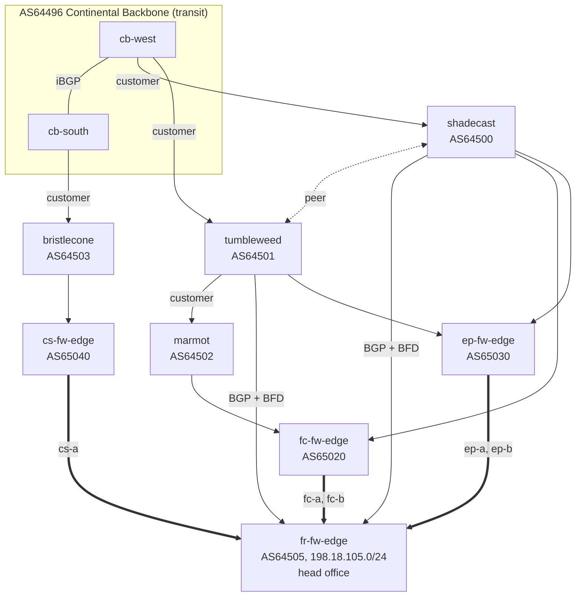
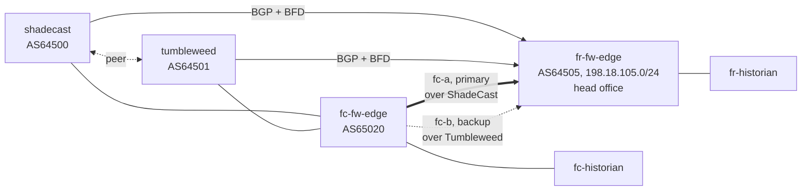

# Spike: a mock internet with BGP, and a site-to-site VPN over it

**Question.** Can four brewery sites reach their head office through a VPN that
rides a mock internet of several ISPs speaking BGP, and keep it when an uplink
or a whole ISP fails? **Decides:** the WAN of the multi-site range: the
networks and their rules, the tunnels, and how a site ties a tunnel to an
uplink ([PLANS.md](../../docs/multisite/PLANS.md) sections 4.2 to 4.5).

## What it builds

Ten routers, each a network namespace with its own FRR (zebra, bgpd, bfdd,
staticd), and a host behind each site edge. Nothing in this lab is a VM.
[The same WAN on VyOS routers](#the-same-wan-on-vyos-routers) is the part of
it that ran on VyOS VMs, under phenix and minimega, in CI.



**Text alternative to the diagram.** The transit carrier (AS 64496) has two
routers, `cb-west` and `cb-south`, joined by iBGP. `shadecast` (AS 64500) and
`tumbleweed` (AS 64501) are customers of `cb-west` and peer with each other.
`marmot` (AS 64502) is a customer of `tumbleweed`, and `bristlecone` (AS 64503) of
`cb-south`. The head office's edge, `fr-fw-edge` (AS 64505), announces
`198.18.105.0/24` to `shadecast` and `tumbleweed` over BGP with BFD.
`fc-fw-edge` has uplinks to `shadecast` and `marmot`, `ep-fw-edge` to
`tumbleweed` and `shadecast`, and `cs-fw-edge` to `bristlecone`. Each site has one
WireGuard tunnel to the head office for each uplink: `fc-a` and `fc-b`, `ep-a`
and `ep-b`, and `cs-a`.

- **The ISPs** prefer a customer's route to a peer's, and a peer's to a
  provider's. They tell peers and providers only their own and their
  customers' prefixes. From the head office they accept only its one prefix.
  From another network they accept any public prefix up to a /24, and no
  private address space.
- **The head office** takes a default route from each ISP and installs both.
  It gives each ISP its own prefix and nothing else.
- **The other sites** have ISP-assigned addresses and a static default route
  for each uplink. They speak no BGP with their ISPs.
- **Each site announces one /24**, the network of its one host. A site of the
  range announces its blocks ([PLANS.md](../../docs/multisite/PLANS.md)
  section 3); `vyos_sketch.py` writes those. The sites are not copies: the
  brewpub's host is on its one flat plant network (`10.21.10.0/24`), and the
  Colorado Springs site, which the company bought, has its own address plan
  (`192.168.20.0/24`). The hosts keep the names `<site>-historian`.
- **The head office's ShadeCast link is a /30** here. In the range it is
  today's INET segment, which also holds the utility's router.
- **Each tunnel** carries eBGP with BFD (300 ms, three missed). The primary
  tunnel of a site wins by local preference at both ends. Only site prefixes
  cross a tunnel, and only a site's own: the head office takes from each site
  the blocks of that site (`SITE-FC`, `SITE-EP`, `SITE-CS`), and a site
  announces only its own.
- **Underlay BGP timers** are 3 s keepalive and 9 s hold, not the real default
  of 60 s and 180 s, so that a silent failure in the core ends in seconds.

## Prerequisites

- Linux with network namespaces, root, `iproute2`, `nftables`, `traceroute`.
- FRR (8.4.4 here), `wireguard-tools`, and either WireGuard in the kernel or
  `wireguard-go`.
- Python 3.12 or later with `pydantic`.

```shell
apt-get install iproute2 frr wireguard-tools wireguard-go nftables traceroute iputils-ping
```

## Steps

```shell
cd cherrymountain-brewery/spikes/wan-bgp
sudo -E python netns_lab.py                    # build, check, tear down (about 6 minutes)
sudo -E python netns_lab.py --keep             # leave the lab up; `--down` removes it
sudo -E python netns_lab.py --pin destination  # the first design, which drifts (finding 2)
python vyos_sketch.py                          # every router as VyOS commands
```

A kept lab is ten namespaces: `ip netns exec fr-fw-edge vtysh -N fr-fw-edge`.

The run writes `summary.md`, `result.json`, each router's `frr.conf`, and each
router's final BGP and routing tables under `$CM_EVIDENCE_DIR/wan-bgp-netns`
(default `evidence/`).

**How a fault is injected.** An nftables table on the ISP's router drops
packets on one interface, or on all of them, and leaves the links up. No
neighbor sees a carrier loss: only BFD or a BGP hold timer can notice. The
rules count what they drop, so a run shows the fault was real. Through each
fault and each repair, every site pings the head office's host ten times a
second, and the longest run of lost pings is the outage. One fault is loud: a
site's uplink is set down, to see where its tunnel goes.

## Pass / fail

- [x] Every BGP session comes up, and every AS reaches every other on a path
      that follows the customer, peer, and provider rules, checked by local
      preference and by the neighbor each route came from.
- [x] No ISP carries a private route, and an ISP refuses a private prefix and
      a /25 that a customer offers; no site learns anything but site
      prefixes through a tunnel.
- [x] No edge would send an unused private address out of an uplink: each
      has a blackhole for its own blocks and for all private space.
- [x] Every site reaches the head office and every other site.
- [x] A site with two uplinks keeps the head office when one goes silent, and
      returns to the primary tunnel after the repair.
- [x] Every site keeps the head office when it loses one ISP, and when a
      whole ISP goes dark. Each fault starts with the lab converged and `fc`
      on its primary tunnel, whose underlay crosses the failed link, and `fc`
      must see a gap.
- [x] A site whose path crosses the dead ISP in the core is cut off for
      about the BGP hold time: at least the hold time less one keepalive
      (6 s), and at most the hold time and three seconds (12 s).
- [x] After the faults, every tunnel still leaves through its own uplink, and
      a tunnel whose uplink is down stays down.
- [x] The head office refuses another site's network when a site announces
      it.

## Result

- **Decision:** **go** for this WAN: five networks, a head office with its own
  AS on two ISPs, and one tunnel for each uplink of each site with eBGP and
  BFD inside. Three things changed from the first design: the head office
  installs the default route of both ISPs (finding 1), a site ties a tunnel
  to an uplink by a firewall mark, not by the endpoint's address (finding 2),
  and the mark's routing table ends in a blackhole (finding 3).
- **Run:** in a container with no VM. Linux 6.18 with no WireGuard, no ESP,
  and no netem in the kernel; FRR 8.4.4; wireguard-go 0.0.20230223;
  `feat-secret-topo` at `fb43c7f`. The final design ran ten times. The last
  run passed all 30 checks, after a review made the checks able to fail: the
  policy checks look at local preference and the neighbor a route came from,
  an ISP is offered prefixes it must refuse, each fault must cut a path that
  crosses it, the hold-timer outage has a lower bound, the pinned lookup must
  end in the blackhole, and every edge has discard routes. The run before
  that passed 29 of 30; the one failure was the kit's (it counted the route
  it had added to make Marmot offer a private prefix). The run before those
  passed all 28 checks, with a route filter for each site and a site that
  announces another site's network (finding 8). The run before it passed all
  27, with the head office keeping the routes its ISPs send (finding 7) and a
  check that neither of its default routes is stale. The two runs before that
  passed all 26 they had. The four runs before those
  had 23 checks, and the design did not yet have the blackhole or the two
  last events. In two of those four, one check failed for a fault of the kit:
  it left Bristlecone's blackhole route in place after the hijack.
- **Evidence:** [evidence/wan-bgp-netns](evidence/wan-bgp-netns) has the
  summary, the result, and each router's `frr.conf` of the last run of the
  final design. [evidence/wan-bgp-netns-destination](evidence/wan-bgp-netns-destination)
  has the summary of a run with `--pin destination`.

### Outages

Longest run of lost pings from each site's host to the head office's, at ten
pings a second, over the runs of the final design. Every fault is on
ShadeCast. `fc` has its primary uplink there. `ep` has only its backup there,
and `cs` is behind Bristlecone, so in the first three events neither was on the
failed path: the transit carrier reached the head office through Tumbleweed,
which it chose from two equal customer routes.

| Event | `fc` | `ep` | `cs` | What moved |
|---|---|---|---|---|
| ShadeCast drops `fc`'s uplink | 0.8 to 0.9 s | not on the path | not on the path | `fc` to its tunnel over Marmot |
| ShadeCast drops the head office's uplink | 0.6 to 1.0 s | not on the path | not on the path | ShadeCast reaches the head office through its peer; `fc` uses its backup until then |
| All of ShadeCast goes dark | 0.8 to 1.0 s | not on the path | not on the path | `fc` to Marmot |
| All of ShadeCast goes dark, with the transit carrier routing to the head office through it | 0.8 to 1.0 s | not on the path | **8.8 to 9.8 s** | `fc` to Marmot; the transit carrier to Tumbleweed, when its BGP hold timer ran out |
| Each repair | none | none | none | Back to the primary tunnel and the direct route |
| The link of `fc`'s ShadeCast uplink set down | not timed | | | `fc` to Marmot; its first tunnel stayed down, and came back 2 s after the link |

- **Next to a BFD session, about one second.** The first three outages are
  three BFD intervals of 300 ms. In a VM that has to wait for a CPU, 300 ms is
  too short; with 1 s it would be about 3 s.
- **Anywhere else, the BGP hold time.** `cs` has one uplink and no part in the
  fault. It lost the head office for as long as the transit carrier kept
  sending toward a dead ISP: 8.8 to 9.8 s with the lab's 9 s hold time, since
  the outage also includes the time to reconverge, and about 180 s with the
  defaults real routers ship with.
- After the last repair, every BGP session of the final design was back
  before the check looked. Runs of the first design took up to 48 s, and one
  early run still had a session down after 60 s. It was not looked into.

### Findings

1. **With wireguard-go, a head office on two ISPs must install both default
   routes.** The head office first preferred ShadeCast's default route and
   installed only that one. The three tunnels that arrived through Tumbleweed
   never came up: a capture showed each handshake come in on the Tumbleweed
   link and no answer leave on any link. With both default routes installed
   (`maximum-paths 2` and `bgp bestpath as-path multipath-relax`), all five
   tunnels came up. The likely cause is that wireguard-go answers through the
   interface a packet came in on, where there was no default route; its code
   was not traced.
2. **A WireGuard endpoint roams, so its address cannot tie a tunnel to an
   uplink.** The first design gave the head office two endpoint addresses and
   each site a static host route for each, through the uplink that was to
   carry it. `--pin destination` reproduces it.
   - After one fault and its repair, `fc-a` pointed at `203.0.113.2`, the
     head office's address on the ShadeCast link, not at `198.18.105.1`. In
     another run it pointed at `198.18.101.2`, its address on the Tumbleweed
     link. WireGuard takes a peer's endpoint from the source address of the
     last packet that authenticated. After the fault, the head office's
     packets carried the address of an uplink, not of the endpoint. Why they
     did was not traced.
   - The host route no longer matches, so the tunnel follows the site's
     default route. A backup tunnel that drifts ends up on the primary uplink
     and fails with it.
   - It also hid a fault. In two of three runs `fc` lost nothing when the
     head office lost its ShadeCast uplink, because `fc-a` had already moved
     to an address behind Tumbleweed. The same event cost 0.7 to 0.9 s when
     the tunnel had not moved.
   - **The fix** is the default, `--pin mark`. The head office has one
     endpoint address and a port for each tunnel. Its default routes, and
     only those, carry that address as the preferred source (`set src` in a
     route map on `ip protocol bgp`). A site marks each tunnel's packets
     (`wg set … fwmark`), and a rule sends the mark to its own routing table.
     In the runs of this design no endpoint moved, and every tunnel left
     through its own uplink after all the faults.
3. **The mark's table must end in a blackhole.** The table holds one route,
   the uplink. When the uplink's link goes down that route goes too, and the
   lookup falls through to the main table: the tunnel would leave through the
   other uplink. With a blackhole behind the uplink route, the lookup for
   `fc-a` found no route while the link was down, and `fc` ran on `fc-b`.
4. **An origin hijack is partial.** `bristlecone` announced `198.18.105.0/24`.
   Both transit routers took it, because its path is one AS long against two.
   `cs`, behind `bristlecone`, lost the head office. `shadecast` and `tumbleweed`
   kept the route from their customer, which they prefer to any route from a
   provider, so `fc` and `ep` stayed up. When the announcement was withdrawn,
   `cs` came back in 3 to 5 s.
5. **Ten FRR routers took about 0.3 GB.** Proportional memory (PSS, which
   splits shared pages among the processes that map them) of all routing
   daemons was 297 MiB in the last run: bgpd 122, zebra 91, bfdd 30,
   wireguard-go 27, staticd 27. Earlier runs summed resident memory, which
   counts the shared libraries once for every process, and reported about
   500 MiB.
6. **The 13 BGP sessions came up in 8 to 9 s** from a cold start, in every run.
7. **The head office must keep the routes its ISPs send
   (`soft-reconfiguration inbound`), or FRR can take a default route away
   from it at start.** The VyOS runs found this ([below](#findings-on-vyos)),
   and the lab then showed the same thing on FRR 8.4.4: seconds after a start,
   ShadeCast's default route at the head office was marked `(stale)`. FRR
   8.4.4 keeps a stale route, so no check had failed. FRR 10.7.1 removes it.
   With the setting, neither route is stale.
8. **The head office must filter each site's routes by site.** The first
   filter let any prefix of `10.0.0.0/8`, /16 to /24, cross a tunnel in
   either direction. With sites that announce /16 blocks, a site's edge in
   the wrong hands could announce a /24 inside another site's block, and the
   longer prefix would win at the head office. The filter is now a list for
   each site. In the last run the brewpub's edge, with its own export filter
   opened, announced the Colorado Springs plant network (`192.168.20.0/24`). It
   offered the route on its tunnels, the head office kept its one route
   through the Colorado Springs tunnel, and the Eastern Plains host still reached the
   Colorado Springs host. The ISPs' filter now refuses all private space, not only
   `10.0.0.0/8`.

### What the kit did not test

- **VyOS, WireGuard in the kernel, and IPsec.** Every router here is FRR on
  Linux, the tunnels are wireguard-go, and the kernel has no ESP.
  [The same WAN on VyOS routers](#the-same-wan-on-vyos-routers) ran a part of
  this lab on VyOS with each of them.
- **The ISPs' filters, in part.** The last run offered Tumbleweed a private
  prefix and a /25 from Marmot, and it took neither. No run offered a public
  prefix that a customer has not registered: the ISPs accept any public /24
  from a customer, which is what lets the hijack work.
- **A fault inside the transit carrier**, between its two routers.
- **A site's own internet access.** A site's default route is static, with no
  health check, so it stays on a dead first uplink. The tunnels are not
  affected.
- **Delay, loss, and load.** No netem; ten idle namespaces on four cores.
- **Firewall rules** on what crosses a tunnel, **NAT**, and **IPv6**.

### An early run that measured nothing

One run before the drop counters existed reported no loss for any site when
the head office lost its ShadeCast uplink. Finding 2 is the likely cause. The
rules now count what they drop, and each run records the internet path under
every site's primary tunnel before and after each event.

## The same WAN on VyOS routers

**Question.** Does a VyOS router take this design from phenix at first boot,
and does it then behave as the lab did, with WireGuard and with route-based
IPsec? **Decides:** where the tunnels and BGP run at a site, how they get
their configuration, and which tunnel
([PLANS.md](../../docs/multisite/PLANS.md) sections 4.3 to 4.5, decisions D2
and D3).

### What it boots

`vyos_ci.py` runs as the `wan-bgp-vyos` job of the
[CherryMountain spikes workflow](../../../.github/workflows/cherrymountain-spikes.yml),
on a GitHub runner with KVM and 4 vCPUs. phenix and minimega boot four VyOS
routers (2 vCPUs and 2 GB each) and two hosts.



**Text alternative to the diagram.** ShadeCast (AS 64500) and Tumbleweed
(AS 64501) peer. The head office's edge, `fr-fw-edge` (AS 64505), speaks BGP
with BFD to both. The Fort Collins edge, `fc-fw-edge` (AS 65020), has an
uplink to each with ISP-assigned addresses. It has two tunnels to the head
office: `fc-a`, the primary, over ShadeCast, and `fc-b`, the backup, over
Tumbleweed. A host sits behind each edge.

- **It is the lab, reduced.** There is no transit carrier, and Tumbleweed
  stands in for Marmot as the site's second ISP. So nothing here can wait for
  a BGP hold timer, and the hijack has nobody to believe it.
- **phenix delivers everything.** Each router's BGP, BFD, policy, and tunnels
  are the `config` list of the patched `vrouter` app ([patches](patches), and
  the draft pull request
  [GhostofGoes/sceptre-phenix#27](https://github.com/GhostofGoes/sceptre-phenix/pull/27)):
  65 commands for an ISP, 96 to 151 for a site edge (59, and 66 to 119, before
  the route filters were a list for each site). `vyos_sketch.py` writes them
  from the lab's model. The job applies the patch for the fork's
  `ci-e2e-minimega` to phenix before it builds it.
- **Two jobs, one for each tunnel.** `CM_TUNNEL=wireguard`, and
  `CM_TUNNEL=vti` for route-based IPsec: IKEv2 with a pre-shared key, a VTI
  for each tunnel, MOBIKE off. WireGuard ties a tunnel to its uplink by a
  mark, as in the lab. IPsec ties it by its source address
  (`policy local-route … source address`). Both use the same table: the
  uplink, and behind it a blackhole.
- **BFD runs at 1 s**, three missed, so that a router that waits for a CPU
  does not look like a dead link. The runner has 10 vCPUs of guests on 4.

### Steps

Run the workflow by hand with `spikes` set to `wan-bgp-vyos`. A push to
`feat-secret-topo` that touches `spikes/` runs it with the other spikes. Each
job uploads `evidence-wan-bgp-vyos-<tunnel>`.

**What a run checks, in order.** phenix rendered each list after its own
configuration and before the commit. Each router committed it at first boot
(if one does not, `vyos_commit_check.sh` applies the lines one by one and
names those VyOS refuses). Every BGP session is up. The head office has a
default route through each ISP, with its endpoint as the source. Each tunnel
leaves through its own uplink. A host at the site reaches a host at the head
office through the primary tunnel. The site's edge announces a network of
another site, and the head office does not take it. Then the faults, each with a ping five
times a second: ShadeCast silent toward the site, ShadeCast silent toward the
head office, the site's uplink set down, and 200 s of silence.

### Pass / fail

- [x] The commands commit at first boot, given to phenix as the `config` list.
- [x] BGP and BFD come up inside both tunnels, and each tunnel leaves through
      its own uplink.
- [x] No WireGuard endpoint moves across a fault and its repair.
- [x] A silent fault on one uplink moves the traffic, and the repair moves it
      back without loss.
- [x] The same with a VTI in place of WireGuard, and the VTI comes back after
      its peer was given up.
- [x] The head office refuses a network of another site when the site's edge
      announces it.

### Result on VyOS

- **Decision:** **go** for the tunnels and BGP on `fw-edge` (E1), configured
  through the `config` list (R1), with either tunnel. One setting was added
  for it: the head office keeps the routes its ISPs send (finding V3).
- **Run:** [run 27](https://github.com/GhostofGoes/sceptre-phenix-topologies/actions/runs/45072901676),
  [run 28](https://github.com/GhostofGoes/sceptre-phenix-topologies/actions/runs/45075247853),
  [run 29](https://github.com/GhostofGoes/sceptre-phenix-topologies/actions/runs/45082278191),
  and [run 30](https://github.com/GhostofGoes/sceptre-phenix-topologies/actions/runs/45092312260)
  of the workflow, on `test-wan-bgp-vyos` at `3ffff8b`, `86a9d07`,
  `3966f5b`, and `119e1b4`: both jobs passed every check in each, 29 in runs
  27 to 29 and 30 in run 30. Run 29 had the patch as it is in the pull
  request, a head office that only answers IKE, and a newer VyOS
  (999.202611222329). Run 30 had the route filters as a list for each site
  and the check of finding V8. For runs 27 and 28: VyOS 999.202611222040 (rolling, built in the run from vyos-build
  `91ccaca`), kernel 6.18.64 with WireGuard in the tree, FRR 10.7.1,
  strongSwan as VyOS ships it; phenix `ci-e2e-minimega` at `afbcba7` with the
  patch; minimega 3.3.0 at `66ed1aa`.
- **Evidence:** [evidence/wan-bgp-vyos-wireguard](evidence/wan-bgp-vyos-wireguard)
  and [evidence/wan-bgp-vyos-vti](evidence/wan-bgp-vyos-vti) have the summary,
  the result, and the script phenix rendered for each router, with the keys
  removed, from run 30.

| Run | Commit | WireGuard job | IPsec job |
|---|---|---|---|
| [24](https://github.com/GhostofGoes/sceptre-phenix-topologies/actions/runs/45067417980) | `b8544af` | 18 of 20. The head office had ShadeCast's session and no default route from it. The faults did not run | 28 of 28 |
| [25](https://github.com/GhostofGoes/sceptre-phenix-topologies/actions/runs/45070332103) | `e9613db` | 27 of 28. The same route was missing, and came back when the head office asked ShadeCast again. The faults then passed | 16 of 20. **Both** default routes were missing for nine minutes, so no tunnel came up |
| [27](https://github.com/GhostofGoes/sceptre-phenix-topologies/actions/runs/45072901676) | `3ffff8b`, with finding V3's setting | 29 of 29 | 29 of 29 |
| [28](https://github.com/GhostofGoes/sceptre-phenix-topologies/actions/runs/45075247853) | `86a9d07`, the same code | 29 of 29 | 29 of 29 |
| [29](https://github.com/GhostofGoes/sceptre-phenix-topologies/actions/runs/45082278191) | `3966f5b`: the pull request's patch, and a head office that only answers IKE | 29 of 29 | 29 of 29 |
| [30](https://github.com/GhostofGoes/sceptre-phenix-topologies/actions/runs/45092312260) | `119e1b4`: a route filter for each site, and a site that announces another site's network | 30 of 30 | 30 of 30 |

Run 26 was cancelled to make room for run 27. Runs 22 and 23 never built the
VyOS image (finding V7).

**Outages**, as the longest run of lost pings from the site's host to the head
office's, over the runs whose faults ran (WireGuard: 25 and 27 to 30; IPsec:
24 and 27 to 30; the 200 s silence and the packet count are from runs 27 to
30).

| Event | WireGuard | Route-based IPsec |
|---|---|---|
| ShadeCast goes silent toward the site | 2.4, 2.8, 3.0, 2.8, and 2.4 s, then `fc-b` | 2.8, 2.6, 3.0, 2.8, and 3.0 s, then `fc-b` |
| The repair | none | none |
| ShadeCast goes silent toward the head office | 2.6, 2.2, 2.2, 2.4, and 2.6 s; ShadeCast then reaches the head office through Tumbleweed | 2.8, 5.4, 2.8, 2.2, and 2.6 s |
| The repair | none | none |
| The site's ShadeCast uplink set down, for 20 s and more | No packet of `fc-a` left through the other uplink; back on `fc-a` when the link was | The same |
| 200 s of silence toward the site, then the repair | Back on `fc-a` 8, 8, 9, and 8 s after the repair. The last handshake was 237 s old | Back on `fc-a` after 36 s and 20 s with both ends opening tunnels, and after 57 s and 59 s with the head office only answering. IKE had given the peer up, and the VTI was down |

### Findings on VyOS

1. **V1: phenix's `config` list works.** All 48 router boots of the six runs
   committed the rendered script at first boot, and VyOS refused no line of
   it. A commit took 15 to 51 s on the runner.
2. **V2: three seconds next to a fault, as the timers say.** With BFD at 1 s
   and three missed, the site lost 2.2 to 3.0 s in nineteen of twenty faults
   and 5.4 s in one. Every repair cost nothing. The lab's one second was its
   300 ms interval.
3. **V3: the head office must keep the routes its ISPs send.** In three of
   the first four jobs the head office lost a default route seconds after its
   sessions came up, and did not get it back by itself. In one job it lost
   both, and with no route to the internet no tunnel came up.
   - **Why.** FRR applies a new route-map five seconds after it is loaded
     (`bgp route-map delay-timer`), and then asks every neighbor that uses it
     for its routes again. The head office's sessions come up in those same
     seconds. An ISP that gets the request before its first announcement has
     gone out postpones the answer, and the postponed answer leaves out the
     route of `default-originate` (`bgp_process_pending_refresh` in
     `bgpd/bgp_packet.c`, read in FRR `stable/10.7` at `7d9492e`: the flag
     that says the route was sent is cleared when a request arrives, not when
     a postponed answer is made). The head office marks the route stale when
     the answer begins and removes it when the answer ends.
   - **What the runs show.** At the head office, the session to the ISP was
     up, one refresh was sent and its begin and end markers received, and no
     prefix was accepted. At the ISP, the default route counted as sent. A
     second request (`clear bgp ipv4 unicast <ISP> soft in`) brought the route
     back at once, in both jobs of run 25. The debug log of the first seconds
     was not captured, so the order of the messages is inferred from the
     counters and the source.
   - **The fix.** `soft-reconfiguration inbound` on the head office's two ISP
     neighbors. The head office then applies a new policy to the routes it has
     stored and asks the ISPs for nothing. Runs 27 to 30 have it, and all
     eight jobs passed. Without it the fault showed in three jobs of four, so
     eight passes are strong evidence and not proof.
4. **V4: the kernel's WireGuard came up with one default route.** In run 24
   the head office had only Tumbleweed's default route, and both tunnels
   still shook hands, the one over ShadeCast too. Finding 1 belongs to
   wireguard-go. The head office still needs both routes, to lose an ISP.
5. **V5: no endpoint moved, and no tunnel left by the wrong uplink.** After
   every fault each WireGuard endpoint was still `198.18.105.1`. With the
   site's ShadeCast link down, a counter on the other uplink saw none of
   `fc-a`'s packets, for either tunnel.
6. **V6: IPsec recovers, slower than WireGuard, and leaves a second SA.** A
   minute of silence does not end an IKE SA: IKEv2 retransmits for about
   165 s first. After 200 s the site had given the peer up and its VTI was
   down. The VyOS bug that leaves a VTI down after a reconnect
   ([T9154](https://vyos.dev/T9154)) did not show: the VTI came back every
   time. How fast depends on who opens tunnels.
   - **Both ends** (runs 27 and 28: one IKE group, with `close-action start`
     and `dead-peer-detection action restart`): back after 36 s and 20 s. In
     run 27 `fc-a` then had two IKE SAs, one opened from each end, and in run
     28 the one the head office opened.
   - **Only the site** (runs 29 and 30: the head office has `close-action
     none` and `dead-peer-detection action clear`): back after 57 s and 59 s,
     with one IKE SA. The site was between two tries when the repair came. The sketch has
     this now, because one SA for a tunnel is the plainer state.
   - WireGuard was back after 8 or 9 s each time, four times.
7. **V7: the VyOS image no longer builds without a change.** vyos-build now
   names the kernel package `linux-image-<version>-<revision>-vyos`. The
   images repository's `build-vyos.sh` looks for `linux-image-<version>-vyos`,
   finds nothing, and then asks for a package that does not exist. Runs 22
   and 23 failed there. `spikes/ci/build_image.sh` now patches the script,
   and the images repository needs the same change.
8. **V8: the head office refuses another site's network, on VyOS too.** Run
   30 gave the routers a route filter for each site (finding 8 of the lab).
   The site's edge then announced `192.168.20.0/24`, a network of the Colorado
   Springs site, on both of its tunnels, with its own export filter opened in
   FRR. The head office had no path for it in BGP and no route in the kernel,
   for either kind of tunnel. The reduced lab has no Colorado Springs site, so this
   shows the refusal and not that traffic to that site stays where it was;
   the lab in namespaces showed that.

### What the VyOS runs did not test

- **The whole internet.** Four routers, not ten: no transit carrier, no third
  ISP, and one site. The nine-second outage of a site off the fault, and the
  hijack, are the lab's.
- **The first seconds of a start, in a debug log.** Eight jobs passed with
  finding V3's setting. The order of FRR's messages without it is still
  inferred.
- **The site's firewall.** These routers have no rulesets, no NAT, and none of
  what `cm-vyos-config.sh` adds. Rules on a tunnel interface are not written.
- **One vCPU.** The range gives a router 1 vCPU; these had 2.
- **A faster return for IPsec.** The 57 s of finding V6 is the site's own
  retry schedule, which nothing here tunes. It ran twice.
- **phenix `main`.** The patch for `main` is the draft pull request. Its
  tests pass in phenix's CI, and it did not run a router here: the job uses
  the fork branch the range pins.
- **More than one node.** The runner is one machine
  ([PLANS.md](../../docs/multisite/PLANS.md) section 4.8).
