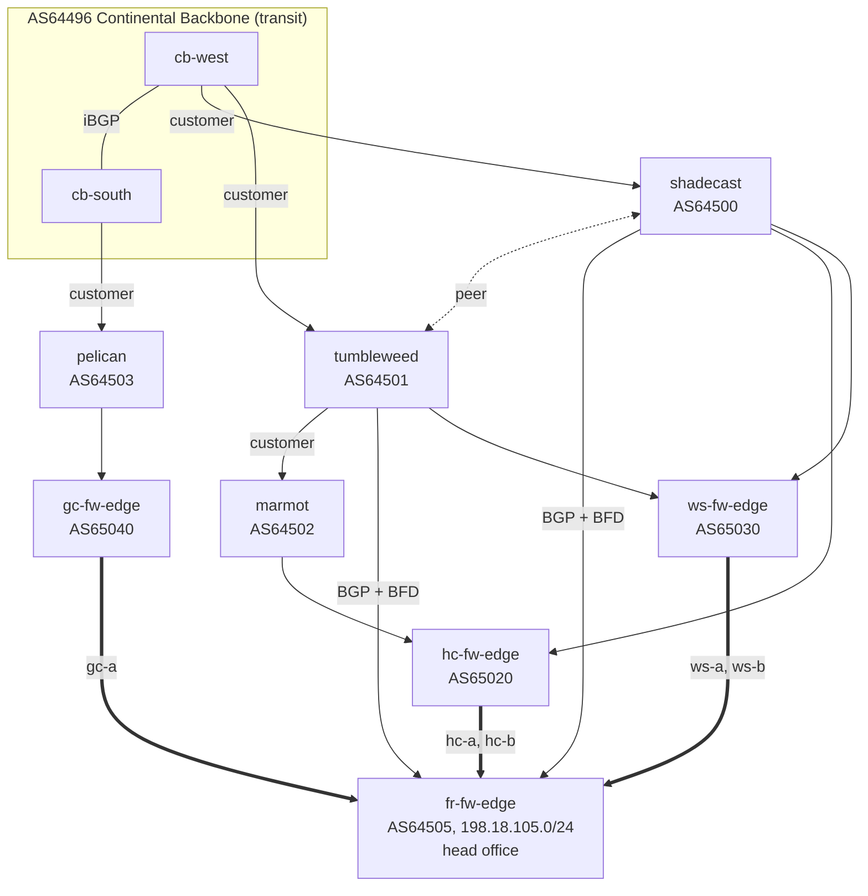

# Spike: a mock internet with BGP, and a site-to-site VPN over it

**Question.** Can four brewery sites reach their head office through a VPN that
rides a mock internet of several ISPs speaking BGP, and keep it when an uplink
or a whole ISP fails? **Decides:** the WAN of the multi-site range: the
networks and their rules, the tunnels, and how a site ties a tunnel to an
uplink ([PLANS.md](../../docs/multisite/PLANS.md) sections 4.2 to 4.5).

## What it builds

Ten routers, each a network namespace with its own FRR (zebra, bgpd, bfdd,
staticd), and a host behind each site edge. Nothing here is a VM.



**Text alternative to the diagram.** The transit carrier (AS 64496) has two
routers, `cb-west` and `cb-south`, joined by iBGP. `shadecast` (AS 64500) and
`tumbleweed` (AS 64501) are customers of `cb-west` and peer with each other.
`marmot` (AS 64502) is a customer of `tumbleweed`, and `pelican` (AS 64503) of
`cb-south`. The head office's edge, `fr-fw-edge` (AS 64505), announces
`198.18.105.0/24` to `shadecast` and `tumbleweed` over BGP with BFD.
`hc-fw-edge` has uplinks to `shadecast` and `marmot`, `ws-fw-edge` to
`tumbleweed` and `shadecast`, and `gc-fw-edge` to `pelican`. Each site has one
WireGuard tunnel to the head office for each uplink: `hc-a` and `hc-b`, `ws-a`
and `ws-b`, and `gc-a`.

- **The ISPs** prefer a customer's route to a peer's, and a peer's to a
  provider's. They tell peers and providers only their own and their
  customers' prefixes. From the head office they accept only its one prefix.
  From another network they accept any public prefix up to a /24, and nothing
  in `10.0.0.0/8`.
- **The head office** takes a default route from each ISP and installs both.
  It gives each ISP its own prefix and nothing else.
- **The other sites** have ISP-assigned addresses and a static default route
  for each uplink. They speak no BGP with their ISPs.
- **Each site announces one /24**, the network of its one host. A site of the
  range announces four blocks ([PLANS.md](../../docs/multisite/PLANS.md)
  section 3); `vyos_sketch.py` writes those.
- **The head office's ShadeCast link is a /30** here. In the range it is
  today's INET segment, which also holds the utility's router.
- **Each tunnel** carries eBGP with BFD (300 ms, three missed). The primary
  tunnel of a site wins by local preference at both ends. Only site prefixes
  (`10.0.0.0/8`, /16 to /24) cross a tunnel in either direction.
- **Underlay BGP timers** are 3 s keepalive and 9 s hold, not the real default
  of 60 s and 180 s, so that a silent failure in the core ends in seconds.

## Prerequisites

- Linux with network namespaces, root, `iproute2`, `nftables`, `traceroute`.
- FRR (8.4.4 here), `wireguard-tools`, and either WireGuard in the kernel or
  `wireguard-go`.
- Python 3.12 or later with `pydantic`.

```shell
apt-get install iproute2 frr wireguard-tools wireguard-go nftables traceroute iputils-ping
```

## Steps

```shell
cd cherrymountain-brewery/spikes/wan-bgp
sudo -E python netns_lab.py                    # build, check, tear down (about 6 minutes)
sudo -E python netns_lab.py --keep             # leave the lab up; `--down` removes it
sudo -E python netns_lab.py --pin destination  # the first design, which drifts (finding 2)
python vyos_sketch.py                          # the site edges as VyOS commands
```

A kept lab is ten namespaces: `ip netns exec fr-fw-edge vtysh -N fr-fw-edge`.

The run writes `summary.md`, `result.json`, each router's `frr.conf`, and each
router's final BGP and routing tables under `$CM_EVIDENCE_DIR/wan-bgp-netns`
(default `evidence/`).

**How a fault is injected.** An nftables table on the ISP's router drops
packets on one interface, or on all of them, and leaves the links up. No
neighbor sees a carrier loss: only BFD or a BGP hold timer can notice. The
rules count what they drop, so a run shows the fault was real. Through each
fault and each repair, every site pings the head office's host ten times a
second, and the longest run of lost pings is the outage. One fault is loud: a
site's uplink is set down, to see where its tunnel goes.

## Pass / fail

- [x] Every BGP session comes up, and every AS reaches every other on a path
      that follows the customer, peer, and provider rules.
- [x] No ISP carries a private route; no site learns anything but site
      prefixes through a tunnel.
- [x] Every site reaches the head office and every other site.
- [x] A site with two uplinks keeps the head office when one goes silent, and
      returns to the primary tunnel after the repair.
- [x] Every site keeps the head office when it loses one ISP, and when a
      whole ISP goes dark.
- [x] A site whose path crosses the dead ISP in the core comes back within
      the BGP hold time.
- [x] After the faults, every tunnel still leaves through its own uplink, and
      a tunnel whose uplink is down stays down.

## Result

- **Decision:** **go** for this WAN: five networks, a head office with its own
  AS on two ISPs, and one tunnel for each uplink of each site with eBGP and
  BFD inside. Three things changed from the first design: the head office
  installs the default route of both ISPs (finding 1), a site ties a tunnel
  to an uplink by a firewall mark, not by the endpoint's address (finding 2),
  and the mark's routing table ends in a blackhole (finding 3).
- **Run:** in a container with no VM. Linux 6.18 with no WireGuard, no ESP,
  and no netem in the kernel; FRR 8.4.4; wireguard-go 0.0.20230223;
  `feat-secret-topo` at `fb43c7f`. The final design ran six times. All 26
  checks passed in the last two. The four runs before them had 23 checks, and
  the design did not yet have the blackhole or the two last events. In two of
  those four, one check failed for a fault of the kit: it left Pelican's
  blackhole route in place after the hijack.
- **Evidence:** [evidence/wan-bgp-netns](evidence/wan-bgp-netns) has the
  summary, the result, and each router's `frr.conf` of the last run of the
  final design. [evidence/wan-bgp-netns-destination](evidence/wan-bgp-netns-destination)
  has the summary of a run with `--pin destination`.

### Outages

Longest run of lost pings from each site's host to the head office's, at ten
pings a second, over the runs of the final design. Every fault is on
ShadeCast. `hc` has its primary uplink there. `ws` has only its backup there,
and `gc` is behind Pelican, so in the first three events neither was on the
failed path: the transit carrier reached the head office through Tumbleweed,
which it chose from two equal customer routes.

| Event | `hc` | `ws` | `gc` | What moved |
|---|---|---|---|---|
| ShadeCast drops `hc`'s uplink | 0.8 to 0.9 s | not on the path | not on the path | `hc` to its tunnel over Marmot |
| ShadeCast drops the head office's uplink | 0.6 to 1.0 s | not on the path | not on the path | ShadeCast reaches the head office through its peer; `hc` uses its backup until then |
| All of ShadeCast goes dark | 0.8 to 0.9 s | not on the path | not on the path | `hc` to Marmot |
| All of ShadeCast goes dark, with the transit carrier routing to the head office through it | 0.8 s | not on the path | **8.8 to 9.0 s** | `hc` to Marmot; the transit carrier to Tumbleweed, when its BGP hold timer ran out |
| Each repair | none | none | none | Back to the primary tunnel and the direct route |
| The link of `hc`'s ShadeCast uplink set down | not timed | | | `hc` to Marmot; its first tunnel stayed down, and came back 2 s after the link |

- **Next to a BFD session, about one second.** The first three outages are
  three BFD intervals of 300 ms. In a VM that has to wait for a CPU, 300 ms is
  too short; with 1 s it would be about 3 s.
- **Anywhere else, the BGP hold time.** `gc` has one uplink and no part in the
  fault. It lost the head office for as long as the transit carrier kept
  sending toward a dead ISP: 9 s with the lab's timers, and 180 s with the
  defaults real routers ship with.
- After the last repair, every BGP session of the final design was back
  before the check looked. Runs of the first design took up to 48 s, and one
  early run still had a session down after 60 s. It was not looked into.

### Findings

1. **With wireguard-go, a head office on two ISPs must install both default
   routes.** The head office first preferred ShadeCast's default route and
   installed only that one. The three tunnels that arrived through Tumbleweed
   never came up: a capture showed each handshake come in on the Tumbleweed
   link and no answer leave on any link. With both default routes installed
   (`maximum-paths 2` and `bgp bestpath as-path multipath-relax`), all five
   tunnels came up. The likely cause is that wireguard-go answers through the
   interface a packet came in on, where there was no default route; its code
   was not traced.
2. **A WireGuard endpoint roams, so its address cannot tie a tunnel to an
   uplink.** The first design gave the head office two endpoint addresses and
   each site a static host route for each, through the uplink that was to
   carry it. `--pin destination` reproduces it.
   - After one fault and its repair, `hc-a` pointed at `203.0.113.2`, the
     head office's address on the ShadeCast link, not at `198.18.105.1`. In
     another run it pointed at `198.18.101.2`, its address on the Tumbleweed
     link. WireGuard takes a peer's endpoint from the source address of the
     last packet that authenticated. After the fault, the head office's
     packets carried the address of an uplink, not of the endpoint. Why they
     did was not traced.
   - The host route no longer matches, so the tunnel follows the site's
     default route. A backup tunnel that drifts ends up on the primary uplink
     and fails with it.
   - It also hid a fault. In two of three runs `hc` lost nothing when the
     head office lost its ShadeCast uplink, because `hc-a` had already moved
     to an address behind Tumbleweed. The same event cost 0.7 to 0.9 s when
     the tunnel had not moved.
   - **The fix** is the default, `--pin mark`. The head office has one
     endpoint address and a port for each tunnel. Its default routes, and
     only those, carry that address as the preferred source (`set src` in a
     route map on `ip protocol bgp`). A site marks each tunnel's packets
     (`wg set … fwmark`), and a rule sends the mark to its own routing table.
     In the runs of this design no endpoint moved, and every tunnel left
     through its own uplink after all the faults.
3. **The mark's table must end in a blackhole.** The table holds one route,
   the uplink. When the uplink's link goes down that route goes too, and the
   lookup falls through to the main table: the tunnel would leave through the
   other uplink. With a blackhole behind the uplink route, the lookup for
   `hc-a` found no route while the link was down, and `hc` ran on `hc-b`.
4. **An origin hijack is partial.** `pelican` announced `198.18.105.0/24`.
   Both transit routers took it, because its path is one AS long against two.
   `gc`, behind `pelican`, lost the head office. `shadecast` and `tumbleweed`
   kept the route from their customer, which they prefer to any route from a
   provider, so `hc` and `ws` stayed up. When the announcement was withdrawn,
   `gc` came back in 3 to 5 s.
5. **Ten FRR routers took 0.5 GB.** Resident memory of all routing daemons
   was about 500 MiB: bgpd 175, zebra 133, bfdd 67, wireguard-go 64,
   staticd 60.
6. **The 13 BGP sessions came up in 8 to 9 s** from a cold start, in every run.

### What the kit did not test

- **VyOS.** Every router here is FRR on Linux. [vyos-sketch](vyos-sketch) has
  the four site edges as VyOS commands (286 in all), written by
  `vyos_sketch.py` from the lab's own model. Each command path was read in
  the vyos-1x source (branch `rolling`, commit `f1789c0`, 2026-11-21). None
  has run.
- **WireGuard in the kernel**, which VyOS uses. Its `send4`
  (`drivers/net/wireguard/socket.c`, read on 2026-11-22) looks the route up
  with the remembered source address and no interface. When the route leaves
  through another interface than the packet came in on, it forgets the
  remembered source and lets the route choose one. So finding 1 may not apply
  there, and finding 2 applies more: without the preferred source, every reply
  that leaves through the other ISP carries the uplink's address, fault or no
  fault. `TODO(verify)` on a VM.
- **IPsec.** The kernel here has no ESP. For a route-based tunnel on VyOS,
  MOBIKE is on unless `disable-mobike` is set, and an open VyOS bug leaves a
  VTI down after its peer reconnects ([T9154](https://vyos.dev/T9154)).
- **The ISPs' filters.** No run offered an ISP a prefix it should refuse (a
  private one, one longer than a /24, or one a customer has not registered).
- **A fault inside the transit carrier**, between its two routers.
- **A site's own internet access.** A site's default route is static, with no
  health check, so it stays on a dead first uplink. The tunnels are not
  affected.
- **Delay, loss, and load.** No netem; ten idle namespaces on four cores.
- **Firewall rules** on what crosses a tunnel, **NAT**, and **IPv6**.

### An early run that measured nothing

One run before the drop counters existed reported no loss for any site when
the head office lost its ShadeCast uplink. Finding 2 is the likely cause. The
rules now count what they drop, and each run records the internet path under
every site's primary tunnel before and after each event.

## What a spike on VyOS VMs has to show

Two VyOS routers (`fr-fw-edge`, `hc-fw-edge`) and the ISPs, in CI as the
`vyos-ipsec` spike ran:

- [ ] The commands of [vyos-sketch](vyos-sketch) commit at first boot, given
      to phenix as the `config` list of the patched `vrouter` app
      ([patches](patches) has the change for `main` and for the fork's
      `ci-e2e-minimega`), or through the post-boot script.
- [ ] BGP and BFD come up inside a WireGuard tunnel, and the mark sends each
      tunnel through its own uplink.
- [ ] With the kernel's WireGuard, no endpoint moves across a fault and its
      repair.
- [ ] A silent fault on one uplink moves the traffic, and the repair moves it
      back.
- [ ] The same with a VTI in place of WireGuard: does the interface come back
      after the repair?
