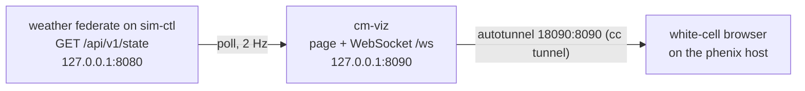

# cm-viz: the white cell's 3D view

A GRFICS-style view of the plant in which attacks have visible physical
consequences ([DESIGN.md §15.10](../DESIGN.md#1510-white-cell-3d-view-cm-viz),
the [viz3d spike](../spikes/viz3d/README.md)). It shows **ground truth**, so it
is for the white cell: never route it through Guacamole or show it to trainees
without a white-cell decision.



Text alternative: the weather federate subscribes to the snapshot keys
(`plant.yaml` `snapshot`) and serves them as `GET /api/v1/state` on
`127.0.0.1:8080`. cm-viz, also on sim-ctl, polls it, builds a frame, and pushes
it over a read-only WebSocket on `127.0.0.1:8090`, where it also serves the
page. The white cell's browser reaches it through the autotunnel.

## Scenes

| Scene | What it shows |
|---|---|
| Cellar CO₂ | The room, the four low CO₂ sensors (tier colors), the gas layer from the sensed ppm, the HMI's layer as a dashed outline when it disagrees, the purge fans (spinning only when they really run), strobes and the tier-3 horn, bas-vent's gas-detection relay and the rio-cellar contact, the carbonation inhibit lamps, and leak plumes |
| Fermenters | The same room, closer: fill and temperature color per vessel (a fermenter's fill is truth only: no transmitter), the head-pressure band against the 15 psig MAWP, glycol jacket valves, spunding vents, and relief-valve (PSV) lifts with their vent plume |
| Plant power | Utility, T-1, and the main breaker; PV and its inverter; the BESS with its state of charge; the main switchboard and each bus's loads; the genset, the ATS, and EP-1; the tariff window. Chevrons move with the power flow and grey out on a dead bus |

Common to all: a scene switcher (keys 1-3), a ground-truth / operator-view
toggle (key `o`), the simulated time and the cellar's 48× kinetic clock, the
data age with greying out when the feed stops (5 s without a message, a state
more than 5 s old, a snapshot no longer advancing, or an unhealthy source), a
frame-rate cap, and a side panel of truth beside the operator's values with
findings such as "purge fan commanded off while tier 1 is active" (held for
5 simulated seconds where a controller has to react first). The server sends a
frame at least once a second, and the data age is computed from the server's
own timestamps plus the time since arrival, so clock skew between the browser
and sim-ctl does not matter.

The server serves GET only (405 otherwise), checks `Host` against the loopback
names and any `--allow-host` (DNS rebinding) and a WebSocket's `Origin` against
`Host` (cross-site reads), allows 32 viewers, and reports a dead or failing
poller on `/healthz` (503).

The operator layer comes from the frame's `operator` field. The operator
toggle draws everything it can from that layer (readings, sensors, tiers, jacket
and carbonation valves, fan commands and status, the relay), but every frame
still carries the truth: the toggle is a convenience view, not a
confidentiality boundary. The offline
harness fills it (the published field values, which a scenario can freeze to
stand in for a replay). In the range it is not connected yet: the page says
so, and FUXA (its own autotunnel) goes in a window beside it. A relay that
reads the historian through a cc tunnel is open work (DESIGN.md §15.10).

Page options: `?scene=cellar|fermenters|power`, `?view=truth|operator`,
`?fps=N` (default 15, `0` uncapped), `?dpr=N` (pixel ratio, default 1), `?aa=1`
(antialiasing). `svg.html` is the 2.5D fallback for browsers without WebGL,
VNC, and low-CPU displays; it redraws only when a frame arrives.

## Files

| Path | What it is |
|---|---|
| `cherrymountain_viz/frame.py` | The `Frame` model (Pydantic) and `build_frame`, which turns the flat HELICS snapshot into scenes and findings; pure functions |
| `cherrymountain_viz/sources.py` | `SimctlSource` (the range: polls `GET /api/v1/state`), `LocalSource` (offline: every federate in-process with a scripted scenario), `StaticSource` (tests) |
| `cherrymountain_viz/scenarios.py` | The offline scenarios: `none`, `co2-leak`, `co2-attack`, `spunding-attack`, `outage` |
| `cherrymountain_viz/server.py` | One port: the page, the read-only `/ws`, `/frame.json`, `/healthz`; a CSP that allows nothing off the server |
| `cherrymountain_viz/web/` | `index.html`, `app.js`, `scenes/{common,cellar,power}.js`, `svg.html`/`svg.js`, styles |
| `cherrymountain_viz/web/vendor/three/` | three.js 0.186.1 (MIT, `LICENSE`), vendored unmodified from the npm tarball |
| `tests/` | Frames, the server and its WebSocket, the sim-ctl source against the real event API, the scenarios; `test_browser.py` (marked `browser`) |
| `tools/shoot.cjs`, `tools/screenshots.py` | Screenshots of the scenes with the offline harness |

The vendored files match `three-0.186.1.tgz` from the npm registry (tarball
SHA-256 `8cd068708ea44f2c73c944b1cead2ba2f0d5c15c8fc194e5700f4e4f4a033fe7`):
`build/three.module.js`, `build/three.core.js`,
`examples/jsm/controls/OrbitControls.js`, and `LICENSE`. To bump, replace them
from the new tarball and run the browser test.

## Run it

```shell
cd cherrymountain-brewery/viz
python3 -m venv .venv && .venv/bin/pip install -e '.[local]' -e ../sim
.venv/bin/python -m cherrymountain_viz --source local \
    --helics ../plant/generated/full/helics.json --scenario co2-attack --speed 5
# http://127.0.0.1:8090/ (3D) or http://127.0.0.1:8090/svg.html (2.5D)
```

In the range, `cm-viz.service` on sim-ctl runs
`python -m cherrymountain_viz --source simctl`. Find the host port with
`cc tunnel list sim-ctl` (guest port 8090), as for Grafana and the event API.

## Tests

```shell
python -m pytest -q                 # the fast suite (prek's cm-viz-tests)
python -m pytest -q -m browser      # headless Chromium: each scene gets WebGL and data
python tools/screenshots.py OUTDIR  # the documented screenshots (deviceScaleFactor 2)
```

The browser test needs Node with the `playwright` package and its Chromium; it
takes about 10 s and is skipped when they are missing. CI does not install
them, so it runs where they are (it is not in prek).
